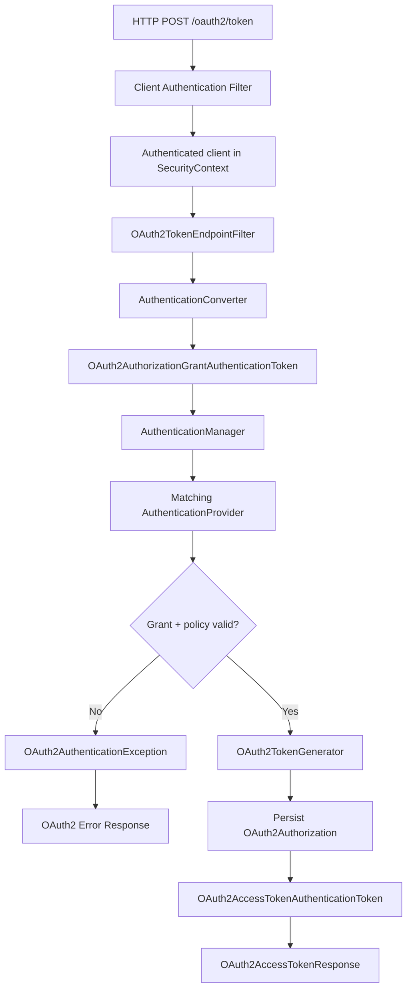

# Creating AuthenticationProvider and Checking Authorization Conditions

## 1. Extending Authentication and Authorization Processing

In the **Protocol Extensions** chapter of the **SPRING_SECURITY_OAUTH2_OIDC_AUTHORIZATION_SERVER** module, we learn how to design, configure, secure, test, and operate an OAuth 2.0/OpenID Connect Authorization Server using Spring Security and Spring Authorization Server in a Spring Boot application.

Spring Authorization Server provides default endpoints and `AuthenticationProvider` implementations to handle authorization requests, client authentication, token requests, refresh tokens, device flows, and other supported protocols. Real-world applications often need additional business checks: which tenant a client belongs to, whether the user is active, whether a grant is enabled for the client, whether a scope is permitted on the target resource, whether an account is locked, or whether an internal authorization code is expired/unused.

There are two common extension approaches:

- **Adding conditions to a default provider** when the protocol flow already exists, such as checking extra permissions before issuing an Authorization Code or Client Credentials Access Token.
- **Creating a custom grant type and AuthenticationProvider** when the system needs a new credential type or token issuance flow.

Not every check requires writing a new provider. Spring Authorization Server provides extension points for converters, providers, validators, success handlers, and error handlers at each endpoint. Choosing the right extension point preserves the framework's battle-tested protocol handling.

After this lesson, you will be able to distinguish authentication from authorization, understand the request processing pipeline, define authorization conditions, extend default validators, build custom grants, issue and persist tokens, map OAuth2 errors, and test valid/invalid scenarios.

## 2. How Does Authentication Differ from Authorization?

The name `AuthenticationProvider` easily leads newcomers to think it only checks usernames and passwords. In Spring Authorization Server, a provider is also used to process protocol requests after they have been converted into an `Authentication` object.

**Authentication** answers the question: is the presented identity or credential valid?

- Did the client authenticate successfully using `client_secret_basic`, `private_key_jwt`, or mTLS?
- Has the resource owner logged in and obtained a valid `Authentication`?
- Is the authorization code, device code, or custom grant code valid?

**Authorization** answers the question: is the authenticated principal permitted to perform this action?

- Is the client allowed to use the requested grant type?
- Is the client allowed to request the `invoice.write` scope?
- Does the user have permission to access the corresponding tenant and resource?
- Does consent cover the required scopes?
- Does risk policy require MFA or additional confirmation?

**Token issuance** is the subsequent step: once authentication and authorization checks succeed, the Authorization Server creates a token with the approved principal, scopes, audience, lifetime, and claims, then persists the authorization state if the flow requires it.

| Question | Example | Typical Handler |
| --- | --- | --- |
| Who is the client? | Verify client ID and credentials. | Client Authentication Filter/Provider. |
| Who is the user? | Log in via session or application mechanism. | Spring Security authentication chain. |
| Is the grant valid? | Authorization code is unexpired, unused, bound to the right client. | Token Endpoint `AuthenticationProvider`. |
| Can the client use the grant? | Client is configured for `authorization_code` or custom grant. | Token Endpoint Provider. |
| Can user/client get the scope? | User belongs to tenant, consent and policy permit. | Authorization validator/policy service. |
| Should a token be issued? | Generate and persist token once all conditions pass. | Token generator and authorization service. |

An `AuthenticationProvider` can perform both grant authentication and authorization policy checks, though it is best to keep these steps cleanly separated in code for testability and auditing.

## 3. Request Processing Pipeline at Protocol Endpoints

At the Token Endpoint, Spring Authorization Server typically processes requests along this chain:



| Component | Responsibility |
| --- | --- |
| Filter | Receives HTTP request, invokes converters and `AuthenticationManager`. |
| `AuthenticationConverter` | Reads, validates protocol parameter structure, and builds the appropriate `Authentication`. |
| Grant Authentication Token | Carries grant type, client principal, and parsed parameters to the provider. |
| `AuthenticationManager` | Locates a provider supporting the submitted `Authentication` type. |
| `AuthenticationProvider` | Authenticates the grant, checks permissions, and executes token issuance logic. |
| `OAuth2TokenGenerator` | Generates access tokens, ID Tokens, or the token type requested in context. |
| `OAuth2AuthorizationService` | Persists and looks up authorization/token state. |
| Success/Error Handler | Converts the outcome into a protocol response. |

At the Authorization Endpoint, the pipeline is similar, handling the user principal, redirect URI, requested scopes, consent, and authorization code generation. At Client Authentication, a provider verifies OAuth client credentials and places `OAuth2ClientAuthenticationToken` into the `SecurityContext`.

## 4. The AuthenticationProvider Contract

`AuthenticationProvider` in Spring Security has two essential methods:

```java
public interface AuthenticationProvider {
    Authentication authenticate(Authentication authentication)
            throws AuthenticationException;

    boolean supports(Class<?> authentication);
}
```

### 4.1. supports()

`supports()` indicates whether the provider handles the passed `Authentication` type:

```java
@Override
public boolean supports(Class<?> authentication) {
    return CustomCodeGrantAuthenticationToken.class
            .isAssignableFrom(authentication);
}
```

Check the exact class or subtype owned by the provider. Never return `true` for all `Authentication.class`, or the provider may mistakenly intercept requests meant for another provider.

### 4.2. authenticate()

A provider typically has three outcomes:

- Return a successfully processed `Authentication`.
- Return `null` if the provider cannot process that `Authentication` type, allowing `AuthenticationManager` to try the next provider.
- Throw `AuthenticationException` if the provider accepts the request type but credentials or authentication/authorization conditions are invalid.

Never return an unauthenticated token as if it succeeded. Never call `setAuthenticated(true)` on the incoming request token to bypass verification. The returned object must accurately reflect the verified state and principal.

### 4.3. Do Not Use supports() for Authorization

`supports()` only selects the provider; it does not decide whether the client should be issued a token. Authorization conditions must be checked in the validator/provider once full context is available.

For example, a provider supporting a custom grant does not mean every client may use that custom grant. The provider must still check `RegisteredClient.getAuthorizationGrantTypes()` and additional policies.

### 4.4. Distinguishing Three Authentication Tokens

Within a single token request, several distinct `Authentication` objects may exist:

- `OAuth2ClientAuthenticationToken`: the authenticated client.
- `CustomCodeGrantAuthenticationToken`: the custom grant token request, initially unprocessed.
- `OAuth2AccessTokenAuthenticationToken`: the successful authentication result carrying the access token returned to the client.

Do not confuse the client principal with the subject of the access token. For grants representing a user, the subject must be the user verified from the grant. For Client Credentials, the principal is typically the client itself.

## 5. Defining Authorization Conditions

Before writing a provider, translate business policies into explicit, verifiable conditions:

| Condition Group | Questions to Answer | Denial Examples |
| --- | --- | --- |
| Client | Does the client exist, is it active, and is it authenticated? | `invalid_client`. |
| Grant type | Is the client configured to use this grant? | `unauthorized_client`. |
| Grant credential | Is the code/assertion/device code valid, bound to the right client, unexpired, and unused? | `invalid_grant`. |
| Subject | Is the user/service subject active with a trusted identity? | `access_denied` or `invalid_grant` per protocol. |
| Tenant | Do subject and client have a valid relationship with the requested tenant? | `access_denied`. |
| Scope | Are requested scopes within the allowed set? | `invalid_scope`. |
| Resource/Audience | Can the client be issued tokens for the target API/resource? | `invalid_target` when supported by profile, or appropriate policy error. |
| Consent | Has the user approved the required permissions? | Redirect to consent or deny. |
| Authentication strength | Does the login session satisfy MFA, `acr`, `auth_time`, or `max-age`? | `access_denied` or require re-authentication. |
| Risk/context | Do device, IP, time, or account status violate policy? | Deny or require an additional verification step. |

### 5.1. Distinguishing Scope from Resource Access Rights

Scope is one part of the permissions expressed by a token. The `invoice.read` scope alone does not prove a user is allowed to read every invoice. The Resource Server must still enforce per-resource authorization—for instance, ensuring a user can only read invoices belonging to their tenant.

The Authorization Server can validate the client/subject/tenant relationship before issuing a token and embed appropriate scopes/audience into the token. The Resource Server continues enforcing business-level authorization on actual API requests.

### 5.2. The Subset Principle

The granted scope set must be a subset of every applicable constraint:

```text
grantedScopes ⊆ requestedScopes (if specified in the request)
grantedScopes ⊆ registeredClient.allowedScopes
grantedScopes ⊆ grant.allowedScopes
grantedScopes ⊆ subjectConsent.allowedScopes
grantedScopes ⊆ policy.allowedScopes
```

If the request omits `scope`, default scope selection must follow the defined protocol and policy. Never automatically grant all of the client's scopes merely because the `scope` parameter was left blank.

### 5.3. Decisions Must Rely on Trusted Data

Never accept `tenant_id`, `subject`, `role`, `is_admin`, or `approved=true` from the request and treat it as truth. These values must come from the authenticated principal, verified grant record, trusted repository, or policy service.

If the client sends an additional `resource` or `tenant` parameter, treat it as a **request** to be checked against the grant and policy. Never allow client-controlled parameters to alter the principal or escalate privileges.

## 6. Choosing the Right Extension Point

| Need | Extension Point to Consider |
| --- | --- |
| Add conditions to an Authorization Code request | `OAuth2AuthorizationCodeRequestAuthenticationProvider.setAuthenticationValidator()`. |
| Change consent requirement rules | `setAuthorizationConsentRequired()` on the Authorization Code provider. |
| Add policy for Client Credentials scopes | `OAuth2ClientCredentialsAuthenticationProvider.setAuthenticationValidator()`. |
| Authenticate clients via a new method | Client Authentication Converter/Provider. |
| Add a new grant type at the Token Endpoint | Custom `AuthenticationConverter`, grant `Authentication` token, and `AuthenticationProvider`. |
| Change token generation or claims | `OAuth2TokenGenerator` or `OAuth2TokenCustomizer`. |
| Customize HTTP success/error responses | Endpoint Success/Error Handler. |
| Check API access rights after token issuance | Authorization policy at the Resource Server. |

Prefer a validator when you only need to add conditions to an existing flow. Create a dedicated provider when you need a new `Authentication`/grant type or distinct verification workflow. Do not replace an entire default provider just to add a small check.

## 7. Adding Conditions to Authorization Code Requests

### 7.1. What Does the Default Provider Already Check?

`OAuth2AuthorizationCodeRequestAuthenticationProvider` handles authorization requests for the Authorization Code Grant. Its default validator, `OAuth2AuthorizationCodeRequestAuthenticationValidator`, validates `redirect_uri` and `scope`.

Spring Authorization Server lets you replace the validator via `setAuthenticationValidator(Consumer<OAuth2AuthorizationCodeRequestAuthenticationContext>)`. If validation fails, the validator must throw `OAuth2AuthorizationCodeRequestAuthenticationException`.

### 7.2. Preserving Default Validation and Chaining a New Policy

The following example retains the default redirect URI and scope checks, then adds a condition that the user must be authorized to use the application:

```java
import java.util.List;
import java.util.function.Consumer;

import org.springframework.security.authentication.AuthenticationProvider;
import org.springframework.security.core.Authentication;
import org.springframework.security.oauth2.core.OAuth2Error;
import org.springframework.security.oauth2.core.OAuth2ErrorCodes;
import org.springframework.security.oauth2.server.authorization.authentication.OAuth2AuthorizationCodeRequestAuthenticationContext;
import org.springframework.security.oauth2.server.authorization.authentication.OAuth2AuthorizationCodeRequestAuthenticationException;
import org.springframework.security.oauth2.server.authorization.authentication.OAuth2AuthorizationCodeRequestAuthenticationProvider;
import org.springframework.security.oauth2.server.authorization.authentication.OAuth2AuthorizationCodeRequestAuthenticationToken;
import org.springframework.security.oauth2.server.authorization.authentication.OAuth2AuthorizationCodeRequestAuthenticationValidator;

private Consumer<List<AuthenticationProvider>> authorizationPolicy(
        ClientAuthorizationPolicy policy) {

    return providers -> providers.forEach(provider -> {
        if (provider instanceof OAuth2AuthorizationCodeRequestAuthenticationProvider codeProvider) {
            Consumer<OAuth2AuthorizationCodeRequestAuthenticationContext> validator =
                    OAuth2AuthorizationCodeRequestAuthenticationValidator.DEFAULT_REDIRECT_URI_VALIDATOR
                            .andThen(OAuth2AuthorizationCodeRequestAuthenticationValidator.DEFAULT_SCOPE_VALIDATOR)
                            .andThen(context -> {
                                OAuth2AuthorizationCodeRequestAuthenticationToken request =
                                        context.getAuthentication();
                                Authentication resourceOwner =
                                        (Authentication) request.getPrincipal();

                                boolean allowed = policy.mayAuthorize(
                                        context.getRegisteredClient(),
                                        resourceOwner,
                                        request.getScopes());

                                if (!allowed) {
                                    OAuth2Error error =
                                            new OAuth2Error(OAuth2ErrorCodes.ACCESS_DENIED);
                                    throw new OAuth2AuthorizationCodeRequestAuthenticationException(
                                            error, null);
                                }
                            });

            codeProvider.setAuthenticationValidator(validator);
        }
    });
}
```

`ClientAuthorizationPolicy` is an application-defined interface. It can check client status, subject, tenant, scopes, and policy version. Avoid embedding verbose database queries or remote service calls inside the validator lambda when they can be encapsulated in an independently testable service.

### 7.3. Attaching the Validator to the Authorization Endpoint

```java
@Bean
SecurityFilterChain authorizationServerSecurityFilterChain(
        HttpSecurity http,
        ClientAuthorizationPolicy policy) throws Exception {

    OAuth2AuthorizationServerConfigurer authorizationServerConfigurer =
            OAuth2AuthorizationServerConfigurer.authorizationServer();

    http
        .securityMatcher(authorizationServerConfigurer.getEndpointsMatcher())
        .with(authorizationServerConfigurer, authorizationServer ->
            authorizationServer
                .authorizationEndpoint(endpoint ->
                    endpoint.authenticationProviders(authorizationPolicy(policy))
                )
        );

    return http.build();
}
```

This snippet configures only the authorization endpoint; the application still needs the other Authorization Server beans and filter chains. When customizing the provider list, modify only the target provider—do not remove other default providers.

### 7.4. Redirect URIs Must Be Strictly Validated

The redirect URI is a critical security boundary. Do not relax matching with prefixes, wildcard domains, or substring checks. For registered URIs, use exact matching rules per OAuth/OIDC profiles and the framework.

Do not omit `DEFAULT_REDIRECT_URI_VALIDATOR` just to allow `localhost` or a new domain in production. If an exception is needed for development, restrict it by profile/environment and never leave that configuration active in production.

## 8. Adding Conditions to the Client Credentials Grant

### 8.1. Using the Default Provider's Validator

`OAuth2ClientCredentialsAuthenticationProvider` exposes `setAuthenticationValidator()`. Its default validator, `OAuth2ClientCredentialsAuthenticationValidator.DEFAULT_SCOPE_VALIDATOR`, checks scopes in Client Credentials requests.

You can chain an additional policy to check service accounts, tenants, resources, and scope restrictions:

```java
import java.util.List;
import java.util.function.Consumer;

import org.springframework.security.authentication.AuthenticationProvider;
import org.springframework.security.oauth2.core.OAuth2AuthenticationException;
import org.springframework.security.oauth2.core.OAuth2Error;
import org.springframework.security.oauth2.core.OAuth2ErrorCodes;
import org.springframework.security.oauth2.server.authorization.authentication.OAuth2ClientCredentialsAuthenticationContext;
import org.springframework.security.oauth2.server.authorization.authentication.OAuth2ClientCredentialsAuthenticationProvider;
import org.springframework.security.oauth2.server.authorization.authentication.OAuth2ClientCredentialsAuthenticationValidator;

private Consumer<List<AuthenticationProvider>> clientCredentialsPolicy(
        ServiceAccountPolicy policy) {

    return providers -> providers.forEach(provider -> {
        if (provider instanceof OAuth2ClientCredentialsAuthenticationProvider clientCredentialsProvider) {
            Consumer<OAuth2ClientCredentialsAuthenticationContext> validator =
                    OAuth2ClientCredentialsAuthenticationValidator.DEFAULT_SCOPE_VALIDATOR
                            .andThen(context -> {
                                boolean allowed = policy.mayIssueToken(
                                        context.getRegisteredClient(),
                                        context.getAuthentication().getScopes());

                                if (!allowed) {
                                    throw new OAuth2AuthenticationException(
                                            new OAuth2Error(OAuth2ErrorCodes.INVALID_SCOPE));
                                }
                            });

            clientCredentialsProvider.setAuthenticationValidator(validator);
        }
    });
}
```

`ServiceAccountPolicy` is the application's policy service. Because the default validator is chained before the custom policy, built-in scope checks continue to run.

### 8.2. Wiring into the Token Endpoint

```java
http
    .securityMatcher(authorizationServerConfigurer.getEndpointsMatcher())
    .with(authorizationServerConfigurer, authorizationServer ->
        authorizationServer
            .tokenEndpoint(tokenEndpoint ->
                tokenEndpoint.authenticationProviders(
                        clientCredentialsPolicy(serviceAccountPolicy))
            )
    );
```

If you need to add a converter or provider for a new grant, use `accessTokenRequestConverter()` and `authenticationProvider()` as shown in the following sections.

### 8.3. Client Credentials Have No Resource Owner

Client Credentials represent the client/service account itself. Do not look up a logged-in user in `SecurityContext` and assign that user as the subject when the protocol flow has no user principal.

Policy may rely on client identity, the tenant assigned to the client, workload identity, resource/audience, and allowed scopes. If authorization on behalf of a user is needed, use an appropriate grant/profile with explicit subject delegation.

## 9. When Do You Need a Custom AuthenticationProvider?

Create a custom provider when the system needs a new grant type—for example, a one-time credential issued by a partner system, an internal grant bound to a tenant/workload, a specialized assertion requiring a separate trust store, or a custom authorization code type outside the grants already supported by Spring.

Do not create a custom grant merely to change scope validation for `client_credentials` or `authorization_code`; the validator extension point already addresses that case.

An extension authorization grant requires at minimum:

1. A unique `grant_type` identifier, typically an absolute URI.
2. An `AuthenticationConverter` that reads the HTTP request and builds a custom grant `Authentication` token.
3. A custom grant `Authentication` token carrying the grant credential and authenticated client principal.
4. An `AuthenticationProvider` that verifies the grant, checks client/policy, and generates the token.
5. Provider/converter configuration on the Token Endpoint.
6. `RegisteredClient` configured to allow the new grant type.

## 10. Designing the Custom Grant Token

Example using the grant type:

```text
urn:ietf:params:oauth:grant-type:custom_code
```

This is an illustrative extension identifier URI. In real systems, choose a namespace controlled by your organization or an appropriate standardized grant type. Do not name a grant in a way that implies it is a standard OAuth grant without a corresponding specification.

The custom token extends `OAuth2AuthorizationGrantAuthenticationToken`:

```java
import java.util.Map;

import org.springframework.security.core.Authentication;
import org.springframework.security.oauth2.core.AuthorizationGrantType;
import org.springframework.security.oauth2.server.authorization.authentication.OAuth2AuthorizationGrantAuthenticationToken;

public final class CustomCodeGrantAuthenticationToken
        extends OAuth2AuthorizationGrantAuthenticationToken {

    public static final AuthorizationGrantType GRANT_TYPE =
            new AuthorizationGrantType(
                    "urn:ietf:params:oauth:grant-type:custom_code");

    private final String code;

    public CustomCodeGrantAuthenticationToken(
            String code,
            Authentication clientPrincipal,
            Map<String, Object> additionalParameters) {
        super(GRANT_TYPE, clientPrincipal, additionalParameters);
        this.code = code;
    }

    public String getCode() {
        return this.code;
    }
}
```

The custom grant token holds the code together with the client principal authenticated by the client authentication filter. It does not verify the code itself and must not be marked authenticated before the provider processes it.

## 11. Writing the AuthenticationConverter for a Custom Grant

The converter only accepts requests whose `grant_type` matches the extension. For other grant types, return `null` so default converters continue processing.

The example below accepts `code` and `scope`, rejects duplicate parameters, and avoids copying client authentication credentials into additional parameters:

```java
import java.util.HashMap;
import java.util.Map;
import java.util.Set;

import jakarta.servlet.http.HttpServletRequest;

import org.springframework.lang.Nullable;
import org.springframework.security.core.Authentication;
import org.springframework.security.core.context.SecurityContextHolder;
import org.springframework.security.oauth2.core.OAuth2AuthenticationException;
import org.springframework.security.oauth2.core.OAuth2ErrorCodes;
import org.springframework.security.oauth2.core.endpoint.OAuth2ParameterNames;
import org.springframework.security.web.authentication.AuthenticationConverter;
import org.springframework.util.StringUtils;

public final class CustomCodeGrantAuthenticationConverter
        implements AuthenticationConverter {

    private static final Set<String> ALLOWED_PARAMETERS = Set.of(
            OAuth2ParameterNames.GRANT_TYPE,
            OAuth2ParameterNames.CLIENT_ID,
            "client_secret",
            "client_assertion",
            "client_assertion_type",
            "code",
            OAuth2ParameterNames.SCOPE,
            "resource");

    @Override
    @Nullable
    public Authentication convert(HttpServletRequest request) {
        String[] grantTypes =
                request.getParameterValues(OAuth2ParameterNames.GRANT_TYPE);

        if (grantTypes == null || grantTypes.length == 0 ||
                !CustomCodeGrantAuthenticationToken.GRANT_TYPE.getValue()
                        .equals(grantTypes[0])) {
            return null;
        }
        if (grantTypes.length != 1) {
            throw new OAuth2AuthenticationException(
                    OAuth2ErrorCodes.INVALID_REQUEST);
        }

        request.getParameterMap().keySet().forEach(name -> {
            if (!ALLOWED_PARAMETERS.contains(name)) {
                throw new OAuth2AuthenticationException(
                        OAuth2ErrorCodes.INVALID_REQUEST);
            }
        });

        String[] codes = request.getParameterValues("code");
        if (codes == null || codes.length != 1 || !StringUtils.hasText(codes[0])) {
            throw new OAuth2AuthenticationException(
                    OAuth2ErrorCodes.INVALID_REQUEST);
        }

        Map<String, Object> additionalParameters = new HashMap<>();
        addSingleParameter(request, OAuth2ParameterNames.SCOPE, additionalParameters);
        addSingleParameter(request, "resource", additionalParameters);

        Authentication clientPrincipal =
                SecurityContextHolder.getContext().getAuthentication();

        return new CustomCodeGrantAuthenticationToken(
                codes[0], clientPrincipal, additionalParameters);
    }

    private static void addSingleParameter(
            HttpServletRequest request,
            String name,
            Map<String, Object> additionalParameters) {

        String[] values = request.getParameterValues(name);
        if (values == null) {
            return;
        }
        if (values.length != 1 || !StringUtils.hasText(values[0])) {
            throw new OAuth2AuthenticationException(
                    OAuth2ErrorCodes.INVALID_REQUEST);
        }
        additionalParameters.put(name, values[0]);
    }
}
```

In a real extension, define an allowlist of parameters for the grant and reject unsupported parameters. Never copy `client_secret`, `client_assertion`, or other credentials into additional parameters, and never log the code. The example allows only a single `resource`; if multiple resources are required, define and test explicit semantics.

## 12. Writing the AuthenticationProvider for a Custom Grant

The provider must verify that the client is authenticated, the grant type is registered for the client, the grant credential is valid, and all authorization conditions pass.

### 12.1. Illustrative Dependencies

The application can define abstractions such as:

```java
import java.util.Set;

import org.springframework.security.core.Authentication;
import org.springframework.security.oauth2.server.authorization.OAuth2Authorization;
import org.springframework.security.oauth2.server.authorization.client.RegisteredClient;

public record CustomGrantRecord(
        String id,
        String subjectName,
        Authentication subjectAuthentication,
        Set<String> allowedScopes) {
}

public interface CustomGrantStore {
    CustomGrantRecord findValid(String rawCode, String clientId);
}

public interface CustomGrantPolicy {
    boolean mayRedeem(
            RegisteredClient client,
            CustomGrantRecord grant,
            Set<String> requestedScopes,
            String requestedResource);
}

public interface CustomGrantRedemptionService {
    void consumeAndSaveAuthorization(
            String grantRecordId,
            String clientId,
            OAuth2Authorization authorization);
}
```

These are application-defined interfaces/models, not built-in Spring Authorization Server APIs. `CustomGrantRecord` contains verified data from a trusted store, such as record ID, verified subject, and allowed scopes. `CustomGrantStore` only returns grants that are still valid and bound to the requesting client.

### 12.2. Provider Validating Conditions

```java
import java.util.Arrays;
import java.util.LinkedHashSet;
import java.util.Set;

import org.springframework.security.authentication.AuthenticationProvider;
import org.springframework.security.core.Authentication;
import org.springframework.security.core.AuthenticationException;
import org.springframework.security.oauth2.core.ClaimAccessor;
import org.springframework.security.oauth2.core.OAuth2AccessToken;
import org.springframework.security.oauth2.core.OAuth2AuthenticationException;
import org.springframework.security.oauth2.core.OAuth2Error;
import org.springframework.security.oauth2.core.OAuth2ErrorCodes;
import org.springframework.security.oauth2.core.OAuth2Token;
import org.springframework.security.oauth2.core.endpoint.OAuth2ParameterNames;
import org.springframework.security.oauth2.server.authorization.OAuth2Authorization;
import org.springframework.security.oauth2.server.authorization.OAuth2TokenType;
import org.springframework.security.oauth2.server.authorization.authentication.OAuth2AccessTokenAuthenticationToken;
import org.springframework.security.oauth2.server.authorization.authentication.OAuth2ClientAuthenticationToken;
import org.springframework.security.oauth2.server.authorization.client.RegisteredClient;
import org.springframework.security.oauth2.server.authorization.context.AuthorizationServerContextHolder;
import org.springframework.security.oauth2.server.authorization.token.DefaultOAuth2TokenContext;
import org.springframework.security.oauth2.server.authorization.token.OAuth2TokenContext;
import org.springframework.security.oauth2.server.authorization.token.OAuth2TokenGenerator;

public final class CustomCodeGrantAuthenticationProvider
        implements AuthenticationProvider {

    private final CustomGrantStore grantStore;
    private final CustomGrantPolicy grantPolicy;
    private final CustomGrantRedemptionService redemptionService;
    private final OAuth2TokenGenerator<? extends OAuth2Token> tokenGenerator;

    public CustomCodeGrantAuthenticationProvider(
            CustomGrantStore grantStore,
            CustomGrantPolicy grantPolicy,
            CustomGrantRedemptionService redemptionService,
            OAuth2TokenGenerator<? extends OAuth2Token> tokenGenerator) {
        this.grantStore = grantStore;
        this.grantPolicy = grantPolicy;
        this.redemptionService = redemptionService;
        this.tokenGenerator = tokenGenerator;
    }

    @Override
    public Authentication authenticate(Authentication authentication)
            throws AuthenticationException {
        if (!(authentication instanceof CustomCodeGrantAuthenticationToken grantRequest)) {
            return null;
        }

        OAuth2ClientAuthenticationToken clientPrincipal =
                requireAuthenticatedClient(grantRequest.getPrincipal());
        RegisteredClient registeredClient = clientPrincipal.getRegisteredClient();

        if (!registeredClient.getAuthorizationGrantTypes()
                .contains(CustomCodeGrantAuthenticationToken.GRANT_TYPE)) {
            throw new OAuth2AuthenticationException(
                    OAuth2ErrorCodes.UNAUTHORIZED_CLIENT);
        }

        CustomGrantRecord grant = grantStore.findValid(
                grantRequest.getCode(), registeredClient.getClientId());
        if (grant == null) {
            throw new OAuth2AuthenticationException(
                    OAuth2ErrorCodes.INVALID_GRANT);
        }

        Set<String> requestedScopes = parseScopes(
                grantRequest.getAdditionalParameters()
                        .get(OAuth2ParameterNames.SCOPE));
        String resource = (String) grantRequest.getAdditionalParameters()
                .get("resource");

        if (!grantPolicy.mayRedeem(
                registeredClient, grant, requestedScopes, resource)) {
            throw new OAuth2AuthenticationException(
                    OAuth2ErrorCodes.ACCESS_DENIED);
        }

        Set<String> approvedScopes = determineApprovedScopes(
                registeredClient, grant, requestedScopes);

        OAuth2TokenContext tokenContext = DefaultOAuth2TokenContext.builder()
                .registeredClient(registeredClient)
                .principal(grant.subjectAuthentication())
                .authorizationServerContext(
                        AuthorizationServerContextHolder.getContext())
                .authorizedScopes(approvedScopes)
                .tokenType(OAuth2TokenType.ACCESS_TOKEN)
                .authorizationGrantType(
                        CustomCodeGrantAuthenticationToken.GRANT_TYPE)
                .authorizationGrant(grantRequest)
                .build();

        OAuth2Token generatedToken = this.tokenGenerator.generate(tokenContext);
        if (generatedToken == null) {
            OAuth2Error error = new OAuth2Error(
                    OAuth2ErrorCodes.SERVER_ERROR,
                    "The token generator failed to generate the access token.",
                    null);
            throw new OAuth2AuthenticationException(error);
        }

        OAuth2AccessToken accessToken = new OAuth2AccessToken(
                OAuth2AccessToken.TokenType.BEARER,
                generatedToken.getTokenValue(),
                generatedToken.getIssuedAt(),
                generatedToken.getExpiresAt(),
                approvedScopes);

        OAuth2Authorization.Builder authorizationBuilder =
                OAuth2Authorization.withRegisteredClient(registeredClient)
                        .principalName(grant.subjectName())
                        .authorizationGrantType(
                                CustomCodeGrantAuthenticationToken.GRANT_TYPE);

        if (generatedToken instanceof ClaimAccessor claimAccessor) {
            authorizationBuilder.token(accessToken, metadata ->
                    metadata.put(
                            OAuth2Authorization.Token.CLAIMS_METADATA_NAME,
                            claimAccessor.getClaims()));
        } else {
            authorizationBuilder.accessToken(accessToken);
        }

        OAuth2Authorization authorization = authorizationBuilder.build();

        // Consume the grant and persist the authorization in the same business transaction.
        this.redemptionService.consumeAndSaveAuthorization(
                grant.id(), registeredClient.getClientId(), authorization);

        return new OAuth2AccessTokenAuthenticationToken(
                registeredClient, clientPrincipal, accessToken);
    }

    @Override
    public boolean supports(Class<?> authentication) {
        return CustomCodeGrantAuthenticationToken.class
                .isAssignableFrom(authentication);
    }

    private static OAuth2ClientAuthenticationToken requireAuthenticatedClient(
            Object principal) {
        if (principal instanceof OAuth2ClientAuthenticationToken client &&
                client.isAuthenticated() &&
                client.getRegisteredClient() != null) {
            return client;
        }
        throw new OAuth2AuthenticationException(
                OAuth2ErrorCodes.INVALID_CLIENT);
    }

    private static Set<String> parseScopes(Object scopeParameter) {
        if (scopeParameter == null) {
            return Set.of();
        }
        if (!(scopeParameter instanceof String scopeValue)) {
            throw new OAuth2AuthenticationException(
                    OAuth2ErrorCodes.INVALID_REQUEST);
        }
        if (!org.springframework.util.StringUtils.hasText(scopeValue)) {
            return Set.of();
        }
        return Set.copyOf(new LinkedHashSet<>(
                Arrays.asList(scopeValue.trim().split("\\s+"))));
    }

    private static Set<String> determineApprovedScopes(
            RegisteredClient client,
            CustomGrantRecord grant,
            Set<String> requestedScopes) {

        Set<String> approved = requestedScopes.isEmpty()
                ? grant.allowedScopes()
                : requestedScopes;

        if (!client.getScopes().containsAll(approved) ||
                !grant.allowedScopes().containsAll(approved)) {
            throw new OAuth2AuthenticationException(
                    OAuth2ErrorCodes.INVALID_SCOPE);
        }
        return Set.copyOf(approved);
    }
}
```

The interfaces and records in the example must be implemented according to your actual schema/policy. The code focuses on illustrating provider structure, token context, and persistence flow.

### 12.3. Checking the Client Principal

The Client Authentication Filter processes client credentials before the Token Endpoint and places the authenticated `OAuth2ClientAuthenticationToken` into the context. The provider should still verify that the principal has the right type, is authenticated, and carries a `RegisteredClient`.

Do not trust `client_id` sent in a custom parameter as proof that the client is authenticated. Never obtain the client principal from the request body; use the principal established by Spring Security after client authentication.

### 12.4. Checking Registered Grant Types

A custom provider can be wired into the Token Endpoint, yet only clients with the corresponding `AuthorizationGrantType` in `RegisteredClient` are allowed to use it. If a client has not registered the grant, return `unauthorized_client`.

When adding a grant type to `RegisteredClient`, still verify authentication method, scopes, token settings, and client policy. Adding a grant type to a record alone does not complete the flow's security.

## 13. Consuming One-Time Grants and Persisting Authorizations Safely

Custom codes are typically bearer credentials. If the same code is submitted twice concurrently, only one request may succeed.

### 13.1. Do Not Simply SELECT Then UPDATE

Unsafe pattern:

```text
Request A: SELECT code -> ACTIVE
Request B: SELECT code -> ACTIVE
Request A: issue token
Request B: issue token
Request A: UPDATE code -> CONSUMED
Request B: UPDATE code -> CONSUMED
```

Both requests passed the check before the state was updated. An atomic operation is required, such as a conditional update:

```sql
UPDATE custom_grant
SET status = 'CONSUMED',
    consumed_at = CURRENT_TIMESTAMP
WHERE id = ?
  AND client_id = ?
  AND status = 'ACTIVE'
  AND expires_at > CURRENT_TIMESTAMP;
```

Only the request receiving an update count of 1 may proceed. If it is 0, the grant is no longer valid or has already been consumed by another request.

### 13.2. Consumption and Persistence Must Be Consistent

If the application successfully consumes the grant and then `OAuth2AuthorizationService.save()` fails, the client receives no token while the grant is lost. Conversely, if the token is saved first and consuming the grant fails, a token may exist even though the grant can be replayed.

If the grant store and authorization service share the same database, place the conditional consume and authorization save within the **same transaction**. If they reside in separate systems, design a state machine/saga with compensation and idempotency; a local `@Transactional` annotation does not make two distinct systems atomic.

`CustomGrantRedemptionService.consumeAndSaveAuthorization()` in the example represents this transaction boundary. It accepts both the grant record ID and client ID so the consume statement re-verifies the binding in the database. In a real implementation, it must:

1. Open a transaction.
2. Consume the grant via conditional update.
3. If update count != 1, throw `invalid_grant`.
4. Save `OAuth2Authorization`.
5. Commit both changes.

Skeleton example for an application-owned JDBC implementation:

```java
import org.springframework.jdbc.core.JdbcTemplate;
import org.springframework.security.oauth2.core.OAuth2AuthenticationException;
import org.springframework.security.oauth2.core.OAuth2ErrorCodes;
import org.springframework.security.oauth2.server.authorization.OAuth2Authorization;
import org.springframework.security.oauth2.server.authorization.OAuth2AuthorizationService;
import org.springframework.stereotype.Service;
import org.springframework.transaction.annotation.Transactional;

@Service
public class JdbcCustomGrantRedemptionService
        implements CustomGrantRedemptionService {

    private final JdbcTemplate jdbcTemplate;
    private final OAuth2AuthorizationService authorizationService;

    public JdbcCustomGrantRedemptionService(
            JdbcTemplate jdbcTemplate,
            OAuth2AuthorizationService authorizationService) {
        this.jdbcTemplate = jdbcTemplate;
        this.authorizationService = authorizationService;
    }

    @Override
    @Transactional
    public void consumeAndSaveAuthorization(
            String grantRecordId,
            String clientId,
            OAuth2Authorization authorization) {

        int updated = jdbcTemplate.update("""
                UPDATE custom_grant
                SET status = 'CONSUMED',
                    consumed_at = CURRENT_TIMESTAMP
                WHERE id = ?
                  AND client_id = ?
                  AND status = 'ACTIVE'
                  AND expires_at > CURRENT_TIMESTAMP
                """, grantRecordId, clientId);

        if (updated != 1) {
            throw new OAuth2AuthenticationException(
                    OAuth2ErrorCodes.INVALID_GRANT);
        }

        this.authorizationService.save(authorization);
    }
}
```

This is a skeleton; table/column names belong to the application's schema. To roll back together, `JdbcTemplate` and `JdbcOAuth2AuthorizationService` must share the same `DataSource` and transaction manager. If the authorization service writes to another database, this JDBC transaction does not automatically cover it.

### 13.3. Persisting Token State

The provider must use `OAuth2AuthorizationService` to persist authorizations per Spring Authorization Server's mechanism. If the token generator produces a JWT, persist claims metadata alongside the token following the framework pattern so other components can read authorization state when needed.

Never store tokens in a static map or in-memory collection in production. Every Authorization Server node must be able to look up the same state.

## 14. Configuring Custom Converter and Provider on the Token Endpoint

Register both extension points with `OAuth2TokenEndpointConfigurer`:

```java
@Bean
SecurityFilterChain authorizationServerSecurityFilterChain(
        HttpSecurity http,
        CustomCodeGrantAuthenticationConverter converter,
        CustomCodeGrantAuthenticationProvider provider) throws Exception {

    OAuth2AuthorizationServerConfigurer authorizationServerConfigurer =
            OAuth2AuthorizationServerConfigurer.authorizationServer();

    http
        .securityMatcher(authorizationServerConfigurer.getEndpointsMatcher())
        .with(authorizationServerConfigurer, authorizationServer ->
            authorizationServer
                .tokenEndpoint(tokenEndpoint ->
                    tokenEndpoint
                        .accessTokenRequestConverter(converter)
                        .authenticationProvider(provider)
                )
        )
        .authorizeHttpRequests(authorize ->
            authorize.anyRequest().authenticated()
        );

    return http.build();
}
```

`accessTokenRequestConverter()` appends the converter to the Token Endpoint's converter list. `authenticationProvider()` appends the provider handling the corresponding grant token. The custom converter returns `null` for other grant types so default converters continue processing.

Do not remove the default converters/providers for Authorization Code, Refresh Token, Client Credentials, Device Code, or Token Exchange if the application still uses them.

### 14.1. Registering the Grant Type on a Client

Example:

```java
RegisteredClient client = RegisteredClient.withId(internalId)
        .clientId("integration-client")
        .clientSecret(encodedSecret)
        .clientAuthenticationMethod(
                ClientAuthenticationMethod.CLIENT_SECRET_BASIC)
        .authorizationGrantType(
                CustomCodeGrantAuthenticationToken.GRANT_TYPE)
        .scope("invoice.read")
        .scope("invoice.write")
        .build();
```

This snippet illustrates configuring a grant for a client. The secret must be encoded with `PasswordEncoder`; the repository must be durable with appropriate unique constraints.

### 14.2. Sample Request

```http
POST /oauth2/token HTTP/1.1
Host: auth.example.com
Authorization: Basic <base64(client-id:client-secret)>
Content-Type: application/x-www-form-urlencoded
Accept: application/json

grant_type=urn:ietf:params:oauth:grant-type:custom_code&
code=<one-time-grant-code>&
scope=invoice.read&
resource=https%3A%2F%2Finvoice-api.example.com
```

This illustrates the protocol for a custom grant. `resource` is supported only when the application explicitly defines how resource/audience is verified. Never treat this parameter as automatic access rights.

## 15. Building a Policy Service Instead of Cramming Logic into the Provider

The provider should orchestrate the authentication and token issuance flow. Complex business rules should be extracted into a service with a clear interface.

Example policy context:

```java
public record TokenAuthorizationContext(
        RegisteredClient client,
        Authentication subject,
        String tenantId,
        String resource,
        Set<String> requestedScopes,
        AuthorizationGrantType grantType) {
}

public interface TokenAuthorizationPolicy {
    AuthorizationDecision evaluate(TokenAuthorizationContext context);
}
```

`AuthorizationDecision` is an application model that may contain allowed/denied status, approved scopes, approved audience, policy ID, and internal reason codes. Do not return sensitive internal reasons to the client.

### 15.1. Recommended Check Order

1. Client is authenticated and active.
2. Client is permitted to use the grant type.
3. Grant credential exists, matches client, matches issuer/audience, is unexpired, and has not been revoked.
4. Subject is verified and active.
5. Subject has a valid relationship with the requested tenant/resource.
6. Requested scopes are a subset of client, grant, consent, and policy.
7. Authentication context satisfies MFA/max-age/ACR if required by policy.
8. Risk policy and token issuance lifetime allow issuance.
9. Generate token with approved scopes/audience/claims.
10. Persist authorization and consume grant transactionally.

This order lets you fail fast before generating tokens and clarifies which conditions have been verified. For sensitive details, return the same external error across multiple internal states to avoid creating an oracle for attackers.

### 15.2. Do Not Use Scope as Arbitrary Roles

Scope describes permissions the client requests from the Authorization Server. Role is a business relationship of the subject. Role claims in a JWT must come from a trusted source, be scoped to the resource, and have an appropriate lifetime.

Do not copy every authority from the user session into an Access Token without filtering. Tokens may be used across multiple Resource Servers; include only the claims necessary for the target resource.

## 16. Building Tokens with the Right Context

`OAuth2TokenGenerator` accepts `OAuth2TokenContext`. Essential fields include `RegisteredClient`, the principal representing the resource owner or client, `AuthorizationServerContext`, `authorizedScopes`, `tokenType`, `authorizationGrantType`, and `authorizationGrant`.

Example custom grant using `DefaultOAuth2TokenContext.builder()`:

```java
OAuth2TokenContext tokenContext = DefaultOAuth2TokenContext.builder()
        .registeredClient(registeredClient)
        .principal(subjectAuthentication)
        .authorizationServerContext(
                AuthorizationServerContextHolder.getContext())
        .authorizedScopes(approvedScopes)
        .tokenType(OAuth2TokenType.ACCESS_TOKEN)
        .authorizationGrantType(customGrantType)
        .authorizationGrant(customGrantAuthentication)
        .build();

OAuth2Token generatedToken = tokenGenerator.generate(tokenContext);
if (generatedToken == null) {
    throw new OAuth2AuthenticationException(
            new OAuth2Error(OAuth2ErrorCodes.SERVER_ERROR));
}
```

`subjectAuthentication` must originate from the verified grant or a trusted identity store. For Client Credentials, the principal is usually the client. For grants representing a user, the principal must be the verified user subject. Never take the subject from an unverified request parameter.

### 16.1. Access Token and Authorization Record

After the token is generated, the provider builds `OAuth2AccessToken` with issued-at, expiration, and approved scopes. It then saves it into `OAuth2Authorization` tied to `RegisteredClient`, principal name, and grant type.

If the token is a JWT (`ClaimAccessor`), store claims metadata alongside the token per the `OAuth2Authorization.Builder` API. If the token is an opaque token, store token state compatible with your introspection/resource server configuration.

### 16.2. Do Not Issue Refresh Tokens by Default for Every Custom Grant

Refresh tokens have their own lifecycle and semantics. Only issue refresh tokens if the custom grant is explicitly designed for rotation, reuse detection, client binding, revocation, and consent. Do not add `OAuth2RefreshTokenGenerator` to the token response simply because the application already has that generator bean.

### 16.3. Claims and Audience

Claims must reflect approved policy. For a JWT Access Token, `iss` must be the Authorization Server's issuer; `sub` must be the verified subject; `aud` must identify the target resource server; `scope`/`scp` must contain only approved scopes; `exp`/`iat`/`nbf` must be valid; and tenant/role claims must originate from trusted sources.

If using `OAuth2TokenCustomizer<JwtEncodingContext>`, check the grant type and token type before adding claims. Never add privileged claims to every token based merely on client name or request parameters.

In the custom grant example, the `resource` parameter has only been validated by policy; it does not automatically become the `aud` claim. If you need tokens targeted to a specific API, have the policy return the approved resource/audience and pass that verified value into the token customizer or token generator. Never copy `resource` straight from the request into `aud`.

## 17. Mapping Errors to OAuth2 Error Responses

Never expose database exceptions, stack traces, or internal reasons to clients. Use OAuth2 error codes appropriate to the stage and protocol.

| Scenario | Common Error Code | Meaning |
| --- | --- | --- |
| Invalid client credentials | `invalid_client` | Client authentication failed. |
| Client not permitted to use grant | `unauthorized_client` | Grant type is not configured for the client. |
| Code invalid, expired, used, or wrong client | `invalid_grant` | Authorization grant is invalid. |
| Missing, duplicate, or malformed parameters | `invalid_request` | Request is invalid. |
| Requested scope exceeds permissions | `invalid_scope` | Scope is unauthorized or invalid. |
| User/policy denies authorization | `access_denied` | Resource owner or policy denied access. |
| Internal failure generating/saving token | `server_error` | Server could not complete processing. |

At the Token Endpoint, providers typically throw `OAuth2AuthenticationException`. For Authorization Code request validators, use `OAuth2AuthorizationCodeRequestAuthenticationException` so the framework generates an authorization error response suited to that flow.

Do not return `invalid_client` for all policy failures, as this conflates authentication with authorization. Also avoid returning `invalid_grant` with details like "code exists but was already used," which can create a credential probing oracle.

## 18. Securing AuthenticationProvider

### 18.1. Input Constraints

- Validate required parameters, occurrence counts, and maximum sizes.
- Reject unknown parameters if the custom grant does not support them.
- Do not parse arbitrary JSON or URLs unnecessarily.
- Do not trust repeated client IDs or subjects in the body after the client has authenticated.
- Do not let clients choose token algorithm, issuer, or key ID.

### 18.2. Protecting Grant Credentials

- Generate codes using a CSPRNG with sufficiently high entropy.
- Store hashes of codes when only comparison is needed.
- Bind codes to client, subject, audience/resource, and scopes.
- Set short expirations tailored to the use case.
- Use atomic consumption to prevent replay.
- Never write raw codes to logs, metric labels, or traces.

### 18.3. Do Not Call External Systems Arbitrarily

If policy must check entitlements in another service, enforce endpoint authentication, TLS, timeouts, circuit breakers, and explicit cache policies. Never treat a policy service timeout as implicit approval. When permissions cannot be determined, fail closed for sensitive privileges.

Avoid synchronous HTTP calls inside a transaction holding a JDBC connection. If multiple data sources are involved, define the check order and commit/consume timing carefully so a grant cannot be consumed without saving the authorization.

### 18.4. Protecting Logs and Audits

You may log correlation IDs alongside client ID, grant type, policy ID/version, allow/deny outcome, approved scopes/audience in an appropriate form, and protocol error codes.

Never log client secrets, authorization codes/custom grant codes, access tokens/refresh tokens, client assertions/private keys, `Authorization` headers, or unfiltered request parameter maps.

## 19. Testing AuthenticationProvider and Authorization Conditions

Test the provider at multiple layers: policy unit tests, provider tests, endpoint integration tests, and concurrency tests.

| Group | Scenario | Expectation |
| --- | --- | --- |
| Provider selection | `supports()` receives custom grant token. | Custom provider is selected. |
| Provider selection | Different token type. | Provider returns `null` or is not invoked. |
| Client authentication | Missing client principal or unauthenticated principal. | `invalid_client`. |
| Client policy | Client does not exist/disabled. | Rejected before issuing token. |
| Grant type | Client has not registered custom grant. | `unauthorized_client`. |
| Grant code | Code does not exist/invalid. | `invalid_grant`. |
| Grant expiry | Code is expired. | `invalid_grant`. |
| Client binding | Code belongs to another client. | `invalid_grant`. |
| Replay | Code already consumed. | `invalid_grant`. |
| Concurrency | Two requests consume the same code concurrently. | Only one request succeeds. |
| Scope | Scope outside client/grant/consent policy. | `invalid_scope` or defined policy error. |
| Subject | User locked or does not belong to tenant. | No token issued. |
| Resource | Resource/audience not allowed. | No token issued for that resource. |
| Token generation | Generator returns `null`. | `server_error`, no authorization saved. |
| Persistence | Saving authorization fails. | No success response returned. |
| Rollback | Grant consumed but saving authorization fails in same DB transaction. | Both operations roll back. |
| Authorization Code validator | Invalid redirect URI. | Request rejected. |
| Authorization Code validator | Invalid scope or user policy denial. | Request rejected. |
| Default validation | Custom policy added. | Default redirect URI/scope validators still run. |
| Client Credentials | Client requests scope outside policy. | No over-privileged scopes issued. |
| Error mapping | Domain exception occurs. | Only controlled OAuth error returned. |
| Token claims | Subject, audience, scope, and expiry. | Claims match approved policy. |
| Logging | Submit fake code/secret. | No credentials appear in logs. |

### 19.1. Unit Tests for Policy

Write isolated unit tests for `CustomGrantPolicy` covering combinations of active/inactive clients, active/locked subjects, valid/invalid tenants, subset/excessive scopes, valid/invalid resources, sufficient/missing consent, and satisfied/unsatisfied authentication strength.

Unit tests keep policy readable and reduce conditional complexity inside `AuthenticationProvider`.

### 19.2. Integration Tests via the Token Endpoint

Send real HTTP requests to `/oauth2/token` with valid client authentication. Verify the converter accepts only the custom `grant_type`, creates the right custom grant token, the provider is selected, the client is checked, the grant is verified and consumed, the token generator creates the token, the authorization is persisted, and the JSON response contains the expected token.

Then resubmit the same code and confirm the second request is rejected.

### 19.3. Testing on a Real Database

For one-time grants, transactions, and concurrency, run integration tests against a production-compatible database engine. In-memory repositories can mask transaction issues, unique constraints, or race conditions.

## 20. Observability and Operations

Track credential-free metrics:

- Request counts by grant type and outcome.
- Rates of `invalid_client`, `unauthorized_client`, `invalid_grant`, `invalid_scope`, and `access_denied`.
- Latency of the policy service and grant store.
- Rates of expired or replayed grant codes.
- Token generation failures.
- Authorization persistence failures.
- Rejection counts by policy ID/version.

Never use raw codes, tokens, subject emails, or secrets as metric labels, as this leaks data and causes high cardinality.

When policies change, record the version or ID to investigate why a request was allowed or denied. For detailed auditing, emit events with correlation IDs and controlled principal/client IDs.

## 21. Common Mistakes When Extending Providers

| Symptom | Cause | Resolution |
| --- | --- | --- |
| Custom grant is not processed | Converter not registered or grant type mismatch. | Check converter, exact absolute URI of `grant_type`, and endpoint config. |
| Provider is never invoked | `supports()` returns `false` or wrong token class. | Check the `Authentication` type created by the converter. |
| Default grants break | Replaced converter/provider list and removed default entries. | Use additive APIs or adjust only the needed provider. |
| New policy does not execute | Configured wrong endpoint or provider instance. | Check `authorizationEndpoint` and `tokenEndpoint` separately. |
| Redirect URI weakened after custom validator | Replaced default validator without chaining redirect checks. | Chain default redirect/scope validators before custom policy. |
| Scope escalation | Checked only request scopes without client/grant/consent checks. | Apply subset intersection across all constraints. |
| Token has wrong subject | Used client principal for user grant or trusted request subject. | Take subject from verified grant. |
| Code used twice | Non-atomic `SELECT` followed by `UPDATE`. | Use conditional update/locking inside a transaction. |
| Code consumed without issuing token | Consumption and authorization save across non-atomic transactions/systems. | Share one transaction or use an idempotent saga. |
| Token generator returns `null` | Token context missing fields or generator lacks token type support. | Check context, generator chain, and algorithms. |
| Claims not persisted | Omitted claims metadata when token is a JWT. | Use builder token metadata with `ClaimAccessor`. |
| Credentials leaked in logs | Logged entire request or `Authentication` object. | Redact codes/secrets/tokens and trim logged payloads. |

## 22. Hands-On Exercises and Checklist

### Exercise 1 — Adding Conditions to Authorization Code

Extend `OAuth2AuthorizationCodeRequestAuthenticationProvider` to verify the user belongs to the client's registered tenant. Preserve the default redirect URI and scope validators. Write tests for valid and invalid tenants.

### Exercise 2 — Restricting Client Credentials

Add a validator for Client Credentials so the service account may only request `invoice.read` on a configured resource. Test scope escalation and disabled clients.

### Exercise 3 — Creating a Custom Grant

Create `CustomCodeGrantAuthenticationToken`, converter, and provider. Register the grant type on a client, send a request to the Token Endpoint, and obtain an Access Token.

### Exercise 4 — Replay Protection

Store custom grant codes in a database with expiry, client binding, and status. Use a conditional update to ensure that out of two concurrent requests, only one consumes successfully.

### Exercise 5 — Verifying Token Context

Verify that principal, authorized scopes, audience/resource, issuer, and lifetime of the Access Token accurately reflect policy. Confirm a client cannot inject a different subject.

### Exercise 6 — Error Mapping

Create test cases for `invalid_client`, `unauthorized_client`, `invalid_grant`, `invalid_scope`, `access_denied`, and `server_error`. Verify responses disclose no internal details.

### Completion Checklist

- [ ] Distinguish authentication, authorization, and token issuance.
- [ ] Understand `AuthenticationConverter`, grant `Authentication` token, `AuthenticationManager`, and `AuthenticationProvider`.
- [ ] `supports()` accepts only the intended `Authentication` type.
- [ ] Provider verifies the client principal is authenticated.
- [ ] Verify the client is permitted to use the grant type.
- [ ] Verify subject, tenant, resource, scopes, and consent from trusted sources.
- [ ] Chain default validators rather than inadvertently dropping default validation.
- [ ] Custom grant has an identifying URI and parameter allowlist.
- [ ] Grant code enforces expiry, client binding, and atomic one-time consumption.
- [ ] Token context contains accurate principal, grant type, authorized scopes, and token type.
- [ ] Persist `OAuth2Authorization` before returning a successful token response.
- [ ] Grant consumption and authorization persistence have an explicit transaction/idempotency plan.
- [ ] Map exceptions to appropriate OAuth2 error codes.
- [ ] Never log codes, client secrets, access tokens, or refresh tokens.
- [ ] Test policies, endpoints, concurrency, rollbacks, and token claims.

## 23. References

- [Spring Authorization Server 1.5.8 — Protocol Endpoints](https://docs.spring.io/spring-authorization-server/reference/protocol-endpoints.html) — converters, providers, validators, authorization endpoint, and token endpoint.
- [Spring Authorization Server 1.5.8 — How-to: Implement an Extension Authorization Grant Type](https://docs.spring.io/spring-authorization-server/reference/guides/how-to-ext-grant-type.html) — custom grant token, converter, provider, token context, and Token Endpoint configuration.
- [Spring Authorization Server 1.5.8 — OAuth2AuthorizationCodeRequestAuthenticationProvider API](https://docs.spring.io/spring-authorization-server/reference/api/java/org/springframework/security/oauth2/server/authorization/authentication/OAuth2AuthorizationCodeRequestAuthenticationProvider.html) — authorization request validator and consent predicate.
- [Spring Authorization Server 1.5.8 — OAuth2ClientCredentialsAuthenticationProvider API](https://docs.spring.io/spring-authorization-server/reference/api/java/org/springframework/security/oauth2/server/authorization/authentication/OAuth2ClientCredentialsAuthenticationProvider.html) — validator for Client Credentials Grant.
- [Spring Authorization Server 1.5.8 — Core Model Components](https://docs.spring.io/spring-authorization-server/reference/core-model-components.html) — `RegisteredClient`, `OAuth2AuthorizationService`, `OAuth2TokenGenerator`, and `OAuth2TokenContext`.
- [Spring Security — Authentication Architecture](https://docs.spring.io/spring-security/reference/servlet/authentication/architecture.html) — `AuthenticationManager`, `AuthenticationProvider`, and `Authentication`.
- [RFC 6749 — The OAuth 2.0 Authorization Framework](https://www.rfc-editor.org/rfc/rfc6749) — authorization grants, token requests, and OAuth error responses.
- [RFC 9700 — Best Current Practice for OAuth 2.0 Security](https://www.rfc-editor.org/rfc/rfc9700) — current OAuth security best practices.
- [RFC 8707 — Resource Indicators for OAuth 2.0](https://www.rfc-editor.org/rfc/rfc8707) — specifying resource/audience for Access Tokens.
- [RFC 9449 — OAuth 2.0 Demonstrating Proof of Possession](https://www.rfc-editor.org/rfc/rfc9449) — binding Access Tokens to client keys with DPoP.

**Conclusion:** `AuthenticationProvider` is where a specific `Authentication` object is processed; in an Authorization Server, a provider can verify grants, check clients, and enforce authorization conditions before issuing tokens. Use a default provider's validator when you only need to add policy to an existing flow. When creating a new grant, implement a dedicated converter, grant token, and provider, verify client/subject/scope/resource, consume credentials atomically once, generate tokens with `OAuth2TokenGenerator`, and persist `OAuth2Authorization` before returning success.
