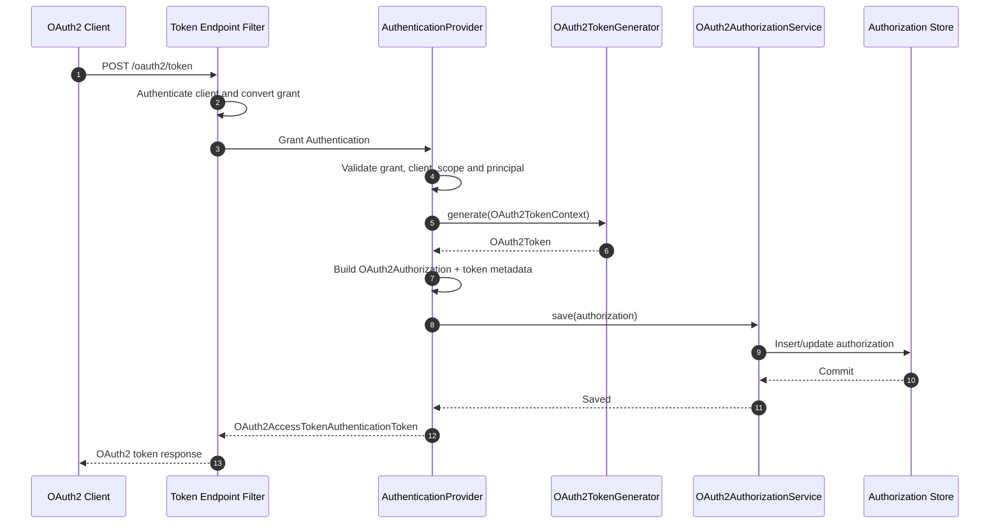
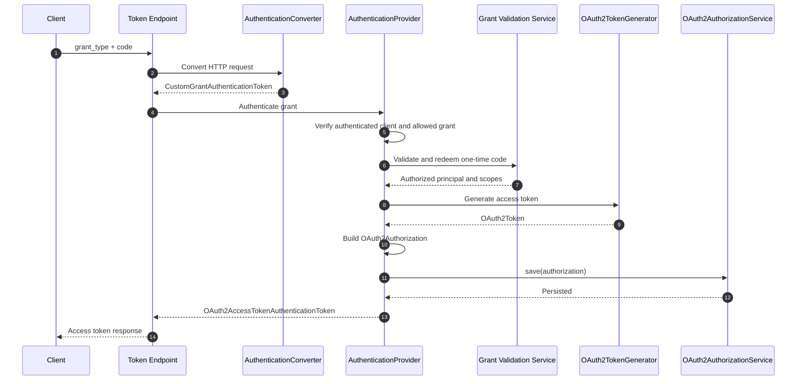
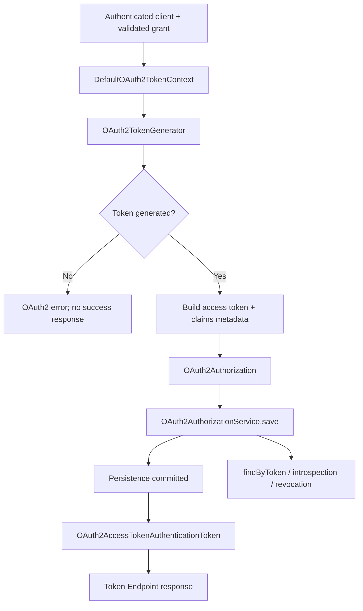

# Generating and Persisting Tokens with OAuth2TokenGenerator and OAuth2AuthorizationService

## 1. Objectives and Context

In the **Protocol Extensions** chapter of the **SPRING_SECURITY_OAUTH2_OIDC_AUTHORIZATION_SERVER** module, the Authorization Server must generate tokens tailored to the authorization grant context, and then persist sufficient state so endpoints and grant flows can verify, look up, refresh, or revoke tokens.

Spring Authorization Server (SAS) separates these two responsibilities into two components:

- `OAuth2TokenGenerator` generates an `OAuth2Token` based on `OAuth2TokenContext`.
- `OAuth2AuthorizationService` persists and queries `OAuth2Authorization`, the object containing tokens alongside metadata, principal, client, grant type, scopes, and associated attributes.

Token generation and authorization persistence are coupled steps, yet distinct. A token generator does not write tokens to a database on its own. An authorization service does not issue tokens on its own either. When extending grant types, the application must coordinate both components inside its `AuthenticationProvider`.

This lesson focuses on generating tokens with a generator, building the authorization record, persisting it via the service, and integrating those steps into the Token Endpoint. After this lesson, you will be able to:

- Explain the responsibilities of `OAuth2TokenGenerator`, `OAuth2TokenContext`, `OAuth2TokenCustomizer`, and `OAuth2AuthorizationService`.
- Distinguish JWT/self-contained access tokens from opaque/reference access tokens.
- Configure `DelegatingOAuth2TokenGenerator` for multiple token types.
- Customize claims for JWT and opaque access tokens.
- Generate tokens within an extension authorization grant.
- Persist tokens along with claims, invalidation metadata, and grant context in `OAuth2Authorization`.
- Wire the generator and authorization service into `OAuth2AuthorizationServerConfigurer`.
- Understand how custom grants use `AuthenticationConverter` and `AuthenticationProvider` at the Token Endpoint.
- Design safe transactions, token lifecycle, revocation, refresh, concurrency, and persistence.
- Test token generation, persistence, lookup, and responses end-to-end.

**Version scope:** Examples target **Spring Authorization Server 1.5.8**, **Spring Security 6.x**, and **Spring Boot 3.x**. APIs may change across versions; the custom grant examples are built from the official SAS 1.5.8 extension grant guide. Business interfaces such as `CustomGrantCodeService` in this lesson are application-defined components.

## 2. Two Responsibilities: Token Generation and Authorization Persistence

An authorization grant flow typically proceeds through these steps:

1. Authenticate the client.
2. Verify the authorization grant and check whether the client is allowed to use that grant.
3. Determine the principal, scopes, and authorization context.
4. Generate the token using `OAuth2TokenGenerator`.
5. Attach the token to `OAuth2Authorization` along with metadata.
6. Persist the authorization via `OAuth2AuthorizationService`.
7. Return the token response to the client.



This ordering matters. If the token response were sent before authorization state was persisted successfully, the client could receive a credential that the Authorization Server cannot look up to introspect or revoke. In a custom provider, always save the authorization before returning a successful authentication result.

### 2.1. Role of Each Component

| Component | Responsibility | Not Responsible For |
| --- | --- | --- |
| `OAuth2TokenContext` | Supplies client, principal, grant, scopes, token type, and authorization context | Generating tokens itself |
| `OAuth2TokenGenerator` | Generates tokens from context | Persisting authorizations itself |
| `OAuth2TokenCustomizer` | Adds/modifies claims or JOSE headers before token generation | Verifying grants on behalf of the provider |
| `OAuth2Authorization` | Aggregates grant state, principal, client, tokens, and metadata | Writing to the database itself |
| `OAuth2AuthorizationService` | Saves, updates, deletes, and looks up authorizations | Generating credentials itself |
| `AuthenticationProvider` | Verifies grants, invokes generator, builds authorization, and persists | Bypassing grant validation |

### 2.2. OAuth2Authorization Is the Record of a Grant

An `OAuth2Authorization` links to a `RegisteredClient` and a principal, recording the grant type, authorized scopes, token objects, and flow-specific attributes. An authorization code flow may hold an authorization code, access token, refresh token, and ID Token. Client Credentials usually needs only an access token. Device flow holds a device code/user code prior to issuing an access token.

Each token is stored in an `OAuth2Authorization.Token<T>`, containing the token object and metadata such as claims or invalidated status. Thus, saving only a raw token string is insufficient to reconstruct full authorization semantics.

## 3. OAuth2TokenContext: Input Data for the Generator

`OAuth2TokenContext` is the context object consumed by generators and customizers. Key accessors include:

| Accessor | Meaning |
| --- | --- |
| `getRegisteredClient()` | Registered and authenticated client |
| `getPrincipal()` | `Authentication` representing the resource owner or client |
| `getAuthorizationServerContext()` | Issuer and runtime context of the AS |
| `getAuthorization()` | Existing authorization if the flow is updating a record |
| `getAuthorizedScopes()` | Scopes granted for the token |
| `getTokenType()` | Type of token being generated |
| `getAuthorizationGrantType()` | Grant type being processed |
| `getAuthorizationGrant()` | `Authentication` object of the current grant |

Common token types in the core model:

- `code`: authorization code.
- `access_token`: access token.
- `refresh_token`: refresh token.
- `id_token`: OpenID Connect ID Token.

Do not confuse `tokenType` with `authorizationGrantType`. For instance, in the Authorization Code Grant, the grant type is `authorization_code`, yet the provider may sequentially generate an access token, a refresh token, and an ID Token.

### 3.1. Building DefaultOAuth2TokenContext

In a custom grant provider, context is typically built from verified data:

```java
OAuth2TokenContext tokenContext =
        DefaultOAuth2TokenContext.builder()
                .registeredClient(registeredClient)
                .principal(principal)
                .authorizationServerContext(
                        AuthorizationServerContextHolder.getContext())
                .authorizedScopes(authorizedScopes)
                .tokenType(OAuth2TokenType.ACCESS_TOKEN)
                .authorizationGrantType(customGrant.getGrantType())
                .authorizationGrant(customGrant)
                .build();
```

If issuing a new token for an existing authorization, pass `authorization(existingAuthorization)` when the flow and generator require that context. Never set principal or scopes from untrusted input; values must originate from preceding authentication and authorization decisions.

### 3.2. Authorized Scopes Must Be the Granted Set

Clients may request scopes in a token request, but the provider must compute the permitted scope set based on:

- Scopes registered for the client.
- Scopes present in the valid grant/consent.
- Resource/audience and tenant policies.
- Constraints of the custom grant.

Never copy the client-submitted scope string directly into token claims. `authorizedScopes` must be the verified result.

## 4. How Does OAuth2TokenGenerator Work?

`OAuth2TokenGenerator<T extends OAuth2Token>` defines the method:

```java
@Nullable
T generate(OAuth2TokenContext context);
```

The generator creates a token from the context or returns `null` if it does not support `context.getTokenType()`. This is an essential contract of the generator chain: a generator that does not handle a given token type must return `null` so the next generator has an opportunity to handle it.

### 4.1. Built-in Implementations

| Implementation | Token Generated | Characteristics |
| --- | --- | --- |
| `JwtGenerator` | JWT for access tokens or ID Tokens | Uses `JwtEncoder` and signing configuration |
| `OAuth2AccessTokenGenerator` | Opaque/reference access token | Claims can be customized via `OAuth2TokenClaimsContext` |
| `OAuth2RefreshTokenGenerator` | Refresh token | Random reference token |
| `DelegatingOAuth2TokenGenerator` | Does not format tokens itself | Invokes child generators sequentially and returns the first non-null result |

SAS treats `OAuth2TokenGenerator` as an optional component. By default, SAS configures a `DelegatingOAuth2TokenGenerator` consisting of an opaque access token generator and a refresh token generator. If a `JwtEncoder` or `JWKSource<SecurityContext>` bean exists, `JwtGenerator` is also included in the default chain.

### 4.2. Token Format Depends on RegisteredClient

For access tokens, `RegisteredClient.getTokenSettings().getAccessTokenFormat()` determines the format:

| Format | Result | How Resource Servers Typically Verify |
| --- | --- | --- |
| `OAuth2TokenFormat.SELF_CONTAINED` | Signed JWT | Verify signature, issuer, audience, expiry, and claims |
| `OAuth2TokenFormat.REFERENCE` | Opaque/reference token | Call introspection or look up state per configured mechanism |

JWTs carry claims that Resource Servers can verify offline. Opaque tokens do not expose claims within the token itself; the AS maintains state so introspection can return results.

### 4.3. DelegatingOAuth2TokenGenerator

`DelegatingOAuth2TokenGenerator` accepts multiple generators. Each generator is invoked in order; the first non-null result is returned.

```java
OAuth2TokenGenerator<?> tokenGenerator =
        new DelegatingOAuth2TokenGenerator(
                customTokenGenerator,
                jwtGenerator,
                accessTokenGenerator,
                refreshTokenGenerator);
```

If `customTokenGenerator` handles access tokens for a specialized client/grant, it must return `null` for contexts outside its scope. Place a custom generator before default generators only intentionally so it takes precedence. A generator that returns a token for every context will block downstream generators.

### 4.4. Generators Do Not Persist Tokens Automatically

After `generate` returns a token, the caller must still:

1. Check that the result is non-null.
2. Convert the token to the appropriate response type if needed.
3. Add the token to `OAuth2Authorization.Builder`.
4. Attach required claims/metadata.
5. Build the authorization.
6. Call `OAuth2AuthorizationService.save`.

This is a common pitfall when writing a custom grant: successfully generating a token does not mean the flow is complete.

## 5. Configuring Token Generators for JWT and Opaque Tokens

SAS 1.5.x generator chain example:

```java
@Bean
OAuth2TokenGenerator<?> tokenGenerator(
        JWKSource<SecurityContext> jwkSource) {

    JwtGenerator jwtGenerator =
            new JwtGenerator(new NimbusJwtEncoder(jwkSource));

    OAuth2AccessTokenGenerator accessTokenGenerator =
            new OAuth2AccessTokenGenerator();

    OAuth2RefreshTokenGenerator refreshTokenGenerator =
            new OAuth2RefreshTokenGenerator();

    return new DelegatingOAuth2TokenGenerator(
            jwtGenerator,
            accessTokenGenerator,
            refreshTokenGenerator);
}
```

This example supplies a JWT generator, an opaque access token generator, and a refresh token generator. Whether JWT or opaque access tokens are chosen also depends on the `RegisteredClient`'s `TokenSettings` and the corresponding generator logic.

### 5.1. Configuration in AuthorizationServerConfigurer

You can wire the generator via `OAuth2AuthorizationServerConfigurer`:

```java
@Bean
@Order(1)
SecurityFilterChain authorizationServerSecurityFilterChain(
        HttpSecurity http,
        OAuth2TokenGenerator<?> tokenGenerator,
        OAuth2AuthorizationService authorizationService)
        throws Exception {

    OAuth2AuthorizationServerConfigurer authorizationServer =
            OAuth2AuthorizationServerConfigurer.authorizationServer();

    http
        .securityMatcher(authorizationServer.getEndpointsMatcher())
        .with(authorizationServer, server -> server
                .tokenGenerator(tokenGenerator)
                .authorizationService(authorizationService))
        .authorizeHttpRequests(authorize ->
                authorize.anyRequest().authenticated());

    return http.build();
}
```

This is the core wiring. The application still requires `RegisteredClientRepository`, `AuthorizationServerSettings`, JWK source/encoder, and client/user authentication components per deployment.

### 5.2. Notes When Declaring a Custom Generator Bean

When an application provides its own `OAuth2TokenGenerator`, do not assume `OAuth2TokenCustomizer` beans will be automatically attached to the custom generator. Wire customizers explicitly onto the appropriate generator using `setJwtCustomizer` or `setAccessTokenCustomizer`. When using the default generator configuration created by SAS, auto-configuration can attach customizer beans based on context type.

## 6. Customizing Claims for JWT and Opaque Tokens

SAS has two primary context customizers:

| Customizer | Token | Editable API |
| --- | --- | --- |
| `OAuth2TokenCustomizer<JwtEncodingContext>` | JWT access token or ID Token | JWS header and JWT claims |
| `OAuth2TokenCustomizer<OAuth2TokenClaimsContext>` | Opaque access token | Claims builder of the opaque access token generator |

Do not mistakenly use a JWT customizer for opaque access tokens or vice versa.

### 6.1. JWT Customizer

`JwtEncodingContext` provides `getJwsHeader()` and `getClaims()`. Example adding a client identifier and verified tenant claim:

```java
@Bean
OAuth2TokenCustomizer<JwtEncodingContext> jwtCustomizer(
        ClientTenantService tenantService) {

    return context -> {
        if (OAuth2TokenType.ACCESS_TOKEN.equals(
                context.getTokenType())) {

            String clientId =
                    context.getRegisteredClient().getClientId();

            String tenantId =
                    tenantService.resolveTrustedTenant(clientId);

            context.getClaims()
                    .claim("client_id", clientId)
                    .claim("tenant_id", tenantId);
        }
    };
}
```

The tenant must be resolved from a trusted source and tied to the registration/client. Never place a request-supplied tenant ID into a JWT unverified. Avoid stuffing PII or full user profiles into access tokens.

### 6.2. Opaque Access Token Customizer

For opaque tokens, use `OAuth2TokenClaimsContext`:

```java
@Bean
OAuth2TokenCustomizer<OAuth2TokenClaimsContext>
        opaqueAccessTokenCustomizer(
                ClientTenantService tenantService) {

    return context -> {
        String clientId =
                context.getRegisteredClient().getClientId();

        context.getClaims()
                .claim("client_id", clientId)
                .claim(
                        "tenant_id",
                        tenantService.resolveTrustedTenant(clientId));
    };
}
```

These claims are not encoded inside the opaque token for clients to read directly. The claims context supplies a builder for the generator to customize the claim set; if a custom provider needs those claims to appear in introspection, the provider and token representation must ensure they are attached to authorization metadata. Do not assume a plain `OAuth2AccessToken` wrapper automatically retains the claim set just because the customizer ran.

### 6.3. Wiring Customizers into Generators

```java
@Bean
OAuth2TokenGenerator<?> tokenGenerator(
        JWKSource<SecurityContext> jwkSource,
        OAuth2TokenCustomizer<JwtEncodingContext> jwtCustomizer,
        OAuth2TokenCustomizer<OAuth2TokenClaimsContext>
                opaqueAccessTokenCustomizer) {

    JwtGenerator jwtGenerator =
            new JwtGenerator(new NimbusJwtEncoder(jwkSource));
    jwtGenerator.setJwtCustomizer(jwtCustomizer);

    OAuth2AccessTokenGenerator accessTokenGenerator =
            new OAuth2AccessTokenGenerator();
    accessTokenGenerator.setAccessTokenCustomizer(
            opaqueAccessTokenCustomizer);

    OAuth2RefreshTokenGenerator refreshTokenGenerator =
            new OAuth2RefreshTokenGenerator();

    return new DelegatingOAuth2TokenGenerator(
            jwtGenerator,
            accessTokenGenerator,
            refreshTokenGenerator);
}
```

If you only attach a JWT customizer, opaque access tokens will not receive those claims. If you only attach an opaque customizer, JWT claims will remain unchanged.

### 6.4. Distinguishing Claims from Token Metadata

- JWT claims are signed and embedded in the JWT payload.
- Opaque token claims live inside authorization metadata managed by the AS.
- Token metadata in `OAuth2Authorization.Token` also holds invalidation status, claims, and other framework attributes.
- Claims stored in an authorization do not automatically become token claims unless the custom provider attaches the proper metadata.

## 7. Extension Grants: Where the Application Coordinates Generator and Service

An extension authorization grant lets the AS support a custom grant type. SAS requires at minimum:

1. An `AuthenticationConverter` that converts HTTP token requests into grant authentication objects.
2. An `AuthenticationProvider` that verifies the grant and issues tokens.
3. Registering the converter/provider on the OAuth2 Token Endpoint.
4. Client registration permitting the extension grant type.

Example grant URI:

```text
urn:ietf:params:oauth:grant-type:custom_code
```

This is merely an illustrative grant name. When building an extension shared across organizations, define a stable URI namespace and document request parameters and error semantics.

### 7.1. Overall Flow



Do not treat a custom grant as an open token-minting endpoint. It must still enforce client authentication, grant authorization, scopes, expiration, replay protection, and token persistence.

## 8. Defining the Custom Grant Authentication Token

The custom grant token can extend `OAuth2AuthorizationGrantAuthenticationToken`. Example:

```java
public final class CustomCodeGrantAuthenticationToken
        extends OAuth2AuthorizationGrantAuthenticationToken {

    public static final AuthorizationGrantType GRANT_TYPE =
            new AuthorizationGrantType(
                    "urn:ietf:params:oauth:grant-type:custom_code");

    private final String code;

    public CustomCodeGrantAuthenticationToken(
            String code,
            Authentication clientPrincipal,
            Map<String, Object> additionalParameters) {

        super(GRANT_TYPE, clientPrincipal, additionalParameters);
        this.code = code;
    }

    public String getCode() {
        return this.code;
    }
}
```

This object carries the grant code and authenticated client principal. Never mark the authentication object as authenticated before the provider verifies the grant.

### 8.1. Converter Reading Requests

The converter only handles its own grant type; other grants must be left for default converters to handle:

```java
public final class CustomCodeGrantAuthenticationConverter
        implements AuthenticationConverter {

    @Override
    public Authentication convert(HttpServletRequest request) {
        String grantType =
                request.getParameter(OAuth2ParameterNames.GRANT_TYPE);

        if (!CustomCodeGrantAuthenticationToken.GRANT_TYPE
                .getValue().equals(grantType)) {
            return null;
        }

        String[] codes = request.getParameterValues("code");
        if (codes == null || codes.length != 1
                || !StringUtils.hasText(codes[0])) {
            throw new OAuth2AuthenticationException(
                    OAuth2ErrorCodes.INVALID_REQUEST);
        }

        Authentication clientPrincipal =
                SecurityContextHolder.getContext().getAuthentication();

        return new CustomCodeGrantAuthenticationToken(
                codes[0], clientPrincipal, Collections.emptyMap());
    }
}
```

In production, the converter needs duplicate-parameter checks for all sensitive fields, request size limits, rejection of malformed encodings, and no logging of grant codes. The Token Endpoint filter handles client authentication before the grant provider runs; the provider must still verify that the client principal is valid.

## 9. Verifying the Grant Before Generating Tokens

Example custom grant using a code issued by a provisioning system. The code service is an application business interface:

```java
public interface CustomGrantCodeService {

    RedeemedCustomGrant redeem(
            String code,
            String registeredClientId);
}

public record RedeemedCustomGrant(
        Set<String> authorizedScopes) {
}
```

The `redeem` implementation must perform atomic consumption:

- The code exists and has not expired.
- The code was issued for the exact client registration.
- The code has never been used.
- The code has not been revoked.
- Scopes in the grant are permitted for the client.
- All bindings for audience, tenant, or resource are valid.
- Only one concurrent request can redeem successfully.

If the code lives in a different system from the authorization database, design explicit consistency guarantees—for example, a single transaction in the same database, a redemption service with compare-and-set, or a stateful idempotent workflow. Never merely read the code and mark it used with two non-atomic statements.

### 9.1. Verifying the Authenticated Client

The provider must retrieve `OAuth2ClientAuthenticationToken` from the grant authentication and require that the token is authenticated. Never trust a client ID in the request body to determine client registration.

### 9.2. Verifying the Registered Grant Type

`RegisteredClient` must contain the exact custom grant type in `getAuthorizationGrantTypes()`. Otherwise, return `unauthorized_client`. Registering a custom grant in code does not automatically permit all clients to use that grant.

### 9.3. Verifying Scopes

After redeeming, verify that granted scopes are a subset of the client's registered scopes:

```java
if (!registeredClient.getScopes()
        .containsAll(redeemedGrant.authorizedScopes())) {
    throw new OAuth2AuthenticationException(
            new OAuth2Error(OAuth2ErrorCodes.INVALID_SCOPE));
}
```

Do not let a custom grant code escalate privileges by requesting scopes outside the allowlist. If the code is issued by another system, scopes must be validated both at issuance time and at redemption time.

## 10. AuthenticationProvider: Generating Tokens and Saving Authorizations

The provider connects three parts: grant validation, token generation, and authorization persistence. Skeleton example following SAS 1.5.8:

```java
public final class CustomCodeGrantAuthenticationProvider
        implements AuthenticationProvider {

    private final OAuth2AuthorizationService authorizationService;
    private final OAuth2TokenGenerator<? extends OAuth2Token> tokenGenerator;
    private final CustomGrantCodeService codeService;

    public CustomCodeGrantAuthenticationProvider(
            OAuth2AuthorizationService authorizationService,
            OAuth2TokenGenerator<? extends OAuth2Token> tokenGenerator,
            CustomGrantCodeService codeService) {

        Assert.notNull(authorizationService,
                "authorizationService cannot be null");
        Assert.notNull(tokenGenerator,
                "tokenGenerator cannot be null");
        Assert.notNull(codeService, "codeService cannot be null");

        this.authorizationService = authorizationService;
        this.tokenGenerator = tokenGenerator;
        this.codeService = codeService;
    }

    @Override
    public Authentication authenticate(Authentication authentication) {
        CustomCodeGrantAuthenticationToken grant =
                (CustomCodeGrantAuthenticationToken) authentication;

        OAuth2ClientAuthenticationToken clientPrincipal =
                getAuthenticatedClientElseThrowInvalidClient(grant);

        RegisteredClient registeredClient =
                clientPrincipal.getRegisteredClient();

        if (!registeredClient.getAuthorizationGrantTypes()
                .contains(grant.getGrantType())) {
            throw new OAuth2AuthenticationException(
                    OAuth2ErrorCodes.UNAUTHORIZED_CLIENT);
        }

        RedeemedCustomGrant redeemedGrant =
                codeService.redeem(
                        grant.getCode(), registeredClient.getId());

        Set<String> authorizedScopes =
                redeemedGrant.authorizedScopes();

        if (!registeredClient.getScopes().containsAll(authorizedScopes)) {
            throw new OAuth2AuthenticationException(
                    new OAuth2Error(OAuth2ErrorCodes.INVALID_SCOPE));
        }

        OAuth2TokenContext tokenContext =
                DefaultOAuth2TokenContext.builder()
                        .registeredClient(registeredClient)
                        .principal(clientPrincipal)
                        .authorizationServerContext(
                                AuthorizationServerContextHolder.getContext())
                        .authorizedScopes(authorizedScopes)
                        .tokenType(OAuth2TokenType.ACCESS_TOKEN)
                        .authorizationGrantType(grant.getGrantType())
                        .authorizationGrant(grant)
                        .build();

        OAuth2Token generatedToken =
                tokenGenerator.generate(tokenContext);

        if (generatedToken == null) {
            throw new OAuth2AuthenticationException(
                    new OAuth2Error(
                            OAuth2ErrorCodes.SERVER_ERROR,
                            "Token generation failed.",
                            null));
        }

        OAuth2AccessToken accessToken =
                generatedToken instanceof OAuth2AccessToken existing
                        ? existing
                        : new OAuth2AccessToken(
                                OAuth2AccessToken.TokenType.BEARER,
                                generatedToken.getTokenValue(),
                                generatedToken.getIssuedAt(),
                                generatedToken.getExpiresAt(),
                                authorizedScopes);

        OAuth2Authorization.Builder authorizationBuilder =
                OAuth2Authorization.withRegisteredClient(registeredClient)
                        .principalName(clientPrincipal.getName())
                        .authorizationGrantType(grant.getGrantType())
                        .authorizedScopes(authorizedScopes);

        if (generatedToken instanceof ClaimAccessor claimAccessor) {
            authorizationBuilder.token(accessToken, metadata ->
                    metadata.put(
                            OAuth2Authorization.Token.CLAIMS_METADATA_NAME,
                            claimAccessor.getClaims()));
        } else {
            authorizationBuilder.accessToken(accessToken);
        }

        OAuth2Authorization authorization =
                authorizationBuilder.build();

        authorizationService.save(authorization);

        return new OAuth2AccessTokenAuthenticationToken(
                registeredClient, clientPrincipal, accessToken);
    }

    @Override
    public boolean supports(Class<?> authentication) {
        return CustomCodeGrantAuthenticationToken.class
                .isAssignableFrom(authentication);
    }

    private static OAuth2ClientAuthenticationToken
            getAuthenticatedClientElseThrowInvalidClient(
                    Authentication authentication) {

        Object principal = authentication.getPrincipal();

        if (principal instanceof OAuth2ClientAuthenticationToken client
                && client.isAuthenticated()) {
            return client;
        }

        throw new OAuth2AuthenticationException(
                OAuth2ErrorCodes.INVALID_CLIENT);
    }
}
```

This is an illustrative skeleton for a client-bound custom grant. Real-world applications must add error mapping, grant-specific validation, transaction boundaries, and business-appropriate principal resolution. If the grant represents a resource owner, resolve the true resource owner principal from the verified grant instead of always using the client principal as the principal name.

### 10.1. Why Wrap the Generated Token in OAuth2AccessToken?

`OAuth2TokenGenerator` returns a generic `OAuth2Token`. `JwtGenerator` may return a `Jwt`, while `OAuth2AccessTokenGenerator` returns an `OAuth2AccessToken`. The Token Endpoint success handler expects an `OAuth2AccessTokenAuthenticationToken` containing a standard access token.

Therefore, if the generator returns a `Jwt`, the provider can create an `OAuth2AccessToken` wrapper with the same token value, issued-at, expires-at, and authorized scopes. JWT claims must be preserved in authorization metadata as shown above.

### 10.2. Why Persist Claims Metadata?

`Jwt` implements `ClaimAccessor`. When the provider wraps a JWT as an `OAuth2AccessToken`, the wrapper object does not retain all JWT claims itself. Saving claims into `OAuth2Authorization.Token.CLAIMS_METADATA_NAME` ensures the authorization record preserves claims so introspection or other components can retrieve them.

Without this metadata, the JWT can still be verified offline by Resource Servers, but introspection responses or AS-side logic may lack expected claims. For opaque tokens, `OAuth2TokenClaimsContext` lets the generator customize the claim set, yet a custom provider must ensure that claim set is persisted alongside token metadata if it needs to be read back later. The provider example in this section illustrates saving claims when the generated token implements `ClaimAccessor`; for standard opaque token wrappers, add appropriate metadata mapping or use a token representation capable of exposing claims.

### 10.3. Why Save Before Returning the Response?

`authorizationService.save(authorization)` must complete before the provider returns `OAuth2AccessTokenAuthenticationToken`. If saving fails, the provider must raise an error and not return a successful access token. This keeps issued credentials consistent with the state the AS uses for introspection/revocation.

## 11. Wiring Converter and Provider into the Token Endpoint

SAS provides extension points for converters and providers:

```java
@Bean
@Order(1)
SecurityFilterChain authorizationServerSecurityFilterChain(
        HttpSecurity http,
        OAuth2AuthorizationService authorizationService,
        OAuth2TokenGenerator<?> tokenGenerator,
        CustomGrantCodeService codeService)
        throws Exception {

    OAuth2AuthorizationServerConfigurer authorizationServer =
            OAuth2AuthorizationServerConfigurer.authorizationServer();

    http
        .securityMatcher(authorizationServer.getEndpointsMatcher())
        .with(authorizationServer, server ->
                server.tokenEndpoint(tokenEndpoint ->
                        tokenEndpoint
                                .accessTokenRequestConverter(
                                        new CustomCodeGrantAuthenticationConverter())
                                .authenticationProvider(
                                        new CustomCodeGrantAuthenticationProvider(
                                                authorizationService,
                                                tokenGenerator,
                                                codeService))))
        .authorizeHttpRequests(authorize ->
                authorize.anyRequest().authenticated());

    return http.build();
}
```

The custom converter and provider are added to the Token Endpoint pipeline. When the converter does not recognize its grant type, it returns `null` so other converters proceed. When the converter recognizes its grant but the request is malformed, it must return an appropriate OAuth2 error rather than silently letting the request fall through to another grant.

### 11.1. Registering the Grant Type on a Client

The client must be configured to allow the custom grant:

```java
RegisteredClient client = RegisteredClient.withId(UUID.randomUUID().toString())
        .clientId("custom-grant-client")
        .clientSecret(passwordEncoder.encode(clientSecret))
        .clientAuthenticationMethod(
                ClientAuthenticationMethod.CLIENT_SECRET_BASIC)
        .authorizationGrantType(
                CustomCodeGrantAuthenticationToken.GRANT_TYPE)
        .scope("message.read")
        .scope("message.write")
        .build();
```

In production, use random secrets, an appropriate `PasswordEncoder`, and a persistent `RegisteredClientRepository`. The snippet above only registers the grant type and scopes; the client must still authenticate at the Token Endpoint.

### 11.2. Sample Request

```http
POST /oauth2/token HTTP/1.1
Host: auth.example.com
Authorization: Basic <BASE64_CLIENT_CREDENTIALS>
Content-Type: application/x-www-form-urlencoded

grant_type=urn:ietf:params:oauth:grant-type:custom_code&code=<REDACTED_ONE_TIME_CODE>
```

A successful OAuth2 Token Endpoint response looks like:

```json
{
  "access_token": "<REDACTED_ACCESS_TOKEN>",
  "token_type": "Bearer",
  "expires_in": 300,
  "scope": "message.read message.write"
}
```

Never place real grant codes or access tokens into examples, logs, shell history, or issue trackers.

## 12. Saving Authorizations via OAuth2AuthorizationService

`OAuth2AuthorizationService` is the persistence boundary for authorization records. Its contract has four operations:

| Method | Purpose |
| --- | --- |
| `save(authorization)` | Save a new authorization or updated state |
| `remove(authorization)` | Delete an authorization record |
| `findById(id)` | Look up by authorization ID |
| `findByToken(token, tokenType)` | Look up the authorization containing a token |

SAS includes `InMemoryOAuth2AuthorizationService` for development/testing and `JdbcOAuth2AuthorizationService` for JDBC persistence. Without a dedicated service bean, SAS may default to the in-memory service. Production deployments must explicitly wire a persistent implementation.

### 12.1. Configuring the JDBC Authorization Service

```java
@Bean
OAuth2AuthorizationService authorizationService(
        JdbcOperations jdbcOperations,
        RegisteredClientRepository registeredClientRepository) {

    return new JdbcOAuth2AuthorizationService(
            jdbcOperations, registeredClientRepository);
}
```

Deploy the accompanying SQL schema matching the exact SAS version and adapt it to your database dialect. For production, evaluate token lookup indexes, LOB sizes, transactions, connection pools, and performance before relying on default configurations.

### 12.2. Wiring the Authorization Service

The JDBC bean must be wired into the configurer:

```java
authorizationServer.authorizationService(authorizationService);
```

Merely declaring a bean in the Spring context without verifying which service the configurer uses can leave the system storing authorizations in memory. Test across restarts and multiple instances to confirm persistence actually works.

### 12.3. What Must an Authorization Record Retain?

At minimum, a record needs:

- Unique authorization ID.
- Internal registered client ID.
- Principal name.
- Authorization grant type.
- Authorized scopes.
- Token objects and issued/expiry timestamps.
- Token metadata, claims, and invalidation flags.
- Attributes required by the grant flow.

Never store only the access token value. During refresh, revocation, or introspection, SAS must know which client/principal the token belongs to and the authorization's state.

## 13. Token Lifecycle: Updating, Refreshing, and Revoking

### 13.1. Refresh Token Flow

When a refresh token is used, the provider looks up the existing authorization, verifies the refresh token is still active and matches the client, and generates a new access token. If refresh token rotation is enabled, the old refresh token can be invalidated and the new token attached to the authorization.

When updating an authorization, preserve remaining active tokens and metadata:

```java
OAuth2Authorization updatedAuthorization =
        OAuth2Authorization.from(existingAuthorization)
                .invalidate(oldRefreshToken)
                .token(newAccessToken)
                .token(newRefreshToken)
                .build();

authorizationService.save(updatedAuthorization);
```

This is a conceptual example. Enforce the exact reuse/rotation policy from `RegisteredClient` `TokenSettings` and ensure updates are atomic.

### 13.2. Token Revocation

Revocation does not necessarily delete the entire authorization. The service can record the token's invalidated state so subsequent lookups recognize the token is no longer active.

`OAuth2Authorization.Token.isActive()` reflects both expiration and invalidation metadata. Do not simply delete the token from the database if callers need to distinguish a token that never existed from one that was revoked.

### 13.3. Introspection

For opaque tokens, Resource Servers typically call introspection. The AS looks up the authorization by token value, checks active status, and returns required details per policy. Custom claims must be stored properly in authorization metadata if introspection is expected to return them.

### 13.4. JWT Offline Validation

JWT signatures can be verified by Resource Servers without querying the AS on every request. Nevertheless, authorization persistence remains necessary for refresh, revocation, introspection, custom grant state, auditing, and other flows. If immediate JWT revocation is required, implement a stateful mechanism such as introspection, a denylist, or event-based invalidation; otherwise, a JWT may remain accepted until expiration.

## 14. Authorization Codes and Other Tokens

`OAuth2TokenGenerator` is used during grant processing, yet you should not assume every credential in every flow passes through the same generator bean.

| Token | Typical Creator | Persistence |
| --- | --- | --- |
| Authorization code | Authorization Code request provider and its configured code generator | Inside `OAuth2Authorization` |
| Access token | `OAuth2TokenGenerator` chain | Inside `OAuth2Authorization` |
| Refresh token | `OAuth2RefreshTokenGenerator` in the token generator chain | Inside `OAuth2Authorization` |
| ID Token | `JwtGenerator` in the OIDC flow | Inside `OAuth2Authorization` with claims |
| Device code/user code | Device Authorization flow provider/generator | Inside `OAuth2Authorization` |

The Authorization Code provider has its own extension point, `setAuthorizationCodeGenerator`. A token generator bean used to create access/refresh/ID tokens should not be mistaken as automatically replacing every generator across all other providers.

## 15. Custom Token Formats and Custom Generators

Two extension approaches are often confused:

1. **Custom format for access/refresh tokens:** the token retains standard OAuth2 semantics, but its encoding or storage format changes.
2. **Custom authorization grant:** adds a new grant verification mechanism, typically needing a dedicated converter and provider.

A custom grant can use standard generators. Conversely, a custom token generator does not by itself create a new grant type.

### 15.1. Custom Generators Only Handle Their Intended Context

Skeleton example of a generator prioritizing a custom format for a specific client/grant while returning `null` for other contexts:

```java
public final class PartnerAccessTokenGenerator
        implements OAuth2TokenGenerator<OAuth2AccessToken> {

    private final OAuth2TokenGenerator<OAuth2AccessToken> delegate;

    public PartnerAccessTokenGenerator(
            OAuth2TokenGenerator<OAuth2AccessToken> delegate) {
        this.delegate = delegate;
    }

    @Override
    public OAuth2AccessToken generate(OAuth2TokenContext context) {
        if (!OAuth2TokenType.ACCESS_TOKEN.equals(context.getTokenType())) {
            return null;
        }

        if (!"partner-client".equals(
                context.getRegisteredClient().getClientId())) {
            return null;
        }

        // The delegate can be a configured opaque/JWT generator.
        return this.delegate.generate(context);
    }
}
```

This example only illustrates context-based dispatch. If actually implementing a custom format, ensure the Resource Server can verify/introspect the token, that issued/expiry timestamps are explicit, and that revocation works. Never invent an arbitrary string and treat it as an OAuth access token without a matching resource-server contract.

### 15.2. Delegating Generator and Ordering

`DelegatingOAuth2TokenGenerator` takes the token from the first generator returning non-null. If a custom generator is placed ahead of default generators, it can override default output. When it does not support a context, it must return `null`.

Do not throw an exception merely because a token type falls outside the generator's scope. Exceptions are reserved for cases where the context is supported but generation genuinely fails.

### 15.3. Extended Token Types

Core `OAuth2TokenContext` defines standard token types such as code, access token, refresh token, and ID Token. A custom token type must be handled by extension code that understands it; merely creating a new `OAuth2TokenType` does not make the Token Endpoint, introspection, revocation, or Resource Servers understand the new credential.

Before adding a custom token type, explicitly define:

- Which grant/endpoint issues it.
- Whether it is a bearer credential.
- How the Resource Server verifies it.
- Under which key it is stored and looked up.
- Expiry, revocation, and replay semantics.
- How it is represented in responses and discovery metadata if required by protocol.

## 16. Transactions and Consistency

Token generation creates new credential material; persistence records the corresponding state. Both operations need a clear ordering and transaction policy.

### 16.1. Save Before Returning the Response

The provider must return success only after the authorization record is saved successfully. If the database fails, return a server error per contract and do not return an access token as if issuance succeeded.

### 16.2. Atomic Code Redemption

Custom one-time grant codes must be consumed atomically. If the code service and authorization store share a database, they can share a transaction manager. Across separate systems, use an idempotency key, compare-and-set, outbox, or an appropriate redemption state machine. Never read a code and mark it used with two non-atomic commands.

### 16.3. Refresh Rotation

When rotating a refresh token, the old token's state and the new token must be written in the same transaction. Saving the new token without invalidating the old token allows the old token to remain usable outside policy. Invalidating the old token first and failing to save the new token leaves the authorization unable to refresh.

### 16.4. Concurrent Requests

Two concurrent requests may redeem the same grant code or refresh token. Ensure:

- Unique constraints or optimistic locking.
- Atomic consumption for one-time codes.
- Replay detection.
- Two requests cannot both succeed if the grant is single-use.
- Duplicate requests are handled per policy and audited.

## 17. Securing Tokens and the Authorization Store

Tokens are bearer credentials in many flows; anyone holding a token can exercise its permissions until expiration or revocation.

### 17.1. Token Entropy and Lifetime

- Use standard generators or an appropriate CSPRNG.
- Set short access token TTLs matching risk and use case.
- Define explicit TTLs and rotation/reuse policies for refresh tokens.
- Authorization codes and custom grant codes must be short-lived, one-time, and client-bound.
- Never use sequential or predictable token values.

### 17.2. Signing Keys

For JWTs, protect private signing keys in KMS/HSM or appropriate secret storage. Implement key rotation and publish public keys via JWKS. Never hard-code or commit private keys in source code.

### 17.3. Protecting Persistence

- Use TLS to the database.
- Restrict read permissions on authorization/token tables.
- Consider encryption at rest / envelope encryption for token values and attributes.
- Never log raw tokens, authorization codes, refresh tokens, or ID Tokens.
- Protect backups, snapshots, and restore environments.
- Preserve token metadata/invalidation across serialization and deserialization.

### 17.4. Avoid Over-Issuing Claims

JWTs/opaque tokens should contain only claims needed by resource servers and authorization purposes. Avoid placing full user profiles, emails, phone numbers, addresses, or sensitive data into access tokens unnecessarily. Token claims are frequently copied across logs, caches, traces, and multiple resource servers.

## 18. Testing Token Generation and Persistence

### 18.1. Unit Tests for Generators

Test:

- Context with a supported token type returns a token.
- Unsupported context returns `null`.
- JWT has expected issuer, subject, audience, expiry, and signature.
- Opaque token has expected claims metadata.
- Generator chain returns the result from the first non-null generator.
- Custom generator does not block other token types.
- Token lifetime honors `TokenSettings`.

### 18.2. Unit Tests for Authorization Mapping

- Authorization record has accurate registered client ID and principal name.
- Grant type and authorized scopes are preserved.
- Access token stores accurate token value and issued/expiry timestamps.
- Claims are persisted when the generated token implements `ClaimAccessor`.
- Invalidation metadata is preserved across updates.
- `findByToken` retrieves the token after saving.
- `remove` deletes the record by authorization ID.

### 18.3. Integration Tests for Custom Grants

Tests should cover the full flow:

1. Register a client with the custom grant type.
2. Supply valid client credentials.
3. Send a token request with the grant type and code.
4. Verify the converter accepts only the target grant.
5. Verify the provider rejects expired, wrong-client, or already-redeemed codes.
6. Verify scopes outside the allowlist are rejected.
7. Verify a `null` return from the token generator maps to a server error.
8. Verify the authorization is persisted before returning the response.
9. Use the token to call a resource server or introspection endpoint.
10. Reuse the code to verify replay protection.

### 18.4. Integration Tests with JDBC

Use a database matching the production dialect or Testcontainers to verify schema, LOBs, transactions, and token lookups. H2 is useful for quick tests but does not replace testing against PostgreSQL/MySQL/SQL Server when production runs on those engines.

### 18.5. Example of Verifying a Persisted Token

```java
@Test
void generatedTokenIsPersistedWithAuthorization() {
    Authentication result =
            customGrantAuthenticationManager.authenticate(grantRequest);

    assertThat(result)
            .isInstanceOf(OAuth2AccessTokenAuthenticationToken.class);

    OAuth2AccessTokenAuthenticationToken tokenResult =
            (OAuth2AccessTokenAuthenticationToken) result;

    OAuth2Authorization authorization =
            authorizationService.findByToken(
                    tokenResult.getAccessToken().getTokenValue(),
                    OAuth2TokenType.ACCESS_TOKEN);

    assertThat(authorization).isNotNull();
    assertThat(authorization.getAccessToken()).isNotNull();
    assertThat(authorization.getAccessToken().isActive()).isTrue();
}
```

This is a skeleton; the test requires a fully configured client, grant fixture, generator, authorization service, and database. Do not test only for an HTTP 200 token response; prove that the token can be looked up from the persistence layer.

## 19. Observability and Operations

### 19.1. Metrics

Monitor:

- Token generation successes/failures by grant type and token format.
- Authorization save latency and error rates.
- Token lookup latency/hits/misses by token type.
- Introspection/revocation/refresh request rates.
- Refresh rotation failures and replay attempts.
- Active/expired authorization record counts via safe aggregation.
- Database connection pools, lock waits, and transaction durations.
- JWT signing/verification errors and key rotation events.

Never use raw tokens, principal names, or PII as metric labels due to leakage risk and high cardinality.

### 19.2. Auditing

Audit logs can record client ID, grant type, authorization ID, granted scopes, token type, policy decision, correlation ID, and timestamp. Never log token values or secrets. For grant codes, log only a protected reference/digest if needed for replay investigations.

### 19.3. Cleanup and Retention

An authorization may contain an access token, refresh token, and grant state with different expirations. Never delete a record simply because its access token expired while its refresh token remains valid. Cleanup must:

- Account for all tokens in the authorization.
- Retain sufficient data for revocation/replay detection per policy.
- Delete secondary token indexes in sync with authorizations.
- Execute in bounded batches.
- Enforce proper retention and auditing.
- Test that cleanup never deletes authorizations with active refresh tokens.

## 20. Troubleshooting

| Symptom | Possible Cause | Resolution |
| --- | --- | --- |
| Token generator returns `null` | No generator supports the token type/context | Check token type and generator chain |
| JWT is unsigned | Missing `JwtEncoder`/`JWKSource` or generator not wired | Check JWK source and `JwtGenerator` |
| Client expects JWT but gets opaque | Misconfigured `TokenSettings` or generator order | Check `accessTokenFormat` and chain |
| Opaque introspection missing custom claims | Missing `OAuth2TokenClaimsContext` customizer or claims metadata | Check generator and authorization metadata |
| JWT missing custom claims | `JwtCustomizer` not attached to `JwtGenerator` | Check token generator bean |
| Custom grant returns `unsupported_grant_type` | `RegisteredClient` lacks grant or converter ignores request | Check grant registration and converter |
| Custom grant returns `unauthorized_client` | Client unauthenticated or missing grant type | Check client auth and `RegisteredClient` |
| Token response succeeds but introspection shows inactive | Authorization was not saved or lookup fails | Check `authorizationService` wiring and save |
| Tokens disappear after restart | Still using `InMemoryOAuth2AuthorizationService` | Switch to a persistent service |
| JWT works but revocation has no immediate effect | Resource Server validates offline | Use introspection/denylist or shorter TTL |
| Old refresh token still works | Invalidation/rotation not saved atomically | Check metadata and transaction |
| Token response has wrong scopes | Provider took scopes directly from request | Compute `authorizedScopes` from grant and client policy |
| Claims metadata lost after save/read | JDBC/JPA mapper does not round-trip claims | Check row/parameter mappers |
| Custom generator blocks default generators | Returned a token instead of `null` for unsupported context | Fix dispatch and chain ordering |
| Custom code can be reused | Redemption is non-atomic or not marked used | Use compare-and-set/unique constraints |
| Multiple instances miss authorizations | Local/in-memory store or replica lag | Use shared persistence and read-after-write consistency |
| Raw tokens appear in logs | HTTP/JDBC body logging or exception logging | Redact tokens and secrets |
| Database error after generating token | Save fails yet provider still returns response | Return success only after save commits |

## 21. Anti-Patterns to Avoid

| Anti-Pattern | Consequence | Recommended Practice |
| --- | --- | --- |
| Assuming the generator saves tokens itself | No authorization record for introspection/revocation | Call `authorizationService.save` |
| Returning response before saving | Client gets an unresolvable token | Save before returning success |
| Ignoring `null` return from generator | Null pointers or invalid responses | Handle generation failures explicitly |
| Custom generator always returns a token | Blocks default generators | Return `null` for unsupported contexts |
| Using grant type as token type | Generator receives wrong context | Separate `authorizationGrantType` and `tokenType` |
| Wrapping a JWT while dropping claims metadata | Introspection lacks claims | Store `ClaimAccessor` claims in token metadata |
| Storing only raw token strings | Loses client/principal/grant/expiry/invalidation | Persist full `OAuth2Authorization` |
| Trusting scopes from the request | Privilege escalation | Use verified authorized scopes |
| Redeeming codes via read-then-update | Replay race condition | Use atomic one-time consumption |
| Relying on JWTs to skip revocation design | Old tokens remain valid offline until expiry | Introspection/denylist/events or short TTL |
| Logging tokens | Bearer credentials exposed | Redaction and safe audit metadata |
| Testing only HTTP 200 | Fails to catch unpersisted authorizations | Test `findByToken` after save |
| Using `InMemory` in a production cluster | State lost across restarts/instances | JDBC or persistent custom service |

## 22. Production Acceptance Checklist

- [ ] `OAuth2TokenContext` has accurate client, principal, grant, scopes, and token type.
- [ ] Grant is verified before calling the generator.
- [ ] Client is authenticated and registered for the corresponding grant type.
- [ ] Authorized scopes reflect the granted permission set.
- [ ] `OAuth2TokenGenerator` includes a generator matching the token format.
- [ ] Generators return `null` for unsupported contexts.
- [ ] Delegating generator ordering is intentional.
- [ ] JWT customizers and opaque customizers are attached to the right generators.
- [ ] JWTs use managed signing keys with rotation.
- [ ] Claims contain no PII or excessive privileges.
- [ ] Tokens are wrapped in the appropriate response type.
- [ ] `ClaimAccessor` claims are saved in authorization metadata.
- [ ] `OAuth2Authorization` has accurate ID, client, principal, grant, and scopes.
- [ ] `OAuth2AuthorizationService` is a persistent service in production.
- [ ] Authorization is saved successfully before returning the token response.
- [ ] Refresh/revocation update metadata and transactions accurately.
- [ ] Custom grant codes enforce expiry, client binding, and one-time redemption.
- [ ] Token values/credentials never appear in logs.
- [ ] Database schema, indexes, backups, and cleanup are verified.
- [ ] Multiple AS instances use shared storage and read-after-write consistency.
- [ ] Integration tests prove issued tokens can be looked up again.
- [ ] Tests cover introspection, revocation, refresh, replay, and database outages.
- [ ] Metrics, audits, and runbooks exist for token generation/persistence failures.

## 23. Memory Map



**`OAuth2TokenGenerator` creates tokens from context; `OAuth2AuthorizationService` persists the state of the authorization holding those tokens.** In a custom grant flow, `AuthenticationProvider` authenticates the client and grant, constructs `OAuth2TokenContext`, invokes the generator, attaches the token along with claims metadata to `OAuth2Authorization`, and saves it via the service before returning a response. By properly distinguishing token formats, grant semantics, metadata, persistence, and transactions, issued tokens can be looked up, introspected, refreshed, and revoked consistently throughout the OAuth 2.0/OpenID Connect lifecycle.

## 24. References

- [Spring Authorization Server 1.5.8 — Core Model / Components](https://docs.spring.io/spring-authorization-server/reference/core-model-components.html)
- [OAuth2TokenGenerator — API 1.5.8](https://docs.spring.io/spring-authorization-server/reference/api/java/org/springframework/security/oauth2/server/authorization/token/OAuth2TokenGenerator.html)
- [OAuth2TokenContext — API 1.5.8](https://docs.spring.io/spring-authorization-server/reference/api/java/org/springframework/security/oauth2/server/authorization/token/OAuth2TokenContext.html)
- [DelegatingOAuth2TokenGenerator — API 1.5.8](https://docs.spring.io/spring-authorization-server/reference/api/java/org/springframework/security/oauth2/server/authorization/token/DelegatingOAuth2TokenGenerator.html)
- [OAuth2Authorization.Builder — API 1.5.8](https://docs.spring.io/spring-authorization-server/reference/api/java/org/springframework/security/oauth2/server/authorization/OAuth2Authorization.Builder.html)
- [OAuth2AuthorizationService — API 1.5.8](https://docs.spring.io/spring-authorization-server/reference/api/java/org/springframework/security/oauth2/server/authorization/OAuth2AuthorizationService.html)
- [How-to: Implement an Extension Authorization Grant Type](https://docs.spring.io/spring-authorization-server/reference/guides/how-to-ext-grant-type.html)
- [Configuration Model — OAuth2AuthorizationServerConfigurer](https://docs.spring.io/spring-authorization-server/reference/configuration-model.html)
- [Protocol Endpoints — Token Endpoint](https://docs.spring.io/spring-authorization-server/reference/protocol-endpoints.html)
