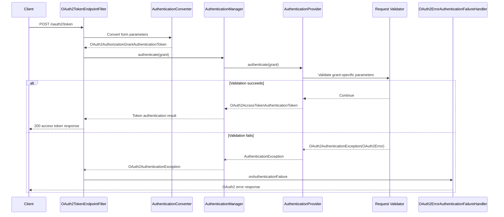

# Standardizing OAuth2Error for Validation and Token Issuance Errors

## 1. Why Standardize OAuth 2.0 Errors?

In an **OAuth 2.0/OpenID Connect Authorization Server** built with **Spring Security, Spring Authorization Server, and Spring Boot**, many components can reject a request: parameter validation, client authentication, authorization grant verification, consent verification, scope evaluation, access token generation, or authorization persistence.

If each component crafts responses in its own way, clients encounter unpredictable errors:

- The same condition causes an endpoint to return different error codes.
- Validation throws a generic exception, causing the Token Endpoint to return HTTP 500 instead of an OAuth error.
- `error_description` leaks stack traces, SQL, secrets, or internal details.
- Validation errors are turned into `invalid_grant` or `invalid_client` with inaccurate semantics.
- A custom handler overrides the default response and drops `Cache-Control: no-store`, `Pragma: no-cache`, or the `WWW-Authenticate` header.
- Resource Server, Authorization Endpoint, and Token Endpoint return inconsistent error JSON.

OAuth 2.0 defines standard error response structures and error codes. Spring Security models errors with `OAuth2Error` and `OAuth2AuthenticationException`; Spring Authorization Server uses these types to translate provider errors into protocol endpoint responses.

In the **SPRING_SECURITY_OAUTH2_OIDC_AUTHORIZATION_SERVER** module, the goal is to learn how to design, configure, secure, test, and operate an OAuth 2.0/OpenID Connect Authorization Server using Spring Security and Spring Authorization Server. This lesson belongs to the **Protocol Extensions** chapter and focuses on standardizing validation errors and errors arising during token issuance.

### Learning Outcomes

After this lesson, you will be able to:

1. Explain the structure of `OAuth2Error`, `OAuth2ErrorCodes`, and `OAuth2AuthenticationException`.
2. Select error codes according to RFC 6749 semantics for authorization requests and token requests.
3. Distinguish client authentication errors, grant errors, scope errors, policy errors, and system errors.
4. Throw OAuth exceptions properly from custom validators and custom `AuthenticationProvider` implementations.
5. Customize `OAuth2TokenEndpointConfigurer.errorResponseHandler(...)` while preserving protocol responses.
6. Distinguish error responses across the Authorization Endpoint, Token Endpoint, and Resource Server.
7. Design `error_description`, `error_uri`, HTTP status, and logging without exposing sensitive information.
8. Write unit/integration tests to verify error codes and wire responses.

**Example scope:** Spring Boot 3.x, Spring Security 6.x, and Spring Authorization Server 1.5.x on the Servlet stack. API names and extension points align with Spring Authorization Server 1.5.8 documentation.

## 2. The Error Model of OAuth 2.0 and Spring

### 2.1. Error Responses Are Part of the Protocol

OAuth 2.0 does not specify that every error is an HTML page or arbitrary JSON. RFC 6749 defines distinct responses per endpoint:

| Endpoint | How Errors Are Returned | Examples |
| --- | --- | --- |
| Authorization Endpoint | Redirect back to the validated client redirect URI, including `error`, `error_description`, and `state` when applicable | `access_denied`, `invalid_request`, `unauthorized_client` |
| Token Endpoint | HTTP error response with an `application/json` JSON body | `invalid_client`, `invalid_grant`, `invalid_scope`, `unsupported_grant_type` |
| Resource Server | Bearer Token error per RFC 6750, typically using `WWW-Authenticate` | `invalid_token`, `insufficient_scope` |
| Discovery/JWKS/metadata | HTTP status matching resource HTTP errors | `404`, `500`, `503` depending on endpoint |

Do not blindly forward an `OAuth2Error` from one endpoint to another while ignoring protocol rules. For instance, `access_denied` at the Authorization Endpoint means the resource owner or OP denied authorization; at the Token Endpoint, clients should not arbitrarily expect that code to describe an expired refresh token.

### 2.2. Three Data Types in Spring

| Type | Role |
| --- | --- |
| `OAuth2Error` | Data object containing `errorCode`, `description`, and `uri` |
| `OAuth2AuthenticationException` | Exception carrying an `OAuth2Error`; used to signal OAuth errors during authentication/authorization processing |
| `OAuth2ErrorCodes` | Constants for standard error codes to avoid string typos |

`OAuth2AuthenticationException` extends Spring Security's `AuthenticationException`. Its constructor accepts an `OAuth2Error` or an error code. When standardizing description/URI, construct an `OAuth2Error` first and pass it into the exception.

Example:

```java
import org.springframework.security.oauth2.core.OAuth2AuthenticationException;
import org.springframework.security.oauth2.core.OAuth2Error;
import org.springframework.security.oauth2.core.OAuth2ErrorCodes;

OAuth2Error error = new OAuth2Error(
        OAuth2ErrorCodes.INVALID_SCOPE,
        "The requested scope is not permitted",
        "https://auth.example.com/docs/errors/invalid-scope");

throw new OAuth2AuthenticationException(error);
```

### 2.3. Structure of OAuth2Error

`OAuth2Error` has three properties:

| Property | Meaning | Rules |
| --- | --- | --- |
| `errorCode` | Machine-readable error code | Must match the protocol and endpoint |
| `description` | Human-readable information | Concise, safe, free of secrets/stack traces/PII |
| `uri` | Documentation URI explaining the error | Should point to public, stable docs containing no private data |

The wire response at the Token Endpoint uses JSON field names `error`, `error_description`, and `error_uri`. Field names in the Java object do not match the JSON keys verbatim:

```json
{
  "error": "invalid_scope",
  "error_description": "The requested scope is not permitted",
  "error_uri": "https://auth.example.com/docs/errors/invalid-scope"
}
```

Never place raw exception messages from databases, HTTP clients, JWK parsers, or cryptographic libraries into `error_description`. Clients do not need to know SQL tables, internal hosts, file paths, or private key identifiers to handle an OAuth error.

### 2.4. OAuth2ErrorCodes and Extension Error Codes

Spring Security provides constants for common OAuth error codes such as:

- `INVALID_REQUEST`
- `INVALID_CLIENT`
- `INVALID_GRANT`
- `UNAUTHORIZED_CLIENT`
- `UNSUPPORTED_GRANT_TYPE`
- `INVALID_SCOPE`
- `ACCESS_DENIED`
- `UNSUPPORTED_RESPONSE_TYPE`
- `SERVER_ERROR`
- `TEMPORARILY_UNAVAILABLE`
- `INSUFFICIENT_SCOPE`
- `INVALID_TOKEN`

Protocol extensions may define custom error codes. Use a custom code only when permitted by the extension's specification or your system contract; do not invent new codes for situations already covered by standard codes.

An error code must be an ASCII token conforming to RFC 6749's character restrictions. Avoid spaces, quotes, newlines, or user-supplied input. `error_description` and `error_uri` must also serialize safely via Spring's form/JSON encoders.

## 3. Selecting the Right Error Code per RFC 6749

### 3.1. Common Errors at the Token Endpoint

| Error Code | When Used | Examples |
| --- | --- | --- |
| `invalid_request` | Request is missing/extra/malformed or has invalid parameters | Missing `grant_type`, duplicate `scope`, sending multiple client authentication mechanisms |
| `invalid_client` | Client authentication failed | Unknown client ID, wrong secret, unsupported authentication method |
| `invalid_grant` | Authorization grant or refresh token is invalid | Expired/used code, mismatched redirect URI, revoked refresh token or belonging to another client |
| `unauthorized_client` | Client is authenticated but not permitted to use that grant type | Client is not authorized to use `client_credentials` |
| `unsupported_grant_type` | AS does not support the grant type in the request | Sending an extension grant type the AS does not implement |
| `invalid_scope` | Requested scope is invalid, unknown, or disallowed in the token request context | Non-existent scope or exceeds client's allowed scopes |

Do not use `invalid_grant` for every error occurring inside a provider. For example, an authenticated client blocked by policy from using a grant type is `unauthorized_client`; an expired authorization code is `invalid_grant`.

RFC 6749 §5.2 lists the six core error codes above for the Token Endpoint; `server_error` and `temporarily_unavailable` are defined in Authorization Endpoint error responses at §4.1.2.1. Spring Authorization Server instructs custom grant providers to use `server_error` if the token generator fails to generate a token. When applying this mapping at the Token Endpoint, document the contract clearly and verify compatibility with the client libraries in use.

### 3.2. invalid_client and HTTP 401

RFC 6749 allows returning HTTP 401 for `invalid_client` to indicate the authentication scheme. If the client used the `Authorization` request header to authenticate, the AS **MUST** return HTTP 401 and an appropriate `WWW-Authenticate` header.

This is why you should not replace the entire Token Endpoint failure handler with one that always returns HTTP 400. A custom handler must preserve the status/header rules required by the framework and RFC.

### 3.3. invalid_scope and unauthorized_client Are Not the Same

- `invalid_scope`: the scope value is invalid, unknown, or rejected in the request.
- `unauthorized_client`: the client authenticated successfully but lacks permission to use the requested grant type or method.

For example, a client might request a syntactically valid scope `payments.write` that policy forbids for that client. Depending on contract and check location, this may be reported as `invalid_scope`. If the client is not allowed to use `client_credentials`, that is `unauthorized_client`.

### 3.4. Authorization Endpoint Has Its Own Rules

The Authorization Endpoint uses error codes such as `invalid_request`, `unauthorized_client`, `access_denied`, `unsupported_response_type`, `invalid_scope`, `server_error`, and `temporarily_unavailable`.

Once a valid redirect URI has been established, the error response is sent via redirect to the client and must preserve `state` if the request included `state`. If the redirect URI is invalid or untrusted, the AS must not redirect errors to that URI; it must display the error at the AS instead.

### 3.5. Resource Server Uses Bearer Token Errors

Resource Servers protect APIs with Bearer Tokens per RFC 6750:

| Error | Meaning |
| --- | --- |
| `invalid_request` | Malformed Bearer request |
| `invalid_token` | Access token missing, expired, revoked, invalid signature, or otherwise invalid |
| `insufficient_scope` | Valid token lacks sufficient permissions to access the resource |

Example:

```http
HTTP/1.1 401 Unauthorized
WWW-Authenticate: Bearer error="invalid_token", error_description="The access token is invalid"
```

Do not use `invalid_grant` at the Resource Server to describe an expired access token. `invalid_grant` belongs to the authorization grant/token endpoint context; the Resource Server uses `invalid_token`.

## 4. How Errors Flow Through Spring Authorization Server

### 4.1. Processing Flow at the Token Endpoint

By default, the Token Endpoint typically processes requests in this sequence:

1. `OAuth2TokenEndpointFilter` receives an HTTP POST to the Token Endpoint.
2. One or more `AuthenticationConverter` instances read form parameters and build an `OAuth2AuthorizationGrantAuthenticationToken` matching the grant type.
3. `AuthenticationManager` selects an `AuthenticationProvider` supporting that token.
4. The provider verifies the client context, authorization grant, redirect URI, scopes, consent/authorization state, and token issuance conditions.
5. The provider returns `OAuth2AccessTokenAuthenticationToken` on success.
6. On an OAuth error, the provider or validator throws `OAuth2AuthenticationException` containing an `OAuth2Error`.
7. The filter passes the exception to `AuthenticationFailureHandler`; by default, `OAuth2ErrorAuthenticationFailureHandler`.

`OAuth2TokenEndpointConfigurer` lets you customize converters, providers, success handlers, and error response handlers. When you only need to adjust error content or auditing, there is no need to replace the entire provider.



### 4.2. Converter, Validator, and Provider Have Different Responsibilities

| Component | Duty | Error Examples |
| --- | --- | --- |
| Converter | Parse request, detect missing/duplicate/malformed parameters | `invalid_request` |
| Client authentication filter/provider | Verify client ID, secret, assertion, certificate, or public client policy | `invalid_client` |
| Grant provider | Validate code, refresh token, device code, grant permission | `invalid_grant`, `unauthorized_client` |
| Request validator | Validate scopes or grant-specific parameters | `invalid_scope`, `invalid_request` |
| Token generator | Generate access token, refresh token, ID Token, or extension token | Resulting failures must be classified by root cause |
| Error response handler | Convert `OAuth2AuthenticationException` to a protocol response | Preserve error code/description/URI and HTTP rules |

Do not place all validation into a standalone controller or servlet filter. Keep validation at the proper extension points so default endpoints continue applying standard protocol behavior.

### 4.3. Client Authentication Occurs Before Token Grant Processing

Client authentication at the Token Endpoint is typically handled by `OAuth2ClientAuthenticationFilter` before the grant provider runs. Therefore, errors for wrong secrets or unknown clients may be returned by the **client authentication filter's** failure handler, not `OAuth2TokenEndpointConfigurer.errorResponseHandler(...)`.

This explains why replacing the Token Endpoint error handler does not necessarily alter every `invalid_client` error. If you need to audit or customize client authentication errors, inspect the corresponding `clientAuthentication(...)` extension point on the Authorization Server configurer.

### 4.4. Authorization Endpoint Uses a Specialized Exception

The Authorization Endpoint uses `OAuth2AuthorizationCodeRequestAuthenticationException`, a subclass of `OAuth2AuthenticationException`. Spring Authorization Server uses this exception to preserve extra authorization request/redirect context when handling errors. Custom authorization request validators should throw the endpoint's specialized exception per the API, rather than throwing a generic `OAuth2AuthenticationException` in every case.

The Token Endpoint and grant-processing endpoints use `OAuth2AuthenticationException`. Do not use the Authorization Endpoint's specialized exception inside the Token Endpoint.

## 5. Standardizing Errors in Custom Validators

### 5.1. Rules When Validation Fails

Spring Authorization Server validators typically take the form `Consumer<...>`. When detecting a request that fails policy, the validator must throw `OAuth2AuthenticationException` containing an `OAuth2Error`. Never return `false`, `null`, error strings, or a `ResponseEntity` from a validator.

Example validating scopes for the Client Credentials Grant:

```java
import java.util.Set;
import java.util.function.Consumer;

import org.springframework.security.oauth2.core.OAuth2AuthenticationException;
import org.springframework.security.oauth2.core.OAuth2Error;
import org.springframework.security.oauth2.core.OAuth2ErrorCodes;
import org.springframework.security.oauth2.server.authorization.authentication.OAuth2ClientCredentialsAuthenticationContext;
import org.springframework.security.oauth2.server.authorization.authentication.OAuth2ClientCredentialsAuthenticationToken;
import org.springframework.security.oauth2.server.authorization.authentication.OAuth2ClientCredentialsAuthenticationValidator;
import org.springframework.security.oauth2.server.authorization.client.RegisteredClient;

private Consumer<OAuth2ClientCredentialsAuthenticationContext> scopeValidator(
        ClientScopePolicy clientScopePolicy) {
    return OAuth2ClientCredentialsAuthenticationValidator.DEFAULT_SCOPE_VALIDATOR
        .andThen(context -> {
            OAuth2ClientCredentialsAuthenticationToken request =
                    context.getAuthentication();

            if (!clientScopePolicy.isAllowed(
                    context.getRegisteredClient(), request.getScopes())) {
                OAuth2Error error = new OAuth2Error(
                        OAuth2ErrorCodes.INVALID_SCOPE,
                        "One or more requested scopes are not permitted",
                        "https://auth.example.com/docs/errors/invalid-scope");
                throw new OAuth2AuthenticationException(error);
            }
        });
}

@FunctionalInterface
interface ClientScopePolicy {
    boolean isAllowed(RegisteredClient client, Set<String> requestedScopes);
}
```

This snippet retains the default validator before running the additional policy. In practice, `RegisteredClient.getScopes()` typically already restricts permitted scopes; the example illustrates attaching error code, description, and URI to a custom policy.

### 5.2. Attaching the Validator to a Built-in Provider

You can configure `OAuth2ClientCredentialsAuthenticationProvider` via `authenticationProviders(...)`:

```java
import java.util.List;
import java.util.function.Consumer;

import org.springframework.security.authentication.AuthenticationProvider;
import org.springframework.security.oauth2.server.authorization.authentication.OAuth2ClientCredentialsAuthenticationProvider;

private Consumer<List<AuthenticationProvider>> configureClientCredentialsErrors(
        ClientScopePolicy clientScopePolicy) {
    return providers -> providers.forEach(provider -> {
        if (provider instanceof OAuth2ClientCredentialsAuthenticationProvider clientCredentials) {
            clientCredentials.setAuthenticationValidator(
                    scopeValidator(clientScopePolicy));
        }
    });
}
```

Then wire it into the existing Token Endpoint:

```java
http
    .securityMatcher(authorizationServerConfigurer.getEndpointsMatcher())
    .with(authorizationServerConfigurer, authorizationServer ->
        authorizationServer.tokenEndpoint(tokenEndpoint ->
            tokenEndpoint.authenticationProviders(
                    configureClientCredentialsErrors(clientScopePolicy))
        )
    );
```

This extends the existing Authorization Server `SecurityFilterChain`. Do not create a second filter chain with the same endpoint matcher merely to swap a validator.

In the example, `clientScopePolicy` is an application-provided policy service injected into the configuration method. It expresses additional per-tenant/product rules; Spring's default validator still verifies whether scopes belong to the client's allowed scopes.

### 5.3. Choose Errors by Context, Not by Method Name

| Condition in Custom Validator/Provider | Appropriate Error |
| --- | --- |
| `scope` malformed or duplicate parameter | `invalid_request` |
| Unknown scope or outside client permissions | `invalid_scope` |
| Authenticated client not allowed to use this grant | `unauthorized_client` |
| Authorization code expired, used, or belongs to another client | `invalid_grant` |
| Invalid client secret or assertion | `invalid_client` |
| Grant type unsupported by the AS | `unsupported_grant_type` |
| Signing service or database hit unexpected error | System error; do not masquerade as a grant error |

If a scope is rejected by policy, do not use `access_denied` just because the description contains the word "denied". `access_denied` is an authorization response error tied to a resource owner or authorization server denying authorization; the Token Endpoint should use `invalid_scope` when the scope value is at fault.

### 5.4. Custom Grant Providers

For extension grants, the provider is responsible for classifying errors. For example, when a submitted assertion/grant is no longer valid:

```java
private void validateCustomGrant(CustomGrantAuthenticationToken request) {
    if (!grantStore.isUsable(request.getGrantHandle())) {
        OAuth2Error error = new OAuth2Error(
                OAuth2ErrorCodes.INVALID_GRANT,
                "The authorization grant is invalid or expired",
                "https://auth.example.com/docs/errors/invalid-grant");
        throw new OAuth2AuthenticationException(error);
    }
}
```

`CustomGrantAuthenticationToken` and `grantStore` in the example are application-defined types/beans. The key rule is that the provider raises errors per the OAuth contract and lets the Token Endpoint filter and error handler produce the response.

Do not catch every `Exception` and convert it into `invalid_grant`. Code bugs, database outages, or token signing infrastructure failures do not render the client's grant invalid. Convert a technical exception to a protocol error only when you have explicitly classified the scenario and defined an appropriate mapping; otherwise, let system-level error handling process it and record an incident.

### 5.5. Errors When the Token Generator Fails to Generate a Token

In a custom grant provider, if `OAuth2TokenGenerator.generate(...)` returns `null` for the token type the provider requires, Spring Authorization Server instructs returning `server_error`:

```java
OAuth2Token generatedAccessToken = tokenGenerator.generate(tokenContext);
if (generatedAccessToken == null) {
    OAuth2Error error = new OAuth2Error(
            OAuth2ErrorCodes.SERVER_ERROR,
            "The token generator failed to generate the access token.",
            null);
    throw new OAuth2AuthenticationException(error);
}
```

This is an Authorization Server-side failure during token issuance. Do not return `invalid_grant`, because the grant itself may be completely valid; the failure lies in the server's ability to generate the token.

## 6. Standardizing Responses at the Token Endpoint

### 6.1. Use the Default Error Handler When No Changes Are Needed

Spring Authorization Server 1.5.8 configures `OAuth2ErrorAuthenticationFailureHandler` as the Token Endpoint's default failure handler. It receives `OAuth2AuthenticationException`, extracts `OAuth2Error`, and renders an OAuth 2.0 Error Response.

For most applications, throwing the proper `OAuth2AuthenticationException` from the provider/validator is sufficient. There is no need to write JSON responses manually or set HTTP status codes yourself.

### 6.2. Customizing for Auditing While Preserving the Protocol Response

If you need to log errors for observability, wrap the default handler and delegate after recording the audit event:

```java
import org.springframework.security.oauth2.core.OAuth2AuthenticationException;
import org.springframework.security.oauth2.core.OAuth2Error;
import org.springframework.security.oauth2.server.authorization.web.authentication.OAuth2ErrorAuthenticationFailureHandler;
import org.springframework.security.web.authentication.AuthenticationFailureHandler;

private AuthenticationFailureHandler tokenEndpointFailureHandler() {
    OAuth2ErrorAuthenticationFailureHandler protocolHandler =
            new OAuth2ErrorAuthenticationFailureHandler();

    return (request, response, exception) -> {
        if (exception instanceof OAuth2AuthenticationException oauth2Exception) {
            OAuth2Error error = oauth2Exception.getError();
            String traceId = (String) request.getAttribute("traceId");

            // Log only the error code and correlation ID; do not log tokens, secrets, or bodies.
            log.warn("oauth_token_endpoint_error error_code={} trace_id={}",
                    error.getErrorCode(), traceId);
        }

        protocolHandler.onAuthenticationFailure(request, response, exception);
    };
}
```

Attach the handler to the Token Endpoint:

```java
http
    .securityMatcher(authorizationServerConfigurer.getEndpointsMatcher())
    .with(authorizationServerConfigurer, authorizationServer ->
        authorizationServer.tokenEndpoint(tokenEndpoint ->
            tokenEndpoint.errorResponseHandler(tokenEndpointFailureHandler())
        )
    );
```

This example assumes the application already has a logger and tracing middleware setting the `traceId` request attribute. If the exception is not an `OAuth2AuthenticationException`, the handler still delegates so errors are never swallowed. In practice, the Token Endpoint configurer intends this handler for OAuth authentication exceptions; unexpected programming or system errors should be observed at the global exception handling layer.

### 6.3. Do Not Rewrite Status Codes or Headers Manually

RFC 6749 specifies that Token Endpoint error responses default to HTTP 400 unless otherwise stated. For `invalid_client`, if the client sent credentials via the HTTP `Authorization` header, the AS **MUST** return HTTP 401 with an appropriate `WWW-Authenticate` header. Therefore:

- Do not create a handler that always returns HTTP 200 with an error JSON body.
- Do not force every error to HTTP 400, since `invalid_client` can require 401.
- Do not strip the `WWW-Authenticate` header set by the client authentication layer.
- Do not return stack traces or internal exception messages in responses.
- Do not omit `Cache-Control: no-store` and `Pragma: no-cache` on error responses.

Example error response:

```http
HTTP/1.1 400 Bad Request
Content-Type: application/json;charset=UTF-8
Cache-Control: no-store
Pragma: no-cache

{
  "error": "invalid_scope",
  "error_description": "One or more requested scopes are not permitted",
  "error_uri": "https://auth.example.com/docs/errors/invalid-scope"
}
```

Token Endpoint error responses use a JSON object with `error`, `error_description`, and `error_uri` fields. Under RFC 6749, `error` is required; the other two fields are optional. Responses carrying sensitive information must be protected from caching.

### 6.4. If You Need to Replace the Wire Converter

`OAuth2ErrorAuthenticationFailureHandler` provides `setErrorResponseConverter(...)` to replace the `HttpMessageConverter<OAuth2Error>` used to serialize error responses. Use this extension point only when there is an explicit formatting requirement and you have confirmed it still preserves:

- Protocol field names `error`, `error_description`, `error_uri`.
- JSON media type and encoding per the RFC.
- Appropriate HTTP status and `WWW-Authenticate`.
- `Cache-Control: no-store` and `Pragma: no-cache`.
- No internal data or tokens in the body.

Do not add arbitrary fields such as `stackTrace`, `exceptionClass`, `sqlState`, or `serverHost` to OAuth error responses. If a correlation ID is needed, consider a dedicated response header with a documented public policy and server-side log mapping.

### 6.5. Standardizing Error Descriptions

A good error description:

- Helps developers understand how to fix their request.
- Does not echo raw input if that input may contain sensitive data.
- Never discloses client secrets, authorization codes, refresh tokens, assertions, signing keys, database details, or internal hosts.
- Does not depend on an End-User UI language; OAuth errors target client developers.
- Is stable enough to test and document.

Recommended examples:

| Avoid | Prefer |
| --- | --- |
| `SQL constraint violation at oauth_authorization table` | `The authorization grant could not be processed` |
| `Refresh token abc123 has been revoked for client portal` | `The refresh token is invalid or expired` |
| `Scope payroll.admin denied by policy rule 83` | `One or more requested scopes are not permitted` |
| `NullPointerException at JwtGenerator.java:217` | `The authorization server could not issue a token` |

Do not return internal details that overly distinguish whether a client exists in flows where such disclosure aids enumeration. Use standard error codes while keeping descriptions general when your threat model requires it.

## 7. Error URI, Extension Errors, and Internal Conventions

### 7.1. error_uri Should Point to Developer Documentation

`error_uri` should be a stable HTTPS URL that does not require login and contains no request-specific information. The documentation page can describe:

- Meaning of the error code.
- Common root causes.
- How to fix the request or client configuration.
- How to capture a correlation ID and contact support.
- Corresponding protocol/Spring version differences if any.

Never include URLs containing tokens, authorization codes, client secrets, or PII in `error_uri`.

### 7.2. When May You Define a Custom Error Code?

RFC 6749 §8.5 designates the OAuth Extensions Error Registry for extended error codes. Only create a custom error code when an extension protocol or interoperability contract genuinely requires it. Arbitrary error codes such as `bad_scope_for_this_customer` or `database_down_17` make client handling difficult and can leak implementation details.

If an extension error code is necessary:

1. Identify the specification/contract that owns the error code.
2. Ensure the name conforms to RFC syntax.
3. Explicitly define the endpoint and conditions of use.
4. Publish documentation for client developers.
5. Verify clients do not depend on undocumented extended error codes outside the contract.

### 7.3. Do Not Confuse OAuth Errors with Business Errors

OAuth errors answer questions about request/authorization/token protocol state. They are not meant to convey every business error from an API.

Examples:

- Client sends a revoked refresh token: `invalid_grant`.
- Client holds a valid token but calls an ordering API with a non-existent order ID: the business API can return `404` or a domain-specific error.
- Token is valid but lacks scope to access a resource: the Resource Server returns `insufficient_scope` per RFC 6750.
- User declines consent: the Authorization Endpoint can return `access_denied`.

Do not turn every domain error into `access_denied`, `invalid_scope`, or `invalid_grant`. Maintain a clear boundary between the OAuth protocol and the API business contract.

## 8. Testing Validation and Token Issuance Errors

### 8.1. Unit Testing Error Mapping

For application-authored helpers/policies, verify both the exception type and the error code:

```java
import static org.assertj.core.api.Assertions.assertThat;
import static org.assertj.core.api.Assertions.assertThatThrownBy;

import org.junit.jupiter.api.Test;
import org.springframework.security.oauth2.core.OAuth2AuthenticationException;
import org.springframework.security.oauth2.core.OAuth2ErrorCodes;

class TokenErrorMappingTest {

    @Test
    void invalidScopeUsesInvalidScopeCode() {
        assertThatThrownBy(() -> scopePolicy.validate("payments.admin"))
                .isInstanceOfSatisfying(
                        OAuth2AuthenticationException.class,
                        exception -> assertThat(exception.getError().getErrorCode())
                                .isEqualTo(OAuth2ErrorCodes.INVALID_SCOPE));
    }

    @Test
    void expiredCustomGrantUsesInvalidGrantCode() {
        assertThatThrownBy(() -> customGrantPolicy.validate("expired-handle"))
                .isInstanceOfSatisfying(
                        OAuth2AuthenticationException.class,
                        exception -> assertThat(exception.getError().getErrorCode())
                                .isEqualTo(OAuth2ErrorCodes.INVALID_GRANT));
    }
}
```

`scopePolicy` and `customGrantPolicy` are application policy objects. Unit tests verify mapping at the business layer; integration tests must still prove the endpoint turns the exception into the right wire response.

### 8.2. Protocol Response Test Matrix

| ID | Request / Scenario | Expected Result |
| --- | --- | --- |
| E01 | Token request missing `grant_type` | `invalid_request`, HTTP 400 |
| E02 | Token request with disallowed duplicate parameter | `invalid_request`, HTTP 400 |
| E03 | Wrong client secret via Basic Authorization header | `invalid_client`, HTTP 401 with appropriate `WWW-Authenticate` |
| E04 | Client authentication failed via method without Authorization header | `invalid_client`, status/headers per RFC and method configuration |
| E05 | Expired authorization code | `invalid_grant` |
| E06 | Already-used authorization code | `invalid_grant` |
| E07 | Authorization code belonging to another client | `invalid_grant` |
| E08 | Revoked/expired refresh token | `invalid_grant` |
| E09 | Authenticated client not permitted to use grant type | `unauthorized_client` |
| E10 | Grant type unsupported by AS | `unsupported_grant_type` |
| E11 | Invalid/non-existent scope | `invalid_scope` |
| E12 | Custom scope policy rejects scope | `invalid_scope` and standardized description |
| E13 | Expired custom grant handle | `invalid_grant` |
| E14 | Custom provider receives unauthenticated client | `invalid_client` |
| E15 | Client has not registered extension grant type | `unauthorized_client` |
| E16 | Token generator returns `null` for access token | `server_error` |
| E17 | Token generator returns wrong token type for ID Token/refresh token | `server_error` per provider policy |
| E18 | Unexpected database error while saving authorization | System error; do not fake `invalid_grant` |
| E19 | Request causes `error_description` with newline/secret | Does not echo raw input; response contains only safe description |
| E20 | Error response includes `error_uri` | URI is valid, stable, and contains no request data |
| E21 | Custom error handler enabled | Error code/body remain OAuth-compliant; audit logs trace ID |
| E22 | Token Endpoint error response | Includes `Cache-Control: no-store` and `Pragma: no-cache` |
| E23 | Client auth uses Authorization header with bad credentials | HTTP 401, includes `WWW-Authenticate` |
| E24 | Authorization Endpoint valid redirect URI and validation fails | Redirects error to verified URI preserving `state` |
| E25 | Authorization Endpoint invalid redirect URI | Does not redirect error to untrusted URI |
| E26 | Resource Server receives expired access token | `invalid_token`, HTTP 401 and Bearer challenge |
| E27 | Resource Server receives valid token lacking permissions | `insufficient_scope`, HTTP 403 |
| E28 | Resource Server request without credentials | Bearer challenge per RFC 6750; does not necessarily expose error code |
| E29 | Extension protocol uses published custom error code | Client receives code per specification and documentation |
| E30 | Error handler receives non-OAuth authentication exception | Handled at system layer, no fake OAuth body returned |

### 8.3. Integration Testing via MockMvc

For an Authorization Server running under Spring MVC tests:

1. Create a `RegisteredClient` with `authorization_code` or `client_credentials` and test scopes.
2. Boot the real Authorization Server filter chain.
3. Send form-encoded requests to `/oauth2/token`.
4. Authenticate the client using its exact registered method.
5. Send one valid request to confirm success responses still work.
6. Send each invalid request to verify HTTP status, JSON `error`, `error_description`, and `error_uri`.
7. Check `Cache-Control`, `Pragma`, and `WWW-Authenticate` where required.
8. Verify responses contain no tokens, secrets, stack traces, or internal details.

Do not merely call a validator directly in a unit test and conclude the Token Endpoint returns the right response. You must test the converter, authentication manager, provider, failure handler, and filter chain together in the same HTTP flow.

### 8.4. Testing Authorization Endpoint and Resource Server Separately

The Authorization Endpoint uses redirect error responses, so tests must confirm the `Location` header points to the verified redirect URI with the matching `state`. For invalid redirect URIs, confirm there is no redirect to an arbitrary host supplied by the request.

The Resource Server uses Bearer challenges, so tests must verify `WWW-Authenticate` and HTTP 401/403 per RFC 6750. Do not use Token Endpoint tests to conclude that Resource Server error standardization is correct.

## 9. Operations Checklist

**Error taxonomy**

- [ ] Every scenario has an error code matching its endpoint.
- [ ] `invalid_client`, `invalid_grant`, `unauthorized_client`, `unsupported_grant_type`, and `invalid_scope` are never conflated.
- [ ] Resource Server uses `invalid_token`/`insufficient_scope` per RFC 6750.
- [ ] Custom extension error codes have a specification/contract and public documentation.

**Responses**

- [ ] `error` is always present and conforms to syntax rules.
- [ ] `error_description` is concise, ASCII-compatible, and contains no secrets/PII/stack traces.
- [ ] `error_uri` is a stable HTTPS URL containing no request data.
- [ ] HTTP status and `WWW-Authenticate` comply with endpoint/RFC requirements.
- [ ] Error responses are not cached.
- [ ] Custom handlers delegate to the protocol handler or preserve mandatory headers/statuses.

**Provider and observability**

- [ ] Validators throw `OAuth2AuthenticationException` with an explicit `OAuth2Error`.
- [ ] Custom grant providers distinguish invalid grants from unauthorized clients and server errors.
- [ ] Token generator failures are classified as server errors.
- [ ] Audits log error code, endpoint, safe client context, and correlation ID.
- [ ] Never log `Authorization` headers, client secrets, authorization codes, refresh tokens, assertions, or request bodies containing credentials.
- [ ] Integration tests verify status, body, headers, and error redaction.

## 10. References

- [RFC 6749 — OAuth 2.0 Authorization Framework, §5.2](https://www.rfc-editor.org/rfc/rfc6749.html#section-5.2): Error Response at the Token Endpoint.
- [RFC 6749 — §4.1.2.1](https://www.rfc-editor.org/rfc/rfc6749.html#section-4.1.2.1): Authorization Error Response.
- [RFC 6749 — §8.5](https://www.rfc-editor.org/rfc/rfc6749.html#section-8.5): OAuth Extensions Error Registry.
- [RFC 6750 — §3.1](https://www.rfc-editor.org/rfc/rfc6750.html#section-3.1): Bearer Token Error Codes.
- [RFC 9449 — DPoP](https://www.rfc-editor.org/rfc/rfc9449.html): `invalid_dpop_proof` and sender-constrained tokens.
- [Spring Authorization Server 1.5.8 — Protocol Endpoints](https://docs.spring.io/spring-authorization-server/reference/protocol-endpoints.html): Token Endpoint converter/provider/response handler/error handler and custom Client Credentials validation.
- [Spring Authorization Server 1.5.8 API — OAuth2TokenEndpointConfigurer](https://docs.spring.io/spring-authorization-server/reference/api/java/org/springframework/security/oauth2/server/authorization/config/annotation/web/configurers/OAuth2TokenEndpointConfigurer.html): `errorResponseHandler(...)` and `authenticationProviders(...)`.
- [Spring Authorization Server 1.5.8 API — OAuth2ErrorAuthenticationFailureHandler](https://docs.spring.io/spring-authorization-server/reference/api/java/org/springframework/security/oauth2/server/authorization/web/authentication/OAuth2ErrorAuthenticationFailureHandler.html): default Token Endpoint error response handler and error converter.
- [Spring Authorization Server 1.5.8 API — OAuth2ClientCredentialsAuthenticationValidator](https://docs.spring.io/spring-authorization-server/reference/api/java/org/springframework/security/oauth2/server/authorization/authentication/OAuth2ClientCredentialsAuthenticationValidator.html): default scope validator.
- [Spring Authorization Server — How-to: Implement an Extension Authorization Grant Type](https://docs.spring.io/spring-authorization-server/reference/guides/how-to-ext-grant-type.html): custom provider and mapping `server_error` when the token generator fails to create a token.
- [Spring Security 6.5 API — OAuth2Error](https://docs.spring.io/spring-security/site/docs/6.5.x/api/org/springframework/security/oauth2/core/OAuth2Error.html): error code, description, and URI.
- [Spring Security 6.5 API — OAuth2AuthenticationException](https://docs.spring.io/spring-security/site/docs/6.5.x/api/org/springframework/security/oauth2/core/OAuth2AuthenticationException.html): exception carrying `OAuth2Error`.

**Conclusion:** Standardizing errors begins with choosing the right error code at the right endpoint. In Spring Authorization Server, validators/providers throw `OAuth2AuthenticationException` carrying `OAuth2Error`; the Token Endpoint filter routes the error through `OAuth2ErrorAuthenticationFailureHandler` into an OAuth error response. When customizing, preserve the default protocol handler, obey HTTP status/header rules, avoid exposing internal information, and test both error mapping and actual HTTP responses.
