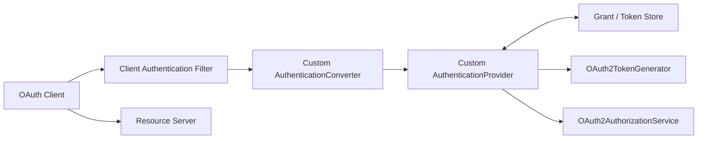

# Security and Compatibility Testing for Extension Grants or Endpoints

An extension grant or endpoint is complete only when clients can consume it under a stable contract, the Authorization Server thoroughly verifies both client identity and authorization proof, tokens are persisted and checked throughout their lifecycle, and invalid requests are rejected per OAuth 2.0 rules. A single unit test for `AuthenticationProvider` returning a token does not prove that entire flow. Bugs can hide in the converter, provider, filter ordering, client authentication, persistence, token generator, response handler, or how the Resource Server interprets the token.

Spring Authorization Server exposes extension points for protocol endpoints. For custom authorization grants at the Token Endpoint, the official guide uses `AuthenticationConverter` to turn an HTTP request into a grant authentication token, `AuthenticationProvider` to verify the grant and issue tokens, and registers both via `OAuth2TokenEndpointConfigurer`. For custom endpoints, the application must explicitly define request matchers, filters, authentication/authorization policies, success handlers, and error handlers. [Extension Authorization Grant](https://docs.spring.io/spring-authorization-server/reference/guides/how-to-ext-grant-type.html) · [Protocol Endpoints](https://docs.spring.io/spring-authorization-server/reference/protocol-endpoints.html)

This lesson belongs to the **Protocol Extensions** chapter of the **SPRING_SECURITY_OAUTH2_OIDC_AUTHORIZATION_SERVER** module. The focus is building a security and compatibility testing strategy for custom grants or endpoints: from parsers, providers, and token lifecycles to HTTP contracts, client/resource server interactions, concurrency, version upgrades, and production operations.

**Example scope:** APIs and extension point names align with Spring Authorization Server 1.5.8. Tests use JUnit, Spring Test/MockMvc, and optionally Testcontainers for databases. Verify actual project dependencies and configuration before copying.

## 1. Defining the Contract Before Writing Tests

### 1.1. Extension Grants and Custom Endpoints Differ

| Extension Type | Example | Integration Point | What to Test |
|---|---|---|---|
| Extension authorization grant | `urn:ietf:params:oauth:grant-type:custom_code` | Token Endpoint | Client authentication, grant evidence, scopes, token generation, authorization persistence, and OAuth errors |
| Extended parameters on a standard endpoint | Claim request or extra validation | Corresponding Authorization, PAR, or Token Endpoint configurer | Standard request compatibility, default validation, and new parameters |
| Custom endpoint | Status check endpoint or proprietary protocol | Security filter chain with dedicated matcher/filter | Routing, authentication, authorization, CSRF/CORS if applicable, responses/errors, and rate limiting |
| Custom client authentication | Proprietary client auth method | Client Authentication configurer | Credential verification, replay, client binding, and principal in `SecurityContext` |
| Custom token/claim behavior | Token format or claim generator | `OAuth2TokenGenerator` and token customizers | Claims, audience, expiry, keys, Resource Server validation, and backward compatibility |

An extension grant usually goes through the existing Token Endpoint. It must follow that endpoint's client authentication and OAuth error response rules. A custom endpoint with its own URL must be integrated explicitly into the filter chain; adding a standalone controller does not automatically inherit the Token Endpoint's protocol security.

### 1.2. Write the Contract Using Observable Data

Before testing, document:

- HTTP method, path, content type, and encoding;
- Name, type, cardinality, and size limits of every parameter;
- How clients authenticate;
- Grant type or operation identifier;
- Which clients are permitted to use it;
- Allowed scopes/resources/audiences that may be requested;
- Conditions for grant evidence validity;
- Issued token types, TTLs, and claim contracts;
- What state is persisted and how replay is handled;
- Success responses and error responses;
- Rate limits, timeouts, and external dependencies;
- Compatibility changes across versions.

Example contract for a custom grant:

```text
POST /oauth2/token
Content-Type: application/x-www-form-urlencoded
Authorization: Basic <client-credentials>

grant_type=urn:ietf:params:oauth:grant-type:custom_code
code=<one-time-grant>
scope=orders.read
```

This is an illustrative contract. Actual grant URIs and parameters must be defined in your system's integration documentation. Per the Spring Authorization Server guide, extension grants use a unique absolute URI for `grant_type`; the converter recognizes only its exact grant URI and returns `null` for other grants so downstream converters can process them. [Extension Grant Guide](https://docs.spring.io/spring-authorization-server/reference/guides/how-to-ext-grant-type.html)

### 1.3. Distinguishing Requirements, Implementations, and Test Oracles

| Concept | Example |
|---|---|
| Requirement | Grant evidence can be used only once |
| Implementation | Provider looks up grant record, checks status, and consumes atomically |
| Test oracle | Two concurrent requests using the same grant: at most one succeeds |
| Evidence | HTTP responses, authorization records, and audit events after both requests |

Do not write tests that merely verify a method was called. Tests must prove protocol behaviors observable by a client or attacker.

### 1.4. Role and Trust Boundary Matrix



The client controls the HTTP parameters and credentials it sends. The client must never self-assert the authenticated principal, grant permissions, consumed state, or security claims. The provider must take client identity from framework-verified authentication and then apply policy before issuing tokens.

## 2. Layered Testing Strategy

### 2.1. Converter Unit Tests

`AuthenticationConverter` is the boundary between HTTP and domain authentication tokens. Test the converter in isolation to confirm:

- Recognizes the exact `grant_type` or endpoint request;
- Returns `null` for requests belonging to other grants;
- Rejects missing, empty, or duplicate required parameters;
- Rejects malformed or out-of-bounds values;
- Never silently picks the first value when a parameter appears multiple times;
- Excludes reserved parameters like `grant_type`, `client_id`, and `client_secret` from additional parameters if required by contract;
- Never derives client identity from caller-asserted parameters;
- Never logs raw secrets/grant codes.

A converter should inspect all values of any single-valued parameter. For example, `code=a&code=b` must not be accepted simply because `getParameter("code")` returns the first value.

### 2.2. Provider Unit Tests

`AuthenticationProvider` implements trusted business logic. Independently test branches for:

- Missing or unauthenticated client principal;
- `RegisteredClient` does not allow the grant;
- Grant evidence missing, wrong client, expired, used, or revoked;
- Scope/resource/audience exceeds client or consent permissions;
- Principal/tenant binding mismatch;
- Token generator returns `null` or throws an error;
- Authorization store fails to save;
- Grant consumption contested by another request;
- Provider rejects unsupported authentication token types.

Mock dependencies in unit tests to verify logic branches, but never use mocks as a substitute for persistence or protocol endpoint integration tests.

### 2.3. Endpoint Integration Tests

Use `@SpringBootTest` and `@AutoConfigureMockMvc` or a real test server to traverse the full `SecurityFilterChain`. These tests verify:

- Endpoint matcher selects the right filter chain;
- Client authentication executes before the custom grant provider;
- Converter/provider are registered properly;
- Success/error handlers render exact HTTP responses;
- Authorizations are saved before returning successful token responses;
- Default grants still work after adding the converter;
- Other endpoints are not inadvertently matched by custom filters.

### 2.4. Consumer/Interoperability Tests

Test with a real client or minimal test client to verify the wire contract:

- Basic or other published client authentication methods;
- Form encoding and parameter escaping;
- Exact `grant_type` URI;
- Token response field names and JSON types;
- Error bodies and HTTP statuses;
- Token type, expiry, scope, and refresh behavior;
- Resource Server token validation;
- Client SDK or OAuth library response parsing.

An internal mock request does not prove a real client library can construct valid requests.

### 2.5. System, Load, and Resilience Tests

Finally, test against a production-like topology:

- Multiple Authorization Server instances;
- Real Database/Redis or Testcontainers;
- Reverse proxy and TLS termination;
- Signing keys/JWKS;
- Rate limiting;
- Dependency timeouts;
- Failover, restarts, and rolling upgrades;
- Load and concurrent replay.

You do not need every scenario in every unit test. Place each invariant at the test layer where it can be observed and reproduced reliably.

## 3. Testing AuthenticationConverter

### 3.1. Input Matrix

| Input | Expected Result |
|---|---|
| Exact custom `grant_type`, valid required parameters | Creates custom grant authentication token |
| Another standard grant type | Returns `null`, letting standard converters handle it |
| Missing `grant_type` | Does not match custom grant; endpoint handles per general contract |
| Unknown `grant_type` | Does not turn into custom grant |
| Missing grant evidence | `invalid_request` |
| Empty grant evidence | `invalid_request` |
| Required parameter repeated twice | `invalid_request` |
| Value exceeds size limit | Rejected before invoking downstream |
| Extra `client_id` in body when client authenticated via Basic | Does not override authenticated client from body |
| Unsupported parameters present | Rejected or ignored per published contract consistently across versions |
| Body lacks valid form content type | Returns appropriate request error without parsing on assumptions |

If a parameter is multi-valued per protocol, define explicit rules. Do not mechanically apply single-value rules to every parameter.

### 3.2. JUnit Example for the Converter

Illustrative test using `MockHttpServletRequest`. `CustomCodeGrantAuthenticationConverter` and `CustomCodeGrantAuthenticationToken` are application classes:

```java
import static org.junit.jupiter.api.Assertions.*;

import org.junit.jupiter.api.AfterEach;
import org.junit.jupiter.api.Test;
import org.springframework.mock.web.MockHttpServletRequest;
import org.springframework.security.core.Authentication;
import org.springframework.security.core.context.SecurityContextHolder;
import org.springframework.security.oauth2.core.OAuth2AuthenticationException;

class CustomCodeGrantAuthenticationConverterTests {

    private final CustomCodeGrantAuthenticationConverter converter =
            new CustomCodeGrantAuthenticationConverter();

    @AfterEach
    void clearSecurityContext() {
        SecurityContextHolder.clearContext();
    }

    @Test
    void convertsOnlyItsOwnGrantType() {
        MockHttpServletRequest request = new MockHttpServletRequest();
        request.setParameter("grant_type",
                "urn:ietf:params:oauth:grant-type:custom_code");
        request.setParameter("code", "one-time-code");

        Authentication result = converter.convert(request);

        assertInstanceOf(CustomCodeGrantAuthenticationToken.class, result);
    }

    @Test
    void returnsNullForAnotherGrantType() {
        MockHttpServletRequest request = new MockHttpServletRequest();
        request.setParameter("grant_type", "client_credentials");

        assertNull(converter.convert(request));
    }

    @Test
    void rejectsDuplicateGrantEvidence() {
        MockHttpServletRequest request = new MockHttpServletRequest();
        request.addParameter("grant_type",
                "urn:ietf:params:oauth:grant-type:custom_code");
        request.addParameter("code", "first");
        request.addParameter("code", "second");

        assertThrows(OAuth2AuthenticationException.class,
                () -> converter.convert(request));
    }
}
```

The test class above must import the corresponding custom classes. This test does not mock `SecurityContextHolder` because it focuses on converter matching/parsing. Add a separate test to verify the client principal is retrieved from the authenticated security context when the implementation passes the principal into the custom authentication token.

### 3.3. Testing Parameter Pollution

Requests like the following must yield deterministic outcomes:

```http
grant_type=urn:ietf:params:oauth:grant-type:custom_code
&code=valid-code
&code=attacker-code
```

```http
grant_type=urn:ietf:params:oauth:grant-type:custom_code
&scope=orders.read
&scope=admin
```

```http
grant_type=urn:ietf:params:oauth:grant-type:custom_code
&client_id=trusted-client
&client_id=attacker-client
&code=valid-code
```

Duplicate parameters can be interpreted differently by proxies, servlet containers, and applications. Test behavior across the exact HTTP stack running in production. For critical parameters, reject ambiguity rather than letting each layer pick a different value.

### 3.4. Testing Request Limits

Test scenarios including:

- Unusually long grant codes;
- Excessive unnecessary parameters;
- Large bodies;
- Malformed encodings;
- Invalid Unicode characters or percent-encoding;
- Overly long `Authorization` headers;
- Missing or incorrect `Content-Type`.

Limits must be enforced at both the reverse proxy/container and the application if payloads can be buffered before reaching the converter. Never reflect raw input in error responses.

## 4. Testing AuthenticationProvider and Grant Evidence

### 4.1. Client Authentication and Grant Authorization

The provider must verify the client is authenticated and its registration permits the grant type. Minimum tests:

| Case | Outcome |
|---|---|
| Missing authenticated client principal | `invalid_client` |
| Wrong client secret/certificate/assertion | Client authentication fails before provider runs |
| Client authenticated but grant not registered | `unauthorized_client` |
| Client permitted for grant | Proceeds to validate grant evidence |
| Caller sends different `client_id` than authenticated client | Does not alter client principal |
| Client disabled or registration expired per policy | Rejected |

Do not rely on `client_id` in the request. The trusted client source is the `OAuth2ClientAuthenticationToken` authenticated by Spring Security and attached to the request.

### 4.2. Grant Evidence Must Be Bound

If the custom grant uses codes, tickets, assertions, or one-time credentials, verify:

- Evidence was issued by a trusted issuer/source;
- Evidence is bound to the exact client or client instance if required by protocol;
- Subject/principal binding is exact;
- Tenant, resource server, and audience match;
- Scopes lie within granted permissions;
- Lifetime has not expired;
- Evidence has not been consumed/revoked;
- Evidence has not been tampered with or signed by an untrusted key;
- Evidence cannot be used in another environment/issuer;
- Evidence from a different flow cannot be substituted.

Never accept caller-asserted email, username, or request parameters as authentication proof in place of a verified subject.

### 4.3. Testing Replay and One-Time Consumption

Create valid grant evidence and send the first request. A second request using the same evidence must be rejected per contract. Repeat the test for:

- Same client, same node;
- Same client, two nodes;
- Two requests sent concurrently;
- First request times out after server already consumed;
- Server restarts between consumption and saving authorization;
- Client retries after failing to receive the token response.

This is a critical concurrency test. Non-atomic "read record, check unused, update used" logic can allow two requests to succeed simultaneously.

### 4.4. Distinguishing Exactly-Once from Idempotency

HTTP clients may retry on timeout without knowing whether the server issued a token. Do not claim a custom grant supports exactly-once delivery merely because a record has a `used` flag.

If the protocol requires idempotency, design explicitly:

- Idempotency key bound to client and operation;
- Responses can be safely replayed for valid retries;
- No accidental minting of a second token;
- Other clients cannot reuse the key;
- TTL and retention of idempotency records;
- Handling crashes between commit and response.

If grant evidence is strictly single-use with no response-replay mechanism, retries after timeouts may require starting a new flow. Document this explicitly in the client contract.

### 4.5. Testing Scopes, Resources, and Audience

The provider must never grant broader permissions than requested and consented:

- Requested scopes must be a subset of client-allowed scopes;
- Never implicitly add administrative scopes;
- Resource/audience must comply with policy;
- Refresh tokens (if issued) must preserve scope/resource bindings per consent;
- Claims must not leak data from other tenants or subjects;
- Invalid scopes return `invalid_scope` per protocol contract.

Test requests with no scope, empty scope, duplicate scopes, scopes not registered by the client, and valid scope values paired with disallowed resources.

### 4.6. Testing Token Generator and Persistence Failures

Failure paths must have tests:

- `OAuth2TokenGenerator.generate(...)` returns `null`;
- Signing key/JWK unavailable;
- Token generator times out or throws an exception;
- `OAuth2AuthorizationService.save(...)` fails;
- Database timeout or deadlock;
- Grant consumption succeeds while saving authorization fails;
- Saving authorization succeeds while response handler fails.

A successful token response must be returned only when required state has been persisted per transaction policy. Never return a token successfully if authorization state cannot be recovered or controlled as designed.

## 5. Testing Token Responses and the Token Lifecycle

### 5.1. Response Contract

For successful requests, verify:

- HTTP status;
- Framework-compliant JSON Content-Type;
- `Cache-Control: no-store`;
- `Pragma: no-cache`;
- `access_token` is present and non-empty;
- `token_type` matches, typically `Bearer` for bearer access tokens;
- `expires_in` matches configured TTL;
- `scope` reflects the actually granted scopes;
- `refresh_token` is present only when permitted by policy/grant;
- Extension response fields match published types and semantics;
- No secrets, grant evidence, or internal error details are returned.

Do not assert JSON property ordering. Assert JSON semantics and the schema contract.

### 5.2. Token Claims and Resource Server

If issuing JWT access tokens, verify:

- Signature validates against the public key in JWKS;
- `iss`, `aud`, `exp`, `iat`, and `nbf` where present;
- Subject/client identity matches the grant type;
- Scopes/authorities are accurate;
- Token contains no excessive claims;
- Key ID and algorithm comply with policy;
- Resource Server rejects expired, wrong-issuer, wrong-audience, or invalid-signature tokens.

If issuing opaque tokens, verify introspection returns accurate `active` status along with scopes, client, subject, and expiry per contract. Never rely on a JWT-decoding test to conclude the opaque token path works.

### 5.3. Token Lifecycle

| Operation | What to Test |
|---|---|
| Issue | Token and authorization record are created |
| Use | Resource Server accepts matching scope/resource |
| Expire | Expired tokens are rejected or reported inactive |
| Refresh | New token issued per policy; old token handled accurately |
| Revoke | Token marked invalidated and introspection reflects it |
| Introspect | Only authorized clients can inspect token state |
| Restart | Authorization/token state survives restarts |
| Key rotation | Old tokens validate during the designed overlap window |
| Cleanup | Records with active refresh tokens or required state are not deleted |

### 5.4. Refresh Token Rotation and Replay Detection

If the extension grant issues refresh tokens, test two concurrent requests using the same refresh token. For public clients, RFC 9700 requires refresh tokens to be sender-constrained or rotated to detect replay. When rotation is chosen, the old token is invalidated and lineage between tokens must be retained to detect reuse. [RFC 9700](https://www.rfc-editor.org/rfc/rfc9700.html)

Tests must confirm:

- Only one request consumes the old token successfully;
- The old token cannot refresh again;
- New tokens retain the exact client, subject, scope, and resource bindings;
- Replay of an old token is detected per policy;
- Reuse detection revokes the token family if required by policy;
- State is synchronized across nodes;
- Crashes/failover do not resurrect old tokens.

## 6. Testing the Error Contract

### 6.1. OAuth Error Mapping

| Scenario | Common OAuth Error | What to Check |
|---|---|---|
| Missing request parameter or duplicate/malformed parameter | `invalid_request` | No token issued; response leaks no sensitive input |
| Wrong client authentication | `invalid_client` | HTTP status and `WWW-Authenticate` match auth method |
| Client not permitted for grant | `unauthorized_client` | Grant issuance does not execute |
| Grant evidence invalid, expired, or replayed | `invalid_grant` | Does not distinguish unnecessary sensitive details |
| Invalid scope | `invalid_scope` | No broader scopes granted |
| Unsupported grant type | `unsupported_grant_type` | Client knows endpoint does not support grant |
| Token generator or server dependency failure | `server_error` or appropriate error | No stack traces/SQL/JWK details returned |

Follow RFC 6749 §5.2 and your extension's contract. Do not use `invalid_grant` for every error just to simplify; error codes help clients distinguish malformed requests from invalid credentials.

### 6.2. Error Responses Must Not Leak Data

Verify responses and logs exclude:

- Raw client secrets or client assertions;
- Grant codes/tickets/assertions;
- Access/refresh tokens;
- Stack traces, SQL statements, connection strings;
- Internal hostnames or sensitive key identifiers;
- Confirmation that a subject exists when that creates user enumeration risk.

Helpful error descriptions can be returned, provided they are stable and independent of internal exception messages.

### 6.3. Never Turn Security Failures into Empty Successes

If grant evidence cannot be verified, the provider must reject. If authorization persistence fails, never return a response containing an unpersisted token. If an endpoint does not recognize a request, never pass the request to a default handler that might unintentionally grant different permissions.

## 7. Testing Custom Endpoints and SecurityFilterChain

### 7.1. Testing Request Matchers and Filter Ordering

For dedicated custom endpoints, test:

- Only the defined path and HTTP method are handled by the custom filter;
- Requests to standard OAuth endpoints still traverse standard filters;
- Similar paths or trailing slashes do not match unexpectedly;
- Disallowed HTTP methods are rejected;
- Filters do not execute twice;
- Endpoint sees the expected authentication principal in `SecurityContext`;
- Exceptions route through the appropriate handler;
- Requests cannot bypass the chain's authorization rules.

For standard endpoints, prefer built-in configurer extension points. For new paths, attach custom filters to a chain whose matcher includes that path. Do not assume `getEndpointsMatcher()` automatically includes application-added custom endpoints.

### 7.2. Testing Authentication and Authorization

Separate two questions:

- **Authentication:** who is the caller? Is the client authenticated? Has the resource owner logged in?
- **Authorization:** is that principal allowed to perform this operation on the specific resource/tenant/scope?

Test unauthenticated callers, wrong clients, authenticated clients lacking the grant, users missing roles, tenant mismatches, and scope mismatches. Do not test only `.authenticated()` in the filter chain if the endpoint requires finer-grained policy.

### 7.3. CSRF, CORS, and Browser Exposure

If a custom endpoint is called from a browser or relies on cookies/sessions, evaluate CSRF. If it is a machine-to-machine endpoint using Bearer/client authentication, define an explicit CSRF policy grounded in actual credential transport and `SecurityFilterChain` configuration.

CORS does not replace authentication. Test allowed origins, disallowed origins, preflight requests, and credentialed requests if browsers call the endpoint. Never enable `*` together with credentials. Do not open wide CORS on the Token Endpoint just for browser testing convenience.

### 7.4. Rate Limiting and Resource Exhaustion

Test:

- Burst requests from a single client;
- Multiple clients sharing an IP;
- Repeated invalid grant evidence;
- Large payloads;
- Slow downstream dependencies;
- Exhausted datastore connections;
- Concurrent requests targeting the same principal/evidence.

Rate limiting should key off verified identities and appropriate network signals. Never rely solely on a caller-asserted `client_id` parameter prior to client authentication.

### 7.5. HTTP Methods, Caching, and Response Headers

Verify endpoints reject GET when the contract allows only POST, never return credentials in URLs, set anti-caching headers on sensitive responses, and return accurate content types. If an endpoint issues redirects, verify redirect targets are allowlisted or bound to the client; never create open redirects from query parameters.

## 8. Testing Compatibility with OAuth 2.0 and Existing Clients

### 8.1. Do Not Break Standard Grants

After adding custom converters/providers, run regression tests for all enabled grants:

- Authorization Code + PKCE;
- Client Credentials;
- Refresh Token;
- Device Authorization;
- Token Exchange if enabled;
- Other standard or extension grants in the system.

Custom converters must return `null` for requests outside their grant. Custom providers must match `supports(...)` strictly to their authentication token class. Never remove or replace standard providers without an intentionally reviewed reason.

### 8.2. Testing Exact Client Registration

Client registrations must permit the exact custom grant type. Test:

- Clients with the grant type;
- Clients without the grant type;
- Disabled clients or modified registrations;
- Client secret rotation;
- Redirect URI/scope/token settings are not bypassed by the custom grant if those policies apply;
- Unique client IDs and stable internal registration IDs.

Never assume all clients can use an extension grant merely because a converter is registered on the endpoint.

### 8.3. Wire Compatibility

For integrated clients, keep stable:

- Grant URI;
- Parameter names and encoding;
- HTTP method and path;
- Client authentication method;
- Token response JSON;
- OAuth error codes;
- Token types and claim contracts;
- Scope semantics;
- Retry/replay behavior.

If a field must change, define contract versioning, a transition period, and backward compatibility for older clients. Never alter the semantics of an existing `grant_type` without versioning or a migration plan.

### 8.4. Metadata and Client Documentation

If the Authorization Server publishes metadata, verify fields such as issuer, token endpoint, grant types, or related capabilities accurately reflect what is supported. Extension grants have custom URIs; do not assume every client library auto-discovers them. Integration docs must supply sample requests, client authentication, required parameters, and error semantics.

### 8.5. Contract Testing with Real Clients

Use an independent test client or supported OAuth library in your ecosystem:

1. Configure registration and secret;
2. Send requests over HTTPS to the live endpoint;
3. Verify status, JSON, and headers;
4. Validate the token with the Resource Server;
5. Call APIs matching the scopes;
6. Send failing requests;
7. Exercise refresh/revocation if part of the contract;
8. Re-run against both the previous client version and the new client version.

This catches mismatches in form encoding, Basic auth, JSON types, and retry behavior that unit tests cannot detect.

## 9. Testing Compatibility Across Spring Upgrades

### 9.1. Three Layers of Compatibility

| Layer | What Must Be Preserved |
|---|---|
| Source/API compatibility | Classes, methods, constructors, packages, and configurer extension points |
| Wire/protocol compatibility | Requests, responses, errors, token claims, and discovery metadata |
| Persisted-data compatibility | Serialization, database schema, token metadata, and authorization state |

An application that compiles cleanly after a dependency upgrade can still break wire contracts or fail to deserialize authorizations persisted by an older version.

### 9.2. Version Matrix

Build a CI matrix covering:

- Current running Spring Authorization Server version;
- Target version;
- Compatible Spring Security/Spring Boot versions;
- Database/Redis adapters;
- Supported client SDKs.

Do not mix mismatched Spring Security and Spring Authorization Server release lines arbitrarily. Use BOM/dependency management and official compatibility matrices.

### 9.3. Pre/Post-Upgrade Regression Tests

Run the same contract test suite on both versions:

- Converter/provider behavior;
- HTTP status and OAuth error responses;
- Token response fields;
- JWT headers/claims/signatures;
- Authorization save/find/update;
- `findByToken` across every token type;
- Refresh/revocation;
- Custom endpoint filter ordering;
- Metadata/discovery;
- Deserialization of data written by the previous version.

If schemas or serialized payloads change, test migrations and rollbacks/forward-fixes using masked production-like copies.

### 9.4. Avoid Depending on Internal Implementations

Prefer public extension points such as `AuthenticationConverter`, `AuthenticationProvider`, `OAuth2TokenGenerator`, and configurer APIs. Avoid relying on internal classes, undocumented filter ordering, or reflection. If forced to rely on an implementation detail, write an explicit regression test and document it as a compatibility risk.

## 10. Threat-Model-Driven Security Testing

### 10.1. Threat-to-Test Matrix

| Threat | Test Case | Safe Outcome |
|---|---|---|
| Client impersonation | Wrong secret/assertion, spoofed client ID | `invalid_client`; no token issued |
| Grant replay | Reusing code/ticket | Subsequent request rejected |
| Grant substitution | Client A's evidence used by client B | Rejected |
| Subject substitution | Evidence belongs to user A but request asserts user B | Caller-supplied subject ignored |
| Scope escalation | Requesting scopes beyond permissions | `invalid_scope` or policy error |
| Audience/resource substitution | Requesting token for disallowed resource | Rejected or restricted to allowed audience |
| Tenant crossing | Tenant A evidence accessing tenant B | Rejected |
| Parameter pollution | Duplicate or conflicting sensitive parameters | `invalid_request` |
| Token replay | Reusing old refresh token after rotation | Reuse detected and policy enforced |
| Token leakage | Token appears in URL/log/error | No token exposed |
| Open redirect | Redirecting to caller-supplied URL | URL outside allowlist rejected |
| Denial of service | Large payloads, request bursts, downstream timeouts | Resource limits enforced, fail safely |
| Race condition | Two requests consume the same grant | At most one succeeds |
| Cross-node stale state | Other node misses revocation | Behavior stays within consistency SLA |
| Key confusion | Token uses disallowed algorithm/kid | Resource Server rejects |
| Serialization tampering | Stored payload modified | Untrusted types rejected; no token issued from corrupted data |

### 10.2. Applying OAuth 2.0 Security BCP

RFC 9700 updates the OAuth 2.0 threat model. Recommendations that should be reflected in your test suite include:

- Exact string matching for registered redirect URIs, except native app localhost port rules;
- CSRF and authorization code injection protection;
- PKCE for public clients;
- No open redirectors;
- Restricting access token privileges and audience;
- Sender-constraining access tokens via mTLS/DPoP where appropriate;
- Public client refresh tokens must be sender-constrained or rotated;
- Never exposing tokens in URLs or logs.

A custom grant must not weaken these protections in standard flows. If an extension involves redirects or browser interactions, evaluate the corresponding threats rather than assuming they do not apply. [RFC 9700](https://www.rfc-editor.org/rfc/rfc9700.html)

### 10.3. Fuzzing and Property-Based Testing

For converters/parsers, fuzz inputs with:

- Missing, empty, duplicate, and improperly encoded parameters;
- Unicode strings, null bytes, and control characters;
- Extremely long values;
- Deeply nested JSON if an endpoint accepts JSON;
- Malformed tokens/evidence;
- Duplicate headers;
- Unknown fields.

Property-based tests can assert invariants: any request with a duplicate required parameter never produces an authentication token; any request belonging to another grant is never consumed by the custom converter; parsers never throw unhandled errors leaking stack traces.

## 11. MockMvc Example for a Custom Grant

### 11.1. Happy-Path Test Through the Token Endpoint

This test must use real client authentication from the test context, a `RegisteredClient` configured with the custom grant type, and a grant evidence fixture. Never use `@WithMockUser` as a substitute for client authentication.

```java
@SpringBootTest
@AutoConfigureMockMvc
class CustomGrantEndpointTests {

    private static final String GRANT_TYPE =
            "urn:ietf:params:oauth:grant-type:custom_code";

    @Autowired
    MockMvc mvc;

    @Test
    void issuesTokenForAuthorizedClientAndValidGrant() throws Exception {
        mvc.perform(post("/oauth2/token")
                .with(httpBasic("custom-client", "test-secret"))
                .contentType(MediaType.APPLICATION_FORM_URLENCODED)
                .param("grant_type", GRANT_TYPE)
                .param("code", "valid-one-time-code")
                .param("scope", "orders.read"))
            .andExpect(status().isOk())
            .andExpect(header().string(
                    HttpHeaders.CACHE_CONTROL, containsString("no-store")))
            .andExpect(jsonPath("$.access_token").isNotEmpty())
            .andExpect(jsonPath("$.token_type").value("Bearer"))
            .andExpect(jsonPath("$.expires_in").isNumber())
            .andExpect(jsonPath("$.scope").value("orders.read"));
    }
}
```

Fixtures and imports such as `httpBasic`, `post`, `MediaType`, `HttpHeaders`, `header`, `jsonPath`, and `containsString` must be declared per your test project. `custom-client` must be a registration with the custom grant type and its secret encoded using an appropriate `PasswordEncoder`; the fixture code must be seeded in the test grant store.

### 11.2. Testing a Client Not Permitted for the Grant

```java
@Test
void rejectsClientThatIsNotRegisteredForCustomGrant() throws Exception {
    mvc.perform(post("/oauth2/token")
            .with(httpBasic("ordinary-client", "test-secret"))
            .contentType(MediaType.APPLICATION_FORM_URLENCODED)
            .param("grant_type", GRANT_TYPE)
            .param("code", "valid-one-time-code"))
        .andExpect(status().isBadRequest())
        .andExpect(jsonPath("$.error").value("unauthorized_client"));
}
```

Status and error body must be verified against your application version's error handler/configuration. The test should also confirm the grant evidence was not consumed when the client was unauthorized for the grant.

### 11.3. Testing Replay

```java
@Test
void rejectsReplayedGrantEvidence() throws Exception {
    issueToken("custom-client", "test-secret", "one-time-code");

    mvc.perform(post("/oauth2/token")
            .with(httpBasic("custom-client", "test-secret"))
            .contentType(MediaType.APPLICATION_FORM_URLENCODED)
            .param("grant_type", GRANT_TYPE)
            .param("code", "one-time-code"))
        .andExpect(status().isBadRequest())
        .andExpect(jsonPath("$.error").value("invalid_grant"));
}
```

`issueToken(...)` is a test project helper. Beyond the response, verify the store: the evidence is marked consumed, authorization records match only the number of successes, and no second token was issued from the same evidence.

### 11.4. Do Not Confuse Resource Server Authentication with Client Authentication

Spring Security Test provides the `jwt()` request post-processor to create a mock `Jwt` for Resource Server authorization tests. It is helpful for testing JWT-protected APIs, but it does not prove `OAuth2ClientAuthenticationFilter` authenticated a client at the Token Endpoint. For the Token Endpoint, use real client authentication via HTTP Basic, `client_secret_post` if supported, a `private_key_jwt` fixture, or whichever client auth method the test targets. [Testing OAuth 2.0 with MockMvc](https://docs.spring.io/spring-security/reference/servlet/test/mockmvc/oauth2.html)

## 12. Testing Persistence and Multiple Instances

### 12.1. Verifying Persisted Authorizations

After the happy path, verify:

- An authorization record exists tied to the exact `RegisteredClient` ID;
- Grant type is accurate;
- Principal name is accurate;
- Authorized scopes are accurate;
- Access token value/metadata are present;
- Issued-at and expires-at timestamps are accurate;
- Claims are persisted if the token generator produced claims;
- Grant evidence is marked consumed;
- Refresh token metadata exists if a refresh token was issued.

Do not stop at verifying `authorizationService.save(...)` was invoked. Read the record back via `findById` or `findByToken`.

### 12.2. Testing findByToken

For each token type created or relied upon by the extension, test:

- Valid token lookup returns the matching authorization;
- Invalid token lookup returns `null`;
- Wrong token type does not mistakenly return a record;
- Invalidated tokens remain retrievable for revocation/replay logic when required by contract;
- Removing an authorization causes lookups to stop returning the record;
- Data recovers completely after restarts.

### 12.3. Two-Instance Testing

```mermaid
sequenceDiagram
    participant C as Client
    participant A as Authorization Server A
    participant B as Authorization Server B
    participant DB as Shared Store
    C->>A: Custom grant request
    A->>DB: Consume grant + save authorization
    DB-->>A: Commit
    A-->>C: Access token
    C->>B: Introspection / refresh / revoke
    B->>DB: Lookup authorization
    DB-->>B: Current token state
    B-->>C: Protocol response
    C->>A: Introspect after revoke
    A->>DB: Read current state
    DB-->>A: Invalidated
    A-->>C: inactive
```



Tests must prove node B can look up tokens issued by node A, and node A observes revocations written by node B. If caches or asynchronous replicas exist, measure convergence time and confirm behavior meets SLA.

### 12.4. Testing Failover and Restarts

Simulate:

- Database connection dropped before saving;
- Connection dropped after commit but before response reaches client;
- Node restart right after consuming the grant;
- Redis primary failure immediately after write;
- Replica lag;
- Signing key rotation;
- Rolling deployment with two versions running simultaneously.

After each failure, verify grants cannot be used twice, tokens are not illegally re-issued, and authorizations do not vanish outside published RPO.

## 13. Testing Observability and Auditing

### 13.1. Logs and Audit Events

Safe to log:

- Request/correlation ID;
- Authenticated client ID;
- Grant type or endpoint operation;
- Policy outcome;
- OAuth error code;
- Latency;
- Node/region;
- Authorization ID or policy-protected subject fingerprint.

Never log raw client secrets, client assertions, grant evidence, authorization codes, access tokens, refresh tokens, or full request bodies.

### 13.2. Metrics

Track:

- Request count by grant type/client;
- Success and error rates;
- `invalid_client`, `unauthorized_client`, `invalid_grant`, `invalid_scope`;
- Grant replay detections;
- Token generation failures;
- Persistence errors;
- Concurrent refresh conflicts;
- p50/p95/p99 latency;
- Rate-limit rejections;
- Replication/cache lag;
- Cross-node lookup failures.

Never use tokens, subjects, or emails as metric labels due to high cardinality and sensitive data exposure.

### 13.3. Testing Audit Correctness

Every grant rejection due to replay or scope escalation should emit an appropriate event, yet audit events must never contain credentials. Also test when the audit sink is unavailable: determine whether auditing is a synchronous requirement or best-effort/outbox, and ensure an audit failure never accidentally turns a rejected grant into a success.

## 14. Release Gate and Acceptance Matrix

### 14.1. Minimum Test Suite

| Group | Pass Criteria |
|---|---|
| Converter | Exact grant accepted; other requests ignored; duplicate/malformed inputs rejected |
| Provider | Client, grant evidence, subject, scope, audience, and tenant verified |
| Replay | Grant/code consumed strictly per policy; concurrency never produces two successes |
| Token | Claims, TTL, response, and Resource Server validation accurate |
| Persistence | Save/find/remove and all token lookups recover accurately |
| Error | OAuth error/status/headers accurate, zero information leakage |
| Filter chain | Endpoint matcher/order/authentication/authorization accurate |
| Regression | Standard grants and standard endpoints unaffected |
| Compatibility | Old/new clients and wire contracts verified |
| Resilience | Restarts/failover preserve token invariants |
| Observability | Adequate metrics/audits containing zero credentials |
| Performance | Throughput/latency and resource usage within thresholds |

### 14.2. Release Blockers

Do not release if any of these defects remain:

- Unauthenticated clients can obtain tokens;
- Clients lacking grant permission can still use it;
- Grant evidence can be replayed or consumed twice;
- Scopes/resources/audience can escalate beyond policy;
- Tokens are returned without saving authorizations;
- Revoked tokens remain active beyond SLA;
- Custom converter breaks standard grants;
- Error responses or logs expose credentials;
- New endpoints bypass authentication/authorization;
- Upgrade breaks reading old authorizations without a migration;
- Older clients break on published responses/errors.

### 14.3. Canary and Rollback

Roll out extensions by client allowlist or traffic cohort if your architecture supports it. Monitor error rates, latency, replays, persistence failures, and Resource Server rejections. Rollback plans must keep schemas/serialization compatible with both old and new versions; never roll back code after a migration has deleted data needed by the old version.

## 15. Execution Workflow

1. Write the protocol contract and threat model.
2. List grant types, token types, client authentication methods, and endpoint matchers.
3. Build converter tests for parameter parsing and ambiguity.
4. Build provider tests for client, grant evidence, scopes, and token policies.
5. Build concurrency tests for one-time consumption, code replay, and refresh rotation.
6. Build MockMvc tests across the full filter chain.
7. Verify success/error responses and headers.
8. Read back persisted authorizations by ID and by each token type.
9. Verify tokens at the Resource Server or introspection endpoint.
10. Run regression tests for all standard grants/endpoints.
11. Run consumer contract tests with real clients.
12. Run multi-instance, restart, failover, and upgrade tests.
13. Measure load, latency, rate limiting, and downstream timeouts.
14. Verify log, audit, and metric redaction.
15. Archive test evidence and release only when all security gates pass.

## 16. Hands-On Exercise

**Context:** The Authorization Server has a custom grant `urn:ietf:params:oauth:grant-type:custom_code`. Client `messaging-client` sends a single-use code to `/oauth2/token`. The provider verifies the code in the grant store, issues a JWT access token with scope `message.read`, and saves the authorization via `OAuth2AuthorizationService`. The system runs two instances.

**Requirements:**

1. Write converter tests for the matching grant type, another grant, missing code, and duplicate code.
2. Write provider tests for unauthenticated clients, clients not permitted the grant, and expired codes.
3. Verify the code is bound to the verified client and subject.
4. Verify scopes cannot exceed registration or consent.
5. Verify two concurrent requests using the same code yield at most one success.
6. Write a MockMvc happy-path test using HTTP Basic client authentication.
7. Write tests for `unauthorized_client`, `invalid_grant`, `invalid_scope`, and `invalid_client`.
8. Verify the token response contains `no-store`, accurate token type, expiry, and scope.
9. Use a Resource Server test to verify JWT issuer, audience, signature, and scope.
10. Read the authorization back by ID and by access token after issuance.
11. Run a two-instance test: node A issues the token, node B introspects/revokes.
12. Simulate restart/failover between consuming the code, saving the authorization, and returning the response.
13. Verify the standard `client_credentials` grant still functions.
14. Verify no credentials appear in logs, error bodies, or metrics.
15. Write consumer contract tests for the current client version and the next version.

**Acceptance criteria:** The custom grant works only for authenticated clients registered for the grant; codes are verified and consumed safely; tokens have accurate scopes/claims, are persisted, and validate on the Resource Server; replays and concurrency races are blocked; error contracts hold; standard grants remain unaffected; state stays consistent across both instances within SLA.

## 17. Self-Assessment Questions

1. Why is a unit test for `AuthenticationProvider` insufficient to accept a custom grant?
2. What should `AuthenticationConverter` return when a request belongs to another grant?
3. Why can duplicate parameters cause parameter pollution?
4. Where does the provider obtain the authenticated client?
5. When do you return `unauthorized_client` versus `invalid_grant`?
6. Why must grant evidence bind to client, subject, audience, and tenant?
7. How do tests prove a one-time grant cannot be replayed under concurrency?
8. Why must token responses be returned only after authorization state is persisted successfully?
9. Which token metadata must be checked after issuance?
10. Why does the `jwt()` test post-processor not prove client authentication at the Token Endpoint?
11. How should custom endpoints be tested for filter matchers and ordering?
12. When must CSRF and CORS be evaluated for extension endpoints?
13. Why must a custom converter preserve default grant processing?
14. What are the three compatibility layers to verify when upgrading Spring Authorization Server?
15. Why must `findByToken` be tested per token type?
16. How does Redis replica lag affect revocation tests?
17. What does RFC 9700 require for public client refresh tokens?
18. Which data must never appear in logs?
19. How do you roll back a release that altered persistence schemas?
20. Which conditions must block a release even when all happy-path tests pass?

## 18. Official References

- [Spring Authorization Server 1.5.8 — How-to: Implement an Extension Authorization Grant Type](https://docs.spring.io/spring-authorization-server/reference/guides/how-to-ext-grant-type.html): `AuthenticationConverter`, `AuthenticationProvider`, Token Endpoint configuration, and sample requests.
- [Spring Authorization Server 1.5.8 — Protocol Endpoints](https://docs.spring.io/spring-authorization-server/reference/protocol-endpoints.html): extension points for authorization, PAR, device, token, introspection, revocation, and OIDC endpoints.
- [Spring Authorization Server — Configuration Model](https://docs.spring.io/spring-authorization-server/reference/configuration-model.html): configuring core services, endpoint configurers, and `SecurityFilterChain`.
- [Spring Security — Testing OAuth 2.0 with MockMvc](https://docs.spring.io/spring-security/reference/servlet/test/mockmvc/oauth2.html): testing Resource Server JWT/Opaque tokens and OAuth2 login in MockMvc.
- [RFC 6749 — The OAuth 2.0 Authorization Framework](https://www.rfc-editor.org/rfc/rfc6749.html): grant types, token requests, error responses, and extension grants.
- [RFC 9700 — Best Current Practice for OAuth 2.0 Security](https://www.rfc-editor.org/rfc/rfc9700.html): exact redirect URI matching, PKCE, token replay, refresh token rotation, sender-constrained tokens, and threat mitigations.
- [RFC 8414 — OAuth 2.0 Authorization Server Metadata](https://www.rfc-editor.org/rfc/rfc8414.html): metadata discovery and supported grant types.
- [RFC 6750 — OAuth 2.0 Bearer Token Usage](https://www.rfc-editor.org/rfc/rfc6750.html): transmitting Bearer tokens and handling token errors.
- [RFC 7636 — Proof Key for Code Exchange](https://www.rfc-editor.org/rfc/rfc7636.html): PKCE and authorization code interception mitigation.

**Remember:** Testing an extension must span from HTTP parsing through provider, token, persistence, and Resource Server. Verify the client is authenticated, the grant is permitted by registration, evidence binds to the exact client/subject/resource and is consumed strictly per policy. Test replay/concurrency, token responses, OAuth errors, filter ordering, compatibility with standard grants, and multi-node state. Release only when security invariants hold under malformed requests, retries, restarts, and failover.
