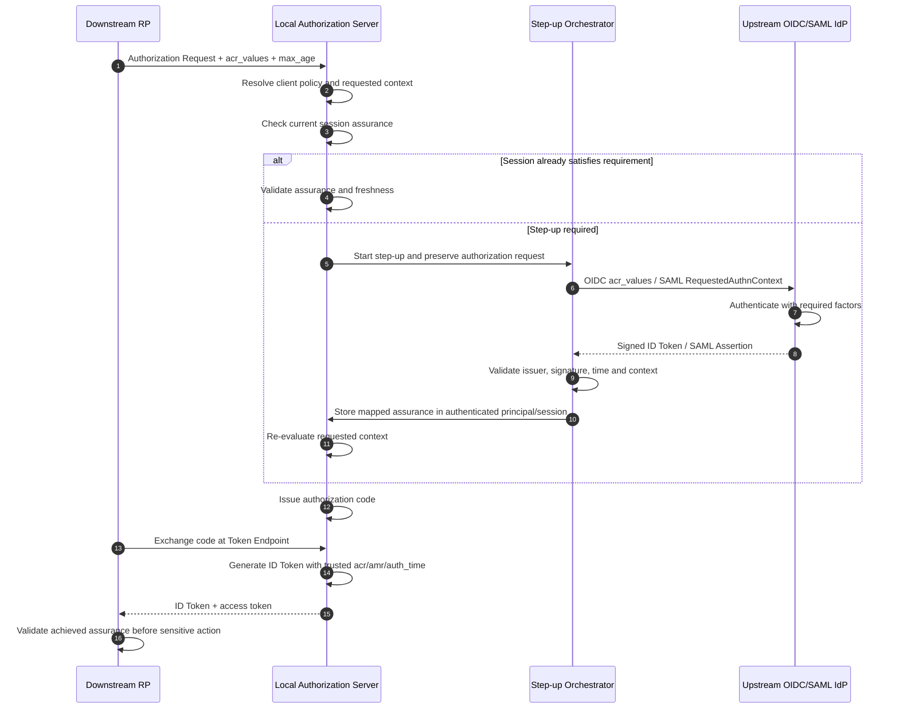

# Passing Authentication Assurance Levels and Contextual MFA Requirements

## 1. The problem: applications need to know how strongly a user authenticated

A user may sign into a system through multiple Identity Providers (IdPs): a local account, Microsoft Entra ID, a partner's SAML IdP, or an OpenID Connect (OIDC) provider. After login succeeds, the application typically receives only an "authenticated" outcome. However, sensitive business operations need to know more:

- Did the user use a password, OTP, security key, or biometrics?
- Were truly independent factors used, or did the user simply re-enter the same factor?
- When did the most recent authentication take place?
- Did the IdP satisfy the application's MFA requirement, or merely reuse an old SSO session?
- Can the Authorization Server issue an ID Token accurately reflecting the achieved assurance level?

If the application only checks whether the user is logged in, it may allow a high-risk action using an old SSO session authenticated solely with a password. Conversely, requiring MFA for every action creates heavy friction disproportionate to each transaction's risk.

The solution is to propagate **Authentication Context** across the entire identity federation chain. A Relying Party (RP) can request a specific assurance level or authentication method; the IdP must perform the appropriate authentication; the Authorization Server verifies the result, maps it to internal policy, and issues tokens reflecting the achieved authentication context.

This lesson explains how to convey assurance/MFA requirements via OIDC and SAML 2.0, how to receive and verify results from the IdP, how to map them to internal policy, and how to include the results in ID Tokens in Spring Authorization Server.

This lesson belongs to the **Identity Federation** chapter of the **SPRING_SECURITY_OAUTH2_OIDC_AUTHORIZATION_SERVER** module. The overall module objective is **learning how to design, configure, secure, test, and operate an OAuth 2.0/OpenID Connect Authorization Server using Spring Security and Spring Authorization Server in a Spring Boot application**.

### Learning objectives

After this lesson, you will be able to:

1. Distinguish authentication method, authentication context, and assurance level.
2. Explain the meaning of OIDC `acr`, `amr`, `auth_time`, `acr_values`, `claims`, and `max_age`.
3. Distinguish a re-authentication request from a genuine MFA requirement.
4. Send `RequestedAuthnContext` and `ForceAuthn` in a SAML `AuthnRequest`.
5. Map OIDC/SAML results to internal assurance policies per issuer.
6. Customize Spring Security OAuth2 Login and SAML2 Login to request context and read results.
7. Use Spring Authorization Server extension points to validate `acr_values` requests.
8. Include verified `acr`, `amr`, and `auth_time` in ID Tokens.
9. Handle step-up authentication, stale SSO sessions, and unsatisfiable requests.
10. Test mapping, freshness, MFA enforcement, and untrusted IdP scenarios.

> **Version scope:** Spring examples use Spring Authorization Server 1.5.8 and Spring Security 6.5.x. The OpenSAML API in the SAML examples uses the OpenSAML 4 line supported by Spring Security 6.5. The assigned SPECIAL_NOTE for this lesson was left blank.

## 2. Concepts to distinguish

### 2.1. Authentication method

An authentication method is how a user proves their identity in a single authentication event, for example:

- Password.
- One-Time Password (OTP) via an app or device.
- Push approval.
- Security key/WebAuthn.
- Smart card or digital certificate.
- Biometrics.

A session may use multiple methods. However, having two interactive steps does not automatically prove MFA. Two steps can rely on the same factor, such as a password and a security question.

### 2.2. Authentication context

Authentication context describes the context or type of authentication performed by the IdP. Context can include:

- Authentication methods.
- Assurance level asserted by the IdP.
- Authentication policy applied.
- Time of authentication.
- Additional attributes per profile or bilateral agreement.

OIDC uses the `acr` claim to convey the Authentication Context Class Reference. SAML uses `AuthnContextClassRef` or `AuthnContextDeclRef` inside `AuthnStatement`.

### 2.3. Assurance level

Assurance level is the degree of confidence a system assigns to an authentication result based on an agreed policy. Illustrative internal examples:

| Level | Illustrative meaning | Suitable transactions |
| --- | --- | --- |
| AAL1 | Single factor or basic accepted method | Viewing general information |
| AAL2 | Multi-factor authentication per policy | Viewing personal data, updating profile |
| AAL3 | Stronger method with device/key binding per policy | Approving payments or changing credentials |

The AAL1/AAL2/AAL3 names in the table are illustrative policy labels. If an organization adopts NIST SP 800-63, it must implement the exact requirements of each Authentication Assurance Level and formal mapping; never assign an AAL solely from a claim string sent by an IdP.

### 2.4. acr vs. amr

| Claim | Meaning | Question answered |
| --- | --- | --- |
| acr | Authentication Context Class Reference | Which context/assurance did the authentication session achieve? |
| amr | Authentication Methods References | Which methods were used? |
| auth_time | Time the End-User was authenticated | How long ago did the user authenticate? |
| iat | Time the ID Token was issued | When was the token issued? |

`acr` is a string whose meaning is agreed between OP and RP; there is no universal numeric scale to compare all `acr` values. `amr` is a JSON array containing method references. RFC 8176 registers common values such as `pwd`, `otp`, `mfa`, `hwk`, `fpt`, and `face`.

Do not infer a strong `acr` simply because `amr` has multiple elements. Likewise, do not infer MFA because an IdP returns an arbitrary claim named `mfa` if that issuer is untrusted and the mapping is unverified.

## 3. OIDC conveying assurance requests and results

OIDC defines parameters and claims related to authentication context.

### 3.1. acr_values

`acr_values` is an optional parameter in an Authentication Request. The RP sends a space-separated list of `acr` values in order of preference. The OP is requested to use one of those contexts when processing the Authentication Request.

Example:

```http
GET /authorize?
  response_type=code&
  client_id=payments-web&
  scope=openid%20profile&
  redirect_uri=https%3A%2F%2Fpayments.example.com%2Fcallback&
  state=opaque-state&
  nonce=opaque-nonce&
  acr_values=urn%3Aexample%3Aassurance%3A2%20https%3A%2F%2Frefeds.org%2Fprofile%2Fmfa
```

The RP prefers internal context `urn:example:assurance:2` first, then accepts the REFEDS MFA profile if OP and RP have agreed on the mapping.

OIDC Core treats `acr_values` as requesting a voluntary claim. If the RP requires a specific `acr` strictly, use the `claims` request parameter with `essential=true` and appropriate `values` when the OP supports the `claims` parameter.

### 3.2. claims parameter to require a mandatory acr

Request object example:

```json
{
  "claims": {
    "id_token": {
      "acr": {
        "essential": true,
        "values": [
          "urn:example:assurance:2",
          "https://refeds.org/profile/mfa"
        ]
      }
    }
  }
}
```

When the `claims` parameter is supported and `acr` is requested as an Essential Claim, the OP must return an `acr` matching one of the requested values. The OP may ask the user to re-authenticate or add a factor. If unable to satisfy it, the OP must treat the authentication attempt as failed.

Do not silently return a weaker `acr` and leave the RP to guess whether the requirement was met.

### 3.3. max_age and auth_time

`max_age` limits the maximum elapsed time since the End-User was last authenticated. If the current session is too old, the OP must perform authentication again. When `max_age` is present, the ID Token needs to include `auth_time` so the RP can verify freshness.

Example:

```http
GET /authorize?
  response_type=code&
  client_id=payments-web&
  scope=openid&
  max_age=300&
  acr_values=urn%3Aexample%3Aassurance%3A2
```

This request requires assurance context 2 and an authentication time no older than 5 minutes per the RP's policy.

`auth_time` differs from `iat`. If a user logged into the IdP at 09:00 but the OP issues an ID Token at 11:00 by reusing the SSO session, `iat` may be 11:00 while `auth_time` remains 09:00.

### 3.4. prompt=login does not mean MFA

`prompt=login` asks the OP to display the authentication UI or perform re-authentication according to the OP's capabilities. It does not specify which factors must be used.

Example:

```http
GET /authorize?
  response_type=code&
  client_id=payments-web&
  scope=openid&
  prompt=login
```

The user might simply re-enter the same password. If the RP needs MFA, it must request an appropriate `acr` context and verify the returned result.

### 3.5. Processing rules at the RP

The RP should:

1. Send `acr_values` per business policy.
2. Use `claims.acr` essential when a mandatory context is required and supported by the OP.
3. Use `max_age` when recent authentication is required.
4. Verify ID Token signature, issuer, audience, nonce, `exp`, and claims per OIDC.
5. Check `auth_time` whenever `max_age` was sent.
6. Verify the returned `acr` is in the accepted set of values.
7. Never treat `prompt=login` as proof of MFA.

## 4. SAML conveying assurance requests and results

In SAML 2.0, an Authentication Request can contain `RequestedAuthnContext`. The returned Assertion contains `AuthnStatement` with `AuthnContext` and `AuthnInstant`.

### 4.1. RequestedAuthnContext

`RequestedAuthnContext` specifies the authentication context classes or declarations the Service Provider wants the IdP to satisfy.

XML example:

```xml
<samlp:AuthnRequest
    xmlns:samlp="urn:oasis:names:tc:SAML:2.0:protocol"
    xmlns:saml="urn:oasis:names:tc:SAML:2.0:assertion"
    ID="_request123"
    Version="2.0"
    IssueInstant="2026-11-16T10:00:00Z">
  <samlp:RequestedAuthnContext Comparison="exact">
    <saml:AuthnContextClassRef>
      https://refeds.org/profile/mfa
    </saml:AuthnContextClassRef>
  </samlp:RequestedAuthnContext>
</samlp:AuthnRequest>
```

The URI in the example is the REFEDS MFA profile. Use it only when both IdP and SP support that profile; many IdPs support only their own set of `AuthnContextClassRef` values.

### 4.2. Comparison

SAML 2.0 defines four values:

| Comparison | Meaning |
| --- | --- |
| exact | Result must exactly match at least one requested context |
| minimum | Result must be at least as strong as one requested context, as evaluated by the responder |
| better | Result must be stronger than the requested context per the responder's rules |
| maximum | Select the strongest possible context without exceeding any requested context |

If `Comparison` is omitted, the default value is `exact`. In federation practice, `exact` is usually more predictable. `minimum`/`better`/`maximum` depend on how the IdP ranks strength; not all IdPs implement ordering identically.

### 4.3. ForceAuthn

`ForceAuthn=true` asks the IdP to re-authenticate the user rather than relying solely on an existing session. However, it does not force the IdP to use MFA. If MFA is required, send an appropriate `RequestedAuthnContext` and check the actual context in the assertion.

### 4.4. AuthnStatement in the assertion

A SAML Assertion may contain an `AuthnStatement`:

```xml
<saml:AuthnStatement
    AuthnInstant="2026-11-16T09:58:00Z"
    SessionIndex="_session-abc">
  <saml:AuthnContext>
    <saml:AuthnContextClassRef>
      https://refeds.org/profile/mfa
    </saml:AuthnContextClassRef>
  </saml:AuthnContext>
</saml:AuthnStatement>
```

The RP reads `AuthnContextClassRef` to determine the achieved context and `AuthnInstant` to determine the authentication time. Never use `SessionNotOnOrAfter` in place of `AuthnInstant`: one represents session expiration, the other represents authentication time.

## 5. Building assurance mappings across IdPs

Each IdP may use different URIs, claims, or interpretations. There is no automatic mapping from every SAML `AuthnContextClassRef` to OIDC `acr` or from `amr` to AAL.

The Authorization Server should maintain an **assurance policy registry** governed per issuer.

### 5.1. Illustrative mapping table

| Issuer/protocol | Value returned by IdP | Internal mapping | Notes |
| --- | --- | --- | --- |
| OIDC corporate IdP | acr=urn:corp:loa:1 | LOCAL_AAL1 | Trusted only for allowlisted issuers |
| OIDC corporate IdP | acr=https://refeds.org/profile/mfa | LOCAL_MFA | Verify issuer profile and policy |
| OIDC IdP | amr=[pwd, otp] | LOCAL_MFA | Only when issuer guarantees both methods were verified |
| SAML partner IdP | PasswordProtectedTransport | LOCAL_AAL1 | Do not infer MFA |
| SAML partner IdP | MobileTwoFactorContract | LOCAL_MFA | Must confirm semantics with IdP |
| SAML partner IdP | https://refeds.org/profile/mfa | LOCAL_MFA | When both sides implement REFEDS MFA profile |

The values in the table are design examples. Never assume URIs or `amr` values with similar names represent the same assurance level without a trust agreement.

### 5.2. Mappings must be bound to the issuer

Do not map `acr` solely by value string. The same `acr` string can carry different meanings at two different issuers.

A policy record should include:

- Verified issuer identifier.
- Protocol: OIDC or SAML.
- ACR URI or SAML `AuthnContextClassRef`.
- AMR allowlist if applicable.
- Internal assurance level.
- Maximum freshness duration.
- Policy on phishing resistance or hardware-bound factors if required.
- Policy version and effective date.

### 5.3. Never elevate assurance from untrusted data

The following cases must be rejected or downgraded to unverified:

- ID Token without verified signature/issuer/audience.
- SAML assertion without verified signature, issuer, audience, recipient, and validity window.
- Issuer absent from the registry.
- `acr` not in approved mappings.
- `amr` containing untrusted values.
- `auth_time` missing or too old when policy requires freshness.
- IdP returns an MFA claim, yet the contract does not define MFA methods or criteria.

### 5.4. MFA must have explicit policy semantics

MFA is the result of combining independent factors per policy. Two methods belonging to the same factor must not be counted as MFA. For instance, password and PIN can both be knowledge factors.

When phishing-resistant MFA is required, policy must explicitly define accepted methods such as WebAuthn/FIDO2 or hardware-backed keys. Do not infer phishing resistance from a generic `acr` unless the issuer commits to that profile.

## 6. End-to-end identity federation model

In this model, the application uses Spring Authorization Server as the internal OP. Users are authenticated via upstream OIDC or SAML IdPs.



Principles:

1. The RP requests an assurance level appropriate for the action.
2. The Local AS checks whether the client is allowed to request that context.
3. If the session is not strong enough or is too old, the step-up orchestrator initiates additional authentication.
4. The Upstream IdP returns a signed result.
5. The Local AS verifies and maps the result according to issuer-specific policy.
6. The Local AS issues an authorization code/token only when assurance meets the requirement.
7. The ID Token reflects the actual achieved context, never blindly echoing the RP's request.

## 7. Spring Security OAuth2 Login: sending assurance requests to an OIDC IdP

Spring Security OAuth2 Login allows customizing the Authorization Request via `OAuth2AuthorizationRequestResolver`. You can add OIDC parameters such as `acr_values`, `max_age`, or `prompt`.

### 7.1. Resolver for fixed MFA requirements

Example configuring an upstream provider that always requires the MFA profile:

```java
@Bean
OAuth2AuthorizationRequestResolver authorizationRequestResolver(
        ClientRegistrationRepository registrations) {

    DefaultOAuth2AuthorizationRequestResolver resolver =
            new DefaultOAuth2AuthorizationRequestResolver(
                    registrations, "/oauth2/authorization");

    resolver.setAuthorizationRequestCustomizer(builder ->
            builder.additionalParameters(parameters -> {
                parameters.put(
                        "acr_values",
                        "https://refeds.org/profile/mfa");
                parameters.put("max_age", 300);
            }));

    return resolver;
}
```

Attach the resolver to `oauth2Login`:

```java
@Bean
SecurityFilterChain applicationSecurity(HttpSecurity http,
        OAuth2AuthorizationRequestResolver authorizationRequestResolver)
        throws Exception {

    http
        .authorizeHttpRequests(authorize ->
            authorize.anyRequest().authenticated())
        .oauth2Login(oauth2 ->
            oauth2.authorizationEndpoint(endpoint ->
                endpoint.authorizationRequestResolver(
                        authorizationRequestResolver)));

    return http.build();
}
```

The snippet above applies to every `ClientRegistration` passing through this resolver. If the application has multiple IdPs with different policies, use a separate resolver per provider or wrap the resolver to inspect `registrationId` before adding parameters. For dynamic step-up, the resolver wrapper reads requirements from the route or server-side context and adds only allowlisted `acr_values`. Never take an arbitrary `acr_values` string from a browser query parameter and forward it straight to the IdP.

### 7.2. Dynamic requirements per transaction

Policy example:

| Action | Requirement |
| --- | --- |
| Portal login | No specific `acr` required |
| View personal data | LOCAL_AAL1 and `auth_time` within 30 minutes |
| Change payment details | LOCAL_MFA and `auth_time` within 5 minutes |
| Change recovery method | Phishing-resistant MFA per policy |

The backend determines the policy from the business action and stores the step-up request in session/server-side state. The resolver uses only that context to construct the Authorization Request. Bind `state` to the session, `nonce`, and transaction ID to prevent request substitution.

### 7.3. Do not use prompt=login instead of acr_values

You can add `prompt=login` if you want the IdP to require re-authentication:

```java
builder.additionalParameters(parameters -> {
    parameters.put("prompt", "login");
    parameters.put("acr_values", "urn:example:assurance:2");
});
```

`prompt=login` asks to log in again; `acr_values` requests a context. When MFA is needed, you need both a policy requesting the context and validation of the returned result.

## 8. Receiving assurance from an OIDC IdP

Spring Security OIDC Login verifies the ID Token before invoking `OidcUserService`. `OidcUser` contains claims from the ID Token and potentially additional UserInfo claims.

### 8.1. Reading claims from the verified ID Token

A custom `OidcUserService` can call the default delegate and then convert verified claims into a dedicated domain object:

```java
@Bean
OAuth2UserService<OidcUserRequest, OidcUser> oidcUserService(
        AssuranceMappingService mappingService) {

    OidcUserService delegate = new OidcUserService();

    return request -> {
        OidcUser user = delegate.loadUser(request);

        String issuer = request.getClientRegistration()
                .getProviderDetails().getIssuerUri();

        Map<String, Object> claims = user.getIdToken().getClaims();
        AssuranceContext assurance =
                mappingService.fromOidc(issuer, claims);

        return new AssuranceAwareOidcUser(user, assurance);
    };
}
```

`AssuranceAwareOidcUser` is an application-defined wrapper implementing `OidcUser` and delegating methods such as `getIdToken()`, `getUserInfo()`, `getClaims()`, `getAuthorities()`, and `getName()`. The wrapper holds the mapped `AssuranceContext`.

Do not read `acr` from the UserInfo response to overwrite the result in the ID Token unless policy permits it. Authentication context must be bound to the authentication event, not treated as a user profile attribute.

### 8.2. Internal domain model

Example:

```java
public record AssuranceContext(
        String issuer,
        String acr,
        List<String> amr,
        Instant authTime,
        String localLevel,
        boolean phishingResistant,
        Instant verifiedAt) {
}
```

The domain object preserves both raw values from the issuer and the internal mapping outcome. This aids auditing, incident investigation, and policy changes without losing provenance.

### 8.3. Mapping service must validate thoroughly

Sketch:

```java
AssuranceContext fromOidc(String issuer, Map<String, Object> claims) {
    String acr = (String) claims.get("acr");
    List<String> amr = readStringList(claims.get("amr"));
    Instant authTime = readInstant(claims.get("auth_time"));

    TrustedIssuerPolicy policy = issuerRegistry.requireTrusted(issuer);
    AssuranceRule rule = policy.requireOidcRule(acr, amr);

    if (authTime == null) {
        throw new UntrustedAuthenticationContextException(
                "auth_time is required by this policy");
    }

    rule.validateMethods(amr);
    return new AssuranceContext(
            issuer, acr, amr, authTime, rule.localLevel(),
            rule.phishingResistant(), Instant.now());
}
```

This is illustrative pseudocode. `readStringList` and `readInstant` must perform strict type conversion. Never cast loosely or default `auth_time` to the current time when the claim is missing.

## 9. Spring Security SAML2 Login: requesting AuthnContext

Spring Security 6.5 supports customizing OpenSAML `AuthnRequest` via `OpenSaml4AuthenticationRequestResolver`.

### 9.1. Sending RequestedAuthnContext

Skeleton example:

```java
@Bean
Saml2AuthenticationRequestResolver samlAuthenticationRequestResolver(
        RelyingPartyRegistrationRepository registrations) {

    RelyingPartyRegistrationResolver registrationResolver =
            new DefaultRelyingPartyRegistrationResolver(registrations);

    OpenSaml4AuthenticationRequestResolver resolver =
            new OpenSaml4AuthenticationRequestResolver(registrationResolver);

    resolver.setAuthnRequestCustomizer(context -> {
        AuthnRequest request = context.getAuthnRequest();
        request.setForceAuthn(true);

        RequestedAuthnContext requested =
                buildRequestedAuthnContext(
                        "https://refeds.org/profile/mfa");
        request.setRequestedAuthnContext(requested);
    });

    return resolver;
}
```

The `buildRequestedAuthnContext` helper illustrates building the OpenSAML object:

```java
RequestedAuthnContext buildRequestedAuthnContext(String classRefValue) {
    XMLObjectBuilderFactory builders =
            XMLObjectProviderRegistrySupport.getBuilderFactory();

    RequestedAuthnContext requested =
            (RequestedAuthnContext) builders
                    .getBuilder(RequestedAuthnContext.DEFAULT_ELEMENT_NAME)
                    .buildObject(RequestedAuthnContext.DEFAULT_ELEMENT_NAME);

    AuthnContextClassRef classRef =
            (AuthnContextClassRef) builders
                    .getBuilder(AuthnContextClassRef.DEFAULT_ELEMENT_NAME)
                    .buildObject(AuthnContextClassRef.DEFAULT_ELEMENT_NAME);

    classRef.setURI(classRefValue);
    requested.getAuthnContextClassRefs().add(classRef);
    requested.setComparison(AuthnContextComparisonTypeEnumeration.EXACT);
    return requested;
}
```

This is an OpenSAML 4 example. Check packages/APIs against the OpenSAML dependency managed by Spring Security 6.5. If the IdP does not support the REFEDS MFA URI, use the URI published by the IdP and agreed upon by both parties.

Attach the resolver to `saml2Login`:

```java
@Bean
SecurityFilterChain samlSecurity(HttpSecurity http,
        Saml2AuthenticationRequestResolver resolver) throws Exception {

    http
        .authorizeHttpRequests(authorize ->
            authorize.anyRequest().authenticated())
        .saml2Login(saml ->
            saml.authenticationRequestResolver(resolver));

    return http.build();
}
```

### 9.2. Do not treat ForceAuthn as proof of MFA

`ForceAuthn=true` asks the IdP to re-authenticate. The user may still just re-enter a password. `RequestedAuthnContext` expresses the context to achieve; the response assertion must be checked to confirm the IdP satisfied it.

### 9.3. Reading AuthnContext and AuthnInstant from the assertion

Spring Security allows replacing `ResponseAuthenticationConverter` on `OpenSaml4AuthenticationProvider`. The default converter processes the assertion and creates a `Saml2Authentication`; the application can read the verified `AuthnStatement` to build an `AssuranceContext`.

Sketch:

```java
OpenSaml4AuthenticationProvider provider =
        new OpenSaml4AuthenticationProvider();

provider.setResponseAuthenticationConverter(responseToken -> {
    Saml2Authentication authentication =
            OpenSaml4AuthenticationProvider
                    .createDefaultResponseAuthenticationConverter()
                    .convert(responseToken);

    Assertion assertion =
            responseToken.getResponse().getAssertions().get(0);

    AuthnStatement statement = assertion.getAuthnStatements().stream()
            .findFirst()
            .orElseThrow(() ->
                    new UntrustedAuthenticationContextException(
                            "AuthnStatement is missing"));

    String classRef = statement.getAuthnContext()
            .getAuthnContextClassRef().getURI();
    Instant authnInstant = statement.getAuthnInstant();

    AssuranceContext assurance =
            assuranceMappingService.fromSaml(
                    trustedIssuerFor(responseToken),
                    classRef,
                    authnInstant);

    return new AssuranceAwareSaml2Authentication(
            authentication, assurance);
});
```

This is pseudocode for the wrapper and issuer resolution; use your application's actual registration/response API to obtain the verified issuer. If an assertion contains multiple `AuthnStatement` elements, apply a policy to select the appropriate statement rather than blindly grabbing the first one without examining semantics.

Do not replace the default response/assertion validator with a custom converter. The converter should run after verifying signature, issuer, audience, destination, subject confirmation, validity window, and `InResponseTo`. Keep default validation and layer assurance checks on top.

## 10. Integrating with Spring Authorization Server

Spring Authorization Server acts as the internal OP in the federation model. It needs to perform three tasks:

1. Receive assurance requests from downstream RPs.
2. Check the current session or trigger step-up.
3. Issue ID Tokens with `acr`, `amr`, and `auth_time` reflecting the actual result.

### 10.1. Authorization Endpoint has extension points to validate requests

`OAuth2AuthorizationEndpointConfigurer` lets you customize the Authorization Request Converter and `AuthenticationProvider`. `OAuth2AuthorizationCodeRequestAuthenticationProvider` has `setAuthenticationValidator(...)` to validate request parameters.

The default validator in SAS 1.5.8 checks `redirect_uri` and `scope`. When adding `acr_values` validation, you must retain both default validators.

### 10.2. Validating acr_values by policy

Skeleton example:

```java
Consumer<OAuth2AuthorizationCodeRequestAuthenticationContext>
        assuranceValidator = context -> {

    OAuth2AuthorizationCodeRequestAuthenticationValidator
            .DEFAULT_REDIRECT_URI_VALIDATOR.accept(context);
    OAuth2AuthorizationCodeRequestAuthenticationValidator
            .DEFAULT_SCOPE_VALIDATOR.accept(context);

    OAuth2AuthorizationCodeRequestAuthenticationToken request =
            context.getAuthentication();

    Object rawAcrValues =
            request.getAdditionalParameters().get("acr_values");

    List<String> requestedAcrValues =
            parseAndValidateAcrValues(rawAcrValues);

    clientAssurancePolicy.validateRequestedContexts(
            context.getRegisteredClient(), requestedAcrValues);

    AssuranceContext current =
            assuranceService.requireFor(request.getPrincipal());

    if (!assurancePolicy.satisfies(current, requestedAcrValues)) {
        throw new OAuth2AuthorizationCodeRequestAuthenticationException(
                new OAuth2Error("login_required",
                        "Required authentication context has not been met",
                        null),
                null);
    }

    Object rawMaxAge = request.getAdditionalParameters().get("max_age");
    if (rawMaxAge != null) {
        Duration maxAge = parseNonNegativeSeconds(rawMaxAge);
        if (!assurancePolicy.isFresh(
                current.authTime(), maxAge, clock.instant())) {
            throw new OAuth2AuthorizationCodeRequestAuthenticationException(
                    new OAuth2Error("login_required",
                            "Authentication context is too old",
                            null),
                    request);
        }
    }
};
```

This is pseudocode. The SAS version's request converter must preserve `acr_values` in `additionalParameters`; verify that with an integration test. If the converter does not preserve required parameters, add a custom `AuthenticationConverter` to retain protocol parameters accurately.

Client assurance policy must restrict which contexts each client is allowed to request. If supporting the `claims` request parameter, parse `claims.acr` and `essential`/`value(s)` per OIDC Core; do not assume the default converter parses or enforces `claims` JSON. With essential `claims.acr`, proceed only when the result achieves one of the requested values. `max_age` must also be explicitly handled as a freshness requirement; do not rely solely on `acr`.

Attach the validator to the default provider:

```java
authorizationServer.authorizationEndpoint(endpoint ->
    endpoint.authenticationProviders(providers ->
        providers.forEach(provider -> {
            if (provider instanceof
                    OAuth2AuthorizationCodeRequestAuthenticationProvider codeProvider) {
                codeProvider.setAuthenticationValidator(assuranceValidator);
            }
        })
    )
);
```

Do not replace the entire validator with `assuranceValidator` while forgetting `redirect_uri` or `scope` validators. A misconfiguration can weaken default protocol checks.

### 10.3. Step-up orchestration occurs before issuing the authorization code

The validator is the final gate. If the current session is not strong enough, the application needs a step-up flow:

1. Preserve the original authorization request in session/server-side state.
2. Resolve the `acr_values` requirement against the client's policy.
3. Redirect the user to the upstream OIDC/SAML IdP or local MFA endpoint.
4. After authentication succeeds, validate the response and update `AssuranceContext` in the principal/session.
5. Restore the original authorization request.
6. Re-run the authorization flow and validator.
7. Issue the authorization code only when assurance is satisfied.

Never trust a browser-submitted query parameter like `step_up=done`. Completion state must come from a verified authentication result bound to the right session, user, issuer, timestamp, and request transaction.

### 10.4. Unsupported requests

If the IdP cannot satisfy a mandatory context:

- Do not issue an authorization code or token with a weaker `acr`.
- Return an authentication/authorization error appropriate to the OIDC flow.
- Optionally display an explanation page or prompt for an alternative login method.
- Record an audit event without logging raw tokens/assertions.

## 11. Including acr, amr, and auth_time in ID Tokens

Spring Authorization Server supports `OAuth2TokenCustomizer<JwtEncodingContext>` to customize JWT claims. A customizer bean can add claims to the ID Token by checking the token type.

Example:

```java
@Bean
OAuth2TokenCustomizer<JwtEncodingContext> assuranceIdTokenCustomizer() {
    return context -> {
        if (!OidcParameterNames.ID_TOKEN.equals(
                context.getTokenType().getValue())) {
            return;
        }

        Object principal = context.getPrincipal().getPrincipal();
        if (!(principal instanceof AssuranceAwarePrincipal assured)) {
            throw new IllegalStateException(
                    "Verified authentication context is required");
        }

        AssuranceContext assurance = assured.getAssuranceContext();

        context.getClaims().claims(claims -> {
            claims.put("acr", assurance.acr());
            claims.put("amr", assurance.amr());
            claims.put("auth_time", assurance.authTime().getEpochSecond());
        });
    };
}
```

`AssuranceAwarePrincipal` is an internal application-defined interface. If authentication flows produce different principal types across local login, OIDC federation, and SAML federation, use a shared abstraction to provide `AssuranceContext`.

### 11.1. Issue only verified values

Never write `acr_values` directly from the authorization request into the ID Token. `acr_values` is the RP's request, not the authentication outcome. The ID Token must contain the `acr` determined by the Authorization Server from the actual achieved assurance.

Similarly, never take `amr` from a query parameter or client-provided header. `amr` must come from the verified ID Token/assertion and be mapped per issuer policy.

### 11.2. One OAuth2TokenCustomizer for multiple JWT types

Spring Authorization Server auto-configures `JwtGenerator` when no custom token generator is present. If the application has another `OAuth2TokenCustomizer<JwtEncodingContext>` adding access token claims, consolidate the logic into one bean and branch by token type. Do not register multiple beans of the same generic type expecting them to automatically compose.

### 11.3. Does the Access Token need acr/amr?

If a Resource Server needs to know the assurance level to make access decisions, you can include `acr`/`amr` in the JWT access token or use a dedicated assurance claim. Add only claims needed by the API and agree on the contract with the Resource Server.

If the access token is an opaque/reference token, use `OAuth2TokenCustomizer<OAuth2TokenClaimsContext>` or store assurance in authorization metadata so introspection returns it. Do not assume a JWT customizer automatically applies to opaque tokens.

## 12. Freshness checks and time-based step-up

A session may have achieved MFA previously yet be too old now. Policy must evaluate both the assurance level and the authentication timestamp.

Example:

```java
boolean satisfies(
        AssuranceContext context,
        String requiredLevel,
        Duration maxAge,
        Instant now) {

    return assurancePolicy.atLeast(
                    context.localLevel(), requiredLevel)
            && context.authTime() != null
            && !context.authTime().isBefore(now.minus(maxAge))
            && !context.authTime().isAfter(now.plus(clockSkew));
}
```

This is pseudocode. Clock skew must be bounded; reject `auth_time` values far in the future beyond the threshold. Never substitute `verifiedAt` or ID Token `iat` for `auth_time`.

### 12.1. Stale MFA does not automatically satisfy fresh MFA

For example, a user completed MFA at 08:00, and at 14:00 attempts to change a recovery phone number. If policy requires MFA within the last 5 minutes, the old session does not satisfy it even though its prior `acr` was MFA.

### 12.2. Upstream SSO sessions can be older than the local session

A user can log into the local AS at 14:00 using an upstream SSO session authenticated at 08:00. The local login time does not replace the upstream authentication's `auth_time`. During federation, preserve the authentication time from the IdP and enforce freshness policies against it.

## 13. OIDC and SAML do not share identical semantics across all IdPs

Notable differences:

| Topic | OIDC | SAML 2.0 |
| --- | --- | --- |
| Request context | `acr_values` or `claims.acr` | `RequestedAuthnContext` |
| Force re-authentication | `prompt=login`; `max_age` | `ForceAuthn` |
| Context result | ID Token `acr` | `AuthnStatement`/`AuthnContextClassRef` |
| Methods | ID Token `amr` | Often requires mapping via `AuthnContext`/attributes or agreement |
| Timestamp | `auth_time` | `AuthnInstant` |
| Freshness | `max_age` | SP validates `AuthnInstant` per policy |
| Comparison mode | `acr_values` is a preference list | `exact`/`minimum`/`maximum`/`better` |

Do not map mechanically:

- `prompt=login` to `ForceAuthn=true` and conclude MFA occurred.
- `acr_values` to `RequestedAuthnContext` without checking URI compatibility.
- SAML `AuthnContextClassRef` to `amr`.
- `amr=[pwd, otp]` to a formal AAL without a policy.

## 14. Step-up challenges from Resource Servers per RFC 9470

RFC 9470 defines the OAuth 2.0 Step Up Authentication Challenge Protocol. When an access token does not meet authentication requirements, the Resource Server can return `WWW-Authenticate` with error `insufficient_user_authentication` and `acr_values` describing the required context.

Response example:

```http
HTTP/1.1 401 Unauthorized
WWW-Authenticate: Bearer error="insufficient_user_authentication",
  acr_values="urn:example:assurance:2"
```

The OAuth Client reads the challenge and initiates a new Authorization Request to the OP with the requested `acr_values`. The OP checks the current session, performs step-up if necessary, and issues new tokens once assurance meets the requirement.

The Resource Server must still validate the access token and enforce its own policies. Receiving an `acr` claim does not replace authorization by scope, audience, tenant, or resource permissions.

## 15. Securing trust boundaries in federation

Authentication context is security-critical data. A wrong mapping can cause a password-only session to be treated as MFA.

### 15.1. OIDC validation

Before trusting `acr`/`amr`/`auth_time`:

- Verify the ID Token signature against trusted JWKS and algorithms.
- Verify `iss` matches the registered issuer.
- Verify `aud` and `azp` when required.
- Verify `exp`, `iat`, `nonce`, and OIDC conditions.
- Verify `auth_time` if `max_age` is present.
- Enforce issuer allowlist and mapping version.

Never accept tokens from an arbitrary issuer merely because the JWT parses cleanly.

### 15.2. SAML validation

Before trusting `AuthnContext`:

- Verify Response/Assertion signatures against metadata and trust configuration.
- Verify `Issuer`, `Destination`, `Recipient`, and `AudienceRestriction`.
- Verify `InResponseTo` and `SubjectConfirmation`.
- Verify `NotBefore`/`NotOnOrAfter` with bounded clock skew.
- Prevent assertion replay.
- Verify `AuthnStatement` and `AuthnInstant`.

Keep Spring Security/OpenSAML default validation intact and only add validators. Never disable `InResponseTo`, audience, or subject confirmation checks to work around integration errors.

### 15.3. Never accept MFA via headers from untrusted proxies

Do not allow browsers to send `X-Authenticated-MFA: true` or `X-User-ACR` and have the Authorization Server trust them directly. If using trusted proxy headers, the proxy must strip external client headers, authenticate the source, protect the hop, and transmit only signed or mTLS-guaranteed data.

### 15.4. Protecting provenance and audit

Record the following attributes:

- Internal subject.
- Verified issuer.
- Raw ACR and local assurance level.
- Raw AMR.
- Authentication time.
- Policy mapping version.
- Verification timestamp and correlation ID.

Never log raw ID Tokens, SAML assertions, OTPs, passwords, or secrets. Audit logs should explain why a request had its assurance elevated without storing credentials.

## 16. Assurance and MFA testing matrix

| Test case | Input | Expected outcome |
| --- | --- | --- |
| Trusted OIDC ACR | Allowlisted issuer, mapped `acr` | Builds accurate `AssuranceContext` |
| Unknown OIDC issuer | Unmapped issuer | Does not elevate assurance |
| Unknown OIDC `acr` | ACR absent from registry | Rejects or downgrades to unverified |
| OIDC AMR `pwd` | Password only | Does not satisfy MFA |
| OIDC AMR `pwd` + `otp` | Trusted issuer, agreed policy | Can map to `LOCAL_MFA` |
| Missing AMR claim | No `amr` | Does not infer MFA |
| Essential ACR requested | OP returns different ACR | Authentication fails |
| Voluntary ACR | OP does not support value | RP applies explicit fallback policy |
| Valid `max_age` | Recent `auth_time` | Passes freshness |
| Expired `max_age` | Stale `auth_time` | Step-up/re-authentication |
| Missing `auth_time` | Request specifies `max_age` | Rejected as fresh authentication |
| Future `auth_time` | Timestamp exceeds clock skew | Rejected |
| `prompt=login` | OP re-prompts but uses password only | Not treated as MFA |
| SAML `RequestedAuthnContext` exact | Assertion returns matching class | Satisfies context if issuer is trusted |
| Weaker SAML context | Assertion returns `PasswordProtectedTransport` | Does not satisfy MFA |
| SAML `ForceAuthn` | IdP re-authenticates without MFA | Does not satisfy MFA |
| Stale SAML `AuthnInstant` | Assertion has old `AuthnInstant` | Step-up per freshness policy |
| SAML assertion replay | Reused assertion | Rejected |
| Unknown SAML issuer | Untrusted issuer | Rejected |
| Mapping version change | Session context uses old mapping | Re-evaluates or expires per policy |
| Valid SAS `acr_values` | Client permitted to request, session sufficient | Authorization code issued |
| Unsupported SAS `acr_values` | Unmapped value | Returns error, issues no code |
| Session lacks assurance | Request requires MFA | Step-up before proceeding |
| Step-up fails | IdP cannot satisfy | Issues no code/token |
| Client requests weak ACR | Disallowed by client policy | Rejects or enforces client policy minimum |
| ID Token customizer | Principal has trusted `AssuranceContext` | ID Token includes `acr`/`amr`/`auth_time` |
| Principal missing context | No `AssuranceContext` | Never issues tokens with fabricated claims |
| Client token refresh | Refreshing older authorization | Never self-upgrades `acr` without a new authentication event |
| Opaque access token | Resource Server introspects | Assurance retrieved from metadata/introspection if policy requires |
| `WWW-Authenticate` step-up | Resource requires stronger `acr` | Client starts new authorization flow |
| Spoofed header | Browser injects MFA header | Untrusted/ignored |
| Multi-issuer | Two IdPs use same `acr` string differently | Separate mapping per issuer |

### 16.1. Standalone mapping tests

Write unit tests for `AssuranceMappingService`:

```java
assertThat(mappingService.fromOidc(
        TRUSTED_ISSUER,
        Map.of(
                "acr", "https://refeds.org/profile/mfa",
                "amr", List.of("pwd", "otp"),
                "auth_time", AUTH_TIME)))
    .extracting(AssuranceContext::localLevel)
    .isEqualTo("LOCAL_MFA");
```

This is pseudocode. Add tests for unknown issuers, unknown `acr`, missing `amr`, missing `auth_time`, and timestamps outside the freshness window.

### 16.2. End-to-end Authorization Server tests

Integration tests must prove:

1. An Authorization Request with `acr_values` is parsed and preserved.
2. Client policy determines the minimum context.
3. Sessions lacking the context are routed through step-up.
4. Upstream results are validated and mapped.
5. The authorization request is restored without losing `state`/`nonce`.
6. An authorization code is issued only when the context is satisfied.
7. The ID Token returns verified `acr`/`amr`/`auth_time`.
8. If the IdP returns a weaker context, no token is issued.

## 17. Troubleshooting

| Symptom | Possible cause | Resolution |
| --- | --- | --- |
| IdP ignores `acr_values` | Provider unsupported or wrong URI | Check metadata/profiles and IdP contract |
| `prompt=login` but no MFA | Prompt only requests re-authentication | Send `ACR`/`RequestedAuthnContext` and check result |
| ID Token missing `acr` | IdP omits claim or local customizer unconfigured | Check token type and principal assurance |
| `amr` lacks `otp` | IdP does not publish method or mapping unsupported | Confirm issuer contract; do not fabricate |
| `auth_time` newer than reality | Using `iat` or local time as substitute | Read `auth_time` from verified ID Token/assertion |
| SAML IdP returns `NoAuthnContext` | `RequestedAuthnContext` unsupported | Align URI/Comparison or pick another IdP flow |
| `ForceAuthn` yields no MFA | IdP only re-checked password | Request an explicit MFA context |
| SAS ignores `acr_values` | Request converter drops additional parameter or validator unconfigured | Check token `additionalParameters` and custom converter |
| Infinite step-up loop | Assurance not persisted or request poorly restored | Bind state to session and verify mapping post-callback |
| Token has overly high `acr` | Customizer echoes request instead of outcome | Emit claims only from verified `AssuranceContext` |
| Two issuers map same `acr` differently | Mapping is not issuer-scoped | Use an issuer-scoped registry |
| Stale MFA session still accepted | Missing `auth_time`/`max_age` checks | Enforce freshness policy |

Investigation sequence: **RP request → acr_values/claims/max_age → upstream AuthnRequest → IdP result → signature/issuer validation → assurance mapping → local session/principal → SAS validator → ID Token customizer**.

## 18. Pre-production checklist

- [ ] Trusted issuer registry and per-issuer ACR/AMR mappings exist.
- [ ] Internal definitions exist for each assurance level.
- [ ] Achieved ACR is distinguished from used AMR methods.
- [ ] `prompt=login` or `ForceAuthn` is never treated as proof of MFA.
- [ ] OIDC Authorization Requests send only allowlisted `acr_values`.
- [ ] Essential `claims.acr` is used when needed and supported by the OP.
- [ ] `max_age` is validated against `auth_time` from the IdP.
- [ ] SAML `RequestedAuthnContext` uses agreed URIs and explicit `Comparison`.
- [ ] Default Assertion/ID Token validations remain intact.
- [ ] `AssuranceContext` is bound to the exact subject, issuer, session, and authentication event.
- [ ] Step-up session state is stored/restored securely against CSRF and request substitution.
- [ ] SAS Authorization Endpoint enforces assurance requirements before issuing codes.
- [ ] ID Token customizer emits claims from verified outcomes, never echoing requests.
- [ ] Access tokens include assurance claims only when Resource Servers explicitly need them.
- [ ] Refresh tokens never refresh `auth_time` or elevate assurance on their own.
- [ ] Provenance, mapping version, and correlation IDs are audited.
- [ ] Tests cover unknown issuers, missing claims, weak contexts, freshness, and replay.
- [ ] Procedures exist when an IdP does not support or cannot satisfy MFA.
- [ ] Monitoring tracks step-up rates, failures, and mapping errors.

## 19. End-to-end scenario: fund transfer requiring fresh MFA

A customer logged into the portal via a corporate OIDC IdP in the morning. The current session has `acr` `LOCAL_AAL1` and `auth_time` from three hours ago. In the afternoon, the customer wants to add a new beneficiary and transfer funds.

Business policy requires `LOCAL_MFA` and an authentication time no older than 5 minutes.

**Step 1 — Resource policy:** backend determines the transfer action requires fresh MFA.

**Step 2 — Step-up:** application initiates an OIDC Authorization Request with agreed `acr_values` and `max_age=300`. If supported by the IdP, essential `claims.acr` can be requested.

**Step 3 — IdP:** IdP prompts the user to authenticate with password and OTP or a stronger factor.

**Step 4 — Federation validation:** Spring Security verifies the ID Token, issuer, signature, audience, nonce, `exp`, and `auth_time`.

**Step 5 — Mapping:** `AssuranceMappingService` confirms the issuer is trusted, `acr` corresponds to the MFA profile, `amr` is valid, and `auth_time` is fresh. The service creates `AssuranceContext` `LOCAL_MFA`.

**Step 6 — Authorization Server:** the Authorization Endpoint checks `acr_values`, client policy, and `AssuranceContext`. If satisfied, SAS proceeds to issue the authorization code.

**Step 7 — ID Token:** the `JwtEncodingContext` customizer writes verified `acr`, `amr`, and `auth_time` into the ID Token.

**Step 8 — Resource Server:** the API checks the token and transaction policy. If the token lacks adequate assurance or `auth_time` is too old, the API rejects it and demands step-up again.

If the IdP only re-authenticates the password without an appropriate MFA context, the Authorization Server does not issue tokens for that transaction.

## 20. Summary

Passing authentication assurance levels and contextual MFA requirements aligns all federation components on the authentication outcome:

1. OIDC uses `acr_values`/`claims` to request context; `acr`, `amr`, and `auth_time` to describe results.
2. SAML uses `RequestedAuthnContext`/`ForceAuthn` to request; `AuthnContextClassRef` and `AuthnInstant` to return results.
3. `prompt=login` and `ForceAuthn` only request re-authentication; they do not guarantee MFA.
4. `acr` is the achieved context; `amr` is the methods used; `auth_time` is the time of authentication.
5. Mappings must be bound to the issuer, policy version, and trust agreement.
6. Spring Security OAuth2 Login and SAML2 Login provide extension points to send requests and carry outcomes into principals.
7. Spring Authorization Server provides authorization validators and `JwtEncodingContext` customizers to enforce requirements and emit claims.
8. Issue authorization codes/tokens only when actual assurance satisfies policy.
9. Freshness, provenance, replay protection, and issuer validation are integral to federation security.

Treat assurance as the result of a verified authentication event, not a label requested by a client. An RP can demand MFA, but only a trusted IdP can prove the achieved method/context; the Authorization Server must verify mapping and freshness before issuing tokens.

### References

- [OpenID Connect Core 1.0 incorporating errata set 2 — Authentication Request and ACR Claim](https://openid.net/specs/openid-connect-core-1_0.html)
- [RFC 8176 — Authentication Method Reference Values](https://www.rfc-editor.org/rfc/rfc8176)
- [RFC 9470 — OAuth 2.0 Step Up Authentication Challenge Protocol](https://www.rfc-editor.org/rfc/rfc9470)
- [OASIS — Assertions and Protocols for the SAML V2.0, Section 3.3.2.2.1 RequestedAuthnContext](https://docs.oasis-open.org/security/saml/v2.0/saml-core-2.0-os.pdf)
- [REFEDS — MFA Profile](https://refeds.org/profile/mfa)
- [Spring Security 6.5 — OAuth2 Login Advanced Configuration](https://docs.spring.io/spring-security/reference/6.5/servlet/oauth2/login/advanced.html)
- [Spring Security 6.5 — Producing SAML AuthnRequest](https://docs.spring.io/spring-security/reference/6.5/servlet/saml2/login/authentication-requests.html)
- [Spring Security 6.5 — Authenticating SAML Responses](https://docs.spring.io/spring-security/reference/6.5/servlet/saml2/login/authentication.html)
- [Spring Security 6.5 — DefaultOAuth2AuthorizationRequestResolver API](https://docs.spring.io/spring-security/reference/6.5/api/java/org/springframework/security/oauth2/client/web/DefaultOAuth2AuthorizationRequestResolver.html)
- [Spring Authorization Server 1.5.8 — Protocol Endpoints](https://docs.spring.io/spring-authorization-server/reference/protocol-endpoints.html)
- [Spring Authorization Server 1.5.8 — OAuth2AuthorizationCodeRequestAuthenticationProvider API](https://docs.spring.io/spring-authorization-server/reference/api/java/org/springframework/security/oauth2/server/authorization/authentication/OAuth2AuthorizationCodeRequestAuthenticationProvider.html)
- [Spring Authorization Server 1.5.8 — OAuth2AuthorizationCodeRequestAuthenticationToken API](https://docs.spring.io/spring-authorization-server/reference/api/java/org/springframework/security/oauth2/server/authorization/authentication/OAuth2AuthorizationCodeRequestAuthenticationToken.html)
- [Spring Authorization Server 1.5.8 — JwtEncodingContext API](https://docs.spring.io/spring-authorization-server/reference/api/java/org/springframework/security/oauth2/server/authorization/token/JwtEncodingContext.html)
- [Spring Authorization Server 1.5.8 — Core Model / Components](https://docs.spring.io/spring-authorization-server/reference/core-model-components.html)
