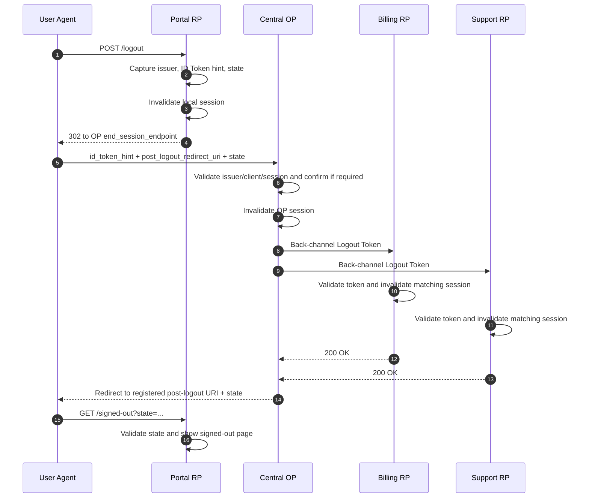

# Handling Sessions and Logout Across Multiple Authentication Domains

## 1. The logout problem in identity federation systems

In an **OAuth 2.0/OpenID Connect Authorization Server** platform built with **Spring Security, Spring Authorization Server, and Spring Boot**, a user can sign in through multiple identity systems: an enterprise Identity Provider, an external provider, a partner system, or a central Authorization Server acting as an identity broker.

An application may simultaneously hold:

- A local application session (Relying Party, RP).
- A session at the OpenID Provider (OP) that authenticated the user.
- Sessions at one or more upstream Identity Providers used by the OP/broker for federated login.
- Sessions at downstream applications to which the platform issues tokens or provides SSO.
- Multiple browser/device sessions belonging to the same user.

When a user clicks Logout in one application, the question is not merely deleting the current cookie. The system must determine **which sessions need to end, in which authentication domains, and which parties must be notified**. Deleting all sessions of the user indiscriminately may unexpectedly log out other devices or tenants. Clearing only one RP's cookie leaves the user still signed in at the OP and automatically logged right back in on the next visit.

In the **SPRING_SECURITY_OAUTH2_OIDC_AUTHORIZATION_SERVER** module, the objective is to learn how to design, configure, secure, test, and operate an OAuth 2.0/OpenID Connect Authorization Server using Spring Security and Spring Authorization Server. This lesson belongs to the **Identity Federation** chapter, focusing on handling sessions and logout when an identity spans multiple authentication domains.

### Learning outcomes

After this lesson, you will be able to:

1. Distinguish RP sessions, OP sessions, upstream IdP sessions, and downstream application sessions.
2. Design safe session correlation keys across multiple issuers, tenants, clients, and devices.
3. Choose appropriately among local logout, RP-Initiated Logout, Back-Channel Logout, Front-Channel Logout, or SAML Single Logout.
4. Configure OIDC logout in Spring Security OAuth2 Client.
5. Configure session tracking and the OIDC Logout Endpoint in Spring Authorization Server.
6. Store session correlations in a multi-instance environment.
7. Handle cascading logout, timeouts, retries, duplicate events, and partial failures.
8. Test logging out the exact target session without affecting other users/tenants.

**Example scope:** Spring Boot 3.x, Spring Security 6.5.x, and Spring Authorization Server 1.5.8 on the Servlet stack. Extension points and API names are referenced against the official documentation of those versions. If your project uses WebFlux or another version, use the corresponding reactive/version-specific APIs rather than copying Servlet examples verbatim.

## 2. Distinguishing session domains

### 2.1. A single login can create multiple independent sessions

Suppose a user opens `portal.example.com`, and the application redirects the browser to `login.example.net` to authenticate. The OP may forward to `idp.corp.example.org`. After logging in successfully, the user also opens `billing.example.com` and `support.example.com`.

| Domain | Example | Session owned by | Cookie/session identifier |
| --- | --- | --- | --- |
| Upstream IdP | `idp.corp.example.org` | Enterprise identity system | IdP cookie |
| Central OP / Identity Broker | `login.example.net` | Authorization Server | OP cookie |
| RP / portal app | `portal.example.com` | Portal | Portal cookie |
| RP / billing app | `billing.example.com` | Billing | Billing cookie |
| RP / support app | `support.example.com` | Support | Support cookie |

These sessions have independent lifecycles. Clearing the portal cookie does not automatically destroy the OP session or the upstream IdP session. Likewise, destroying the session at the OP does not automatically destroy local sessions at RPs unless the OP sends logout notifications and the RPs process them.

### 2.2. Four concepts that must be separated

**Local application logout** terminates only the current application's session. This is an action directly controlled by the application.

**RP-Initiated Logout** allows an RP to direct the User Agent to the OP's Logout Endpoint to ask the OP to log the user out. The OP identifies the matching session, may ask the user for confirmation, and notifies RPs logged into that OP using the logout mechanisms both sides support.

**OP-Initiated Logout** occurs when the OP initiates logout notifications to RPs. OIDC defines Front-Channel Logout and Back-Channel Logout for this purpose.

**Upstream federation logout** occurs when the identity broker/OP asks the upstream IdP to terminate the user's session. This is a distinct step in the identity federation chain; not every OIDC RP logout automatically terminates the session at the upstream IdP.

### 2.3. Identity does not mean session

One user can have one identity yet multiple sessions. In OIDC:

- `iss` identifies the OP/issuer that issued the token.
- `sub` identifies the End-User within that issuer's scope.
- `sid` identifies a session at the OP within that issuer's scope.
- `aud` identifies the client/RP for which the token was issued.

Never use `sub` alone to look up sessions in a multi-issuer federated system. Two independent OPs can both issue `sub = "12345"` to two different people. The minimum identity key must include both issuer and subject: `(iss, sub)`.

`sid` is not a global session ID either. OIDC Back-Channel Logout specifies that `sid` need only be unique within the context of an issuer; therefore, session keys must include the issuer. If an RP has multiple client registrations/audiences, add client/tenant context during lookup so you do not log out the wrong session.

Never use email, username, or display name as a session key. These values can change, are not unique across domains, and may be reassigned to someone else.

### 2.4. An identity broker must maintain cross-domain mappings

If `login.example.net` acts as a broker between applications and upstream IdPs, the broker should persist the relationship:

| Attribute | Purpose |
| --- | --- |
| `tenant_id` | Organization/tenant scope of the session |
| `local_session_id` | Session at the broker |
| `upstream_issuer` | Issuer of the IdP that authenticated the user |
| `upstream_subject` | `sub` from the source IdP |
| `upstream_sid` | `sid` from the source IdP, if present |
| `downstream_client_id` | RP/client logged into the broker |
| `downstream_sid` | Session identifier issued by the broker to the client, if any |
| `created_at`, `last_seen_at`, `expires_at` | Lifecycle and timeout management |
| `logout_status`, `logout_at` | Logout progress tracking |

This mapping lets the broker determine which upstream identity/session created a downstream session. If the upstream IdP does not support `sid` or a logout protocol, the broker can terminate only the sessions it manages; it cannot claim to have ended the session at the source IdP.

### 2.5. Do not share session cookies across application domains

A cookie for `portal.example.com` is not automatically sent to `billing.example.com`. Attempting to share a broad Domain cookie such as `.example.com` increases the blast radius if one subdomain is compromised and couples applications to a single session cookie contract.

Typically, each RP keeps a host-only cookie and its own session. SSO is achieved via redirects through the OP; the OP maintains its own cookie. When logging out multiple RPs is needed, use OIDC logout notifications rather than requiring all applications to share a cookie.

Cookie `SameSite`, `Secure`, `HttpOnly`, domain/path, and third-party cookie policies affect front-channel/iframe logout. Never treat the browser clearing one site's cookie as proof that all server-side sessions have been destroyed.

## 3. Choosing the right logout mechanism

### 3.1. Comparing mechanisms

| Mechanism | Who initiates? | Channel | Strengths | Limitations |
| --- | --- | --- | --- | --- |
| Local logout | RP | HTTP request to the RP itself | Simple, direct control over local session | OP and other RPs may still have active sessions |
| OIDC RP-Initiated Logout | RP | Browser redirect/form POST to OP | User explicitly logs out of the OP | Requires User Agent; downstream outcome depends on OP notifications |
| OIDC Back-Channel Logout | OP | Direct HTTP POST OP → RP | Independent of open browser tabs/third-party cookies | RP must store session mapping; endpoint must be reachable from OP |
| OIDC Front-Channel Logout | OP | Browser loads RP's logout URI, often via iframe | Can clear browser-side state/cookies | Affected by third-party cookie blocking, iframes, and browser policies |
| OIDC Session Management | RP checks OP status | Browser iframe/check session | Can detect OP session changes | Polling/iframe depends on browser and storage policies |
| SAML 2.0 Single Logout | RP or Asserting Party (AP) | SAML LogoutRequest/LogoutResponse over HTTP binding | Integrates with SAML ecosystems | Depends on metadata, signatures, bindings, and AP SLO support |

Back-Channel Logout is usually preferable when reliable server-side session revocation across systems is needed. Front-Channel Logout can supplement it to clear browser-side state, but should not be the sole mechanism in environments where browsers block third-party cookies.

### 3.2. Local logout

Local logout ends only the current RP's session. It is appropriate when:

- The user wants to exit only the current application.
- The application does not wish to disrupt login sessions at the OP or other RPs.
- The OP does not support a logout protocol.
- Security policy requires immediate local session deletion, even if the OP is unreachable.

Spring Security provides the `logout()` DSL and `LogoutSuccessHandler`. You can configure the logout endpoint, `LogoutHandler`, `HttpSession` invalidation, `SecurityContext` clearing, and cookie deletion per application configuration.

### 3.3. RP-Initiated Logout

The RP directs the User Agent to the `end_session_endpoint` published in OP Discovery metadata. The request typically carries:

- `id_token_hint`: ID Token previously issued by the OP to the RP, serving as a session hint.
- `post_logout_redirect_uri`: URI the RP asks the browser to return to after logout; must be registered and validated by the OP.
- `state`: opaque value for the RP to correlate the callback.
- `client_id` or `logout_hint`: usable per OIDC rules when applicable.

When `id_token_hint` is present, the OP must verify that the token was issued by itself and match the client/session. OIDC recommends the OP accept an ID Token from a current/recent session even if `exp` has passed, because logout can occur after token expiration. If there is no ID Token hint or the hint does not belong to the current session, the OP must ask the user for confirmation before logging out per RP-Initiated Logout rules.

`post_logout_redirect_uri` is used only when valid and must exact-match a URI registered for that specific client. Without an `id_token_hint`, the OP needs another way to verify destination validity before redirecting. Never use `state` as a target URL and never redirect to arbitrary URLs.

### 3.4. Back-Channel Logout

The OP sends an HTTP POST to the RP's `backchannel_logout_uri` with a Logout Token, which is a signed JWT. The RP verifies the token and locates matching sessions to terminate.

Key claims in a Logout Token:

| Claim | Requirement |
| --- | --- |
| `iss` | Required; OP's issuer |
| `aud` | Required; client/RP receiving the logout |
| `iat` | Required; time of issuance |
| `jti` | Required; unique ID of the token |
| `events` | Required; contains event `http://schemas.openid.net/event/backchannel-logout` |
| `sub` | Optional; identifies the End-User |
| `sid` | Optional; identifies the End-User's session at the OP |
| `nonce` | Prohibited in Logout Tokens |

A Logout Token must contain `sub`, `sid`, or both. If only `sub` is present, the RP logs out all sessions for that subject within the matching issuer/client scope. If `sid` is present, the RP can log out only the session matching `sid`. When processing the token, always match `iss` and `aud`; never look up solely by `sub` or `sid`.

### 3.5. Front-Channel Logout and browser privacy

Front-Channel Logout instructs the OP to direct the User Agent to each RP's logout URI, typically via iframes. Each RP receives the request and clears its corresponding session/browser state.

Because requests execute in a third-party context, browsers may block the RP's cookies or storage. Consequently:

- Iframes may not send the RP's session cookie.
- `SameSite=Lax` or `Strict` cookies may not be sent inside cross-site iframes.
- `SameSite=None` requires `Secure`, yet still does not bypass all third-party cookie blocking mechanisms.
- Closed tabs, offline browsers, or content blockers can prevent notifications from reaching the RP.

If the OP sends `iss` and `sid` query parameters on a front-channel request, both must appear together. The RP should match them against the issuer/session of the current or recent ID Token; never log out all sessions just upon receiving an unidentified iframe request. Return non-cacheable responses to prevent browsers from reusing stale logout responses.

### 3.6. SAML Single Logout

In systems with upstream/downstream SAML IdPs, SAML 2.0 Single Logout (SLO) can be used instead of OIDC logout. An RP can send `saml2:LogoutRequest` to the Asserting Party; the AP can also send `LogoutRequest` to the RP. Both parties verify signature, issuer, destination, and `SessionIndex`/NameID per profile and return `LogoutResponse`.

Spring Security supports RP-initiated and AP-initiated SAML SLO via `saml2Logout()`. You must configure `SingleLogoutService` metadata, signing credentials, and endpoints. SLO works cross-domain only if all parties advertise and support SLO; never automatically translate an OIDC logout into a SAML `LogoutRequest` without a proper federation adapter.
## 4. Logout flows across multiple authentication domains

### 4.1. User logs out of an RP and requests OP logout

Suppose a user is on Portal, logged in via a central OP. Portal can end its local session either before or after redirecting to the OP:

- **Local-first:** Portal's session is destroyed immediately. If the OP is unreachable or the user cancels confirmation at the OP, Portal is still logged out. This usually aligns best with security expectations when the user clicks Logout.
- **OP-first:** keeps Portal's session while waiting for the OP to finish. If the browser closes or a redirect fails, the local session may remain active; clear timeouts and fallbacks are required.

The RP must capture enough information for the logout request before destroying the session: ID Token hint, issuer/client registration, post-logout redirect URI, and transaction state. Never put raw access tokens/refresh tokens in URLs. `state` values must be random, opaque, short-lived, and bound to the browser transaction.



The diagram shows an implementation using Back-Channel Logout. If the OP and RPs support only Front-Channel Logout, notifications travel through the User Agent and are subject to browser privacy controls. If the OP does not support notifications, Portal cannot conclude that Billing and Support have logged out.

### 4.2. OP logging out multiple RPs

When the OP logs out an End-User, the OP must know which RPs the user logged into and which sessions must end. A registry/visited-client store can track:

- OP's issuer.
- RP's `client_id`.
- Session's `subject` and `sid`.
- Registered `backchannel_logout_uri` or `frontchannel_logout_uri`.
- `backchannel_logout_session_required` or `frontchannel_logout_session_required`.
- Login timestamp, expiration timestamp, and notification status.

At logout, the OP generates a distinct Logout Token for each matching client/audience. Never send a token with Portal's `aud` to Billing's endpoint. Each RP must receive a token issued specifically for its own client.

### 4.3. Broker acting as both RP and OP

An identity broker typically holds two roles:

1. As an RP to the upstream IdP: the broker receives an ID Token from the IdP and creates a local broker session.
2. As an OP to downstream RPs: the broker issues ID Tokens/access tokens and creates corresponding client sessions.

When the broker receives a logout from the upstream IdP, the broker must verify the Logout Token from the right upstream issuer, use `iss + sub` or `iss + sid` to locate matching broker sessions, terminate those sessions, send broker-signed Logout Tokens to downstream RPs with active related sessions, revoke authorizations/tokens per policy, and record an audit log.

When a user logs out at the broker, the broker can send downstream logout notifications and direct the browser to the upstream OP's `end_session_endpoint` using the ID Token hint received from upstream. OIDC RP-Initiated Logout is not a generic server-to-server logout API; without a browser redirect or a vendor-specific mechanism, the broker cannot end the upstream OP session solely with an arbitrary HTTP call.

### 4.4. Log out one session or all sessions?

| Scope | Lookup key | Outcome |
| --- | --- | --- |
| One device/session at one OP | `iss + sid + client/audience` | Logs out only the identified session |
| All user sessions at one OP/client | `iss + sub + client/audience` | Logs out sessions for that subject at the matching RP |
| All apps within a tenant | `tenant + issuer + subject`, then fan-out to tenant clients | Logs out within the specified tenant |
| All devices across all OPs | Requires identity link mappings and dedicated cross-issuer policy | Cannot be inferred from a single `sid` |

If a user has two accounts at two different issuers sharing the same email, logging out of issuer A must not automatically log out issuer B. Perform cross-issuer logout only when federation mappings have verified both identities belong to the same account and policy permits it.
## 5. Configuring OIDC logout in an RP with Spring Security

### 5.1. RP-Initiated Logout

Spring Security OAuth2 Client provides `OidcClientInitiatedLogoutSuccessHandler`. The handler uses `ClientRegistrationRepository` to locate the OIDC configuration and end-session endpoint from Provider metadata. Single-RP example:

```java
import org.springframework.context.annotation.Bean;
import org.springframework.context.annotation.Configuration;
import org.springframework.security.config.annotation.web.builders.HttpSecurity;
import org.springframework.security.oauth2.client.registration.ClientRegistrationRepository;
import org.springframework.security.oauth2.client.oidc.web.logout.OidcClientInitiatedLogoutSuccessHandler;
import org.springframework.security.web.SecurityFilterChain;
import org.springframework.security.web.authentication.logout.LogoutSuccessHandler;

@Configuration
class PortalSecurityConfiguration {

    @Bean
    LogoutSuccessHandler oidcLogoutSuccessHandler(
            ClientRegistrationRepository registrations) {

        OidcClientInitiatedLogoutSuccessHandler handler =
                new OidcClientInitiatedLogoutSuccessHandler(registrations);
        handler.setPostLogoutRedirectUri("{baseUrl}/signed-out");
        return handler;
    }

    @Bean
    SecurityFilterChain applicationSecurity(
            HttpSecurity http,
            LogoutSuccessHandler oidcLogoutSuccessHandler) throws Exception {

        http
            .authorizeHttpRequests(authorize ->
                authorize.anyRequest().authenticated())
            .oauth2Login(oauth2 -> { })
            .logout(logout ->
                logout.logoutSuccessHandler(oidcLogoutSuccessHandler));

        return http.build();
    }
}
```

The registered `post_logout_redirect_uri` must match the URI configured on the OP. The `{baseUrl}` template is resolved by Spring Security to the application's base URL; when running behind a reverse proxy, configure forwarded headers/trusted proxies properly so callbacks do not generate the wrong host or scheme.

By default, the handler redirects via GET. If the OP requires POST serialization, configure `FormPostRedirectStrategy` per Spring Security's API. Never assemble `end_session_endpoint` from arbitrary request parameters or Host headers.

### 5.2. Applications with multiple OIDC providers

A `ClientRegistrationRepository` can hold multiple registrations, such as `corp`, `partner-a`, and `partner-b`. Each registration has its own issuer, client ID, secret, redirect URI, and metadata. On logout:

- Identify the provider/registration that created the current session.
- Use the ID Token hint belonging to the matching issuer/client.
- Send the request to that registration's end-session endpoint.
- Use the post-logout redirect URI registered for that client.

Do not pick a provider based on email domain or a browser-supplied query parameter without matching against the authentication stored in the session. If an application supports multiple registrations sharing an issuer or multiple tenants using dynamic client registrations, store the registration ID in session correlation and consider a custom `LogoutSuccessHandler` to select the right registration.

### 5.3. Enabling Back-Channel Logout in the RP

Spring Security 6.5 supports OIDC Back-Channel Logout for `oauth2Login` applications. Basic configuration:

```java
import org.springframework.context.annotation.Bean;
import org.springframework.security.config.Customizer;
import org.springframework.security.config.annotation.web.builders.HttpSecurity;
import org.springframework.security.oauth2.client.oidc.session.OidcSessionRegistry;
import org.springframework.security.oauth2.client.oidc.web.logout.OidcBackChannelLogoutHandler;
import org.springframework.security.web.SecurityFilterChain;
import org.springframework.security.web.session.HttpSessionEventPublisher;

@Bean
OidcBackChannelLogoutHandler oidcBackChannelLogoutHandler(
        OidcSessionRegistry sessionRegistry) {

    OidcBackChannelLogoutHandler handler =
            new OidcBackChannelLogoutHandler(sessionRegistry);
    handler.setSessionCookieName("SESSION"); // Spring Session; use JSESSIONID if applicable
    return handler;
}

@Bean
HttpSessionEventPublisher httpSessionEventPublisher() {
    return new HttpSessionEventPublisher();
}

@Bean
SecurityFilterChain webSecurity(HttpSecurity http) throws Exception {
    http
        .oauth2Login(Customizer.withDefaults())
        .oidcLogout(oidc -> oidc.backChannel(Customizer.withDefaults()));
    return http.build();
}
```

The `SESSION` cookie configuration applies when using Spring Session; if your container uses `JSESSIONID`, keep the corresponding cookie name. `oidcLogout()` requires `oauth2Login()` to be configured. `HttpSessionEventPublisher` lets the registry receive lifecycle events when an `HttpSession` is invalidated so stale mappings are removed.

The default endpoint has the pattern `/logout/connect/back-channel/{registrationId}`. `registrationId` identifies which `ClientRegistration` the Logout Token must target. Never expose this endpoint as an unauthenticated local logout endpoint; Spring Security verifies the Logout Token before the handler looks up sessions.

### 5.4. How Spring Security locates the right session

At login time, Spring Security stores the correlation between ID Token/issuer, provider session ID (`sid`) if present, associated CSRF token/context, local application session ID, and the registration/client used for login.

When the OP invokes Back-Channel Logout:

1. The RP verifies the Logout Token's signature and claims.
2. `OidcSessionRegistry` finds matching sessions.
3. If the token has `sid`, the RP ends only sessions linked to that provider session.
4. If `sid` is absent but `sub` is present, the RP ends sessions for that subject within the matching issuer/client scope.
5. Spring Security runs `LogoutHandler`s for each session to invalidate the session and clear the `SecurityContext`.

### 5.5. Default registry and clustered environments

`InMemoryOidcSessionRegistry` stores mappings in a single JVM's memory. If the RP runs multiple instances behind a load balancer, a Back-Channel Logout request may arrive at a node without the session mapping; that node will not know which session to invalidate.

In a cluster:

- Implement `OidcSessionRegistry` backed by a database or distributed store.
- Save mappings before returning login success to the browser.
- Remove mappings when local sessions expire, log out, or are invalidated.
- Use transactions/atomic deletes so concurrent logout requests do not process the same session twice.
- Set TTLs on mappings to clean up sessions that missed lifecycle events.
- Use a shared session store (e.g., Spring Session) or route requests to the session-owning node.

Spring Security allows replacing `OidcSessionRegistry` with a custom implementation. Core methods save `OidcSessionInformation`, remove by client session ID, and remove mappings referenced by `OidcLogoutToken`. When processing a token, the repository must match the corresponding issuer and audience, not just session ID or subject.

### 5.6. Checking the cookie name when using Spring Session

Back-Channel Logout does not rely on the browser sending the RP's cookie to the OP. However, Spring Security uses session correlation and internal logout requests to run logout handlers for the right session. `OidcBackChannelLogoutHandler` defaults to the cookie name `JSESSIONID`; if your application uses Spring Session with cookie `SESSION`, you must configure `setSessionCookieName("SESSION")`.

Test this configuration after changing session cookie names, reverse proxies, or Spring Session repositories. A wrong cookie name can cause the endpoint to accept a valid Logout Token without invalidating the actual session.

## 6. Configuring the OIDC Logout Endpoint in Spring Authorization Server

### 6.1. OP's SessionRegistry

Spring Authorization Server uses `SessionRegistry` to track authenticated sessions when OIDC is enabled. `OidcLogoutAuthenticationProvider` uses the registry to locate `SessionInformation` associated with the End-User requesting logout.

Example configuring the default registry in a Servlet application:

```java
import org.springframework.context.annotation.Bean;
import org.springframework.context.annotation.Configuration;
import org.springframework.security.core.session.SessionRegistry;
import org.springframework.security.core.session.SessionRegistryImpl;
import org.springframework.security.web.session.HttpSessionEventPublisher;
import org.springframework.security.config.Customizer;
import org.springframework.security.config.annotation.web.builders.HttpSecurity;
import org.springframework.security.oauth2.server.authorization.config.annotation.web.configurers.OAuth2AuthorizationServerConfigurer;
import org.springframework.security.web.SecurityFilterChain;

@Configuration
class AuthorizationServerSecurityConfiguration {

    @Bean
    SessionRegistry sessionRegistry() {
        return new SessionRegistryImpl();
    }

    @Bean
    HttpSessionEventPublisher httpSessionEventPublisher() {
        return new HttpSessionEventPublisher();
    }

    @Bean
    SecurityFilterChain authorizationServerSecurity(HttpSecurity http)
            throws Exception {

        OAuth2AuthorizationServerConfigurer authorizationServer =
                OAuth2AuthorizationServerConfigurer.authorizationServer();

        http
            .securityMatcher(authorizationServer.getEndpointsMatcher())
            .with(authorizationServer, server ->
                server.oidc(Customizer.withDefaults()));

        return http.build();
    }
}
```

If the application already has an Authorization Server filter chain, add OIDC configuration to that chain rather than creating a second chain with overlapping endpoint matchers. `SessionRegistryImpl` suits development/single instances. In a production cluster, use a shared registry or session architecture ensuring logout requests locate sessions across all nodes.

`HttpSessionEventPublisher` publishes session lifecycle events so `SessionRegistryImpl` cleans up `SessionInformation` when an `HttpSession` is invalidated/destroyed. If concurrent session control is enabled, share the same `SessionRegistry` between the session strategy and OIDC Logout.

### 6.2. OIDC Logout Endpoint

Spring Authorization Server 1.5.8 provides `OidcLogoutEndpointConfigurer` to handle RP-Initiated Logout. The default filter uses `OidcLogoutAuthenticationConverter` to parse requests, `OidcLogoutAuthenticationProvider` to validate and look up sessions, `OidcLogoutAuthenticationSuccessHandler` to execute logout, and an error handler for validation failures.

You can customize converter, provider, success handler, and error handler via `logoutEndpoint(...)`. The default provider uses the OP's `SessionRegistry`; this registry is distinct from the `OidcSessionRegistry` used by Spring Security OAuth2 Client to store mappings between upstream OP sessions and local RP sessions.

### 6.3. OP's SessionRegistry is not the downstream RP registry

| Component | Where used? | Managed mapping |
| --- | --- | --- |
| `SessionRegistry` | Spring Authorization Server when acting as OP | User ↔ local session at the OP |
| `OidcSessionRegistry` | Spring Security OAuth2 Client when acting as RP | Upstream OP session (`iss`, `sid`, `sub`, `aud`) ↔ local RP session |
| Federation session store | Multi-domain identity broker/OP | Upstream IdP ↔ broker session ↔ downstream client sessions |

Do not use one registry to stand in for all three roles if its schema and lifecycle cannot fully represent those relationships.

### 6.4. OP must track logged-in RPs

OIDC RP-Initiated Logout requires the OP to use the logout mechanism registered by RPs to notify RPs logged in with the same End-User. In Spring Authorization Server 1.5.8, the documentation covers the Logout Endpoint, provider, `SessionRegistry`, and success handler; the application must still design tracking for downstream RP sessions and dispatch Back-Channel/Front-Channel notifications per registered metadata.

A minimal downstream session record should contain:

| Field | Meaning |
| --- | --- |
| `op_issuer` | Issuer of the OP sending the logout |
| `client_id` | RP receiving the Logout Token |
| `subject` | End-User subject at the OP |
| `sid` | Session ID at the OP if the RP supports session-specific logout |
| `backchannel_logout_uri` | Endpoint receiving the Logout Token |
| `session_required` | Whether the RP requires `sid` |
| `last_seen_at`, `expires_at` | Session lifecycle |
| `notification_status`, `attempt_count` | Dispatch/retry state |

At logout, create one notification per client/audience with an active session. The Logout Token must be signed by the OP's key and contain `iss`, `aud`, `iat`, `jti`, and `events`; add `sid` and/or `sub` per logout scope. Never include `nonce` in a Logout Token.

### 6.5. Attaching notification dispatch to the logout success handler

Spring Authorization Server provides `OidcLogoutAuthenticationSuccessHandler.setLogoutHandler(...)` to attach application logout actions. For a multi-domain broker/OP, a custom handler should:

1. Read session identity and client-session mappings before invalidating the local OP session.
2. Write a logout event to a transactional outbox.
3. Invalidate the OP session and clear the `SecurityContext`.
4. Have a worker pick up events, mint a separate Logout Token per client, and send it to the Back-Channel Logout URI.
5. Update delivery status, retry transient errors, and expire items exceeding the retry policy.
6. Perform the post-logout redirect only after local logout steps complete per policy.

Do not call dozens of RP endpoints sequentially inside the browser's logout request; one slow RP should not hold the OP session in an un-logged-out state. Use an outbox so notifications are not lost if a process stops after destroying the session but before sending requests. However, OIDC RP-Initiated Logout expects the OP to finish notifying RPs before performing the post-logout redirect. Therefore, orchestration must wait for dispatch across all selected RPs to finish or reach a defined deadline/policy timeout; do not redirect immediately after merely enqueueing events. If some RPs still failed, record their status and show an appropriate completion page.

```json
{
  "iss": "https://login.example.net",
  "aud": "portal-client",
  "iat": 1760000000,
  "jti": "logout-event-opaque-id",
  "events": {
    "http://schemas.openid.net/event/backchannel-logout": {}
  },
  "sub": "user-subject-at-this-issuer",
  "sid": "provider-session-id"
}
```

This is an illustrative payload. The OP must sign the JWT with its signing key, set a valid issuance timestamp, and use each client's specific `aud`. Never send a sample token verbatim or share one token across multiple RPs.

## 7. Designing a session store for multiple issuers and instances

### 7.1. Schema must include issuer and client context

A mapping table can be designed as follows:

```sql
CREATE TABLE federated_session_link (
    id                    VARCHAR(64) PRIMARY KEY,
    tenant_id             VARCHAR(128) NOT NULL,
    rp_registration_id    VARCHAR(128) NOT NULL,
    client_id             VARCHAR(255) NOT NULL,
    op_issuer             VARCHAR(512) NOT NULL,
    op_subject            VARCHAR(512) NOT NULL,
    op_session_id         VARCHAR(512),
    local_session_id      VARCHAR(256) NOT NULL,
    upstream_issuer       VARCHAR(512),
    upstream_subject      VARCHAR(512),
    upstream_session_id   VARCHAR(512),
    status                VARCHAR(32) NOT NULL,
    created_at            TIMESTAMP NOT NULL,
    last_seen_at          TIMESTAMP,
    expires_at            TIMESTAMP NOT NULL,
    logged_out_at         TIMESTAMP
);

CREATE INDEX idx_session_sid
    ON federated_session_link
       (tenant_id, op_issuer, client_id, op_session_id);

CREATE INDEX idx_session_subject
    ON federated_session_link
       (tenant_id, op_issuer, client_id, op_subject);

CREATE INDEX idx_session_local
    ON federated_session_link
       (rp_registration_id, local_session_id);
```

This schema is a suggestion; adjust data types, indexes, and uniqueness constraints for your database. Important principles:

- Key Back-Channel Logout lookups by issuer and audience/client.
- When `sid` is present, prioritize identifying the specific session.
- When `sid` is absent, use `issuer + subject + client` to find sessions requiring logout.
- When tenant is a security boundary, include `tenant_id` in query predicates.
- `local_session_id` is sensitive data; encrypt/protect it at rest and never log it.
- Do not store raw ID Tokens or Logout Tokens without a clear audit requirement; store necessary claims and a token digest/`jti` instead.

### 7.2. Replay protection for Logout Tokens

A Logout Token is a signed message carrying authority to terminate sessions. The RP must verify the signature using the right issuer's key and check:

1. `iss` is in the list of issuers configured as trusted by the RP.
2. `aud` contains the client ID of the RP receiving the request.
3. `iat` is valid under clock-skew and maximum-age policies.
4. `events` contains the exact Back-Channel Logout event.
5. `sub` or `sid` is present.
6. `nonce` is absent.
7. Signing algorithm is allowed and the signature is valid.
8. `jti` has not been recently processed if replay detection is enabled.

Store replay keys scoped by `(issuer, jti)` with an appropriate TTL. Do not store `jti` globally alone because multiple issuers can emit colliding values. If the same Logout Token is resent due to a retry, handle it idempotently: if the session is already logged out, return success rather than throwing an error that makes the OP retry forever.

### 7.3. Outbox and delivery state

On the OP/broker, do not send notifications directly inside the transaction invalidating the session. Create an outbox record in the same transaction:

```sql
CREATE TABLE logout_notification_outbox (
    event_id          VARCHAR(64) PRIMARY KEY,
    tenant_id         VARCHAR(128) NOT NULL,
    op_issuer         VARCHAR(512) NOT NULL,
    client_id         VARCHAR(255) NOT NULL,
    subject_ref       VARCHAR(512),
    session_ref       VARCHAR(512),
    destination       VARCHAR(2048) NOT NULL,
    status            VARCHAR(32) NOT NULL,
    attempt_count     INTEGER NOT NULL DEFAULT 0,
    next_attempt_at   TIMESTAMP,
    created_at        TIMESTAMP NOT NULL,
    delivered_at      TIMESTAMP,
    last_error_code   VARCHAR(128)
);
```

Workers send each notification, update delivery state, and retry with exponential backoff. The destination must come from the validated client registration; never use a URL supplied by a logout request.

Do not write complete Logout Tokens into logs/outboxes unnecessarily. You can mint the token at dispatch time from the event record and current signing key, storing `jti` for deduplication. If persisting tokens for exact retries is necessary, encrypt them, bound TTL, and enforce access control.

### 7.4. Handling multiple sessions and concurrent logouts

A user may be logged into the same RP on desktop and mobile. When a Logout Token carries `sid`, remove only that session's mapping. When the token carries only `sub`, remove all mappings matching issuer/audience/subject per spec.

To avoid race conditions:

- Use transactions or atomic state transitions from `ACTIVE` to `LOGGING_OUT`/`LOGGED_OUT`.
- Allow only one worker to claim each outbox item at a time.
- Enforce unique constraints on replay keys and appropriate session mappings.
- If a session already expired before the notification arrived, treat logout as complete.
- Never let a delivery failure to RP A block logging out RP B.

### 7.5. Caches and session stores must stay consistent

In a cluster, deleting a session in the database while leaving an authentication/session cache on another node can allow subsequent requests to succeed. On logout:

- Invalidate the shared session store.
- Clear session correlation and authentication caches.
- Publish invalidation events to all nodes.
- Ensure APIs/resource servers have a mechanism to handle revoked tokens when access tokens are self-contained JWTs.
- Do not confuse logging out a session with revoking every issued access token.

Logout terminates the login session and prevents the session from continuing to be used. Already-issued JWT access tokens can remain valid until `exp` if resource servers do not check revocation/introspection or session state. When near-instant revocation is needed, consider short-lived tokens, reference tokens/introspection, revocation/denylists with cache invalidation, or claim/session versions with policy checks.

## 8. Upstream and downstream logout in an identity broker

### 8.1. When the upstream IdP sends a logout

If the broker logs in via upstream OIDC, the broker can enable Back-Channel Logout like a normal RP. The broker needs upstream mappings:

```text
(upstream_issuer, upstream_sub, upstream_sid)
    -> broker local session
    -> downstream RP sessions
```

Upon receiving a token:

1. Verify the token against the exact upstream issuer.
2. Look up the broker session by `sid` if present; otherwise look up by `iss` + `sub`.
3. Cross-check tenant and upstream client registration.
4. Mark the broker session as logged out.
5. Create downstream logout events for affected RPs.
6. Revoke refresh tokens per policy and record an audit log.

If the upstream IdP sends a logout by `sub` without `sid`, the broker may need to log out multiple broker sessions belonging to that subject under that issuer. Never apply this across other issuers.

### 8.2. When the user logs out at the broker

The broker can both log out downstream RPs and ask the upstream OP to log out via RP-Initiated Logout. Before destroying the broker session, save the details needed to construct the upstream logout request in a short-lived logout transaction:

- Upstream issuer and registration ID.
- ID Token hint from upstream.
- Broker's post-logout callback URI registered with upstream.
- Random state, expiry, and browser correlation.

Next, the broker invalidates its local session, emits downstream logout events, and redirects the browser to the upstream `end_session_endpoint`. The callback must verify `state` before displaying the completion page.

If the upstream OP lacks a logout endpoint or does not support a compatible mechanism, the broker can end only its own session and notify downstream RPs. Never display a message claiming "logged out of all systems" when you lack confirmation or capability to do so.

### 8.3. Combining OIDC and SAML

A broker may connect to an OIDC upstream and issue SAML assertions downstream, or vice versa. When receiving a logout:

- Identify the protocol and issuer that created the source session.
- Map to the exact internal subject/session.
- Terminate the internal session.
- Translate into the corresponding OIDC Logout Token or SAML `LogoutRequest` for downstream.
- Track each protocol's outcome independently.

Never directly substitute an OIDC `sid` for a SAML `SessionIndex` or vice versa. These are two identifiers belonging to two different protocol/session contexts; the broker must maintain explicit mappings.

## 9. Handling logout failures and partial errors

### 9.1. Logout must be idempotent

OIDC Back-Channel Logout considers logout successful if the RP no longer holds a session for the End-User at the time the request arrives. Thus, if the same Logout Token is resent due to a timeout/retry, the RP should verify the token, look up sessions by issuer/audience/subject/session ID, and if the session is already gone, return success under idempotent semantics. Never create a new session or alter another user's session.

Idempotency does not mean skipping token validation. Tokens with invalid signatures, issuers, or audiences must still be rejected.

### 9.2. Classifying responses when sending Back-Channel Logout

| Response from RP | How OP handles it |
| --- | --- |
| HTTP 200 OK | Success |
| HTTP 204 No Content | Should be treated as success equivalent to 200 |
| Timeout/connection reset/5xx | Eligible for retry with backoff and deadline |
| HTTP 400 Bad Request | Invalid logout request or processing failure; do not retry blindly |
| HTTP 401/403 | Inspect endpoint, network policy, and implementation; do not send token to another endpoint |

An RP that has already logged out locally can return 200/204 even when no session is found. This keeps the OP from retrying endlessly for an already-ended session.

### 9.3. Multi-RP logout can complete partially

Suppose the OP has Portal, Billing, and Support. Portal returns 200, Billing times out, and Support returns 400 because it failed to verify the token. The true state must reflect each client individually:

- The OP session is invalidated.
- Portal confirmed logout.
- Billing is awaiting retry or hit deadline.
- Support has a protocol/configuration error requiring investigation.

Do not roll back the OP session just because one RP failed to respond. Do not claim all apps logged out if notifications remain pending/failed. You can display a message stating the user has signed out of the central account and some applications are completing logout.

### 9.4. Retries and dead-lettering

The dispatch worker should use exponential backoff with jitter, cap retry counts and total retry duration, distinguish transient network errors from token/registration errors, avoid endless retries on 400, record the last status/error code and correlation ID, route expired events to a dead-letter queue for operations, and ensure retries never generate tokens with the wrong audience or for the wrong session.

If signing keys rotate during retries, new Logout Tokens must be signed with the current key published by the OP and verifiable by RPs. Maintain JWKS/key overlap per rotation procedures.

### 9.5. Refresh tokens and access tokens after logout

Back-Channel Logout requires the RP to end the session and clear related state. For refresh tokens, OIDC Back-Channel Logout recommends revoking refresh tokens bound to the session if they were not issued with `offline_access`; refresh tokens with `offline_access` should normally not be automatically revoked solely because a browser session logged out.

Already-issued JWT access tokens do not vanish when a session is deleted. If resource servers verify JWTs offline, tokens can remain accepted until `exp`. Options include short access token TTLs, reference tokens/introspection, revocation/denylists with cache invalidation, or claim/session versions and status checks per policy.

Do not confuse logging out a browser session with revoking all credentials for the user across every device. Revocation scope must follow session, client, tenant, and token type.

## 10. Session and logout security

### 10.1. Validating Logout Tokens

The RP must verify the signature using the trusted issuer's key, `iss` exact-matching the configured issuer, `aud` containing the receiving client ID, `iat` within clock-skew/maximum-age policy, `events` containing the Back-Channel Logout event, presence of `sub` or `sid`, absence of `nonce`, algorithm not `none` and within an allowlist, and `jti` not replayed if replay detection is enabled.

Never select a decoder from an issuer self-declared in the request body and trust the token once the signature checks out. Issuers must map to known trust/client registration configurations; with multiple issuers, select validators/decoders via an allowlist and verify the audience of the exact registration.

### 10.2. Logout CSRF and protocol endpoints

Browser-initiated local logout should use POST and Spring Security's CSRF protection. Never create a GET endpoint that deletes sessions merely when a user visits a URL, because another website can trigger that request.

Back-Channel Logout is a server-to-server request carrying a signed Logout Token. Use the endpoint configured by Spring Security OIDC logout, or a custom endpoint enforcing identical validation. Never bypass CSRF by opening a `logout-all` endpoint accepting arbitrary subjects/emails.

### 10.3. Cookies and session fixation

- Session cookies must set `Secure` over HTTPS and `HttpOnly`.
- Choose `SameSite` compatible with login/logout redirects and browser support.
- Never share session cookies across apps/tenants without a clear threat model.
- Keep Spring Security's session fixation protection; session IDs must rotate upon authentication.
- Invalidate the server-side session and delete cookies with matching Path/Domain/Max-Age.
- Never rely solely on cookie deletion to revoke sessions in a cluster.

### 10.4. Scoping identity boundaries

- Always scope `sub` by `iss`.
- Scope `sid` by `iss` and appropriate client/audience.
- Scope sessions by tenant when tenant is a security boundary.
- Never use email as a primary key or infer cross-issuer links automatically.
- Never let logout from one client affect another client unless the token specifies that audience/session.
- Never trust `registrationId`, tenant ID, or provider name taken directly from query params without checking against the current session.

### 10.5. Never expose tokens and session identifiers

Never log ID Token hints, Logout Tokens, access tokens, refresh tokens, session cookies, or raw session IDs. Audit logs should record issuer, client ID, tenant, hashed/opaque session reference, `jti`, timestamp, status, and correlation ID.

Restrict access to the session store and outbox. Session mappings can correlate users and devices; leaking this table exposes the organization's federated login topology.

## 11. Testing multi-domain sessions and logout

### 11.1. Test matrix

| ID | Scenario | Expected outcome |
| --- | --- | --- |
| S01 | User performs local logout from Portal | Only the Portal session is invalidated |
| S02 | RP sends RP-Initiated Logout with valid ID Token hint | Browser is directed to the right OP |
| S03 | OP checks ID Token hint from a different issuer | Hint is not used to log out sessions |
| S04 | Logout request includes mismatched `client_id` and ID Token hint | OP rejects per OIDC |
| S05 | Expired ID Token hint while current/recent OP session is valid | OP processes per RP-Initiated Logout rules, not rejected solely for `exp` |
| S06 | RP sends unregistered `post_logout_redirect_uri` | OP does not redirect to that URI |
| S07 | RP sends `state` and logout succeeds | OP echoes `state` to callback; RP verifies `state` |
| S08 | No ID Token hint provided | OP prompts user confirmation before logging out |
| S09 | Back-channel Logout Token with valid signature and right `iss`/`aud` | RP accepts notification |
| S10 | Logout Token with untrusted issuer | RP rejects with HTTP 400 |
| S11 | Logout Token with `aud` of another client | RP does not log out the current client's session |
| S12 | Logout Token missing `backchannel-logout` event | RP rejects |
| S13 | Logout Token contains `nonce` | RP rejects |
| S14 | Logout Token lacks both `sub` and `sid` | RP rejects |
| S15 | Logout Token has `sid` for a single session | Only that matching session is ended |
| S16 | Logout Token has only `sub` | Matching sessions for that issuer/subject/client are ended |
| S17 | Two issuers share the same `sub` | Logging out issuer A does not affect issuer B |
| S18 | Two issuers share the same `sid` | Logging out one issuer does not affect the other |
| S19 | Two tenants share a subject yet are isolated | Logging out tenant A does not affect tenant B |
| S20 | Same Logout Token sent twice | Second attempt handled idempotently without unintended errors |
| S21 | Replayed Logout Token `jti` | RP enforces replay policy and does not log out wrong sessions |
| S22 | RP already logged out before notification arrives | Returns success under idempotent semantics |
| S23 | One RP times out during OP fan-out | Other RPs still receive notifications |
| S24 | RP returns HTTP 204 | OP treats as success |
| S25 | RP returns HTTP 400 due to invalid token | Logs error; does not retry blindly |
| S26 | Back-channel request hits node not owning the session | Shared registry/session store still locates and invalidates session |
| S27 | Using Spring Session cookie `SESSION` | Handler configured with exact cookie name |
| S28 | Session expires leaving stale mapping | TTL/event cleanup purges mapping |
| S29 | Upstream IdP logs out broker | Broker ends right session and emits downstream logout events |
| S30 | Broker logout when upstream OP lacks logout support | Broker logs out local/downstream and does not claim upstream logout |
| S31 | OIDC subject and SAML `SessionIndex` share same string | Identifiers are never conflated across protocols |
| S32 | Front-channel logout runs in iframe with third-party cookies blocked | Test confirms limitation; back-channel still ends server-side session |
| S33 | Client has multiple sessions across desktop/mobile | Logout by `sid` ends only the targeted session |
| S34 | Refresh token without `offline_access` bound to logged-out session | Revoked per policy/spec |
| S35 | Refresh token with `offline_access` | Not auto-revoked solely due to browser session logout |
| S36 | Issued JWT access token at session logout | Post-logout behavior aligns with token TTL/revocation policy |
| S37 | Cross-site CSRF logout request | Local POST logout blocked by CSRF protection |
| S38 | User logs out then logs back in | New session ID created; old mappings do not affect new session |

### 11.2. Integration tests for RP Back-Channel Logout

With Spring Security Servlet:

1. Create multiple OIDC `ClientRegistration`s with distinct issuers/client IDs.
2. Perform logins to create multiple local sessions and record OIDC session mappings.
3. Send signed Logout Tokens to `/logout/connect/back-channel/{registrationId}`.
4. Verify a token with matching audience deletes only sessions of that registration.
5. Send a token with `sid` to verify only a single session is removed.
6. Send a token with only `sub` to verify matching sessions are removed.
7. Send tokens with invalid issuer, audience, signature, events, `nonce`, and replayed `jti` to confirm rejection.
8. Verify `HttpSessionEventPublisher` cleans the registry and cookies/session store are handled accurately.

Do not merely call `OidcSessionRegistry.removeSessionInformation(...)` in a unit test and conclude the endpoint is secure. Run through the filter chain to test token validation, registration ID, session cookies, and `LogoutHandler`s.

### 11.3. Integration tests for OP/broker fan-out

With the Authorization Server acting as OP:

1. Log in an End-User and create a session in `SessionRegistry`.
2. Create downstream session records for Portal, Billing, and Support.
3. Send an RP-Initiated Logout to the OIDC Logout Endpoint.
4. Verify the OP session is invalidated and outbox events are written in the same transaction.
5. Run the notification worker; verify each client receives a token with its own audience.
6. Simulate one RP timing out and one RP returning 400; verify delivery state and retry/dead-lettering.
7. Resend the logout request and confirm idempotency.
8. Verify the post-logout redirect targets only registered URIs and echoes `state`.

### 11.4. Browser and SAML testing

For Front-Channel Logout, test in browsers with realistic third-party cookie blocking, iframe restrictions, and `SameSite` policies. Verify the RP does not log out the wrong session when issuer/session identifiers are missing or invalid.

For SAML SLO, test RP-initiated and AP-initiated flows separately: `LogoutRequest`/`LogoutResponse` signatures, destination, issuer, session index, replay, and endpoint bindings. Never rely on an OIDC Back-Channel test to claim SAML SLO works.

## 12. Production operations checklist

**Session identity**

- [ ] Every session correlation includes issuer and client/audience.
- [ ] Subjects are scoped by issuer; never use email as a session key.
- [ ] Session IDs are opaque, never logged, and protected at rest.
- [ ] Tenant boundary is included in queries whenever tenant is a security boundary.
- [ ] TTL and cleanup exist for session mappings.

**OIDC logout**

- [ ] RP-Initiated Logout uses `end_session_endpoint` from discovery/trusted metadata.
- [ ] ID Token hint belongs to the right issuer/client/session.
- [ ] `post_logout_redirect_uri` is registered and exact-matched.
- [ ] `state` is random, opaque, has an expiry, and is verified by the RP.
- [ ] Back-channel Logout Token validates signature, `iss`, `aud`, `iat`, `events`, `sub`/`sid`, and `nonce`.
- [ ] Replay/idempotency policy exists for `jti` and duplicate notifications.
- [ ] Front-channel is not the sole mechanism when reliable server-side logout is required.

**Spring Security / Spring Authorization Server**

- [ ] RP enables `oauth2Login` and `oidcLogout` in the right `SecurityFilterChain`.
- [ ] `OidcSessionRegistry` uses a shared store in clusters.
- [ ] `OidcBackChannelLogoutHandler` session cookie name matches Spring Session/container config.
- [ ] `HttpSessionEventPublisher` is configured when lifecycle events are needed for registries.
- [ ] OP shares `SessionRegistry` with concurrent session control if that feature is used.
- [ ] OP has a downstream RP session registry and notification dispatcher.
- [ ] OP's `SessionRegistry` is not confused with RP's `OidcSessionRegistry`.

**Operations**

- [ ] Logout fan-out uses an outbox, retry/backoff, and dead-letter queue.
- [ ] Failure at one RP does not block logging out the OP session.
- [ ] Metrics exist for pending/success/failed logout notifications by issuer/client.
- [ ] Procedures exist for signing key rotation and JWKS updates.
- [ ] Procedures exist for handling deprovisioned or untrusted clients/IdPs.
- [ ] Post-logout access tokens/refresh tokens follow revocation policies.
- [ ] Regression tests cover cross-issuer, cross-tenant, and multi-device logout.

## 13. References

- [OpenID Connect RP-Initiated Logout 1.0](https://openid.net/specs/openid-connect-rpinitiated-1_0-final.html): `end_session_endpoint`, `id_token_hint`, `client_id`, `post_logout_redirect_uri`, `state`, confirmation, and post-logout redirects.
- [OpenID Connect Back-Channel Logout 1.0](https://openid.net/specs/openid-connect-backchannel-1_0-final.html): Logout Token claims, validation, session lookup, 200/204 responses, and idempotent logout.
- [OpenID Connect Front-Channel Logout 1.0](https://openid.net/specs/openid-connect-frontchannel-1_0.html): `frontchannel_logout_uri`, `iss`, `sid`, and third-party content limitations.
- [OpenID Connect Session Management 1.0](https://openid.net/specs/openid-connect-session-1_0-final.html): OP/RP session state and session management.
- [Spring Security 6.5 — OIDC Logout](https://docs.spring.io/spring-security/reference/6.5/servlet/oauth2/login/logout.html): local logout, `OidcClientInitiatedLogoutSuccessHandler`, Back-Channel Logout, `OidcSessionRegistry`, Spring Session cookie name, and custom registries.
- [Spring Authorization Server 1.5.8 — Core Model / Components](https://docs.spring.io/spring-authorization-server/reference/core-model-components.html): `SessionRegistry`, `SessionRegistryImpl`, and `HttpSessionEventPublisher`.
- [Spring Authorization Server 1.5.8 — Protocol Endpoints](https://docs.spring.io/spring-authorization-server/reference/protocol-endpoints.html): `OidcLogoutEndpointConfigurer`, `OidcLogoutAuthenticationProvider`, `OidcLogoutAuthenticationSuccessHandler`, and logout validator.
- [Spring Security — Performing Single Logout](https://docs.spring.io/spring-security/reference/servlet/saml2/logout.html): RP-initiated and AP-initiated SAML 2.0 SLO.

**Conclusion:** Logout in identity federation systems is a problem of managing relationships across multiple sessions and multiple issuers. Separate local RP sessions, OP sessions, and upstream IdP sessions; use `iss + sub` or `iss + sid` with client/audience to scope lookups accurately; store shared mappings across clusters; and send logout notifications using the protocols each RP supports. Spring Security provides OIDC client logout and Back-Channel Logout on the RP side, while Spring Authorization Server provides the OIDC Logout Endpoint and `SessionRegistry` on the OP side; a multi-domain broker must add a federation session store, downstream registry, and notification dispatcher with retries and idempotency.
