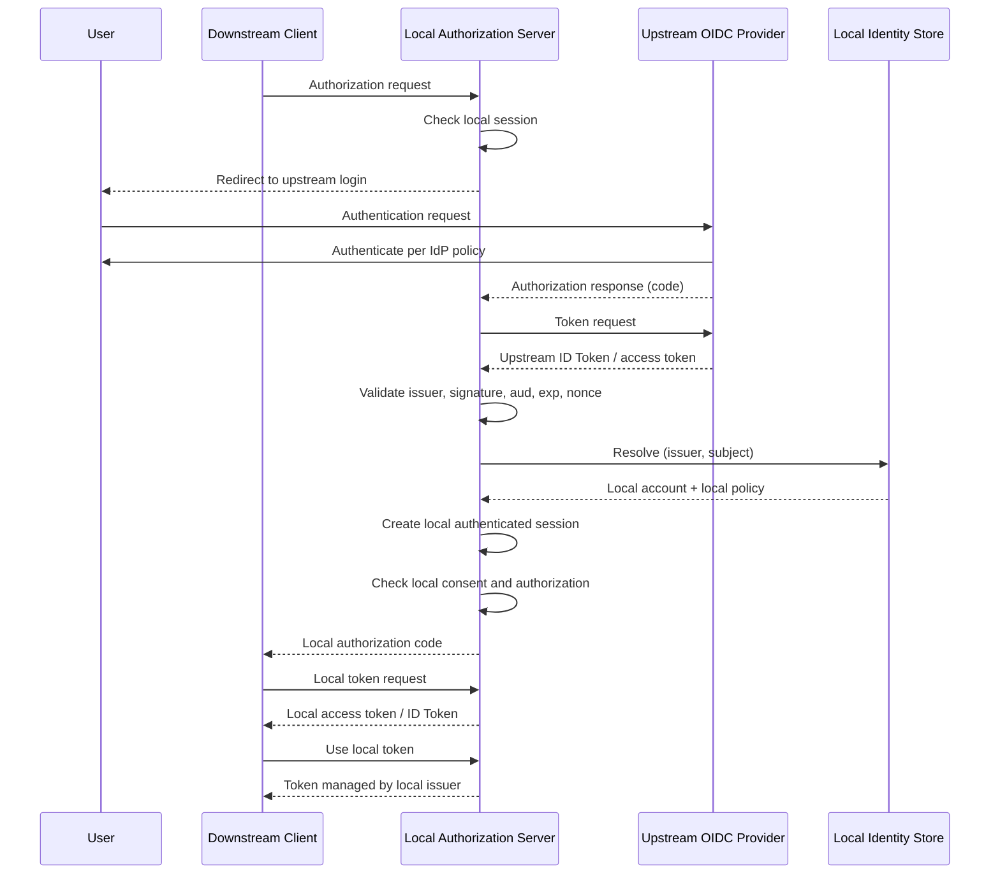
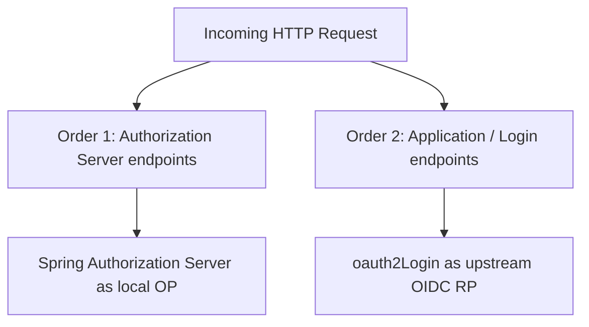

# Boundaries of Responsibility Between Identity Federation and Token Issuance

When an Authorization Server integrates with an external Identity Provider (IdP), two concerns must be clearly separated: the external IdP authenticates the user under an established trust relationship; the internal Authorization Server decides what that user is allowed to do in the system and issues tokens for clients and resource servers under its management. A successful login at the IdP does not automatically grant every scope, role, or business permission in the internal system.

In this model, the internal application often plays two roles simultaneously. It is an OpenID Connect Relying Party (RP) toward the external IdP to receive login results; and it is an OpenID Provider (OP)/OAuth 2.0 Authorization Server toward internal clients to issue tokens. Spring Security provides OAuth2 Client and `oauth2Login()` for the RP role. Spring Authorization Server provides protocol endpoints and token services for the OP role. Combining both roles requires an application-managed identity mapping layer and authorization policy. [Spring Security OAuth2 Login](https://docs.spring.io/spring-security/reference/servlet/oauth2/login/index.html) · [Spring Authorization Server Core Model](https://docs.spring.io/spring-authorization-server/reference/core-model-components.html)

This lesson belongs to the **Identity Federation** chapter of the **SPRING_SECURITY_OAUTH2_OIDC_AUTHORIZATION_SERVER** module. Its goal is to understand the boundary of responsibility between federation and token issuance, design secure account mapping, issue internal tokens with distinct issuers/audiences/claims, and handle logout, consent, provisioning, and error scenarios.

**Example scope:** illustrative APIs follow Spring Security 7.x and Spring Authorization Server 1.5.x. Use a version set compatible with your project's Spring Boot version; configuration examples are integration skeletons, not a complete production broker without adding a local identity service and policies.

## 1. Distinguishing identity federation from token issuance

### 1.1. What does identity federation do?

Identity federation establishes trust between identity domains. The internal application accepts authentication results from a configured and verified IdP. With OIDC, the application receives an ID Token and may call the UserInfo Endpoint to retrieve permitted claims.

Responsibilities of the federation layer include:

- Selecting the exact governed upstream issuer/IdP;
- Initiating the authentication request and maintaining `state`/`nonce`;
- Verifying the ID Token, signature, issuer, audience, expiration, and nonce;
- Fetching UserInfo if needed and checking subject consistency;
- Identifying the external identity by issuer and subject;
- Mapping the external identity to an internal account;
- Checking that the internal account is active and permitted to log in;
- Normalizing trusted attributes/assurance into a local principal.

The external IdP is responsible for the authentication method it performs, such as password, passkey, MFA, or enterprise authentication. The internal application must still decide whether to accept that IdP for the current use case.

### 1.2. What does token issuance do?

The internal Authorization Server is responsible for issuing tokens to registered clients. It must decide:

- Which clients are permitted to use an authorization grant;
- Which principal represents the corresponding internal user;
- Which scopes/resources the client may request;
- Which permissions the user has consented to;
- Whether local role, tenant, account status, and risk policies permit issuance;
- Which access token/ID Token to issue;
- The internal token's issuer, audience, subject, claims, signing key, and TTL;
- How refresh, revocation, introspection, and consent are managed.

Spring Authorization Server models clients via `RegisteredClient`, authorizations via `OAuth2Authorization`, consent via `OAuth2AuthorizationConsent`, and token issuance via `OAuth2TokenGenerator`. These components belong to the internal Authorization Server's domain of responsibility. [Core Model / Components](https://docs.spring.io/spring-authorization-server/reference/core-model-components.html)

### 1.3. Responsibility assignment table

| Concern | Upstream IdP | Internal Authorization Server |
|---|---|---|
| User authentication | Executes and returns result | Verifies OIDC result and decides whether to accept |
| External identification | Issues `iss` and `sub` | Stores `(issuer, subject)` link to local account |
| Local account | Does not manage internal status | Checks active, locked, suspended, tenant, and policy |
| MFA/assurance | Executes authentication and supplies verified context | Maps assurance to local policy; requires step-up if needed |
| Local roles/permissions | May supply claims/groups per contract | Decides mappings and internal permissions |
| OAuth client registration | Does not decide which internal clients are allowed | Manages `RegisteredClient` |
| Consent | Does not replace consent for internal clients | Manages consent per client and principal |
| Access token for internal APIs | Does not issue internal system tokens | Issues tokens with internal issuer/audience/key/claims |
| ID Token for internal clients | Does not issue ID Tokens on behalf of local OP | Issues new ID Tokens to internal clients when using OIDC |
| Refresh/revocation | Manages only the IdP's own tokens | Manages tokens issued by the local Authorization Server |
| Logout | Manages session at the IdP | Manages local sessions, tokens, and downstream logout per policy |

### 1.4. Do not turn a login result into access permissions

A valid ID Token only proves the IdP authenticated a subject for the corresponding client/issuer under OIDC rules. It does not prove the user has `payments.approve`, `tenant.admin`, or `orders.write` permissions in the internal system.

For example, an employee who logs in successfully with a corporate account may be identified as user `employee-4821`. However, permission to approve payments must come from local authorization policy, not be inferred merely because the IdP returned `email_verified=true` or an unchecked group claim.

## 2. Role model in an identity federation architecture

### 2.1. Participating parties

| Component | Role |
|---|---|
| Upstream Identity Provider | OP that authenticates the user and issues an ID Token to the broker |
| Identity broker / internal application | RP toward upstream; maps external identity to local principal |
| Local Authorization Server | OP/AS toward internal clients; grants authorizations and tokens |
| Downstream OAuth/OIDC client | RP/client asking the user to log in and requesting internal tokens |
| Resource Server | API validating access tokens issued by the local AS |
| Local identity store | Stores local accounts, external identity links, tenants, status, and policies |
| Authorization/consent store | Stores authorizations, token state, and consents of the local AS |

A single Spring Boot application can host both the identity broker and Spring Authorization Server in the same process. Nevertheless, they remain two distinct domains of responsibility requiring independent configuration, testing, and observability.

### 2.2. Federated login flow



The flow above depicts two separate protocol exchanges:

1. The broker logs in with the upstream IdP via OAuth 2.0 Authorization Code Flow/OIDC.
2. The downstream client performs an authorization grant with the local Authorization Server and receives internal tokens.

The upstream authorization code and ID Token are not the token response intended for the downstream client. The local AS completes a separate authorization flow and issues tokens per its own registration, consent, and policies.

### 2.3. Two issuers, two token domains

Suppose:

- Upstream issuer: `https://login.corp.example`;
- Local issuer: `https://identity.example.internal`;
- Downstream API: `https://api.example.internal/orders`;
- Internal client: `orders-portal`.

The upstream ID Token has `iss=https://login.corp.example` and `aud` equal to the broker's client ID at the upstream IdP. The local access token has `iss=https://identity.example.internal` and `aud` equal to the internal API permitted by the local AS. The local ID Token, if issued, has audience `orders-portal`.

Do not replace `iss` on an upstream token with the local issuer, nor merely swap the audience and pass the token to an API. Internal token issuance must mint new tokens signed and managed by the local AS.

## 3. Establishing trust with an upstream OIDC Provider

### 3.1. Controlled onboarding of upstream providers

Every upstream IdP must be onboarded as a configured trust relationship:

- Exact Issuer URI;
- Broker's Client ID and credentials;
- Authorization grant type and redirect URI;
- Required scopes;
- Allowed signing algorithms;
- Discovery/JWKS policy;
- TLS and network egress policy;
- Claim mapping policy;
- Account linking policy;
- Logout integration if supported;
- Owner, contact, expiry, and configuration change process.

Never accept an arbitrary `issuer-uri`, JWKS URL, or discovery URL from a query parameter or user profile. If an application fetches metadata from a caller-controlled URL, it risks SSRF, issuer mix-up, or trusting a rogue key server.

### 3.2. OIDC Discovery and issuer pinning

You can use `issuer-uri` in Spring Security to discover the upstream provider's metadata:

```yaml
spring:
  security:
    oauth2:
      client:
        registration:
          corporate:
            provider: corporate
            client-id: local-broker-client
            client-secret: ${CORPORATE_OIDC_CLIENT_SECRET}
            client-authentication-method: client_secret_basic
            authorization-grant-type: authorization_code
            redirect-uri: "{baseUrl}/login/oauth2/code/{registrationId}"
            scope:
              - openid
              - profile
              - email
        provider:
          corporate:
            issuer-uri: https://login.corp.example
```

These values are examples. In production, credentials must come from a secret manager. `issuer-uri` must be a governed issuer and match `iss` in the ID Token exactly. Do not treat a shared hostname as proof that two issuers are equivalent; the issuer path is also part of its identifier.

### 3.3. Validating the ID Token

Before using an ID Token as proof of login, verify at minimum:

- Valid signature using a key from the pinned issuer's JWKS;
- Algorithm is in the allowlist;
- `iss` exactly matches the configured issuer;
- `aud` contains the broker's client ID;
- If multiple audiences exist, validate `azp` per the OIDC contract and policy;
- `exp` is unexpired and `iat` falls within the acceptance window;
- `nonce` matches the value sent in the authentication request;
- `state` in the authorization response matches the stored request;
- Authorization code is redeemed by the right client and redirect URI;
- PKCE is used when required by flow/client policy;
- `auth_time`, `acr`, `amr` are checked if policy requires fresh authentication or specific assurance.

OpenID Connect Core mandates verifying issuer and audience; `nonce` binds the ID Token to the authentication request and mitigates replay. [OpenID Connect Core 1.0](https://openid.net/specs/openid-connect-core-1_0.html)

Spring Security handles many protocol steps through OAuth2 Client/OIDC login. The application must still configure trusted providers, manage state/sessions properly, and write tests for security conditions required by internal policy.

### 3.4. UserInfo does not replace ID Token validation

The UserInfo Endpoint supplies claims about the End-User using an access token. It is not independent proof to skip ID Token validation. When using UserInfo:

- The access token must be sent only to the UserInfo Endpoint belonging to the matching provider;
- TLS and provider metadata must be verified;
- `sub` in UserInfo must match `sub` in the ID Token;
- Accept only requested claims permitted by policy;
- Never use claims lacking provenance or stability guarantees as account identifiers.

Spring Security's `OidcUserService` can call the UserInfo Endpoint and provides an extension point for applications to customize user processing. [Spring Security Advanced OAuth2 Login](https://docs.spring.io/spring-security/reference/servlet/oauth2/login/advanced.html)

### 3.5. Key rotation and provider compromise

When an upstream IdP rotates signing keys, the broker must fetch new keys from the trusted JWKS and handle overlap per metadata/provider behavior. Never pin a single public key permanently if the provider performs normal rotation. Conversely, never accept arbitrary keys or algorithms merely because the JWKS endpoint returns them.

If an upstream issuer or signing key is compromised:

1. Mark the provider restricted or suspended;
2. Stop accepting new logins from that provider;
3. Evaluate sessions and local account links created from the provider;
4. Identify which local tokens require revocation;
5. Inspect audit logs and issued access tokens;
6. Restore trust only after keys/issuer are re-verified.

## 4. Identifying and linking external identities to local accounts

### 4.1. Using the issuer and subject pair

OIDC defines `sub` as a unique, never-reassigned subject identifier within an issuer's scope. Combining `iss` and `sub` gives RPs a stable identifier for an external identity. Email, phone, display name, and username do not have equivalent uniqueness/stability guarantees. [OIDC Core — Claim Stability and Uniqueness](https://openid.net/specs/openid-connect-core-1_0.html#ClaimStability)

Linking model:

| Field | Meaning |
|---|---|
| `provider_issuer` | Configured and verified issuer |
| `provider_subject` | `sub` from the verified ID Token |
| `local_user_id` | Stable internal ID |
| `linked_at` | Linking timestamp |
| `last_authenticated_at` | Most recent authentication |
| `status` | Active, suspended, unlinked, or administrative state |
| `authentication_context` | Context permitted for storage such as `acr`/`auth_time` per policy |

The unique key should be the `(provider_issuer, provider_subject)` pair. With multiple IdPs, storing `sub` alone without the issuer creates collision risks across identity domains.

### 4.2. Never use email as a linking key

Do not write logic like:

```java
// Unsafe: email is not an external subject identifier.
LocalUser user = userRepository.findByEmail(oidcUser.getEmail())
        .orElseGet(() -> userRepository.create(oidcUser.getEmail()));
```

Email addresses can change, be recycled, be unverified, or match across two different issuers. `email_verified=true` is only an issuer claim within an established trust scope; it does not turn email into a stable OIDC identifier key, nor does it prove two existing accounts belong to the same person.

### 4.3. Account linking must require proof

If a user wants to link a second IdP to a local account:

1. The user logs into the existing local account with a valid session/step-up;
2. Initiates the linking flow with the second IdP;
3. Verifies the second IdP's ID Token and `(iss, sub)`;
4. Clearly displays the IdP/account being linked;
5. Requires confirmation per policy;
6. Saves the external identity link under a unique constraint;
7. Audits who performed it, when, and from which session;
8. Handles collisions if the external identity is already attached to another local account.

Never auto-merge two accounts solely because their emails match. Account linking alters account control and must be protected as a sensitive operation.

### 4.4. Pairwise subjects and multiple upstream clients

An OIDC provider may use pairwise subjects—different `sub` values per sector/client—to restrict RPs from correlating user activity. If the broker registers multiple distinct clients at the same upstream IdP, the same person can have different `sub` values for each client/sector.

Therefore, interpret `sub` in the context of the registered client/sector. If consolidating different identity links is necessary, require a verified linking workflow or an inter-organizational identifier provided by upstream under a separate contract. Never assume matching emails mean matching subjects.

### 4.5. Local account lifecycle

A valid upstream login must still be rejected if the local account is:

- Suspended/disabled;
- Locked due to an incident or policy;
- Outside the permitted tenant/organization;
- Missing mandatory onboarding completion;
- Unlinked from that IdP;
- Requiring step-up or re-verification;
- No longer eligible to access the application.

Deprovisioning at the IdP does not automatically update the local account without SCIM, events, or a dedicated synchronization process. Define sync SLAs, handle missed provider events, and block local accounts in the interim.

## 5. Mapping claims and authentication context

### 5.1. Map only claims with clear provenance

Build an allowlisted claim mapping instead of copying all upstream claims into local principals/tokens:

| Upstream claim | Can be used for | Condition |
|---|---|---|
| `sub` + `iss` | External identity link | ID Token verified |
| `email` | Contact/display or verification workflow | Never use as primary key; evaluate `email_verified` |
| `name`, `given_name`, `family_name` | Profile display | Never use for permissions |
| `groups` | Input hints for local role mapping | Must have namespace, owner, and mapping policy |
| `acr` | Authentication context | Trust only values within assurance contract |
| `amr` | Authentication methods | Never infer assurance beyond provider guarantees |
| `auth_time` | Authentication timestamp | Used for freshness/step-up checks |
| `locale`, `zoneinfo` | UX | Never use for authorization |

Claims outside the allowlist should be ignored or kept in a controlled audit context, never emitted automatically into tokens.

### 5.2. Never map upstream groups directly to local roles

For example, the IdP returns:

```json
{
  "groups": ["employees", "finance", "global-admins"]
}
```

Do not turn `global-admins` into `ROLE_ADMIN` simply by prepending a prefix. Group names can be changed by an upstream administrator; they may carry organization-wide scope or fail to fit local tenants.

Use a governed mapping table:

| Upstream issuer | Upstream group | Local tenant | Local permission |
|---|---|---|---|
| `https://login.corp.example` | `finance-approvers` | `tenant-a` | `payment.approve` |
| `https://login.corp.example` | `support-agents` | `tenant-a` | `support.case.read` |
| `https://partner.example` | `merchant-ops` | `merchant-42` | `merchant.order.read` |

Mappings must have an owner, auditing, review cadence, and tests. If group claims are missing or fail to load, the application must never default to granting broader permissions.

### 5.3. Authentication assurance is not local authorization

`acr` and `amr` can describe the upstream IdP's authentication context/methods. The local AS needs an explicit policy mapping, for example:

- `acr` in satisfied set → corresponding local authentication assurance level;
- `auth_time` recent enough for sensitive operations;
- `amr` includes factors matching step-up policy;
- Missing assurance claims or untrusted issuer → step-up requirement not met.

Never trust an arbitrary `acr` value merely because it is named `urn:...:loa:2`. You must know how the upstream provider defines, enforces, and audits that value.

### 5.4. Local policy retains the right to deny

The local AS may refuse to issue tokens or require additional authentication even when upstream login succeeds. For instance:

- User authenticated, yet local account is suspended;
- Upstream MFA is too stale;
- Client requests scopes outside policy;
- Tenant mismatch;
- Resource Server is not permitted to receive tokens;
- Session risk exceeds threshold;
- Consent is absent or has been revoked.

The final decision on internal tokens belongs to the local Authorization Server.

## 6. Integrating Spring Security OAuth2 Login and Spring Authorization Server

### 6.1. Two security configurations, two roles

Spring Security `oauth2Login()` configures the application as an OAuth2 Client/OIDC RP. Spring Authorization Server's configurer configures the endpoints of the local OP/AS. An application can use two separate `SecurityFilterChain` beans to isolate endpoints and processing order.

Conceptual configuration diagram:



Authorization Server endpoints must be matched using the configurer's endpoint matcher. Login/callback endpoints belong to the application chain. Test filter chain ordering so `/login/oauth2/code/{registrationId}` callbacks are never mistakenly intercepted by the Authorization Server chain.

### 6.2. Configuring the Authorization Server chain

Skeleton configuration example:

```java
@Bean
@Order(1)
SecurityFilterChain authorizationServerSecurityFilterChain(
        HttpSecurity http) throws Exception {

    OAuth2AuthorizationServerConfigurer authorizationServerConfigurer =
            OAuth2AuthorizationServerConfigurer.authorizationServer();

    http
        .securityMatcher(authorizationServerConfigurer.getEndpointsMatcher())
        .with(authorizationServerConfigurer, server -> server
            .oidc(Customizer.withDefaults()))
        .authorizeHttpRequests(authorize -> authorize
            .anyRequest().authenticated())
        .exceptionHandling(exceptions -> exceptions
            .defaultAuthenticationEntryPointFor(
                new LoginUrlAuthenticationEntryPoint(
                    "/oauth2/authorization/corporate"),
                new MediaTypeRequestMatcher(MediaType.TEXT_HTML)));

    return http.build();
}
```

This example assumes an upstream registration ID of `corporate` and uses a login redirect for browser requests. Configure the issuer, JWK source, client repository, authorization/consent services, and endpoint policies per your application. The Authorization Server configurer provides extension points for core services and endpoint behavior. [Configuration Model](https://docs.spring.io/spring-authorization-server/reference/configuration-model.html)

### 6.3. Configuring the application/login chain

```java
@Bean
@Order(2)
SecurityFilterChain applicationSecurityFilterChain(
        HttpSecurity http,
        OAuth2UserService<OidcUserRequest, OidcUser> federatedOidcUserService)
        throws Exception {

    http
        .authorizeHttpRequests(authorize -> authorize
            .requestMatchers("/assets/**", "/health").permitAll()
            .anyRequest().authenticated())
        .oauth2Login(oauth2 -> oauth2
            .userInfoEndpoint(userInfo -> userInfo
                .oidcUserService(federatedOidcUserService)));

    return http.build();
}
```

Imports and specific matchers depend on the application. If supporting multiple upstream IdPs, define how providers are selected by tenant/domain or onboarding policy. Never accept an arbitrary registration ID and dynamically build a provider from a user-supplied URL.

### 6.4. OidcUserService as the local identity mapping point

Spring Security lets you supply a custom `OidcUserService` to process UserInfo and map the principal. You can use the default delegate to preserve OIDC validation/fetch behavior, then invoke your local identity service:

```java
import java.util.Map;

import org.springframework.security.oauth2.client.oidc.userinfo.OidcUserRequest;
import org.springframework.security.oauth2.client.oidc.userinfo.OidcUserService;
import org.springframework.security.oauth2.client.userinfo.OAuth2UserService;
import org.springframework.security.oauth2.core.oidc.user.OidcUser;

@Bean
OAuth2UserService<OidcUserRequest, OidcUser> federatedOidcUserService(
        FederatedIdentityService identityService,
        FederatedClaimMapper claimMapper,
        LocalOidcPrincipalFactory principalFactory) {

    OidcUserService delegate = new OidcUserService();

    return request -> {
        OidcUser upstreamUser = delegate.loadUser(request);

        String issuer = upstreamUser.getIdToken()
                .getClaimAsString("iss");
        String subject = upstreamUser.getIdToken()
                .getSubject();

        Map<String, Object> approvedClaims =
                claimMapper.mapAllowedClaims(upstreamUser.getClaims());

        LocalFederatedAccount account = identityService
                .resolveOrProvision(issuer, subject, approvedClaims);

        return principalFactory.create(account, upstreamUser);
    };
}
```

`FederatedIdentityService`, `FederatedClaimMapper`, `LocalFederatedAccount`, and `LocalOidcPrincipalFactory` are application-defined abstractions. The factory should produce an `OidcUser` wrapper whose `getName()` stably returns the local subject and whose authorities come from local policy. The wrapper can also implement the `LocalFederatedPrincipal` interface below so token customizers read local subject/tenant/authorities. It may retain upstream authentication context for auditing, but must never cause upstream token claims to automatically become local token claims.

If the application does not want automatic account provisioning, `resolveOrProvision` must look up only existing accounts and reject un-onboarded users. Never create local users merely because some IdP returned a valid ID Token.

### 6.5. Local principal and local token claims

Principals used in the local Authorization Server must represent local accounts. A design might include:

```java
import java.util.Set;

public interface LocalFederatedPrincipal {
    String subject();
    String tenantId();
    Set<String> authorities();
}
```

This is an illustrative application interface. The actual principal class implements both `OidcUser` and `LocalFederatedPrincipal`; `getName()` returns the stable local subject, while the interface methods supply data decided by local policy. External issuer/subject and authentication context can be kept in a separate object for auditing. Never use a raw upstream ID Token as an internal access token.

When issuing JWTs with Spring Authorization Server, use `OAuth2TokenCustomizer<JwtEncodingContext>` to add local claims after checking the token type:

```java
import org.springframework.security.oauth2.core.oidc.OidcParameterNames;
import org.springframework.security.oauth2.server.authorization.OAuth2TokenType;
import org.springframework.security.oauth2.server.authorization.token.JwtEncodingContext;
import org.springframework.security.oauth2.server.authorization.token.OAuth2TokenCustomizer;

@Bean
OAuth2TokenCustomizer<JwtEncodingContext> localTokenClaimsCustomizer() {
    return context -> {
        Object principal = context.getPrincipal().getPrincipal();
        if (!(principal instanceof LocalFederatedPrincipal user)) {
            return;
        }

        if (OAuth2TokenType.ACCESS_TOKEN.equals(context.getTokenType())) {
            context.getClaims().subject(user.subject());
            context.getClaims().claim("tenant_id", user.tenantId());
            context.getClaims().claim(
                    "authorities", user.authorities());
        }

        if (OidcParameterNames.ID_TOKEN.equals(
                context.getTokenType().getValue())) {
            context.getClaims().subject(user.subject());
        }
    };
}
```

This is an example for a custom principal and JWT token generator. With a custom-written token generator, wire the customizer into that generator. Add only claims determined by local policy; never copy upstream `groups`, `roles`, `email`, or `acr` into every token. `tenant_id` and `authorities` are illustrative; ensure Resource Servers understand the exact contract and never trust tokens from other issuers.

### 6.6. Maintaining the local AS's issuer and signing keys

The local AS must sign tokens with keys managed by the local trust domain. Tokens issued by the local AS must contain:

- `iss` equal to the local issuer;
- `aud` equal to the permitted downstream resource/client;
- `sub` equal to the stable local subject;
- `exp`, `iat`, and time claims per policy;
- Scopes/authorities granted by the local AS;
- `kid`/algorithm per local key policy;
- Token metadata and revocation state persisted per design.

Never use an upstream IdP's private signing key to sign internal tokens. Never place the upstream issuer in internal tokens merely because upstream authenticated the user.

## 7. Distinguishing token types in federation

### 7.1. Upstream ID Token

An ID Token is an assertion about End-User authentication for a specific OIDC client. It carries `iss`, `sub`, `aud`, `exp`, `iat`, and optionally `auth_time`, `acr`, `amr`, `nonce`. The audience is the broker's client ID at the upstream IdP, not by default a local downstream client or API.

### 7.2. Upstream Access Token

An upstream access token authorizes the broker to call resource servers belonging to the upstream provider per granted scopes/audiences. It does not automatically grant access to internal APIs. Do not send this token to a local Resource Server unless the internal API was explicitly designed to trust the upstream's issuer, audience, keys, and policy.

### 7.3. Local Access Token

A local access token is issued by the local AS to an internal client. It carries issuer, audience, scope, subject, and lifetime per internal policy. Internal Resource Servers must validate tokens against the configured local issuer/JWKS or introspection endpoint.

### 7.4. Local ID Token

When the local AS has OIDC enabled, it issues a new ID Token to the downstream client. This ID Token confirms that the local OP authenticated the internal subject for that client, under the local authentication session and policy. It is not a copy of the upstream ID Token.

### 7.5. Local Refresh Token

Refresh tokens are issued and managed by the local AS. Expiration of an upstream access token does not automatically expire a local refresh token, and vice versa. The local AS needs its own policies for TTL, rotation, reuse detection, revocation, and re-authentication conditions.

### 7.6. Comparison table

| Attribute | Upstream ID Token | Upstream Access Token | Local Access Token | Local ID Token |
|---|---|---|---|---|
| Issuer | Upstream IdP | Upstream AS | Local AS | Local AS |
| Audience | Broker client ID | Upstream resource | Local API/resource | Local downstream client |
| Purpose | Verifies upstream login | Calls upstream APIs | Calls local APIs | Downstream OIDC client login |
| Subject | Upstream `sub` | Per upstream semantics | Local subject | Local subject |
| Signing key | Upstream | Upstream or opaque | Local | Local |
| Revocation/lifecycle | Managed by upstream | Managed by upstream | Managed by local AS | Managed by local AS |
| Sent to local APIs? | No | Only with an explicit trust contract | Yes, if audience matches | Never use as an API access token |

## 8. When is token exchange or token relay needed?

### 8.1. Do not forward tokens simply because you have them

If the broker holds an upstream access token, that token can be used to call upstream APIs per its scopes/audience. Do not automatically forward it to downstream clients or internal APIs.

Options to distinguish:

- **Local token issuance:** the local AS issues new tokens based on the local principal and local authorization policy.
- **Server-side token relay:** the backend retains the upstream token and uses it to call upstream APIs; the token is kept away from browsers/downstream clients unless necessary.
- **Token exchange:** a client sends a subject token to an RFC 8693-capable STS/Authorization Server to request a new token for a different audience/resource per policy.
- **Credential delegation:** permits a service to act on behalf of a subject with explicit actor identity and constraints.

### 8.2. Token exchange is a distinct protocol

RFC 8693 defines token exchange via the extension grant `urn:ietf:params:oauth:grant-type:token-exchange`. The Authorization Server must verify the subject token, actor token if present, token type, audience/resource, and policy before issuing a new token. Merely swapping audience or copying claims without validating the source token is not secure token exchange. [RFC 8693](https://www.rfc-editor.org/rfc/rfc8693.html)

When implementing token exchange, define:

- Which clients are permitted to call exchange;
- Which `subject_token`/`actor_token` types are accepted;
- Issuer and signature validation;
- Subject and actor binding;
- Target audience/resource;
- Maximum granted scopes;
- Delegation/impersonation policy;
- Output token lifetime;
- Revocation propagation if needed;
- Audit trail and confused deputy defenses.

### 8.3. Avoid creating a confused deputy

If the broker is authorized to call multiple upstream APIs, never let a downstream client supply any arbitrary upstream token and ask the local AS to swap it for a broader-privileged token. Verify the token belongs to the right issuer, audience, client/subject, resource, and falls within delegation policy. Output tokens must never exceed the permissions allowed to the subject and actor.

## 9. Consent and internal authorization

### 9.1. Login does not imply consent

The upstream IdP authenticates the user; the local AS still decides which scopes internal clients may request and which scopes the user has approved. If a local client requests `orders.read` and `payments.approve`, a successful IdP login does not mean both permissions have been consented to.

Spring Authorization Server represents consent with `OAuth2AuthorizationConsent`, binding a `RegisteredClient` and a principal. Authorities in consent can represent scopes, claims, or permissions approved by the user. [Core Model / Components](https://docs.spring.io/spring-authorization-server/reference/core-model-components.html)

### 9.2. Local authorization policy

Federation outcomes must be combined with:

- Local account status;
- Local roles/permissions;
- Tenant membership;
- Client registration;
- Requested scopes;
- Resource/audience;
- Consent;
- Risk/step-up requirements;
- Business policy.

Never let an upstream IdP directly decide all scopes for local clients unless there is a specific trust agreement and controlled mapping policy.

### 9.3. Scopes and roles are not the same

Scopes typically describe permissions granted to a client in an OAuth request; roles/authorities can be attributes of the principal or local authorization policy. A group claim from an IdP is not automatically a scope. Define how external groups map to local permissions, and how local policy translates into scopes/token claims.

## 10. Logout and sessions across two trust domains

### 10.1. Multiple independent sessions exist

In identity federation, the following can coexist:

1. Session at the upstream IdP;
2. Local browser session of the broker/Authorization Server;
3. Local OAuth authorization/token state;
4. Session of the downstream RP/client;
5. Upstream authorized-client tokens stored by the backend to call external APIs.

Logging out one session does not automatically clear all remaining sessions or tokens.

### 10.2. Local logout

Local logout must define:

- Clearing the local HTTP session and `SecurityContext`;
- Deleting or invalidating local authorized-client state if policy requires;
- Revoking local refresh tokens/authorizations when needed;
- Notifying downstream RPs via front-channel/back-channel logout if supported;
- Recording an audit event;
- Handling browser cookies and session fixation.

Local logout does not mean the upstream IdP session has ended. The user may immediately be signed back in when starting a new login because the upstream SSO session remains active.

### 10.3. Upstream RP-Initiated Logout

If the local broker wants to request upstream OP logout, it can use RP-Initiated Logout with `end_session_endpoint` from discovery metadata and a matching `id_token_hint`. Verify `post_logout_redirect_uri` and `state` per spec. Upstream logout controls only the session at the upstream OP and RPs notified by that OP; it does not automatically revoke previously issued local access tokens. [RP-Initiated Logout 1.0](https://openid.net/specs/openid-connect-rpinitiated-1_0.html)

### 10.4. Back-channel logout and local token revocation

If the upstream IdP supports Back-Channel Logout, the broker can receive a Logout Token and identify affected sessions using `iss`, `sub`, and/or `sid`. After verifying the logout token, the broker can delete the matching local session and apply policies to revoke local authorizations/refresh tokens. Back-channel logout does not automatically define all revocation policies; the local AS must define and implement them explicitly. [Back-Channel Logout 1.0](https://openid.net/specs/openid-connect-backchannel-1_0.html)

### 10.5. Fresh authentication and step-up

A local session may still be valid while the upstream authentication is too old. For sensitive operations, the local AS can require re-authentication using `max_age`, `prompt`, or corresponding policies, then verify `auth_time` and `acr` in the fresh result. Do not merely check whether the local cookie still exists to conclude authentication is sufficiently fresh.

## 11. Data boundaries and ownership

### 11.1. Upstream and local data

| Data | Authoritative source | Stored locally? | Emitted into tokens? |
|---|---|---|---|
| Upstream issuer/subject | Upstream IdP | Yes, in external identity link | Usually unnecessary |
| Email/profile | Upstream IdP, syncable | Copy may be stored with source/timestamp | Only when client needs it and policy allows |
| Local user ID | Local identity service | Yes | Can serve as local `sub` |
| Local roles/permissions | Local authorization system | Yes | Only required claims/scopes |
| Upstream access token | Upstream IdP | Only when calling upstream APIs; must be protected | Not by default |
| Upstream ID Token | Upstream IdP | Minimal metadata may be stored for audit/session | Never re-issued as local ID Token |
| Local access/ID/refresh token | Local AS | Authorization store | Per protocol |
| Consent | Local AS/resource owner | Yes | Typically reflected via scopes/authorization |
| Authentication context | Upstream, then local mapping | Stored per policy | Only when needed and normalized |

### 11.2. Provenance and freshness

If retaining claims for post-login use, track:

- Which issuer the claim came from;
- When it was received;
- Which protocol verified it;
- Whether `email_verified` or assurance context is present;
- Whether the claim can change or needs re-synchronization;
- How the local system learns when an upstream account is locked.

Never treat a stale profile snapshot as current authentication proof. A local token could be issued after upstream claims changed if no synchronization or re-authentication policy exists.

### 11.3. Minimizing token data

Include only claims needed by the client/resource. Never put full profiles, groups, emails, employee numbers, or sensitive data into access tokens merely because they are available upstream. JWTs are often read by many services and can end up in logs/telemetry; minimizing claims reduces leakage and coupling.

## 12. Testing federation and issuance boundaries

### 12.1. Upstream OIDC validation tests

| Case | Outcome |
|---|---|
| Invalid ID Token signature | Login fails |
| `iss` differs from configured issuer | Rejected |
| `aud` missing broker client ID | Rejected |
| Invalid `azp` when check required | Rejected |
| Expired `exp` | Rejected |
| Mismatched `nonce` | Rejected |
| Mismatched `state` | Rejected |
| UserInfo `sub` differs from ID Token `sub` | Rejected |
| Valid JWKS key rotation | New key accepted per policy |
| Unknown signing algorithm | Rejected |

### 12.2. Local identity mapping tests

- Same `(iss, sub)` always resolves to the same local account;
- Same `sub` with a different issuer resolves to a different identity;
- Matching email does not auto-merge accounts;
- An external identity already attached to another account cannot be arbitrarily re-linked;
- Disabled/suspended local accounts are rejected;
- Tenant mismatches are rejected;
- Claims outside the allowlist are not placed into the local principal;
- Group claims produce permissions only through mapping policy;
- Account unlinking/revocation is enforced per policy.

### 12.3. Local token issuance tests

- Local tokens carry the internal issuer;
- Access token audience is the permitted internal resource;
- Local `sub` is the stable local subject;
- Scopes reflect local policy/consent;
- Signing keys belong to the local AS;
- Tokens do not contain upstream ID Tokens or raw upstream access tokens;
- Local refresh/revocation/introspection work independently;
- Clients without registered grants/scopes cannot obtain tokens.

### 12.4. Session/logout tests

- Local logout deletes the local session;
- Upstream logout is not assumed to have revoked local tokens;
- Back-channel Logout Token is verified before processing;
- Logout events affect only matching `iss`/`sub`/`sid` sessions;
- Local refresh tokens are revoked per policy;
- User may require re-authentication if the upstream SSO session remains active;
- Downstream logout notifications are sent/received properly when configured.

### 12.5. Multi-IdP and account-linking tests

Run tests with two different issuers returning the same email, same display name, or same `sub`. The system must keep identity links separate. Test pairwise subjects, provider removal, key rotation, and provider disablement to ensure no identity collisions or erroneous auto-linking occur.

## 13. Common design mistakes

| Mistake | Consequence | Fix |
|---|---|---|
| Using email as external identity key | Account collision or takeover when email changes/recycles | Use `(iss, sub)` |
| Re-issuing upstream ID Token to downstream clients | Wrong issuer/audience and wrong trust domain | Local AS issues a new ID Token |
| Forwarding upstream access token to local APIs | API receives token with wrong audience/issuer | Issue local access token or policy-governed token exchange |
| Copying all upstream groups into local roles | Privilege escalation | Allowlist and owner-governed mapping |
| Trusting `email_verified` as authorization | User receives unrelated permissions | Use local policy and consent |
| Using `acr` without a trust contract | Spoofed assurance | Pin issuer and map agreed values |
| Allowing dynamic issuer from input | SSRF/issuer mix-up | Select providers from a governed registry |
| Creating admin upon successful IdP login | Elevation of privilege | Separate onboarding/provisioning and local role assignment |
| Local logout assumed to log out upstream | SSO silently logs back in | Separate sessions and support RP-initiated logout when needed |
| Upstream logout while keeping local refresh tokens indefinitely | Local access persists past upstream logout | Local session/token revocation policy |
| Using an old local session for sensitive actions | Fails re-authentication requirements | `max_age`, `auth_time`, step-up |
| Ignoring deprovisioning | Local account stays active after IdP locks user | SCIM/events/reconciliation and local denial |
| Putting raw upstream tokens inside local JWT | Credential leakage and coupling | Never copy; use dedicated token relay/exchange |
| Same local `sub` for multiple people from multiple issuers | Collisions and corrupted audits | Stable local subject independent of upstream |

## 14. Onboarding workflow for an upstream IdP

1. Identify issuer, owner, purpose, and allowed user groups.
2. Register the broker client at the upstream IdP.
3. Declare exact redirect URI and client authentication method.
4. Configure issuer URI, discovery/JWKS, and TLS policy.
5. Select minimal scopes, typically starting with `openid` and adding profile/email only when needed.
6. Define claim allowlist and mapping for local accounts.
7. Establish the `(iss, sub)` external identity key.
8. Define account provisioning/linking and deprovisioning.
9. Define local role, tenant, scope, and consent policies.
10. Configure `oauth2Login()` and custom `OidcUserService`.
11. Configure local AS token issuer, keys, audience, claims, and TTL.
12. Define logout, session, step-up, and refresh-token policies.
13. Run validation, account-linking, token-issuance, and multi-IdP tests.
14. Roll out canary to a small user cohort.
15. Monitor issuer validation errors, account mapping, local denials, and token issuance.
16. Expand rollout only once auditing and support workflows are operational.

## 15. Hands-on exercise

**Scenario:** An enterprise has an upstream IdP `https://login.corp.example`. A Spring Boot application acts as an OIDC RP to this IdP and runs Spring Authorization Server for internal clients. The `orders-portal` client needs an access token to call `https://api.example.internal/orders`.

**Requirements:**

1. Configure the upstream OIDC client with `issuer-uri`, client ID/secret, redirect URI, and minimal scopes.
2. Separate the Authorization Server `SecurityFilterChain` and application/login `SecurityFilterChain`.
3. Write a custom `OidcUserService` using the default delegate to fetch the upstream OIDC user.
4. Resolve the local identity using the `(iss, sub)` pair.
5. Build a local principal with a local subject and authorities from local policy.
6. Write a test proving two issuers with the same email do not merge accounts.
7. Write a mapping policy for upstream group `finance-approvers` to local permission `payment.approve` scoped by tenant.
8. Verify a suspended local account receives no local tokens even when upstream login succeeds.
9. Issue a local JWT access token with local issuer, local subject, API audience, and consented scopes.
10. Verify the local token contains neither the upstream ID Token nor the raw upstream access token.
11. Test that the Resource Server trusts only the local issuer for internal APIs.
12. Define how to use the upstream access token when the backend must call an upstream API.
13. Design local logout and upstream RP-Initiated Logout.
14. Test refresh/revocation of local tokens after upstream logout.
15. Build a deprovisioning workflow for when a user is locked upstream.

**Acceptance criteria:** Upstream IdP only authenticates identity within its trust domain; the local identity service determines the local account; the local Authorization Server decides consent/scope/audience and issues new tokens signed by the local issuer. No email-based account merging, no upstream tokens used with wrong audiences, and logout/provisioning follow explicit policies.

## 16. Self-assessment questions

1. How do identity federation and token issuance differ in responsibility?
2. Why can an application act simultaneously as an OIDC RP and a local OIDC OP?
3. How are `iss` and `sub` used together to identify an external identity?
4. Why is email not a safe account linking key?
5. How do upstream ID Tokens and access tokens differ in purpose?
6. Why must the local AS issue new tokens rather than forwarding the upstream ID Token?
7. What is the significance of an upstream access token's audience?
8. Should the local principal use the local subject or the upstream subject?
9. When is a custom `OidcUserService` needed?
10. Why must UserInfo `sub` match ID Token `sub`?
11. Which claims can be allowlisted and which must never be used for local authorization?
12. Why do upstream groups not automatically become local roles?
13. How can `acr`, `amr`, and `auth_time` be used in a step-up policy?
14. How does local consent differ from upstream authentication?
15. When is token exchange per RFC 8693 needed?
16. Why does local logout not automatically end the upstream IdP session?
17. Which data must Back-Channel Logout verify?
18. How should a local account be handled when the upstream user is deprovisioned?
19. Why must arbitrary issuer URIs never be accepted from users?
20. Which tests prove local tokens carry only permissions granted by the local AS?

## 17. Official references

- [Spring Security — OAuth2 Login](https://docs.spring.io/spring-security/reference/servlet/oauth2/login/index.html): configuring an application as an OAuth2 Client/OIDC RP.
- [Spring Security — Advanced OAuth2 Login Configuration](https://docs.spring.io/spring-security/reference/servlet/oauth2/login/advanced.html): `OidcUserService`, UserInfo, and mapping authorities.
- [Spring Authorization Server — Core Model / Components](https://docs.spring.io/spring-authorization-server/reference/core-model-components.html): `RegisteredClient`, `OAuth2Authorization`, consent, and token generators.
- [Spring Authorization Server — Configuration Model](https://docs.spring.io/spring-authorization-server/reference/configuration-model.html): configuring the Authorization Server and endpoint configurers.
- [OpenID Connect Core 1.0](https://openid.net/specs/openid-connect-core-1_0.html): ID Token, validation, issuer/subject stability, nonce, and claims.
- [RFC 8693 — OAuth 2.0 Token Exchange](https://www.rfc-editor.org/rfc/rfc8693.html): subject token, actor token, audience/resource, and token exchange policies.
- [OpenID Connect RP-Initiated Logout 1.0](https://openid.net/specs/openid-connect-rpinitiated-1_0.html): logout requests from an RP to an upstream OP.
- [OpenID Connect Back-Channel Logout 1.0](https://openid.net/specs/openid-connect-backchannel-1_0.html): Logout Tokens and how RPs handle sessions.
- [RFC 9700 — Best Current Practice for OAuth 2.0 Security](https://www.rfc-editor.org/rfc/rfc9700.html): OAuth security threats and protections for tokens and authorization flows.

**Key takeaway:** Upstream IdPs authenticate users; the local identity service maps external identities to local accounts; the local Authorization Server decides permissions and issues internal tokens. Use `(iss, sub)` to link identities, keep local `sub`, issuer, audience, and signing keys independent, and map claims via allowlists and local policies. Distinguish upstream/local tokens, local/upstream sessions, consent, and revocation. Federation establishes trust in identity; it does not delegate full token-issuance authority to the upstream IdP.
