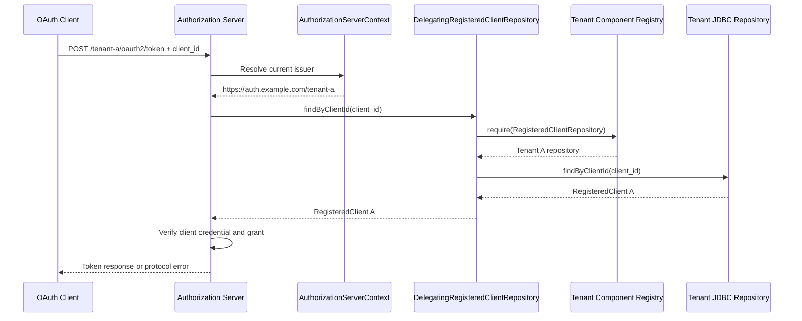
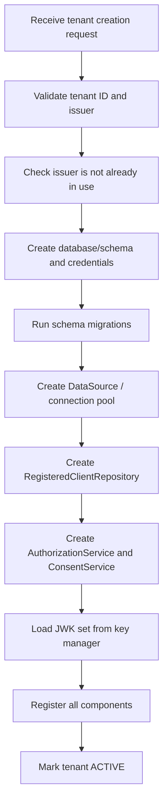

# Partitioning RegisteredClientRepository by Tenant

## 1. Why Partition RegisteredClientRepository?

In the **Multitenancy** chapter of the **SPRING_SECURITY_OAUTH2_OIDC_AUTHORIZATION_SERVER** module, we learn how to design, configure, secure, test, and operate an OAuth 2.0/OpenID Connect Authorization Server using Spring Security and Spring Authorization Server in a Spring Boot application.

An Authorization Server serving multiple organizations must ensure that clients belonging to tenant A cannot be found, modified, or used within the context of tenant B. Each tenant can have its own client IDs, client secrets, redirect URIs, grant types, scopes, and policies. If all clients reside in a single repository and queries lack a tenant boundary, a routing bug can expose configuration or issue tokens under another tenant's policies.

Spring Authorization Server defines `RegisteredClientRepository` as the central component for storing and looking up `RegisteredClient` instances. The repository is invoked across many protocol flows, including client authentication, authorization grants, token introspection, and dynamic client registration.

The interface has three methods:

| Method | Purpose |
| --- | --- |
| `save(RegisteredClient registeredClient)` | Persist a client registration. |
| `findById(String id)` | Look up a registration by internal ID. |
| `findByClientId(String clientId)` | Look up a registration by OAuth client identifier. |

These methods do not take a tenant parameter. Therefore, in a multi-tenant deployment, the application must determine the tenant from the request's Authorization Server context and delegate to the corresponding repository.

Spring Authorization Server 1.5.8 provides an official guide for this model: enable multiple issuers on the same host, use `AuthorizationServerContextHolder` to obtain the current issuer, build a per-issuer component registry, and use a composite repository to forward calls to the tenant-specific repository.

### Learning Objectives

After this lesson, you will be able to:

- Understand the contract and role of `RegisteredClientRepository`.
- Use the current issuer as a tenant identifier in a multi-issuer model.
- Enable `multipleIssuersAllowed(true)` properly.
- Build a component registry mapping issuers to concrete repositories.
- Create a `DelegatingRegisteredClientRepository` backed by separate JDBC repositories.
- Choose between database, schema, or shared-table isolation.
- Protect lookups, saves, caches, transactions, and dynamic registration against cross-tenant access.
- Recognize the other services that must also be tenant-partitioned for a truly secure Authorization Server.

## 2. RegisteredClientRepository in Spring Authorization Server

### 2.1. What Data Does RegisteredClient Contain?

`RegisteredClient` describes a registered OAuth 2.0 client. Key fields include:

| Property | Meaning |
| --- | --- |
| `id` | Unique internal ID of the registration. |
| `clientId` | Client identifier sent by the client application in protocol requests. |
| `clientIdIssuedAt` | Timestamp when the client ID was issued. |
| `clientSecret` | Encoded secret if the client requires a shared secret. |
| `clientSecretExpiresAt` | Timestamp when the secret expires. |
| `clientAuthenticationMethods` | Allowed client authentication methods. |
| `authorizationGrantTypes` | Grant types the client is permitted to use. |
| `redirectUris` | Registered redirect URIs. |
| `postLogoutRedirectUris` | URIs permitted for post-logout redirects. |
| `scopes` | Scopes the client is permitted to request. |
| `clientSettings` | Client configuration such as PKCE and consent. |
| `tokenSettings` | TTL, refresh token reuse, and other token settings. |

A client ID is not a secret. Client secrets must be encoded using a Spring Security `PasswordEncoder` before persistence; never store plaintext secrets in the database.

### 2.2. The Repository Is Shared Across Protocol Flows

Spring Authorization Server components invoke the repository at several points:

- Client authentication needs to look up the client by `client_id` before verifying credentials.
- The Token Endpoint reads grant types, auth methods, scopes, and token settings.
- The Authorization flow validates redirect URIs and client settings.
- Introspection/revocation links authorizations back to a `RegisteredClient`.
- Dynamic Client Registration stores or reads registrations.

Because the repository participates across so many flows, selecting the wrong tenant is not merely a data bug. It can corrupt the issuer, grant policies, redirect URIs, or accepted credentials.

### 2.3. Two Default Implementations

Spring Authorization Server provides:

- `InMemoryRegisteredClientRepository`: suitable for development and testing.
- `JdbcRegisteredClientRepository`: stores clients using JDBC and `JdbcOperations`.

In production, use a persistent repository. For multitenancy, you can create one `JdbcRegisteredClientRepository` per tenant and wrap them with a delegating repository.

## 3. Selecting the Tenant by Issuer Identifier

### 3.1. The Issuer Represents the Tenant

OpenID Connect Discovery and OAuth 2.0 Authorization Server Metadata allow an issuer identifier to contain a path component. Spring Authorization Server can use this issuer as the tenant identifier.

Example of two tenants sharing a host:

```text
https://auth.example.com/tenant-a
https://auth.example.com/tenant-b
```

Protocol endpoints sit beneath their respective issuers:

```text
https://auth.example.com/tenant-a/oauth2/authorize
https://auth.example.com/tenant-a/oauth2/token
https://auth.example.com/tenant-a/oauth2/jwks

https://auth.example.com/tenant-b/oauth2/authorize
https://auth.example.com/tenant-b/oauth2/token
https://auth.example.com/tenant-b/oauth2/jwks
```

Each issuer has its own metadata. Tenant A's discovery response must return Tenant A's issuer and endpoints; Tenant B must return Tenant B's issuer and endpoints.

### 3.2. Enabling Multiple Issuers on the Same Host

By default, support for multiple issuers on the same host is disabled. Enable it with `AuthorizationServerSettings`:

```java
import org.springframework.context.annotation.Bean;
import org.springframework.context.annotation.Configuration;
import org.springframework.security.oauth2.server.authorization.settings.AuthorizationServerSettings;

@Configuration(proxyBeanMethods = false)
public class AuthorizationServerSettingsConfig {

    @Bean
    AuthorizationServerSettings authorizationServerSettings() {
        return AuthorizationServerSettings.builder()
                .multipleIssuersAllowed(true)
                .build();
    }
}
```

In a multi-issuer configuration, do not call `issuer("https://auth.example.com")` to fix a single issuer. Configuring a fixed issuer forces the server back to a single-tenant issuer context. When multiple issuers are enabled, Spring can resolve the issuer from the current request.

### 3.3. AuthorizationServerContextHolder

`AuthorizationServerContext` holds the runtime context of the Authorization Server, including `AuthorizationServerSettings` and the current issuer.

Retrieve the current issuer via:

```java
import org.springframework.security.oauth2.server.authorization.context.AuthorizationServerContext;
import org.springframework.security.oauth2.server.authorization.context.AuthorizationServerContextHolder;

AuthorizationServerContext context =
        AuthorizationServerContextHolder.getContext();

String issuer = context.getIssuer();
```

When the issuer is not statically configured, `getIssuer()` resolves the issuer from the current request. For example, a request to `https://auth.example.com/tenant-a/oauth2/token` can yield the issuer `https://auth.example.com/tenant-a`.

### 3.4. Issuers Must Be Allowlisted

Do not resolve a tenant by extracting an arbitrary string from the URL and querying a matching repository. Only registered, approved issuers may be used.

The registry must look up issuers by exact match. Avoid suffix matching like `issuer.endsWith(tenantId)` as the sole mechanism, because two tenant identifiers can share a suffix relationship or different URLs could collide. Store and match the full canonical issuer.

If the system sits behind a reverse proxy, trust forwarded host/proto headers only from proxies configured as trusted. Never allow clients to send `X-Forwarded-Host` or `Forwarded` directly to select a different issuer.

## 4. Per-Issuer Component Registry

### 4.1. What Does the Registry Do?

The registry stores the concrete components for each issuer. Example:

```text
https://auth.example.com/tenant-a
    -> RegisteredClientRepository A
    -> OAuth2AuthorizationService A
    -> OAuth2AuthorizationConsentService A
    -> JWKSource A

https://auth.example.com/tenant-b
    -> RegisteredClientRepository B
    -> OAuth2AuthorizationService B
    -> OAuth2AuthorizationConsentService B
    -> JWKSource B
```

Each composite component reads the issuer from `AuthorizationServerContextHolder` and retrieves the corresponding implementation.

### 4.2. Implementing the Registry

The example below uses a thread-safe map and exact issuer matching:

```java
import java.util.Map;
import java.util.concurrent.ConcurrentHashMap;
import java.util.concurrent.ConcurrentMap;

import org.springframework.security.oauth2.server.authorization.context.AuthorizationServerContext;
import org.springframework.security.oauth2.server.authorization.context.AuthorizationServerContextHolder;
import org.springframework.stereotype.Component;
import org.springframework.util.Assert;

@Component
public class TenantPerIssuerComponentRegistry {

    private final ConcurrentMap<String, ConcurrentMap<Class<?>, Object>> registry =
            new ConcurrentHashMap<>();

    public <T> void register(String issuer, Class<T> componentType, T component) {
        Assert.hasText(issuer, "issuer cannot be empty");
        Assert.notNull(componentType, "componentType cannot be null");
        Assert.notNull(component, "component cannot be null");

        ConcurrentMap<Class<?>, Object> components =
                this.registry.computeIfAbsent(
                        issuer, key -> new ConcurrentHashMap<>());
        Object previous = components.putIfAbsent(componentType, component);
        Assert.state(previous == null,
                "Component already registered for issuer and type");
    }

    public void registerAll(String issuer, Map<Class<?>, ?> components) {
        Assert.hasText(issuer, "issuer cannot be empty");
        Assert.notEmpty(components, "components cannot be empty");

        ConcurrentMap<Class<?>, Object> snapshot = new ConcurrentHashMap<>();
        components.forEach((componentType, component) -> {
            Assert.notNull(componentType, "componentType cannot be null");
            Assert.notNull(component, "component cannot be null");
            snapshot.put(componentType, component);
        });

        Object previous = this.registry.putIfAbsent(issuer, snapshot);
        Assert.state(previous == null, "Issuer is already registered");
    }

    public <T> T require(Class<T> componentType) {
        AuthorizationServerContext context =
                AuthorizationServerContextHolder.getContext();
        Assert.state(context != null && context.getIssuer() != null,
                "AuthorizationServerContext with issuer is required");

        String issuer = context.getIssuer();
        Map<Class<?>, Object> components = this.registry.get(issuer);
        Assert.state(components != null,
                "Issuer is not registered: " + issuer);

        Object component = components.get(componentType);
        Assert.state(component != null,
                "Component is not registered for issuer: " + issuer);

        return componentType.cast(component);
    }
}
```

This registry has important properties:

- The issuer is the full key, with no substring/suffix matching.
- Only registered issuers have components.
- Missing issuer or component fails closed.
- `putIfAbsent` prevents accidental overwriting of registered components.
- `ConcurrentHashMap` supports concurrent reads across many requests.

In large systems, the registry must also manage component lifecycles, tenant status, key rotation, and closing resources when a tenant is deprovisioned.

### 4.3. Normalizing Issuers

The issuer must be consistent between component registration and request resolution. Do not arbitrarily strip paths, alter hosts, or change schemes. Define a single canonicalization rule during tenant onboarding:

- Scheme and host match the public issuer.
- Port is explicitly determined.
- Tenant path has valid encoding.
- No query or fragment.
- Consistent trailing slash rule.

Never normalize in a way that collapses two distinct issuers into the same key. Perform exact key matching after validating/canonicalizing at the onboarding boundary.

## 5. DelegatingRegisteredClientRepository

### 5.1. The Delegation Principle

A composite repository implements the `RegisteredClientRepository` interface. Each method retrieves the current repository from the registry and forwards the call:

```java
import org.springframework.security.oauth2.server.authorization.client.RegisteredClient;
import org.springframework.security.oauth2.server.authorization.client.RegisteredClientRepository;
import org.springframework.stereotype.Component;

@Component
public final class DelegatingRegisteredClientRepository
        implements RegisteredClientRepository {

    private final TenantPerIssuerComponentRegistry componentRegistry;

    public DelegatingRegisteredClientRepository(
            TenantPerIssuerComponentRegistry componentRegistry) {
        this.componentRegistry = componentRegistry;
    }

    @Override
    public void save(RegisteredClient registeredClient) {
        currentRepository().save(registeredClient);
    }

    @Override
    public RegisteredClient findById(String id) {
        return currentRepository().findById(id);
    }

    @Override
    public RegisteredClient findByClientId(String clientId) {
        return currentRepository().findByClientId(clientId);
    }

    private RegisteredClientRepository currentRepository() {
        return this.componentRegistry.require(RegisteredClientRepository.class);
    }
}
```

The delegating repository does not need to parse client IDs or pick a tenant from request parameters. The tenant has already been determined by the request's issuer context, and the registry returns only that issuer's component.

### 5.2. Why Must All Three Methods Delegate?

If only `findByClientId` delegates while `findById` accesses a global store, authorization recovery operations can retrieve a `RegisteredClient` from another tenant.

If only the two read methods delegate while `save` writes to a default repository, dynamic registration can store clients in the wrong tenant.

All three methods must follow the exact same tenant selection rule.

### 5.3. Errors When a Tenant Is Not Found

Never fall back to a default repository or the first tenant in a map when the issuer does not exist. Such fallback turns a routing error into cross-tenant data access.

Return an appropriate server error through the application's error handling, log an audit/correlation ID, and avoid disclosing the list of existing tenants to callers.

## 6. Configuring Separate JDBC Repositories per Tenant

### 6.1. Each Tenant Has Its Own DataSource

Spring Authorization Server 1.5.8 illustrates one `JdbcRegisteredClientRepository` per issuer, with each repository receiving a `JdbcTemplate` bound to its own `DataSource`.

Example configuring two tenants:

```java
import javax.sql.DataSource;

import org.springframework.beans.factory.annotation.Qualifier;
import org.springframework.boot.jdbc.DataSourceBuilder;
import org.springframework.context.annotation.Bean;
import org.springframework.context.annotation.Configuration;
import org.springframework.jdbc.core.JdbcTemplate;
import org.springframework.security.oauth2.server.authorization.client.JdbcRegisteredClientRepository;
import org.springframework.security.oauth2.server.authorization.client.RegisteredClientRepository;

@Configuration(proxyBeanMethods = false)
public class RegisteredClientRepositoryConfig {

    @Bean
    RegisteredClientRepository registeredClientRepository(
            @Qualifier("tenantADataSource") DataSource tenantADataSource,
            @Qualifier("tenantBDataSource") DataSource tenantBDataSource,
            TenantPerIssuerComponentRegistry registry) {

        RegisteredClientRepository tenantARepository =
                new JdbcRegisteredClientRepository(
                        new JdbcTemplate(tenantADataSource));

        RegisteredClientRepository tenantBRepository =
                new JdbcRegisteredClientRepository(
                        new JdbcTemplate(tenantBDataSource));

        registry.register(
                "https://auth.example.com/tenant-a",
                RegisteredClientRepository.class,
                tenantARepository);

        registry.register(
                "https://auth.example.com/tenant-b",
                RegisteredClientRepository.class,
                tenantBRepository);

        return new DelegatingRegisteredClientRepository(registry);
    }
}
```

Both `DataSource` instances must be initialized with a schema compatible with Spring Authorization Server. Use a migration tool to create tables before enabling a tenant; do not rely on the application auto-creating schemas on every startup.

### 6.2. Dedicated DataSource per Tenant

A `DataSource` can be configured with HikariCP or another connection pool. The example below illustrates bean naming and injection:

```java
@Bean("tenantADataSource")
DataSource tenantADataSource(TenantDatabaseProperties properties) {
    return DataSourceBuilder.create()
            .url(properties.tenantA().jdbcUrl())
            .username(properties.tenantA().username())
            .password(properties.tenantA().password())
            .build();
}
```

In production, connection credentials should come from a secret manager or protected configuration. Never hardcode usernames/passwords in source code.

### 6.3. Registering the Repository in SecurityFilterChain

`RegisteredClientRepository` is a required component of the Authorization Server. It can be configured directly via `OAuth2AuthorizationServerConfigurer`:

```java
@Bean
SecurityFilterChain authorizationServerSecurityFilterChain(
        HttpSecurity http,
        RegisteredClientRepository registeredClientRepository) throws Exception {

    OAuth2AuthorizationServerConfigurer authorizationServerConfigurer =
            OAuth2AuthorizationServerConfigurer.authorizationServer();

    http
        .securityMatcher(authorizationServerConfigurer.getEndpointsMatcher())
        .with(authorizationServerConfigurer, authorizationServer ->
            authorizationServer
                .registeredClientRepository(registeredClientRepository)
        );

    return http.build();
}
```

This snippet illustrates attaching the repository to the configurer. The application still needs to configure the filter chain, authentication, token generator, issuer, JWKs, and other required endpoints.

## 7. Per-Tenant Client Lookup Flow

### 7.1. Client Authentication

Client Authentication happens before the Token Endpoint processes the grant. Spring needs to look up the client by `client_id`, so the repository must resolve the tenant immediately from the request's issuer.



### 7.2. Same client_id in Two Tenants

With separate repositories, Tenant A and Tenant B can both register the client ID `portal`:

| Issuer | Client ID | Repository |
| --- | --- | --- |
| https://auth.example.com/tenant-a | portal | Tenant A database/schema. |
| https://auth.example.com/tenant-b | portal | Tenant B database/schema. |

Client identity in a multi-issuer model must be understood as the `(issuer, clientId)` pair. The Resource Server must also verify both issuer and audience; never treat identical `client_id` values as the same client across the entire system.

### 7.3. Do Not Infer the Tenant from client_id

`client_id` is request input and is unauthenticated when the repository lookup begins. Do not parse a `tenant-a` prefix and blindly trust the tenant claimed by the client. The tenant must come from the server-resolved and allowlisted issuer context.

If an architecture does not use multiple issuers and lacks a trusted tenant context at client lookup time, require globally unique client IDs or design an authenticated tenant routing layer before client authentication.

## 8. Choosing a Data Isolation Model

There are three common models. Each has trade-offs in isolation level, cost, and operations.

| Model | Approach | Advantages | Cost/Risks |
| --- | --- | --- | --- |
| Database per tenant | Each tenant has its own database and `DataSource`. | Strong isolation, independent backup/restore and quotas. | Many connection pools, migrations, and databases to operate. |
| Schema per tenant | Same database server, dedicated schema per tenant. | Separates namespaces while sharing DB infrastructure. | Needs exact schema routing, `search_path` management, and per-schema migrations. |
| Shared table | Single table with a `tenant_id` column. | Fewer databases/pools, centralized management, resource-efficient. | Every query must include a tenant predicate; one missing condition leaks data. |

### 8.1. Database per Tenant

Create one `JdbcRegisteredClientRepository` and one `DataSource` per tenant. This is the direct model shown in the Spring Authorization Server guide.

Advantages:

- Tenant A's repository cannot see Tenant B's database.
- Backup, restore, encryption, and quotas can be provisioned per tenant.
- Client IDs can overlap across tenants.
- Reduces the risk of a query missing `tenant_id` exposing clients.

Drawbacks:

- A large number of tenants increases the count of `DataSource` instances and connection pools.
- Connection secrets and migrations must be managed per tenant.
- Provisioning/deprovisioning needs automation.

### 8.2. Schema per Tenant

You can create a separate schema per tenant with identical `oauth2_registered_client` tables, then configure the `DataSource`/`JdbcTemplate` or connection initialization to access the right schema.

Never concatenate a schema name directly from a request parameter into SQL. The schema must come from a validated registry and be quoted/validated according to the database engine. Verify whether the connection pool resets schema/session state when connections are returned.

### 8.3. Shared Table with tenant_id

If using a shared table, the schema needs a tenant column:

```sql
ALTER TABLE oauth2_registered_client
    ADD COLUMN tenant_id VARCHAR(100);

-- Backfill tenant_id for existing registrations before enforcing NOT NULL.
-- The exact UPDATE and ALTER syntax depends on the database engine.

CREATE UNIQUE INDEX uk_registered_client_tenant_client
    ON oauth2_registered_client (tenant_id, client_id);

CREATE UNIQUE INDEX uk_registered_client_tenant_id
    ON oauth2_registered_client (tenant_id, id);
```

This is an illustrative migration; backfill existing data before setting `NOT NULL`, and check the actual database dialect and constraints.

The default `JdbcRegisteredClientRepository` uses the framework's schema/SQL and will not automatically add `tenant_id` to every query just because a new column exists. A shared-table model requires a custom `RegisteredClientRepository` implementation or another persistence mechanism that enforces the tenant predicate on `save`, `findById`, and `findByClientId`.

Queries must always filter by tenant:

```sql
SELECT *
FROM oauth2_registered_client
WHERE tenant_id = ?
  AND client_id = ?;
```

Never write a fallback query with only `client_id` when the tenant context is missing. Do not rely solely on application code if the database supports row-level security; consider RLS as an additional defense layer.

## 9. Distinguishing Internal ID, client_id, and Tenant ID

These three values serve distinct purposes:

| Value | Purpose | Rule |
| --- | --- | --- |
| Tenant ID/issuer | Selects the Authorization Server's data domain and issuer. | Must be server-determined and allowlisted. |
| `RegisteredClient.id` | Internal key linking authorization records to the client. | Unique within storage scope; shared databases usually need global uniqueness. |
| `RegisteredClient.clientId` | Client identifier in the OAuth protocol. | Can be globally unique or unique per tenant depending on architecture. |

With database-per-tenant, two tenants can share the same internal ID because each database is independent. In a shared table, use a UUID/global ID or a composite unique constraint with the tenant.

`OAuth2Authorization` stores `registeredClientId` to link back to `RegisteredClient`. Therefore, `OAuth2AuthorizationService` must look up `RegisteredClient` in the right tenant. Never let Tenant A's authorization reference an ID resolved in Tenant B's repository.

## 10. Other Components Must Also Be Tenant-Partitioned

Partitioning `RegisteredClientRepository` is essential, but not sufficient on its own for a secure multi-tenant Authorization Server.

Spring Authorization Server 1.5.8 specifies four components that require multi-tenant capability:

1. `RegisteredClientRepository`.
2. `OAuth2AuthorizationService`.
3. `OAuth2AuthorizationConsentService`.
4. `JWKSource<SecurityContext>`.

### 10.1. OAuth2AuthorizationService

The authorization service stores authorization codes, access tokens, refresh tokens, ID Tokens, principals, and grant state. If a client is looked up in Tenant A while authorizations are stored in a global store without a tenant boundary, token state can be read or revoked by the wrong tenant.

Create one `JdbcOAuth2AuthorizationService` per tenant and delegate via the same issuer registry. When constructing each child service, pass the delegating `RegisteredClientRepository` so that when restoring an authorization, the client is looked up in the current tenant.

### 10.2. OAuth2AuthorizationConsentService

Consents are bound to a `RegisteredClient` and a resource owner. If consents are shared without a tenant boundary, one tenant can accidentally inherit another tenant's consent, especially when principal names and client IDs match.

Create a `JdbcOAuth2AuthorizationConsentService` per tenant and delegate by issuer. When looking up consents, the client registration and principal pair must be resolved within the right tenant.

### 10.3. JWKSource

`JWKSource` determines which keys sign tokens and which public keys are published at the JWKS endpoint. Each tenant can have its own JWK set so Tenant A's tokens are never signed with Tenant B's private keys.

Create a composite `JWKSource<SecurityContext>` that retrieves the JWK set for the current issuer. When signing a JWT, key selection must belong to the request's tenant. When serving the JWKS endpoint, publish only that issuer's public keys.

### 10.4. Other Components to Consider

Depending on the application, you may also need to partition:

- OIDC UserInfo and user/subject lookup.
- Dynamic Client Registration metadata and registration access tokens.
- Token customizers and claim policies.
- Device authorization state.
- PAR request state.
- Token revocation/introspection state.
- Auditing, rate limits, quotas, and tenant-specific policies.
- Caches for clients, authorizations, and JWKs.

All data accessed during protocol flows must respect a consistent tenant boundary.

## 11. Registering OAuth2AuthorizationService per Tenant

The delegation pattern mirrors the repository:

```java
import org.springframework.security.oauth2.server.authorization.OAuth2Authorization;
import org.springframework.security.oauth2.server.authorization.OAuth2AuthorizationService;
import org.springframework.security.oauth2.server.authorization.OAuth2TokenType;

public final class DelegatingOAuth2AuthorizationService
        implements OAuth2AuthorizationService {

    private final TenantPerIssuerComponentRegistry registry;

    public DelegatingOAuth2AuthorizationService(
            TenantPerIssuerComponentRegistry registry) {
        this.registry = registry;
    }

    @Override
    public void save(OAuth2Authorization authorization) {
        current().save(authorization);
    }

    @Override
    public void remove(OAuth2Authorization authorization) {
        current().remove(authorization);
    }

    @Override
    public OAuth2Authorization findById(String id) {
        return current().findById(id);
    }

    @Override
    public OAuth2Authorization findByToken(
            String token, OAuth2TokenType tokenType) {
        return current().findByToken(token, tokenType);
    }

    private OAuth2AuthorizationService current() {
        return registry.require(OAuth2AuthorizationService.class);
    }
}
```

When registering the JDBC implementations:

```java
JdbcOAuth2AuthorizationService tenantAAuthorizationService =
        new JdbcOAuth2AuthorizationService(
                new JdbcTemplate(tenantADataSource),
                delegatingRegisteredClientRepository);

JdbcOAuth2AuthorizationService tenantBAuthorizationService =
        new JdbcOAuth2AuthorizationService(
                new JdbcTemplate(tenantBDataSource),
                delegatingRegisteredClientRepository);

registry.register(
        "https://auth.example.com/tenant-a",
        OAuth2AuthorizationService.class,
        tenantAAuthorizationService);

registry.register(
        "https://auth.example.com/tenant-b",
        OAuth2AuthorizationService.class,
        tenantBAuthorizationService);
```

This setup should run during component bootstrapping. Both JDBC services use the delegating repository; when reading an authorization during a request, the issuer context selects the matching child repository.

## 12. Registering OAuth2AuthorizationConsentService per Tenant

The delegate must forward all three methods:

```java
import org.springframework.security.oauth2.server.authorization.OAuth2AuthorizationConsent;
import org.springframework.security.oauth2.server.authorization.OAuth2AuthorizationConsentService;

public final class DelegatingOAuth2AuthorizationConsentService
        implements OAuth2AuthorizationConsentService {

    private final TenantPerIssuerComponentRegistry registry;

    public DelegatingOAuth2AuthorizationConsentService(
            TenantPerIssuerComponentRegistry registry) {
        this.registry = registry;
    }

    @Override
    public void save(OAuth2AuthorizationConsent consent) {
        current().save(consent);
    }

    @Override
    public void remove(OAuth2AuthorizationConsent consent) {
        current().remove(consent);
    }

    @Override
    public OAuth2AuthorizationConsent findById(
            String registeredClientId, String principalName) {
        return current().findById(registeredClientId, principalName);
    }

    private OAuth2AuthorizationConsentService current() {
        return registry.require(OAuth2AuthorizationConsentService.class);
    }
}
```

Register a separate `JdbcOAuth2AuthorizationConsentService` per tenant using its corresponding `DataSource`. Never use a global consent repository when `RegisteredClient` is partitioned by issuer.

## 13. JWKSource and Per-Tenant Signing Keys

### 13.1. Selecting the JWK Set by Issuer

A composite `JWKSource` can retrieve the `JWKSet` from the registry:

```java
import java.util.List;

import com.nimbusds.jose.jwk.JWK;
import com.nimbusds.jose.jwk.JWKSet;
import com.nimbusds.jose.jwk.JWKSelector;
import com.nimbusds.jose.jwk.source.JWKSource;
import com.nimbusds.jose.proc.SecurityContext;

public final class TenantJWKSource implements JWKSource<SecurityContext> {

    private final TenantPerIssuerComponentRegistry registry;

    public TenantJWKSource(TenantPerIssuerComponentRegistry registry) {
        this.registry = registry;
    }

    @Override
    public List<JWK> get(
            JWKSelector selector,
            SecurityContext context) {
        JWKSet jwkSet = this.registry.require(JWKSet.class);
        return selector.select(jwkSet);
    }
}
```

The registry needs a separate `JWKSet` registered per issuer. In production, private keys should be managed by a KMS/HSM or an appropriate secret/key management system. In-memory RSA key generation examples are suitable only for illustration and testing.

### 13.2. Why Do Keys Need a Tenant Boundary?

If all issuers share a single private key, tokens for Tenant A and Tenant B are signed by the same key. While not necessarily wrong in every architecture, this reduces isolation and increases the blast radius of a key compromise.

With separate keys:

- Tenants can rotate/revoke keys independently.
- Each issuer's JWKS publishes only its corresponding public keys.
- A private key incident in one tenant has limited impact on others.
- Auditing and key ownership are clearer.

Resource Servers must still verify `iss` and `aud`. A valid signature from a key does not by itself prove the token belongs to the right issuer or resource.

### 13.3. Key Rotation

Each tenant needs a rotation workflow:

1. Generate a new key in the key manager.
2. Publish the new public key in the issuer's JWKS.
3. Switch new token signing to the new key.
4. Keep the old public key long enough to verify unexpired tokens.
5. Remove the old public key once no valid tokens depend on it.

Never delete an old JWK immediately upon changing the signing key if older access tokens are still valid.

## 14. Registering All Components for a Tenant

During tenant onboarding, components should be initialized as a consistent group:

```java
import java.util.Map;

public void registerTenantComponents(
        String issuer,
        DataSource dataSource,
        TenantPerIssuerComponentRegistry registry,
        RegisteredClientRepository delegatingRegisteredClientRepository) {

    JdbcTemplate jdbc = new JdbcTemplate(dataSource);

    RegisteredClientRepository clients =
            new JdbcRegisteredClientRepository(jdbc);

    OAuth2AuthorizationService authorizations =
            new JdbcOAuth2AuthorizationService(
                    jdbc, delegatingRegisteredClientRepository);

    OAuth2AuthorizationConsentService consents =
            new JdbcOAuth2AuthorizationConsentService(
                    jdbc, delegatingRegisteredClientRepository);

    JWKSet jwkSet = loadTenantJwkSetFromKeyManager(issuer);

    registry.registerAll(issuer, Map.of(
            RegisteredClientRepository.class, clients,
            OAuth2AuthorizationService.class, authorizations,
            OAuth2AuthorizationConsentService.class, consents,
            JWKSet.class, jwkSet));
}
```

This is an illustrative skeleton; add the `java.util.Map` import and replace `Assert.notEmpty` with equivalent validation for the Spring version in use. `registerAll` builds a component snapshot and publishes the issuer via a single `putIfAbsent` call, preventing requests from observing a partially registered tenant.

Ensure that:

- Schemas are migrated before components are published.
- The `DataSource` has pool limits and credentials scoped to the tenant.
- The `JWKSet` has been loaded from the key manager.
- The registry never publishes a tenant when only some components are ready.
- If initialization fails, release created resources and do not leave the tenant in a half-registered state.

In production, maintain a dedicated `TenantDescriptor`/lifecycle state to manage `PROVISIONING`, `ACTIVE`, `SUSPENDED`, and `DEPROVISIONING`.

## 15. Adding Tenants Dynamically at Runtime

### 15.1. When Is a Dynamic Tenant Registry Needed?

If the tenant set is fixed, dedicated `DataSource`/repository beans can be declared at application startup. If tenants are added or removed while the system is running, declaring every `DataSource` as a `@Bean` may not fit.

The Spring Authorization Server guide notes that `DataSource` instances and components can be registered in the registry at startup or at runtime.

### 15.2. Tenant Onboarding Workflow



A tenant may only be marked `ACTIVE` after all essential dependencies are ready. If the registry is updated before migrations run or before JWKs are ready, early requests can fail mid-flow.

### 15.3. Managing the DataSource Lifecycle

A `DataSource` typically owns connection pools and housekeeping threads. When deprovisioning a tenant:

- Stop accepting new requests for that issuer.
- Determine how to handle active authorizations/tokens.
- Revoke or disable clients per policy.
- Remove components from the registry in a safe sequence.
- Close the connection pool after in-flight requests finish.
- Retain data according to retention/backup policies.

Never create a new pool per request. Components and `DataSource` instances must outlive individual requests and be managed centrally.

### 15.4. Limiting Tenant Count

If each tenant has multiple dedicated pools, total maximum connections roughly equal the sum of all pools across all tenants and all application replicas. Enforce quotas and limits aligned with database capacity. Growing tenant count must not allow unbounded connection growth.

## 16. Tenant Context, Transactions, and Threads

### 16.1. Context Must Exist Before Calling the Repository

In Spring Authorization Server's multi-issuer flow, `AuthorizationServerContextHolder` supplies the current issuer to the component registry. Delegating repositories should only be called when this context is ready.

If an admin API or background job invokes `RegisteredClientRepository` outside a protocol request, `AuthorizationServerContextHolder` may be empty. Those use cases need an explicit call path accepting a validated tenant—for example, a service taking a tenant ID and retrieving the concrete repository from the registry. Never guess a default tenant.

### 16.2. Context Is Bound to the Request Thread

`AuthorizationServerContextHolder` stores context bound to the current thread. With async executors, schedulers, or message consumers, do not assume context automatically transfers across threads.

Workers should receive the issuer/tenant ID as a validated field, check tenant status, and open an appropriate execution context before calling components. Always clear the context afterward if the application manages `ThreadLocal` state to avoid leaking context across requests.

### 16.3. Do Not Switch Tenants Mid-Transaction

Once a JDBC transaction acquires a connection from a `DataSource` or routing layer, that connection is bound to the current transaction. Changing the issuer/tenant mid-transaction will not switch the connection to another database.

Therefore:

- Determine the issuer before starting a persistence transaction.
- Keep the tenant context immutable throughout the transaction.
- Do not call Tenant B's service from inside a transaction holding Tenant A's connection.
- For cross-tenant administration, use separate transactions per tenant or an explicit stateful workflow.

### 16.4. Transaction Manager Must Match the DataSource

`JdbcRegisteredClientRepository`, `JdbcOAuth2AuthorizationService`, and `JdbcOAuth2AuthorizationConsentService` use `JdbcOperations` bound to the tenant's `DataSource`. If an operation requires multiple JDBC calls to commit/roll back together, the transaction manager must manage the exact `DataSource` those calls use.

With multiple physical `DataSource` instances, a single static transaction manager will not automatically switch to the current issuer's database. You can use a tenant-aware routing `DataSource` with tenant context fixed before the transaction begins, or manage transaction managers per tenant through an abstraction with a clear lifecycle. Never change the issuer after a transaction has acquired a connection.

If services use different `DataSource` instances, a local `@Transactional` does not create a distributed transaction. Use the same transactional resource or design an outbox/saga for multi-database operations.

## 17. Caches Must Also Have a Tenant Boundary

A global cache keyed only by `client_id` can return Tenant A's `RegisteredClient` to a Tenant B request if both tenants use the same client ID.

Cache keys should include the issuer/tenant:

```text
cache key = issuer + ":" + client_id
cache key = issuer + ":" + registered_client_internal_id
```

Cache invalidation must also be tenant-aware. When a client in Tenant A rotates its secret, redirect URI, or scopes, do not evict or overwrite Tenant B's cache entry with the same client ID.

Never cache negative lookups globally by `client_id` alone. If `portal` does not exist in Tenant A but exists in Tenant B, A's cache miss must never apply to B.

## 18. Dynamic Client Registration and Tenants

If OpenID Connect Dynamic Client Registration is enabled, registration requests go through the tenant's issuer. `RegisteredClientRepository.save()` must delegate to that issuer's repository.

Rules:

- Initial Access Tokens must be issued and verified within the corresponding tenant.
- Registration Access Tokens must be bound to the registration and tenant.
- `registration_client_uri` must use the tenant's issuer/endpoints.
- Reading/updating/deleting registrations must enforce the same tenant boundary if implemented.
- Never allow Tenant A's registration token to read Tenant B's clients.

Dynamic registration must never automatically create a new tenant merely because a request specifies an unknown issuer. Tenants must be provisioned and allowlisted before allowing registration.

## 19. Security and Common Pitfalls

### 19.1. Do Not Trust Arbitrary Tenant Headers

A client-sent header such as `X-Tenant-Id` is not proof that the client is authorized for that tenant. If using host/path/forwarded headers to select an issuer, protect the proxy boundary and validate the issuer against an allowlist.

### 19.2. Do Not Fall Back to a Global Repository

When the registry cannot find the issuer, return an error. Never fall back to a default repository, the first tenant, or an unrequested public tenant.

### 19.3. Do Not Use Suffix Matching

Comparing issuers by suffix can confuse issuers. Use the exact canonical issuer string as the key. If mapping a path tenant ID is needed, parse with a URI/path parser and look up the tenant registry; do not use arbitrary substrings.

### 19.4. Do Not Partition Only the Client Repository

If `RegisteredClientRepository` is partitioned while authorizations, consents, or JWKs still use a global store, the tenant boundary is incomplete. Audit every component invoked in the flow and all related caches.

### 19.5. Do Not Log Secrets or Tokens

Never log client secrets, authorization codes, access tokens, refresh tokens, registration access tokens, or `Authorization` headers when debugging tenant routing. Log correlation IDs, allowlisted issuers, and client IDs where policy permits.

### 19.6. Common Pitfalls

| Symptom | Possible cause | Resolution |
| --- | --- | --- |
| Repository cannot find tenant | Missing `AuthorizationServerContext` or unregistered issuer. | Check multi-issuer settings and issuer allowlist. |
| All requests hit one tenant | Fixed issuer configured via `issuer(...)`. | Remove fixed issuer when using multi-issuer mode. |
| Another tenant's client is found | Delegate uses global repository or cache key lacks tenant. | Delegate all three methods and tenant-scope caches. |
| Dynamic registration saves to wrong tenant | `save` does not use current issuer context. | Check request issuer and repository delegate. |
| Authorization cannot be restored | Authorization service and client repository use different tenant contexts. | Delegate both via the same issuer registry. |
| Token signed with wrong tenant's key | Global `JWKSource` or registry selects wrong issuer. | Partition `JWKSource`/`JWKSet` and verify `iss`. |
| New tenant fails right after onboarding | Registry publishes before migrations/components are ready. | Register atomically after all dependencies are ready. |
| Async job looks up wrong tenant | Context not propagated or not established. | Pass verified tenant ID and initialize context in worker. |
| Database pool exhausted | Each tenant creates unbounded pools. | Set quotas, pool budgets, and `DataSource` lifecycle management. |

## 20. Testing Multi-Tenant RegisteredClientRepository

| Test group | Scenario | Expectation |
| --- | --- | --- |
| Registry lookup | Registered Issuer A. | Returns repository A. |
| Registry lookup | Unknown issuer. | Fails closed, no fallback. |
| Issuer matching | Issuer B shares a similar suffix with Issuer A. | Only the exact issuer is selected. |
| Missing context | Call repository without `AuthorizationServerContext`. | Clear context/configuration error. |
| Client lookup | Same client ID in Tenant A and Tenant B. | Each issuer returns its own registration. |
| Internal ID lookup | Same internal ID in two independent DBs. | Each tenant reads only the ID in its own storage. |
| Save | Register client via Issuer A. | Only database/schema A gets the new record. |
| Cross-tenant | Token/issuer A looks up client existing only in B. | Client not found. |
| Client authentication | Secret A used with Issuer B. | Authentication fails. |
| Grant policy | Client A requests grant/scope existing only in B. | Rejected. |
| Authorization persistence | Token issued in Tenant A. | Authorization stored in A. |
| Consent | Same principal/client ID in two tenants. | Consent is not shared across tenants. |
| JWK | Request JWKS for Issuer A/B. | Only the corresponding issuer's public keys are published. |
| JWT validation | Issuer A token sent to Resource Server requiring Issuer B. | Rejected. |
| Dynamic registration | Register via Issuer A. | Registration and management token bound to A. |
| Cache | Cache same client ID in two tenants. | Two separate entries. |
| Concurrency | Concurrent requests across two issuers. | No repository/context cross-contamination. |
| Dynamic tenant | Inactive tenant receives request. | Rejected until provisioning completes. |
| Deprovisioning | Suspended/deprovisioning tenant. | No new registrations or tokens created. |

### 20.1. Integration Test with Two Issuers

Create two issuers:

- `https://auth.example.com/tenant-a`
- `https://auth.example.com/tenant-b`

Register the same client ID `portal` with different secrets and scopes in each repository. Send token requests to each issuer:

1. Secret A with Issuer A must succeed for a valid grant.
2. Secret A with Issuer B must fail.
3. Secret B with Issuer B must succeed for a valid grant.
4. JWT signed by Issuer A must have `iss` set to Issuer A.
5. Issuer A's JWKS must not return B's private keys or key set.

### 20.2. Testing the Component Registry

Test the registry with unregistered issuers, issuers with wrong scheme/host/path, non-canonical trailing slashes, null context, and unregistered component types. Missing context or non-existent tenant cases must fail explicitly.

## 21. Practice Exercises and Checklist

### Exercise 1 — Two Tenants, Two Repositories

Create two `DataSource` instances and two `JdbcRegisteredClientRepository` instances. Register them in the component registry by issuer, then create `DelegatingRegisteredClientRepository`.

### Exercise 2 — Enable Multiple Issuers

Configure `multipleIssuersAllowed(true)`. Use two path issuers and verify Discovery metadata returns the right token endpoint, JWKS URI, and issuer.

### Exercise 3 — Same Client ID

Register client ID `portal` in both tenants with different secrets/scopes. Verify `findByClientId` returns the right record per issuer.

### Exercise 4 — Partition Authorization and Consent

Create two `JdbcOAuth2AuthorizationService` and two `JdbcOAuth2AuthorizationConsentService` instances per tenant. Verify authorizations/consents cannot be read across tenants.

### Exercise 5 — Separate Signing Keys

Create a separate JWK set per tenant. Issue JWTs through each issuer and check `iss`, `kid`, and JWKS responses.

### Exercise 6 — Dynamic Tenant Lifecycle

Write a tenant provisioning service covering database/schema, migrations, `DataSource`, repositories, authorization/consent services, JWKs, and registry registration. Enable the tenant only after all components are ready.

### Completion Checklist

- [ ] Understand the three methods of `RegisteredClientRepository`.
- [ ] Understand why the repository needs tenant-aware delegation.
- [ ] Enable `multipleIssuersAllowed(true)` and do not fix the issuer in multi-issuer mode.
- [ ] Retrieve the issuer from `AuthorizationServerContextHolder`.
- [ ] Use an exact issuer allowlist in the component registry.
- [ ] Delegate `save`, `findById`, and `findByClientId`.
- [ ] Choose an appropriate database/schema/shared-table model.
- [ ] Understand that shared tables require tenant predicates in every query.
- [ ] Partition `OAuth2AuthorizationService`, `OAuth2AuthorizationConsentService`, and `JWKSource`.
- [ ] Use tenant-aware cache keys.
- [ ] Ensure tenant context stability in transactions and async workers.
- [ ] Manage tenant onboarding, suspension, and deprovisioning.
- [ ] Test cross-tenant lookups, client authentication, tokens, consents, and JWKS.

## 22. References

- [Spring Authorization Server 1.5.8 — How-to: Implement Multitenancy](https://docs.spring.io/spring-authorization-server/reference/guides/how-to-multitenancy.html) — multiple issuers, component registry, delegating `RegisteredClientRepository`, authorization/consent services, `JWKSource`, and dynamic tenants.
- [Spring Authorization Server — Core Model Components](https://docs.spring.io/spring-authorization-server/reference/core-model-components.html) — `RegisteredClient`, `RegisteredClientRepository`, `OAuth2Authorization`, and `OAuth2AuthorizationService`.
- [Spring Authorization Server API — RegisteredClientRepository](https://docs.spring.io/spring-authorization-server/reference/api/java/org/springframework/security/oauth2/server/authorization/client/RegisteredClientRepository.html) — contract of `save`, `findById`, and `findByClientId`.
- [Spring Authorization Server API — AuthorizationServerContext](https://docs.spring.io/spring-authorization-server/reference/api/java/org/springframework/security/oauth2/server/authorization/context/AuthorizationServerContext.html) — issuer resolved from `AuthorizationServerContext`.
- [Spring Authorization Server API — AuthorizationServerSettings.Builder](https://docs.spring.io/spring-authorization-server/reference/api/java/org/springframework/security/oauth2/server/authorization/settings/AuthorizationServerSettings.Builder.html) — configuring `multipleIssuersAllowed`.
- [RFC 8414 — OAuth 2.0 Authorization Server Metadata](https://www.rfc-editor.org/rfc/rfc8414) — issuer and metadata endpoints.
- [OpenID Connect Discovery 1.0](https://openid.net/specs/openid-connect-discovery-1_0.html) — issuer, provider configuration, and endpoint discovery.
- [RFC 7519 — JSON Web Token](https://www.rfc-editor.org/rfc/rfc7519) — issuer (`iss`), audience (`aud`), and time claims.

**Conclusion:** To partition `RegisteredClientRepository` by tenant, identify the tenant by the current issuer, register concrete repositories per issuer, and use a delegating repository that forwards `save`, `findById`, and `findByClientId`. Spring Authorization Server 1.5.8 provides this pattern with a component registry and dedicated JDBC repositories. To guarantee end-to-end isolation, apply the same tenant boundary to authorizations, consents, JWKs, caches, and admin/dynamic registration flows.
