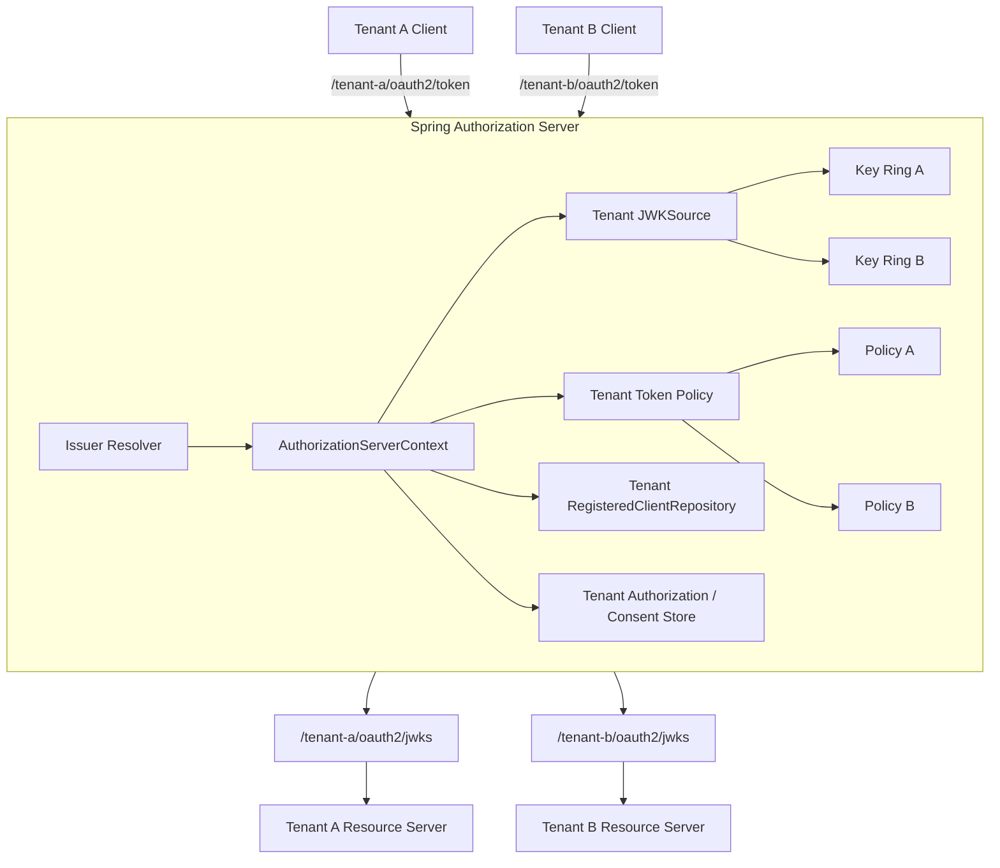
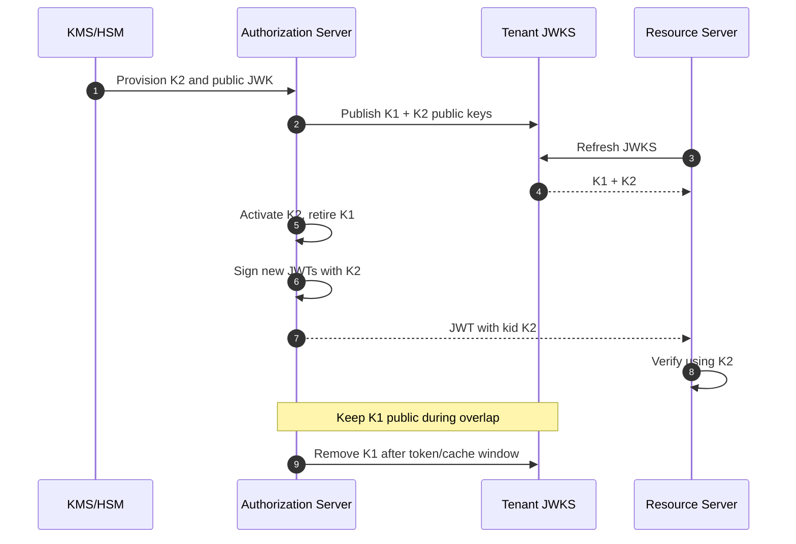

# Isolating Signing Keys, JWKS, and Token Policies Across Tenants

## 1. Problem Statement: Multiple Tenants Sharing an Authorization Server

A SaaS platform may serve multiple organizations on the same Spring Authorization Server cluster. Each organization has its own clients, users, scopes, resources, and token policies. Some organizations also require signing keys managed by themselves or keys stored in a dedicated KMS/HSM.

If all tenants share a single signing key pair and a single JWK Set, every token shares the same verification key source. Resource Servers have a harder time distinguishing tenants by signature alone; a misconfigured audience or issuer can allow a token from Tenant A to be accepted in Tenant B's context. Rotating keys, revoking keys, or changing policies for one tenant can also impact the entire system.

A multi-tenant design must isolate at least three layers:

1. **Signing keys and JWKS:** each issuer signs only with keys belonging to that tenant and publishes only that tenant's public keys.
2. **Token policies:** each tenant has appropriate audience, scope, TTL, token format, grant, and claim policies.
3. **Resource Server verification:** tokens must carry a trusted issuer, a signature matching that issuer's key, and an audience matching the receiving API.

This lesson explains how to implement these layers with Spring Authorization Server 1.5.8, Spring Security 6.5, and the multiple-issuers-per-host model. Coverage includes key ring management, per-issuer `JWKSource`, JWKS discovery, rotation, token customization, Resource Server resolvers, and testing to prevent cross-tenant access.

This lesson belongs to the **Multitenancy** chapter of the **SPRING_SECURITY_OAUTH2_OIDC_AUTHORIZATION_SERVER** module. The overall module goal is **learning how to design, configure, secure, test, and operate an OAuth 2.0/OpenID Connect Authorization Server with Spring Security and Spring Authorization Server in a Spring Boot application**.

### Learning Objectives

After this lesson, you will be able to:

- Identify tenants using a normalized issuer URI.
- Enable multiple issuers per host in Spring Authorization Server.
- Select a `JWKSet` for the current issuer using a composite `JWKSource`.
- Separate private signing keys from public JWKS and store private keys in a KMS/HSM.
- Design key rings, key IDs, key statuses, and rotation workflows.
- Publish dedicated JWKS and metadata for each issuer.
- Apply token settings, audiences, scopes, and claim policies per tenant/client.
- Configure Resource Servers to select a `JwtDecoder` from an issuer allowlist.
- Prevent Tenant A's tokens from being accepted in Tenant B.
- Test key isolation, JWKS isolation, rotation, caching, and token policies.

> **Version scope:** Examples use Spring Authorization Server 1.5.8 and Spring Security 6.5.x. KMS/HSM and persistence examples are architectural patterns; exact APIs depend on the provider. The assigned SPECIAL_NOTE for this lesson is left blank.

## 2. Tenant Boundaries Defined by Issuer

In OAuth 2.0/OIDC, the issuer (`iss` claim) is the identifier of the Authorization Server. Spring Authorization Server supports multiple issuers on the same host by placing the tenant in the path of the issuer URI.

Example:

| Tenant | Issuer | JWK Set URI |
| --- | --- | --- |
| tenant-a | https://auth.example.com/tenant-a | https://auth.example.com/tenant-a/oauth2/jwks |
| tenant-b | https://auth.example.com/tenant-b | https://auth.example.com/tenant-b/oauth2/jwks |

Each issuer's OIDC metadata advertises its corresponding endpoints. A Tenant A client discovering metadata from issuer A receives A's `jwks_uri`; Tenant B receives B's JWKS URI.

### 2.1. Enabling Multiple Issuers

Spring Authorization Server disables multiple issuers on a single host by default. Configure:

```java
@Bean
AuthorizationServerSettings authorizationServerSettings() {
    return AuthorizationServerSettings.builder()
            .multipleIssuersAllowed(true)
            .build();
}
```

In this configuration, do not call `issuer("https://auth.example.com")`. When a fixed issuer is configured, the Authorization Server switches to a single fixed issuer. With multitenancy, the issuer is resolved from the current request.

### 2.2. AuthorizationServerContext

`AuthorizationServerContext` provides the current issuer and `AuthorizationServerSettings`. Spring stores this context in `AuthorizationServerContextHolder` using a `ThreadLocal`.

```java
AuthorizationServerContext context =
        AuthorizationServerContextHolder.getContext();

Assert.state(context != null, "AuthorizationServerContext is required");
String issuer = context.getIssuer();
```

The issuer can be resolved from the request path, for example:

- `https://auth.example.com/tenant-a/oauth2/token` → issuer `https://auth.example.com/tenant-a`.
- `https://auth.example.com/tenant-b/oauth2/jwks` → issuer `https://auth.example.com/tenant-b`.

This serves as the tenant routing source for components running within the Authorization Server request pipeline.

### 2.3. Normalizing Issuer URIs

An issuer is an exact identifier, not an approximate tenant name. The registry should store and look up the full canonical issuer URI:

```java
Map<String, TenantRuntime> tenantsByIssuer;

TenantRuntime requireTenant(String issuer) {
    TenantRuntime tenant = tenantsByIssuer.get(issuer);
    if (tenant == null) {
        throw new IllegalStateException("Unknown issuer");
    }
    return tenant;
}
```

Never use `endsWith(tenantId)` or `contains(tenantId)` to select a tenant in production. Two issuers sharing a suffix or nested paths can be misresolved. Use exact matching after normalizing scheme, host, port, and path according to deployment conventions.

If TLS terminates at a reverse proxy, trust forwarded host/proto headers only from proxies configured as trusted. The proxy must strip client-sent headers and rewrite canonical values. Otherwise, an attacker can manipulate the issuer resolved from the request.

## 3. Components That Must Be Isolated by Tenant

Spring Authorization Server identifies `JWKSource<SecurityContext>` as one of the components requiring multitenancy support. Other data components must also be partitioned:

| Component | Data | Isolation approach |
| --- | --- | --- |
| `JWKSource<SecurityContext>` | Private signing keys and public JWKs | Dedicated key ring per issuer |
| `RegisteredClientRepository` | Client ID, grants, scopes, token settings | Dedicated repository/schema/database or tenant predicate |
| `OAuth2AuthorizationService` | Authorization codes, access/refresh tokens, metadata | Dedicated storage or tenant predicate |
| `OAuth2AuthorizationConsentService` | User/client consents | Dedicated storage or tenant predicate |
| `TenantTokenPolicyRegistry` | Audience, TTL cap, scope policy, token claims | Dedicated policy record per issuer |

If only `JWKSource` is isolated while `RegisteredClientRepository` is shared without a tenant boundary, Tenant A's client ID can be looked up during a Tenant B request. If the authorization store is shared without a tenant predicate, token introspection or revocation can read another tenant's authorization.

You can use separate databases, separate schemas, or shared tables with `tenant_id`. Whichever model is chosen, every operation must be bound by the verified issuer.

## 4. Overall Architecture

Each tenant has its own issuer, key ring, client registry, and token policy. Spring Authorization Server can use a single composite `JWKSource` bean, but that bean returns only the current issuer's key set.



Processing flow:

1. A request arrives at an endpoint containing the issuer path.
2. Spring creates `AuthorizationServerContext` with the current issuer.
3. `JWKSource` or a token customizer retrieves the issuer from the context.
4. The registry returns the key ring or token policy registered for that issuer.
5. The Authorization Server signs the token using the tenant's private key.
6. The issuer's metadata/JWKS endpoint publishes the corresponding public key.
7. The Resource Server validates `iss`, selects the matching decoder/JWKS, and checks `aud`.

## 5. Designing a Key Ring per Tenant

A key ring should manage the lifecycle of multiple keys, not just one active key pair.

### 5.1. Key States

| State | Used to sign new tokens? | Public key published? |
| --- | --- | --- |
| `PREPARED` | No | Can be published before activation |
| `ACTIVE` | Yes | Yes |
| `RETIRED` | No | Yes, while old tokens remain valid |
| `REVOKED` | No | Per incident policy; usually removed from JWKS and issued tokens handled |
| `DESTROYED` | No | No |

Each tenant should have only one `ACTIVE` signing key per algorithm/purpose at a time, unless intentionally supporting multiple algorithms. Older keys in `RETIRED` state retain only public material to verify previously issued tokens.

### 5.2. Metadata of a Key

The key registry can store:

| Field | Meaning |
| --- | --- |
| `issuer` | Issuer owning the key |
| `kid` | Key ID in the JWK/JWS header |
| `algorithm` | Allowed signing algorithm, e.g., `RS256` or `ES256` |
| `keyType` | `RSA` or `EC` |
| `keyPurpose` | `sig` for signing |
| `kmsKeyReference` | Reference ID to the key in KMS/HSM |
| `status` | `PREPARED`, `ACTIVE`, `RETIRED`, `REVOKED` |
| `activatedAt` | Timestamp when signing began |
| `retiredAt` | Timestamp when signing stopped |
| `publishUntil` | Timestamp when public key publication may stop |
| `policyVersion` | Associated policy version |

Never store plaintext private keys in tenant configuration tables or application properties files. Store only references to a KMS/HSM or access-controlled secret store. If holding a private key object in memory, load it from an access-controlled secret manager and never log or serialize the object.

### 5.3. Authorization Server Keys Differ from OAuth Client Keys

`JWKSource` on the Authorization Server provides the Authorization Server's token-signing keys.

`RegisteredClient.getClientSettings().getJwkSetUrl()` instead points to an OAuth client's JWK Set, for example to verify `private_key_jwt` or self-signed mTLS certificates. The two key sources serve different roles and must never be mixed.

## 6. Storing Keys in KMS/HSM

Production should use asymmetric keys and protect private keys using a KMS/HSM or dedicated signing service.

A provisioning workflow:

1. Create the tenant and canonical issuer.
2. Create a key pair in KMS/HSM with a policy-approved algorithm.
3. Retrieve the public key and build a JWK with `kid`, `use=sig`, `alg`.
4. Store `kmsKeyReference`, public JWK, and key status in the key registry.
5. Verify the key can sign and the public key validates a test signature.
6. Register the key ring in the tenant registry.
7. Activate the issuer only after all components are ready.

If the KMS/HSM supports remote signing, you can implement a `JwtEncoder`/signing adapter that calls KMS instead of bringing private keys into the JVM. When doing so, control timeouts, retries, idempotency, key versions, and resilience when the signing service is unavailable.

### 6.1. Creating a JWK from a Key Pair

Illustrative example with an RSA key pair obtained from a secure source:

```java
RSAKey signingJwk = new RSAKey.Builder(publicKey)
        .privateKey(privateKey)
        .keyUse(KeyUse.SIGNATURE)
        .algorithm(JWSAlgorithm.RS256)
        .keyID(kid)
        .build();
```

In a KMS/HSM model, the private key may be non-exportable. In that case, `privateKey` cannot be used directly as shown above; you need a KMS-integrated signer/`JwtEncoder` and a `JWKSource` returning the matching public JWK for discovery.

Never generate a random new key on every application restart. Doing so invalidates verification of existing tokens and changes JWKS outside the rotation process.

## 7. Per-Issuer JWKSource

Spring Authorization Server uses `JWKSource<SecurityContext>` to obtain keys when signing JWTs and serving the JWK Set endpoint. In multitenancy, a composite implementation is needed to select the key set for the current issuer.

### 7.1. Tenant Key Registry

Example model:

```java
public record TenantKeyRing(
        String issuer,
        JWKSet signingKeySet,
        String activeKid,
        String policyVersion) {
}

public interface TenantKeyRingRegistry {
    TenantKeyRing requireByIssuer(String issuer);
}
```

The registry must check that the issuer is in the allowlist and throw an error if not. Never fall back to a default key ring or the first tenant's keys.

### 7.2. Composite JWKSource

```java
final class TenantJwkSource implements JWKSource<SecurityContext> {

    private final TenantKeyRingRegistry keyRings;

    TenantJwkSource(TenantKeyRingRegistry keyRings) {
        this.keyRings = keyRings;
    }

    @Override
    public List<JWK> get(
            JWKSelector selector,
            SecurityContext securityContext) throws KeySourceException {

        AuthorizationServerContext context =
                AuthorizationServerContextHolder.getContext();
        if (context == null || !StringUtils.hasText(context.getIssuer())) {
            throw new KeySourceException(
                    "Authorization Server issuer context is missing");
        }

        TenantKeyRing keyRing =
                keyRings.requireByIssuer(context.getIssuer());

        return selector.select(keyRing.signingKeySet());
    }
}
```

This is an illustrative skeleton. `TenantKeyRingRegistry` should use exact issuer matching and return an isolated key set. Never create a single `JWKSet` containing all tenants' keys and let Nimbus pick by `kid`: `kid` only identifies a key within one JWK Set, not a trust boundary across issuers.

### 7.3. Fail Closed Without Tenant Context

If `AuthorizationServerContextHolder.getContext()` returns null or the issuer is unregistered, `JWKSource` must raise an error. Never fall back to a global key. Falling back can allow a request with the wrong issuer to sign with another tenant's key.

`AuthorizationServerContextHolder` uses `ThreadLocal`. For background jobs, scheduled rotation, or async tasks, do not rely on `ThreadLocal`. Pass the issuer/key ring explicitly to administrative services or invoke tenant-specific components directly.

### 7.4. Only ACTIVE Keys Are Used for Signing

A key ring may hold:

- `ACTIVE` keys with private signing material.
- `RETIRED` keys with only public material for verifying older tokens.
- `PREPARED` keys whose public JWK is published but not yet selected for signing.

JWK selection for signing must choose the right `ACTIVE` key matching the algorithm and signing capability. `RETIRED`/`PREPARED` keys must never accidentally become signing keys simply because they appear in the same `JWKSet`.

## 8. Dedicated JWKS and Metadata per Issuer

Spring Authorization Server configures the JWK Set endpoint only when a `JWKSource<SecurityContext>` bean is present. With multiple issuers, the endpoint is routed by issuer path.

Example:

| Metadata request | Published `jwks_uri` |
| --- | --- |
| https://auth.example.com/tenant-a/.well-known/openid-configuration | https://auth.example.com/tenant-a/oauth2/jwks |
| https://auth.example.com/tenant-b/.well-known/openid-configuration | https://auth.example.com/tenant-b/oauth2/jwks |

Resource Servers must obtain the JWKS URI from the corresponding issuer's metadata or from governed trusted issuer configuration.

### 8.1. JWK Sets Must Contain Only Public Key Material

Private keys used to sign tokens must never appear in HTTP JWKS responses. Public JWKs typically carry properties such as:

- `kty`: key type, such as `RSA` or `EC`.
- `kid`: key identifier.
- `use`: `sig`.
- `alg`: permitted algorithm.
- `n`, `e` for RSA or `crv`, `x`, `y` for EC.

Never expose private parameters such as `d`, `p`, `q`, `dp`, `dq`, `qi`, or symmetric key `k`. Even though the internal `JWKSource` needs private keys for signing, verify that actual HTTP responses from the JWK Set endpoint contain only public parameters.

### 8.2. Do Not Merge JWKS Across Tenants

Tenant A's JWKS must not contain Tenant B's public keys. Merging all keys into one endpoint can cause Resource Servers to find a key with the same `kid` belonging to a different issuer, and key caching becomes prone to mixing.

If Tenant A and Tenant B happen to share the same `kid` string, that can still be valid because each issuer has its own JWK Set. However, all internal caches/indexes must use a composite key `(issuer or jwks_uri, kid)`, never `kid` alone.

### 8.3. Discovery Is Configuration Data, Not Arbitrary Trust

OIDC Provider Configuration advertises `issuer` and `jwks_uri`. Clients and Resource Servers must verify the issuer matches their trusted configured issuer. Never take `jku` or `x5u` arbitrarily from a JWT header and fetch that URL. Doing so enables SSRF and lets attackers control the verification key source.

## 9. Safe Key Rotation Workflow

Rotation requires an overlap window so new tokens use the new key while existing tokens can still be verified.

### 9.1. Routine Rotation

Suppose Tenant A currently signs with `K1` and wants to switch to `K2`:

1. Create `K2` in KMS/HSM and assign `kid=tenant-a-2026-02`.
2. Publish `K2`'s public JWK in Tenant A's JWKS before signing tokens with `K2`.
3. Verify Resource Servers can fetch and recognize `K2`.
4. Transition `K2` to `ACTIVE` and `K1` to `RETIRED`.
5. New tokens are signed with `K2`.
6. Keep `K1`'s public JWK in JWKS at least until the last token signed with `K1` expires, plus clock skew and cache lifetime.
7. After the overlap window, remove `K1`'s public JWK from JWKS.
8. Destroy or disable `K1`'s private key per retention/audit policy.

### 9.2. Rotation Sequence



### 9.3. Calculating the Overlap Window

Minimum retention time for the old public key should include:

`max(token TTL of tenant/clients signed by old key) + clock skew + JWKS cache lifetime + propagation delay`.

If a tenant has multiple clients with different TTLs, use the largest TTL that could have been signed with the old key. Never delete the old key simply because the new key is active.

### 9.4. Emergency Rotation on Private Key Compromise

When a private key is suspected of compromise:

- Stop signing with that key immediately.
- Activate a new key.
- Remove the compromised public key from JWKS per incident policy.
- Refresh/invalidate JWKS caches at Resource Servers where manageable.
- Identify tokens issued with the compromised key and revoke/deny them per policy.
- For self-contained JWTs, removing the key from JWKS does not guarantee every Resource Server with a cached key immediately rejects tokens; additional cache invalidation and token TTL/revocation handling are needed.
- Record audit logs, preserve evidence, and assess the affected tenant scope.

Do not rotate keys for all tenants if only one tenant was compromised, unless evidence shows shared keys or infrastructure were affected.

## 10. kid, Algorithms, and Key Usage

`kid` is used to select a key in a JWK Set, especially during key rollover. Per RFC 7517, keys within the same JWK Set SHOULD have distinct `kid` values.

Principles:

1. Generate unique `kid` values within each JWK Set and never reuse them for different key material.
2. Cache keys by issuer/JWKS URI combined with `kid`.
3. Only use keys with `use=sig` and a policy-approved algorithm.
4. Configure an algorithm allowlist; never trust the algorithm chosen by a token header alone.
5. Never reuse the same private key across multiple tenants merely to save operational effort.
6. Never let HMAC algorithms share a secret across tenants when issuer isolation is required.

For example, Tenant A uses `RS256` and Tenant B uses `ES256`. Resource Servers must verify against the issuer's metadata and policy; never accept algorithm downgrade or algorithm confusion.

### 10.1. Do Not Use kid as a Tenant Identifier

`kid` is solely a key ID. It does not prove which tenant a token belongs to. The tenant must be determined from the verified issuer; only then select the corresponding JWK Set. Never pick a tenant from a `kid` prefix, custom header, or query parameter.

### 10.2. Avoiding SSRF and Header Injection

Never use `jku`, `x5u`, or arbitrary URLs from a JWT header to fetch keys. Never concatenate `kid` directly into SQL/LDAP queries. If the key registry performs dynamic lookups, use parameterized queries and a governed allowlist of issuers/JWKS URIs.

## 11. Designing Per-Tenant Token Policies

Separate signing keys alone are not enough. Tenant A and Tenant B may need different TTLs, audiences, scopes, token formats, and claim policies.

### 11.1. Two Policy Tiers

There should be two tiers:

- **Tenant policy:** upper bounds and defaults for the tenant, such as permitted audiences, maximum TTL, algorithm, scope namespace, token format, and claim policy.
- **Client policy:** concrete configuration in `RegisteredClient`, such as grant types, scopes, access token TTL, refresh token TTL, refresh token reuse, and access token format.

Client policy must never exceed tenant policy limits.

### 11.2. Example Policy Table

| Policy | tenant-a | tenant-b |
| --- | --- | --- |
| Max access token TTL | 10 minutes | 5 minutes |
| Max refresh token TTL | 8 hours | 2 hours |
| Access token format | JWT | Opaque |
| Permitted audience | api-a | api-b |
| Scope namespace | a.* | b.* |
| Signing algorithm | RS256 | ES256 |
| Refresh token reuse | false | false |
| Policy version | 7 | 3 |

Values in the table are examples. Actual lifetimes should follow each tenant's risk model and operational requirements.

### 11.3. RegisteredClient Must Live in the Tenant Repository

Spring Authorization Server lets you configure `TokenSettings` on each `RegisteredClient`. In multitenancy, `RegisteredClient` must be saved in the current tenant's repository.

```java
TokenSettings tokenSettings = TokenSettings.builder()
        .accessTokenTimeToLive(Duration.ofMinutes(5))
        .refreshTokenTimeToLive(Duration.ofHours(2))
        .reuseRefreshTokens(false)
        .accessTokenFormat(OAuth2TokenFormat.SELF_CONTAINED)
        .build();

RegisteredClient client = RegisteredClient.withId(UUID.randomUUID().toString())
        .clientId("tenant-b-orders")
        .clientAuthenticationMethod(ClientAuthenticationMethod.CLIENT_SECRET_BASIC)
        .authorizationGrantType(AuthorizationGrantType.AUTHORIZATION_CODE)
        .authorizationGrantType(AuthorizationGrantType.REFRESH_TOKEN)
        .redirectUri("https://orders.tenant-b.example/callback")
        .scope("b.orders.read")
        .tokenSettings(tokenSettings)
        .build();

tenantBRegisteredClientRepository.save(client);
```

This is a provisioning example. Secrets must be encoded before saving if the client uses a secret. The service creating/updating `RegisteredClient` must validate that TTL, grants, scopes, and format stay within tenant policy.

## 12. Tenant-Aware Token Customization

`OAuth2TokenContext` provides:

- `getAuthorizationServerContext()` — current issuer.
- `getRegisteredClient()` — registered client.
- `getAuthorizedScopes()` — granted scopes.
- `getTokenType()` — token type being minted.
- `getAuthorizationGrantType()` — grant type.

Using these, a token customizer can retrieve policies by issuer and client.

### 12.1. Adding Tenant Claims and Audience to JWT Access Tokens

```java
@Bean
OAuth2TokenCustomizer<JwtEncodingContext> tenantJwtCustomizer(
        TenantTokenPolicyRegistry policies) {

    return context -> {
        String issuer =
                context.getAuthorizationServerContext().getIssuer();
        TenantTokenPolicy policy = policies.requireByIssuer(issuer);
        RegisteredClient client = context.getRegisteredClient();

        if (OAuth2TokenType.ACCESS_TOKEN.equals(context.getTokenType())) {
            Collection<String> audiences =
                    policy.audiencesFor(client, context.getAuthorizedScopes());

            context.getClaims()
                    .audience(audiences)
                    .claim("tenant_id", policy.tenantId())
                    .claim("tenant_policy_version", policy.version());
        }
    };
}
```

This is a skeleton. `audiencesFor(...)` must validate the client and permitted scopes before returning audiences. Never take arbitrary audiences from the request or unvetted client metadata.

Do not overwrite `iss` with the tenant ID. The issuer URI remains the Authorization Server identifier; `tenant_id` is an extra claim for downstream application convenience. Resource Servers must still verify the issuer.

### 12.2. Do Not Alter ID Token Audience Like Access Tokens

ID Tokens have their own OIDC semantics: `aud` primarily identifies the OIDC client the ID Token was issued for. Never write a Resource Server's audience into an ID Token in place of the client audience. In the customizer, branch by token type and add only necessary claims without violating OIDC rules.

### 12.3. TokenSettings Controls TTL

`TokenSettings` is where access token TTL, refresh token TTL, refresh token reuse, and token format are configured per `RegisteredClient`. Tenant provisioning must enforce tenant caps before saving `RegisteredClient`.

Do not rely solely on a customizer to modify `exp` after the token generator has built the token. If a dynamic hard cap at issuance time is needed, design an explicit token generator/policy layer and ensure `expiresAt` stays consistent across the token, `OAuth2Authorization` metadata, and response.

### 12.4. JWT and Opaque Tokens

Spring Authorization Server supports:

| Token format | Verification method | Multi-tenant policy |
| --- | --- | --- |
| `SELF_CONTAINED` | Resource Server verifies JWT signature via JWKS | Must check issuer, audience, and claim policy |
| `REFERENCE` | Resource Server calls introspection | Introspection endpoint must be routed and authenticated per tenant |

For opaque access tokens, use `OAuth2TokenCustomizer<OAuth2TokenClaimsContext>` to add claims. Ensure authorization/introspection persistence stores the necessary claims. A JWT customizer does not automatically apply to opaque tokens.

## 13. Configuring Resource Servers to Verify by Issuer

A Resource Server can receive tokens from multiple issuers. It must choose a decoder based on the issuer in the JWT, though that issuer is untrusted until signature and claim validation succeed.

### 13.1. Issuer Allowlist

Spring Security provides `JwtIssuerAuthenticationManagerResolver`. For a fixed list of issuers:

```java
JwtIssuerAuthenticationManagerResolver resolver =
        JwtIssuerAuthenticationManagerResolver.fromTrustedIssuers(
                "https://auth.example.com/tenant-a",
                "https://auth.example.com/tenant-b");

http
    .authorizeHttpRequests(authorize ->
        authorize.anyRequest().authenticated())
    .oauth2ResourceServer(oauth2 ->
        oauth2.authenticationManagerResolver(resolver));
```

The resolver uses `iss` in the JWT to select an `AuthenticationManager`, accepting only trusted issuers. Never dynamically construct a decoder for arbitrary `iss` URLs sent in a token.

### 13.2. Checking Audience per Tenant

Issuer validation answers "who issued the token?". Audience validation answers "which API was the token issued for?". Both are required.

When each tenant has a different audience, you can build a dedicated `AuthenticationManager` with its corresponding `JwtDecoder` and validators:

```java
Map<String, AuthenticationManager> managers = new ConcurrentHashMap<>();

for (TenantResourcePolicy tenant : trustedTenantPolicies) {
    NimbusJwtDecoder decoder =
            NimbusJwtDecoder.withIssuerLocation(tenant.issuer()).build();

    OAuth2TokenValidator<Jwt> issuerAndTime =
            JwtValidators.createDefaultWithIssuer(tenant.issuer());

    OAuth2TokenValidator<Jwt> audience =
            new JwtClaimValidator<List<String>>(
                    "aud",
                    values -> values != null
                            && values.contains(tenant.resourceAudience()));

    decoder.setJwtValidator(
            new DelegatingOAuth2TokenValidator<>(issuerAndTime, audience));

    JwtAuthenticationProvider provider =
            new JwtAuthenticationProvider(decoder);
    managers.put(tenant.issuer(), provider::authenticate);
}

JwtIssuerAuthenticationManagerResolver resolver =
        new JwtIssuerAuthenticationManagerResolver(managers::get);
```

This is an illustrative skeleton. `trustedTenantPolicies` must come from a governed tenant registry. `JwtIssuerAuthenticationManagerResolver` queries the map by issuer; if the issuer is absent, the map returns null and the request is rejected. Depending on the application's audience structure, the validator may need to handle both `String` and `Collection<String>`.

### 13.3. Do Not Replace Issuer Validation with a Tenant Claim

Never identify a tenant solely from the `tenant_id` claim. That claim is signed by the issuer, but is meaningful only after token verification succeeds. The right sequence:

1. Read the issuer to select a decoder from the allowlist.
2. Verify the signature using the issuer's JWKS.
3. Verify `iss`, `exp`, `nbf`, `aud`, and other validators.
4. Only then use the signed `tenant_id` to enforce business policies.

## 14. Caching JWKS and Avoiding Tenant Mixing

Resource Servers typically cache JWK Sets to avoid fetching JWKS on every request. Caching is essential for performance, but must be partitioned by issuer.

### 14.1. Cache Keys Must Include the Issuer

Never use `kid` alone as a cache key. A sensible structure:

`cache key = canonical issuer + jwks_uri + kid`.

Two tenants can both have `kid=key-1`; their public keys differ and their JWKS URIs differ. Caching by `kid` alone can return the wrong key.

### 14.2. Unknown kid and JWKS Refresh

When a Resource Server receives a token with an uncached `kid`, the decoder may refresh the JWK Set according to the library's mechanism. Enforce limits:

- Fetch only from the JWKS URI obtained from a trusted issuer.
- Enforce timeouts and retry limits.
- Prevent forged tokens from triggering continuous JWKS fetch requests.
- Apply rate limiting or request coalescing on cache misses.
- Never fall back to another tenant's key set when a `kid` is not found.

### 14.3. Cache TTL and Key Rotation

Cache duration affects how quickly Resource Servers notice new keys and removed keys. Rotation plans must coordinate publish timing, cache TTL, token TTL, and clock skew.

Do not assume all Resource Servers refresh caches simultaneously. Test realistically across multiple nodes, multiple regions, and decoders with warm caches.

## 15. Token Policies Must Be Enforced per Tenant

One tenant may require shorter token TTLs, a separate scope namespace, a distinct audience, or a different token format. Control the following points:

### 15.1. Scopes and Grants

- Tenant A's `RegisteredClient` must not be queried under Tenant B.
- Scopes must be issued according to the tenant namespace or policy registry.
- A tenant cannot request a grant type disallowed by its policy.
- Refresh tokens must not expand scopes beyond the granted authorization.

### 15.2. Audience

Each Resource Server should have its own audience or an explicit audience mapping. Tenant A's token must not be accepted by an API dedicated to Tenant B. If an API truly serves multiple tenants, it must still check tenant binding and resource ownership after JWT verification.

### 15.3. TTL and Refresh Policy

Tenant policies can set:

- Maximum access token TTL.
- Maximum refresh token TTL.
- Refresh token rotation/reuse policy.
- Authorization code lifetime.
- Token revocation and session policies.

Tenant-level limits act as hard caps; a `RegisteredClient` can pick a shorter TTL, but never exceed the cap.

### 15.4. Token Claims

Emit only claims needed by Resource Servers. Tenant claims must come from the verified policy/authorization context, never from client requests or arbitrary headers. Avoid placing sensitive tenant data inside JWTs, since JWTs are generally readable by anyone holding the token.

### 15.5. Distinguishing JWT Types

If the same issuer emits both ID Tokens and access tokens, Resource Servers must never accept an ID Token as an access token. Use distinct validation rules per token type, distinct audiences, and appropriate token types/headers. Never rely on signature validity alone.

## 16. Managing Tenant Lifecycles

Creating a tenant is not just adding an issuer string to a map. Synchronized provisioning is required:

1. Validate the tenant request and create an immutable tenant ID.
2. Create the canonical issuer and check for duplicates.
3. Provision datasource/schema for clients, authorizations, and consents.
4. Provision the key ring in KMS/HSM.
5. Create the tenant token policy and audience allowlist.
6. Create component registry entries.
7. Run signing/verification and JWKS discovery self-tests.
8. Transition the tenant to `ACTIVE` only once all components are ready.

### 16.1. Dynamic Registration Must Be Atomic in State

If a key ring is registered before the repository is ready, the tenant could mint tokens without saving authorizations. If metadata is published before JWKS is ready, clients cannot verify tokens.

Use lifecycle states such as `PROVISIONING`, `ACTIVE`, `SUSPENDED`, `DECOMMISSIONING`. Only `ACTIVE` tenants may serve protocol traffic. Update the registry via a controlled administrative operation with rollback support.

### 16.2. Suspension and Decommissioning

When suspending a tenant:

- Stop issuing new tokens.
- Reject authorization/token endpoints per policy.
- Handle existing refresh tokens, authorizations, and sessions.
- Continue serving public JWKS while existing tokens remain valid if Resource Servers need to verify already-issued tokens.

When decommissioning:

- Stop publishing metadata on schedule.
- Retain public keys for the required retention window or revoke immediately in emergencies.
- Revoke clients, authorizations, and consents.
- Delete key material per KMS/HSM procedure.
- Retain audit evidence per retention policy.

## 17. Protecting the Registry and Key Management

The registry is the security control plane. If an attacker modifies the `issuer → key ring` mapping, they can force a tenant to use the wrong key or cause Resource Servers to fetch keys from a malicious source.

Controls:

- Only authorized admins/service identities may create or modify tenant key rings.
- Separate duties for key creation, activation, rotation, and destruction.
- Use an approval workflow for production signing key changes.
- Audit `issuer`, `kid`, KMS reference, status, and actor.
- Never log private keys, secrets, KMS credentials, or raw tokens.
- Encrypt databases/backups storing key metadata and policies.
- Use mTLS/TLS for KMS, databases, and JWKS endpoints.
- Block SSRF by allowlisting `jwks_uri`, KMS endpoints, and metadata sources.
- Alert whenever a tenant unexpectedly changes keys or algorithms.

## 18. Tenant Isolation Test Matrix

| Test case | Condition | Expected outcome |
| --- | --- | --- |
| Issuer A signing | Request to Tenant A | `JWKSource` selects key ring A |
| Issuer B signing | Request to Tenant B | `JWKSource` selects key ring B |
| Unknown issuer | Issuer absent from registry | Fails closed |
| Missing context | No `AuthorizationServerContext` | No global key fallback |
| JWKS A | GET Tenant A JWKS URI | Only A's public keys |
| JWKS B | GET Tenant B JWKS URI | Only B's public keys |
| Cross-tenant JWKS | Token A with Key B | Signature fails verification |
| Same `kid` across tenants | A and B share `kid` string | Cache remains separated by issuer/JWKS URI |
| Duplicate `kid` within set | Two keys in same JWKS share `kid` | Provisioning rejected |
| Private key exposure | Inspect HTTP JWKS | No private JWK parameters |
| Rotation publish | `K2` published before signing | Resource Server recognizes `K2` |
| Rotation overlap | `K1` token still valid | `K1` still verifies during overlap |
| Rotation cleanup | Token/cache window expires | `K1` removed per policy |
| Key compromise | `K1` revoked | `K1` stops signing; incident policy handles tokens/caches |
| Wrong issuer | Token signed with A but `iss` is B | Resource Server rejects |
| Wrong audience | Token A sent to API B | Audience validator rejects |
| Wrong tenant claim | `tenant_id` mismatches issuer policy | Rejected or denied access |
| Client repository isolation | Client A looked up in B | Not found |
| Authorization isolation | Authorization A looked up in B | Not found |
| Token TTL cap | Client requests TTL exceeding tenant cap | Provisioning/update rejected |
| Scope isolation | Client A requests B's scope | `invalid_scope` or policy denial |
| Token format policy | Tenant requests disallowed format | Token not issued |
| Untrusted `jku` | JWT header contains unknown URL | URL not fetched |
| Host header spoof | Client sets forwarded host | Issuer unchanged |
| Dynamic tenant partial setup | Missing key ring or store | Tenant does not transition to `ACTIVE` |
| Cache miss flood | Many tokens with unknown `kid` | Rate limiting/coalescing engages |
| Async task | No request `ThreadLocal` | Tenant must be passed explicitly |
| Decommissioning | Tenant retired | No new tokens issued; JWKS retention follows policy |

### 18.1. Cross-Tenant Signature Testing

Create two separate key pairs:

- `K_A` signs a JWT with `iss=https://auth.example.com/tenant-a`.
- `K_B` signs a JWT with `iss=https://auth.example.com/tenant-b`.

Verify:

1. Decoder A accepts Token A.
2. Decoder B accepts Token B.
3. Decoder A rejects Token B even if `kid` happens to match.
4. Decoder B rejects Token A.
5. Modifying `iss` in Token A to Issuer B causes signature or issuer validation to fail.
6. Changing `aud` in Token A to Audience B causes the audience validator to fail.

These tests must run against an actual Resource Server, not just by calling `JWKSelector` in a unit test.

## 19. Troubleshooting

| Symptom | Possible cause | Resolution |
| --- | --- | --- |
| Tenant A token signed with Key B | Registry picks wrong issuer or uses global key | Check exact issuer mapping and `JWKSource` |
| Tenant A JWKS contains Key B | Wrong `JWKSet` returned or key sets merged | Separate key rings and inspect endpoint responses |
| Resource Server reports unknown `kid` after rotation | New public key not yet published/cache refreshed | Publish before signing; check JWKS cache |
| Old tokens fail after rotation | Old public key removed too early | Size overlap for token TTL, skew, and cache |
| Tenant B accepts Tenant A's token | Missing issuer/audience/tenant validation | Add issuer and audience validators |
| Same `kid` returns wrong key | Cache uses `kid` alone as key | Cache by issuer/JWKS URI + `kid` |
| `JWKSource` cannot find tenant | Null context or canonical issuer differs from registry | Check request path, proxy, and exact URI |
| Issuer changes with `Host` header | Forwarded headers not properly trusted | Trust only proxy and allowlisted hosts |
| KMS timeout fails token endpoint | Signing service unavailable | Add timeouts, circuit breakers, capacity, and HA |
| Tenant A client settings appear in B | Shared `RegisteredClientRepository` lacks predicate | Separate repositories or add tenant filter |
| Token TTL exceeds tenant cap | Client provisioning fails to enforce policy | Validate `TokenSettings` before save |
| New tenant issues tokens but JWKS 404s | Non-atomic provisioning | Mark `ACTIVE` only after full self-tests |
| Background rotation lacks issuer context | Relies on `ThreadLocal` outside request | Pass issuer/key ring explicitly |

Investigation sequence: **canonical issuer → AuthorizationServerContext → tenant registry → JWKSource/key ring → signing kid/algorithm → JWKS response/cache → token iss/aud → Resource Server decoder → tenant policy**.

## 20. Comprehensive Scenario: Two Tenants Sharing an Authorization Server Cluster

A SaaS platform serves Tenants A and B. Both share the domain `auth.example.com`, but have different keys, API audiences, and token TTLs.

**Step 1 — Issuer:** configure `multipleIssuersAllowed(true)`, use issuer paths `/tenant-a` and `/tenant-b`, and do not set a fixed issuer.

**Step 2 — Provisioning:** create Key A in KMS and Key B in HSM; create two key rings and two tenant policies.

**Step 3 — Component registry:** register A/B `JWKSource` key rings, A/B `RegisteredClientRepository`, A/B `OAuth2AuthorizationService`, and A/B consent services by canonical issuer.

**Step 4 — Signing:** Token Endpoint requests for A obtain issuer context A, and `JWKSource` selects private Key A. Requests for B select private Key B.

**Step 5 — Discovery:** OIDC metadata A returns JWKS URI A; metadata B returns JWKS URI B. Each JWKS contains only its own public keys.

**Step 6 — Token policy:** Tenant A issues JWTs with audience `api-a` and max TTL 10 minutes. Tenant B issues opaque tokens or JWTs with audience `api-b` and max TTL 5 minutes per policy.

**Step 7 — Resource Server:** the resolver accepts only the two allowlisted issuers. Each issuer's decoder verifies signature, `iss`, `aud`, `exp`, and claim policies.

**Step 8 — Rotation:** Tenant A rotates `K1` to `K2` without affecting key ring B. `K1` stays public during the overlap window; B does not need to rotate.

As a result, the same cluster serves multiple tenants while keys, JWKS, clients, authorizations, and token policies remain partitioned by issuer.

## 21. Pre-Production Checklist

- [ ] Issuer URI is canonical and allowlisted.
- [ ] `multipleIssuersAllowed(true)` is enabled; no fixed issuer is configured in multi-issuer mode.
- [ ] Trusted proxy/forwarded headers are configured to prevent host spoofing.
- [ ] Registry uses exact issuer lookups and fails closed.
- [ ] Each tenant has its own key ring with keys stored in KMS/HSM or a secure secret store.
- [ ] Private signing keys never appear in HTTP JWKS.
- [ ] `JWKSource` returns only the current issuer's key set.
- [ ] `kid` is unique within each JWK Set and caches are issuer-scoped.
- [ ] Each issuer's JWKS URI is accurately advertised in discovery metadata.
- [ ] Rotation follows publish-before-sign and keeps old public keys for the overlap window.
- [ ] Key compromise and cache invalidation procedures exist.
- [ ] `RegisteredClientRepository`, authorization store, and consent store are isolated per tenant.
- [ ] Each client's `TokenSettings` stay within tenant policy.
- [ ] Access tokens carry audiences matching their target resource servers.
- [ ] Resource Servers verify issuer, signature, audience, expiration, and token type.
- [ ] Resource Servers never fetch JWKS from untrusted `jku`/`x5u` headers.
- [ ] Tenant claims are used only after token verification succeeds.
- [ ] Async/background jobs receive an explicit tenant context.
- [ ] Provisioning activates a tenant only after keys, JWKS, stores, and policies are ready.
- [ ] Tests cover cross-tenant signatures, JWKS, audiences, client lookups, and token policies.
- [ ] Metrics/audits track signing, rotation, unknown issuers/`kid`s, and KMS errors.

## 22. Summary

Isolating signing keys, JWKS, and token policies across tenants requires a clear, consistent issuer boundary:

1. Use the issuer URI as the tenant identifier and enable multiple issuers per host in SAS.
2. Resolve the tenant from the current `AuthorizationServerContext` and query the registry by exact issuer.
3. Use a composite `JWKSource` that returns each issuer's dedicated key ring.
4. Store private signing keys in KMS/HSM; JWKS publishes only public keys.
5. Rotate keys with an overlap window: publish the new public key before signing and retain the old public key until token/cache windows expire.
6. Partition `RegisteredClient`, authorization stores, and consent stores by tenant.
7. Enforce `TokenSettings`, audience, scopes, claims, and token formats per tenant policy.
8. Resource Servers must verify issuer and audience; `kid` or `tenant_id` never replace trust validation.
9. Cache JWKS by issuer/JWKS URI and `kid`; never merge keys across tenants.
10. Test cross-tenant rejection, key rotation, caching, host spoofing, and provisioning lifecycles.

Treat the issuer as an end-to-end security boundary. A tenant's request must use only that issuer's key ring, client registry, authorization store, and token policy; tokens are accepted only when their signature belongs to a trusted issuer and their audience matches the Resource Server.

### References

- [Spring Authorization Server 1.5.8 — How-to: Implement Multitenancy](https://docs.spring.io/spring-authorization-server/reference/guides/how-to-multitenancy.html)
- [Spring Authorization Server 1.5.8 — Configuration Model](https://docs.spring.io/spring-authorization-server/reference/configuration-model.html)
- [Spring Authorization Server 1.5.8 — Core Model / Components](https://docs.spring.io/spring-authorization-server/reference/core-model-components.html)
- [Spring Authorization Server 1.5.8 — AuthorizationServerSettings API](https://docs.spring.io/spring-authorization-server/reference/api/java/org/springframework/security/oauth2/server/authorization/settings/AuthorizationServerSettings.html)
- [Spring Authorization Server 1.5.8 — AuthorizationServerContextHolder API](https://docs.spring.io/spring-authorization-server/reference/api/java/org/springframework/security/oauth2/server/authorization/context/AuthorizationServerContextHolder.html)
- [Spring Authorization Server 1.5.8 — NimbusJwkSetEndpointFilter API](https://docs.spring.io/spring-authorization-server/reference/api/java/org/springframework/security/oauth2/server/authorization/web/NimbusJwkSetEndpointFilter.html)
- [Spring Security 6.5 — OAuth 2.0 Resource Server Multi-tenancy](https://docs.spring.io/spring-security/reference/6.5/servlet/oauth2/resource-server/multitenancy.html)
- [Spring Security 6.5 — OAuth 2.0 Resource Server JWT](https://docs.spring.io/spring-security/reference/6.5/servlet/oauth2/resource-server/jwt.html)
- [RFC 7517 — JSON Web Key (JWK), Section 4.5 and Section 5](https://www.rfc-editor.org/rfc/rfc7517)
- [RFC 8414 — OAuth 2.0 Authorization Server Metadata](https://www.rfc-editor.org/rfc/rfc8414)
- [RFC 8725 — JSON Web Token Best Current Practices, Sections 3.8–3.12](https://www.rfc-editor.org/rfc/rfc8725)
- [OpenID Connect Discovery 1.0](https://openid.net/specs/openid-connect-discovery-1_0.html)
