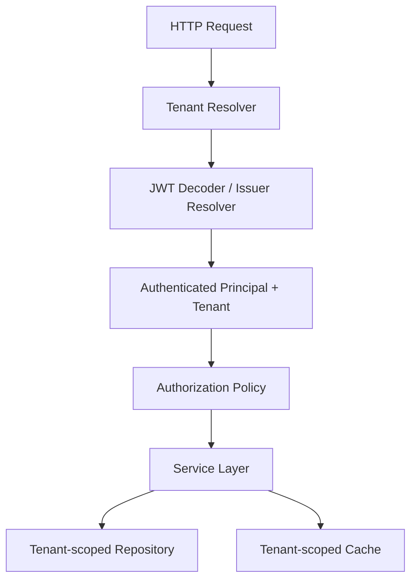

# Testing Against Cross-Tenant Access, Issuer Confusion, and Key Confusion

In a multi-tenant Authorization Server, checking that a JWT has a valid signature is not enough to conclude a request is safe. A token may be validly signed yet belong to another tenant; an issuer may be valid yet not intended for the API receiving the request; a `kid` may collide between two tenants; or Tenant A's authorization data may be queried through Tenant B's repository. These bugs commonly emerge at the boundaries between tenant resolution, JWT validation, key selection, authorization policies, and persistence.

This lesson builds a testing strategy to prove three invariants: **a request is processed only within a reliably determined tenant; tokens are verified only with the issuer and keys belonging to that tenant; and another tenant's data and permissions cannot be accessed via requests, caches, repositories, or background tasks**.

Spring Authorization Server 1.5.8 provides a guide for deploying multiple issuers on the same host, where components such as `RegisteredClientRepository`, `OAuth2AuthorizationService`, `OAuth2AuthorizationConsentService`, and `JWKSource` must be selected by issuer. Spring Security Resource Server supports tenant-aware authentication via `JwtIssuerAuthenticationManagerResolver` and `AuthenticationManagerResolver`. These are key integration points to include in integration tests alongside the application's business policy tests. [Spring Authorization Server — How-to: Implement Multitenancy](https://docs.spring.io/spring-authorization-server/reference/guides/how-to-multitenancy.html) · [Spring Security — OAuth 2.0 Resource Server Multi-tenancy](https://docs.spring.io/spring-security/reference/servlet/oauth2/resource-server/multitenancy.html)

**Example scope:** Spring Authorization Server 1.5.8 and compatible Spring Security. URIs, tenants, and keys in this lesson are illustrative data. Verify your exact Spring Boot/Spring Security versions before copying configurations.

## 1. Defining the Threat Model and Security Invariants

### 1.1. Three Defect Classes to Prevent

| Class | Example defect | Consequence |
|---|---|---|
| Cross-tenant access | A user in Tenant A reads an order or authorization of Tenant B | Data leakage, unauthorized modification, or unauthorized actions |
| Issuer confusion | Token from Issuer A is accepted at Tenant B; callback returns from a different issuer than the one that started the flow | Tokens/codes routed into the wrong trust domain |
| Key confusion | Resolver fetches the wrong JWKS, `kid` cache lacks issuer, A's key verifies B's token | Attackers use another tenant's token or key to bypass authentication |

These three classes can combine. For instance, if two tenants share the same `kid`, a global cache returns A's public key for B's request; if the system also skips exact issuer validation, A's token can be accepted in B's context.

### 1.2. Defining the Invariants

Before writing tests, state the following conditions explicitly and bind each to a test oracle:

1. Every request is bound to exactly one tenant permitted by the registry.
2. The tenant comes from a controlled routing source, never directly from arbitrary caller input.
3. `iss` in a JWT must match the registered issuer exactly and be verified with keys belonging to that issuer.
4. `aud` must contain the Resource Server/API receiving the token.
5. `tenant_id` in the token, if used, must match the tenant of the resource being accessed.
6. `kid` is looked up only within the JWK Set attached to the corresponding issuer.
7. Non-existent, disabled, or partially provisioned tenants must be rejected; never fall back to a default tenant.
8. Clients, authorizations, consents, signing keys, caches, and business data must be isolated per tenant.
9. Every query path and background job preserves the exact tenant context.
10. Tenant context is cleared after the request so it never leaks to the next request on the same thread.
11. A validly signed token with the wrong tenant, issuer, audience, or permissions must still be rejected.
12. Tenant A cannot alter Tenant B's configuration, keys, or token state.

A test that merely asserts HTTP 200 for a valid token proves none of these invariants. Negative tests are required for every boundary.

### 1.3. Asset, Trust Boundary, and Attacker Input Matrix

| Asset | Trust boundary | Controllable input |
|---|---|---|
| Tenant registry | Request → tenant resolver | Host, path, forwarded headers, tenant header |
| Issuer metadata | Client/RP → Authorization Server | Authorization response, discovery metadata |
| JWT | Client → Resource Server | Header, issuer, audience, subject, key ID, claims |
| JWKS | Issuer → verifier | Key set, key rotation, key ID, algorithm, use |
| Client registration | Client → Token Endpoint | Client ID, grant, redirect URI, scopes |
| Authorization/consent | Protocol provider → persistence | Authorization ID, principal, token lookup |
| Tenant business data | Authenticated principal → repository | Record ID, tenant ID, filters/queries |
| Cache | Request/service → cache | Cache key, tenant context, invalidation |

### 1.4. Distinguishing Token Authentication and Resource Authorization

- **Token authentication:** Are the signature, issuer, expiration, audience, and required claims valid?
- **Tenant authorization:** Does the principal belong to the resource's tenant and have permission to perform the operation?
- **Data isolation:** Does the repository read/write records strictly within the verified tenant context?

A JWT validly signed by Issuer A may pass authentication yet must still be rejected if attempting to access Tenant B's data. Therefore, do not collapse tests into a single `authenticated()` assertion.

## 2. Determining the Tenant from Trusted Sources

### 2.1. Tenant Routing Approaches

| Source | Example | Security conditions |
|---|---|---|
| Issuer path | `https://auth.example.com/acme` | Pre-configured issuer; exact path mapping |
| Subdomain | `https://acme.auth.example.com` | Domain allowlisted in registry; proxy/`Host` headers handled safely |
| Dedicated host | `https://auth-acme.example.com` | Governed host → tenant mapping |
| API route | `/api/tenants/acme/orders` | Tenant in route must match token and principal permissions |
| Tenant claim in JWT | `tenant_id=acme` | Used only after JWT signature/issuer verification; never trust unverified claims |
| Gateway context | Internal header signed/controlled by gateway | Trust header only after gateway authentication and stripping caller-sent headers |

No single tenant source fits every application. Pick one authoritative source per endpoint and clearly define how remaining signals are cross-checked against it.

### 2.2. Do Not Trust Caller-Sent X-Tenant-ID

The following request must never automatically set the tenant context:

```http
GET /api/orders/42
Authorization: Bearer <token>
X-Tenant-ID: tenant-b
```

If clients can change the header themselves, they can attempt to access another tenant's data. If a gateway injects a tenant header, the gateway must strip any client-sent header of the same name before attaching the verified value; the application must accept traffic solely from the trusted gateway or verify the gateway's signature/mTLS.

### 2.3. Controlling Host and Forwarded Headers

When the tenant is determined via hostname:

- Accept only hostnames present in the tenant/domain registry;
- Configure the reverse proxy to overwrite `Forwarded`/`X-Forwarded-*` from clients;
- Trust forwarded headers only from declared proxies;
- Never use `Host` or `X-Forwarded-Host` to construct arbitrary new issuers;
- Validate port, scheme, and canonical path;
- Reject unknown hosts, unregistered host aliases, and duplicate/conflicting headers.

Tests should pass through the reverse proxy or accurately simulate forwarded-header configurations. Internal mock requests can bypass the layer most exposed to spoofing.

### 2.4. Canonical Issuers and Exact Matching

An issuer is an identifier, not a string for fuzzy matching. Never use `endsWith`, `contains`, ambiguous prefixes, or path-stripped matching to select a tenant.

For example, these two issuers are distinct values:

```text
https://auth.example.com/acme
https://auth.example.com/acme-labs
```

A registry should map the exact normalized issuer according to configuration conventions. Avoid arbitrarily stripping trailing slashes, changing path casing, or decoding URIs before comparison if doing so collapses two distinct issuers into the same key. Define the canonical form during tenant onboarding and store that exact value.

### 2.5. Testing the Tenant Resolver

| Test | Input | Expectation |
| --- | --- | --- |
| Valid tenant | Registered host/path | Resolves the right tenant |
| Non-existent tenant | Unknown host/path | Rejected |
| Disabled tenant | Tenant in inactive state | Rejected |
| Similar tenant ID | `acme-labs` when tenant is `acme` | Does not misresolve |
| Spoofed header | Caller-sent `X-Tenant-ID` | Ignored or rejected |
| Conflicting host and route | Host A, path B | Rejected per policy |
| Untrusted forwarded host | Client-injected header | Does not alter tenant |
| Missing tenant context | Request to tenant-required endpoint | Fails closed, no fallback |

## 3. Testing Multiple Issuers in Spring Authorization Server

### 3.1. Path-Containing Issuers Representing Tenants

Spring Authorization Server supports multiple issuers on the same host via path components. Example:

| Tenant | Issuer | Token Endpoint | JWKS Endpoint |
|---|---|---|---|
| `acme` | `https://auth.example.com/acme` | `/acme/oauth2/token` | `/acme/oauth2/jwks` |
| `globex` | `https://auth.example.com/globex` | `/globex/oauth2/token` | `/globex/oauth2/jwks` |

Metadata must return the right tenant's issuer and endpoint URLs. `acme`'s discovery must never return `globex`'s `jwks_uri` or `token_endpoint`.

Spring Authorization Server disables multiple issuers per host by default. For the path issuer model, configure `AuthorizationServerSettings` as follows:

```java
@Bean
AuthorizationServerSettings authorizationServerSettings() {
    return AuthorizationServerSettings.builder()
            .multipleIssuersAllowed(true)
            .build();
}
```

Enabling this option only permits multiple issuers on the host. It does not automatically create a tenant registry, separate databases, separate JWK Sets, or authorization policies. Tenant-aware components must still be configured and tested. [Spring Authorization Server — Enable Multiple Issuers](https://docs.spring.io/spring-authorization-server/reference/guides/how-to-multitenancy.html)

### 3.2. Components That Must Be Resolved by Issuer

The Spring Authorization Server guide specifies the components requiring multi-tenancy support:

- `RegisteredClientRepository`;
- `OAuth2AuthorizationService`;
- `OAuth2AuthorizationConsentService`;
- `JWKSource<SecurityContext>`.

If these components share an implementation, that implementation must enforce explicit tenant scoping. You can use separate schemas, separate databases, or shared schemas with a tenant discriminator and query constraints. [Spring Authorization Server — Multi-tenant Components](https://docs.spring.io/spring-authorization-server/reference/guides/how-to-multitenancy.html)

### 3.3. Registry Must Use Exact Issuer Keys

Minimal registry example:

```java
@Component
public class TenantComponentRegistry {

    private final ConcurrentMap<String, TenantComponents> tenants =
            new ConcurrentHashMap<>();

    public void register(String issuer, TenantComponents components) {
        if (issuer == null || issuer.isBlank()) {
            throw new IllegalArgumentException("issuer is required");
        }
        if (components == null) {
            throw new IllegalArgumentException("components are required");
        }

        TenantComponents previous = tenants.putIfAbsent(issuer, components);
        if (previous != null) {
            throw new IllegalStateException("issuer is already registered");
        }
    }

    public TenantComponents requireIssuer(String issuer) {
        TenantComponents components = tenants.get(issuer);
        if (components == null || !components.enabled()) {
            throw new IllegalArgumentException("unknown or disabled issuer");
        }
        return components;
    }
}
```

`TenantComponents` is a record/application object holding the repository, authorization service, consent service, JWK source, and tenant status. This example demonstrates exact-key lookup. In production, the registry must also control updates, disabling, rotation, concurrency, and connection pool lifecycles.

Never use a global map keyed solely by `kid` or `clientId` to locate a tenant's component. The same client ID or key ID can exist across multiple tenants.

### 3.4. Retrieving the Current Tenant from AuthorizationServerContext

During Spring Authorization Server protocol processing, `AuthorizationServerContextHolder` supplies `AuthorizationServerContext`, containing the current issuer. Delegating components can use this issuer to pick the matching repository.

```java
TenantComponents currentTenant(TenantComponentRegistry registry) {
    AuthorizationServerContext context =
            AuthorizationServerContextHolder.getContext();

    if (context == null || context.getIssuer() == null) {
        throw new IllegalStateException("issuer context is unavailable");
    }

    return registry.requireIssuer(context.getIssuer());
}
```

This example requires importing `AuthorizationServerContext`, `AuthorizationServerContextHolder`, and `TenantComponents` from your actual packages/application. If the issuer context is missing or the issuer is absent from the allowlist, the request must fail. Never fall back to a default component.

### 3.5. Testing Each Delegating Component

| Component | Behavior to verify |
|---|---|
| `RegisteredClientRepository` | `findByClientId`/`findById` reads only the current issuer's registrations |
| `OAuth2AuthorizationService` | `save`, `remove`, `findById`, `findByToken` operate only on the current tenant's store |
| `OAuth2AuthorizationConsentService` | Consent lookup/save/remove never mixes principals/clients across tenants |
| `JWKSource` | Signing and JWKS endpoint use only the current issuer's key set |

Test both successful lookups and identical IDs colliding across two tenants. The same client ID, authorization ID, or principal name can be valid in two independent tenants; results must be separated by tenant context.

### 3.6. Testing Discovery Metadata

For each tenant, call:

- OIDC Provider Configuration Endpoint;
- OAuth Authorization Server Metadata Endpoint;
- JWKS Endpoint.

Verify:

- `issuer` matches the tenant exactly;
- `authorization_endpoint`, `token_endpoint`, `introspection_endpoint`, and `revocation_endpoint` point to the corresponding issuer;
- `jwks_uri` points to that tenant's key set;
- Tenant A's metadata contains no endpoint URLs belonging to Tenant B;
- Unknown tenants do not return a default tenant's metadata;
- Disabled tenants are no longer advertised as active tenants.

## 4. Testing Resource Server Issuer Resolution

### 4.1. Tenant-Aware AuthenticationManagerResolver

Resource Servers can verify tokens from multiple issuers using `JwtIssuerAuthenticationManagerResolver`. For a static issuer set, use an allowlist:

```java
@Bean
AuthenticationManagerResolver<HttpServletRequest> authenticationManagerResolver() {
    return JwtIssuerAuthenticationManagerResolver.fromTrustedIssuers(
            "https://auth.example.com/acme",
            "https://auth.example.com/globex"
    );
}
```

Then wire the resolver into the Resource Server:

```java
http
    .authorizeHttpRequests(authorize -> authorize
        .anyRequest().authenticated())
    .oauth2ResourceServer(oauth2 -> oauth2
        .authenticationManagerResolver(authenticationManagerResolver));
```

Spring Security picks an `AuthenticationManager` based on the issuer in the JWT and should accept only trusted issuers. Discovery/decoders are initialized on demand in this approach. [Spring Security — Resolving Tenant by JWT Issuer](https://docs.spring.io/spring-security/reference/servlet/oauth2/resource-server/multitenancy.html)

### 4.2. An Unverified Issuer Is Only a Routing Hint

Before the signature is verified, the issuer claim in a JWT is untrusted data. The resolver can read it to select a verifier from the allowlist, but must never treat it as proof of a valid token.

Safe flow:

1. Parse the token just enough to extract the issuer as a routing hint;
2. Verify the issuer is in the allowlist;
3. Select the decoder/JWK source attached to that issuer;
4. Verify the signature with keys belonging to the issuer;
5. Verify exact issuer, expiry, not-before, and required claims;
6. Verify the API's audience;
7. Pass the verified principal/tenant into authorization policies.

If the issuer is not in the allowlist, stop before creating a decoder or calling any discovery URL. Never create a `JwtDecoder` from an arbitrary token-supplied issuer URL, as that leads to SSRF and trust expansion.

### 4.3. Dynamic Tenant Registry

If tenants are added/removed at runtime, you can use a repository holding `AuthenticationManager` instances created from approved tenant configurations. Spring Security supports `JwtIssuerAuthenticationManagerResolver` with an issuer-to-manager lookup strategy. The documentation emphasizes never taking any arbitrary issuer and constructing a manager on the fly; issuers must be validated against a trusted source such as an allowlist. [Spring Security — Dynamic Tenants](https://docs.spring.io/spring-security/reference/servlet/oauth2/resource-server/multitenancy.html)

When adding a tenant:

- Verify tenant onboarding and issuer ownership;
- Check issuer uniqueness;
- Pin metadata/JWKS URLs from approved configuration;
- Create the decoder/manager and validators;
- Register atomically once all components are ready.

When disabling/removing a tenant:

- Stop accepting new requests;
- Remove the tenant from the resolver/registry;
- Invalidate decoder/JWK caches;
- Handle active tokens per policy;
- Never allow stale managers to stay active indefinitely.

### 4.4. Testing the Issuer Resolver

| Test | Token | Expectation |
|---|---|---|
| Trusted Issuer A | Issuer A, signed with Key A | Decoder A verifies |
| Trusted Issuer B | Issuer B, signed with Key B | Decoder B verifies |
| Unknown issuer | Attacker issuer | Rejected; no arbitrary issuer discovery |
| Issuer A, signed with Key B | Issuer A, signature B | Signature fails |
| Issuer B, signed with Key A | Issuer B, signature A | Signature fails |
| Off-by-one-char issuer | String nearly identical to A | Rejected |
| Suffix-matching issuer | Foreign host issuer ending in `/acme` | Does not match Issuer A |
| Disabled tenant | Issuer A | Rejected per registry status |

## 5. Testing Issuer Confusion and OAuth Mix-Up

### 5.1. Distinguishing JWT Issuer from Authorization Response Issuer

Two contexts must be tested separately:

- JWT issuer: the issuer that minted the JWT. The Resource Server verifies it alongside signature, keys, and audience.
- OAuth authorization response issuer: the issuer of the Authorization Server returning the authorization response to the client. RFC 9207 defines this parameter to prevent mix-up when a client interacts with multiple Authorization Servers.

Do not confuse these two steps. A client might verify a JWT correctly yet still send an authorization code to the wrong token endpoint if the callback flow does not bind the authorization response's issuer. [RFC 9207 — OAuth 2.0 Authorization Server Issuer Identification](https://www.rfc-editor.org/rfc/rfc9207.html)

### 5.2. Testing Issuer in Authorization Responses

When a client interacts with multiple Authorization Servers:

- Bind the transaction/state to the selected issuer when starting the flow;
- Verify the issuer in the authorization response matches the stored issuer;
- Never pick the token endpoint from a callback-supplied parameter;
- Never send codes/client credentials to another issuer's token endpoint;
- If the response contains conflicting issuer identifiers, reject it;
- Test both authorization success and error responses.

RFC 9207 specifies the `iss` response parameter as a mix-up countermeasure; clients must compare it against the expected issuer. [RFC 9207](https://www.rfc-editor.org/rfc/rfc9207.html)

### 5.3. Mix-Up Test Cases

| Scenario | Expectation |
|---|---|
| Flow starts with Issuer A, callback returns Issuer A | Proceeds |
| Flow starts with Issuer A, callback returns Issuer B | Rejected; code not redeemed |
| Callback missing `iss` when policy requires RFC 9207 | Rejected |
| Tenant A `state` used in Tenant B callback | Rejected |
| Code A sent to token endpoint B | Not sent; if test server receives it, rejected |
| Issuer A metadata points to B endpoints | Misconfiguration detected and onboarding blocked |
| Two issuers with duplicate identifiers | Concurrent registration prevented |

## 6. Testing JWK and Signing Key Separation

### 6.1. Key IDs Have Meaning Only Within Their JWK Set

Two tenants can both use `kid=key-2026-01` with different public keys. This is not a conflict if each key ID is resolved within the corresponding issuer's JWK Set.

A global cache shaped like `Map<kid, PublicKey>` is a dangerous design. Cache keys should include at least the issuer and key ID, or cache the entire JWK Set per issuer.

Example cache keys:

```text
jwks:https://auth.example.com/acme:key-2026-01
jwks:https://auth.example.com/globex:key-2026-01
```

### 6.2. Mandatory Key Checks

- Keys are fetched from the JWKS URI configured for the trusted issuer;
- Signatures are verified using keys from that issuer's JWK Set;
- Algorithm is in the allowlist and matches the key type;
- Key type, `use`, and `key_ops` match verification/signing purpose;
- Key IDs are resolved within the issuer namespace;
- Never trust arbitrary `jku` or `x5u` in JWT headers;
- Never accept the `none` algorithm;
- Never reuse the same key for different purposes if policy requires separation;
- Tenant A's private signing keys never appear in Tenant B's JWKS or keystore context.

RFC 8725 requires verifying algorithms, binding keys to issuers, checking audiences, and never trusting arbitrary URLs/key locators from JWT headers. [RFC 8725 — JWT Best Current Practices](https://www.rfc-editor.org/rfc/rfc8725.html)

### 6.3. Testing Same Key ID, Different Keys

Create two independent key pairs:

- Tenant A: key ID `shared-kid`, key pair A;
- Tenant B: key ID `shared-kid`, key pair B.

Then craft tokens:

| Token | Issuer | Signature | Outcome |
|---|---|---|---|
| Valid A | A | Private key A | Accepted at A |
| Valid B | B | Private key B | Accepted at B |
| Forged A with Key B | A | Private key B | Rejected |
| Forged B with Key A | B | Private key A | Rejected |
| A uses non-existent key ID | A | Unregistered key | Rejected |
| A alters header key ID to Key B | A | Private key A | Rejected if mismatched against selected Key A |

This test catches caches or resolvers that look up key IDs without the issuer.

### 6.4. Key Rotation and Cache Invalidation

For each tenant, test:

1. Initial JWKS contains key `K1`;
2. Issue tokens with `K1`;
3. Add `K2` to JWKS and start signing new tokens with `K2`;
4. Verifier loads `K2`;
5. Old `K1` tokens continue to verify during the overlap window;
6. After `K1` tokens expire and policy allows, remove `K1`;
7. Caches refresh/invalidate properly;
8. Tenant B is unaffected by Tenant A's rotation.

Never remove an old key immediately upon starting rotation while valid tokens signed by that key remain active. Conversely, when a key is compromised, emergency rotation/revocation must be able to disable the key rapidly.

### 6.5. Testing Metadata/JWKS Isolation

For each issuer:

- The JWKS endpoint returns only that issuer's public keys;
- Private keys are never returned;
- Key IDs can match another tenant without confusion;
- The JWK Set contains no revoked keys outside the overlap policy;
- JWKS cache keys include the issuer;
- One tenant cannot alter another tenant's JWKS URI;
- Disabled tenants no longer issue tokens or publish keys outside policy.

## 7. Testing Per-Tenant JWT Validation

### 7.1. Do Not Check Only the Signature

A token is accepted only when every condition matches:

| Component | Check |
|---|---|
| Signature | Valid with the selected issuer's public key |
| Issuer | Exact match with a trusted issuer |
| Audience | Includes the receiving API/resource |
| Expiry | Not expired |
| Not-before | Past the valid-from timestamp |
| Issued-at | Within issuance time policies |
| Subject | Valid format/identifier for the tenant |
| Tenant claim | Matches the resource's tenant if used |
| Scopes/authorities | Only granted permissions |
| Token type/profile | Right token type accepted by the endpoint |

RFC 8725 recommends validating issuer and subject, audience, algorithm, explicit typing, and separate validation rules per JWT type. [RFC 8725](https://www.rfc-editor.org/rfc/rfc8725.html)

### 7.2. Testing Audience Substitution

Suppose Issuer A issues tokens for `api-a` and `api-b`. A token intended for `api-a` must not be accepted at `api-b` if the audience excludes `api-b`.

Tests:

- Right issuer, right audience;
- Right issuer, audience of another tenant's API;
- Right issuer, missing audience;
- Audience contains multiple values excluding the current resource;
- Audience has a similar URL with a different host/path;
- ID Token submitted as an access token;
- Another API's access token used as a credential.

### 7.3. Configuring Per-Tenant Audience Validators

The issuer resolver selects the right decoder, yet the application must still enforce the audience expected by the API. For each tenant, you can build a decoder/`AuthenticationManager` wired with matching validators when the tenant is onboarded:

```java
import org.springframework.security.oauth2.core.OAuth2Error;
import org.springframework.security.oauth2.core.OAuth2ErrorCodes;
import org.springframework.security.oauth2.core.OAuth2TokenValidator;
import org.springframework.security.oauth2.core.OAuth2TokenValidatorResult;
import org.springframework.security.oauth2.core.DelegatingOAuth2TokenValidator;
import org.springframework.security.oauth2.jwt.Jwt;
import org.springframework.security.oauth2.jwt.JwtDecoder;
import org.springframework.security.oauth2.jwt.JwtValidators;
import org.springframework.security.oauth2.jwt.NimbusJwtDecoder;

OAuth2TokenValidator<Jwt> audienceValidator(String expectedAudience) {
    OAuth2Error error = new OAuth2Error(
            OAuth2ErrorCodes.INVALID_TOKEN,
            "The token audience is not accepted",
            null);

    return jwt -> jwt.getAudience().contains(expectedAudience)
            ? OAuth2TokenValidatorResult.success()
            : OAuth2TokenValidatorResult.failure(error);
}

JwtDecoder tenantDecoder(TenantDefinition tenant) {
    NimbusJwtDecoder decoder = NimbusJwtDecoder
            .withIssuerLocation(tenant.issuer())
            .build();

    decoder.setJwtValidator(new DelegatingOAuth2TokenValidator<>(
            JwtValidators.createDefaultWithIssuer(tenant.issuer()),
            audienceValidator(tenant.audience())));
    return decoder;
}
```

`TenantDefinition` is an application-defined record with `issuer()` and `audience()`. Register the `AuthenticationManager` built from this decoder under the exact issuer key in the tenant registry. If using `fromTrustedIssuers` directly, add per-issuer audience validation; an issuer allowlist alone does not define the API's business audience.

### 7.4. Testing Tenant Claims and Tenant Routes

If tokens carry a tenant claim, the Resource Server must compare the verified claim against the resource's tenant. Never use a tenant claim from a JWT before signature validation completes.

Example:

- Token: Issuer A, Tenant A;
- Request: `/api/tenants/A/orders/42` → may proceed to permission checks;
- Request: `/api/tenants/B/orders/42` → rejected;
- Token: Issuer A, Tenant B → rejected per token profile/policy;
- Token: Issuer B, Tenant A → rejected.

Not every system needs both an issuer and a tenant claim, but if both are used, define a strict one-to-one or issuer-to-tenant mapping. Never infer the tenant from `sub` or `client_id`.

### 7.5. Distinguishing 401 and 403

Typically:

- **401 Unauthorized:** invalid token, wrong issuer, bad signature, expired, or unauthenticated;
- **403 Forbidden:** valid token, yet principal lacks permission for the tenant/resource/operation.

HTTP statuses may vary depending on exception handlers, but the contract must remain consistent. Tests must not ambiguously turn invalid tokens into 403 if doing so masks authentication failures.

## 8. Testing Data Isolation and Persistence

### 8.1. Testing Repositories per Tenant

Using the same business key, create data in both tenants:

| Tenant | Order ID | Owner | Value |
|---|---|---|---|
| A | `order-100` | `user-a` | `A-PRIVATE` |
| B | `order-100` | `user-b` | `B-PRIVATE` |

Tests must prove:

- User A reads only `A-PRIVATE`;
- User B reads only `B-PRIVATE`;
- Identical IDs do not cause queries to return the wrong row;
- A's update/delete does not alter B's row;
- Queries without a tenant context fail closed;
- ID-only queries without a tenant predicate are never used on multi-tenant access paths.

### 8.2. Shared Schema with a Tenant Discriminator

If multiple tenants share tables, every query needs a tenant predicate or row-level security:

```sql
SELECT id, owner_id, status
FROM orders
WHERE tenant_id = :trustedTenantId
  AND id = :orderId;
```

The trusted tenant ID must come from the verified tenant context. Never bind values directly from query parameters or caller-controlled headers.

Test `findById`, batch queries, pagination, exports, reports, background cleanup, and native SQL paths alike. One safe repository method does not guarantee all other queries include the tenant predicate.

### 8.3. Dedicated Schema/Database per Tenant

If using separate schemas or databases:

- Verify `DataSource`/schema selection follows the tenant context;
- Never reuse connections/sessions that executed `SET SCHEMA` without resetting;
- Connection pools must never leave Tenant A's session state intact when handing the connection to B;
- Migrations run strictly against the right tenant's database/schema;
- Backups/restores never overwrite another tenant;
- Monitoring and admin tooling must also respect tenant scoping.

Test connection pool reuse by interleaving A → B → A requests on the same pool.

### 8.4. Authorization and Consent Isolation

Test Spring Authorization Server services:

- Identical client IDs in A and B still resolve their respective registrations;
- Internal `RegisteredClient` IDs are never confused;
- Duplicate authorization IDs across two stores never return the wrong record;
- `findByToken` queries only within the current tenant context;
- A's refresh token is never found by B;
- Consents for a principal/client in A cannot be used by B;
- `remove`/revocation in A never deletes B's authorizations.

### 8.5. Unique Constraints and ID Collisions

In a shared schema, unique keys should include the tenant discriminator when business logic allows identical IDs across tenants. Even when IDs are globally unique, every access still requires a tenant predicate. Never rely on global uniqueness as a substitute for authorization boundaries.

## 9. Testing Tenant Propagation and Cache Isolation

### 9.1. Tenant Context Across Layers



Tenant context must propagate through services, repositories, caches, message consumers, and background jobs. Never let individual layers infer the tenant using different rules.

### 9.2. ThreadLocal and Async Execution

If the application uses `ThreadLocal` to store tenant context:

- Set the context before invoking services;
- Clear it inside `try`/`finally`;
- Never assume context automatically propagates across `@Async`, executors, schedulers, or reactive pipelines;
- Implement an explicit context propagation mechanism;
- Test thread reuse to detect tenant leakage.

Critical test: Tenant A's request finishes and the thread is reused for Tenant B's request; Request B must never see Context A.

### 9.3. Cache Keys Must Have a Tenant Namespace

Never key caches solely by `userId`, `clientId`, `orderId`, or key ID if those values can overlap across tenants.

Example:

```text
tenant:acme:order:order-100
tenant:globex:order:order-100

tenant:acme:jwks:key-2026-01
tenant:globex:jwks:key-2026-01
```

Test cache hits/misses, eviction, invalidation, and warm-up with two tenants sharing identical business IDs. Verify A's cache can never return B's object and vice versa.

### 9.4. Cache Invalidation When Tenant State Changes

When a tenant is disabled or changes issuer/keys:

- Delete or invalidate related caches;
- Remove stale `AuthenticationManager`/decoders;
- Remove the tenant from the routing registry;
- Never retain stale JWKS/authorization policies beyond allowed windows;
- Prevent other nodes in the cluster from continuing to use stale registries.

Test across multiple application instances, not just a single JVM.

## 10. Testing Authorization on the Resource Server

### 10.1. Tenant Match Is Necessary, Not Sufficient

Once a token is valid and the tenant matches, still verify:

- The user holds an active membership;
- The client is permitted to call the API;
- Scopes/authorities satisfy the operation;
- Object ownership or relationship policies;
- The resource belongs to the right tenant;
- The tenant is active and not suspended.

Never treat Tenant A in a claim as permission to access all resources in Tenant A.

### 10.2. Testing Object-Level Authorization

Create two users within the same tenant and across two different tenants. Verify:

- User A cannot read User B's private object under owner-based policies;
- Tenant A cannot read Tenant B's object even by guessing the exact ID;
- Tenant A's admin does not become a global admin;
- Support operators act cross-tenant only with explicit break-glass permissions, auditing, and time limits;
- Client credentials tokens cannot impersonate user tokens when the API requires a user subject.

### 10.3. Testing Tenant Switching

If the application allows users to switch tenants:

1. User holds memberships in A and B;
2. User selects Tenant A;
3. Session/principal context updates through the authentication workflow;
4. New tokens are issued with the corresponding tenant/scopes;
5. Old tokens from A are never interpreted as B tokens;
6. Tenant B cannot be injected into an old token via request parameters;
7. Switching back to A does not leave B's permissions in caches or `SecurityContext`.

Never let a client modify only the `X-Tenant-ID` header to switch the principal's tenant.

## 11. Testing Key Confusion and JWT Substitution

### 11.1. Threat-to-Test Matrix

| Threat | How to construct test | Outcome |
|---|---|---|
| A's key verifies B's token | Sign Issuer B token with Private Key A | Signature invalid against JWKS B |
| Duplicate key ID | A and B share key ID with different keys | Resolver uses issuer namespace; no key mix-up |
| `none` algorithm | Craft unsigned JWT | Rejected |
| Algorithm confusion | Switch algorithm to another type | Rejected per allowlist/key type |
| Arbitrary `jku` | Header points to attacker server | No outbound request made |
| Arbitrary `x5u` | Header contains non-allowlisted URL | URL not fetched |
| Wrong key type | Use HMAC key on RSA/EC-only decoder | Rejected |
| Removed key | Token signed with retired/untrusted key | Rejected after cache/policy window |
| JWT type confusion | Use ID Token at API access-token endpoint | Rejected per profile/audience/type |
| Issuer substitution | Change issuer claim while keeping old signature | Signature/issuer validation fails |

### 11.2. Never Fetch JWKS URLs from JWT Headers

Avoid patterns like:

```java
// Unsafe: URL supplied by the token header can point to any arbitrary host.
URL jwksUrl = new URL(jwtHeader.get("jku").toString());
JWKSet jwkSet = JWKSet.load(jwksUrl);
```

The JWKS URI must come from the metadata/configuration of a trusted issuer controlled by tenant onboarding. RFC 8725 warns that following arbitrary `jku`/`x5u` headers enables SSRF. [RFC 8725 — Do Not Trust Received Claims](https://www.rfc-editor.org/rfc/rfc8725.html)

### 11.3. Separating Validation Profiles Across JWT Types

If the same issuer emits multiple JWT types—such as access tokens, ID Tokens, logout tokens, or internal tokens—validators must distinguish them via mutually exclusive conditions:

- Explicit token type or token profile where defined;
- Distinct audiences;
- Distinct required claims;
- Distinct key sets or signing policies where needed;
- Distinct issuers when trust domains differ.

Test submitting an ID Token as an access token, Service A's token at Service B, and tokens with a valid audience yet wrong token type.

## 12. Integration Test Suite with Real Signed Tokens

### 12.1. Why Mock JWTs Are Not Enough

Spring Security Test can generate mock `Jwt` instances to test authorization rules. While useful for method security or controller policies, it bypasses:

- JWS signatures;
- JWK selection;
- Issuer resolvers;
- Decoders;
- Key rotation;
- Audience validators;
- JWKS caching.

Therefore, maintain two test groups:

1. **Policy tests:** can use authenticated mock `Jwt` instances to test tenant claims, scopes, and object authorization.
2. **Decoder integration tests:** mint real JWTs signed with keys A/B and send them in HTTP `Bearer` headers to exercise the real resolver, decoder, and JWK selection.

### 12.2. Two-Tenant Fixture

Create a fixture:

| Attribute | Tenant A | Tenant B |
|---|---|---|
| Issuer | `https://auth.example.com/acme` | `https://auth.example.com/globex` |
| Tenant claim | `acme` | `globex` |
| Key ID | `shared-kid` | `shared-kid` |
| Signing key | RSA key A | RSA key B |
| Audience | `orders-api` | `orders-api` |
| Subject | `user-100` | `user-100` |

Identical subject, audience, and key ID are chosen intentionally to prove that issuer and key namespaces alone distinguish tenants.

### 12.3. Exact-Match Registry Test Example

```java
@Test
void registryDoesNotResolveIssuerBySuffix() {
    TenantComponents acme = componentsFor("acme");
    registry.register("https://auth.example.com/acme", acme);

    assertSame(acme, registry.requireIssuer(
            "https://auth.example.com/acme"));

    assertThrows(IllegalArgumentException.class,
            () -> registry.requireIssuer(
                    "https://evil.example/acme"));
}
```

This test protects the registry against suffix-based issuer matching. Add tests for `acme-labs`, trailing slashes, and path encoding per your system's canonical issuer policy.

### 12.4. MockMvc Example with a Real Signed JWT

```java
@Test
void tenantATokenCannotReadTenantBResource() throws Exception {
    String token = signedAccessToken(
            tenantAKey,
            "https://auth.example.com/acme",
            "orders-api",
            "user-100",
            "acme");

    mvc.perform(get("/api/tenants/globex/orders/order-100")
            .header(HttpHeaders.AUTHORIZATION, "Bearer " + token))
        .andExpect(status().isForbidden());
}
```

`signedAccessToken(...)` is a fixture helper signing a JWT with private key A. Expecting 403 in this example assumes Issuer A and the signature are valid, while the authorization policy detects that route tenant `globex` mismatches principal tenant `acme`. If the resolver/endpoint contract rejects earlier, the status may be 401; pick one clear enforcement point and test consistently.

### 12.5. Testing Token B Signed with Key A

```java
@Test
void tenantBIssuerCannotBeVerifiedWithTenantAKey() throws Exception {
    String token = signedAccessToken(
            tenantAKey,
            "https://auth.example.com/globex",
            "orders-api",
            "user-100",
            "globex");

    mvc.perform(get("/api/tenants/globex/orders/order-100")
            .header(HttpHeaders.AUTHORIZATION, "Bearer " + token))
        .andExpect(status().isUnauthorized());
}
```

The token claims Issuer B, yet its signature was created with private key A. The resolver selects Verifier B by issuer; Verifier B trusts only public key B and must reject it. Do not replace this test with a `jwt()` mock post-processor because mocks skip signature verification.

### 12.6. Testing Policies with Mock Jwt

For controller/service authorization, you can build mock `Jwt` instances with tenant claims to verify:

- Tenant A token on Tenant A route succeeds with sufficient scopes/roles;
- Tenant A token on Tenant B route is rejected;
- Token missing tenant claim is rejected when policy requires the claim;
- Token with a tenant outside membership is rejected;
- Valid scope with wrong object owner is still rejected.

Document clearly that these are post-authentication policy tests. They do not replace decoder/JWKS integration tests.

## 13. Testing Concurrency and Tenant Lifecycles

### 13.1. Two Tenants Operating Concurrently

Execute parallel requests:

- A issues tokens while B issues tokens;
- A rotates keys while B introspects;
- A revokes authorizations while B revokes authorizations;
- A updates client registrations while B reads clients;
- A creates consents while B deletes consents;
- Concurrent requests sharing identical client IDs, subjects, key IDs, and record IDs across both tenants.

Expectation: each operation affects only its own tenant.

### 13.2. Tenant Provisioning

A tenant enters the registry only after required components are ready:

1. Allocate tenant ID and canonical issuer;
2. Create schema/database and run migrations;
3. Create `RegisteredClient` repository;
4. Create authorization and consent services;
5. Create/register JWK source;
6. Initialize validator/`AuthenticationManager` if needed by Resource Servers;
7. Verify discovery/JWKS;
8. Atomically register the tenant and mark it active.

Never expose a tenant in the resolver before its JWK source or persistence components are ready.

### 13.3. Tenant Disable/Offboarding

When a tenant is disabled:

- Stop issuing new tokens;
- Stop verifying tokens per policy;
- Disable client registrations;
- Handle active refresh tokens and authorizations;
- Remove components from the registry;
- Invalidate caches/decoders/JWK selectors;
- Preserve audit data and run export/retention procedures;
- Block stale tenant context across all other nodes.

Test races between in-flight requests and disable operations. Explicitly define whether in-flight requests are allowed to complete or must be aborted.

### 13.4. Tenant ID Reuse

Never reuse an old tenant ID/issuer for another organization while tokens, logs, caches, backups, or data linked to that identifier remain. If reusing a display name is unavoidable, generate a new issuer/tenant key and keep a tombstone for the old identifier.

## 14. Testing Observability and Incident Response

### 14.1. Audit Events

Audits should log enough detail for investigation:

- Resolved tenant/issuer;
- Authenticated client ID;
- Verified subject or subject fingerprint per policy;
- Resource/operation;
- Authorization outcome;
- Failure category: unknown issuer, invalid signature, audience mismatch, tenant mismatch, key lookup failure;
- Node/region and correlation ID;
- Safe-level Key ID if needed to investigate rotation.

Never log raw JWTs, access tokens, refresh tokens, private keys, client secrets, or full `Authorization` headers.

### 14.2. Metrics

Track per tenant while avoiding excessive cardinality:

- Authentication successes/failures;
- Unknown/disabled issuers;
- Signature failures;
- Audience/tenant mismatches;
- JWK fetch/refresh failures;
- Cache hits/misses and invalidation lag;
- Cross-tenant authorization denials;
- Repository query failures;
- Tenant provisioning/disable events;
- p50/p95/p99 latency by endpoint/tenant tier.

Never use tokens, subjects, or resource IDs as metric labels.

### 14.3. Testing Against Data Leakage on Errors

When an unknown issuer, missing key, or missing tenant context occurs:

- Error responses must not disclose whether a tenant exists if policy requires anti-enumeration;
- Never return a default JWK Set;
- Never return another tenant's metadata;
- Never log raw tokens;
- Never call arbitrary `jku`/issuer URLs;
- Never fall back to a default tenant's database or keys.

### 14.4. Incident Drills

Rehearse scenarios:

- Tenant A's signing key is compromised;
- Tenant A accidentally receives B's JWK Set;
- Issuer metadata is tampered with;
- Cache manager still holds a disabled issuer;
- A query lacking a tenant predicate leaks records;
- Tenant context leaks between two requests;
- A tenant is onboarded with a wrong or duplicate issuer.

Define how to disable issuers, rotate keys, revoke tokens, flush caches, query audits, and notify tenant owners.

## 15. Comprehensive Test Matrix

| Group | Positive tests | Negative/security tests | Integration level |
|---|---|---|---|
| Tenant resolution | Valid host/path/issuer | Unknown, disabled, spoofed header, host mismatch | MVC/proxy integration |
| Authorization Server | Correct issuer metadata/token endpoints | Unallowlisted issuer, missing components | Spring Boot integration |
| Resource Server | Valid A/B JWTs | Unknown issuer, issuer/key mismatch, wrong audience | Signed JWT + MockMvc |
| JWK | Right issuer keys, rotation overlap | Duplicate key ID, wrong tenant key, `none` alg, `jku` | JWK/decoder integration |
| Persistence | CRUD within tenant | ID collision, cross-tenant query, missing context | Testcontainers/database |
| Cache | Cache hit for right tenant | Key collision, stale tenant, failed invalidation | Multi-instance |
| Authorization | Valid roles/scopes | Route tenant mismatch, object owner mismatch | Service/API integration |
| Lifecycle | Provision/disable succeeds | Partial provisioning, races, stale managers | Concurrency/system |
| Observability | Accurate audit/metrics | Credential leakage, tenant enumeration | Log/metrics tests |
| OAuth client mix-up | Matching callback issuer | Different callback issuer, cross-tenant `state` | Browser/client integration |

## 16. Release Gate

Do not release if any of the following remain true:

- An unallowlisted issuer can still trigger discovery or a decoder;
- A JWT is verified with another tenant's key;
- Two tenants sharing a key ID cause the cache to pick the wrong key;
- Tenant A's token can access Tenant B's endpoints or data;
- Tenant context persists onto the next thread/request;
- Repositories or caches have a non-tenant-scoped access path;
- Audience is unchecked;
- JWT types are undistinguished when endpoints require distinct profiles;
- Unknown tenants fall back to a default tenant;
- A tenant is disabled yet other nodes still accept tokens from stale registries past SLA;
- Metadata/JWKS endpoints expose another tenant's keys or endpoints;
- Logs/audits contain bearer tokens or private keys;
- OAuth callbacks fail to verify issuer in multi-authorization-server flows;
- Key rotation keeps old tokens valid past policy or rejects new tokens within the expected overlap.

A release passes only when tests run against a multi-instance topology and production-like stores/caches, not solely on a single JVM with mock repositories.

## 17. Execution Workflow

1. Write a threat model covering cross-tenant access, issuer confusion, and key confusion.
2. Choose the tenant resolver source and canonical issuer format.
3. Build an exact-key, allowlisted tenant registry.
4. Configure multi-issuer Authorization Server if using issuer paths.
5. Create delegating client, authorization, consent, and JWK components.
6. Configure the Resource Server issuer resolver backed by the trusted issuer registry.
7. Add issuer, audience, tenant claim, and algorithm validation.
8. Create two tenant fixtures sharing subject, client ID, and key ID yet using separate keys.
9. Write registry/tenant resolver and metadata/JWKS isolation tests.
10. Write signed JWT tests for issuer/key/audience mismatches.
11. Write repository/cache isolation tests.
12. Write object-level authorization and route tenant mismatch tests.
13. Run concurrency, tenant disable, and key rotation tests.
14. Run multi-instance, reverse proxy, and failover tests.
15. Verify logs, audits, metrics, and incident runbooks.
16. Archive evidence for each security invariant and release only once every gate passes.

## 18. Practice Exercise

**Context:** A Spring Authorization Server serves two tenants, `acme` and `globex`, on the same host. Their issuers are `https://auth.example.com/acme` and `https://auth.example.com/globex`. Both tenants may share identical client IDs, subjects, authorization IDs, and key IDs, while keeping data and signing keys independent. A Resource Server serves the API `/api/tenants/{tenantId}/orders`.

**Requirements:**

1. Enable multiple issuers and verify metadata for each issuer.
2. Build `TenantComponentRegistry` with exact issuer lookup.
3. Create separate repositories, authorization services, consent services, and JWK sources per tenant.
4. Configure the Resource Server to trust only the two allowlisted issuers.
5. Generate two RSA key pairs with the same key ID but different key material.
6. Issue valid JWTs for each tenant with the same subject and audience.
7. Verify Token A accesses Route A successfully given matching scopes/permissions.
8. Verify Token A accessing Route B is rejected.
9. Craft a token with Issuer B signed with Key A; verify rejection.
10. Craft a token with Issuer A and Audience B; verify rejection.
11. Try an unknown issuer and verify the system makes no discovery requests to that URL.
12. Create two records with the same ID in a shared database and verify queries never cross tenants.
13. Verify cache keys include the tenant namespace.
14. Run A → B requests across the same thread/connection pool to check for tenant context leakage.
15. Rotate Key A while B continues verifying tokens normally.
16. Disable Tenant B and verify all instances stop accepting Token B within SLA.
17. Verify OAuth callbacks carry the right `iss` response per RFC 9207 when clients support multiple AS instances.
18. Verify logs and metrics contain no raw tokens.

**Acceptance criteria:** Every request resolves to an allowlisted tenant; issuers and audiences are validated accurately; key lookups are namespaced by issuer; A's tokens cannot be verified by B's keys or access B's resources; persistence/caches/contexts never leak data; tenant disabling and key rotation apply consistently across instances.

## 19. Self-Assessment Questions

1. Why does a valid JWT signature not prove the token belongs to the tenant handling the request?
2. Why must caller-sent `X-Tenant-ID` never be used as a trusted tenant source?
3. How can an issuer path represent a tenant in Spring Authorization Server?
4. Why is `multipleIssuersAllowed(true)` insufficient by itself for secure multi-tenancy?
5. Which four Spring Authorization Server components must be resolved by issuer?
6. Why does the registry need exact issuer matching rather than `endsWith`?
7. What information does `AuthorizationServerContextHolder` provide to delegating components?
8. Which claim does `JwtIssuerAuthenticationManagerResolver` use to select an `AuthenticationManager`?
9. Why must an unverified issuer be used solely as a routing hint?
10. Why must you never construct a decoder from an arbitrary issuer URL in a JWT?
11. What kind of mix-up does RFC 9207 address?
12. How does a JWT issuer differ from an authorization response issuer?
13. Why can two tenants safely share the same key ID when properly namespaced?
14. What data should key JWK caches?
15. What does RFC 8725 recommend regarding algorithms, issuer, audience, `jku`, and `x5u`?
16. Why must the tenant claim be matched against the resource's tenant?
17. When should 401 be returned versus 403?
18. How do you detect database queries missing a tenant predicate?
19. Why must a `ThreadLocal` tenant context always be cleared?
20. What must happen when a tenant is disabled while requests are in flight?

## 20. Official References

- [Spring Authorization Server 1.5.8 — How-to: Implement Multitenancy](https://docs.spring.io/spring-authorization-server/reference/guides/how-to-multitenancy.html): multiple issuers, tenant registry, `RegisteredClientRepository`, authorization/consent services, and multi-tenant `JWKSource`.
- [Spring Security — OAuth 2.0 Resource Server Multi-tenancy](https://docs.spring.io/spring-security/reference/servlet/oauth2/resource-server/multitenancy.html): `JwtIssuerAuthenticationManagerResolver`, dynamic trusted tenant registry, tenant-aware JWK selection, and validators.
- [RFC 8725 — JSON Web Token Best Current Practices](https://www.rfc-editor.org/rfc/rfc8725.html): algorithm verification, issuer/subject, audience, untrusted claims, explicit typing, and mutually exclusive validation rules.
- [RFC 9207 — OAuth 2.0 Authorization Server Issuer Identification](https://www.rfc-editor.org/rfc/rfc9207.html): the `iss` response parameter and defenses against authorization server mix-up.
- [RFC 8414 — OAuth 2.0 Authorization Server Metadata](https://www.rfc-editor.org/rfc/rfc8414.html): issuer identifiers and metadata endpoints.
- [RFC 7517 — JSON Web Key (JWK)](https://www.rfc-editor.org/rfc/rfc7517.html): JWK Set, key ID, and key metadata.
- [RFC 7519 — JSON Web Token (JWT)](https://www.rfc-editor.org/rfc/rfc7519.html): registered claims such as issuer, subject, audience, expiry, not-before, and issued-at.
- [OWASP Authorization Cheat Sheet](https://cheatsheetseries.owasp.org/cheatsheets/Authorization_Cheat_Sheet.html): deny by default, least privilege, and checking authorization on every request.

**Key takeaway:** Tenant isolation must be tested end-to-end from request resolvers to issuers, decoders, JWK sources, authorization policies, repositories, and caches. The issuer defines the trust domain; keys must belong to the issuer; the audience identifies the receiving resource; tenant policies govern which data the principal may access. Test with real signed tokens, two tenants sharing identical IDs and key IDs, concurrent requests, and multiple application instances. Never fall back when tenant, issuer, or key cannot be resolved.
