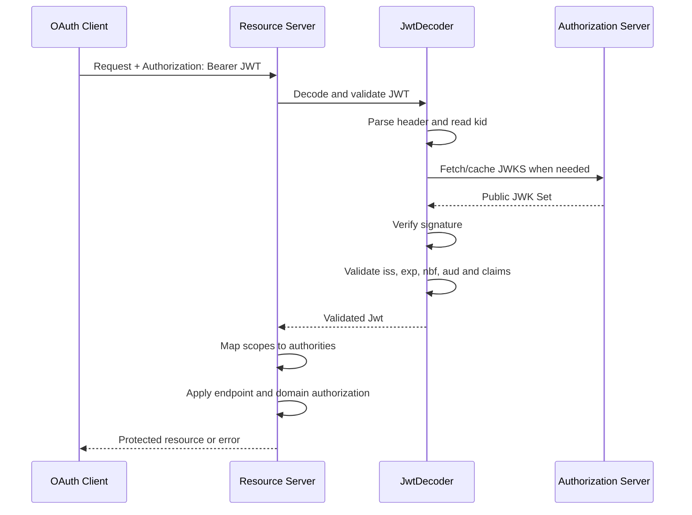

# Integrating a Resource Server to Verify JWTs Using Issuer and JWKS

## 1. Role of the Resource Server in an OAuth 2.0 System

In the **Application Integration** chapter of the **SPRING_SECURITY_OAUTH2_OIDC_AUTHORIZATION_SERVER** module, we learn how to design, configure, secure, test, and operate an OAuth 2.0/OpenID Connect Authorization Server using Spring Security and Spring Authorization Server in a Spring Boot application.

The Authorization Server authenticates the client or resource owner according to the appropriate grant, enforces authorization policies, and issues tokens. The Resource Server protects APIs, receives access tokens from clients, and decides whether a request is allowed to access a resource.

When using JWT access tokens, the Resource Server does not need to call the Authorization Server on every request to introspect the token. It can verify the signature using public keys published via a JSON Web Key Set (JWKS), and then validate the required claims. This model reduces round trips on the request path and enables multiple Resource Servers to verify tokens independently.

However, a valid signature only proves that the token was signed by the corresponding key. The Resource Server must still verify that the token comes from a trusted issuer, is intended for its own API, is still valid, and carries the appropriate scopes/authorities for the endpoint.

### Learning Objectives

After this lesson, you will be able to:

- Distinguish between Authorization Server, Resource Server, access token, and ID Token.
- Configure a Spring Boot Resource Server using an issuer URI and JWKS.
- Understand discovery metadata, jwks_uri, kid, and key rotation.
- Verify signature, iss, aud, exp, and nbf.
- Apply scope-based authorization using SCOPE_ authorities.
- Add validators for audience and business claims.
- Handle multiple issuers/tenants using JwtIssuerAuthenticationManagerResolver.
- Propagate tenant context from verified JWTs into the business layer.
- Test valid tokens, wrong issuer/audience tokens, key rotation, and JWKS failures.

## 2. Access Token vs. ID Token

OAuth 2.0 defines an access token for clients to access protected resources. OpenID Connect defines an ID Token to inform clients about the user authentication result and provide authentication claims.

The two tokens serve different purposes:

| Characteristic | Access Token | ID Token |
| --- | --- | --- |
| Primary recipient | Resource Server/API specified in aud. | OIDC client with the corresponding client_id in aud. |
| Purpose | Authorizes API access. | Conveys authentication result to the client. |
| Common claims | iss, sub, aud, exp, iat, scope or scp. | iss, sub, aud, exp, iat, nonce, auth_time, and OIDC claims. |
| Where verified | Resource Server. | OIDC client/Relying Party. |
| API access decision | Combines scope, audience, and policy. | Not used in place of an access token. |

Do not send an ID Token to an API just because it is a validly signed JWT. An ID Token typically has the web/mobile application as its audience; an API requires an access token whose audience is that API itself.

Nor should a Resource Server accept just any JWT signed by the same Authorization Server. It must check the token type/profile and the audience issued for its resource.

## 3. How Do JWT and JWKS Work?

### 3.1. Three Parts of a JWT

A compact JWT typically consists of three Base64URL parts separated by dots:

```text
BASE64URL(header).BASE64URL(payload).BASE64URL(signature)
```

- **Header** describes the signing algorithm and key identifier, such as alg and kid.
- **Payload** contains claims such as iss, sub, aud, exp, and scope.
- **Signature** enables the recipient to verify that the header/payload have not been altered after signing.

The payload is Base64URL-encoded, not encrypted. Anyone holding the token can read the claims. Do not put passwords, client secrets, private data, or unnecessary sensitive data into a JWT.

### 3.2. JWK and JWKS

A JWK (JSON Web Key) is a JSON representation of a cryptographic key. A JWKS (JSON Web Key Set) is a set of JWKs, typically published by the Authorization Server at the jwks_uri endpoint.

With asymmetric signatures:

- The Authorization Server holds the private key and uses it to sign tokens.
- The Authorization Server publishes the public key in the JWKS.
- The Resource Server fetches the public key and uses it to verify signatures.

The public key can be public; the private key must never appear in the JWKS response.

### 3.3. Using kid to Select a Key

When multiple public keys exist in the JWKS, the kid header helps the decoder select the matching key. kid is only a lookup identifier to find the key, not proof that the token is trustworthy.

The Resource Server must verify the signature using public keys obtained from a configured JWKS or discovered from a trusted issuer. Never fetch keys from a URL supplied by an arbitrary token header or claim.

### 3.4. Verification Flow



The Resource Server only creates an Authentication after the decoder successfully validates the token. If any validation step fails, the request is not considered authenticated.

## 4. Dependencies and Basic Configuration

### 4.1. Dependency

With Spring Boot, use the Resource Server starter:

```xml
<dependency>
    <groupId>org.springframework.boot</groupId>
    <artifactId>spring-boot-starter-oauth2-resource-server</artifactId>
</dependency>
```

The starter provides Resource Server and JWT support. At the Spring Security library level, the two core modules are spring-security-oauth2-resource-server and spring-security-oauth2-jose; the JOSE module provides JWT decoding and verification.

Do not declare a Spring Security version different from the one managed by Spring Boot dependency management unless there is a clear compatibility reason.

### 4.2. Configuring the Issuer URI

Suppose the Authorization Server issues access tokens with the issuer:

```text
https://auth.example.com
```

Resource Server configuration:

```yaml
spring:
  security:
    oauth2:
      resourceserver:
        jwt:
          issuer-uri: https://auth.example.com
          audiences: https://orders-api.example.com
```

issuer-uri must match the iss claim in the access token exactly. audiences requires the token to contain an audience intended for the API. A validly signed token without this audience will be rejected.

### 4.3. Configuring the JWKS URI Directly

If the Authorization Server does not publish a suitable metadata endpoint or the Resource Server needs to know the JWKS endpoint ahead of time, you can configure both the issuer and the JWKS URI:

```yaml
spring:
  security:
    oauth2:
      resourceserver:
        jwt:
          issuer-uri: https://auth.example.com
          jwk-set-uri: https://auth.example.com/oauth2/jwks
          audiences: https://orders-api.example.com
```

jwk-set-uri specifies where to fetch the public keys. Keep issuer-uri to validate the iss claim. If you only configure a JWKS URI without adding an issuer validator, the Resource Server can verify the signature, but cannot be certain the token was issued by the issuer the API expects.

### 4.4. Discovery Metadata

When only issuer-uri is configured, Spring Security uses the Provider Configuration or Authorization Server Metadata endpoint to locate the jwks_uri field. Depending on the issuer and metadata profile, the discovery endpoint may be:

- https://auth.example.com/.well-known/openid-configuration
- https://auth.example.com/.well-known/oauth-authorization-server

For issuers containing a path, Spring Security supports the corresponding well-known locations according to discovery rules. Check the actual metadata response and ensure the issuer in the metadata matches the configured issuer.

In Spring Authorization Server, the default JWKS endpoint is usually /oauth2/jwks; metadata is the authoritative source publishing the corresponding URL. The Resource Server should rely on metadata or administratively managed endpoint configuration rather than constructing URLs from incoming requests.

### 4.5. Startup and First Verification

With the default Spring Boot configuration, discovery can be deferred until the first time the Resource Server receives a bearer JWT. This prevents API startup from necessarily depending on the Authorization Server being up at boot time.

When the Resource Server needs to verify a token, it retrieves metadata/JWKS as configured, selects the matching public key, and validates the token. If the application declares its own JwtDecoder bean, keep in mind that decoder initialization may perform discovery earlier and affect startup dependencies.

## 5. Configuring SecurityFilterChain for an API

Example protecting endpoints by scope:

```java
import static org.springframework.security.oauth2.core.authorization.OAuth2AuthorizationManagers.hasScope;

import org.springframework.context.annotation.Bean;
import org.springframework.context.annotation.Configuration;
import org.springframework.security.config.Customizer;
import org.springframework.security.config.annotation.web.builders.HttpSecurity;
import org.springframework.security.web.SecurityFilterChain;

@Configuration(proxyBeanMethods = false)
public class ResourceServerSecurityConfig {

    @Bean
    SecurityFilterChain apiSecurityFilterChain(HttpSecurity http)
            throws Exception {

        http
            .authorizeHttpRequests(authorize -> authorize
                .requestMatchers("/actuator/health").permitAll()
                .requestMatchers("/api/orders/**").access(hasScope("orders.read"))
                .requestMatchers("/api/order-admin/**").access(hasScope("orders.write"))
                .anyRequest().authenticated()
            )
            .oauth2ResourceServer(oauth2 ->
                oauth2.jwt(Customizer.withDefaults())
            );

        return http.build();
    }
}
```

When using the default JWT Resource Server, Spring Security maps scopes to authorities with the SCOPE_ prefix. Therefore, hasScope("orders.read") is equivalent to checking authority SCOPE_orders.read.

If using hasAuthority, you must include the full prefix:

```java
.requestMatchers("/api/orders/**")
.hasAuthority("SCOPE_orders.read")
```

Calling permitAll() for the health endpoint does not make business endpoints public. Declare specific routes before general rules and avoid accidentally applying permitAll() to APIs carrying tenant data.

### 5.1. Enabling Method Security

Authorization can be placed close to service methods:

```java
import org.springframework.security.access.prepost.PreAuthorize;
import org.springframework.stereotype.Service;

@Service
public class OrderQueryService {

    @PreAuthorize("hasAuthority('SCOPE_orders.read')")
    public Order findOrder(String orderId) {
        // Load order and apply tenant/domain checks.
        return loadOrder(orderId);
    }
}
```

Enable method security:

```java
import org.springframework.context.annotation.Configuration;
import org.springframework.security.config.annotation.method.configuration.EnableMethodSecurity;

@Configuration
@EnableMethodSecurity
public class MethodSecurityConfig {
}
```

Scopes control permissions at the API/action level. The service must still verify whether the user/client is authorized to access the specific order, account, or tenant.

## 6. What Does JwtDecoder Verify?

JwtAuthenticationProvider uses JwtDecoder to parse, verify signatures, and validate claims. For a JWT access token, key checks include:

| Component | What to Verify | Purpose |
| --- | --- | --- |
| Signature | Signature matches a public key in JWKS. | Token has not been tampered with and was signed by the matching private key. |
| iss | Issuer matches a trusted issuer. | Token came from the expected Authorization Server. |
| aud | Audience contains the API's identifier. | Token was issued for the right Resource Server. |
| exp | Not yet expired. | Limits token usage lifetime. |
| nbf | Current time has passed nbf. | Rejects tokens that are not yet valid. |
| alg | Algorithm is in the allowlist. | Prevents accepting unwanted algorithms. |
| Business claims | Required tenant, scope, subject, and policies are valid. | Ensures the token satisfies API authorization rules. |

iat indicates when the token was issued, but does not replace exp. If policy requires a maximum token age or requires iat, add a dedicated validator.

### 6.1. Issuer Identifies Who Issued the Token

The iss claim identifies the Authorization Server. The value must match the trusted issuer, including scheme, host, and path. Do not strip paths or alter trailing slashes to make a token match approximately.

In a multi-issuer system, iss also distinguishes a tenant's identity domain. The same sub from two different issuers does not automatically refer to the same person.

### 6.2. Audience Identifies Who May Receive the Token

The aud claim indicates which resource server the token is intended for. If the Orders API receives a token issued for the Billing API, the signature may still be valid, yet the Orders API must reject it due to the wrong audience.

Audience may be a string or a list of URIs/strings in the JWT. Spring Security exposes audience via Jwt.getAudience(), allowing validation of an API identifier in the list.

Do not substitute scope checks for audience validation. Scope and audience answer two distinct questions:

- Audience: which API is the token sent to?
- Scope: what actions is the token allowed to perform on that API?

### 6.3. Expiration and Clock Skew

A token with exp in the future can still be rejected if nbf is in the future or timestamps are invalid. Clocks between the Authorization Server and Resource Server must be synchronized.

Spring Security allows configuring clock skew for timestamp validators. Set only a small allowance matching actual clock drift; do not extend token lifetimes by setting an overly large skew.

## 7. Adding an Audience Validator in Java

If you do not use Spring Boot's audiences property or need a more complex policy, you can configure JwtDecoder and validators directly.

Example requiring an exact issuer and requiring the audience to contain https://orders-api.example.com:

```java
import org.springframework.context.annotation.Bean;
import org.springframework.context.annotation.Configuration;
import org.springframework.security.oauth2.core.OAuth2Error;
import org.springframework.security.oauth2.core.DelegatingOAuth2TokenValidator;
import org.springframework.security.oauth2.core.OAuth2TokenValidator;
import org.springframework.security.oauth2.core.OAuth2TokenValidatorResult;
import org.springframework.security.oauth2.jwt.Jwt;
import org.springframework.security.oauth2.jwt.JwtDecoder;
import org.springframework.security.oauth2.jwt.JwtValidators;
import org.springframework.security.oauth2.jwt.NimbusJwtDecoder;

@Configuration(proxyBeanMethods = false)
public class JwtDecoderConfig {

    private static final String ISSUER =
            "https://auth.example.com";
    private static final String AUDIENCE =
            "https://orders-api.example.com";

    @Bean
    JwtDecoder jwtDecoder() {
        NimbusJwtDecoder decoder =
                NimbusJwtDecoder.withIssuerLocation(ISSUER).build();

        OAuth2TokenValidator<Jwt> issuerAndTimestampValidator =
                JwtValidators.createDefaultWithIssuer(ISSUER);

        OAuth2TokenValidator<Jwt> audienceValidator = jwt -> {
            if (jwt.getAudience() != null &&
                    jwt.getAudience().contains(AUDIENCE)) {
                return OAuth2TokenValidatorResult.success();
            }

            OAuth2Error error = new OAuth2Error(
                    "invalid_token",
                    "The required audience is missing",
                    null);
            return OAuth2TokenValidatorResult.failure(error);
        };

        decoder.setJwtValidator(
                new DelegatingOAuth2TokenValidator<>(
                        issuerAndTimestampValidator,
                        audienceValidator));

        return decoder;
    }
}
```

JwtValidators.createDefaultWithIssuer() retains the default timestamp validators and checks the issuer. DelegatingOAuth2TokenValidator combines them with the audience validator. Do not replace all default validators with a lambda that only checks the audience.

When declaring a JwtDecoder bean, this configuration replaces Spring Boot's auto-configured decoder. Verify issuer discovery, JWKS URI, trusted algorithms, timeouts, and caching according to operational requirements.

### 7.1. Authorization Server Must Emit the Audience for the API

The Resource Server can only check the audience if the access token actually contains the aud claim. With Spring Authorization Server, you can add the audience to JWT access tokens using OAuth2TokenCustomizer:

```java
import java.util.List;

import org.springframework.context.annotation.Bean;
import org.springframework.context.annotation.Configuration;
import org.springframework.security.oauth2.server.authorization.OAuth2TokenType;
import org.springframework.security.oauth2.server.authorization.token.JwtEncodingContext;
import org.springframework.security.oauth2.server.authorization.token.OAuth2TokenCustomizer;

@Configuration(proxyBeanMethods = false)
public class AccessTokenAudienceConfig {

    @Bean
    OAuth2TokenCustomizer<JwtEncodingContext> accessTokenAudienceCustomizer() {
        return context -> {
            if (OAuth2TokenType.ACCESS_TOKEN.equals(context.getTokenType())) {
                context.getClaims().audience(
                        List.of("https://orders-api.example.com"));
            }
        };
    }
}
```

The example uses a fixed audience for a single API. In a multi-API system, determine the audience based on the resource requested by the client and verified policies; do not add every audience to every access token. Customize only JWT access tokens; do not apply API audiences to ID Tokens.

## 8. Signing Algorithms and Key Selection

### 8.1. Trust Only Approved Algorithms

The Resource Server needs an allowlist of signing algorithms. Do not read the alg value from the JWT and blindly accept any algorithm.

Spring Security's NimbusJwtDecoder configures trusted algorithms via its builder or the Spring Boot property jws-algorithms. Choose algorithms matching the signing keys and organizational standards, such as RSA or EC.

If the Authorization Server signs with RS256, the Resource Server must verify with the corresponding public RSA key. If switching to ES256, configure the decoder to accept the approved EC algorithm and ensure the key in the JWKS is compatible.

Do not allow none, do not treat an HMAC shared secret as a public key in JWKS, and do not infer algorithms from untrusted data.

### 8.2. Key Selection via kid

When a token includes kid, the decoder selects the corresponding JWK in the key set. If the key is not found or the signature does not match, verification fails.

Do not write custom logic that tries every available key or arbitrary algorithm when kid is not found just to let the token pass. An unknown key may indicate a forged token, a token signed by another issuer, or a token issued with a new key that has not been properly published.

### 8.3. Do Not Fetch the JWKS URI from the JWT

A token must not dictate the URL from which the Resource Server downloads public keys. If an application builds a JWKS URI from the iss claim or an unverified header, an attacker could make the server access unexpected endpoints.

Map issuers to metadata/JWKS URIs from a trusted registry or administratively managed configuration. With multi-issuer setups, allowlist the issuer before instantiating a decoder.

## 9. Key Rotation and JWKS Caching

The Authorization Server can rotate signing keys without reconfiguring every Resource Server. Once the JWKS publishes the new key, Spring Security can automatically use it to verify tokens.

Safe rotation workflow:

1. Generate a new key in the key management system.
2. Publish the new public key in the JWKS with a new kid.
3. Wait until Resource Servers can fetch/see the new key.
4. Switch the Authorization Server to sign tokens with the new private key.
5. Keep the old public key in the JWKS for as long as older tokens may still be valid.
6. Remove the old public key after tokens signed with it have expired, plus clock skew and an operational buffer.

If you switch to signing with the new key before the new public key is published, Resource Servers may fail to verify new tokens. If you remove the old key too early, previously issued valid tokens may be rejected.

JWKS responses are typically cached to avoid calling the Authorization Server on every request. Therefore, when investigating rotation issues, check cache lifetimes, response cache headers, unknown kid occurrences, key set refresh behavior, and network connectivity to the JWKS endpoint.

Do not cache private keys at the Resource Server. The Resource Server only needs public keys.

## 10. Mapping Scopes to GrantedAuthority

By default, Spring Security uses JwtAuthenticationConverter and JwtGrantedAuthoritiesConverter to map scopes in a JWT to GrantedAuthority instances.

For example, if a token contains:

```json
{
  "iss": "https://auth.example.com",
  "aud": ["https://orders-api.example.com"],
  "sub": "user-123",
  "scope": "orders.read orders.write"
}
```

Default authorities:

```text
SCOPE_orders.read
SCOPE_orders.write
```

They can be used in URL authorization or method security:

```java
.requestMatchers(HttpMethod.GET, "/api/orders/**")
.hasAuthority("SCOPE_orders.read")
.requestMatchers(HttpMethod.POST, "/api/orders/**")
.hasAuthority("SCOPE_orders.write")
```

Do not automatically treat every roles, groups, or permissions claim as an authority without defining a contract between the Authorization Server and Resource Server. If custom mapping is needed, use JwtAuthenticationConverter and map only signed claims that have a clear schema and belong to a trusted issuer.

### 10.1. Custom Converter When an Issuer Uses a Custom Claim

For example, the Authorization Server emits an authorities claim with a list of internal permissions:

```java
import java.util.Collection;
import java.util.ArrayList;
import java.util.List;
import java.util.Set;

import org.springframework.context.annotation.Bean;
import org.springframework.context.annotation.Configuration;
import org.springframework.core.convert.converter.Converter;
import org.springframework.security.core.GrantedAuthority;
import org.springframework.security.core.authority.SimpleGrantedAuthority;
import org.springframework.security.oauth2.jwt.Jwt;
import org.springframework.security.oauth2.server.resource.authentication.JwtAuthenticationConverter;
import org.springframework.security.oauth2.server.resource.authentication.JwtGrantedAuthoritiesConverter;

@Configuration(proxyBeanMethods = false)
public class JwtAuthoritiesConfig {

    private static final Set<String> ALLOWED_AUTHORITIES =
            Set.of("ROLE_SUPPORT", "ROLE_ORDER_AUDITOR");

    @Bean
    JwtAuthenticationConverter jwtAuthenticationConverter() {
        JwtGrantedAuthoritiesConverter scopes =
                new JwtGrantedAuthoritiesConverter();

        Converter<Jwt, Collection<GrantedAuthority>> authoritiesConverter =
                jwt -> {
                    Collection<GrantedAuthority> authorities = new ArrayList<>();
                    Collection<GrantedAuthority> scopeAuthorities =
                            scopes.convert(jwt);
                    if (scopeAuthorities != null) {
                        authorities.addAll(scopeAuthorities);
                    }
                    List<String> tokenAuthorities =
                            jwt.getClaimAsStringList("authorities");
                    if (tokenAuthorities != null) {
                        tokenAuthorities.stream()
                                .filter(ALLOWED_AUTHORITIES::contains)
                                .map(SimpleGrantedAuthority::new)
                                .forEach(authorities::add);
                    }
                    return authorities;
                };

        JwtAuthenticationConverter converter =
                new JwtAuthenticationConverter();
        converter.setJwtGrantedAuthoritiesConverter(authoritiesConverter);
        return converter;
    }
}
```

The snippet above preserves the default scope mapping. When mapping custom claims, add authorities from an explicit allowlist to avoid turning arbitrary strings in a token into administrative privileges.

Attach the converter to the Resource Server:

```java
http.oauth2ResourceServer(oauth2 ->
        oauth2.jwt(jwt ->
                jwt.jwtAuthenticationConverter(jwtAuthenticationConverter)));
```

## 11. Handling Principal and Tenant Context

By default, Authentication.getPrincipal() is the Jwt object; Authentication.getName() is typically derived from the sub claim.

In a multi-tenant application, sub is not necessarily globally unique. A safe identifier usually needs to combine the issuer and subject:

```text
principal key = iss + ":" + sub
```

If the token contains a tenant_id claim, use it only after the decoder has verified the signature and issuer. Also verify that the tenant is compatible with the issuer and the resource served by the API.

Do not use a tenant ID from a request header as the sole source of truth. Clients can modify headers. Tenant context must be derived from the authenticated principal/issuer or verified against a trusted tenant mapping.

### 11.1. Do Not Confuse Scopes with Record-Level Permissions

The orders.read scope may permit invoking the order-reading capability, but it does not automatically authorize reading every order. The service must verify that the order belongs to a tenant/account the principal is allowed to access.

Example:

```java
import org.springframework.security.core.context.SecurityContextHolder;
import org.springframework.security.oauth2.jwt.Jwt;

@PreAuthorize("hasAuthority('SCOPE_orders.read')")
public Order findOrder(String orderId) {
    Jwt jwt = (Jwt) SecurityContextHolder.getContext()
            .getAuthentication().getPrincipal();

    String issuer = jwt.getIssuer().toString();
    String subject = jwt.getSubject();

    return orderRepository.findVisibleOrder(orderId, issuer, subject)
            .orElseThrow(OrderNotFoundException::new);
}
```

Data queries need appropriate tenant/subject predicates or row-level security. Do not just load an order by ID and assume the scope alone suffices to protect ownership.

## 12. Supporting Multiple Issuers in a Resource Server

A Resource Server can accept access tokens from multiple Authorization Servers or multiple issuers of a multi-tenant Authorization Server. In that case, each issuer may have:

- Different JWKS URIs and signing keys.
- Different audiences/API identifiers.
- Different scope/claim policies.
- Different tenant mappings.

Spring Security provides JwtIssuerAuthenticationManagerResolver to select an AuthenticationManager based on the issuer claim in the JWT.

### 12.1. Static Issuer Allowlist

For a fixed list of issuers:

```java
import org.springframework.context.annotation.Bean;
import org.springframework.context.annotation.Configuration;
import org.springframework.security.config.annotation.web.builders.HttpSecurity;
import org.springframework.security.oauth2.server.resource.authentication.JwtIssuerAuthenticationManagerResolver;
import org.springframework.security.web.SecurityFilterChain;

@Configuration(proxyBeanMethods = false)
public class MultiIssuerResourceServerConfig {

    @Bean
    SecurityFilterChain apiSecurityFilterChain(HttpSecurity http)
            throws Exception {

        JwtIssuerAuthenticationManagerResolver resolver =
                JwtIssuerAuthenticationManagerResolver.fromTrustedIssuers(
                        "https://auth.example.com/tenant-a",
                        "https://auth.example.com/tenant-b");

        http
            .authorizeHttpRequests(authorize -> authorize
                .anyRequest().authenticated()
            )
            .oauth2ResourceServer(oauth2 ->
                oauth2.authenticationManagerResolver(resolver)
            );

        return http.build();
    }
}
```

The resolver only accepts issuers in the trusted list. Each issuer has its own decoder/provider and issuer validation. Issuer endpoints are loaded lazily, so the application does not necessarily have to contact all Authorization Servers at startup. This configuration demonstrates allowlisting and issuer validation; if the API requires a specific audience, add an audience validator to each issuer's decoder as shown in the next section.

### 12.2. Unverified Initial Issuer Claim

The resolver must read iss to select an AuthenticationManager before the decoder verifies the signature. That value must be used strictly as a lookup key in the allowlist.

After selecting the manager, JwtDecoder must still verify the signature, issuer, timestamps, and audience. Do not use the unverified iss claim to access tenant databases, fetch secrets, call arbitrary URLs, or grant permissions.

### 12.3. Different Audiences per Issuer

If all tenants serve the same API audience, a shared audience validator can be configured on each decoder. If each tenant has its own audience, build a dedicated AuthenticationManager/JwtDecoder per issuer with its corresponding audience.

Do not merely allowlist issuers while omitting audience validation. A token signed by a trusted issuer could still be intended for a different API.

## 13. Multi-Issuer with Per-Tenant AuthenticationManager

When each issuer has its own audience or policy, create dedicated decoders/providers and register them in a map keyed by issuer:

```java
import java.util.Map;

import org.springframework.context.annotation.Bean;
import org.springframework.context.annotation.Configuration;
import org.springframework.security.authentication.AuthenticationManager;
import org.springframework.security.oauth2.core.OAuth2Error;
import org.springframework.security.oauth2.core.DelegatingOAuth2TokenValidator;
import org.springframework.security.oauth2.core.OAuth2TokenValidator;
import org.springframework.security.oauth2.core.OAuth2TokenValidatorResult;
import org.springframework.security.oauth2.jwt.Jwt;
import org.springframework.security.oauth2.jwt.JwtValidators;
import org.springframework.security.oauth2.jwt.NimbusJwtDecoder;
import org.springframework.security.oauth2.server.resource.authentication.JwtAuthenticationProvider;
import org.springframework.security.oauth2.server.resource.authentication.JwtIssuerAuthenticationManagerResolver;

@Configuration(proxyBeanMethods = false)
public class TenantAuthenticationManagersConfig {

    private AuthenticationManager managerFor(
            String issuer, String audience) {

        NimbusJwtDecoder decoder =
                NimbusJwtDecoder.withIssuerLocation(issuer).build();

        OAuth2TokenValidator<Jwt> audienceValidator = jwt -> {
            if (jwt.getAudience() != null &&
                    jwt.getAudience().contains(audience)) {
                return OAuth2TokenValidatorResult.success();
            }
            return OAuth2TokenValidatorResult.failure(
                    new OAuth2Error(
                            "invalid_token",
                            "Invalid audience",
                            null));
        };

        decoder.setJwtValidator(
                new DelegatingOAuth2TokenValidator<>(
                        JwtValidators.createDefaultWithIssuer(issuer),
                        audienceValidator));

        JwtAuthenticationProvider provider =
                new JwtAuthenticationProvider(decoder);
        return provider::authenticate;
    }

    @Bean
    JwtIssuerAuthenticationManagerResolver tenantResolver() {
        Map<String, AuthenticationManager> managers = Map.of(
                "https://auth.example.com/tenant-a",
                managerFor(
                        "https://auth.example.com/tenant-a",
                        "https://orders-a.example.com"),
                "https://auth.example.com/tenant-b",
                managerFor(
                        "https://auth.example.com/tenant-b",
                        "https://orders-b.example.com"));

        return new JwtIssuerAuthenticationManagerResolver(managers::get);
    }
}
```

This is an example for a static list of issuers. When the number of tenants is large, load issuer/audience/JWKS configurations from a managed tenant registry and cache AuthenticationManager instances by issuer.

The manager map must not be populated from an arbitrary issuer sent by a client. Only provisioned, active tenants with verified issuer metadata may be added to the map.

## 14. Adding and Removing Tenants Dynamically

If tenants can be created while the Resource Server is running, you can use an updatable AuthenticationManager repository:

```java
import java.util.concurrent.ConcurrentHashMap;
import java.util.concurrent.ConcurrentMap;

import org.springframework.security.authentication.AuthenticationManager;
import org.springframework.security.oauth2.jwt.JwtDecoders;
import org.springframework.security.oauth2.server.resource.authentication.JwtAuthenticationProvider;
import org.springframework.security.oauth2.server.resource.authentication.JwtIssuerAuthenticationManagerResolver;

public final class DynamicTenantAuthenticationManagers {

    private final ConcurrentMap<String, AuthenticationManager> managers =
            new ConcurrentHashMap<>();

    public JwtIssuerAuthenticationManagerResolver resolver() {
        return new JwtIssuerAuthenticationManagerResolver(managers::get);
    }

    public void registerTrustedTenant(String issuer) {
        // issuer must come from the trusted tenant registry, not from a JWT.
        JwtAuthenticationProvider provider =
                new JwtAuthenticationProvider(
                        JwtDecoders.fromIssuerLocation(issuer));
        managers.put(issuer, provider::authenticate);
    }

    public void removeTenant(String issuer) {
        managers.remove(issuer);
    }
}
```

This is an illustrative skeleton. Before calling registerTrustedTenant, the system must verify that the tenant is provisioned, the issuer belongs to the allowlist, and the audience/policies are configured. In production, the created manager must apply a dedicated audience validator as in the previous section; the JwtDecoders.fromIssuerLocation example only illustrates creating a decoder with default issuer validation.

Do not expose a public endpoint like register-issuer?url=... that creates a decoder for a caller-supplied URL. Doing so can introduce SSRF, causing the Resource Server to fetch JWKS from internal hosts or attacker-controlled endpoints.

When removing a tenant, coordinate rejecting new tokens, caches, in-flight requests, and data policies. Removing the manager from the map does not automatically revoke already-issued tokens; the Resource Server needs policies for token lifetimes, revocation/introspection, or a denylist if immediate revocation is required.

## 15. Tenant Propagation After Verification

Selecting the right AuthenticationManager only solves token verification. The application must also propagate the tenant context into authorization and data access.

One approach:

1. Decoder verifies signature, issuer, audience, and timestamps.
2. JwtAuthenticationProvider creates a JwtAuthenticationToken.
3. Controller/service reads the issuer and tenant claims from the verified Jwt.
4. Domain service checks whether the tenant/subject has permission on the resource.
5. Repository queries always restrict by tenant.

Do not use the tenant_id claim as an administrative authority. Tenant ID is a data-partitioning context; action permissions must still rely on scopes/authorities and business policies.

If an API accepts tokens from multiple issuers, store the issuer together with the subject in audit logs and principal keys to avoid conflating two users who share the same sub.

## 16. JWT Validation and Authorization Are Two Separate Layers

| Layer | Question | Example |
| --- | --- | --- |
| Token validation | Is the token valid and intended for this API? | Signature, issuer, audience, expiry, not-before. |
| Coarse-grained authorization | Does the token have the scope for this action? | SCOPE_orders.read. |
| Domain authorization | Is the principal permitted to access the specific record? | Order belongs to the principal's tenant/account. |
| Data isolation | Does the query restrict data to the right tenant? | Tenant predicate or row-level security. |

A JWT with a valid signature and the orders.read scope still does not mean the user may read another tenant's orders. The Resource Server must enforce all layers of checks.

## 17. Verification Errors and HTTP Responses

The Resource Server typically returns:

| Scenario | Common HTTP Response | Meaning |
| --- | --- | --- |
| No bearer token on an endpoint requiring authentication | 401 Unauthorized | Caller has not provided credentials. |
| Malformed JWT, invalid signature, wrong issuer/audience, or expired | 401 Unauthorized | Bearer token is invalid. |
| Valid token but missing scope/authority | 403 Forbidden | Principal is authenticated but lacks sufficient permissions. |
| JWKS/metadata endpoint unavailable | Server-side verification error, typically 5xx or authentication failure depending on cause/configuration | API cannot reliably verify the token. |

Do not turn JWKS/network errors into permitted access. When a signature cannot be verified, the Resource Server must fail closed.

### 17.1. Do Not Leak Internal Details

Do not return to clients:

- Internal JWKS URLs or connection strings.
- Decoder stack traces.
- Token contents or unnecessary private claims.
- Details about whether other tenants exist.
- Public key cache or internal key management state.

Log the correlation ID, allowlisted issuer, error category, and endpoint; do not log raw bearer tokens.

### 17.2. Distinguishing 401 and 403

401 indicates that the request lacks valid authentication. 403 indicates that authentication succeeded, but permissions are insufficient.

If a token lacks a scope, do not return 401 just to obscure that policy denied access. Use the appropriate 403/Bearer error without exposing resource data.

## 18. Performance, Caching, and Availability

### 18.1. JWKS Should Not Be Fetched on Every Request

The Resource Server caches key material to avoid continuously fetching JWKS. This reduces latency and load on the Authorization Server. During key rotation, cache behavior determines how quickly the Resource Server sees the new key.

Monitor:

- JWKS fetch latency and failure count.
- Decoder/authentication failures by category.
- Unknown kid rate.
- Cache refreshes and key rotation events.
- Request authentication latency.

Do not create a new decoder on every request. For multi-issuer setups, cache managers/decoders per issuer and manage their lifecycle.

### 18.2. Timeouts and Networking

The JWKS endpoint is a dependency during verification when a key is not yet cached or needs refreshing. Set appropriate connect/read timeouts if configuring the HTTP client/decoder manually; do not allow a slow endpoint to hold request threads indefinitely.

The Resource Server should have a stable network route to metadata/JWKS endpoints. If using an egress proxy, control DNS, TLS certificates, and allowed destinations.

### 18.3. Should JWT Verification Results Be Cached?

Generally, let the decoder and JWKS cache do their job. Caching entire verification results keyed by raw token can complicate revocation, expiry, audience, and policy changes. If caching is strictly necessary, the TTL must not exceed the token's lifetime and must account for issuer, audience, validator version, and revocation policy.

### 18.4. JWT or Opaque Token?

JWTs fit when Resource Servers need local verification and can tolerate revocation delay bounded by token lifetime/key policy. Opaque tokens fit when centralized introspection is needed or token state can change immediately.

Do not choose JWTs solely because they are easy to decode. The decision must weigh revocation requirements, number of resource servers, permission sensitivity, latency, and availability.

## 19. Testing the Resource Server

Test at two layers: authorization behavior and cryptographic token validation.

| Category | Scenario | Expected |
| --- | --- | --- |
| Valid token | Valid signature, valid issuer/audience, unexpired. | Authentication succeeds. |
| Invalid signature | Altered payload or signed with another key. | 401. |
| Unknown issuer | iss not in allowlist. | Rejected before selecting manager. |
| Wrong issuer | Validly signed token but iss differs from configured issuer. | 401. |
| Wrong audience | Token intended for another API. | 401. |
| Expired | exp has passed. | 401. |
| Not before | nbf is in the future beyond clock skew. | 401. |
| Missing audience | Token lacks required aud. | 401. |
| Scope allowed | Has orders.read and calls GET endpoint. | Succeeds. |
| Scope missing | Valid token but missing orders.write. | 403. |
| Wrong tenant | Tenant A token accesses Tenant B resource. | Rejected by domain policy. |
| Same subject, different issuer | Two issuers share the same sub. | The two principal identities are not conflated. |
| Key rotation | JWKS publishes new key and token uses new kid. | New token is verified after key is fetched. |
| Old key overlap | Old token still valid and old key remains in JWKS. | Old token continues to validate. |
| Old key removed | Old token expired and old key removed. | Old token is no longer verified. |
| Unknown kid | kid not present in JWKS. | Rejected; does not fall back to arbitrary keys. |
| JWKS unavailable | Key not cached and endpoint unreachable. | Request is denied. |
| Dynamic tenant | Unregistered tenant. | Resolver rejects. |
| Dynamic tenant removal | Tenant removed from allowlist. | New tokens from that issuer are rejected. |
| ID Token presented | ID Token with web client audience sent to API. | API rejects due to wrong audience/token profile. |
| No bearer token | Calling endpoint requiring authentication without a token. | 401. |

### 19.1. MockMvc and jwt() Tests

Spring Security Test provides the jwt() request post-processor to create a simulated JwtAuthenticationToken. It is useful for testing URL authorization, method security, scope/authority mapping, and domain authorization based on principal/claims.

However, jwt() does not prove that the decoder verified signatures, JWKS, issuer, or audience. Cryptographic checks require integration tests with genuinely signed JWTs and corresponding public keys.

### 19.2. Integration Testing with a Real JWK Set

Create a test Authorization Server or a test JWK Set with dedicated private/public keys. Issue tokens with specific issuer, audience, scopes, and expiration. Have the Resource Server fetch the public key and send real requests.

Try modifying one byte of the payload, changing the issuer, changing the audience, expiring the token, and changing the kid. These cases must all be rejected.

### 19.3. Testing Multiple Issuers

Create two issuers with different signing keys and audiences. Confirm:

1. Token A passes API/manager A.
2. Token A does not pass manager B when issuer/audience do not match.
3. Issuers outside the allowlist are rejected.
4. The same sub from different issuers yields distinct identities.
5. Tenant context after authentication always matches the verified issuer.

## 20. Troubleshooting

| Symptom | Possible Cause | Resolution |
| --- | --- | --- |
| The iss claim is not valid | issuer-uri does not match iss claim, different path or trailing slash. | Compare exact issuer in metadata and token. |
| Invalid audience | Token is not meant for current API or Authorization Server did not emit matching aud. | Configure audience on both sides. |
| Unable to resolve the Configuration with the provided Issuer | Metadata endpoint incorrect or unreachable. | Check discovery URL, TLS, DNS, and issuer metadata. |
| Unable to find a signing key that matches | kid missing from JWKS, stale cache, or key not yet published. | Check JWKS, kid, cache, and rotation order. |
| Valid token but 403 | Missing scope or authority mapping mismatch. | Check scope/scp, SCOPE_ prefix, and endpoint policy. |
| All issuers are rejected | Wrong resolver allowlist or issuer string mismatch. | Check exact issuer and manager registry. |
| One tenant uses the wrong audience | Decoder uses an unsuitable shared validator. | Create per-issuer manager/decoder with dedicated audience. |
| API depends on Authorization Server at startup | Eager discovery in custom decoder or synchronous bootstrap config. | Review lazy discovery and JWKS configuration. |
| Old tokens rejected after rotation | Old public key removed too soon or inappropriate cache/clock skew. | Maintain key overlap and synchronize time. |
| Resource Server calls strange URL to fetch JWKS | Issuer/JWKS endpoint derived from untrusted data. | Use an issuer allowlist and managed tenant registry. |
| Tenant A token reads Tenant B data | Only checking scope, lacking domain/data isolation. | Bind verified tenant context to every query. |

## 21. Hands-on Exercises and Checklist

### Exercise 1 — Configure Issuer and JWKS

Create a Spring Boot Resource Server, add the OAuth2 Resource Server starter, configure issuer-uri, and call an API with a JWT access token issued by the Authorization Server. Observe discovery metadata and JWKS.

### Exercise 2 — Add Audience

Issue a token intended for https://orders-api.example.com. Configure the Resource Server to require this audience. Try a token with the Billing API's audience and verify it is rejected.

### Exercise 3 — Scope Authorization

Create a GET endpoint requiring orders.read and a POST endpoint requiring orders.write. Inspect SCOPE_ authorities and distinguish 401 from 403.

### Exercise 4 — Key Rotation

Issue a token with key A, publish key B, switch signing new tokens to B, and keep A in JWKS. Verify both old and new tokens validate during the overlap period.

### Exercise 5 — Multi-Issuer

Configure two issuers in JwtIssuerAuthenticationManagerResolver. Assign a separate audience to each tenant and verify tokens cannot pass another tenant's decoder.

### Exercise 6 — Tenant Data Isolation

Extract the issuer and subject from the verified Jwt. Use them to restrict data queries. Try sending a different tenant header and confirm the API cannot access another tenant's data.

### Completion Checklist

- [ ] Distinguish Access Token and ID Token.
- [ ] Include appropriate Resource Server and JOSE dependencies.
- [ ] Configure issuer-uri matching the iss claim.
- [ ] Discovery metadata returns correct issuer and jwks_uri.
- [ ] Use public keys only from a trusted JWKS.
- [ ] Verify signature, iss, aud, exp, and nbf.
- [ ] Enforce audience validation for the API.
- [ ] Trust only allowlisted signing algorithms.
- [ ] Understand kid, JWKS caching, and key rotation.
- [ ] Map scopes to SCOPE_ authorities.
- [ ] Enforce domain permissions and tenant data isolation.
- [ ] Multi-issuer accepts only allowlisted issuers.
- [ ] Never obtain JWKS URLs from unverified tokens or requests.
- [ ] Never log raw bearer tokens.
- [ ] Test both authorization behavior and real JWT signatures.

## 22. References

- [Spring Security 6.5 — OAuth 2.0 Resource Server JWT](https://docs.spring.io/spring-security/reference/6.5/servlet/oauth2/resource-server/jwt.html) — dependencies, issuer discovery, JWKS, audience, decoder, and scope mapping.
- [Spring Security 6.5 — OAuth 2.0 Resource Server Multi-tenancy](https://docs.spring.io/spring-security/reference/6.5/servlet/oauth2/resource-server/multitenancy.html) — JwtIssuerAuthenticationManagerResolver, trusted issuers, dynamic tenants, and tenant propagation.
- [Spring Authorization Server — Configuration Model](https://docs.spring.io/spring-authorization-server/reference/configuration-model.html) — Authorization Server configuration and protocol endpoints.
- [Spring Authorization Server — Core Model Components](https://docs.spring.io/spring-authorization-server/reference/core-model-components.html) — token generation, JWK, and authorization model.
- [RFC 7517 — JSON Web Key](https://www.rfc-editor.org/rfc/rfc7517) — JWK and JWK Set.
- [RFC 7519 — JSON Web Token](https://www.rfc-editor.org/rfc/rfc7519) — JWT claims, issuer, audience, and expiration.
- [RFC 8414 — OAuth 2.0 Authorization Server Metadata](https://www.rfc-editor.org/rfc/rfc8414) — metadata and jwks_uri.
- [RFC 9068 — JWT Profile for OAuth 2.0 Access Tokens](https://www.rfc-editor.org/rfc/rfc9068) — JWT access token profile.
- [RFC 6750 — OAuth 2.0 Bearer Token Usage](https://www.rfc-editor.org/rfc/rfc6750) — bearer tokens and error responses.

**Conclusion:** A Resource Server must verify JWT signatures using public keys obtained from a trusted JWKS, validate the exact issuer and audience, and verify token validity before mapping scopes to authorities and applying authorization. With multiple tenants, select a decoder from an allowlisted issuer, apply dedicated audience/policies, and propagate the tenant context from the verified JWT down to the data layer. A valid signature is a necessary condition; API access still depends on audience, scope, and domain authorization.
