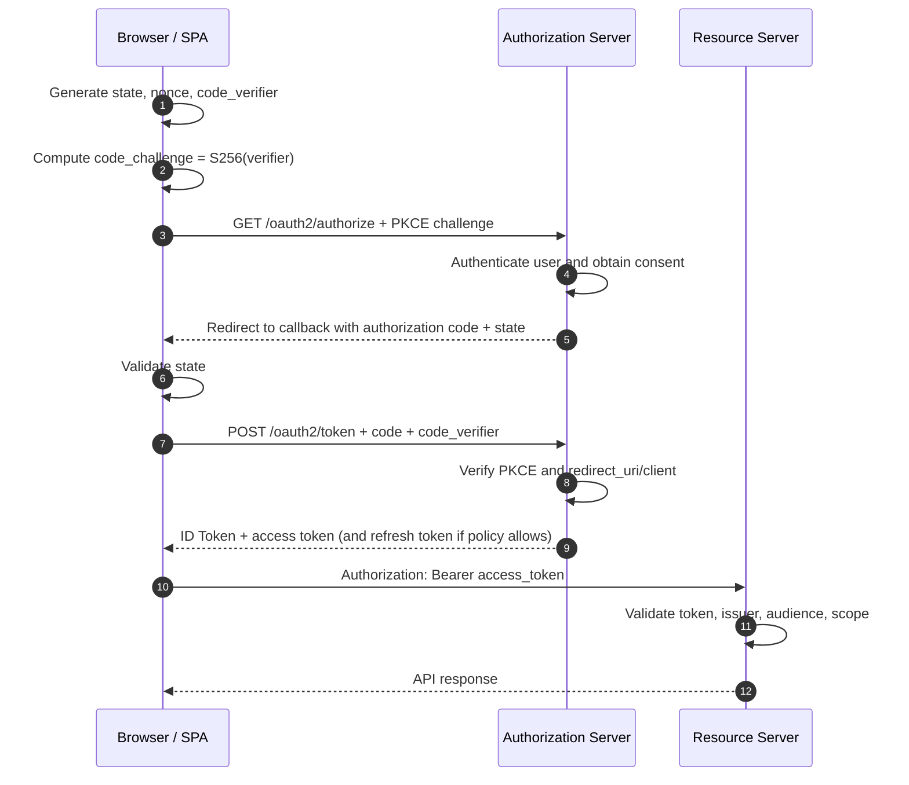
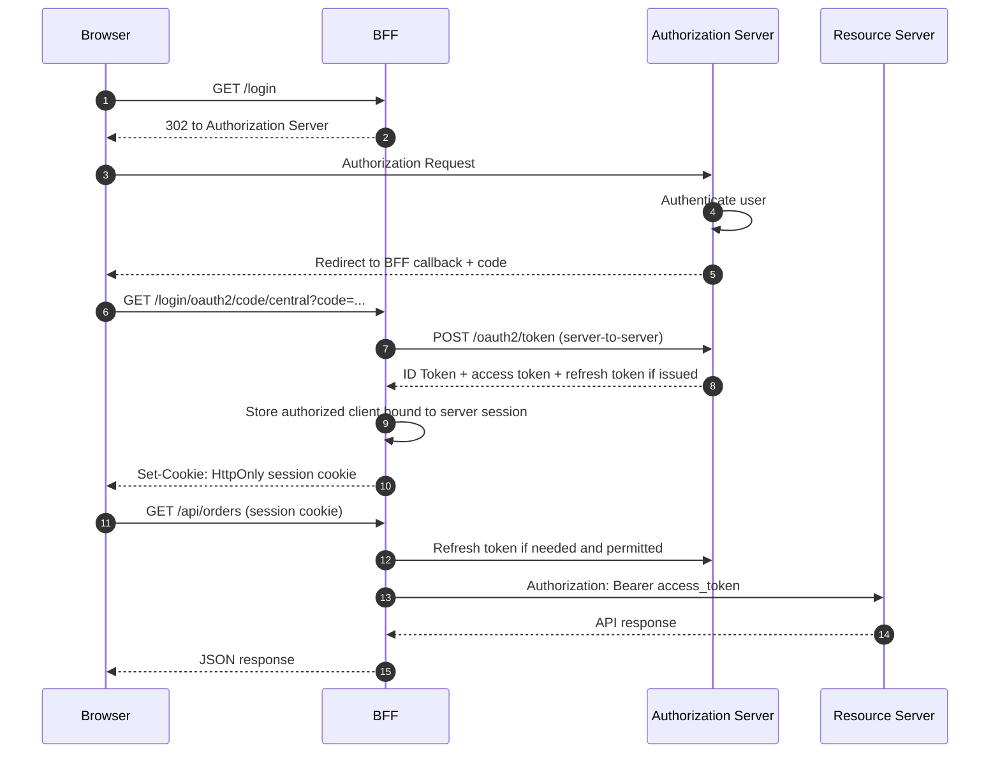

# Designing an SPA Client with PKCE and Evaluating the BFF Pattern

## 1. The Challenge of Integrating an SPA with an Authorization Server

A Single Page Application (SPA) executes JavaScript inside the browser, so its source code and all data it receives reside in a user-controlled environment. An SPA cannot securely keep a client secret the way a server-side application can. In OAuth 2.0, an SPA is therefore a **public client**.

An SPA typically needs to sign users in via OpenID Connect (OIDC), call APIs protected by an access token, and maintain login state across page reloads. Two architectures are common:

- **SPA calls the Authorization Server and Resource Server directly:** the browser executes the Authorization Code Flow with PKCE, receives tokens, and sends the access token to the API.
- **Backend for Frontend (BFF):** the browser communicates only with the application's own backend; the BFF performs OAuth/OIDC server-side, stores tokens, and calls APIs on the user's behalf.

No single choice fits every system. A direct SPA reduces backend components and fits pure client applications, but tokens reside in the JavaScript environment. A BFF reduces token exposure to the browser, at the cost of operating server-side sessions, protecting cookies and CSRF, and running an intermediary backend.

In the **SPRING_SECURITY_OAUTH2_OIDC_AUTHORIZATION_SERVER** module, the goal is to learn how to design, configure, secure, test, and operate an OAuth 2.0/OpenID Connect Authorization Server with Spring Security and Spring Authorization Server. This lesson belongs to the **Application Integration** chapter, focusing on designing an SPA public client with PKCE and evaluating when to use a BFF.

### Learning Outcomes

After this lesson, you will be able to:

1. Distinguish between a public SPA client and a confidential BFF client.
2. Describe the Authorization Code Flow with PKCE S256 and the roles of `state`, `nonce`, and `code_verifier`.
3. Register an SPA client in Spring Authorization Server with `ClientAuthenticationMethod.NONE` and mandatory PKCE.
4. Configure CORS for the Token Endpoint and Resource Server without confusing CORS with authentication/CSRF.
5. Evaluate ways of storing access tokens/refresh tokens in the browser and XSS risks.
6. Design a BFF that stores tokens server-side, uses session cookies, and protects against CSRF.
7. Compare direct SPA, BFF, and token-mediating backend across threat model, operations, and user experience.
8. Build a test matrix for redirects, PKCE, CORS, sessions, refresh, and logout.

**Example scope:** Spring Boot 3.x, Spring Security 6.5.x, and Spring Authorization Server 1.5.8 on the Servlet stack. Illustrative APIs focus on OAuth/OIDC configuration; they need to be integrated into your application's existing `SecurityFilterChain`, `RegisteredClientRepository`, key management, and resource server.

## 2. Three Common Application Architectures

### 2.1. SPA Calling the Authorization Server and API Directly

In this architecture, the browser is an OAuth public client:

1. The SPA redirects the browser to the Authorization Endpoint.
2. The Authorization Server authenticates the user and issues an authorization code.
3. The SPA exchanges the code at the Token Endpoint using `code_verifier`.
4. The SPA keeps the access token in runtime and sends a Bearer token to the Resource Server.



The advantage is architectural simplicity—no backend is needed solely to relay tokens. The drawback is that the access token is present in the JavaScript runtime. If the application suffers from XSS, malicious code can call APIs with the user's token or read the token from any storage accessible to JavaScript.

### 2.2. Backend for Frontend (BFF)

A BFF is a dedicated backend for one UI or group of UIs. The browser does not receive OAuth access tokens/refresh tokens. The BFF is a confidential client, performs the Authorization Code Flow server-side, keeps tokens in a session/authorized-client store, and calls Resource Servers on the user's behalf.



The BFF keeps OAuth tokens server-side. The browser holds only a session cookie with appropriate `Secure`, `HttpOnly`, and `SameSite` flags. This reduces the risk of token theft via JavaScript, though it does not eliminate XSS: malicious scripts can still perform actions on the user's behalf within the application's origin.

The BFF also requires CSRF protection because the browser automatically attaches cookies to requests. With a BFF, CSRF defense is a mandatory part of designing state-changing APIs.

### 2.3. Token-Mediating Backend

An intermediate variant is a backend that performs the OAuth code exchange and returns the access token to the SPA, while the SPA still uses the token to call the Resource Server directly. This keeps the client secret on the server, but the access token still resides in the browser and can be stolen via XSS.

A token-mediating backend does not offer the same token-protection benefits as a BFF. Choose it only when there is a clear architectural reason, such as needing a backend to handle confidential-client authentication while still wanting the browser to call APIs directly. You must separately evaluate where tokens are stored, how refresh works, and the degree of token exposure.

### 2.4. Quick Comparison

| Criterion | Direct SPA | Token-Mediating Backend | BFF |
| --- | --- | --- | --- |
| OAuth client | Public client | Backend confidential client | Backend confidential client |
| PKCE | Mandatory for public clients | Recommended | Recommended |
| Tokens in browser | Yes | Yes | No |
| API calls | Browser → API | Browser → API | Browser → BFF → API |
| Cookie session | Not required | Depends on design | Commonly used |
| CORS | SPA needs CORS to AS Token Endpoint and API | SPA needs CORS to backend/token API and Resource Server | Browser typically calls only same-origin BFF |
| CSRF | Not cookie-bearer based; still protect any cookie-based endpoints | Depends on session/cookie mechanism | Mandatory for requests using session cookies |
| XSS impact | Can steal tokens and call APIs | Can steal access tokens | Cannot directly read OAuth tokens, but can still act on user's behalf |
| Operations | Fewer backend components | Requires intermediary backend | Requires session store and backend proxy |

## 3. Choosing Public Client vs. Confidential Client

### 3.1. SPA as a Public Client

A public client cannot prove its identity with a secret kept confidential. Any value embedded in a JavaScript bundle, build-time environment variable, or downloaded configuration file can be read by the user.

Therefore:

- Do not configure a client secret in an SPA.
- Do not use `client_secret_basic` or `client_secret_post` from the browser.
- Register the client with `ClientAuthenticationMethod.NONE`.
- Use Authorization Code Grant with PKCE `S256`.
- Do not use the Implicit Grant or Resource Owner Password Credentials Grant for new applications.
- Restrict redirect URIs, scopes, grant types, and audiences to actual needs.

PKCE binds the authorization code to the `code_verifier` generated by the SPA before redirecting the browser to the OP. An attacker who intercepts the authorization code without the verifier cannot exchange it for tokens. PKCE does not turn an SPA into a confidential client, nor does it protect tokens if an attacker already executes JavaScript in the SPA's origin.

### 3.2. BFF as a Confidential Client

A BFF runs on servers controlled by the organization, so it can authenticate the client using:

- `client_secret_basic` with a secret stored in a secret manager and rotated periodically.
- `private_key_jwt` if the system has appropriate private key management and rotation.
- Mutual TLS when supported by infrastructure and the Authorization Server.

A BFF should still use PKCE for the Authorization Code Flow to strengthen authorization code protection. PKCE and confidential-client authentication complement each other: one binds the code to the browser transaction, and the other authenticates the backend client.

Do not convert the same client registration between SPA and BFF merely by adding a secret to the frontend. Separate client IDs, redirect URIs, authentication methods, scopes, and policies according to each application's role.

### 3.3. Deciding Based on Threat Model

A direct SPA can be appropriate when the application is purely client-side without its own business backend, APIs accept Bearer tokens from the browser and CORS can be tightly configured, the organization accepts tokens existing in the browser runtime with XSS mitigations in place, and long-lived refresh tokens do not need to be stored in the browser.

A BFF is usually appropriate when data is sensitive or business operations carry high risk, refresh tokens and access tokens must stay out of the browser, a backend already exists or can be deployed on the same origin, centralized session revocation/server-side authorization/auditing is desired, or multiple internal APIs need token relay without exposing credentials to the browser.

## 4. Authorization Code Flow with PKCE for SPAs

### 4.1. Generating Verifier and Challenge

The SPA generates a random `code_verifier` with high entropy and a length of 43–128 characters per RFC 7636. From the verifier, the SPA derives the challenge:

```text
code_challenge = BASE64URL-ENCODE(SHA256(ASCII(code_verifier)))
code_challenge_method = S256
```

Do not use `plain` in new applications. The verifier must be stored temporarily long enough for the callback; do not send the verifier in the Authorization Request.

### 4.2. Authorization Request

The request typically includes:

| Parameter | Role |
| --- | --- |
| `response_type=code` | Requests an authorization code |
| `client_id` | Registered public client ID |
| `redirect_uri` | Callback URI that must match the registration |
| `scope` | Requested permissions; OIDC requires `openid` |
| `state` | Prevents request forgery and binds callback to the browser transaction |
| `nonce` | Binds the ID Token to the OIDC authentication request |
| `code_challenge` | PKCE challenge |
| `code_challenge_method=S256` | Challenge method |

Example request:

```http
GET /oauth2/authorize?
  response_type=code&
  client_id=spa-web&
  redirect_uri=https%3A%2F%2Fapp.example.com%2Fcallback&
  scope=openid%20profile%20orders.read&
  state=opaque-random-state&
  nonce=opaque-random-nonce&
  code_challenge=BASE64URL_SHA256_CHALLENGE&
  code_challenge_method=S256
```

`state` and `nonce` must be generated independently; never reuse the same value. Store state, nonce, and verifier in a TTL-bounded transaction store tied to the tab/browser context as managed by the OIDC library in use.

### 4.3. Handling the Callback

When the browser returns to the callback:

1. Check whether the callback contains `error` or `code`.
2. Match `state` against the initiated transaction; reject callbacks without a valid state.
3. Retrieve the `code_verifier` associated with the transaction.
4. Send the authorization code, redirect URI, and verifier to the Token Endpoint.
5. Verify the ID Token: signature, issuer, audience, timestamps, nonce, and OIDC claims.
6. Clear transaction state/verifier upon completion or expiration.

Do not trust `sub`, email, or role taken directly from callback query parameters. Identity must come from the verified ID Token or the userinfo endpoint called per OIDC policy.

### 4.4. Token Request

The SPA sends a form-urlencoded request:

```http
POST /oauth2/token
Content-Type: application/x-www-form-urlencoded

grant_type=authorization_code&
client_id=spa-web&
code=AUTHORIZATION_CODE&
redirect_uri=https%3A%2F%2Fapp.example.com%2Fcallback&
code_verifier=ORIGINAL_CODE_VERIFIER
```

Do not send a client secret. The Authorization Server must verify that the code exists, has not been used, is not expired, and belongs to the right client; `redirect_uri` matches the authorization request/registration URI per protocol; `code_verifier` produces the challenge stored with the authorization code; and the client and grant type are permitted.

Authorization codes must be single-use. Once a code is successfully exchanged, any subsequent exchange attempt must be rejected.

### 4.5. State, Nonce, and PKCE Solve Different Problems

| Mechanism | Primary Protection | Does Not Replace |
| --- | --- | --- |
| `state` | Correlation and CSRF protection for the authorization response | PKCE or ID Token validation |
| `nonce` | Binds ID Token to OIDC request, preventing replay/mix-up in OIDC | `state` or PKCE |
| PKCE | Prevents authorization code interception/injection via verifier | XSS protection or client authentication |
| Exact redirect URI match | Prevents codes/tokens from being sent to unregistered callbacks | `state`, `nonce`, or PKCE |

Use all of these mechanisms together as required by the flow. Do not omit `state` just because PKCE is present, and do not omit PKCE just because the client already has `state`.

## 5. Registering an SPA Public Client in Spring Authorization Server

### 5.1. RegisteredClient for an SPA

An SPA must be registered as a public client: authentication method `NONE`, Authorization Code Grant, specific redirect URI, and mandatory PKCE.

```java
import java.time.Duration;
import java.util.UUID;

import org.springframework.security.oauth2.core.AuthorizationGrantType;
import org.springframework.security.oauth2.core.ClientAuthenticationMethod;
import org.springframework.security.oauth2.server.authorization.client.RegisteredClient;
import org.springframework.security.oauth2.server.authorization.settings.ClientSettings;
import org.springframework.security.oauth2.server.authorization.settings.TokenSettings;

RegisteredClient spaClient = RegisteredClient.withId(UUID.randomUUID().toString())
        .clientId("spa-web")
        .clientName("Web SPA")
        .clientAuthenticationMethod(ClientAuthenticationMethod.NONE)
        .authorizationGrantType(AuthorizationGrantType.AUTHORIZATION_CODE)
        .redirectUri("https://app.example.com/callback")
        .postLogoutRedirectUri("https://app.example.com/signed-out")
        .scope("openid")
        .scope("profile")
        .scope("orders.read")
        .clientSettings(ClientSettings.builder()
                .requireProofKey(true)
                .requireAuthorizationConsent(true)
                .build())
        .tokenSettings(TokenSettings.builder()
                .accessTokenTimeToLive(Duration.ofMinutes(5))
                .build())
        .build();
```

Save the `RegisteredClient` in `RegisteredClientRepository` (JDBC or an appropriate implementation). Do not add `.clientSecret(...)` for a public SPA. If the application does not use OIDC, omit the `openid`/`profile` scopes and use only OAuth scopes defined by the API contract.

`requireProofKey(true)` forces the client to supply a PKCE challenge. By itself, this setting does not enforce an S256-only policy; if your deployment requires S256-only, ensure the Authorization Code Request validator rejects the `plain` challenge method and include an integration test for that case. In environments with multiple client types, apply PKCE policy per client registration rather than relying on the browser self-declaring itself as an SPA.

### 5.2. Do Not Grant Broader Permissions Than Needed

Register only specific HTTPS redirect URIs for production, necessary scopes, the Authorization Code Grant, specific post-logout redirect URIs if using OIDC RP-Initiated Logout, and an access token lifetime aligned with risk.

Do not use wildcard redirect URIs such as `https://*.example.com/*`. Do not allow an SPA to use `client_credentials`: that grant is for machine-to-machine clients with server-side credentials. Never let an SPA hold a client secret or private key.

### 5.3. Configuring CORS for the Token Endpoint

Because a browser SPA exchanges the code directly at the Token Endpoint, the Token Endpoint must allow the SPA's origin via CORS. CORS does not apply to top-level browser redirects to the Authorization Endpoint; it applies to cross-origin `fetch`/XHR calls, such as requests to the Token Endpoint and Resource Server.

Example CORS configuration for a specific origin:

```java
import java.util.List;

import org.springframework.context.annotation.Bean;
import org.springframework.context.annotation.Configuration;
import org.springframework.web.cors.CorsConfiguration;
import org.springframework.web.cors.CorsConfigurationSource;
import org.springframework.web.cors.UrlBasedCorsConfigurationSource;

@Configuration
class SpaCorsConfiguration {

    @Bean
    CorsConfigurationSource corsConfigurationSource() {
        CorsConfiguration cors = new CorsConfiguration();
        cors.setAllowedOrigins(List.of("https://app.example.com"));
        cors.setAllowedMethods(List.of("POST", "OPTIONS"));
        cors.setAllowedHeaders(List.of("Content-Type"));
        cors.setAllowCredentials(false);
        cors.setMaxAge(3600L);

        UrlBasedCorsConfigurationSource source =
                new UrlBasedCorsConfigurationSource();
        source.registerCorsConfiguration("/oauth2/token", cors);
        return source;
    }
}
```

In the Authorization Server `SecurityFilterChain`, enable CORS:

```java
http
    .securityMatcher(authorizationServerConfigurer.getEndpointsMatcher())
    .cors(org.springframework.security.config.Customizer.withDefaults())
    .with(authorizationServerConfigurer, authorizationServer -> {
        // OIDC, token endpoint, and configured endpoints
    });
```

This snippet is an addition to an existing Authorization Server filter chain. When using multiple `SecurityFilterChain` beans, confirm that the chain handling `/oauth2/token` actually uses this `CorsConfigurationSource` and that the CORS filter runs before authentication to handle `OPTIONS` preflight requests.

A public SPA client does not use cookies to call the Token Endpoint, so `allowCredentials(false)` is the right choice. Do not use `allowedOrigins("*")` in production. When supporting multiple environments, declare each origin via deployment configuration; never echo arbitrary Origin values.

### 5.4. CORS on the Resource Server

If the SPA calls APIs directly, the Resource Server also needs CORS for the SPA's origin. Allow only the HTTP methods and headers the API requires, typically including `Authorization` and `Content-Type`. `OPTIONS` preflight requests must not require a Bearer token before the CORS filter responds.

CORS is only a browser policy governing whether JavaScript may read a response. It does not authenticate access tokens, authorize API access, or stop non-browser clients from sending requests. The Resource Server must still verify token signature/issuer/audience/expiration and authorities/scopes.

## 6. Protecting Tokens in an SPA

### 6.1. Token Storage Is a Security Decision

When an SPA calls APIs directly, the access token must be placed in the request Authorization header. There are several places to store tokens, each carrying different risks:

| Storage Location | Characteristics | Assessment |
| --- | --- | --- |
| JavaScript memory | Token is lost on reload/tab close; accessible only to running code | Generally the lower-risk choice for access tokens |
| `sessionStorage` | Survives reloads within a tab; readable by same-origin JavaScript | More convenient than memory, but readable via XSS |
| `localStorage` | Persists long-term and shared across same-origin tabs | Not recommended for long-lived bearer/refresh tokens |
| IndexedDB | Persistent storage accessible to same-origin JavaScript | Does not eliminate XSS risk |
| HttpOnly cookie | Unreadable by JavaScript; sent automatically by browser per cookie rules | Requires CSRF protection; better suited to BFF sessions |

No storage location in the browser protects a token against XSS executing in the same origin. Memory storage limits lifetime and keeps tokens out of persistent storage, yet malicious scripts can still read runtime state or invoke APIs on the user's behalf.

### 6.2. Avoid Long-Lived Refresh Tokens in the Browser If Possible

Access tokens should have short TTLs matching API risk. Refresh tokens are higher value because they can mint new access tokens over an extended period.

If an SPA requires refresh tokens, the Authorization Server must enforce OAuth Security BCP policies for public clients:

- Use refresh token rotation with reuse detection, or sender-constrained refresh tokens when supported by the ecosystem.
- Bound lifetime and client/session scope.
- Revoke the token family upon detecting reuse of an old token if the implementation supports family semantics.
- Require consent/`offline_access` according to policy.
- Never issue long-lived immutable refresh tokens to public clients.

Simply enabling rotation does not guarantee full reuse detection. Verify the behavior of your token service/version and test detecting replayed old refresh tokens. If adequate mechanisms are unavailable, consider not issuing refresh tokens to the SPA and requiring users to re-authenticate when the access token expires.

### 6.3. Reducing XSS Risk

Because SPAs run JavaScript, mitigating XSS is part of OAuth design:

- Enforce a strict Content Security Policy (CSP), avoiding `unsafe-inline`/`unsafe-eval` wherever the application permits.
- Use Trusted Types when supported by frameworks and target browsers.
- Apply context-aware output encoding; never render untrusted HTML.
- Minimize third-party scripts, tag managers, and unnecessary dependencies.
- Keep dependencies updated, audit supply chains, and pin build versions.
- Never place tokens in URLs, query strings, fragments, analytics, error reports, or logs.
- Never expose tokens on `window` globals or via `postMessage` without origin checks.
- Validate `postMessage` sender origins and exact message schemas.

PKCE protects the authorization code in transit; it is not an XSS defense. If an attacker executes JavaScript inside the SPA, the attacker can exercise the SPA's privileges for as long as the script runs.

### 6.4. Use Proven OIDC Libraries

In an SPA, use a well-maintained OIDC/OAuth client library to generate verifiers/challenges using CSPRNG and SHA-256, manage state/nonce and callback transactions, validate issuer/audience/nonce and ID Token signatures, handle clock skew/discovery/JWKS rotation/token expiry, and avoid writing custom JWT parsers or manually assembling authorization/token endpoint URLs.

Do not treat Base64-decoding a JWT as token verification. An SPA may read claims for UI display, while the API must independently verify the access token and permissions on the server.

## 7. Designing a BFF with Spring Security

### 7.1. Registering a Confidential Client for the BFF

A BFF has a server-side callback and authenticates as a client. Example using `client_secret_basic`; in production, secrets must come from a secret manager, never hard-coded:

```java
import java.util.UUID;

import org.springframework.security.oauth2.core.AuthorizationGrantType;
import org.springframework.security.oauth2.core.ClientAuthenticationMethod;
import org.springframework.security.oauth2.server.authorization.client.RegisteredClient;
import org.springframework.security.oauth2.server.authorization.settings.ClientSettings;

RegisteredClient bffClient = RegisteredClient.withId(UUID.randomUUID().toString())
        .clientId("portal-bff")
        .clientSecret(passwordEncoder.encode(bffClientSecret))
        .clientAuthenticationMethod(ClientAuthenticationMethod.CLIENT_SECRET_BASIC)
        .authorizationGrantType(AuthorizationGrantType.AUTHORIZATION_CODE)
        .redirectUri("https://portal.example.com/login/oauth2/code/central")
        .postLogoutRedirectUri("https://portal.example.com/signed-out")
        .scope("openid")
        .scope("profile")
        .scope("orders.read")
        .clientSettings(ClientSettings.builder()
                .requireProofKey(true)
                .requireAuthorizationConsent(true)
                .build())
        .build();
```

`passwordEncoder` and `bffClientSecret` are application dependencies/configuration. You can use `private_key_jwt` instead of a secret when key management infrastructure supports it. Even as a confidential client, the BFF should still use PKCE.

### 7.2. Configuring OAuth2 Login on the BFF

Spring Security OAuth2 Client can handle the Authorization Code Flow and store `OAuth2AuthorizedClient` server-side:

```java
import org.springframework.context.annotation.Bean;
import org.springframework.context.annotation.Configuration;
import org.springframework.security.config.Customizer;
import org.springframework.security.config.annotation.web.builders.HttpSecurity;
import org.springframework.security.web.SecurityFilterChain;

@Configuration
class BffSecurityConfiguration {

    @Bean
    SecurityFilterChain bffSecurity(HttpSecurity http) throws Exception {
        http
            .authorizeHttpRequests(authorize -> authorize
                .requestMatchers("/", "/assets/**", "/csrf").permitAll()
                .anyRequest().authenticated())
            .oauth2Login(Customizer.withDefaults())
            .oauth2Client(Customizer.withDefaults())
            .csrf(Customizer.withDefaults())
            .logout(Customizer.withDefaults());

        return http.build();
    }
}
```

This is a configuration skeleton for a Servlet BFF. `ClientRegistration` points to the issuer and the BFF's client registration; the default callback typically takes the form `/login/oauth2/code/{registrationId}`. Sessions and authorized clients must be stored server-side, bound to the current principal/session. When running multiple instances, use Spring Session/shared stores and matching authorized-client persistence. The `/csrf` route in the example is an endpoint the application must implement to return the CSRF token to the frontend; it is not a built-in Spring Security endpoint.

Do not disable CSRF merely because the backend serves a JSON API. Session cookies are sent automatically by browsers, so every state-changing request requires a CSRF token or an appropriate anti-CSRF defense. Keep default CSRF protection enabled and provide an endpoint/mechanism for the frontend to obtain the CSRF token; send the token in a header such as `X-CSRF-TOKEN` on POST/PUT/PATCH/DELETE requests.

### 7.3. BFF Session Cookies

Cookie configuration example:

```yaml
server:
  servlet:
    session:
      cookie:
        name: __Host-SESSION
        http-only: true
        secure: true
        same-site: lax
        path: /
```

The `__Host-` cookie prefix requires HTTPS (Secure), `Path=/`, and no `Domain` attribute. Reverse proxy configuration must ensure the application recognizes the HTTPS scheme properly. `SameSite=Lax` suits standard authorization code callbacks over top-level GET redirects; if using POST response mode, re-evaluate cookie policy and test callbacks carefully. If the frontend and BFF truly reside on different sites and cross-site cookies are unavoidable, `SameSite=None; Secure` may be necessary, but carefully evaluate third-party cookie policies and CSRF. Prefer deploying the BFF on the same origin as the frontend.

Do not use session cookies to store access tokens. The cookie carries only a random session identifier; tokens remain in the server-side session/authorized-client store. Session identifiers must be rotated after authentication and invalidated on logout/timeout.

### 7.4. Calling Resource Servers from the BFF

The BFF uses `OAuth2AuthorizedClientManager` to retrieve the authorized client bound to the user/session and attach the access token to server-to-server requests. Example with `WebClient` in a Servlet application:

```java
import org.springframework.context.annotation.Bean;
import org.springframework.security.oauth2.client.OAuth2AuthorizedClientManager;
import org.springframework.security.oauth2.client.OAuth2AuthorizedClientProviderBuilder;
import org.springframework.security.oauth2.client.registration.ClientRegistrationRepository;
import org.springframework.security.oauth2.client.web.DefaultOAuth2AuthorizedClientManager;
import org.springframework.security.oauth2.client.web.OAuth2AuthorizedClientRepository;
import org.springframework.security.oauth2.client.web.reactive.function.client.ServletOAuth2AuthorizedClientExchangeFilterFunction;
import org.springframework.web.reactive.function.client.WebClient;

@Bean
OAuth2AuthorizedClientManager authorizedClientManager(
        ClientRegistrationRepository registrations,
        OAuth2AuthorizedClientRepository authorizedClients) {

    var manager = new DefaultOAuth2AuthorizedClientManager(
            registrations, authorizedClients);
    manager.setAuthorizedClientProvider(
            OAuth2AuthorizedClientProviderBuilder.builder()
                    .authorizationCode()
                    .refreshToken()
                    .build());
    return manager;
}

@Bean
WebClient resourceApiClient(OAuth2AuthorizedClientManager manager) {
    var oauth2 = new ServletOAuth2AuthorizedClientExchangeFilterFunction(manager);
    oauth2.setDefaultOAuth2AuthorizedClient(true);
    return WebClient.builder()
            .apply(oauth2.oauth2Configuration())
            .baseUrl("https://api.example.com")
            .build();
}
```

This is a baseline configuration; explicitly control which registration/client is selected per API and do not automatically send the same access token to every host. Only call APIs with matching audiences. If the BFF accesses multiple Resource Servers, use explicit authorized clients/registrations per destination.

Never forward a raw Authorization header sent by the browser to the BFF. The BFF must retrieve the token from the authorized client bound to the authenticated session and construct the outbound header itself. Never allow the browser to arbitrarily choose the token, audience, or destination URL.

### 7.5. CSRF for the BFF

Because the BFF relies on cookie sessions, state-changing requests must have anti-CSRF defense. You can use a server-generated and validated synchronizer token, or a properly designed double-submit cookie; also check Origin/Referer where appropriate.

Typical flow:

1. Browser fetches the CSRF token from a same-origin endpoint.
2. Frontend stores the token in memory.
3. For state-changing requests, frontend sends the token in a custom header.
4. Spring Security compares the token with the one bound to the session/cookie.
5. Requests with missing/invalid tokens are rejected.

A CSRF token is not an OAuth access token and must never be used to call a Resource Server. `SameSite` is an additional defense-in-depth layer, not a replacement for CSRF tokens in applications supporting diverse browsers/contexts.

XSS can still read CSRF tokens or call same-origin APIs. CSP, output encoding, and dependency hygiene remain essential even when using a BFF.

## 8. CORS, CSRF, and Cookies: Choosing the Right Mechanism

### 8.1. CORS Is Not CSRF Protection

The two mechanisms solve different problems:

| Mechanism | Question Addressed | Example |
| --- | --- | --- |
| CORS | Does the browser allow JavaScript at origin A to read a response from origin B? | SPA calling Token Endpoint or a cross-origin API |
| CSRF protection | Was a request using automatically sent credentials (typically cookies) actually initiated by the legitimate application? | BFF receiving POST /api/orders with a session cookie |
| OAuth client authentication | Which client is calling the Token Endpoint and does it have valid credentials? | BFF authenticating with client secret/private key |
| Access token validation | Does the API request carry a valid token with sufficient permissions? | Resource Server verifying signature, issuer, audience, expiry, and scopes |

CORS does not replace CSRF. A request can still be processed by the server even if the browser blocks JavaScript from reading the response; CORS is not a request authentication mechanism. Conversely, a CSRF token does not grant CORS permission for an SPA to call an API.

### 8.2. When Is Allow Credentials Needed?

For a public SPA client calling the Token Endpoint with a form request and no cookies, set allowCredentials(false). For a same-origin BFF, the browser sends session cookies to the BFF under normal cookie rules and typically does not need CORS.

If the frontend and BFF have different origins—whether same-site or cross-site:

- Declare only explicit origins; never use wildcards when allowCredentials(true).
- Enable credentials only when cross-origin cookies are genuinely required.
- Configure cookie SameSite, Secure, Domain, and Path accurately.
- Keep CSRF tokens and Origin/Referer validation.
- Test on real browsers because third-party cookie restrictions vary across browsers.

Never use Access-Control-Allow-Origin: * together with credentials. Never echo back an arbitrary Origin simply because the request contains an Origin header.

### 8.3. Token Endpoint and Authorization Endpoint

In a direct SPA, the browser performs a top-level navigation to the Authorization Endpoint. This is a navigation, not a cross-origin XHR; there is no need to enable CORS just to redirect to that endpoint.

After the callback, the SPA uses fetch/XHR to call the Token Endpoint. That is a cross-origin request if the SPA and OP are on different origins, so the Token Endpoint needs CORS configured with the right origin/method/headers. A BFF exchanges the code server-to-server, so CORS is not involved in its token exchange request.

## 9. Refresh, Logout, and Session Lifecycle

### 9.1. Refresh Tokens in an SPA

If the SPA has no refresh token, once the access token expires the OIDC library can re-initiate the authorization flow. The user may not need to re-enter credentials if the OP session is still active.

If the Authorization Server issues refresh tokens to a public SPA, enforce OAuth Security BCP: rotation or sender-constraining, bounded TTLs, offline_access control, and reuse detection. Spring Authorization Server provides TokenSettings.reuseRefreshTokens(false) so old refresh tokens are not reused when minting new ones; this setting is part of rotation, not by itself proof of family-wide reuse detection/revocation. Test and add corresponding policies.

Do not store refresh tokens in localStorage merely for convenient persistent login. When long-lived refresh capability is mandatory, a BFF usually provides a more controllable protection model.

### 9.2. Refresh Tokens in a BFF

The BFF keeps refresh tokens in the server-side authorized-client store and never returns them to the browser. When an access token nears expiration, OAuth2AuthorizedClientManager can use the refresh token to obtain a new access token via the configured provider.

Production requires:

- Storing authorized clients bound to the specific principal and session.
- Protecting refresh tokens at rest; restricting database/cache read permissions.
- Handling concurrent refreshes so two requests do not attempt to use the same rotated refresh token simultaneously.
- Revoking refresh tokens on logout or session deprovisioning per policy.
- Removing authorized clients on session timeout, logout, or account lock.
- Shared storage when the BFF runs across multiple instances.

### 9.3. Logout in an SPA

SPA local logout must clear tokens from runtime/storage and clear transaction state. However, that does not automatically terminate the OP session. To log out of the OP, the SPA initiates RP-Initiated Logout to the end_session_endpoint published in discovery metadata, passing id_token_hint, a registered post_logout_redirect_uri, and state if required by the flow.

Do not build logout URLs from browser-supplied query parameters. Do not use arbitrary URLs as post-logout redirects. If the OP does not support RP-Initiated Logout, the SPA can only clear local state and should make clear that the OP session may remain active.

### 9.4. Logout in a BFF

The BFF must invalidate the server-side session, remove authorized clients/refresh tokens per policy, and clear the session cookie. If OP logout is required, the BFF can use Spring Security's OidcClientInitiatedLogoutSuccessHandler to redirect the browser to the OP after local session cleanup.

Handler example:

```java
import org.springframework.context.annotation.Bean;
import org.springframework.security.oauth2.client.registration.ClientRegistrationRepository;
import org.springframework.security.oauth2.client.oidc.web.logout.OidcClientInitiatedLogoutSuccessHandler;
import org.springframework.security.web.authentication.logout.LogoutSuccessHandler;

@Bean
LogoutSuccessHandler bffOidcLogoutSuccessHandler(
        ClientRegistrationRepository registrations) {
    var handler = new OidcClientInitiatedLogoutSuccessHandler(registrations);
    handler.setPostLogoutRedirectUri("{baseUrl}/signed-out");
    return handler;
}
```

Register the corresponding post-logout redirect URI on the OP and verify reverse proxy/base URL settings. Local logout must still succeed if the OP is unreachable; never leave the BFF session active simply because the OP redirect failed.

To use this handler, inject the bean into SecurityFilterChain and configure `logout.logoutSuccessHandler(bffOidcLogoutSuccessHandler)`. Also ensure the logout POST still passes through CSRF protection.

### 9.5. Logout Does Not Immediately Invalidate Issued Access Tokens

Ending a browser/BFF session does not automatically make already-issued JWT access tokens vanish. If Resource Servers verify JWTs offline, tokens remain valid until exp. When near-instant revocation is needed, consider short access token TTLs, reference tokens/introspection, revocation/denylists, or authorization/session version checks.

Define the logout/revocation scope clearly: one browser session, one client, one device, one tenant, or all sessions for a user. Never revoke credentials across other clients/issuers merely because email or username matches.

## 10. Deployment and Operations

### 10.1. Origin Boundaries and Reverse Proxies

With a BFF, co-locate the frontend and BFF on the same origin—for example, static SPA assets and /api/** reverse-proxied through the BFF. This minimizes CORS and simplifies cookie policies. If multiple subdomains are involved, explicitly define site/origin boundaries and cookie scope before configuring.

Behind a reverse proxy:

- Trust forwarded headers only from authenticated proxies.
- Never derive base URLs from arbitrary Host headers.
- Ensure redirect URIs, issuer, and callbacks use HTTPS.
- Enforce request body limits, header size limits, and timeouts on login/callback endpoints.
- Never cache callbacks, token responses, CSRF tokens, or responses containing session data.

### 10.2. Managing Client Registrations per Environment

Separate SPA clients and BFF clients. Production, staging, and development should have separate redirect URIs, origins, client IDs, and credentials. Never use production client secrets in frontend builds or CI artifacts.

When changing domains or callbacks:

1. Register the exact redirect URI on the Authorization Server.
2. Update allowed CORS origins for the SPA if applicable.
3. Update the post-logout redirect URI.
4. Test authorization requests, callbacks, and logout.
5. Remove the old URI once the transition window ends.

Do not allow wildcard redirect URIs for the convenience of preview environments. Use dedicated client registrations for previews with limited lifetimes and scopes.

### 10.3. Logging and Telemetry

Never log access tokens, refresh tokens, authorization codes, client secrets, PKCE verifiers, complete ID Tokens, session cookies, or CSRF tokens. You may log client ID/registration ID, issuer and endpoint, normalized grant type and scopes, correlation ID/trace ID, OAuth error code and HTTP status, PKCE validation outcome without logging the verifier/challenge, and hashed/opaque session references for the BFF.

Monitor error rates for invalid_grant, invalid_client, PKCE mismatch, CORS preflight failures, callback state mismatches, refresh token reuse, and BFF session timeouts. Never put tokens or personal data into metric labels.

### 10.4. Availability and Session Storage

A direct SPA has less dependency on backend sessions, but depends on the Authorization Server, JWKS endpoint, and Resource Server. A BFF additionally depends on the session store and BFF availability. In a BFF cluster, the session store and authorized-client store must be shared across nodes; ensure consistent session rotation and invalidation.

Configure timeouts for login/callback, the Token Endpoint, and outbound APIs. A slow Resource Server should not hold session locks for too long or block all user requests. With refresh token rotation, serialize refreshes per authorized client/session to prevent race conditions.

## 11. Testing SPAs and BFFs

### 11.1. Test Matrix

| ID | Scenario | Expected Result |
| --- | --- | --- |
| A01 | SPA sends Authorization Request with S256 code challenge | AS accepts request and binds challenge to authorization code |
| A02 | SPA omits code_challenge when client requires PKCE | AS rejects authorization request |
| A03 | SPA sends code_challenge_method=plain | AS rejects if policy requires S256 |
| A04 | SPA exchanges code with valid verifier | Token Endpoint issues tokens |
| A05 | SPA exchanges code with invalid verifier | invalid_grant/PKCE validation failure per protocol |
| A06 | SPA exchanges the same authorization code a second time | AS rejects already-used code |
| A07 | SPA uses a redirect URI differing from registration | AS rejects |
| A08 | Callback has mismatched state | SPA rejects callback and does not use the code |
| A09 | ID Token nonce mismatch | OIDC client rejects authentication |
| A10 | SPA sends a client secret | Client does not rely on secrets; request must not authenticate with a secret |
| A11 | SPA requests an unregistered grant type | AS rejects |
| A12 | SPA calls Token Endpoint from an allowed origin | CORS response has expected origin/method/headers |
| A13 | SPA calls Token Endpoint from a disallowed origin | Browser denies CORS access; AS does not authorize based on Origin alone |
| A14 | Preflight OPTIONS to Token Endpoint | CORS filter responds before authentication |
| A15 | SPA calls API with valid access token | Resource Server returns response |
| A16 | SPA calls API with wrong-audience token | Resource Server rejects |
| A17 | SPA calls API with expired token | Resource Server rejects |
| A18 | SPA access token stored in memory and page reloads | Token is gone from runtime; login/refresh flow runs per policy |
| A19 | SPA with XSS test payload | CSP/output encoding mitigates; tests do not treat PKCE as XSS defense |
| A20 | Public SPA issued refresh token per policy | Rotation/sender-constraining and reuse behavior verified |
| A21 | Old refresh token reused after rotation | AS detects/revokes per reuse policy |
| A22 | BFF callback receives valid authorization code | BFF exchanges code server-to-server and creates session |
| A23 | BFF browser response | Contains only session cookie, no OAuth access/refresh tokens |
| A24 | BFF receives POST without CSRF token | Spring Security rejects |
| A25 | BFF receives POST with valid CSRF token | Request is processed per authorization policy |
| A26 | BFF session cookie lacks Secure/HttpOnly/SameSite policy | Deployment check catches misconfiguration |
| A27 | BFF calls downstream API | Token retrieved from authorized client bound to principal/session |
| A28 | BFF attempts to send token to disallowed host/audience | Outbound policy blocks |
| A29 | Two concurrent requests need refresh for same authorized client | Rotated refresh token is not reused; refresh is serialized |
| A30 | BFF logout while OP is unavailable | Local session is still invalidated and cookie cleared |
| A31 | BFF RP-Initiated Logout | Redirects only to end_session_endpoint and registered URI |
| A32 | BFF cluster handles session on another node | Shared session/authorized-client store locates session |
| A33 | Token appears in URL/log/analytics | Test or log scan detects and eliminates |
| A34 | CORS enables allowCredentials with wildcard origin | Configuration test fails |

### 11.2. Testing the Authorization Server

With Spring Authorization Server:

1. Create a public RegisteredClient with ClientAuthenticationMethod.NONE, Authorization Code Grant, and requireProofKey(true).
2. Send an authorization request with PKCE S256 and verify a code is generated.
3. Send token requests with valid and invalid verifiers and check outcomes.
4. Verify single-use code enforcement, redirect URI matching, and client ID checks.
5. Send requests from allowed and disallowed origins to verify CORS.
6. Verify consent/scopes and access token audience.
7. If issuing refresh tokens to SPAs, test rotation and reuse detection against the actual implementation.

Do not test only the RegisteredClient object; exercise the Authorization Endpoint, Token Endpoint, and Resource Server filter chain to verify protocol responses.

### 11.3. Testing the BFF

With Spring Security OAuth2 Client:

1. Start the BFF with its session store and ClientRegistration.
2. Execute the Authorization Code Flow login and callback.
3. Verify tokens exist only in the server-side authorized-client store.
4. Call a BFF API with a valid cookie; verify the BFF retrieves the token from the current principal.
5. Send state-changing requests with missing/invalid CSRF tokens and confirm rejection.
6. Test session fixation, timeout, logout, and refresh rotation.
7. Run multiple instances to verify session/authorized-client persistence.
8. Simulate an unavailable Resource Server and invalid refresh token to verify errors are handled without leaking credentials.

## 12. Production Design Checklist

**SPA public client**

- [ ] Use only Authorization Code Grant with PKCE S256.
- [ ] No client secret/private key in frontend bundles.
- [ ] Redirect URI is exact match and uses HTTPS.
- [ ] state, nonce, and code_verifier are random, independent, TTL-bounded, and cleared after callback.
- [ ] ID Token is fully validated; access token is validated server-side by APIs.
- [ ] Tokens never appear in URLs, logs, analytics, or unnecessary persistent storage.
- [ ] Public client refresh tokens enforce tested rotation/sender-constraining and reuse policies.
- [ ] CORS allowlist includes only necessary origins.

**BFF**

- [ ] BFF has its own client registration and confidential-client authentication.
- [ ] PKCE remains enabled for the Authorization Code Flow.
- [ ] Access/refresh tokens are stored strictly server-side.
- [ ] Session cookies enforce Secure, HttpOnly, SameSite, and proper host/domain/path.
- [ ] CSRF protection covers all requests using cookie sessions.
- [ ] Authorized clients are bound to principal/session and stored in shared cluster storage.
- [ ] Outbound tokens are sent only to Resource Servers with matching audiences.
- [ ] Logout invalidates local sessions, clears cookies, and handles authorized clients per policy.

**Authorization Server / Resource Server**

- [ ] Public SPAs are registered with ClientAuthenticationMethod.NONE.
- [ ] PKCE is enforced via client policy; S256 is required per policy.
- [ ] client_credentials is never granted to SPAs.
- [ ] Minimal necessary scopes, audiences, and TTLs.
- [ ] CORS and authentication are configured independently.
- [ ] Resource Server verifies issuer, audience, signature, expiry, and authorities.
- [ ] Tests cover code replay, PKCE mismatch, CORS, CSRF, refresh, and logout.

## 13. References

- [RFC 6749 — OAuth 2.0 Authorization Framework](https://www.rfc-editor.org/rfc/rfc6749.html): Authorization Code Grant, public/confidential clients, and Token Endpoint.
- [RFC 7636 — Proof Key for Code Exchange (PKCE)](https://www.rfc-editor.org/rfc/rfc7636.html): code_verifier, code_challenge, and S256.
- [RFC 9700 — Best Current Practice for OAuth 2.0 Security](https://www.rfc-editor.org/rfc/rfc9700.html): PKCE, refresh token rotation/sender constraint, redirect URIs, and threat mitigations.
- [OpenID Connect Core 1.0](https://openid.net/specs/openid-connect-core-1_0.html): Authorization Code Flow, ID Token, nonce, and validation.
- [OpenID Connect Discovery 1.0](https://openid.net/specs/openid-connect-discovery-1_0.html): issuer, authorization endpoint, token endpoint, and JWKS URI.
- [Spring Authorization Server 1.5.8 — Core Model / Components](https://docs.spring.io/spring-authorization-server/reference/core-model-components.html): RegisteredClient, ClientSettings, and TokenSettings.
- [Spring Authorization Server 1.5.8 — Protocol Endpoints](https://docs.spring.io/spring-authorization-server/reference/protocol-endpoints.html): Authorization Endpoint, Token Endpoint, and PKCE/client configuration.
- [Spring Security 6.5 — OAuth2 Login](https://docs.spring.io/spring-security/reference/6.5/servlet/oauth2/login/index.html): OAuth2 Login and OIDC client integration.
- [Spring Security 6.5 — OAuth2 Client](https://docs.spring.io/spring-security/reference/6.5/servlet/oauth2/client/index.html): OAuth2AuthorizedClientManager, authorized client persistence, and WebClient integration.
- [Spring Security 6.5 — CSRF](https://docs.spring.io/spring-security/reference/6.5/servlet/exploits/csrf.html): CSRF token repository and request handling.
- [OWASP Cross Site Scripting Prevention Cheat Sheet](https://cheatsheetseries.owasp.org/cheatsheets/Cross_Site_Scripting_Prevention_Cheat_Sheet.html): output encoding and XSS defense.
- [OWASP HTML5 Security Cheat Sheet](https://cheatsheetseries.owasp.org/cheatsheets/HTML5_Security_Cheat_Sheet.html): browser storage and client-side security.

**Conclusion:** An SPA is a public client and requires the Authorization Code Flow with PKCE S256; it cannot safely keep a client secret in the browser. When choosing a direct SPA, manage tokens in runtime memory, mitigate XSS, configure strict CORS, and control refresh tokens per OAuth Security BCP. When choosing a BFF, keep OAuth tokens server-side, use a confidential client and secure session cookies, and enforce CSRF protection. Base your decision on threat model, data sensitivity, backend/session-store operability, and user experience requirements.
