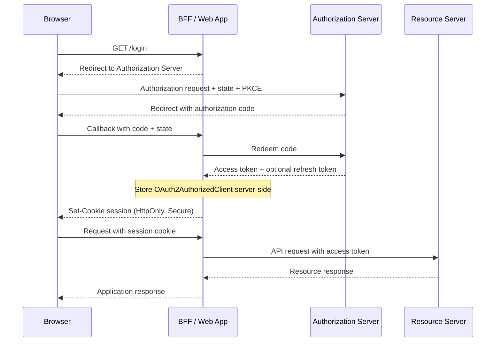

# Token Storage Boundaries, Sessions, and Each Application's Security Responsibilities

In an OAuth 2.0/OpenID Connect system, multiple applications can participate in a single session: browser, frontend SPA, backend-for-frontend (BFF), API gateway, backend services, mobile app, Resource Server, and Authorization Server. Each component holds a different kind of state. Without clearly defining which component owns access tokens, refresh tokens, authorization state, HTTP sessions, and cookies, a system easily ends up duplicating tokens too broadly, failing to revoke credentials on logout, or inadvertently sending tokens to services with the wrong audience.

The design principle is **every credential has a clear owner, a controlled storage location, a lifecycle, and a revocation workflow**. An application receiving a token must protect it within its scope of work; an application forwarding a token must verify the destination; the Authorization Server manages the authorization/token state it issues; the Resource Server only verifies tokens and enforces policies for its own API.

This lesson distinguishes tokens from sessions, explains the responsibilities of each application type, presents Spring Security/Spring Authorization Server storage options and configurations, and builds tests for refresh, logout, revocation, and credential leakage.

**Example scope:** The OAuth2 Client/BFF sections use current Spring Security APIs. Configuration examples specific to Spring Authorization Server 1.5.8 must pair with the compatible Spring Security 6.5.x line. Starting with Spring Security 7.0, Authorization Server has been integrated into Spring Security; do not mix Spring Authorization Server 1.5.x artifacts with Spring Security 7.x. If a project uses Spring Security 7.x, use the Authorization Server module within that Spring Security line and verify packages/APIs against your version. [Spring Authorization Server moving to Spring Security 7.0](https://spring.io/blog/2025/09/11/spring-authorization-server-moving-to-spring-security-7-0/) · [Spring Authorization Server 1.5.8](https://spring.io/blog/2026/06/09/spring-authorization-server-releases-2026-06/)

**Version security note:** DefaultConsentPage in Spring Authorization Server 1.5.0–1.5.8 is affected by CVE-2026-59316. If maintaining the 1.5.8 branch, do not use the default consent page; configure a custom consent page with HTML entity encoding or upgrade to a supported patched release. In the integrated Spring Security Authorization Server line, versions 7.0.0–7.0.6 and 7.1.0 are affected by CVE-2026-47877; fixed releases are 7.0.7 and 7.1.1 or later. [CVE-2026-59316](https://spring.io/security/cve-2026-59316) · [CVE-2026-47877](https://spring.io/security/cve-2026-47877)

## 1. Distinguishing Tokens, Authorizations, and Sessions

### 1.1. Access Token Is an API Access Credential

An access token is a credential issued to a client to call one or more Resource Servers within scope, audience, lifetime, and other constraints. The token may be a self-contained JWT or an opaque reference token.

- The client sends the access token to the Resource Server in the Authorization header using the Bearer scheme.
- The Resource Server verifies JWTs via issuer/JWK/claim validation or introspects opaque tokens.
- Tokens may only be used for the granted resources and audiences.
- Expired or revoked tokens are no longer accepted under the Resource Server's policy.

An access token is neither a browser login cookie nor proof that a particular HTTP session still exists.

### 1.2. Refresh Token Is a Credential for Obtaining New Access Tokens

A refresh token is held by the client to request a new access token from the Authorization Server when the current token expires or nears expiration. It usually has a longer lifetime than an access token and carries higher sensitivity.

- Only clients permitted and authenticated per registration may use refresh tokens.
- Public clients need appropriate protections such as rotation/reuse detection per policy.
- Refresh tokens must never be sent to a Resource Server.
- Upon logout or account compromise, policies must revoke related refresh tokens/authorizations.

Do not place refresh tokens into JavaScript/browser storage if the architecture can keep them in a backend/BFF or native application secure storage.

### 1.3. HTTP Session Is the State of a Web Application

An HTTP session is typically identified by a session cookie such as JSESSIONID. In a Spring Security servlet application, the session can store or link to SecurityContext, saved requests, CSRF state, OAuth2 authorization requests, and application data.

A session cookie is normally just a random session identifier. It is not an Authorization Server access token and must never be sent to a Resource Server as a bearer credential.

Sessions have their own lifecycle:

- Created when the application needs to maintain state across requests;
- Subject to idle timeouts and potentially absolute lifetimes;
- Invalidated on logout or session expiration;
- Rotated in ID after authentication to prevent session fixation;
- May remain alive even when an access token has expired, provided the application retains the session and has a refresh/re-authentication policy.

### 1.4. Authorization Record on the Authorization Server

Spring Authorization Server uses OAuth2Authorization to store authorization state and associated tokens. A record may hold access tokens, refresh tokens, authorization codes, metadata, claims, and attributes depending on the grant. OAuth2AuthorizationService stores and queries these authorizations; it supports grant processing, introspection, revocation, and other protocol flows.

This is Authorization Server state, distinct from the OAuth2AuthorizedClient held by an OAuth2 Client application to call external APIs. [Spring Authorization Server — Core Model / Components](https://docs.spring.io/spring-authorization-server/reference/core-model-components.html)

### 1.5. Four Concepts That Must Not Be Conflated

| Component | Meaning | Typical Owner |
|---|---|---|
| Access token | Credential for calling resources | OAuth2 client owning the token |
| Refresh token | Credential for requesting new tokens | OAuth2 client issued the token |
| HTTP session | Web login and application request state | Web app/BFF |
| OAuth2 authorization | Record of grant, consent, and issued tokens | Authorization Server |

A user may have an active local web session while a downstream API access token has expired. A refresh token may still be valid after a browser session has logged out. A token revoked at the Authorization Server may still sit in a client's cache, yet the Resource Server must reject it via its implemented validation/introspection/revocation mechanism.

## 2. Identifying Each Application's Ownership and Trust Boundary

### 2.1. Responsibility Matrix

| Component | Credentials/State Typically Held | Security Responsibilities |
|---|---|---|
| Browser SPA | App session cookie or short-lived access token if calling APIs directly | Origin/XSS/CSRF protection; keep tokens out of URLs/logs |
| BFF | HTTP session, OAuth2AuthorizedClient, access/refresh tokens | Server-side token storage, session controls, CSRF, and outbound destination control |
| Backend web app | HTTP session, user's OAuth2AuthorizedClient | Protect session, authorized-client store, and token relay |
| Mobile app | Access/refresh tokens in OS secure storage | PKCE, external browser, device storage, and app lifecycle |
| Machine-to-machine service | Client credentials or workload identity; access token | Secret/key management, workload identity, token cache, and least privilege |
| API gateway | May hold tokens per flow; typically validates or relays within bounds | Audience, routing, token exchange/relay, and never log bearer tokens |
| Resource Server | Normally does not persist bearer tokens long-term | Validate tokens, authorization, and audit requests |
| Authorization Server | Client registrations, authorizations, consent, token state, and signing keys | Token issuance, persistence, rotation, revocation, and protocol security |

Not every component needs to store access tokens. A Resource Server receives a bearer token on a request, validates it, and uses the principal/claims for the current request; it should not store copies of the token in a session or database unless a specific use case demands it.

### 2.2. BFF Architecture

In the BFF model, the browser holds only the BFF's session cookie. The BFF performs the OAuth2 Authorization Code Flow (with PKCE where appropriate), receives tokens, saves OAuth2AuthorizedClient in a server-side store, and calls Resource Servers on behalf of the browser.



The browser never needs to know upstream API access tokens/refresh tokens. Because the session cookie acts as a bearer-like credential toward the BFF, it must still be protected with TLS, HttpOnly, Secure, SameSite, CSRF protection, and session expiration.

### 2.3. SPA Calling Resource Servers Directly

In the browser-based client model, JavaScript receives and uses access tokens to call APIs. The browser application bears responsibility for protecting tokens in runtime and storage. Persistent storage such as localStorage, sessionStorage, or IndexedDB can be read by malicious JavaScript running in the same origin. In-memory storage narrows persistence windows, yet does not eliminate the risk of malicious scripts driving the app to use the token.

RFC 10017 analyzes browser token storage options and emphasizes that no browser storage mechanism completely prevents malicious code running in the same origin from exfiltrating or exercising tokens. Whenever feasible, consider a BFF to keep tokens server-side. [RFC 10017 — OAuth 2.0 for Browser-Based Applications](https://www.rfc-editor.org/rfc/rfc10017.html)

### 2.4. Native Mobile Application

Native apps are public clients and cannot hold static client secrets like confidential server applications. Use the Authorization Code Flow with PKCE and an external user-agent/system browser. Access/refresh tokens must be protected with OS secure storage, such as a Keychain/Keystore-backed facility; never store plaintext tokens in preferences, logs, backups, or unprotected files.

When a device is lost, the app is uninstalled, or the user logs out, clear local credentials and revoke server-side refresh tokens/authorizations if policy requires. Deleting tokens on the device does not automatically revoke already-issued tokens.

### 2.5. Machine-to-Machine Service

Background services typically use client_credentials or workload identity. Tokens belong to a service principal, not a user session. Services keep client credentials/private keys in a secret manager or HSM-backed system, request access tokens with minimal scopes/audiences, and cache tokens until shortly before expiry.

Do not share one broad-permission service account across all workloads when separate identities can be issued per service/environment. Never store client secrets in source code, image layers, command-line arguments, or logs.

## 3. Choosing Where to Store Access Tokens and Refresh Tokens

### 3.1. Decision Table by Application Type

| Application | Access Token | Refresh Token | Session/Cookie |
|---|---|---|---|
| BFF | Server-side authorized-client store | Server-side, encrypted at rest | Browser holds opaque session cookie |
| Server-rendered web app | Server-side authorized-client store | Server-side, encrypted at rest | HTTP session |
| Direct SPA | Usually in-memory; consider worker isolation | Minimize; if used, define explicit storage strategy | Never turn bearer tokens into session cookies |
| Native mobile | OS-protected secure storage | OS-protected secure storage, rotation-aware | App-managed login state |
| M2M service | Server-side token cache | Usually no refresh token with client credentials; request a new token | No end-user HTTP session |
| Resource Server | Do not persist token after request | Never hold caller's refresh token | Usually stateless |

These are architectural choices, not rigid rules for every framework. Evaluate your threat model, XSS/CSRF exposure, device posture, network, token lifetimes, and offline requirements.

### 3.2. BFF: Storing Tokens Server-Side

A BFF can store authorized clients in a JDBC-backed store or a protected distributed store. Records should bind to the local principal/session, client registration, and resource/audience per policy.

Requirements:

- Only the backend process may read the token store;
- Encrypt sensitive fields at rest, managing encryption keys separately from the database;
- Restrict DB roles and network access;
- Never expose the token store via browser APIs;
- Never log serialized authorized clients;
- Maintain retention/cleanup for expired, logged-out, or unlinked records;
- Enforce transaction/concurrency policies for refresh-token rotation.

### 3.3. SPA: Storage and XSS Considerations

localStorage is convenient for surviving reloads and sharing across tabs, yet same-origin JavaScript can read it. sessionStorage is scoped to a tab, yet remains readable by same-origin scripts. IndexedDB is a persistent asynchronous store, yet is likewise not a security boundary against XSS.

In-memory storage shortens token survival after reloads or tab closes. Web Workers can isolate some token operations from the main thread, though malicious scripts can still drive the app to send requests or invoke worker-exposed APIs. Never claim any browser storage mechanism is immune to XSS.

### 3.4. Mobile: Secure Storage and Backups

Native tokens must be stored in OS secure storage bound to the device/user profile per policy. Verify:

- Whether tokens are excluded from cloud backups;
- Whether tokens can appear in crash reports or debug logs;
- Whether the app deletes tokens on logout, account removal, or device enrollment reset;
- Whether refresh rotation updates tokens atomically;
- How the app handles clock skew, offline states, and refresh failures;
- What risk policy governs jailbroken/rooted or compromised devices.

### 3.5. Never Store Bearer Tokens in URLs

Never place access tokens or refresh tokens in query strings, paths, fragments sent to backends, analytics events, or redirect URLs. URLs leak into browser history, referrers, proxy access logs, telemetry, and screenshots.

Send bearer tokens only in the Authorization header over TLS to the intended resource. Avoid logging full headers or traces.

## 4. Distinguishing Two Authorized-Client Models in Spring

### 4.1. OAuth2AuthorizedClient Belongs to the OAuth2 Client Application

In Spring Security OAuth2 Client, OAuth2AuthorizedClient associates a ClientRegistration, principal/resource owner, access token, and optional refresh token. It represents an authorization the client application can use to access protected resources.

OAuth2AuthorizedClientRepository is responsible for persisting authorized clients across web requests. OAuth2AuthorizedClientService manages authorized clients at the application level. Default implementations may store in memory; Spring Security also provides a JDBC service for persistence. [Spring Security — OAuth2 Client Core Interfaces](https://docs.spring.io/spring-security/reference/servlet/oauth2/client/core.html)

### 4.2. OAuth2Authorization Belongs to the Authorization Server

OAuth2Authorization stores authorizations issued by the local Authorization Server. It links RegisteredClient, principal, grant, authorized scopes, tokens, and metadata. OAuth2AuthorizationService is the central component to save/load authorizations, supporting token introspection, revocation, and protocol processing.

Never use OAuth2AuthorizedClientService in place of OAuth2AuthorizationService; the two services have distinct ownership and lifecycles.

### 4.3. Spring Comparison Table

| Spring Type | Where It Lives | Purpose |
|---|---|---|
| OAuth2AuthorizedClient | OAuth2 Client/BFF | Holds tokens received by the client app from the Authorization Server |
| OAuth2AuthorizedClientRepository | OAuth2 Client web app | Persists authorized clients across web requests |
| OAuth2AuthorizedClientService | OAuth2 Client application | Loads/saves/removes authorized clients at the application level |
| OAuth2AuthorizedClientManager | OAuth2 Client application | Authorizes or re-authorizes clients, e.g., token refresh |
| OAuth2Authorization | Authorization Server | Stores grants and tokens issued by the server |
| OAuth2AuthorizationService | Authorization Server | Persists/queries authorization and token state |
| OAuth2AuthorizationConsentService | Authorization Server | Stores principal consent for a RegisteredClient |

### 4.4. In-Memory vs. JDBC Storage

In-memory services fit simple development/testing. When running multiple instances or requiring tokens to survive restarts, use an appropriate persistent store. Spring Security provides JdbcOAuth2AuthorizedClientService; Spring Authorization Server provides JdbcOAuth2AuthorizationService and JdbcOAuth2AuthorizationConsentService.

Persistent storage does not automatically imply encryption. Evaluate database encryption, column/application-level encryption, key management, backups, access controls, and log masking. [Spring Security — Authorized Client Features](https://docs.spring.io/spring-security/reference/servlet/oauth2/client/authorized-clients.html) · [Spring Authorization Server — Core Model](https://docs.spring.io/spring-authorization-server/reference/core-model-components.html)

## 5. Configuring OAuth2 Client for a Web Application/BFF

### 5.1. Registering the Client and Keeping Secrets Outside Source

Example client registration configuration:

```yaml
spring:
  security:
    oauth2:
      client:
        registration:
          orders-bff:
            provider: local-as
            client-id: orders-bff
            client-secret: ${OAUTH_CLIENT_SECRET}
            client-authentication-method: client_secret_basic
            authorization-grant-type: authorization_code
            redirect-uri: "{baseUrl}/login/oauth2/code/{registrationId}"
            scope:
              - openid
              - orders.read
        provider:
          local-as:
            issuer-uri: https://identity.example.internal
```

OAUTH_CLIENT_SECRET_FROM_SECRET_MANAGER is an illustrative placeholder; inject secrets via a secret manager or protected runtime configuration. Never commit real secrets. Redirect URIs must be registered exactly and run over HTTPS in production.

### 5.2. Storing Authorization Requests in the Session

By default, Spring Security uses HttpSessionOAuth2AuthorizationRequestRepository to retain OAuth2AuthorizationRequest between redirecting to the Authorization Server and receiving the callback. This request holds data needed to correlate/validate the authorization response, such as state and flow parameters.

Never disable state correlation or build a custom callback handler that skips state verification. If using a custom AuthorizationRequestRepository, ensure state is bound to the browser transaction and has a TTL. [Spring Security — Authorization Code Grant](https://docs.spring.io/spring-security/reference/servlet/oauth2/client/authorization-grants.html)

### 5.3. SecurityFilterChain for the BFF

Example servlet application using session-based login:

```java
@Bean
SecurityFilterChain bffSecurity(HttpSecurity http) throws Exception {
    http
        .authorizeHttpRequests(authorize -> authorize
            .requestMatchers("/", "/assets/**", "/health").permitAll()
            .anyRequest().authenticated())
        .oauth2Login(Customizer.withDefaults())
        .sessionManagement(session -> session
            .sessionCreationPolicy(SessionCreationPolicy.IF_REQUIRED)
            .sessionFixation(fixation -> fixation.changeSessionId()))
        .csrf(Customizer.withDefaults());

    return http.build();
}
```

This is a skeleton configuration for a servlet BFF. CSRF protection remains required for state-changing requests using cookie sessions. changeSessionId provides session fixation protection; Spring Security also offers other session fixation options. If the application exposes separate stateless APIs, separate security chains by matcher and policy rather than accidentally applying BFF session policies to all endpoints. [Spring Security — Session Management](https://docs.spring.io/spring-security/reference/servlet/authentication/session-management.html)

### 5.4. Configuring Session Cookies

Example production cookie configuration:

```yaml
server:
  servlet:
    session:
      cookie:
        name: BFF_SESSION
        http-only: true
        secure: true
        same-site: lax
```

Keep the cookie domain/path as narrow as possible. Do not set a broad Domain across all subdomains unless required. SameSite=Lax usually fits top-level login redirects; specialized cross-site flows may need adjustments. SameSite does not replace CSRF tokens and does not replace Origin/Referer validation per policy.

### 5.5. Session Store in Multi-Instance Environments

If the BFF runs multiple instances, sessions need a shared store or controlled sticky routing. The shared session store must protect SecurityContext, saved requests, and sensitive attributes. If the session holds OAuth2 authorized clients, token records must be protected accordingly.

Test failover: a user logs in on instance A, the next request hits instance B and continues working properly; logout/revocation initiated on one node must take effect across all nodes within SLA.

## 6. Persisting OAuth2AuthorizedClient and Automatic Token Refresh

### 6.1. Repository or Service?

Use OAuth2AuthorizedClientRepository when authorization is tied to a web request/session. Use OAuth2AuthorizedClientService when loading/saving authorized clients at the application level, such as in background tasks or service processes without an HttpServletRequest.

Spring Security provides JdbcOAuth2AuthorizedClientService to persist authorized clients to a database. If the app uses a custom store, implement concurrency, encryption, expiry, and cleanup per contract.

### 6.2. Configuring the Manager for Web Requests

OAuth2AuthorizedClientManager coordinates authorization/re-authorization and persistence. Providers can support authorization code, refresh token, and client credentials:

```java
@Bean
OAuth2AuthorizedClientManager authorizedClientManager(
        ClientRegistrationRepository registrations,
        OAuth2AuthorizedClientRepository authorizedClients) {

    OAuth2AuthorizedClientProvider provider =
            OAuth2AuthorizedClientProviderBuilder.builder()
                    .authorizationCode()
                    .refreshToken()
                    .clientCredentials()
                    .build();

    DefaultOAuth2AuthorizedClientManager manager =
            new DefaultOAuth2AuthorizedClientManager(
                    registrations, authorizedClients);
    manager.setAuthorizedClientProvider(provider);
    return manager;
}
```

DefaultOAuth2AuthorizedClientManager operates in a web request context using the repository. When a valid refresh token is present, the provider can obtain a new access token and the success handler persists the updated authorized client. When re-authorization fails because the refresh token is no longer valid, the default failure handler can remove the stale authorized client. [Spring Security — OAuth2AuthorizedClientManager](https://docs.spring.io/spring-security/reference/servlet/oauth2/client/core.html)

### 6.3. Configuring the Manager for Background Services

Background tasks without a servlet request can use AuthorizedClientServiceOAuth2AuthorizedClientManager with OAuth2AuthorizedClientService. The client principal/service identity must be defined stably without simulating a user session.

```java
@Bean
OAuth2AuthorizedClientManager serviceAuthorizedClientManager(
        ClientRegistrationRepository registrations,
        OAuth2AuthorizedClientService authorizedClientService) {

    OAuth2AuthorizedClientProvider provider =
            OAuth2AuthorizedClientProviderBuilder.builder()
                    .clientCredentials()
                    .build();

    AuthorizedClientServiceOAuth2AuthorizedClientManager manager =
            new AuthorizedClientServiceOAuth2AuthorizedClientManager(
                    registrations, authorizedClientService);
    manager.setAuthorizedClientProvider(provider);
    return manager;
}
```

Enable only the grants the service genuinely needs. A client_credentials token represents the client/service, not a user logged in on a browser.

### 6.4. Calling Resource Servers with RestClient

Spring Security provides OAuth2ClientHttpRequestInterceptor to integrate RestClient with OAuth2AuthorizedClientManager:

```java
@Bean
RestClient ordersRestClient(
        OAuth2AuthorizedClientManager authorizedClientManager) {

    OAuth2ClientHttpRequestInterceptor interceptor =
            new OAuth2ClientHttpRequestInterceptor(
                    authorizedClientManager);

    return RestClient.builder()
            .requestInterceptor(interceptor)
            .build();
}
```

When calling an API, specify the appropriate registration ID and principal via request attributes or an interceptor resolver. Set a base URL/destination allowlist on the RestClient; never let the interceptor attach bearer tokens to requests targeting user-controlled URLs. When handling invalid tokens, configure an authorization failure handler to remove stale authorized clients for the corresponding principal/registration. [Spring Security — Authorized Client Features](https://docs.spring.io/spring-security/reference/servlet/oauth2/client/authorized-clients.html)

### 6.5. Refresh Tokens and Rotation

When the Authorization Server enables refresh-token rotation, the old refresh token may be invalidated once a new token is issued. The client must atomically persist the new refresh token alongside the new access token. If two concurrent requests use the same old refresh token:

- One request may succeed in refreshing;
- The other request may fail with invalid_grant because the old token was already consumed;
- If the failure handler mistakenly deletes the newly persisted record, the user is unexpectedly logged out;
- If two instances overwrite each other, the token store may end up holding an obsolete refresh token.

Solutions include serializing refreshes per authorized-client key, optimistic locking/versioning, transactions, or appropriate distributed locks. Do not assume a single OAuth2AuthorizedClientManager solves every race condition in a custom distributed store.

### 6.6. Configuring Refresh Token Rotation on the Authorization Server

With Spring Authorization Server, a RegisteredClient's TokenSettings controls TTL and refresh token reuse. Example:

```java
TokenSettings tokenSettings = TokenSettings.builder()
        .accessTokenTimeToLive(Duration.ofMinutes(5))
        .refreshTokenTimeToLive(Duration.ofDays(14))
        .reuseRefreshTokens(false)
        .build();
```

reuseRefreshTokens(false) requests issuing a new refresh token per the corresponding server version/configuration behavior. Test reuse detection, concurrent refreshes, revocation, and token-family policies. Do not merely flip configuration without addressing client desynchronization during parallel refreshes.

## 7. Protecting Token Data at Rest

### 7.1. Sensitive Data Classification

| Data | Sensitivity | Controls |
|---|---|---|
| Access token | High | Restrict read access, encrypt at rest, never log |
| Refresh token | Very high | Encrypt at rest, rotation/reuse detection, revocation |
| Authorization code | High, short-lived | Store securely, single-use, bind to client/redirect |
| Client secret | Very high | Secret manager, hash/encode at AS per secret type |
| Private signing key | Critical | HSM/KMS/keystore, access policies, rotation |
| Session ID cookie | High | TLS, HttpOnly, Secure, SameSite, rotate/invalidate |
| Principal/session metadata | Depends on data | Minimize, access control, retention |
| Consent record | Business-sensitive | Tenant/principal/client scoping, audit |

### 7.2. Encryption at Rest and Key Separation

When tokens are persisted in a JDBC store, database encryption/TDE protects storage media, yet does not necessarily protect tokens from database principals with table read access. When required by your threat model, apply application-level envelope encryption or column-level encryption. Manage encryption keys outside the database with rotation and auditing.

Never reuse the same key across:

- Signing JWTs;
- Encrypting the token store;
- Encrypting sessions;
- Encrypting backups.

Separating keys by purpose and environment limits blast radius if any single key is compromised.

### 7.3. Access Control and Backups

- The BFF's database account reads/writes only required authorized-client rows;
- Resource Servers have no read access to the refresh token store;
- Operator access is audited and restricted;
- Backups containing tokens/sessions are encrypted with controlled retention;
- Restore tests verify that tokens revoked before backup time are not resurrected outside policy;
- Delete account/session data according to retention and privacy policies.

### 7.4. Never Put Tokens in Logs, Traces, or Error Reports

Redact Authorization, Cookie, Set-Cookie, access_token, refresh_token, client_secret, and token response bodies from logs and traces. Never place tokens in MDC, span attributes, metric labels, or exception messages.

When troubleshooting, log a short token fingerprint/hash if correlation is needed, never the raw token. Fingerprints also require policy controls since they can become sensitive identifiers.

## 8. Token Relay and API Gateway/Backend Responsibilities

### 8.1. Relay Is Intentional Credential Forwarding

Token relay is when a backend/gateway receives a token from a client and forwards it to a downstream service. Before relaying, verify that the downstream service is genuinely permitted to receive that token:

- Does the downstream trust the issuer?
- Does the token's audience include the downstream resource?
- Are the scopes sufficient without being overly broad?
- Is the token sender/client-constrained?
- Does the downstream need user identity or service identity?
- Is token exchange needed to issue a new token for the target audience?

Never forward a token merely because it arrived on the inbound request.

### 8.2. Never Relay Tokens to Arbitrary URLs

If a backend calls a user-supplied URL, never attach a bearer token automatically. An SSRF or redirect could send the token to an attacker's host. Use service-specific clients, fixed base URLs, host/scheme allowlists, and never forward Authorization headers across redirects to different origins.

### 8.3. When to Use Token Exchange

If the current token has audience A while service B requires its own token, consider RFC 8693 token exchange or an equivalent delegation mechanism. The Authorization Server/STS must validate the subject token, actor/client, audience/resource, and scope policies before issuing a new token.

Token exchange can produce a credential with narrower audience and lifetime. It is not modifying claims or rewriting aud on an existing token.

### 8.4. The Gateway Should Not Become the Owner of All Tokens

A gateway can validate tokens, route requests, or exchange tokens, yet you must explicitly define how long it retains tokens and which APIs it calls on a user's behalf. If the gateway merely proxies bearer tokens, avoid caching or logging them. If the gateway holds refresh tokens, it becomes an OAuth2 client responsible for credential protection and corresponding logout/revocation.

## 9. Session Cookies, CSRF, and XSS

### 9.1. Session Cookies Are Web App Bearer Credentials

Anyone obtaining a session cookie can use the session while the cookie/session remains valid. Protect cookies with:

- Secure so they are sent only over HTTPS;
- HttpOnly so JavaScript cannot read them directly;
- SameSite suited to login redirects and cross-site requirements;
- Narrow Domain/Path scoping;
- Session ID rotation after login/privilege elevation;
- Idle timeouts and absolute timeouts;
- Server-side invalidation on logout, account disablement, or security events.

HttpOnly does not stop malicious scripts from making requests using cookies inside the browser; it only prevents JavaScript from reading the cookie. Therefore, CSRF protection remains necessary.

### 9.2. CSRF with Cookie-Based Authentication

Browsers automatically attach cookies to matching requests. Attackers can trick browsers into sending state-changing requests if the application lacks CSRF checks. Keep CSRF protection enabled for forms/APIs using cookie sessions, use synchronizer tokens or framework-appropriate patterns, and check Origin/Referer per policy.

Never disable CSRF globally simply because the application has some stateless Bearer-token endpoints. Separate filter chains or matchers according to each endpoint's authentication model.

### 9.3. XSS and Token Theft

XSS can read tokens from web storage or invoke app functionality on a user's behalf. A BFF reduces JavaScript's direct access to OAuth tokens, yet XSS can still leverage the browser session cookie to call the BFF as that user.

Thus a BFF does not replace output encoding, CSP, dependency hygiene, input handling, and script controls. Protect both session cookies and the browser application.

### 9.4. CORS Is Not Authorization

CORS determines which browser JavaScript origins may read a response; it does not replace authentication, authorization, or CSRF protection. Never use wildcard origins with credentialed requests. Resource Servers must still validate tokens and permissions regardless of which browser origin sent the request.

## 10. Logout: Clearing Sessions, Authorized Clients, and Revoking Tokens

### 10.1. Logout Has Multiple Layers

Logout can involve:

1. Clearing the local browser session;
2. Clearing local SecurityContext and session cookies;
3. Removing OAuth2AuthorizedClient at the BFF;
4. Revoking refresh tokens/authorizations at the Authorization Server if policy requires;
5. Clearing local application state/caches;
6. Terminating the upstream OIDC provider session if needed;
7. Notifying downstream RPs/clients via supported logout protocols.

Completing one step does not automatically execute all the others.

### 10.2. Spring Security Local Logout

Spring Security's default POST /logout invalidates the HTTP session, clears SecurityContext/SecurityContextRepository, clears CSRF state, and publishes a logout event. Additional LogoutHandler implementations can remove custom cookies or authorized-client state. [Spring Security — Handling Logouts](https://docs.spring.io/spring-security/reference/servlet/authentication/logout.html)

Example:

```java
@Bean
SecurityFilterChain bffSecurity(HttpSecurity http) throws Exception {
    http
        .authorizeHttpRequests(authorize -> authorize
            .anyRequest().authenticated())
        .oauth2Login(Customizer.withDefaults())
        .logout(logout -> logout
            .deleteCookies("BFF_SESSION")
            .logoutSuccessUrl("/"));

    return http.build();
}
```

The cookie name must match the actual session cookie. Servlet containers often manage session cookies separately; verify deleteCookies in your deployment environment. Spring Security invalidates the session via SecurityContextLogoutHandler; never rely solely on sending an empty cookie to conclude the server session was cleared.

### 10.3. Removing the Authorized Client

When a user logs out, the BFF must remove the authorized client bound to the exact registration ID and principal name. Example application logic:

```java
authorizedClientService.removeAuthorizedClient(
        "orders-bff",
        authentication.getName());
```

If using OAuth2AuthorizedClientRepository, call the matching repository API with the request/response context. Removing the authorized client from the BFF store prevents the app from reusing stored tokens; it does not necessarily revoke tokens at the Authorization Server.

### 10.4. Revocation at the Authorization Server

RFC 7009 defines the token revocation endpoint. The client sends the token to be revoked to the Authorization Server over TLS and authenticates per client policy. When revoking a refresh token, the server may also invalidate associated access tokens depending on authorization server semantics/implementation. Resource Servers need a mechanism to learn of revocation: introspection, denylist/cache invalidation, or short access token lifetimes depending on token format and architecture.

With self-contained JWTs, offline Resource Server validation does not automatically know a token was just revoked without an extra revocation signal/check. That is why token lifetimes, refresh-token revocation, introspection, and distributed caches must be designed together. [RFC 7009 — Token Revocation](https://www.rfc-editor.org/rfc/rfc7009.html)

### 10.5. Logout at the Upstream OIDC Provider

RP-Initiated Logout can ask the upstream OP to terminate the user's login session. That does not automatically clear local BFF sessions or revoke local tokens issued by another Authorization Server. Identify which issuer owns each session/token and call the corresponding logout/revocation endpoint. With Back-Channel Logout, verify the Logout Token and map it to the local session before clearing it.

## 11. Distinguishing Lifetimes and Synchronizing Lifecycles

### 11.1. Four Independent Clocks

| Clock | Example | What Expires |
|---|---|---|
| Browser cookie lifetime | Session cookie or persistent cookie | Browser stops sending the cookie upon expiry |
| Server HTTP session timeout | 20 minutes idle | Local app session is invalidated |
| Access token TTL | 5 minutes | Resource Server rejects expired token |
| Refresh token TTL/revocation | 14 days or revoked | Client cannot obtain new access tokens |

These numbers are only examples. Do not synchronize lifetimes by setting all of them equal. Define idle timeouts, absolute session lifetimes, access token TTLs, and refresh token TTLs according to risk and use case.

### 11.2. Session Still Alive, Access Token Expired

The BFF can keep the login session alive and use the refresh token to fetch a new access token. If refresh fails due to revocation/expiry, the BFF should remove the authorized client and prompt the user to re-authenticate or display an appropriate state.

Never continue calling APIs with an expired token or automatically fall back to a service account token when the operation requires user identity.

### 11.3. Access Token Still Alive, User Logged Out

After local logout, the browser no longer holds a valid session cookie, yet an access token copied earlier may remain usable until it expires or is revoked/denied. If immediate logout across all APIs is required, use revocation/introspection/denylists or session/authorization version checks. Invalidating only the HTTP session cannot revoke a bearer token already issued to a client.

### 11.4. Account Disablement and Security Events

When a user is disabled, password/MFA is reset, roles are removed, or compromise is suspected, define policies to:

- Invalidate local sessions;
- Remove authorized clients;
- Revoke refresh tokens and authorizations;
- Revoke/deny unexpired access tokens if needed;
- Invalidate caches;
- Propagate events across apps/regions;
- Audit the time from event to enforcement across all Resource Servers.

## 12. Testing Storage Boundaries and Ownership

### 12.1. Token Storage Tests

| Test | Expected Result |
|---|---|
| Browser response after BFF login | Contains no access/refresh tokens in HTML, JSON, or cookies |
| Browser cookie | Has appropriate Secure/HttpOnly/SameSite and scope |
| Database authorized-client store | Tokens are readable only by the required service role |
| Logs/tracing | Contain no Authorization/Cookie/token responses |
| Backup/restore | Token store is protected and retention/revocation policies remain intact |
| Resource Server | Does not persist bearer tokens in business records/sessions outside valid use cases |
| Mobile app | Tokens do not appear in plain preferences/logs/backups |
| M2M secret | No secrets in repositories, images, or build artifacts |

### 12.2. Session Tests

- Session ID rotates after login;
- Sessions past idle timeout are rejected;
- Absolute session lifetime is enforced;
- Logout invalidates the server session;
- Old cookies cannot restore a session;
- Session A cannot be used by user B after account switching;
- Session store survives multi-instance failover;
- CSRF tokens are required for state-changing cookie-authenticated requests.

### 12.3. Authorized-Client Tests

- Authorized client binds to the exact registration ID and principal;
- Principal A cannot load Principal B's authorized client;
- Successful refresh persists the new access token and refresh token;
- Refresh failure removes the matching record;
- Concurrent refreshes do not overwrite a new refresh token with an older token;
- Client credentials tokens are not mistakenly bound to a user principal;
- Removing an authorized client on logout does not affect other principals.

### 12.4. Revocation/Logout Tests

- Local logout clears the session;
- BFF authorized client is removed;
- Refresh token is revoked per policy;
- Resource Server rejects tokens once revocation takes effect within SLA;
- Logout from upstream provider handles session mapping accurately;
- Forged or wrong-issuer logout tokens are rejected;
- One user logging out does not revoke another user's tokens;
- Logout leaves no tokens behind in caches or background tasks.

## 13. Common Design Mistakes

| Mistake | Consequence | Fix |
|---|---|---|
| Treating a session cookie as an access token | Sends wrong credential to APIs | Distinguish app sessions from OAuth bearer tokens |
| Storing refresh tokens in localStorage | XSS can steal long-lived credentials | Use BFF/server-side or appropriate secure storage |
| Sharing one token across many apps | Overly broad audience/scopes and hard to revoke | Issue separate tokens per client/resource |
| Logging tokens | Credentials leak through observability | Redact headers/bodies and log fingerprints if needed |
| Deleting cookie without invalidating session | Server-side session stays active | Use Spring Security logout handlers |
| Removing authorized client without revoking | Copied tokens remain usable | Revoke refresh tokens/authorizations per policy |
| Revoking JWT while Resource Server is offline | Tokens remain accepted until expiry | Introspection/denylist/short TTL |
| Parallel refresh without locking | Refresh token rotation race logs users out | Lock/version/atomic persistence |
| Attaching bearer tokens to every RestClient URL | Tokens leak to unintended hosts | Fixed destinations and allowlists |
| Using client credentials instead of user tokens | Loses user identity/audit and grants overly broad access | Pick grant matching actual actor |
| Disabling CSRF because OAuth is used | Cookie-authenticated endpoints become vulnerable to CSRF | Keep CSRF or isolate filter chains properly |
| Assuming HttpOnly stops XSS completely | Malicious scripts still drive app via cookies | CSP, output encoding, CSRF, and BFF |
| Invalidating only local session on account compromise | Access/refresh tokens stay valid | Session invalidation + token revocation |
| Using in-memory stores across multiple nodes | Tokens/sessions lost on restart or missing on other nodes | Use appropriate shared persistent stores |

## 14. Design and Operations Workflow

1. Diagram browser/mobile/BFF/backend/gateway/Resource Server/Authorization Server interactions.
2. For each credential, document its owner, storage location, principal/client binding, and audience.
3. Decide whether the browser holds OAuth tokens directly or uses a BFF.
4. Select OAuth2AuthorizedClientRepository or OAuth2AuthorizedClientService for client apps.
5. Select OAuth2AuthorizationService and consent store for the Authorization Server.
6. Choose persistent stores when multi-instance/restart survival is required; protect tokens at rest and in backups.
7. Establish cookie/session policies, CSRF, session fixation, and idle/absolute timeouts.
8. Configure access/refresh TTLs, rotation, reuse detection, and concurrent refresh policies.
9. Configure outbound clients to send bearer tokens only to allowlisted destinations.
10. Define local logout, authorized-client removal, token revocation, and upstream logout.
11. Define account disablement/compromise events and propagation SLAs.
12. Write tests for storage/session/refresh/revocation and multi-instance failover.
13. Audit log/trace/metrics redaction and token store access permissions.
14. Rehearse database loss, key rotation, logout, and refresh failure scenarios.
15. Re-review ownership whenever adding new applications, APIs, tenants, or trust domains.

## 15. Hands-on Exercise

**Context:** A system includes SPA orders-ui, BFF orders-bff, Spring Authorization Server at https://identity.example.internal, and Resource Server orders-api. The BFF signs in via Authorization Code Flow, the browser uses a session cookie, and the BFF calls the API with an access token. The BFF needs refresh tokens to maintain login sessions within policy limits.

**Requirements:**

1. Draw a sequence diagram for login, callback, token exchange, API call, and logout.
2. Specify which application owns the browser cookie, HTTP session, OAuth2AuthorizedClient, OAuth2Authorization, and token stores.
3. Configure oauth2Login() and a session-based SecurityFilterChain.
4. Configure Secure, HttpOnly, SameSite session cookies and CSRF protection.
5. Use a persistent OAuth2AuthorizedClientService/repository for multi-instance environments.
6. Use OAuth2AuthorizedClientManager supporting refresh tokens.
7. Configure the outbound RestClient to send tokens only to orders-api.
8. Configure refresh token rotation on the RegisteredClient.
9. Write a test where two concurrent requests trigger token refresh and verify the store does not lose the new token.
10. Write a test verifying browser responses contain no access/refresh tokens.
11. Write tests for session fixation, idle timeout, and logout.
12. Write tests for removing the authorized client and revoking the refresh token.
13. Write a test verifying the Resource Server enforces revocation within the chosen SLA.
14. Write a test verifying logs/traces contain no bearer tokens, cookies, or client secrets.
15. Rehearse BFF restart/failover and verify session/authorized-client state remains intact.

**Acceptance criteria:** The browser holds only the app session cookie; the BFF owns authorized clients and protects access/refresh tokens server-side; the Authorization Server owns issued authorization/token state; the Resource Server only validates tokens and policies. Logout clears sessions and authorized clients while revoking tokens as required; refresh rotation is race-free; tokens are never relayed to hosts outside the allowlist.

## 16. Self-Assessment Questions

1. How does an access token differ from an HTTP session in purpose and ownership?
2. Which endpoint receives refresh tokens, and why are they never sent to Resource Servers?
3. How does OAuth2AuthorizedClient differ from OAuth2Authorization?
4. When should you use OAuth2AuthorizedClientRepository vs. OAuth2AuthorizedClientService?
5. Why does a BFF keep tokens server-side while the browser holds only a session cookie?
6. Why does HttpOnly not replace CSRF protection?
7. Why is localStorage not a safe place to store refresh tokens against XSS?
8. Which flow should native apps use, and where should they store tokens?
9. Why does a client credentials token not represent a logged-in user?
10. What responsibilities does OAuth2AuthorizedClientManager handle?
11. Which manager/repository should background jobs use?
12. Why does a RestClient interceptor need a destination allowlist?
13. What race condition does refresh token rotation introduce?
14. What does reuseRefreshTokens(false) mean on the Authorization Server?
15. Does database encryption/TDE protect tokens from all database readers?
16. Does local logout automatically revoke already-issued access tokens?
17. Why might a Resource Server using offline JWT validation not immediately know a token was revoked?
18. When an account is disabled, which sessions and tokens must be handled?
19. When is token exchange needed instead of token relay?
20. Which tests prove that token ownership and logout contracts work properly?

## 17. Official Reference Documents

- [Spring Security — OAuth2 Client Core Interfaces](https://docs.spring.io/spring-security/reference/servlet/oauth2/client/core.html): OAuth2AuthorizedClient, repository, service, and manager.
- [Spring Security — Authorized Client Features](https://docs.spring.io/spring-security/reference/servlet/oauth2/client/authorized-clients.html): persistence, RestClient integration, and failure handling.
- [Spring Security — Authorization Code Grant](https://docs.spring.io/spring-security/reference/servlet/oauth2/client/authorization-grants.html): authorization request repository and code exchange.
- [Spring Security — Session Management](https://docs.spring.io/spring-security/reference/servlet/authentication/session-management.html): session fixation, concurrent sessions, and session lifecycle.
- [Spring Security — Handling Logouts](https://docs.spring.io/spring-security/reference/servlet/authentication/logout.html): invalidating sessions, clearing SecurityContext, cookie cleanup, and logout handlers.
- [Spring Authorization Server — Core Model / Components](https://docs.spring.io/spring-authorization-server/reference/core-model-components.html): RegisteredClient, OAuth2Authorization, token state, authorization/consent services, and token generator.
- [Spring Security 7 — Authorization Server Core Model / Components](https://docs.spring.io/spring-security/reference/servlet/oauth2/authorization-server/core-model-components.html): corresponding model after Authorization Server integration into Spring Security.
- [Spring Security 7 — Authorization Server Configuration Model](https://docs.spring.io/spring-security/reference/servlet/oauth2/authorization-server/configuration-model.html): configuring protocol endpoints and core components in the 7.x line.
- [RFC 10017 — OAuth 2.0 for Browser-Based Applications](https://www.rfc-editor.org/rfc/rfc10017.html): browser token storage, in-memory/persistent storage, and threat models for malicious JavaScript.
- [RFC 7009 — OAuth 2.0 Token Revocation](https://www.rfc-editor.org/rfc/rfc7009.html): revocation endpoint and token invalidation semantics.
- [RFC 9449 — OAuth 2.0 Demonstrating Proof of Possession (DPoP)](https://www.rfc-editor.org/rfc/rfc9449.html): sender-constrained access tokens and proof-of-possession.
- [OWASP Session Management Cheat Sheet](https://cheatsheetseries.owasp.org/cheatsheets/Session_Management_Cheat_Sheet.html): session identifier, cookie, and lifecycle controls.

**Takeaway:** Access tokens, refresh tokens, HTTP sessions, and Authorization Server authorization records each have their own owner and lifecycle. A BFF keeps tokens in a server-side store while the browser holds a session cookie; SPAs/mobile apps require threat-model-driven storage strategies; Resource Servers verify tokens and permissions; Authorization Servers manage token state and revocation. Logout must clean up sessions, authorized clients, and server-side token state according to policy. Never log tokens, never relay to arbitrary URLs, and never assume clearing a cookie equates to revoking a token.
