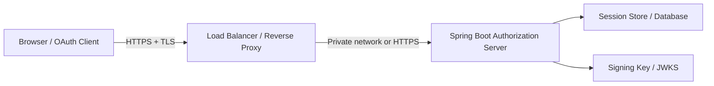
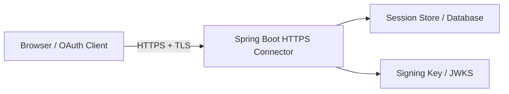

# Enforcing HTTPS and Configuring Secure, HttpOnly, SameSite Cookies

## 1. Why Must an Authorization Server Enforce HTTPS?

The Authorization Server (AS) handles authentication credentials, authorization codes, access tokens, refresh tokens, ID Tokens, and login sessions. If requests travel over plain HTTP, an attacker can eavesdrop, modify payloads, or inject responses in transit. This can expose credentials, hijack authorization codes, tamper with redirects, or interfere with login sessions.

Therefore, HTTPS must protect the entire HTTP surface of the AS and related applications, including:

- The Authorization Endpoint and Token Endpoint.
- OIDC Discovery, JWKS, UserInfo, Revocation, Introspection, and Logout Endpoints if enabled.
- Login pages, consent pages, admin pages, and static resources.
- Client redirect URIs and identity provider callbacks.
- Internal APIs and management endpoints carrying authentication data or sessions.

HTTPS is HTTP running over TLS. TLS provides encryption, server authentication via certificates, and data integrity over the connection. In production environments, use TLS 1.3 or TLS 1.2 with strong cipher suites; disable TLS 1.0/1.1 and legacy configurations.

The `Secure`, `HttpOnly`, and `SameSite` cookie flags add protection for session cookies in the browser. They do not replace TLS: `Secure` only instructs the browser to send the cookie over HTTPS; `HttpOnly` prevents JavaScript from reading the cookie; `SameSite` controls when the browser sends the cookie on cross-site requests.

In the **SPRING_SECURITY_OAUTH2_OIDC_AUTHORIZATION_SERVER** module, the goal is to learn how to design, configure, secure, test, and operate an OAuth 2.0/OpenID Connect Authorization Server with Spring Security and Spring Authorization Server. This lesson belongs to the **Server Security** chapter, focusing on enforcing HTTPS and configuring secure session cookies for Spring Boot applications.

### Learning Outcomes

After this lesson, you will be able to:

1. Distinguish between TLS termination at a reverse proxy and end-to-end TLS to the application.
2. Configure HTTPS redirects and HSTS in Spring Security 6.5.
3. Configure TLS on the Spring Boot embedded server when the application terminates TLS itself.
4. Handle `Forwarded`/`X-Forwarded-*` headers safely behind a load balancer.
5. Configure session cookies with `Secure`, `HttpOnly`, `SameSite`, and the `__Host-` prefix.
6. Customize Spring Session cookies using `DefaultCookieSerializer`.
7. Choose the right `SameSite` setting for OIDC redirects, `form_post`, iframes, and logout.
8. Test HTTPS, HSTS, cookie attributes, and session behavior in the browser.

**Example scope:** Spring Boot 3.x, Spring Security 6.5.x, and Spring Authorization Server 1.5.8 on the Servlet stack. Configuration examples are meant to be integrated into the `SecurityFilterChain` and `application.yml` of an existing application.

## 2. TLS Models in Spring Boot Deployments

### 2.1. TLS Termination at the Reverse Proxy

A common model is for the browser to connect over HTTPS to a load balancer/reverse proxy. The proxy holds the public certificate, terminates TLS, and forwards requests to Spring Boot:



In this model, Spring Boot may receive internal connections over HTTP. The application still needs to know that the original browser request used HTTPS in order to:

- Generate redirect URIs and absolute URLs with the correct scheme.
- Mark session cookies as `Secure`.
- Emit HSTS properly.
- Apply HTTPS redirects without causing redirect loops.
- Advertise HTTPS issuer and endpoint URLs.

The proxy must strip any forwarded headers sent by external clients and set trusted values itself, such as `Forwarded` or `X-Forwarded-Proto`. Accept requests only from controlled proxies; never allow browsers to declare a scheme/host that the application trusts.

If the proxy → application connection crosses an untrusted network, use TLS for the internal hop, network policies, or mTLS. Terminating TLS at the proxy alone does not protect traffic on the remaining network segment.

### 2.2. End-to-End TLS at the Embedded Server

Spring Boot can also terminate TLS itself using a certificate/keystore configured on embedded Tomcat, Jetty, or Undertow:



This model fits when the application is exposed directly or when encryption is required from the proxy all the way to the application. If a proxy still sits in front of the application, TLS can be configured on both hops.

### 2.3. Comparison

| Criterion | TLS termination at proxy | TLS at embedded server |
| --- | --- | --- |
| Public certificate | Managed at proxy/load balancer | Managed at Spring Boot or secret volume |
| HTTPS redirect | Usually handled by the proxy; can be supplemented in Spring Security | Can be handled by Spring Security/connector |
| Scheme seen by app | Requires forwarded-header integration | Direct requests are already HTTPS |
| Cookie `Secure` | Requires `secure=true` and proper forwarded scheme | Connector receives HTTPS; still configure explicitly |
| Internal hop | Consider TLS/mTLS and network isolation | No proxy hop if exposed directly |
| Certificate operations | Centralized at the edge | Per application/instance or secret mount |

Regardless of where TLS is terminated, browsers and all external clients must always connect over HTTPS. Publicly exposed OAuth/OIDC endpoints must never use HTTP.

## 3. Configuring HTTPS in Spring Security

### 3.1. Redirecting HTTP to HTTPS

Spring Security 6.5 provides `redirectToHttps(...)` for Servlet applications. It can be applied to each `SecurityFilterChain` serving requests that require HTTPS:

```java
import org.springframework.context.annotation.Bean;
import org.springframework.security.config.Customizer;
import org.springframework.security.config.annotation.web.builders.HttpSecurity;
import org.springframework.security.web.SecurityFilterChain;

@Bean
SecurityFilterChain applicationSecurity(HttpSecurity http) throws Exception {
    http
        .authorizeHttpRequests(authorize -> authorize
            .anyRequest().authenticated())
        .redirectToHttps(Customizer.withDefaults());

    return http.build();
}
```

`redirectToHttps` replaces the deprecated `requiresChannel` configuration in Spring Security 6.5. If the application has multiple filter chains, configure HTTPS on each appropriate chain; the first filter chain matching a request will handle it.

Never send credentials or sensitive request bodies over HTTP and expect a redirect to protect the request. An HTTPS redirect is a navigation measure, not encryption of the HTTP request already sent. OAuth clients must configure the Token Endpoint and other endpoints with HTTPS from the start. At the edge, you can reject HTTP for endpoints receiving sensitive POSTs; if redirecting POSTs, use status 307/308 to preserve method/body according to policy.

For the Authorization Server, add this configuration to the chain handling Authorization Server endpoints. Example snippet to merge into an existing chain:

```java
http
    .securityMatcher(authorizationServerConfigurer.getEndpointsMatcher())
    .with(authorizationServerConfigurer, authorizationServer ->
        authorizationServer.oidc(Customizer.withDefaults()))
    .authorizeHttpRequests(authorize ->
        authorize.anyRequest().authenticated())
    .redirectToHttps(Customizer.withDefaults());
```

This illustrates the Authorization Server filter chain fragment, not a standalone chain replacing all client authentication, endpoint, and exception handling configuration of the application.

If the reverse proxy already redirects HTTP → HTTPS, configuring redirect in the application can serve as an additional defense layer. When both are enabled, forwarded headers must be configured properly so Spring Security recognizes the original request as HTTPS; otherwise, the application may enter a redirect loop.

### 3.2. Configuring HSTS

HTTP Strict Transport Security (HSTS) instructs the browser to remember that a host must be accessed over HTTPS for the declared duration. Spring Security enables HSTS by default for requests recognized as secure; it can also be configured explicitly:

```java
http.headers(headers -> headers
    .httpStrictTransportSecurity(hsts -> hsts
        .maxAgeInSeconds(31_536_000)
        .includeSubDomains(true)
    )
);
```

The generated header looks like:

```http
Strict-Transport-Security: max-age=31536000; includeSubDomains
```

Enable `includeSubDomains` only when all relevant subdomains reliably support HTTPS. The `preload` directive should be added only after the entire domain meets the HSTS preload list criteria and the organization accepts long-term browser-enforced HTTPS. Do not enable `preload` just to boost a scanner score.

HSTS is accepted by browsers only from valid HTTPS responses. HTTP responses must not send the HSTS header per RFC. HSTS also does not replace HTTP → HTTPS redirects for clients that do not yet have the HSTS policy cached.

HSTS is a directive for browsers; it does not replace TLS validation in service-to-service clients, SDKs, or batch systems. Those clients must still configure HTTPS endpoints and verify certificates.

### 3.3. Publishing Issuer and Endpoints over HTTPS

The Authorization Server should use a canonical, fixed HTTPS issuer URL:

```java
import org.springframework.context.annotation.Bean;
import org.springframework.security.oauth2.server.authorization.settings.AuthorizationServerSettings;

@Bean
AuthorizationServerSettings authorizationServerSettings() {
    return AuthorizationServerSettings.builder()
            .issuer("https://login.example.com")
            .build();
}
```

Do not build the issuer dynamically from an unverified `Host` or forwarded header. The issuer appears in Discovery metadata and the token `iss` claim; unintended scheme/host changes will prevent clients and Resource Servers from verifying the issuer or create an incorrect trust boundary.

Register redirect URIs, post-logout redirect URIs, and client endpoints with HTTPS in production. Never use wildcard URIs or automatically downgrade to HTTP when a proxy/backend reports an internal HTTP scheme.

## 4. Configuring Behind a Reverse Proxy

### 4.1. Enabling Forwarded-Header Support

When TLS terminates at a proxy, Spring Boot needs to read original request details sent by the proxy. On the Servlet stack, you can use Spring Framework's `ForwardedHeaderFilter` via configuration:

```yaml
server:
  forward-headers-strategy: framework
  tomcat:
    redirect-context-root: false
```

`server.forward-headers-strategy: framework` enables handling of `Forwarded` and `X-Forwarded-*` headers. `server.tomcat.redirect-context-root: false` should be considered when using Tomcat with SSL termination at the proxy so `X-Forwarded-Proto` is processed before context-root redirects.

Use this configuration only when the proxy is inside your trust boundary. The proxy must:

1. Strip client-supplied `Forwarded`, `X-Forwarded-Proto`, `X-Forwarded-Host`, and `X-Forwarded-Port` headers.
2. Rewrite those headers based on the actual client connection.
3. Forward to the application only over a private network or TLS.
4. Block direct Internet access to Spring Boot's internal port.

If the application is directly reachable, an attacker can send `X-Forwarded-Proto: https` directly to trick the application into treating an HTTP request as HTTPS. Do not solve this by trusting arbitrary forwarded headers.

### 4.2. Configuring Redirects at the Edge and Application

The ingress/load balancer should redirect all public HTTP requests to HTTPS before forwarding to the application. The application can enable `redirectToHttps` as an extra layer of defense. Test both requests through the proxy and internal requests; ensure health checks or readiness probes do not accidentally trigger redirect loops.

If the proxy translates external HTTPS requests into internal HTTP, forwarded-header support must run before Spring Security so `request.isSecure()` reflects the original scheme. That way `redirectToHttps` will not mistake the request for HTTP and loop.

### 4.3. Do Not Let the Host Header Dictate the Issuer

A forwarded host may be needed for application-generated links/callbacks, but the Authorization Server issuer should be a canonical configuration. Never let an unfiltered `Host` or `X-Forwarded-Host` header alter `iss`, discovery URLs, or redirect URIs. All public endpoints must match the DNS name and certificate trusted by clients.

## 5. Configuring TLS for the Embedded Spring Boot Server

If Spring Boot terminates TLS itself, you can configure a PKCS#12 keystore:

```yaml
server:
  port: 8443
  ssl:
    enabled: true
    key-store: ${TLS_KEYSTORE:file:/run/secrets/auth-server.p12}
    key-store-type: PKCS12
    key-store-password: ${TLS_KEYSTORE_PASSWORD}
    key-alias: auth-server
    enabled-protocols:
      - TLSv1.3
      - TLSv1.2
```

Keystore files and passwords must be mounted/injected from a secret manager or secrets management system. Never commit private keys, keystore passwords, or certificate private material to Git. Production operations must monitor certificate expiry, rotation, and chains.

If the application uses TLS termination at the proxy and receives only internal HTTP, do not add this `server.ssl` configuration unless you intentionally want TLS on the proxy → application hop. The two models are configured differently; avoid accidentally exposing a public HTTP connector alongside HTTPS.

### 5.1. Certificate and TLS Policy

- Use a certificate with a SAN matching the Authorization Server's public hostname.
- Provide the complete required certificate chain.
- Automate renewal and controlled reload/restart.
- Enable only TLS 1.2 and TLS 1.3; prefer TLS 1.3 when supported by clients.
- Disable weak cipher suites, compression, and legacy protocols at the proxy/connector.
- Synchronize system clocks so certificate and token timestamp checks are accurate.
- Do not use self-signed certificates in public production environments unless trust distribution is explicitly managed.

## 6. Configuring Session Cookies in Spring Boot

### 6.1. Configuring Cookies via application.yml

Spring Boot allows configuring the session cookie via `server.servlet.session.cookie.*`. Example:

```yaml
server:
  servlet:
    session:
      cookie:
        name: __Host-SESSION
        secure: true
        http-only: true
        same-site: lax
        path: /
```

Do not specify `domain` in this example so the browser creates a host-only cookie. The `__Host-` prefix requires the cookie to have `Secure`, `Path=/`, and no `Domain` attribute. If any condition is missing, modern browsers will reject a cookie with this prefix.

If the container uses `JSESSIONID`, you can keep the default name and still configure `secure`, `http-only`, `same-site`, and `path`. Choose `__Host-SESSION` when the entire application runs over HTTPS and the cookie path can be `/`.

### 6.2. Meaning of Each Attribute

| Attribute | Effect | Key points to remember |
| --- | --- | --- |
| `Secure` | Browser sends cookie only over HTTPS | Does not encrypt the cookie in storage; TLS is still mandatory |
| `HttpOnly` | JavaScript cannot read the cookie via `document.cookie` | Does not stop XSS from sending requests on behalf of the user |
| `SameSite` | Restricts cookies on cross-site requests | May affect OIDC callbacks and iframes |
| `Path` | Restricts the path where the cookie is sent | `__Host-` requires `/` |
| `Domain` | Extends the cookie to subdomains | Omit this attribute to use host-only cookies whenever possible |

`HttpOnly` should be enabled for session identifiers. Do not set `HttpOnly=false` on the session cookie just so the frontend can tell if a user is logged in; provide a session/status endpoint that does not expose the session identifier.

### 6.3. Do Not Confuse the Session Cookie with All Other Cookies

The `server.servlet.session.cookie` properties apply to the session cookie managed by the Servlet container/Spring Session. They do not automatically configure every cookie created by the application, OIDC libraries, remember-me, or a CSRF repository.

Inspect every `Set-Cookie` header in responses:

- Session cookie.
- Remember-me cookie if enabled.
- CSRF cookie if using a cookie repository.
- State/nonce cookies if managed by an OIDC library.
- Cookies added by a reverse proxy or gateway.

Any cookie containing credentials or a session identifier needs an appropriate `Secure`/`HttpOnly`/`SameSite` policy. A CSRF cookie that JavaScript needs to read may require `HttpOnly=false`, but apply that only to that CSRF cookie; never weaken the session cookie.

## 7. Configuring Cookies with Spring Session

### 7.1. DefaultCookieSerializer

When an application uses Spring Session (Redis/JDBC or another repository), you can customize how session cookies are written using `DefaultCookieSerializer`:

```java
import org.springframework.context.annotation.Bean;
import org.springframework.context.annotation.Configuration;
import org.springframework.session.web.http.CookieSerializer;
import org.springframework.session.web.http.DefaultCookieSerializer;

@Configuration
class SessionCookieConfiguration {

    @Bean
    CookieSerializer cookieSerializer() {
        DefaultCookieSerializer serializer = new DefaultCookieSerializer();
        serializer.setCookieName("__Host-SESSION");
        serializer.setCookiePath("/");
        serializer.setUseSecureCookie(true);
        serializer.setUseHttpOnlyCookie(true);
        serializer.setSameSite("Lax");
        // Do not call setDomainName or setDomainNamePattern.
        return serializer;
    }
}
```

This bean controls the session cookie serialized by Spring Session. If a custom serializer is declared, verify it does not unexpectedly override `server.servlet.session.cookie.*` settings. Never configure two mechanisms writing the same session cookie with conflicting attributes.

`DefaultCookieSerializer` uses `HttpOnly` and `SameSite=Lax` by default; `Secure` defaults to `HttpServletRequest.isSecure()`. In production, set `Secure` explicitly so the cookie always carries this flag, while configuring forwarded headers properly if TLS terminates at a proxy.

### 7.2. Cookie Changes Require Coordination

When changing cookie name, `Path`, `Domain`, or `SameSite`:

1. Identify old cookies currently held by browsers.
2. Send a cookie deletion with the exact matching name, `Path`, and `Domain`.
3. Issue the new cookie with the updated flags.
4. Test login, OIDC callback, refresh, logout, and session timeout.
5. Clear old cookies across all hostnames and paths previously used.

Cookies with the same name but different `Path`/`Domain` can coexist in the browser. The server may then receive multiple values under the same name; avoid overlapping cookie configurations.

## 8. Choosing the Right SameSite for OAuth/OIDC

### 8.1. Lax, Strict, and None

| Value | General behavior | Common usage |
| --- | --- | --- |
| `Strict` | Restricts cookies on navigations initiated from another site | Apps with little need for cross-site navigation; can drop sessions during OIDC redirects |
| `Lax` | Sends cookies on same-site requests and top-level cross-site safe navigations such as GET | Typically suitable for query-based Authorization Code callbacks |
| `None` | Allows cookies on cross-site requests if accepted by the browser | Use only when a flow genuinely requires it; requires `Secure` |

### 8.2. GET-Based Authorization Code Callbacks

In a standard Authorization Code Flow, the OP redirects the browser back to the RP/application via a top-level GET carrying the authorization code and state. `SameSite=Lax` usually allows the session cookie to accompany this navigation, making it a sensible starting point for session cookies.

`SameSite=Strict` can prevent the cookie from being sent when the browser returns from an external OP to the callback. The application may lose correlation with the login transaction or prior session. Do not choose `Strict` just for stronger protection without testing the entire flow.

### 8.3. Response Mode form_post

If the OIDC response mode is `form_post`, the OP sends the authorization response via a cross-site POST to the callback. `Lax` cookies are typically not sent on cross-site POSTs. When this flow is genuinely required, evaluate `SameSite=None; Secure` or an alternative callback/session design compatible with your library and browser support.

Do not switch all system cookies to `None` just to fix one callback. Adjust only the relevant cookie, protect against CSRF, and test on real browsers.

### 8.4. Iframes and Front-Channel Logout

OIDC Front-Channel Logout can load the RP's logout URI inside an iframe from the OP. `Lax`/`Strict` cookies may not be sent in a third-party context. `SameSite=None; Secure` allows browsers to send cookies per cookie attributes, though browser third-party cookie blocking policies may still prevent it.

If reliable server-side logout is needed, prefer Back-Channel Logout or an authenticated server-to-server mechanism. Do not rely solely on iframes to terminate sessions.

### 8.5. SameSite Does Not Replace CSRF

`SameSite` is a CSRF mitigation layer, not the sole mechanism. Applications using session cookies must still maintain CSRF protection for state-changing requests and validate origins per their threat model. Never disable CSRF entirely just because cookies are set to `Lax` or `Strict`.

## 9. Session Lifecycle and Cookie Protection

### 9.1. Session Fixation

After a user authenticates successfully, the session ID must be changed to prevent an attacker from fixing a session ID prior to authentication and reusing it after the victim logs in. Spring Security Servlet enables session fixation protection suited for modern Servlet containers by default; do not disable it without a clear justification.

On logout or session expiration:

- Invalidate the session server-side.
- Delete the session cookie using the exact cookie name, `Path`, and `Domain` issued.
- Remove authorized clients/refresh tokens tied to the session according to policy.
- Clear related caches and session correlations.
- Never delete only the browser cookie while leaving the session valid in the store.

### 9.2. Limiting Cookie Scope

Prefer host-only cookies; do not set a broad `Domain` like `.example.com` to share sessions across multiple applications. Broad-domain cookies increase blast radius if one subdomain is compromised and couple applications to the same session boundary.

The `__Host-` prefix has browsers enforce three rules: `Secure`, `Path=/`, and no `Domain`. This is a strong fit for the session cookie of a standalone host like `login.example.com`. If an application needs a narrower cookie path or domain scope, do not use this prefix.

### 9.3. Disabling URL-Based Session Tracking

Never let the Servlet container append session IDs to URLs like `;jsessionid=...`. Session IDs in URLs can leak into browser history, access logs, analytics, `Referer` headers, or screenshots.

You can restrict tracking mode to cookies only:

```yaml
server:
  servlet:
    session:
      tracking-modes:
        - cookie
      timeout: 20m
```

A 20-minute timeout is an example; choose it based on risk, user experience, and organizational policy. Session timeouts do not replace token TTLs, refresh token policies, or logout/revocation.

### 9.4. CSRF Must Remain Enabled

Session cookies are sent automatically by browsers according to cookie policy. If an application uses sessions for login, consent, or admin pages, keep Spring Security's CSRF protection enabled for state-changing requests.

Do not disable CSRF for the entire Authorization Server just to make one API work. Spring Authorization Server has dedicated request matchers and filters for protocol endpoints; if you must customize the CSRF ignore list, exclude only the exact endpoints that do not use cookie authentication and verify behavior with integration tests. Login forms, consent forms, and application management endpoints still require proper protection.

## 10. Integrating Configuration into the Authorization Server

### 10.1. Configuration for the Authorization Server and Application Chains

An application typically has at least two filter chains: the Authorization Server chain and the application chain (login, consent, admin pages). HTTPS redirect and HSTS should be applied to chains serving browsers/clients:

```java
import org.springframework.context.annotation.Bean;
import org.springframework.core.annotation.Order;
import org.springframework.security.config.Customizer;
import org.springframework.security.config.annotation.web.builders.HttpSecurity;
import org.springframework.security.web.SecurityFilterChain;
import org.springframework.security.oauth2.server.authorization.config.annotation.web.configurers.OAuth2AuthorizationServerConfigurer;

@Bean
@Order(1)
SecurityFilterChain authorizationServerSecurity(HttpSecurity http) throws Exception {
    OAuth2AuthorizationServerConfigurer authorizationServerConfigurer =
            OAuth2AuthorizationServerConfigurer.authorizationServer();

    http
        .securityMatcher(authorizationServerConfigurer.getEndpointsMatcher())
        .with(authorizationServerConfigurer, server ->
            server.oidc(Customizer.withDefaults()))
        .authorizeHttpRequests(authorize ->
            authorize.anyRequest().authenticated())
        .redirectToHttps(Customizer.withDefaults())
        .headers(headers -> headers
            .httpStrictTransportSecurity(hsts -> hsts
                .maxAgeInSeconds(31_536_000)
                .includeSubDomains(true)));

    return http.build();
}
```

This snippet shows where HTTPS/HSTS is configured; constructors, configurers, and other endpoints must follow the application's existing Spring Authorization Server setup. When using multiple chains, apply equivalent settings to the application chain. Enable `includeSubDomains` only when every subdomain in the HSTS scope runs HTTPS.

### 10.2. Example application.yml for Behind-Proxy Deployments

```yaml
server:
  forward-headers-strategy: framework
  tomcat:
    redirect-context-root: false
  servlet:
    session:
      timeout: 20m
      tracking-modes:
        - cookie
      cookie:
        name: __Host-SESSION
        secure: true
        http-only: true
        same-site: lax
        path: /
```

The proxy must terminate TLS, redirect HTTP at the edge, sanitize forwarded headers, and permit only internal connections from the proxy to the application. If using embedded TLS instead of proxy TLS termination, omit forwarded-header settings if unneeded and configure `server.ssl` as shown in section 5.

### 10.3. Which Cookies Should Be HttpOnly?

Session identifiers, remember-me credentials, and cookies carrying authentication data should be `HttpOnly`. A CSRF cookie may need to be readable by JavaScript depending on the SPA integration; if using such a cookie, allow JavaScript access only for that CSRF cookie, never for the session cookie.

If the frontend needs to check login status, provide a same-origin JSON endpoint returning minimal status; never expose session IDs, access tokens, or refresh tokens to JavaScript.

## 11. Testing HTTPS and Cookies

### 11.1. Testing with an HTTP Client

You can test HTTP redirects:

```bash
curl -I http://login.example.com/oauth2/authorize
```

The expected result is a redirect to HTTPS, typically status 301/302/307/308 depending on the edge/application. Check the HTTPS response:

```bash
curl -I https://login.example.com/.well-known/openid-configuration
```

The response must have a valid certificate and an HSTS header. If the endpoint requires authentication, use an appropriate public endpoint to check TLS/headers.

Inspect session cookies after login using browser DevTools or an HTTP client with a cookie jar. Session cookies must have `Secure`, `HttpOnly`, and `SameSite` matching policy. With the `__Host-` prefix, verify `Path=/` and no `Domain`.

### 11.2. Test Matrix

| ID | Scenario | Expected result |
| --- | --- | --- |
| H01 | Access public endpoint over HTTP | Redirects to HTTPS or is rejected by edge |
| H02 | Access same endpoint over HTTPS | TLS handshake succeeds, valid certificate |
| H03 | TLS 1.0/1.1 | Handshake rejected |
| H04 | TLS 1.2/1.3 | Handshake succeeds per policy |
| H05 | Expired certificate or hostname mismatch | Client rejects connection |
| H06 | HTTPS response | Includes `Strict-Transport-Security` |
| H07 | HTTP response | Do not rely on HSTS header; HTTP must redirect/block |
| H08 | `includeSubDomains` enabled | All subdomains in scope support HTTPS |
| H09 | HSTS `preload` | Enabled only when domain meets preload requirements |
| H10 | Request via proxy with `X-Forwarded-Proto=https` | Application recognizes original request as secure |
| H11 | Client sends `X-Forwarded-Proto=https` directly | Spoofed header is stripped by proxy or direct request is blocked |
| H12 | Post-login redirect after TLS termination | Redirect URI has accurate public scheme/host |
| H13 | Discovery metadata | `issuer` and endpoint URLs all use canonical HTTPS |
| H14 | Session cookie after login | Has `Secure` and `HttpOnly` |
| H15 | Session cookie `SameSite=Lax` | Has `SameSite=Lax` |
| H16 | `__Host-` cookie prefix | Has `Secure`, `Path=/`, and no `Domain` |
| H17 | Unintended cookie `Domain` configured | Deployment test catches cookie is no longer host-only |
| H18 | Top-level GET OIDC callback | `Lax` session cookie is sent per browser policy |
| H19 | `form_post` OIDC callback | Test cookie behavior; do not assume `Lax` will be sent |
| H20 | `SameSite=Strict` with cross-site callback | Testing confirms session is not unexpectedly lost |
| H21 | `SameSite=None` | Cookie has `Secure` and browser policies are tested |
| H22 | Front-channel logout in iframe | Test real-world third-party cookie restrictions |
| H23 | Session cookie | JavaScript cannot read it via `document.cookie` |
| H24 | Session fixation | Session ID changes after authentication |
| H25 | Logout | Server-side session is invalidated and cookie is deleted |
| H26 | URL containing `jsessionid` | No session ID appears in URLs |
| H27 | State-changing POST missing CSRF token | Request is rejected |
| H28 | Spring Session cluster | Cookies and sessions handled consistently across nodes |
| H29 | Health check behind proxy | No redirect loop or false status |
| H30 | HSTS `includeSubDomains` | Does not break subdomains without HTTPS support |

### 11.3. Real Browser Testing

`SameSite` and third-party cookies depend on browser policies. Test across all browsers supported by your organization, covering at least these flows:

1. Open SPA → redirect to OP → login → callback to client.
2. Consent and return to client.
3. Refresh page after login.
4. Open new tab and perform SSO login.
5. RP-Initiated Logout and return to post-logout URI.
6. Front-Channel Logout if enabled.
7. Back-Channel Logout when browser is closed or offline.

Do not only check the `Set-Cookie` header; verify that the browser actually sends the cookie on the required requests.

## 12. Production Checklist

**TLS and HTTPS**

- [ ] All public endpoints use HTTPS.
- [ ] TLS 1.2/1.3 are enabled; legacy protocols are disabled.
- [ ] Certificates have SANs matching hostnames, full chains, and a rotation process.
- [ ] Public HTTP redirects or is blocked at the edge.
- [ ] Proxy → application uses a private network or TLS/mTLS per the threat model.
- [ ] Forwarded headers are trusted only from authenticated proxies.
- [ ] Issuer, Discovery, redirect URIs, and callbacks all use canonical HTTPS URLs.

**HSTS**

- [ ] HSTS is emitted on HTTPS responses.
- [ ] `max-age` aligns with deployment procedures.
- [ ] `includeSubDomains` is enabled only when all subdomains support HTTPS.
- [ ] `preload` is enabled only after meeting all requirements.

**Cookies and Sessions**

- [ ] Session cookies have `Secure` and `HttpOnly`.
- [ ] `SameSite` is chosen based on OIDC response mode and browser support.
- [ ] Cookies use host-only scope where possible; avoid unnecessarily broad `Domain` sharing.
- [ ] `__Host-` prefix has `Secure`, `Path=/`, and no `Domain`.
- [ ] Session ID rotates after authentication.
- [ ] Session cookies are deleted with matching `Path`/`Domain` on logout.
- [ ] URL-based session tracking is disabled.
- [ ] CSRF protection remains active for cookie-authenticated requests.
- [ ] Other cookies such as remember-me/CSRF are evaluated separately.

**Operations**

- [ ] No unexpected public HTTP connectors exist.
- [ ] Health checks and readiness probes do not trigger redirect loops.
- [ ] Logs contain no cookies, session IDs, authorization codes, or tokens.
- [ ] Browser tests exist for GET callbacks, `form_post`, and logout iframes if used.
- [ ] Alerts exist for expiring certificates and TLS/redirect error metrics.

## 13. References

- [RFC 8446 — The Transport Layer Security (TLS) Protocol Version 1.3](https://www.rfc-editor.org/rfc/rfc8446.html): TLS 1.3 handshake, encryption, and integrity.
- [RFC 6797 — HTTP Strict Transport Security (HSTS)](https://www.rfc-editor.org/rfc/rfc6797.html): `Strict-Transport-Security`, `max-age`, and `includeSubDomains`.
- [Spring Security 6.5 — HTTP](https://docs.spring.io/spring-security/reference/6.5/features/exploits/http.html): HTTPS redirects, HSTS, and proxy configuration.
- [Spring Security 6.5 — Security HTTP Response Headers](https://docs.spring.io/spring-security/reference/6.5/servlet/exploits/headers.html): HSTS defaults and explicit configuration.
- [Spring Boot 3.5 — Embedded Web Servers](https://docs.spring.io/spring-boot/3.5/how-to/webserver.html): TLS termination at proxy, `ForwardedHeaderFilter`, and `forward-headers-strategy`.
- [Spring Boot 3.5 — Servlet Web Applications](https://docs.spring.io/spring-boot/3.5/reference/web/servlet.html): session cookie properties and `SameSite`.
- [Spring Session — DefaultCookieSerializer API](https://docs.spring.io/spring-session/reference/api/java/org/springframework/session/web/http/DefaultCookieSerializer.html): `Secure`, `HttpOnly`, `SameSite`, and cookie name/path/domain.
- [OWASP Transport Layer Security Cheat Sheet](https://cheatsheetseries.owasp.org/cheatsheets/Transport_Layer_Security_Cheat_Sheet.html): TLS configuration and deployment.
- [OWASP Session Management Cheat Sheet](https://cheatsheetseries.owasp.org/cheatsheets/Session_Management_Cheat_Sheet.html): session identifiers, cookie attributes, and lifecycle.
- [OWASP Cross-Site Request Forgery Prevention Cheat Sheet](https://cheatsheetseries.owasp.org/cheatsheets/Cross-Site_Request_Forgery_Prevention_Cheat_Sheet.html): CSRF protection and cookie-based sessions.

**Conclusion:** HTTPS must cover the entire OAuth/OIDC flow and all Authorization Server endpoints. When running behind a proxy, trust forwarded headers only from controlled proxies so the application detects the true public scheme. Session cookies need `Secure`, `HttpOnly`, and `SameSite` chosen according to OIDC callback/logout flows; prefer host-only cookies and the `__Host-` prefix where appropriate. HSTS, HTTPS redirects, cookie flags, and CSRF are complementary defense layers, each addressing a different part of the threat model.
