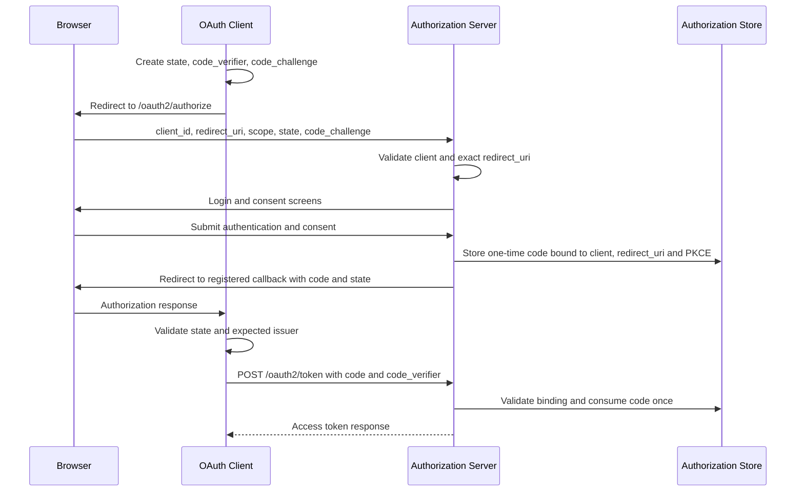
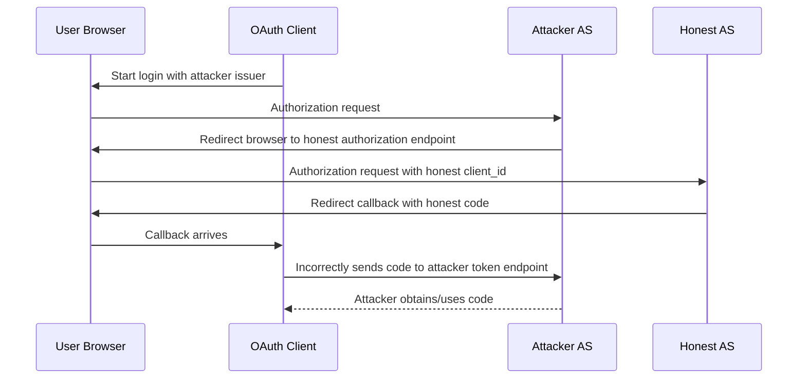

# Preventing Open Redirects, Authorization Response Injection, and Mix-Up Attacks

## 1. Why Must an Authorization Server Protect Redirect Flows?

In the **Server Security** chapter of the **SPRING_SECURITY_OAUTH2_OIDC_AUTHORIZATION_SERVER** module, we learn how to design, configure, secure, test, and operate an OAuth 2.0/OpenID Connect Authorization Server using Spring Security and Spring Authorization Server in a Spring Boot application.

The Authorization Code Flow uses the user's browser to shuttle back and forth between the client and the Authorization Server. The Authorization Server authenticates the user, requests consent if needed, and then redirects the browser back to the client's redirect URI with an authorization response. This flow introduces several trust boundaries:

- The Authorization Server must ensure the response is sent only to a registered redirect URI belonging to the right client.
- The client must ensure the callback corresponds to an authorization request it initiated itself.
- The client must ensure the authorization response came from the intended Authorization Server.
- The Authorization Server must protect the authorization code against theft, replay, or use in another transaction.

The three attack classes covered in this lesson are related yet distinct:

| Attack | Core flaw | Consequence |
| --- | --- | --- |
| Open redirect | An endpoint redirects the browser to an arbitrary URL or redirect URIs are validated loosely. | Authorization codes/tokens can be sent to an attacker; legitimate domain URLs can also be abused for phishing. |
| Authorization response injection | The client accepts a code/state/response not properly bound to a transaction, or an attacker injects a code obtained from another session. | The client can log in under the wrong identity or exchange a victim's code for tokens. |
| Mix-up attack | A client supports multiple Authorization Servers without identifying which issuer produced the response. | The client sends an authorization code or token to an attacker's token endpoint. |

RFC 9700 is the current Best Current Practice for OAuth 2.0 Security. This lesson applies its requirements together with RFC 9207 on issuer identification, then maps them to the extension points of Spring Authorization Server 1.5.8 and Spring Security 6.5.

### Learning Outcomes

After this lesson, you will be able to:

- Explain the risks of matching redirect URIs via wildcards, prefixes, or suffixes.
- Preserve exact redirect URI validation in Spring Authorization Server.
- Prevent open redirects in both the Authorization Server and client applications.
- Protect callbacks with `state`, PKCE, and OIDC `nonce`.
- Understand authorization code injection and PKCE downgrade attacks.
- Recognize mix-up attacks when a client connects to multiple issuers.
- Emit and verify the `iss` response parameter per RFC 9207.
- Integrate Spring Authorization Server's success/error response and metadata extension points.
- Write negative tests for redirects, callbacks, issuers, and code redemption.

## 2. Authorization Code Flow and Points Requiring Protection

A standard Authorization Code flow:



Checks at the Authorization Endpoint and at the client callback complement one another. Exact redirect URIs do not replace `state`/PKCE; likewise, `state`/PKCE do not allow the Authorization Server to redirect to an unregistered URL.

## 3. Redirect URIs Must Be Pre-Registered

### 3.1. The Redirect URI Is the Destination for Authorization Responses

A client registers its redirect URIs when created in the Authorization Server. Example:

```text
https://portal.example.com/login/oauth2/code/corporate
https://mobile.example.com/oauth/callback
http://127.0.0.1:43127/callback
```

The authorization request can include a `redirect_uri` parameter. The Authorization Server must verify this URI belongs to the exact `RegisteredClient`. If the client included `redirect_uri` in the authorization request, the token request must send the exact same value as required by the Authorization Code Grant.

Do not use `redirect_uri` to infer tenant, issuer, or client registration by string guessing. The Client ID must be looked up first, and then the redirect URI validated against that specific client's registered URIs.

### 3.2. Exact String Matching

RFC 9700 requires the Authorization Server to compare the redirect URI against registered URIs using exact string matching. The explicit standard exception is dynamic ports for native application loopback redirect URIs.

Example registered URI:

```text
https://portal.example.com/oauth/callback
```

| Received URI | Result |
| --- | --- |
| `https://portal.example.com/oauth/callback` | Accepted. |
| `https://portal.example.com/oauth/callback/` | Rejected. |
| `https://portal.example.com/oauth/callback?next=/home` | Rejected unless that exact URI is registered. |
| `https://portal.example.com.evil.example/oauth/callback` | Rejected. |
| `https://evil.example/portal.example.com/oauth/callback` | Rejected. |
| `http://portal.example.com/oauth/callback` | Rejected due to scheme mismatch. |
| `https://portal.example.com:443/oauth/callback` | Do not normalize it into matching the registered string. |

Do not decode-and-reencode, lowercase the host, strip default ports, strip trailing slashes, or normalize paths before comparing in a way that collapses two distinct URIs into one. If the system needs multiple callbacks, register each specific URI explicitly.

### 3.3. Do Not Use Wildcards

Avoid patterns such as:

```text
https://*.example.com/*
https://portal.example.com/*
https://portal.example.com/callback?*
```

Wildcards make it hard to reason about which hosts and paths are permitted. Subdomains can be taken over, routes can become open redirectors, or query parameters can alter navigation targets.

### 3.4. Native App Loopback Exception

Native apps often bind a local HTTP listener on an ephemeral port. RFC 8252 allows Authorization Servers to accept variable ports for loopback IP redirect URIs, such as `http://127.0.0.1:{port}/callback`.

This exception applies only to native app loopback redirect URIs. Never generalize it into wildcard ports for public hostnames, never apply it to web applications, and never allow arbitrary schemes.

Prefer loopback IP literals `127.0.0.1` or `[::1]` per native app profile. Avoid using `localhost` in ways where resolvers might point elsewhere or be intercepted by uncontrolled proxies.

## 4. Spring Authorization Server Redirect URI Validation

### 4.1. Default Validator

Spring Authorization Server 1.5.8 uses `OAuth2AuthorizationCodeRequestAuthenticationValidator` to validate authorization request parameters, including `redirect_uri` and `scope`. If validation fails, the provider throws `OAuth2AuthorizationCodeRequestAuthenticationException`.

This validation layer must be preserved in production. Never replace the default validator with a custom validator that checks only the client ID or uses a loose regex.

### 4.2. Registering a Client with Specific Redirect URIs

Example of a confidential web client:

```java
import java.util.UUID;

import org.springframework.context.annotation.Bean;
import org.springframework.context.annotation.Configuration;
import org.springframework.security.oauth2.core.AuthorizationGrantType;
import org.springframework.security.oauth2.core.ClientAuthenticationMethod;
import org.springframework.security.oauth2.server.authorization.client.RegisteredClient;
import org.springframework.security.oauth2.server.authorization.client.RegisteredClientRepository;
import org.springframework.security.oauth2.server.authorization.client.InMemoryRegisteredClientRepository;
import org.springframework.security.oauth2.server.authorization.settings.ClientSettings;

@Configuration(proxyBeanMethods = false)
public class RegisteredClientConfig {

    @Bean
    RegisteredClientRepository registeredClientRepository() {
        RegisteredClient portal = RegisteredClient.withId(
                        UUID.randomUUID().toString())
                .clientId("portal-web")
                .clientSecret("REPLACE_WITH_PASSWORD_ENCODER_OUTPUT")
                .clientAuthenticationMethod(
                        ClientAuthenticationMethod.CLIENT_SECRET_BASIC)
                .authorizationGrantType(AuthorizationGrantType.AUTHORIZATION_CODE)
                .redirectUri(
                        "https://portal.example.com/login/oauth2/code/corporate")
                .scope("openid")
                .scope("profile")
                .scope("orders.read")
                .clientSettings(ClientSettings.builder()
                        .requireProofKey(true)
                        .requireAuthorizationConsent(true)
                        .build())
                .build();

        return new InMemoryRegisteredClientRepository(portal);
    }
}
```

This is an illustrative example; production requires a persistent repository and secrets encoded with a real `PasswordEncoder`. `requireProofKey(true)` requires the client to use PKCE in the Authorization Code Flow. Do not disable PKCE just because a client is confidential.

### 4.3. Custom Validators Must Preserve Default Behavior

Replace the redirect validator only when a specific, analyzed business requirement demands it. If writing a custom validator, use exact membership against the `RegisteredClient`'s URI set and keep running the default scope validator:

```java
import java.util.function.Consumer;

import org.springframework.security.oauth2.core.OAuth2Error;
import org.springframework.security.oauth2.core.OAuth2ErrorCodes;
import org.springframework.security.oauth2.server.authorization.authentication.OAuth2AuthorizationCodeRequestAuthenticationContext;
import org.springframework.security.oauth2.server.authorization.authentication.OAuth2AuthorizationCodeRequestAuthenticationException;
import org.springframework.security.oauth2.server.authorization.authentication.OAuth2AuthorizationCodeRequestAuthenticationProvider;
import org.springframework.security.oauth2.server.authorization.authentication.OAuth2AuthorizationCodeRequestAuthenticationToken;
import org.springframework.security.oauth2.server.authorization.authentication.OAuth2AuthorizationCodeRequestAuthenticationValidator;
import org.springframework.security.oauth2.server.authorization.client.RegisteredClient;

public final class StrictRedirectUriValidator
        implements Consumer<OAuth2AuthorizationCodeRequestAuthenticationContext> {

    @Override
    public void accept(
            OAuth2AuthorizationCodeRequestAuthenticationContext context) {
        OAuth2AuthorizationCodeRequestAuthenticationToken request =
                context.getAuthentication();
        RegisteredClient client = context.getRegisteredClient();
        String requestedRedirectUri = request.getRedirectUri();

        if (requestedRedirectUri == null ||
                !client.getRedirectUris().contains(requestedRedirectUri)) {
            throw new OAuth2AuthorizationCodeRequestAuthenticationException(
                    new OAuth2Error(OAuth2ErrorCodes.INVALID_REQUEST),
                    null);
        }
    }
}
```

Wire the validator into the provider:

```java
Consumer<OAuth2AuthorizationCodeRequestAuthenticationContext> validator =
        new StrictRedirectUriValidator()
                .andThen(
                        OAuth2AuthorizationCodeRequestAuthenticationValidator
                                .DEFAULT_SCOPE_VALIDATOR);

authorizationServer.authorizationEndpoint(endpoint ->
        endpoint.authenticationProviders(providers ->
                providers.forEach(provider -> {
                    if (provider instanceof
                            OAuth2AuthorizationCodeRequestAuthenticationProvider codeProvider) {
                        codeProvider.setAuthenticationValidator(validator);
                    }
                })));
```

The configuration above demonstrates the Spring Authorization Server 1.5.8 extension point. In an actual application, it lives inside the `SecurityFilterChain` configured with `OAuth2AuthorizationServerConfigurer`. Unless you have additional requirements, keeping the default validator is simpler and safer.

This illustrative validator requires `redirect_uri` on every authorization request. That is stricter than the OAuth allowance to omit `redirect_uri` when a client has only one registered URI. If your deployment needs to support that allowance, keep the framework's default validator and add extra checks without weakening URI matching rules.

## 5. The Authorization Server Must Never Become an Open Redirector

### 5.1. Do Not Redirect When the Client or Redirect URI Is Invalid

If `client_id` does not exist or `redirect_uri` does not belong to that client, the Authorization Server must never automatically redirect the browser to the URI provided in the request.

Example malicious request:

```http
GET /oauth2/authorize?response_type=code
    &client_id=portal-web
    &redirect_uri=https%3A%2F%2Fevil.example%2Fcollect
    &scope=orders.read
```

The Authorization Server must reject the request and display the error on the Authorization Server itself. Never place an unverified `redirect_uri` into a `Location` header, even with the intention of showing a friendly error page.

Only after validating both the client and a legitimate redirect URI may the Authorization Server use that URI for protocol authorization responses.

### 5.2. Redirect Errors Only to Verified URIs

When a request has a valid redirect URI but is rejected due to scope, consent, or policy, the Authorization Server may send an OAuth error response back to the verified URI. Never automatically redirect errors to an unverified URI just for UX consistency.

Error responses also carry protocol parameters such as `error`, `error_description`, `error_uri`, and `state`. The client must handle them only after validating the transaction and issuer.

### 5.3. Dynamic Client Registration Increases Risk

If Dynamic Client Registration is enabled, an attacker can register their own client with a redirect URI pointing to a phishing site or an open redirect endpoint. A redirect URI matching a registration does not imply the website is trustworthy.

For newly registered or unvetted clients:

- Display the client name and redirect URI domain clearly so users can recognize them.
- Do not automatically redirect users after an error or denied consent if the URI is untrusted.
- Apply vetting policies, domain allowlists, or risk-based approval workflows.
- Restrict self-service client registration and monitor anomalous registrations.

## 6. Open Redirects in Client Applications

Even if the Authorization Server validates redirect URIs properly, the client's own callback can still be an open redirector.

Example unsafe endpoint:

```java
@GetMapping("/continue")
String continueTo(@RequestParam String returnUrl) {
    return "redirect:" + returnUrl;
}
```

An attacker can craft a URL that looks like it belongs to the application's domain:

```text
https://portal.example.com/continue?returnUrl=https://evil.example
```

Users trust the `portal.example.com` domain, yet the browser gets sent to the attacker. If this URL is used as a callback or can carry codes/tokens in the query/fragment, the attacker can harvest credentials.

### 6.1. Store Relative Paths Instead of Arbitrary URLs

If you need to return to the original page after login, store only a validated relative path, such as `/orders/123`. Never store an arbitrary client-submitted absolute URL and redirect to it.

A basic validation helper:

```java
public String safeReturnPath(String candidate) {
    if (candidate == null ||
            !candidate.startsWith("/") ||
            candidate.startsWith("//") ||
            candidate.contains("\\") ||
            candidate.contains("\r") ||
            candidate.contains("\n")) {
        return "/";
    }
    return candidate;
}
```

This is only an initial check. If your application has encoded slashes, double encoding, path traversal, or reverse proxy rewrites, validate using a proper URI parser and actual routing rules. Better yet, store a server-defined route key or page ID.

### 6.2. Never Put Raw Return URLs in `state`

`state` correlates an authorization request with a browser session; it is not a trusted container for arbitrary navigation URLs. Store the return path in session/server-side storage under a random transaction key. `state` should carry only a random lookup value for the transaction.

Never use `startsWith("https://portal.example.com")` to allowlist URLs. That check can be bypassed by `https://portal.example.com.evil.example`, userinfo tricks, or alternative URL encodings.

## 7. What Is Authorization Response Injection?

Authorization response injection occurs when an attacker causes a client to accept a response that does not belong to a transaction initiated by the client, or swaps the code in a response with a code obtained from another transaction.

A code injection scenario:

1. The attacker logs in through the client and Authorization Server themselves, receiving an authorization code bound to the attacker's account.
2. The attacker initiates a separate login transaction in the victim's browser.
3. The attacker replaces the authorization code in the victim's callback with the code captured in step 1.
4. The client sends that code to the Token Endpoint using the victim's transaction details.
5. If the code is not bound to the right PKCE verifier or client instance, the client may create a session bound to the wrong identity/resources for that transaction.

A forged response might also carry an attacker-chosen `state`, a spoofed `error`, or a different issuer. Thus, clients must never merely check whether a response contains a code.

## 8. Binding Callbacks with `state`

### 8.1. `state` as Both Correlation and CSRF Token

The client generates a random, unpredictable `state` for each authorization request. That value is stored in the browser session or a browser-bound server-side store. When the callback arrives, the client looks up the pending transaction and verifies that `state` matches.

A secure `state` must be:

- Newly generated for each authorization transaction.
- Backed by sufficient entropy from a secure random generator.
- Bound to the browser/session that initiated the flow.
- Single-use and deleted after processing.
- Free of unsigned/unencrypted trusted data.
- Rejected if missing, mismatched, or expired.

Never use a constant `state` across users or logins. Never check only for the presence of the `state` parameter.

### 8.2. Spring Security Authorization Request Storage

Spring Security OAuth2 Client uses `AuthorizationRequestRepository` to persist `OAuth2AuthorizationRequest` from flow initiation until callback processing. The default implementation is `HttpSessionOAuth2AuthorizationRequestRepository`, which stores the request in `HttpSession`.

This repository can be declared explicitly in OAuth2 Login configuration:

```java
import org.springframework.context.annotation.Bean;
import org.springframework.context.annotation.Configuration;
import org.springframework.security.config.annotation.web.builders.HttpSecurity;
import org.springframework.security.oauth2.client.web.HttpSessionOAuth2AuthorizationRequestRepository;
import org.springframework.security.web.SecurityFilterChain;

@Configuration(proxyBeanMethods = false)
public class OAuth2ClientSecurityConfig {

    @Bean
    SecurityFilterChain clientSecurityFilterChain(HttpSecurity http)
            throws Exception {
        http
            .oauth2Login(oauth2 -> oauth2
                .authorizationEndpoint(endpoint ->
                    endpoint.authorizationRequestRepository(
                            new HttpSessionOAuth2AuthorizationRequestRepository())
                )
            );

        return http.build();
    }
}
```

This makes the default session repository behavior explicit. If using a custom repository or stateless cookie, protect integrity, confidentiality where required, session binding, expiry, and one-time consumption. Never place an unsigned authorization request in a tamperable cookie.

### 8.3. Session Cookies Also Need Protection

For web clients, session cookies need `Secure`, `HttpOnly`, and `SameSite` compatible with the response mode/callback. Never weaken `SameSite` or disable CSRF protection application-wide just to get a callback working; test the real flow and configure narrow exceptions only if necessary.

## 9. PKCE Against Authorization Code Injection

### 9.1. How It Works

PKCE binds an authorization code to the specific client instance that created the request:

```text
code_verifier = random high-entropy secret
code_challenge = BASE64URL(SHA256(code_verifier))
code_challenge_method = S256
```

The client sends `code_challenge` and `code_challenge_method=S256` in the Authorization Request. When redeeming the code at the Token Endpoint, the client sends `code_verifier`. The Authorization Server recomputes the challenge and issues tokens only if the verifier matches the challenge stored with the code.

An attacker who obtains a code without the original transaction's verifier cannot exchange the code for tokens.

### 9.2. PKCE Must Use S256

Clients should use `S256`. Never use `plain` because the verifier is sent in cleartext in the authorization request and can leak over the front channel. RFC 9700 recommends a method that does not expose the verifier; `S256` satisfies this requirement.

### 9.3. The Authorization Server Must Enforce PKCE

Spring Authorization Server enforces PKCE via `ClientSettings.requireProofKey(true)`:

```java
RegisteredClient publicClient = RegisteredClient.withId(
                UUID.randomUUID().toString())
        .clientId("spa-client")
        .clientAuthenticationMethod(ClientAuthenticationMethod.NONE)
        .authorizationGrantType(AuthorizationGrantType.AUTHORIZATION_CODE)
        .redirectUri("https://app.example.com/callback")
        .scope("openid")
        .scope("profile")
        .clientSettings(ClientSettings.builder()
                .requireProofKey(true)
                .requireAuthorizationConsent(true)
                .build())
        .build();
```

Spring Authorization Server 1.5.8 enables `requireProofKey` by default for clients. Declaring it explicitly on public clients is still good practice for policy reviewability and preventing cross-environment drift. The Authorization Server must validate the verifier at the Token Endpoint and prevent downgrade: if a token request sends `code_verifier` for a code created without a `code_challenge`, it must be rejected.

### 9.4. Confidential Clients Should Also Use PKCE

A client secret protects client authentication, but it does not prevent all cases of authorization codes being injected into a legitimate client's browser session. RFC 9700 recommends PKCE for confidential clients because it binds the code to the exact transaction. Never use a client secret as an excuse to omit PKCE.

## 10. OIDC `nonce` Protects Authentication Responses

In OpenID Connect, `nonce` is generated by the client per authentication request and sent to the OpenID Provider. The provider includes that value in the ID Token. The client verifies that the `nonce` in the ID Token matches the stored transaction.

`nonce` helps detect replayed ID Tokens or codes injected from another OIDC transaction, provided the client actually verifies `nonce` before accepting tokens.

Distinguish these three values:

| Value | Role |
| --- | --- |
| `state` | Binds the authorization response to the browser transaction and prevents CSRF. |
| PKCE `code_verifier` | Proves the client redeeming the code is the same client instance that generated the challenge. |
| OIDC `nonce` | Binds the ID Token to a specific authentication request and prevents replay/injection in OIDC. |

`nonce` does not replace PKCE for OAuth-only clients. In OIDC, if relying on `nonce` as a code-injection defense, the client must verify `nonce` in the ID Token returned by the Token Endpoint and must not use the ID Token or access token until verification succeeds.

Spring Security OIDC Login validates ID Tokens as part of the OIDC provider flow. Never write a custom ID Token parser that skips signature, issuer, audience, expiry, or `nonce` checks.

## 11. Callbacks Must Process Responses in the Right Order

When a callback receives `code`, `state`, `error`, and other response parameters, the client should proceed in order:

1. Identify the pending transaction from the browser/session context.
2. Verify the transaction has not expired and has not been consumed.
3. Match `state` against the stored value.
4. When multiple issuers exist, validate the response issuer per RFC 9207 or an equivalent countermeasure.
5. Only after the steps above, handle `error` or send `code` to the Token Endpoint.
6. Send the exact `redirect_uri`, client authentication, and `code_verifier` for that transaction.
7. For OIDC, validate the ID Token—including `nonce`—before using the authentication result.
8. Delete the transaction state after success or failure.

If `state` or issuer is wrong, do not render `error_description` as if it came from the expected provider. Abort the flow, log an audit event without credentials, and ask the user to restart.

Never accept multiple conflicting `code`, `state`, or `iss` values in the same response. Parsers must handle duplicate query parameters fail-closed.

## 12. How Does a Mix-Up Attack Happen?

A mix-up attack targets a client supporting two or more Authorization Servers. Suppose:

- Honest Authorization Server: `https://login.example.com`.
- Attacker Authorization Server: `https://evil.example`.
- The client uses the same callback URI for both issuers.

The attacker can route the browser through their Authorization Server and redirect the request to the honest server. The honest server issues an authorization code, while the client still believes the response came from the attacker issuer selected initially. The client sends the code to the attacker's token endpoint; the attacker captures the code and can redeem or abuse it.



The flaw is that the client fails to bind the response to the issuer chosen for the transaction. Storing only the authorization server URL is insufficient if issuer endpoint metadata can be swapped; the client must resolve the issuer and its endpoint/token endpoint tuple from trusted metadata.

## 13. RFC 9207: Authorization Server Issuer Identification

RFC 9207 defines the `iss` response parameter. An Authorization Server supporting this RFC must include its issuer identifier in authorization responses, including both success responses and error responses redirected back to the client.

Example:

```http
HTTP/1.1 302 Found
Location: https://client.example/callback
  ?code=SplxlOBeZQQYbYS6WxSbIA
  &state=af0ifjsldkj
  &iss=https%3A%2F%2Flogin.example.com
```

Error responses must also include `iss`:

```http
HTTP/1.1 302 Found
Location: https://client.example/callback
  ?error=access_denied
  &state=af0ifjsldkj
  &iss=https%3A%2F%2Flogin.example.com
```

Authorization Server Metadata must advertise:

```json
{
  "issuer": "https://login.example.com",
  "authorization_response_iss_parameter_supported": true
}
```

The `iss` value in the response must match the `issuer` in metadata exactly. RFC 9207 requires clients to URL-decode the form-encoded value and compare using simple string comparison; never lowercase, strip ports, strip trailing slashes, or normalize URIs in a way that merges distinct issuers.

## 14. Clients Must Verify the Issuer Before Redeeming the Code

The client must store the chosen issuer together with the transaction and browser session. Upon receiving the response:

- If metadata indicates the issuer supports the `iss` response parameter, it must be present.
- When `iss` is present, decode as `application/x-www-form-urlencoded` and compare strictly against the stored issuer.
- If they do not match, abort the flow; never send the code to the Token Endpoint.
- For error responses, never assume an error came from the expected issuer if the issuer check fails.
- If the response contains multiple issuer identities (e.g., response parameter and ID Token), they must be consistent.

If a client interacts with both RFC 9207-supporting and non-supporting issuers, it must track support state per issuer. Never accept a response missing `iss` from an issuer that advertises support.

### 14.1. Alternative: Distinct Redirect URI per Issuer

RFC 9700 permits clients to use a distinct redirect URI for each issuer when no other issuer identification mechanism is available. The client must verify that the actual callback URI receiving the response matches the URI assigned to that issuer.

This is a fallback control; RFC 9700 recommends preferring issuer identification. Distinct redirect URIs are harder to operate when one client registration is used across multiple issuers and can still fail if an Authorization Server validates redirect URIs weakly.

## 15. Spring Security OAuth2 Client and Multi-Issuer Setups

### 15.1. Explicit ClientRegistration Configuration

Each issuer should have its own `ClientRegistration` specifying its authorization URI, token URI, issuer URI, client ID, and registered redirect URI. Never accept a token endpoint from query parameters or browser-supplied data.

Example Boot configuration:

```yaml
spring:
  security:
    oauth2:
      client:
        registration:
          corporate:
            provider: corporate
            client-id: portal-web
            client-secret: REPLACE_WITH_SECRET_MANAGER_REFERENCE
            client-authentication-method: client_secret_basic
            authorization-grant-type: authorization_code
            redirect-uri: "{baseUrl}/login/oauth2/code/{registrationId}"
            scope:
              - openid
              - profile
              - orders.read
        provider:
          corporate:
            issuer-uri: https://login.example.com
```

The `redirect-uri` template expands from the application's base URL. Behind a reverse proxy, trust `Forwarded`/`X-Forwarded-*` headers only from a configured trusted proxy and strip spoofed client headers. Otherwise, an attacker can trick the application into generating redirect URIs using an attacker-controlled host/proto.

### 15.2. PKCE for OAuth2 Client

Spring Security automatically applies PKCE for public clients based on `ClientRegistration` conditions; PKCE can be explicitly required via `ClientRegistration.ClientSettings.requireProofKey(true)`. For confidential clients, enable it to defend against authorization code injection.

### 15.3. Verifying RFC 9207 Support by Version

Spring Security 6.5 provides `AuthorizationRequestRepository`, `OAuth2AuthorizationRequestResolver`, and callback processing filters. The OAuth2 Login documentation describes storing requests and exchanging codes, but do not assume every 6.5 release automatically enforces full RFC 9207 checks for multi-issuer apps.

For clients connecting to multiple issuers, verify whether your exact version checks the response `iss` prior to token exchange. If not, add a callback guard/custom flow before code redemption, reading the expected issuer from the stored authorization request in session. Never check `iss` using a callback-supplied value as the expected source.

Do not assume configuring two separate `ClientRegistration` entries completes mix-up defense. The client must still verify that the response belongs to the right issuer and send the code only to the token endpoint of the registration saved in the transaction.

## 16. Spring Authorization Server 1.5.8 and RFC 9207

### 16.1. Built-In Extension Points

Spring Authorization Server 1.5.8 supports customizing the Authorization Endpoint via:

- `authorizationResponseHandler`: handles successful authorization responses.
- `errorResponseHandler`: handles authorization error responses.
- `authorizationServerMetadataCustomizer`: augments Authorization Server metadata.

The 1.5.8 documentation describes these extension points, but does not document an out-of-the-box toggle that enables RFC 9207 automatically. Therefore, never advertise `authorization_response_iss_parameter_supported=true` unless your response handlers actually append `iss`.

### 16.2. Advertising Metadata Only After Implementing Responses

A metadata customizer can add the RFC 9207 claim:

```java
authorizationServer.authorizationServerMetadataEndpoint(metadata ->
        metadata.authorizationServerMetadataCustomizer(builder ->
                builder.claim(
                        "authorization_response_iss_parameter_supported",
                        true)));
```

This snippet only advertises the capability. It does not automatically add `iss` to redirect responses.

### 16.3. Customizing Both Success and Error Handlers

To implement RFC 9207 in an application using Spring Authorization Server 1.5.8, supply both handlers:

```java
authorizationServer.authorizationEndpoint(endpoint -> endpoint
        .authorizationResponseHandler(issuerAwareSuccessHandler)
        .errorResponseHandler(issuerAwareErrorHandler));
```

`issuerAwareSuccessHandler` and `issuerAwareErrorHandler` are application-owned implementations. Each handler must preserve default protocol behavior, read the authoritative issuer from `AuthorizationServerContext`/`AuthorizationServerSettings`, append the `iss` parameter to verified redirect responses, and preserve `state`/error fields per spec.

Implementation requirements:

1. Append `iss` only when the response is sent to a verified redirect URI.
2. Add the issuer to both success responses and redirect-based error responses.
3. URL-encode the issuer value exactly once when constructing the `Location` URI.
4. Never take the issuer from request parameters or an untrusted `Host` header.
5. Never redirect to an invalid URI just to send an error with `iss`.
6. Set `authorization_response_iss_parameter_supported` metadata to `true` only after both handlers are implemented and tested.

This integration point warrants dedicated code review and integration tests. Do not copy a naive response handler that merely concatenates strings onto `Location`; properly handle existing query parameters, encoding, duplicate parameters, response modes, and error paths.

### 16.4. Multi-Issuer Deployments

If the Authorization Server supports multiple issuers, `iss` in the response must be the current request's issuer, not a fixed global issuer. It must match the issuer metadata of the corresponding tenant. Cross-test tenants to confirm tenant A's response never carries tenant B's issuer.

## 17. Preventing Authorization Response Leakage

Authorization codes and `state` typically appear in the callback query string. They can leak via:

- Browser history or URL screenshots.
- HTTP access logs, reverse proxy logs, and APM traces.
- `Referer` headers when the callback page loads third-party resources.
- Analytics, error tracking, or client-side telemetry.
- Error pages echoing query parameters.

Controls:

- Use the Authorization Code Flow; never use the Implicit Flow to return access tokens over the front channel.
- Protect codes with PKCE and allow single-use redemption only.
- Set `Referrer-Policy: no-referrer` on callback/authorization pages as appropriate.
- Never load third-party scripts, images, iframes, or analytics on pages receiving authorization responses.
- Set `Cache-Control: no-store` on sensitive pages/responses.
- Never log raw codes, `state`, tokens, or full callback URLs.
- After processing the callback, perform an internal redirect to a clean URL without carrying sensitive query parameters forward.

### 17.1. Redirect Status After Receiving Credentials

An Authorization Server often transitions from a login form POST to a client redirect. Avoid HTTP 307 for this step because browsers may re-submit the POST body containing user credentials to the client. RFC 9700 notes that 307 preserves method/body, whereas 303 forces a switch to GET. Verify the redirect strategy of both the application and proxies; never change status codes arbitrarily.

## 18. Reverse Proxies and Redirect URIs

An application behind a load balancer/reverse proxy may receive internal requests over HTTP while the public URL is HTTPS. If Spring builds redirect URIs from internal host/proto, the URI will not match the registration or can be manipulated by an attacker via forwarded headers.

Rules:

- Terminate TLS at a managed proxy.
- The proxy strips client-supplied `Forwarded`/`X-Forwarded-*` headers and writes trusted values.
- Spring processes forwarded headers strictly according to the defined topology.
- Never let requests choose an arbitrary host to alter redirect URIs.
- Use a fixed public base URL when deployments have a stable domain.
- Verify the actual redirect URI sent in both authorization requests and token requests.

Never fix redirect mismatch errors by allowing all hosts or enabling wildcards.

## 19. Auditing Authorization Responses, State, and Issuers

When auditing the Authorization Code Flow, record non-sensitive data sufficient to reconstruct the transaction:

- Client ID and selected issuer.
- Verified redirect URI registration ID or fingerprint.
- Internal correlation ID/transaction ID.
- Outcomes of `state`, PKCE, and issuer validation.
- Consent and authorization policy outcomes.
- Error category, timestamp, and callback route.

Never store raw authorization codes, code verifiers, access tokens, refresh tokens, or `state` secrets. If state correlation is needed, store a hash or internal transaction ID.

In multi-issuer setups, do not log only the registration ID; log the selected issuer to aid mix-up investigations. However, the audited issuer must come from trusted configuration/metadata, never from an unverified response.

## 20. Security Testing Redirects and Responses

Test both the Authorization Server and the OAuth Client. Happy-path testing alone is insufficient to prove redirect/callback security.

| Category | Scenario | Expectation |
| --- | --- | --- |
| Redirect exact match | Exact registered URI. | Authorization request proceeds. |
| Redirect suffix | Host is `portal.example.com.evil.example`. | Rejected. |
| Redirect prefix | Path starts like registered URI but adds an unregistered suffix. | Rejected. |
| Scheme mismatch | HTTPS registered, request uses HTTP. | Rejected. |
| Port mismatch | Web redirect URI changes port. | Rejected. |
| Query mismatch | Adds unregistered query parameter. | Rejected. |
| Wildcard | URI matches wildcard domain/path. | Registration must not allow wildcards. |
| Native loopback | Loopback port varies per native app profile. | Only the native loopback exception applies. |
| Unknown client | `client_id` does not exist. | Never redirects to request-supplied `redirect_uri`. |
| Invalid redirect | Valid client but wrong `redirect_uri`. | Shows error on Authorization Server; never redirects to wrong URI. |
| Client open redirect | `returnUrl=https://evil.example`. | Never redirects outside allowlisted domains. |
| Encoded redirect | Double encoding, backslash, CRLF, or scheme-relative URL. | Rejected. |
| Missing `state` | Callback lacks `state` in flow requiring `state`. | Callback rejected. |
| Wrong `state` | `state` differs from stored transaction. | Callback rejected before token exchange. |
| Replayed `state` | Reusing an already-consumed `state`. | Callback rejected. |
| Expired transaction | Callback arrives past timeout. | Callback rejected. |
| Code injection | Attacker's code injected into victim's transaction. | PKCE verifier mismatch; token exchange fails. |
| Missing verifier | Client omits `code_verifier` for PKCE code. | Token Endpoint rejects. |
| PKCE downgrade | Token request includes verifier when code had no challenge. | Rejected. |
| Wrong verifier | Verifier does not produce stored challenge. | Rejected. |
| Nonce mismatch | ID Token `nonce` differs from transaction. | OIDC authentication fails; tokens discarded. |
| Wrong issuer | Response `iss` differs from stored issuer. | Aborts before token exchange. |
| Missing issuer | Issuer advertises RFC 9207 yet response omits `iss`. | Client rejects response. |
| Error issuer mismatch | Error response carries `iss` differing from expected issuer. | Untrusted error; abort flow. |
| Duplicate issuer | Response has two conflicting `iss` values. | Rejected. |
| Tenant mix-up | Tenant A response contains issuer B. | Rejected. |
| Referer leakage | Callback page loads third-party resources. | Does not send code/`state` in `Referer`. |
| 307 credential forwarding | Login POST receives 307 redirect to client. | Never forwards credential POST body to client. |

### 20.1. Integration Tests with Spring Authorization Server

Create a `RegisteredClient` with a single redirect URI and `requireProofKey(true)`. Send requests to `/oauth2/authorize` with redirect URI variations. Verify:

1. The exact URI enters the authorization flow.
2. Invalid URIs never appear in a `Location` response header.
3. The authorization code is stored bound to the client, redirect URI, and PKCE challenge.
4. Token requests missing or sending the wrong verifier are rejected.
5. An already-redeemed code cannot be used a second time.

If custom RFC 9207 handlers are present, verify both success and error responses include `iss`, metadata includes `authorization_response_iss_parameter_supported=true`, and tenant issuers match.

### 20.2. Integration Tests with Spring Security OAuth2 Client

Verify:

1. Authorization requests include a transaction-specific `state`.
2. PKCE uses `S256` and the verifier never appears on the front channel.
3. Callbacks with wrong `state` never call the Token Endpoint.
4. Issuer mismatches never call the Token Endpoint.
5. Successful callbacks use only the token endpoint of the stored `ClientRegistration`.
6. OIDC `nonce` mismatches fail authentication.

MockMvc can be used to test filter/callback behavior, but keep at least one end-to-end test with an Authorization Server and real browser redirects for critical failure paths.

## 21. Troubleshooting

| Symptom | Possible cause | Resolution |
| --- | --- | --- |
| Authorization request fails with `invalid_request` | `redirect_uri` fails exact string match or invalid scope. | Compare raw URI with `RegisteredClient` `redirectUris`. |
| Login works locally but fails behind proxy | Base URL/proto/host computed from wrong headers or proxy didn't set forwarded headers. | Configure proxy trust and public base URL. |
| Users redirected to external site after login | Client has open redirect or un-allowlisted `returnUrl`. | Store server-side route keys/relative paths. |
| Callback reports `state` mismatch | Session cookie lost, transaction expired, or callback hit different browser. | Check `SameSite`/`Secure`, session affinity, and state repository. |
| Code exchange fails with PKCE error | Verifier from wrong transaction or lost across nodes. | Persist verifier securely alongside authorization request. |
| Code injection still possible | PKCE not enforced or verifier shared across flows. | Enable `requireProofKey`, `S256`, and per-flow verifiers. |
| OIDC login fails `nonce` check | ID Token `nonce` mismatch or custom flow skipped `nonce` validation. | Use standard OIDC provider and validate `nonce` before using tokens. |
| Multi-issuer client sends code to wrong token endpoint | Only authorization URL stored, not transaction issuer/metadata tuple. | Store issuer and endpoint tuple with `state`; verify response `iss`. |
| Metadata advertises `iss` but response omits it | Metadata enabled before success/error handlers added `iss`. | Align both handlers and metadata; never advertise fake capabilities. |
| Success response has `iss` but error response lacks it | Only success handler customized. | Customize and test error handler separately. |
| Response `iss` mismatches metadata | Configured issuer differs from public issuer or wrong tenant context. | Use canonical issuer and exact string comparison. |
| Code leaked in logs | Access logs/APM record full query strings. | Redact code/`state`/tokens and restrict callback logging. |

## 22. Hands-On Exercises and Checklist

### Exercise 1 — Exact Redirect URI

Register a client with one redirect URI. Send requests with host suffixes, path suffixes, different ports, different schemes, and extra query parameters. Confirm only the registered string is accepted.

### Exercise 2 — PKCE Enforcement

Register a public client with `requireProofKey(true)`. Attempt an authorization request without a challenge, using `plain`, sending a wrong verifier, and sending a verifier for a code created without a challenge. Confirm all invalid cases are rejected.

### Exercise 3 — Client Open Redirect

Audit all endpoints accepting `returnUrl`, `next`, `redirect`, `continue`, or `target`. Write tests with off-domain absolute URLs, scheme-relative URLs, encoded URLs, and backslashes. Permit only defined internal routes.

### Exercise 4 — Authorization Response Injection

Start two transactions with distinct PKCE verifiers. Take the code from transaction A and inject it into callback B. Confirm the client cannot redeem the code due to verifier mismatch.

### Exercise 5 — OIDC Nonce

Start two OIDC login transactions and swap the ID Token `nonce` between them. Confirm OIDC login fails before establishing a principal or session.

### Exercise 6 — Two-Issuer Mix-Up

Configure two Authorization Servers/issuers sharing one callback URI. Simulate a response from issuer A inside a transaction initiated for issuer B. Confirm the client checks `iss` and aborts before sending the code to the Token Endpoint.

### Exercise 7 — RFC 9207 on the Authorization Server

Implement an issuer-aware success handler and error handler in Spring Authorization Server 1.5.8. Enable the metadata claim only after both handlers add `iss`. Verify exact issuer values in responses and metadata.

### Completion Checklist

- [ ] `RegisteredClient` contains only specific redirect URIs.
- [ ] Redirect URIs use exact string matching.
- [ ] No wildcard, prefix, or suffix matching is used for web redirect URIs.
- [ ] Dynamic port exception applies only to native loopback redirect URIs.
- [ ] Invalid clients/redirect URIs never trigger external redirects.
- [ ] No open redirect endpoints exist on the Authorization Server or clients.
- [ ] Return paths are stored server-side or restricted to internal routes.
- [ ] `state` is random, transaction-specific, session-bound, and single-use.
- [ ] PKCE `S256` is enabled for public clients and recommended for confidential clients.
- [ ] Authorization Server enforces `code_verifier` and prevents PKCE downgrade.
- [ ] OIDC `nonce` is validated before using ID Tokens/access tokens.
- [ ] Callbacks validate `state` before token exchange.
- [ ] Multi-issuer clients validate response issuer per RFC 9207.
- [ ] Clients store the issuer/token endpoint tuple per transaction.
- [ ] RFC 9207 metadata is enabled only after both success and error responses emit `iss`.
- [ ] Callback pages load no third-party resources that leak `Referer`.
- [ ] Logs/APM redact codes, `state`, and tokens.
- [ ] Integration tests cover redirects, PKCE, `nonce`, mix-up, and error responses.

## 23. References

- [RFC 9700 — Best Current Practice for OAuth 2.0 Security](https://www.rfc-editor.org/rfc/rfc9700.html) — exact redirect URIs, open redirects, authorization code injection, PKCE, CSRF, and mix-up.
- [RFC 9207 — OAuth 2.0 Authorization Server Issuer Identification](https://www.rfc-editor.org/rfc/rfc9207.html) — `iss` response parameter, metadata support, and issuer validation.
- [RFC 7636 — Proof Key for Code Exchange (PKCE)](https://www.rfc-editor.org/rfc/rfc7636.html) — code challenge and verifier.
- [RFC 8252 — OAuth 2.0 for Native Apps](https://www.rfc-editor.org/rfc/rfc8252.html) — loopback redirect URIs and native app best practices.
- [RFC 6749 — The OAuth 2.0 Authorization Framework](https://www.rfc-editor.org/rfc/rfc6749.html) — authorization request/response, redirect URIs, and authorization code grant.
- [RFC 8414 — OAuth 2.0 Authorization Server Metadata](https://www.rfc-editor.org/rfc/rfc8414.html) — issuer and metadata capabilities.
- [Spring Authorization Server 1.5.8 — Protocol Endpoints](https://docs.spring.io/spring-authorization-server/reference/protocol-endpoints.html) — authorization endpoint validators, success/error handlers, and metadata customizer.
- [Spring Authorization Server 1.5.8 API — OAuth2AuthorizationCodeRequestAuthenticationProvider](https://docs.spring.io/spring-authorization-server/reference/api/java/org/springframework/security/oauth2/server/authorization/authentication/OAuth2AuthorizationCodeRequestAuthenticationProvider.html) — custom authorization request validator.
- [Spring Authorization Server — How-to: Authenticate using a Single Page Application with PKCE](https://docs.spring.io/spring-authorization-server/reference/guides/how-to-pkce.html) — configuring public clients and `requireProofKey`.
- [Spring Security 6.5 — Authorization Grant Support](https://docs.spring.io/spring-security/reference/6.5/servlet/oauth2/client/authorization-grants.html) — `OAuth2AuthorizationRequestResolver`, redirect URI templates, and PKCE.
- [Spring Security 6.5 — Core Interfaces and Classes](https://docs.spring.io/spring-security/reference/6.5/servlet/oauth2/client/core.html) — `ClientRegistration`, issuer metadata, and `requireProofKey`.

**Conclusion:** Securing redirect flows requires multiple simultaneous layers. The Authorization Server accepts only registered redirect URIs via exact matching and never redirects when the client or URI is unverified. Clients bind callbacks to transactions with `state`, PKCE, and OIDC `nonce`. When supporting multiple issuers, clients must verify the response issuer per RFC 9207 before redeeming an authorization code. With Spring Authorization Server 1.5.8, keep the default redirect validator; if implementing RFC 9207 yourself, add `iss` to both success and error responses before advertising the capability in metadata.
