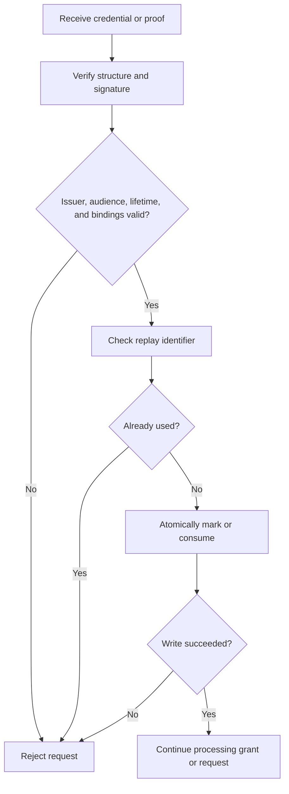
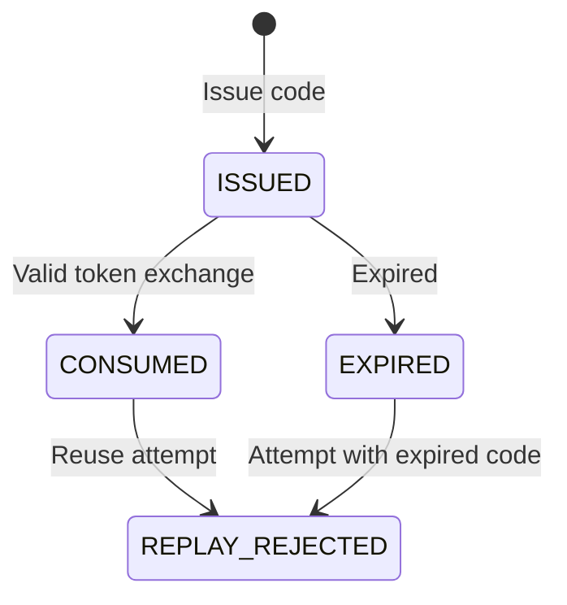

# Replay Protection for Authorization Codes, Client Assertions, Device Codes, and DPoP Proofs

## 1. Objectives and Scope

In the `SPRING_SECURITY_OAUTH2_OIDC_AUTHORIZATION_SERVER` module, securing an OAuth 2.0/OpenID Connect Authorization Server goes beyond verifying signatures or checking token expiration. The Authorization Server must also ensure that a valid authentication message or authorization code cannot be captured by an attacker and replayed to perform the same action a second time.

This attack class is known as a **replay attack**. An attacker might extract an authorization code from browser history, logs, leaked URLs, or insecure channels; copy a JWT client assertion; observe a device code; or record a DPoP proof. If the server checks only the signature and `exp`, a stolen message remains valid throughout its lifetime window.

This lesson focuses on four common credential/proof artifacts at the Authorization Server:

| Artifact | Purpose | Replay risk | Core controls |
|---|---|---|---|
| Authorization code | Exchanges an authorization grant for tokens | Another party redeems the code for tokens, or an already-used code is redeemed again | Short lifetime, client/redirect URI/PKCE binding, and single-use atomic consumption |
| Client assertion | Authenticates a client using a JWT | A signed JWT assertion is replayed to impersonate a subsequent authentication | `exp`, `iat`, `aud`, `jti`, signature verification, and a shared replay store |
| Device code | Completes the Device Authorization Grant | An approved device code is exchanged multiple times | Pending/approved/denied/consumed/expired states and atomic state transitions |
| DPoP proof | Proves the client possesses the private key bound to each HTTP request | A valid proof is reused on the same or another request | Signature, `htm`, `htu`, `iat`, `jti`, nonce, and key-binding validation |

Relevant standards include OAuth 2.0 (RFC 6749), PKCE (RFC 7636), OAuth 2.0 Device Authorization Grant (RFC 8628), JWT Profile for OAuth 2.0 Client Authentication and Authorization Grants (RFC 7523), and Demonstrating Proof of Possession (DPoP, RFC 9449).

## 2. Replay Protection Design Principles

A reliable replay-protection mechanism typically combines five properties:

1. **Validity:** verify signature, issuer, audience, client, scope, and protocol constraints.
2. **Freshness:** bound the acceptance window using `exp`, `iat`, and a small clock skew.
3. **Uniqueness:** identify single-use artifacts by `jti`, code, or message identifier.
4. **Binding:** tie the message to the exact client, redirect URI, HTTP method, URI, or public key.
5. **Atomicity:** when multiple requests arrive concurrently, only one request may consume the message.

Checking expiration alone is insufficient. For instance, a client assertion whose `exp` is still in the future can be replayed dozens of times within its validity window. Likewise, a DPoP proof with a valid signature does not prove the proof has not already been used. The server must record usage or transition credential state consistently across all instances.

A general verification flow can be modeled as follows:



The exact step order may vary by protocol. What matters is that checking and recording must prevent race conditions. Two concurrent requests must never both observe an "unused" state and both issue tokens.

### 2.1. Scope of Replay State Storage

The replay store must be shared by every instance capable of handling the same credential. If instance A records a `jti` but instance B cannot see that record, an attacker can replay the assertion or proof against B.

Options include:

- A relational database with unique constraints and transactions.
- Redis or a distributed key-value store supporting `SET NX`-style atomic creation with TTL.
- Another consistent store providing compare-and-set or insert-if-absent semantics.

Local in-JVM caches are suitable only for single-instance testing. Never use a local cache as a security boundary in a multi-node deployment. If the replay store is unavailable, the safe decision is normally to reject the affected request rather than skipping the check.

### 2.2. Time and TTLs

Nodes must synchronize clocks via NTP or an equivalent mechanism. Allowed clock skew should cover only realistic inter-host drift; never widen the acceptance window excessively.

The TTL of a replay record must span the entire period during which the message could still be accepted. For client assertions, the TTL normally extends to `exp` plus clock skew. For DPoP proofs, the TTL must cover the accepted proof-age window (`iat`). For authorization codes and device codes, the consumed state must persist long enough for every node to recognize the credential as spent—at least until credential expiration and any related processing window have elapsed.

## 3. Preventing Authorization Code Replay

### 3.1. Why Must Authorization Codes Be Single-Use?

In the Authorization Code Flow, the Authorization Server delivers an authorization code to the client via the redirect URI. The client sends the code to the token endpoint to exchange for tokens. The code is a short-lived credential that can leak through browser history, proxy logs, URL analytics, error pages, or misconfigured redirects.

Per RFC 6749, an authorization code must not be used more than once. Upon detecting that a code has already been used, the Authorization Server must reject the request. The server should also revoke any tokens previously issued based on the replayed code if they can be identified and revoked.

### 3.2. Binding Authorization Codes

A secure authorization code requires the following properties:

- Generated by a cryptographic random generator with sufficient entropy; contains no predictable sensitive data.
- Short-lived, sized to complete the redirect and token exchange.
- Bound to the `RegisteredClient`, validated redirect URI, grant, and authorization request attributes.
- When the client uses PKCE, store `code_challenge` and `code_challenge_method`; the token endpoint must verify the matching `code_verifier`.
- Can be consumed successfully only once.
- Never appears in logs, traces, metric labels, tracking URLs, or error messages.

PKCE and replay protection solve two distinct problems. PKCE binds the code to the party holding `code_verifier`, reducing the risk that an interceptor can redeem a stolen code. Single-use consumption prevents the same code from being redeemed repeatedly. Enabling PKCE does not eliminate the single-use requirement.

The `state` parameter helps the client correlate responses with authorization requests and prevents certain CSRF vectors. In OpenID Connect, `nonce` binds the ID Token to the authentication request. Neither value replaces single-use authorization code consumption.

### 3.3. State Model

The code lifecycle can be modeled as a simple state machine:



When the token endpoint receives a code, the server validates the client, redirect URI, PKCE verifier, and grant conditions. Next, transitioning from `ISSUED` to `CONSUMED` must be an atomic operation. Only the request that wins the state transition may proceed to issue tokens.

An illustrative SQL statement demonstrating atomic consumption:

```sql
UPDATE one_time_credential
   SET consumed_at = CURRENT_TIMESTAMP
 WHERE credential_hash = :credential_hash
   AND consumed_at IS NULL
   AND expires_at > CURRENT_TIMESTAMP;
```

The application treats the credential as consumed only when the updated row count equals `1`. If the count is `0`, the credential is expired, nonexistent, or already consumed by another request. This table illustrates custom storage design; it is not Spring Authorization Server's default table name.

In real systems, consuming the code and persisting the authorization/tokens must occur within an appropriate transaction boundary. Ensure two concurrent requests cannot both issue tokens from one code. Use unique constraints, optimistic locking, row-level locks, or conditional updates depending on your persistence model.

### 3.4. Applying This in Spring Authorization Server

Spring Authorization Server implements the Authorization Code Grant flow at the token endpoint. The standard provider loads the authorization via `OAuth2AuthorizationService`, validates code conditions, marks the code token invalidated, and saves the updated authorization. Keep this standard flow unless special protocol requirements dictate otherwise.

Key components to review:

| Component | Role in replay protection |
|---|---|
| `RegisteredClientRepository` | Stores clients, grant types, redirect URIs, and related client settings |
| `OAuth2AuthorizationService` | Stores authorizations along with token states |
| Authorization Code Authentication Provider | Validates and processes code exchange at the token endpoint |
| PKCE validation | Verifies `code_verifier` against the stored challenge |
| Shared database | Ensures consumed code state is visible across all instances |

For multi-instance production environments, evaluate how `OAuth2AuthorizationService` reads and updates authorizations. `InMemoryOAuth2AuthorizationService` suits testing or single-process apps, and does not provide durable shared state across multiple processes. Use a JDBC service or a custom implementation aligned with your storage architecture.

Do not assume calling `save` on an arbitrary implementation automatically provides atomic consumption when two requests run concurrently. Inspect transactions, isolation levels, and record updates in the deployed library version. If security requirements guarantee strictly one winner, add synchronization or a persistence/provider implementation with atomic consumption. Any provider customization must preserve all standard protocol checks, including client, redirect URI, PKCE, expiration, and authorization status.

When detecting an already-used code, return an appropriate OAuth error such as `invalid_grant`, without revealing which authorization the code belonged to. If previously issued tokens can be linked to the replayed authorization, apply revocation policy and emit a security event.

## 4. Preventing Client Assertion Replay

### 4.1. What Is a Client Assertion?

With JWT-based client authentication, the client sends a JWT in `client_assertion` along with `client_assertion_type` to the token endpoint. The assertion is typically signed with the client's private key (`private_key_jwt`) or a shared secret (`client_secret_jwt`). The Authorization Server verifies the assertion to authenticate the client.

An assertion with a valid signature can still be copied and replayed. Thus, the digital signature proves JWT origin and integrity, while replay protection must prove the assertion has not already been accepted.

### 4.2. Claims to Verify

| Claim/header | Meaning and verification |
|---|---|
| `iss` | Assertion issuer identifier; in client authentication profiles, typically the client ID |
| `sub` | Authenticated subject; must match the client ID per the configured profile |
| `aud` | Must contain an audience accepted by the Authorization Server, typically the token endpoint or published Authorization Server identifier |
| `exp` | Expiration time; must be in the future and have a short validity window |
| `iat` | Issued-at time; reject assertions that are too old or further in the future than allowed clock skew |
| `jti` | Unique assertion identifier; used to detect previously accepted assertions |
| `alg` | Signing algorithm on the client/server allowlist; reject `none` and disallowed algorithms |
| `kid` | Selects the appropriate verification key; never treat `kid` alone as authentication proof |

Never trust `iss`, `sub`, or `aud` from unverified input to select trust anchors. The flow must resolve the client and key from trusted configuration, verify the signature, and then validate all claims and algorithm policies. For `private_key_jwt`, prefer asymmetric algorithms with explicit key lifecycle management.

### 4.3. Replay Store for `jti`

After an assertion passes signature and claim validation, the server must record `jti` via an insert-if-absent operation. Replay keys should be scoped by client so two independent clients never collide accidentally:

```text
replay:client-assertion:{client_id}:{hash(jti)}
```

If the key already exists, the assertion is a replay and must be rejected. If it does not exist, only one request can create the key successfully. Key TTL extends until `exp` plus allowed clock skew. Storing a hash of `jti` instead of the raw value reduces identifier exposure in caches.

Redis pseudocode example:

```java
Duration ttl = Duration.between(clock.instant(), assertionExpiresAt.plus(clockSkew));
if (ttl.isNegative() || ttl.isZero()) {
    throw invalidClient("Client assertion has expired");
}

String key = "replay:client-assertion:" + clientId + ":" + sha256(jti);
Boolean firstUse = stringRedisTemplate.opsForValue()
        .setIfAbsent(key, "1", ttl);

if (!Boolean.TRUE.equals(firstUse)) {
    // false: jti already exists; null: write operation could not be confirmed.
    throw invalidClient("Client assertion was already used");
}
```

This illustrates a replay-protection service; `clock`, `clockSkew`, `sha256`, and `invalidClient` must be supplied by the application. Never treat a `null` result from the write operation as success. With Redis Cluster or multi-region deployments, verify that consistency guarantees and data-store sharing scope satisfy deployment requirements.

Another option is a database table with a primary/unique key:

```sql
CREATE TABLE oauth2_replay_guard (
    purpose        VARCHAR(40)  NOT NULL,
    subject_id     VARCHAR(200) NOT NULL,
    token_id_hash  CHAR(64)     NOT NULL,
    expires_at     TIMESTAMP    NOT NULL,
    PRIMARY KEY (purpose, subject_id, token_id_hash)
);
```

For client assertions, `purpose` is `CLIENT_ASSERTION`, `subject_id` is the client ID, and `token_id_hash` is the hash of `jti`. Insertion must rely on the primary-key constraint for concurrency control; never implement a non-atomic `SELECT` check followed by a separate `INSERT` without locking or proper transaction semantics.

### 4.4. Integrating with Spring Authorization Server

Spring Authorization Server supports client authentication via JWT assertions. The authentication flow must perform both JWT validation and replay checking. In versions providing `JwtClientAssertionDecoderFactory`, you can customize the decoder's validator to enforce claim and signature rules per `RegisteredClient`. However, a pure validator does not provide a shared `jti` store; consuming `jti` must be integrated into client authentication so it runs only after the assertion is verified.

When customizing `OAuth2ClientAuthenticationProvider` or its counterpart, preserve Spring Authorization Server's standard checks and map failures to `invalid_client`. Avoid recording `jti` before verifying signature, audience, and client, or a forged request could pre-consume a legitimate client's `jti`. Conversely, once an assertion is accepted, never skip recording it because of a transient cache error.

Practical policies should keep assertion lifetimes short (e.g., a few minutes or less depending on clock sync), allow bounded clock skew, require `jti`, and allow only explicitly configured signing algorithms per client. Key rotation needs a controlled overlap window without weakening audience checks or `jti` uniqueness.

## 5. Preventing Device Code Replay

### 5.1. Two Codes in the Device Authorization Grant

The Device Authorization Grant (RFC 8628) targets input-constrained devices. The device requests authorization and receives `device_code`, `user_code`, `verification_uri`, and a polling interval. The user opens the verification page on another device, enters the user code, and approves the request. The device polls the token endpoint using the device code.

The two codes differ in purpose and sensitivity:

- `device_code` is the secret credential the device presents at the token endpoint. It must be generated with high entropy, kept confidential, and used only within its granted lifetime.
- `user_code` is a short human-enterable code on the verification page. Because its value space is smaller, it requires rate limiting, attempt caps, and anti-guessing controls.

Never use `user_code` as a bearer credential to exchange for tokens. Never log raw `device_code` or `user_code` values in logs or telemetry.

### 5.2. States and Polling Responses

The Authorization Server must manage at least these states:

| State | Meaning | Response when device polls |
|---|---|---|
| `PENDING` | User has not completed approval | `authorization_pending` |
| `APPROVED` | User approved and request is still valid | Can issue tokens if `device_code` is consumed successfully |
| `DENIED` | User denied | `access_denied` |
| `CONSUMED` | Device code was already used to issue tokens | Reject subsequent uses, typically `invalid_grant` |
| `EXPIRED` | Device code expired | `expired_token` |

Clients must obey the `interval` in the response. If polling faster than allowed, the Authorization Server returns `slow_down`; per RFC 8628, the client increases its polling interval per protocol rules. While still awaiting user action, the server returns `authorization_pending`. These responses must not extend the `device_code` expiration indefinitely.

### 5.3. Single-Use Device Code Consumption

Once approved by the user, the first valid polling request exchanges the device code for tokens. Transitioning from `APPROVED` to `CONSUMED` must be atomic. If two concurrent polling requests hit two instances, only one may issue tokens; the other must be rejected.

The processing sequence should guarantee:

1. Identify the device code and matching client.
2. Verify the device code exists, has not expired, and was issued to the calling client.
3. Check approval or denial status.
4. If `PENDING`, return `authorization_pending`; if polling too fast, apply `slow_down`.
5. If `APPROVED`, consume the code via a conditional update inside a transaction.
6. Only if consumption succeeds, issue and persist tokens.
7. Reject all subsequent redemption attempts.

Do not transition to `CONSUMED` before validating the client and grant conditions. Equally, never issue tokens first and update code state afterward in an independent operation that could fail, as that risks issuing tokens multiple times.

### 5.4. Protecting the Verification Page

The `user_code` entry page is a distinct attack surface. Rate-limit attempts by IP, session, and/or user code; trigger CAPTCHA or step-up controls on guessing patterns; never disclose whether a code exists before the user completes required verification steps; and require appropriate user login/authentication prior to approval.

The verification page must display enough context for the user to identify the requesting device or application. Never auto-approve just because the user entered a valid code. Approval must bind to the stored authorization request, client, scopes, and specific validity window.

### 5.5. Integration in Spring Authorization Server

Spring Authorization Server includes components for the Device Authorization Grant and device code redemption at the token endpoint. Use the standard grant configuration and providers for your library version, and persist authorizations via an `OAuth2AuthorizationService` backed by shared state across instances.

In distributed deployments, verify that transitioning the device code to invalidated/consumed is protected by transactions or atomic updates. If your current storage implementation lacks that guarantee, add persistence-layer synchronization or controlled provider customization. Never build a custom device-code exchange endpoint that skips checks on client, user state, expiration, polling interval, and scope.

## 6. Preventing DPoP Proof Replay

### 6.1. What Problem Does DPoP Solve?

DPoP (RFC 9449) is an application-layer proof-of-possession mechanism. The client creates a JWT proof signed with its private key to prove possession of the key matching the public key advertised in the proof. DPoP can bind an access token to that key, reducing the risk that a stolen access token can be used standalone.

A DPoP proof is created per HTTP request. Hence, a valid proof is bound to the request's method, URI, and timestamp. If a server validates only the signature, an attacker can replay the captured proof within its validity window. The server must check `jti` and reject previously used proofs.

### 6.2. Proof Structure and Key Claims

A DPoP proof is a JWT with header and payload conforming to the RFC 9449 profile:

| Component | Verification |
|---|---|
| Header `typ` | Must be `dpop+jwt` |
| Header `alg` | Allowed asymmetric algorithm; reject `none` and non-allowlisted algorithms |
| Header `jwk` | Contains public key for signature verification; reject private key parameters |
| `jti` | Unique proof identifier; detect values already used with the corresponding key |
| `htm` | Request HTTP method; must match actual method |
| `htu` | Target HTTP URI normalized per DPoP rules; must match request URI |
| `iat` | Proof creation timestamp; must fall within the accepted time window |
| `nonce` | Present when required by server; must match a valid server-issued nonce |
| `ath` | Access token hash when the proof accompanies a request to a protected resource |

Do not require `ath` at the token endpoint when no access token is attached yet. At the resource server, when the client sends an access token under the `DPoP` scheme, verify `ath` matches the hash of the exact access token presented.

### 6.3. Proof Verification Sequence

A typical verification sequence includes:

1. Extract the DPoP proof from the `DPoP` HTTP header; reject if missing on an endpoint requiring DPoP.
2. Validate `typ`, `alg`, and JWK structure; accept only permitted public keys.
3. Verify the JWT signature using the public key embedded in the proof.
4. Compute the JWK thumbprint (`jkt`) and verify `htm` matches the actual HTTP method.
5. Normalize the URI per DPoP rules and compare with `htu`. Never carelessly compare an internal reverse-proxied URI against the public URI signed by the client.
6. Verify `iat` lies within the allowed time window and validate `nonce` if required by the endpoint.
7. Atomically register the key and `jti` pair in the replay store. Reject the proof if a record already exists.
8. At the resource server, validate `ath` and confirm the proof key matches the access token's `cnf.jkt`.
9. Proceed with request handling only after every verification step passes.

The replay identifier typically takes the form:

```text
replay:dpop:{jkt}:{hash(jti)}
```

This scoping separates distinct public keys. The replay store must be shared across all instances capable of handling the same requests. The TTL should outlive the accepted `iat` window plus clock skew.

### 6.4. Nonces and Retries

An Authorization Server or Resource Server may require a DPoP nonce to reduce the risk of pre-generated proofs being replayed later. The server sends a nonce in the `DPoP-Nonce` header; the client creates a fresh proof containing that nonce and retries the request. When a required nonce is missing or invalid, the server may return `use_dpop_nonce` per RFC 9449.

Nonces do not replace `jti` checks. A nonce binds a proof to a server-issued challenge; `jti` detects reuse of the exact same proof. When retrying a request, the client must generate a new proof with a fresh `jti` and the current nonce if required—never resend the exact old proof JWT.

### 6.5. Binding Access Tokens to the DPoP Key

When the token endpoint accepts a DPoP proof during token issuance, the Authorization Server can bind the access token to the proof's public key. The token carries a confirmation claim `cnf` containing the JWK thumbprint `jkt`. The token response sets `token_type` to `DPoP`.

When the resource server receives a request, it must validate the access token as usual while also validating the fresh DPoP proof. The proof's JWK thumbprint must match `cnf.jkt`; `ath` must match the access token; and `htm`, `htu`, `iat`, `jti`, and `nonce` must be valid. If an access token is sent under the `Bearer` scheme when policy requires DPoP, never bypass proof binding.

For DPoP-bound refresh tokens, the client must prove possession of the matching key when refreshing. Key-rotation policies must be designed explicitly; never automatically accept a new key merely because the client holds a refresh token.

### 6.6. Reverse Proxy Considerations

`htu` is a common pitfall when an Authorization Server or Resource Server runs behind a load balancer, ingress, or reverse proxy. The application may see an internal `http` scheme and internal host while the client signed the public URI `https://auth.example.com/...`.

Trust forwarded headers only from proxies on your trusted list. Configure Spring to process forwarded headers consistently with your infrastructure; never let external clients supply `X-Forwarded-Host` or `Forwarded` headers to alter the URI used for verification. If the public URI cannot be determined reliably, reject the proof rather than relaxing `htu` comparison.

### 6.7. Integrating DPoP with Spring

DPoP support varies across Spring Authorization Server and Spring Security versions. Before implementing, verify the APIs and capabilities of your exact version. When built-in DPoP support is available, configure it via those APIs and verify both the token endpoint and resource server. When extending manually, integration points typically sit in token-endpoint request conversion/authentication and resource-server authentication filters.

Do not assume adding a standard `JwtDecoder` completes DPoP. DPoP requires validating HTTP method, URI, timestamps, nonce, `jti`, `ath`, and the link between JWK thumbprint and `cnf.jkt`. Nor should you simply inject `cnf.jkt` in a token customizer: that claim is meaningful only after the server has verified the proof and bound the token to that key.

## 7. Structuring Controls in a Spring Application

A maintainable architecture cleanly separates responsibilities:

| Responsibility | Suggested component | Requirement |
|---|---|---|
| Client storage | `RegisteredClientRepository` | Client IDs, grants, authentication methods, and key metadata from a trusted source |
| Authorization/token storage | `OAuth2AuthorizationService` | Shared state, transactions, and consistent updates |
| JWT assertion verification | JWT decoder/validator and client auth provider | Verify signature, issuer, subject, audience, timestamps, and algorithm |
| Detecting used assertions/proofs | Custom `ReplayGuard` backed by Redis or DB | Insert-if-absent, TTLs, shared across instances |
| Consuming codes/device codes | Grant providers and persistence | Atomic state transitions; strictly one request succeeds |
| Resource server DPoP verification | DPoP authentication filter/provider | Validate proof and access token in the same request context |
| Clock | Injected `Clock` | Testable and synchronized across nodes |

Encapsulate `jti` detection in a service with a clear contract, such as `consume(namespace, subject, jti, expiresAt)`. This service returns successfully only when recording first use. Callers must map failures to protocol-compliant errors: `invalid_client` for client assertions, the appropriate DPoP error for proofs, or `invalid_grant` for spent codes.

Do not put all replay-protection logic into `OAuth2TokenCustomizer`. Token customizers primarily enrich claims during token generation; they do not replace request verification and single-use state updates. Nor should a single generic filter consume every `jti` without distinguishing namespace and subject, since different JWT types have distinct identifier scopes and lifecycles.

### 7.1. Example ReplayGuard Contract

The snippet below illustrates a shared service contract. Persistence may use Redis or a relational database:

```java
public interface ReplayGuard {

    /**
     * Records the first use of an identifier.
     * Throws ReplayDetectedException if the identifier already exists
     * or if the write operation cannot be confirmed as successful.
     */
    void consume(
            String namespace,
            String subject,
            String jti,
            Instant expiresAt);
}
```

Example namespaces:

```text
CLIENT_ASSERTION
DPOP_PROOF
```

For authorization codes and device codes, the right mechanism is normally transitioning the authorization record itself to consumed/invalidated within the token-issuance transaction, rather than merely putting a `jti` in a cache. That keeps credential consumption and token persistence transactionally consistent.

### 7.2. Multi-Instance Configuration and Operations

In multi-instance environments:

- All instances must share the authorization store and replay store.
- Cache keys must include clear namespaces and subject scopes.
- TTLs must match the actual lifetime of each credential/proof, never an arbitrary single TTL for everything.
- Never rely on sticky sessions for security; subsequent requests may hit any node.
- Fail-open vs. fail-closed behavior must be explicit. For replay checks, store failures should normally fail requests safely.
- Purge expired records via TTL or background jobs; never purge records earlier than the acceptance window.
- Restrict access, encrypt connections, and protect Redis/database instances as critical security infrastructure.

## 8. Testing Replay Protection

Testing only a single valid request does not prove replay protection works. You must test repeated requests, concurrent requests, and requests routed across multiple instances.

| Scenario | Expected result |
|---|---|
| First redemption of a valid authorization code | Succeeds exactly once |
| Re-submitting the same authorization code | `invalid_grant`; no additional tokens issued |
| Two concurrent requests redeeming the same code | Exactly one succeeds |
| Expired code or wrong PKCE/redirect URI | Rejected; no tokens issued |
| Replaying the same client assertion `jti` | First may succeed; replay rejected with client authentication error |
| Same `jti` across two different clients | No collision when namespaces are scoped by client |
| Assertion with invalid signature or wrong audience | Rejected; never treated as valid |
| Replaying a device code after token issuance | Rejected; no second token issued |
| Polling while device request is pending | `authorization_pending` |
| Polling faster than `interval` | `slow_down` and client adjusts polling cadence |
| Two concurrent polling requests after user approval | Only one consumes the code and issues tokens |
| Replaying the same DPoP proof | Rejected because `jti` was already used |
| DPoP proof with wrong `htm` or `htu` | Rejected |
| Stale DPoP proof or invalid nonce | Rejected or new nonce requested per policy |
| DPoP proof key mismatches `cnf.jkt` | Resource server rejects request |
| Two nodes receive the same assertion/proof nearly simultaneously | Only one use is accepted |
| Replay store unreachable | Request safely rejected; check is never skipped |

Include integration tests against the real database/Redis with concurrent requests. For race conditions, sequential tests are insufficient. Use a barrier/latch so multiple threads submit the same credential simultaneously, then assert that the number of successful responses is strictly one.

Also test behavior across node restarts, cache failovers, clock skew within allowed bounds, and requests routed to different instances. These scenarios frequently uncover flaws invisible to single-service unit tests.

## 9. Observability and Incident Handling

Create rejection counters categorized by cause, for example:

- `authorization_code_replay_rejected`
- `client_assertion_replay_rejected`
- `device_code_replay_rejected`
- `dpop_proof_replay_rejected`
- `replay_store_unavailable`
- `dpop_nonce_required`

Metric labels should carry only low-cardinality dimensions such as grant type, endpoint, or error code. Never put codes, `jti`, device codes, user codes, access tokens, assertion JWTs, or DPoP JWTs into metric labels.

Security event logs can include request correlation ID, verified client ID, endpoint, timestamp, and error category. Never log raw credentials. If correlating retries is necessary, use a controlled hash or internal event ID; never log tokens for debugging.

When replay rates spike, inspect gateway logs, potential URL leaks, client retry logic, inter-node clock skew, TTL settings, and cache store consistency. Misbehaving client retries can generate replay errors without an attack; nevertheless, never automatically relax security policies just to silence alerts.

## 10. Common Design Pitfalls

| Pitfall | Consequence | Fix |
|---|---|---|
| Checking only `exp` on assertions/proofs | Credentials remain reusable throughout validity window | Record `jti` in a shared store |
| Using local caches across multiple nodes | Replayed requests succeed on another node | Use shared DB/Redis with atomic operations |
| Check-then-insert in two unlocked steps | Two concurrent requests both pass | Use unique constraints, `SET NX`, transactions, or compare-and-set |
| Setting TTL too short | Records vanish while credentials are still valid | Derive TTL from `exp` or `iat` window plus clock skew |
| Using one namespace for all JWT types | Identifier collisions or difficult forensics | Partition namespaces by proof type and subject |
| Enabling PKCE while neglecting single-use codes | Codes can still be replayed and reprocessed | Keep PKCE alongside single-use code consumption |
| Treating `user_code` as a strong secret | Vulnerable to guessing due to short code space | Enforce rate limits, attempt caps, and user authentication |
| Issuing tokens before consuming the device code | Race conditions can mint multiple tokens | Consume atomically first inside the proper transaction |
| Checking only DPoP signatures | Proofs can be replayed or used on other requests | Validate `htm`, `htu`, `iat`, `jti`, nonce, and token binding |
| Trusting forwarded headers from any source | Attackers spoof the URI used to check `htu` | Trust only configured proxies and normalize URIs consistently |
| Swallowing Redis/database errors | System inadvertently fails open | Reject requests whenever first use cannot be confirmed |
| Logging full JWTs/codes for debugging | Creates another credential leak vector | Log safe metadata and correlation IDs |

## 11. Implementation Checklist

- [ ] Authorization codes have high entropy, short lifetimes, and client/redirect URI binding.
- [ ] PKCE is required for eligible clients and `code_verifier` is always validated.
- [ ] Authorization codes are consumed only once via atomic state updates.
- [ ] On code replay, requests are rejected and linked token revocation policies apply where possible.
- [ ] Client assertions validate signature, `iss`, `sub`, `aud`, `exp`, `iat`, `jti`, and algorithm allowlists.
- [ ] Client assertion `jti` values are atomically recorded in a shared store scoped by client.
- [ ] Device codes are securely generated, bound to the client, and redeemable only once.
- [ ] Device authorization properly handles `authorization_pending`, `slow_down`, `access_denied`, and expiration.
- [ ] The `user_code` verification page enforces rate limiting and anti-guessing controls.
- [ ] DPoP proofs validate `typ`, `alg`, JWK, signature, `htm`, `htu`, `iat`, `jti`, and nonce per policy.
- [ ] Resource servers validate `ath` and `cnf.jkt` for DPoP access tokens.
- [ ] The replay store is shared across nodes, uses proper TTLs, and fails closed on errors.
- [ ] Integration tests cover sequential replay, concurrent replay, multi-instance routing, and store outages.
- [ ] Logs and metrics never leak codes, assertions, device codes, access tokens, or DPoP proofs.

## 12. Conclusion

Replay protection must be designed around the lifecycle of each credential type. Authorization codes and device codes require atomically updated single-use consumption states. Client assertions require unique `jti` values recorded only after JWT verification. DPoP proofs must be bound to the HTTP request and public key while enforcing freshness and uniqueness. In Spring Authorization Server, standard providers and `OAuth2AuthorizationService` form the grant-processing foundation; production systems must add persistence, transactions, and a shared replay store suited to the deployment topology.
