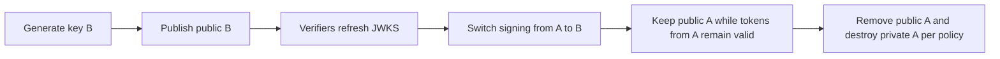

# Protecting Secrets, Private Keys, Tokens, and Personal Information

## 1. Objectives and Scope

In the `SPRING_SECURITY_OAUTH2_OIDC_AUTHORIZATION_SERVER` module, an Authorization Server holds many high-value data assets: client secrets, private keys used to sign tokens, encryption keys, authorization codes, access tokens, refresh tokens, ID Tokens, and user identity attributes. If any of these are exposed, attackers can impersonate clients, mint or misuse tokens, read user data, or maintain unauthorized access even after password changes.

Protecting sensitive data must cover its entire lifecycle: creation, distribution, storage, usage, rotation, revocation, backup, and destruction. Encrypting disks or masking values in an admin UI alone is insufficient. Applications must also restrict where secrets appear, control who can use them, keep tokens out of logs, and ensure personal data is collected and shared strictly within required bounds.

This lesson focuses on four data categories:

| Category | Examples | Impact if exposed | Key controls |
|---|---|---|---|
| Authentication secrets | Client secrets, database passwords, API credentials | Client impersonation or unauthorized access to backing systems | Secret manager, encryption, access control, rotation, and usage monitoring |
| Cryptographic keys | Private signing keys, private encryption keys, TLS private keys | Forging tokens, decrypting data, or impersonating endpoints | KMS/HSM, access control, separation of duties, rotation, and auditing |
| Tokens/credentials | Authorization codes, access tokens, refresh tokens, ID Tokens | Session hijacking, unauthorized API calls, or identity spoofing | TLS, short lifetimes, secure storage, binding, and revocation |
| Personal data | Subject IDs, emails, names, phone numbers, permission groups | Privacy violations, profile exposure, or sensitive inference | Minimization, access control, encryption, retention, and auditing |

## 2. Classifying Data and Defining Trust Boundaries

Before choosing protection technologies, inventory all data assets and map where they travel. An Authorization Server typically spans these boundaries:

1. **Build and source control:** source code, sample config files, CI/CD pipelines, and build artifacts.
2. **Runtime:** environment variables, JVM memory, mounted files, process arguments, and logs.
3. **Data stores:** databases storing clients, authorizations, tokens, and user profiles.
4. **Key management systems:** Secret Managers, KMS, HSMs, or remote signing services.
5. **Communication channels:** browsers, token endpoints, userinfo endpoints, introspection, and resource server APIs.
6. **Operations:** backups, tracing, monitoring, support tickets, memory dumps, and support tools.

A value can be encrypted in the database yet still leak in logs or backups. Classification must therefore trace the entire data path.

| Classification | Examples | Handling principles |
|---|---|---|
| Public | Discovery metadata, public JWKS, API documentation | Can be published per policy; still protect integrity |
| Internal | Service names, non-sensitive config keys | Share only within operational scope |
| Confidential | Client secrets, access tokens, refresh tokens, authorization codes | Provide only to required components; never log; encrypt in transit and at rest |
| Highly sensitive | Private signing keys, master encryption keys, recovery keys | Prefer KMS/HSM; strict access control, full operation auditing, recovery and replacement procedures |
| Personal data | Email, name, phone number, account-linking subjects | Process strictly by purpose; restrict access, retention, and sharing scope |

Do not treat everything inside a JWT as public—nor assume signed JWTs hide data. A signed JWS payload is typically only Base64URL-encoded, meaning anyone holding the token can decode its claims. Signatures protect integrity, not confidentiality. If a payload carries confidential information, trim the claims or use appropriate encryption; never add sensitive details to an access token merely because it is signed.

## 3. Managing Application and OAuth Client Secrets

### 3.1. Never Put Secrets in Source Code

Never commit passwords, client secrets, API keys, private keys, keystore files, or live tokens into Git. Commonly overlooked locations include:

- `application.yml`, `application.properties`, and profile-specific config files.
- Dockerfiles, image layers, Helm values, Kubernetes manifests, and Compose files.
- Deployment scripts, shell commands, pipeline YAML, and build arguments.
- Test fixtures, snapshots, sample logs, tutorials, and `.env` files.
- Default values in code or local-development configs.

`.gitignore` prevents certain new files from being added to Git, but it does not purge secrets already committed. Once a secret enters repository history, treat it as compromised: revoke or rotate the credential, inspect history and forks/copies, and remediate the repository per organizational procedure.

### 3.2. Use a Secret Manager or Platform Secret Provisioning

Production deployments should retrieve secrets from a centralized secret manager or a protected platform credential mechanism, such as:

- A cloud provider's Secret Manager.
- HashiCorp Vault or an equivalent secrets management service.
- Kubernetes Secrets paired with etcd encryption, RBAC, secure distribution, and rotation policies.
- Workload identity mechanisms so applications acquire short-lived credentials instead of storing long-lived passwords.

The secret manager must support per-workload access control, access auditing, versioning, rotation, and revocation. Never share a single secret across dev, test, staging, and production environments. Each environment and application should have its own identity and permission boundary.

Kubernetes Secrets store values in Base64 inside manifests/APIs; Base64 is not encryption. Enable encryption at rest for etcd, restrict RBAC, guard secret read permissions, avoid printing manifests containing secrets to logs, and control node access. Where the platform supports external secret stores or workload identity, adopt them to minimize static secrets in configuration.

### 3.3. Configuring Spring Boot to Read Externalized Secrets

Spring Boot supports externalized configuration. Applications can read properties from environment variables, mounted files, or config trees. Config files keep only property names and references to secret providers.

Example configuration containing no secret values:

```yaml
spring:
  datasource:
    url: jdbc:postgresql://db.internal:5432/authorization
    username: ${DB_USERNAME}
    password: ${DB_PASSWORD}

authorization:
  bootstrap:
    client-secret: ${BOOTSTRAP_CLIENT_SECRET}
```

In production, these variables must be injected from a secret manager or runtime secret provider. Never place live values into committed `.env` files, Docker build arguments, command lines, or pipeline logs.

With config trees, a secret directory can be mounted outside the image:

```yaml
spring:
  config:
    import: "configtree:/run/secrets/"
```

For instance, `/run/secrets/spring.datasource.password` supplies the `spring.datasource.password` property. Directory read permissions must be restricted to the application process; never mount that directory into containers that do not require those secrets. Verify file structure and property naming rules for your exact Spring Boot version.

Group related configuration into `@ConfigurationProperties` to validate completeness and types at startup. Avoid scattering `@Value` annotations reading secrets throughout the codebase, which makes inventorying and swapping providers harder.

```java
@ConfigurationProperties(prefix = "authorization.bootstrap")
public record BootstrapClientProperties(String clientSecret) {
}
```

This is solely a configuration-binding example. In production, bootstrap secrets need an explicit lifecycle, should exist only during initial provisioning, and should be replaced by a secure client-credential issuance workflow. Never expose debug or actuator endpoints that reveal sensitive configuration properties to unauthorized users.

### 3.4. Storing Client Secrets Securely

A client secret is a shared secret between a client and the Authorization Server. During client registration, display the secret only once if your product workflow permits; never return the full secret via admin APIs or UIs once persisted.

Spring Authorization Server stores client records via `RegisteredClientRepository`. Secrets stored in `RegisteredClient` must be one-way hashed using a `PasswordEncoder` before persistence. Example:

```java
RegisteredClient client = RegisteredClient.withId(UUID.randomUUID().toString())
        .clientId("billing-service")
        .clientSecret(passwordEncoder.encode(rawClientSecret))
        .clientAuthenticationMethod(ClientAuthenticationMethod.CLIENT_SECRET_BASIC)
        .authorizationGrantType(AuthorizationGrantType.CLIENT_CREDENTIALS)
        .scope("billing.read")
        .build();

registeredClientRepository.save(client);
```

This snippet assumes `passwordEncoder` is configured and `rawClientSecret` was supplied over a secure channel. Never hard-code real values in examples or source code. Keep encoder configuration consistent between storage and verification; when upgrading hash algorithms or parameters, plan a proper migration strategy.

A one-way hash cannot recover the original client secret. If a client loses its secret, the right workflow is generating a new secret, updating the client in phases, and revoking the old secret. For systems needing asymmetric authentication, consider `private_key_jwt` to avoid distributing shared secrets, though the client's private key must still be protected on the client side.

## 4. Protecting Private Keys and Cryptographic Keys

### 4.1. Separate Keys by Purpose

Never use a single key for every function. Separate at least the following purposes:

- Keys for signing JWTs / access tokens / ID Tokens.
- Keys for encrypting data or backups.
- TLS keys for network transport.
- Keys for client authentication or per-client assertion signing.
- Keys used to protect other secret material (key-encryption keys).

Key separation limits blast radius when one key is compromised and lets you apply distinct rotation schedules, access controls, and recovery workflows. Use standard-compliant algorithms and key sizes, configure an explicit allowlist, and remove weak or deprecated algorithms.

### 4.2. Prefer KMS/HSM for Production Signing Keys

An Authorization Server's private signing key is extraordinarily valuable. If an attacker steals an active signing key, they can mint forged JWTs trusted by resource servers unless other detection mechanisms exist.

In production, consider storing keys in a KMS or HSM so private key material never leaves as a file or environment variable. The application is granted signing permissions via its workload identity. The KMS/HSM should support auditing, algorithm restrictions, per-key authorization, rotation, and proper backup/recovery procedures.

If your current library or setup supports only in-process keys, design a signing adapter suited to your version's APIs. Integrating an HSM/KMS may involve `JWKSource`, `JwtEncoder`, or custom signing components. Do not assume merely configuring a KMS URL causes Spring Authorization Server to offload all signing to the HSM automatically.

### 4.3. Publishing Public Keys via JWKS

An OpenID Provider typically publishes its public keys through a JWKS endpoint referenced in discovery metadata. Public keys can be distributed so resource servers and clients can verify signatures. Private key parameters must never appear in JWKS.

When publishing JWKs, include only the required public fields. Never include `d`, `p`, `q`, `dp`, `dq`, `qi`, or equivalent private components in the response. Query the JWKS endpoint from an independent client network to verify the response contains strictly public key material.

Each key should have a stable `kid` so verifiers select the right key. `kid` is a public identifier, not a secret. Avoid reusing a `kid` for a different key while caches might still hold the old JWKS.

### 4.4. Encrypting Keys at Rest

If a private key must be stored in a file or database, encrypt it using a separately managed key-encryption key. Separate ciphertext read permissions from decryption permissions; protect the decryption key in a KMS/HSM or equivalent system. Restrict file permissions, never bake private keys into container images, and never place key files inside static/web roots.

Never store the master key alongside the ciphertext such that a single filesystem read compromises both. Backups containing private keys must receive protection equivalent to the originals, with access controls and periodic restore tests. If using a Java keystore, the keystore password is also a secret and must be supplied from a secure source.

## 5. Key Rotation and Revocation

Rotation must be planned ahead of key expiration or incidents. For JWT signing keys, you cannot simply swap the key and immediately delete the old public key, because tokens signed with the old key may still be valid and verifiers may be caching JWKS.

A standard rollover procedure includes:

1. Generate a new key pair in the KMS/HSM or trusted key store; assign a new `kid`.
2. Publish the new public key in JWKS before signing with it.
3. Wait for resource servers and clients to refresh their JWKS caches.
4. Switch the Authorization Server to sign with the new private key.
5. Retain the old public key in JWKS at least until all tokens signed by the old key expire, plus clock skew and cache lifetimes.
6. Verify no valid tokens still require the old key; only then remove the old public key per policy.
7. Revoke or destroy the old private key per procedure while retaining required audit records.



If a key is suspected compromised, an emergency procedure may require removing the old public key immediately and rejecting tokens signed by it. This can disrupt active legitimate requests; coordinate token re-issuance, verifier cache invalidation, and incident response. Never follow a routine rollover timeline for a compromised key.

Client secrets also require staged rotation: generate the new secret, update the client, verify the client works with the new secret, and then disable the old secret. If the system supports only one active secret at a time, schedule the cutover to avoid downtime and prepare a controlled rollback.

## 6. Protecting Access Tokens, Refresh Tokens, and Authorization Codes

### 6.1. Minimizing Token Exposure

Tokens are bearer credentials unless bound by a proof-of-possession mechanism. Anyone holding an access token can generally exercise its privileges until it expires or is revoked. Therefore:

- Transmit tokens only over TLS; never pass tokens in query parameters or URLs.
- Use the `Authorization` header with the appropriate scheme; avoid exposing tokens in browser URLs, analytics, or referrers.
- Never log tokens in application logs, access logs, tracing spans, exception messages, or metric labels.
- Restrict scopes and audiences to the target APIs.
- Set short access token lifetimes aligned with risk and refresh/re-authentication capabilities.
- Protect client-side token storage; browser apps must account for XSS, CSRF, and cookie/storage policies.
- Never return tokens in error responses or debug pages.

Do not assume that being a signed JWT makes a token safe if leaked. Any holder can replay a bearer token until expiration. Moreover, signatures do not hide claim contents.

### 6.2. Choosing JWT Access Tokens vs. Reference Tokens

JWT access tokens allow resource servers to verify signatures and claims locally, reducing introspection calls per request. Conversely, instant revocation is harder if verifiers check only signatures and `exp`. Evaluate short lifetimes, denylists, or additional status checks where rapid revocation is required.

Reference tokens are opaque values requiring resource servers to call introspection or a state-lookup mechanism. This gives the Authorization Server centralized state control and simpler revocation, at the cost of runtime dependency on the introspection service and requiring protection of resource server connections and credentials.

Spring Authorization Server supports configuring access tokens as self-contained JWTs or reference tokens depending on version capabilities. When using reference tokens, protect token storage and the introspection endpoint. When using JWTs, protect signing keys, JWKS, token lifetimes, and verifier policies.

### 6.3. Storing Authorizations and Tokens

`OAuth2AuthorizationService` manages authorizations along with their tokens and metadata. In production, use an appropriate persistent implementation, restrict database permissions, and encrypt sensitive data at the storage layer. Consider field-level encryption for token/credential columns if your threat model requires protection even against database copy exposure.

Do not assume database encryption at rest protects tokens from everyone with query access. Applications, DBAs, backup operators, and analytics pipelines may have differing access levels. Enforce least privilege, audit sensitive queries, protect backups, and separate encryption-key administration from database administration.

For reference tokens or tokens stored for revocation, consider storing hashes/lookup digests where architecture allows, reducing the impact of database reads leaking raw tokens. Maintain exact lookup behavior, avoid weak hashes, and verify whether your library implementation supports that pattern. Never alter Spring Authorization Server's persistence schema without checking impacts on queries and token lifecycles.

### 6.4. Refresh Token Rotation and Reuse Detection

Refresh tokens are long-lived and often higher-value than access tokens. Use refresh token rotation so every successful refresh issues a new refresh token and invalidates the old one. If an old token reappears, treat it as possible cloning; apply policy to revoke the token family or associated authorization.

Spring Authorization Server provides `reuseRefreshTokens` in `TokenSettings`. Setting it to `false` forces a new refresh token on each successful refresh. Example:

```java
TokenSettings tokenSettings = TokenSettings.builder()
        .accessTokenTimeToLive(Duration.ofMinutes(5))
        .refreshTokenTimeToLive(Duration.ofHours(8))
        .reuseRefreshTokens(false)
        .build();
```

The lifetimes above are illustrative; pick values matching your threat model and product UX. Verify that your persistence implementation stores invalidated token state consistently and handles concurrent refresh requests safely. Rotation does not automatically equate to complete reuse detection for every edge case; test old-token reuse, network retries, and concurrent refresh requests.

When reuse is detected, revocation decisions must balance security against user impact. You can invalidate the entire authorization/session, require re-authentication, and trigger a security alert. Never log refresh tokens during investigation.

### 6.5. Cookies and Browsers

If the application stores sessions or tokens in cookies, configure `Secure`, `HttpOnly`, and `SameSite` appropriately. `HttpOnly` prevents JavaScript from reading cookies, though it does not eliminate CSRF. For cookies sent automatically by the browser, enforce CSRF protection and origin validation.

Avoid storing long-lived access tokens or refresh tokens in `localStorage` whenever possible, since any JavaScript running on the same origin can read it during an XSS attack. With a Backend-for-Frontend architecture, keep tokens server-side and use secure session cookies for the browser. Designs must account for XSS, CSRF, session fixation, logout, and multi-tab behavior.

## 7. Protecting ID Tokens and OpenID Connect Data

An ID Token is an authentication assertion meant for the OIDC client. It may include `sub`, `iss`, `aud`, `auth_time`, `nonce`, `email`, `name`, or other claims depending on scopes and configuration. Clients must validate signature, issuer, audience, expiration, and `nonce` per OIDC Core; never use an ID Token as an access token to call APIs.

Emit only genuinely needed claims. For example, an API checking invoice read permissions does not need date of birth, phone number, or street address. Use a stable `sub` scoped to the issuer for identity linking; never assume email addresses are immutable or globally unique.

The OIDC UserInfo endpoint can return additional claims based on scopes and user permissions. Validate the access token, filter claims by scope, restrict which clients may request sensitive fields, and avoid returning entire user profiles. For sensitive attributes, enforce consent and purpose-based sharing policies.

If clients do not need direct identifying attributes, consider pairwise subject identifiers to reduce cross-client user tracking. Ensure subject mapping stays stable per client/sector per OIDC requirements and does not accidentally change linked identities during config updates.

## 8. Minimizing and Protecting Personal Information

### 8.1. Purpose-Bound Collection

Before adding a new claim or data field, answer:

1. Which specific feature or obligation requires this data?
2. Can an internal identifier or less sensitive attribute be used instead?
3. Which components need this data and for how long?
4. Does the data actually belong in an ID Token, access token, or UserInfo?
5. When a user updates or deletes data, how are copies and existing tokens handled?

Never collect data "just in case" without an explicit purpose. Never dump all user attributes into tokens merely because adding claims is easy.

### 8.2. Role- and Purpose-Based Access Control

Separate permissions for application operators, support staff, developers, auditors, database administrators, and service accounts. Support staff may need to view authorization status or partial identifiers to resolve tickets, without needing to read tokens or private keys.

Apply least privilege across multiple layers:

- Scopes and audiences govern which APIs can accept tokens.
- Claims govern which attributes reach clients and resource servers.
- Database roles restrict accessible tables and columns.
- Secret manager policies restrict which workloads read secrets or invoke signing operations.
- Admin UIs mask sensitive data and audit reads or modifications.

Do not treat scopes as a substitute for fine-grained authorization. Resource servers must still enforce permissions on specific resources and actions.

### 8.3. Encryption, Pseudonymization, and Data Partitioning

Encrypt personal data in transit with TLS and at rest per your threat model. For sensitive fields, consider field-level encryption with data encryption keys protected by KMS. Version keys so older records remain decryptable during transitions and can be re-encrypted when needed.

Pseudonymization replaces direct identifiers with surrogate codes, reducing risk in logs, analytics, and test environments. However, while a mapping table or re-identification path exists, the data must still be protected as personal data. Hashing emails or phone numbers does not automatically anonymize them; small input spaces remain guessable and reversible via lookup.

Never use production data containing personal information as test fixtures without proper de-identification and approval. Test data should be synthetic or sanitized so individuals cannot be identified.

### 8.4. Retention and Data Deletion

Define retention periods for authorizations, tokens, consents, audit logs, profiles, and backups. Once the purpose ends or the policy period expires, delete or anonymize data per procedure. Deleting a primary database record does not automatically erase copies in replicas, backups, data warehouses, or log archives.

Retention design must align with security investigation needs, regulatory obligations, and data-subject rights. Avoid storing token payloads in audit logs; record minimal metadata such as client ID, pseudonymized subject reference, timestamp, action, and outcome.

## 9. Preventing Leakage via Logs, Traces, and Operational Tools

Logs and telemetry frequently create unintended copies of sensitive data. Enforce redaction policies across gateways, logging frameworks, and application code. Fields that must never be logged verbatim include:

- `Authorization`, `Proxy-Authorization`, `Cookie`, and `Set-Cookie` headers containing credentials.
- `access_token`, `refresh_token`, `id_token`, authorization codes, and device codes.
- `client_secret`, `client_assertion`, private keys, keystore passwords, and database passwords.
- Replayable DPoP proofs or JWT assertions.
- Unnecessary PII such as email, phone number, address, or profile contents.

Pay special attention to reverse proxy access logs: logging full URLs by default can leak query parameters. Even if your application never puts tokens in query strings, callback URLs may carry authorization codes. Configure proxies to omit sensitive query strings or redact before writing logs.

Never include tokens or secrets in exception messages. Avoid logging raw request/response bodies on token, introspection, revocation, registration, and UserInfo endpoints. Distributed tracing must scrub sensitive headers and avoid capturing payloads by default.

When correlating events, use request IDs, verified client IDs, grant types, endpoints, and error codes. If a token fingerprint is needed for forensics, use a purpose-built digest with restricted access; never log raw tokens or treat fingerprints as credentials.

Actuator endpoints such as `env`, `configprops`, `heapdump`, `threaddump`, and other management endpoints can expose configuration or in-memory secrets. Expose only required endpoints, enforce authentication/authorization, restrict network access, and verify secrets are properly masked. Heap dumps and crash dumps may contain tokens, passwords, or private key material; treat them as confidential, limit retention, and restrict download permissions.

## 10. Encrypting Connections and Protecting Transport Channels

Enforce TLS for browser-to-Authorization-Server, service-to-service, database, cache, secret manager, KMS, and management connections. Disable weak protocols and cipher suites per current operational standards. Manage certificates, hostname verification, and rotation; never disable certificate verification as a quick fix for environment errors.

For sensitive internal connections, consider mutual TLS to authenticate both client and server. Transport-layer mTLS and OAuth client authentication are complementary layers; enabling one does not automatically replace the other's policies.

Never send tokens to endpoints without verified TLS. Never permit arbitrary redirects on requests carrying `Authorization` headers to other hosts. Audit proxy settings and egress policies so tokens reach only approved resource servers.

## 11. Testing and Verifying Protection Controls

Testing must verify that data stays protected along actual runtime paths, not merely that the application boots.

| Scenario | Expected result |
|---|---|
| Scan source repositories and artifacts for secrets | No production credentials or real private keys |
| Read runtime configuration via management endpoints | Secrets are masked or endpoints are access-restricted |
| Register a client and inspect persisted record | Client secret is stored properly hashed/encoded, never plaintext |
| Call the JWKS endpoint | Public keys only; no private JWK parameters |
| Rotate signing key | New tokens use new `kid`; old tokens remain verifiable during transition |
| Remove old key after rollover | Does not break active tokens per policy |
| Submit a rotated refresh token | Old token is rejected and reuse is recorded per policy |
| Inspect logs and traces during token endpoint calls | No tokens, assertions, client secrets, or authorization codes appear |
| Inspect access token claims | Contains only claims needed for audience and scope |
| Call UserInfo with restricted scope | Returns only permitted claims |
| Query database using operations role | Cannot read columns/tables outside granted scope |
| Restore from backup | Only authorized personnel/workflows can decrypt and restore data |
| Revoke secret after an incident | Old credential is no longer accepted |
| Connect over invalid TLS | Connection is rejected; certificate checks are never bypassed |

Automate secret scanning in pre-commit hooks, CI pipelines, and periodic repository scans. Pair this with dependency/container scanning and deployment configuration checks. When a scanner flags a secret, never merely delete the line in a new commit: determine whether the credential is still active, rotate it, and audit logs and released artifacts.

## 12. Responding to Secret or Token Exposure

When a credential exposure is suspected, act in priority order to stop further misuse:

1. Identify the credential type, owner, environment, privilege scope, and likely exposure window.
2. Revoke or disable the credential as supported by the system; for signing keys, evaluate removing the public key and rejecting tokens signed by it.
3. Rotate secrets/keys through a secure workflow; re-issue client credentials or require re-authentication/re-authorization as needed.
4. Review logs, audit events, network access, and anomalous usage across the relevant timeframe.
5. Check copies in Git, build artifacts, container images, backups, tickets, chat, traces, and log stores; restrict access and remediate per policy.
6. Assess impacted personal data or systems and notify according to legal and organizational procedures.
7. Document root cause, strengthen preventive controls, and re-test secret handling paths.

Never send a replacement secret over the same channel that leaked the previous one. Never delete forensic logs arbitrarily; preserve evidence per incident response procedures while restricting access to sensitive data.

## 13. Common Mistakes

| Mistake | Risk | Fix |
|---|---|---|
| Putting client secrets in YAML or Git | Secrets persist in history and artifacts | Fetch from secret manager; rotate if committed |
| Treating Base64 as encryption | Anyone reading manifests can decode it | Encrypt at rest and restrict access |
| Storing plaintext client secrets | Database leaks directly expose credentials | Use `PasswordEncoder` and re-issuance workflows |
| Embedding private keys in images or long-lived env vars | Hard to control copies and access scope | Use KMS/HSM or protected file mounts; separate duties |
| Publishing private JWKs in JWKS | Attackers can forge tokens | Publish public JWKs only; test responses |
| Deleting old public keys immediately at rollover | Verifiers reject valid in-flight tokens | Keep public keys until token lifetimes and cache windows expire |
| Using one key for both signing and encryption | Widens blast radius if compromised | Separate keys by purpose and access permissions |
| Logging tokens or traces | Logs become a source of stolen credentials | Redact headers, bodies, URLs, and exceptions |
| Putting excessive PII into JWTs | Expands the number of systems seeing personal data | Minimize claims by scope and audience |
| Assuming signed JWTs are confidential | Anyone holding the token can read the payload | Never put confidential data inside JWS payloads |
| Omitting refresh token rotation | Cloned tokens stay usable for a long time | Enable rotation, reuse detection, and family revocation |
| Using production data in tests | PII spreads to less protected environments | Use synthetic or de-identified data |
| Leaving backups unprotected | Exposes historical data and expired keys | Encrypt backups, restrict access, set retention, test restores |

## 14. Implementation Checklist

- [ ] Inventory of secrets, keys, tokens, and PII with owners, purposes, and storage locations.
- [ ] No committed secrets or private keys; secret scanning runs in CI and repositories.
- [ ] Each environment uses isolated credentials; workloads have least-privilege identities.
- [ ] Secrets are provisioned from a secret manager or runtime provider; never baked into images.
- [ ] Client secrets are hashed/encoded with `PasswordEncoder` before storage.
- [ ] Private signing keys are protected by KMS/HSM or encrypted storage with strict access controls.
- [ ] JWKS publishes public keys only; `kid` and rollover procedures are explicitly managed.
- [ ] Rotation, revocation, backup, and recovery procedures exist for every key/secret type.
- [ ] Tokens travel over TLS and never appear in URLs, logs, traces, or metrics.
- [ ] Access tokens enforce appropriate scopes, audiences, and lifetimes; refresh tokens enforce rotation/reuse policies.
- [ ] ID Tokens and UserInfo carry only claims required by scope and purpose.
- [ ] PII is access-controlled, encrypted, pseudonymized where appropriate, and governed by retention policies.
- [ ] Actuator, dump, admin endpoints, and support tools are access-restricted.
- [ ] Backups, replicas, log archives, and test data are protected according to classification.
- [ ] Tests verify secret scanning, key rollover, token leakage prevention, refresh token reuse, and incident response.

## 15. Conclusion

Securing an Authorization Server requires managing secrets, private keys, tokens, and personal data as assets with distinct lifecycles. Secrets must be provisioned and rotated via centralized management; private signing keys must be isolated with public keys published properly; tokens must have bounded lifetimes, privileges, storage controls, and revocation capabilities; and PII must be minimized, access-controlled, and purged per policy. Within Spring Authorization Server, `RegisteredClientRepository`, `OAuth2AuthorizationService`, `TokenSettings`, Spring Boot externalized configuration, and key-management integration points are central to implementing these controls. Final effectiveness must be validated through configuration tests, operational testing, and incident-response drills.
