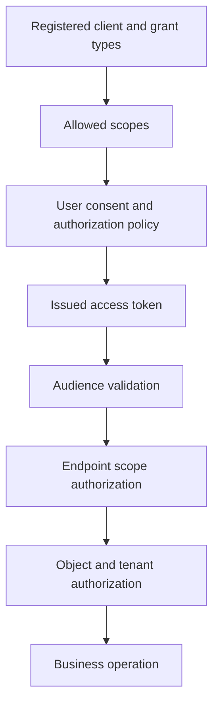

# Limiting Scopes, Audiences, and Administrative Privileges by Least Privilege

## 1. Least Privilege in OAuth 2.0

In the **Server Security** chapter of the **SPRING_SECURITY_OAUTH2_OIDC_AUTHORIZATION_SERVER** module, we learn how to design, configure, secure, test, and operate an OAuth 2.0/OpenID Connect Authorization Server with Spring Security and Spring Authorization Server.

The **least privilege** principle requires that every user, client, service, and access token receive strictly the permissions needed to complete a specific use case for the required duration. When a token is leaked or a client is compromised, the blast radius is thereby contained.

RFC 9700 recommends minimizing access token privileges for the application/use case while restricting audiences to a specific Resource Server or a very small group of Resource Servers. Each Resource Server must verify on its own that the token was issued for it.

In a Spring Authorization Server system, least privilege must be enforced across multiple layers:

1. **Client registration:** clients may request only the necessary grant types and scope set.
2. **Authorization/consent:** users grant only the subset of scopes matching policy and intended purpose.
3. **Token issuance:** access tokens carry only authorized scopes and audiences derived from trusted policy.
4. **Resource Server:** APIs validate issuer, audience, scopes, and permissions on specific resources.
5. **Admin plane:** administrative operations use dedicated clients, audiences, scopes, authentication, and approval workflows.

No single claim or annotation creates least privilege by itself. It is an end-to-end policy spanning client registration through API action enforcement.

### Learning Outcomes

After this lesson, you will be able to:

- Distinguish between scope, audience, role, permission, and resource-level authorization.
- Design a scope taxonomy organized by action and business domain.
- Constrain scopes by `RegisteredClient`, grant type, user consent, and policy.
- Bind JWT access tokens to the exact target audience.
- Separate administrative clients, scopes, and APIs from regular user applications.
- Configure Spring Authorization Server 1.5.8 to mint tokens according to policy.
- Configure Spring Security 6.5 to enforce scopes at URL and method levels.
- Combine RBAC, ABAC, tenant isolation, and object-level authorization.
- Test rejecting over-privileged tokens, wrong audiences, or missing scopes.

## 2. Distinguishing Scope, Audience, and Administrative Privileges

These three concepts answer three different questions:

| Concept | Question | Example |
| --- | --- | --- |
| Scope | What category of actions may the token perform? | `orders.read`, `orders.cancel`. |
| Audience (`aud`) | Which Resource Server was the token issued for? | `https://orders-api.example.com`. |
| Admin privilege | Which principal/client may perform sensitive administrative actions? | `orders.admin.users.disable`. |

For instance, a token carrying `orders.read` whose audience is the Billing API must still be rejected by the Orders API. A token with the Orders API audience but missing `orders.cancel` cannot cancel an order. A token carrying an administrative scope is accepted only when client, principal, audience, and policy all authorize that action.

### 2.1. Scope Is Not Role

An OAuth scope represents permissions granted to an access token within a client/resource context. A role typically describes a set of responsibilities for a user or service in the system. A permission describes a specific action on a specific object type or resource.

Example:

- Role `ROLE_ORDER_MANAGER` might group a set of business permissions.
- Scope `orders.read` allows a token to invoke order-reading endpoints.
- Permission `order:123:read` might indicate that a principal can read order `123` specifically.

Do not blindly map every role to a scope or every scope to a role. Scopes are typically coarse-grained authorization; domain policies must still decide whether the principal is authorized on a specific record.

### 2.2. Audience Is Not Scope

Audience restricts *where* a token may be used. Scope restricts *what actions* the token may perform at that resource.

A token may look like:

```json
{
  "iss": "https://auth.example.com",
  "aud": ["https://orders-api.example.com"],
  "scope": "orders.read orders.cancel"
}
```

The Orders API verifies that `aud` contains its own identifier and then verifies the scope required by the endpoint. Never infer audience from scope or vice versa.

### 2.3. Administrative Privileges Are High-Impact Permissions

Administrative privileges can alter users, clients, tenants, signing keys, policies, or system state. Never grant a single broad `admin` scope for all operations. Split them by action and resource:

- `orders.admin.users.read`
- `orders.admin.users.disable`
- `orders.admin.clients.read`
- `orders.admin.clients.manage`
- `orders.admin.refunds.approve`
- `orders.admin.audit.read`

A token that only needs to list users should never simultaneously have permission to disable users, modify client registrations, or approve refunds.

## 3. Layered Privilege-Restriction Model

Least privilege can be modeled as a narrowing chain:



Each layer only narrows permissions. No layer may ever expand permissions beyond the preceding layer.

Example:

- Client `storefront-web` is registered with only `orders.read` and `orders.create`.
- User consents only to `orders.read`.
- Token is minted with `orders.read` and audience Orders API.
- Orders API permits GET only with `SCOPE_orders.read`.
- Service verifies the order belongs to a tenant the principal is allowed to access.

Even when a token has a valid signature, issuer, and timestamps, it cannot invoke endpoints or read records outside these boundaries.

## 4. Designing a Scope Taxonomy

### 4.1. Naming by Resource and Action

Good scopes have clear, stable, reviewable names:

```text
orders.read
orders.create
orders.update
orders.cancel
orders.refund.request
orders.refund.approve
users.profile.read
users.profile.update
users.admin.disable
clients.admin.read
clients.admin.manage
```

Scopes should reflect actual actions supported by the API. Avoid generic names like `api`, `full_access`, `read`, `write`, `root`, or `admin` when they span multiple resources and use cases.

### 4.2. Avoid Implicit Scope Hierarchies

Never implicitly assume `orders.write` includes `orders.read`, or `orders.admin` includes all other scopes, unless a policy is explicitly defined, tested, and documented.

If a use case requires both reading and writing, grant the client both scopes:

```text
orders.read orders.update
```

Explicit listing ensures consent screens, audit logs, and policy reviews accurately reflect granted permissions.

### 4.3. Separate Read and Write Permissions

Reading data and mutating data carry different risks. Separate them:

| API action | Recommended scope |
| --- | --- |
| GET order detail/list | `orders.read` |
| POST create order | `orders.create` |
| PATCH order | `orders.update` |
| POST cancel order | `orders.cancel` |
| POST request refund | `orders.refund.request` |
| POST approve refund | `orders.refund.approve` |

Never use a single `orders.manage` scope when a client only needs to read or only needs to create orders.

### 4.4. Separate User and Machine Scopes

A user-facing client and a background service often need different permissions. Never grant machine-level administrative permissions to a web client merely because both call the Orders API.

Example:

- `storefront-web`: `orders.read`, `orders.create`.
- `fulfillment-worker`: `orders.read`, `orders.update`.
- `refund-approval-console`: `orders.read`, `orders.refund.approve`.
- `nightly-reconciliation`: `orders.read`, `orders.admin.reconcile`.

## 5. Constraining Scopes in RegisteredClient

`RegisteredClient` is the first boundary defining which scopes a client is allowed to request. Spring Authorization Server 1.5.8 stores this scope set inside `RegisteredClient`.

Example of two clients with different privilege boundaries:

```java
import java.time.Duration;
import java.util.List;
import java.util.UUID;

import org.springframework.context.annotation.Bean;
import org.springframework.context.annotation.Configuration;
import org.springframework.security.oauth2.core.AuthorizationGrantType;
import org.springframework.security.oauth2.core.ClientAuthenticationMethod;
import org.springframework.security.oauth2.server.authorization.client.InMemoryRegisteredClientRepository;
import org.springframework.security.oauth2.server.authorization.client.RegisteredClient;
import org.springframework.security.oauth2.server.authorization.client.RegisteredClientRepository;
import org.springframework.security.oauth2.server.authorization.settings.ClientSettings;
import org.springframework.security.oauth2.server.authorization.settings.TokenSettings;

@Configuration(proxyBeanMethods = false)
public class RegisteredClientLeastPrivilegeConfig {

    @Bean
    RegisteredClientRepository registeredClientRepository() {
        RegisteredClient storefront = RegisteredClient.withId(
                        UUID.randomUUID().toString())
                .clientId("storefront-web")
                .clientSecret("ENCODED_SECRET_FROM_PASSWORD_ENCODER")
                .clientAuthenticationMethod(
                        ClientAuthenticationMethod.CLIENT_SECRET_BASIC)
                .authorizationGrantType(AuthorizationGrantType.AUTHORIZATION_CODE)
                .redirectUri("https://shop.example.com/login/oauth2/code/storefront")
                .scope("orders.read")
                .scope("orders.create")
                .clientSettings(ClientSettings.builder()
                        .requireProofKey(true)
                        .requireAuthorizationConsent(true)
                        .build())
                .tokenSettings(TokenSettings.builder()
                        .accessTokenTimeToLive(Duration.ofMinutes(5))
                        .build())
                .build();

        RegisteredClient adminConsole = RegisteredClient.withId(
                        UUID.randomUUID().toString())
                .clientId("orders-admin-console")
                .clientSecret("ENCODED_ADMIN_SECRET_FROM_PASSWORD_ENCODER")
                .clientAuthenticationMethod(
                        ClientAuthenticationMethod.CLIENT_SECRET_BASIC)
                .authorizationGrantType(AuthorizationGrantType.AUTHORIZATION_CODE)
                .redirectUri("https://admin.example.com/login/oauth2/code/orders")
                .scope("orders.admin.users.read")
                .scope("orders.admin.users.disable")
                .scope("orders.admin.audit.read")
                .clientSettings(ClientSettings.builder()
                        .requireProofKey(true)
                        .requireAuthorizationConsent(true)
                        .build())
                .tokenSettings(TokenSettings.builder()
                        .accessTokenTimeToLive(Duration.ofMinutes(5))
                        .build())
                .build();

        return new InMemoryRegisteredClientRepository(
                List.of(storefront, adminConsole));
    }
}
```

This example is for development/testing. Production should use `JdbcRegisteredClientRepository` or a suitable persistent repository with secrets encoded via a real `PasswordEncoder`. Never store plaintext secrets or use `InMemoryRegisteredClientRepository` for deployments that must survive restarts.

`storefront-web` has no administrative scopes in its registration. Even if the client includes `orders.admin.users.disable` in an authorization request, the Authorization Server must not grant scopes outside the registered set.

### 5.1. Grant Types Are Also a Boundary

Register only the grant types a client genuinely needs:

- Web applications with user logins typically use Authorization Code + PKCE.
- Service-to-service workloads can use Client Credentials.
- Never enable Password Grant or unnecessary custom grants.
- Never grant Client Credentials to SPAs/mobile apps because they cannot protect a client secret.

A scope allowlist is meaningless if a client is given a stronger grant type or credential than its use case requires.

## 6. Consent and Authorized Scopes

In the Authorization Code Flow, a client may request a set of scopes while the resource owner approves only a subset. Spring Authorization Server represents consent using `OAuth2AuthorizationConsent`, storing the authorities granted by the resource owner to the client.

Once the flow completes, `OAuth2Authorization` stores `authorizedScopes`. This is the set of scopes granted for that specific authorization, distinct from the maximum scopes registered on the client.

Example:

| Stage | Scopes |
| --- | --- |
| `RegisteredClient` allows | `orders.read`, `orders.create`, `orders.cancel` |
| Client requests | `orders.read`, `orders.create` |
| User consents to | `orders.read` |
| Access token issued with | `orders.read` |

Never add a scope merely because it exists in `RegisteredClient`. Token customizers and token-issuance logic must rely on `authorizedScopes` after applying authorization policy.

### 6.1. The Consent Screen Must Explain Permissions

The consent screen should clearly display the application/client name, the Resource Server it wants to access, the action corresponding to each scope, sensitive scopes or admin privileges, and the impact of granting access.

Never display raw technical scope names without user-facing explanations. Never bundle read, write, and admin permissions into a single "Allow access" checkbox.

### 6.2. Consent Does Not Replace Server-Side Policy

Consent proves the resource owner approved a subset of requested permissions. The Authorization Server must still enforce policy: whether the client may request that scope, whether the user has sufficient privileges, whether the tenant may access that resource, and whether the scope fits the audience.

With the Client Credentials Grant, there is no resource owner to consent. The Authorization Server must constrain scopes via client registration, service account policy, and resource policy.

In particular, a user clicking consent does not prove the user holds administrative privileges. The Authorization Server must verify the principal's entitlements before permitting admin scopes in the authorization/token flow. Consent answers whether the user allows the client to act on their behalf; server-side policy answers whether that user is eligible to hold those privileges.

## 7. Constraining Scopes by Client, User, and Grant

A scope should be granted only when every required condition holds:

```text
granted scopes
    = client allowed scopes
    ∩ grant/requested scopes
    ∩ user consent (when applicable)
    ∩ server-side authorization policy
```

This is a conceptual model. Each grant type has specific protocol rules, but the core principle is that each policy layer may only narrow the permission set.

### 7.1. Users Cannot Exceed Their Own Privileges

A user with role `CUSTOMER_SUPPORT` may read order details to assist customers, yet must not be granted `orders.admin.users.disable`. If a client requests this scope, the Authorization Server must reject or withhold that scope according to defined protocol/policy.

### 7.2. Clients Cannot Exceed Their Registered Privileges

Client `storefront-web` cannot inject administrative scopes into a token request. The scope set in `RegisteredClient` is a server-side boundary; never trust the requested scope list from the request as authoritative.

### 7.3. Client Credentials Needs Dedicated Service Principals

With Client Credentials, the principal represents the client/service rather than a logged-in user. Never copy all user roles into machine-to-machine tokens.

Each service should have its own client ID, its own rotatable credentials, minimal grant types, workload-specific scopes, target API audience, and short token TTLs.

Never share one over-privileged service client with read/write/admin access across all APIs for every batch job.

## 8. Scopes Do Not Replace Audience Restrictions

RFC 9700 recommends restricting access tokens to a single Resource Server or a very small set of Resource Servers. A Resource Server must reject any token whose audience does not include itself.

Example:

| Resource Server | Audience |
| --- | --- |
| Orders API | `https://orders-api.example.com` |
| Billing API | `https://billing-api.example.com` |
| Orders Admin API | `https://orders-admin-api.example.com` |

Never issue one access token with audience `https://all-apis.example.com` just so a client can reuse one token across every service. Doing so widens impact if a token leaks and prevents resource servers from distinguishing intended targets.

### 8.1. Resource Indicators

RFC 8707 defines the `resource` request parameter, allowing a client to specify the exact protected resource the token will access. The Authorization Server can use resource indicators to apply policy and populate appropriate audiences.

The `resource` value must be an absolute URI with no fragment. The Authorization Server must verify whether the resource belongs to the client/grant allowlist. If rejected, it can return `invalid_target`.

Spring Authorization Server 1.5.8 provides custom token generation and endpoint extensions, but do not assume resource indicators are automatically enforced merely because `RegisteredClient` defines scopes. If implementing RFC 8707, you must:

1. Parse and validate `resource` at the Authorization Endpoint / Token Endpoint.
2. Verify the resource belongs to the client's allowlist.
3. Persist granted resources alongside the authorization/grant.
4. When minting tokens, read resources from the verified authorization state.
5. Set the corresponding audience without echoing arbitrary request URLs into `aud`.
6. On refresh or token exchange, allow only resources within the original grant or a policy-permitted subset.

### 8.2. Multi-Audience Tokens Only When Strictly Necessary

If a client must call multiple APIs, prefer requesting separate tokens per resource. Use multiple audiences only when the APIs share the same trust boundary and have a clear operational justification. Each Resource Server must still validate its own audience.

## 9. Policy-Driven Audience Issuance in Spring Authorization Server

Spring Authorization Server 1.5.8 provides `OAuth2TokenCustomizer<JwtEncodingContext>` to customize JWT headers/claims. The context exposes `RegisteredClient`, `authorizedScopes`, principal, grant type, and token type.

Example mapping client IDs to governed audiences:

```java
import java.util.List;
import java.util.Map;
import java.util.Set;

import org.springframework.context.annotation.Bean;
import org.springframework.context.annotation.Configuration;
import org.springframework.security.oauth2.server.authorization.OAuth2TokenType;
import org.springframework.security.oauth2.server.authorization.token.JwtEncodingContext;
import org.springframework.security.oauth2.server.authorization.token.OAuth2TokenCustomizer;

@Configuration(proxyBeanMethods = false)
public class AccessTokenAudiencePolicy {

    private static final Map<String, String> CLIENT_AUDIENCES = Map.of(
            "storefront-web", "https://orders-api.example.com",
            "orders-admin-console", "https://orders-admin-api.example.com",
            "billing-worker", "https://billing-api.example.com");

    private static final Set<String> ADMIN_SCOPES = Set.of(
            "orders.admin.users.read",
            "orders.admin.users.disable",
            "orders.admin.audit.read");

    @Bean
    OAuth2TokenCustomizer<JwtEncodingContext> accessTokenCustomizer() {
        return context -> {
            if (!OAuth2TokenType.ACCESS_TOKEN.equals(context.getTokenType())) {
                return;
            }

            String clientId = context.getRegisteredClient().getClientId();
            String audience = CLIENT_AUDIENCES.get(clientId);
            if (audience == null) {
                throw new IllegalStateException(
                        "No audience policy is registered for this client");
            }

            boolean requestsAdminScope = context.getAuthorizedScopes()
                    .stream()
                    .anyMatch(ADMIN_SCOPES::contains);

            boolean hasAdminPrincipal = context.getPrincipal().getAuthorities()
                    .stream()
                    .anyMatch(authority ->
                            "ROLE_ORDERS_ADMIN".equals(authority.getAuthority()));

            if (requestsAdminScope &&
                    (!"orders-admin-console".equals(clientId) ||
                            !hasAdminPrincipal)) {
                throw new IllegalStateException(
                        "The client or principal is not allowed to receive admin scopes");
            }

            context.getClaims().audience(List.of(audience));
        };
    }
}
```

This is an illustrative policy. In real systems, client/audience/scope mappings should live in governed configuration or a policy store. Checking `ROLE_ORDERS_ADMIN` here acts as a final backstop; authorization policy should already exclude admin scopes from under-privileged users before issuing an authorization code. If you have multiple `OAuth2TokenCustomizer<JwtEncodingContext>` needs, combine the logic into one bean to avoid duplicate beans of the same generic type. This customizer applies only to JWT access tokens; opaque tokens require the corresponding customizer/token generator.

Never take audience from request parameters, `Host` headers, or unverified claims. Audiences must come from a governed resource mapping.

### 9.1. Why Does the Customizer Inspect Authorized Scopes?

`context.getAuthorizedScopes()` holds the scopes actually granted to the authorization being processed. Never use the client's raw requested scopes or UI defaults to populate claims. If a scope was not granted, it must not appear in the access token.

### 9.2. Never Put API Audiences into ID Tokens

An ID Token's audience identifies the OIDC client, whereas an access token's audience identifies the Resource Server. Customizers must check `OAuth2TokenType.ACCESS_TOKEN` before modifying claims. Never overwrite an ID Token's audience with an API audience.

## 10. Resource Servers Must Validate Audience

Every Resource Server must configure its own issuer and audience. Example for Orders API:

```yaml
spring:
  security:
    oauth2:
      resourceserver:
        jwt:
          issuer-uri: https://auth.example.com
          audiences: https://orders-api.example.com
```

With Spring Security 6.5, `issuer-uri` validates the issuer; `audiences` validates that the token carries the API's audience. If a validly signed token was issued solely for the Billing API, the Orders API must reject it.

If declaring a custom `JwtDecoder`, retain issuer validation, timestamp validation, and audience validation. Never accidentally replace default validators with one that checks only scopes.

### 10.1. Opaque Tokens

With opaque/reference tokens, Resource Servers use introspection rather than decoding JWTs locally. The Resource Server must still verify whether the token was issued for that resource and which policies apply. If the introspection response or Authorization Server policy does not expose a clear audience, add resource binding on the Authorization Server or an equivalent validation check.

## 11. Protecting Endpoints with Scopes in Spring Security

Spring Security maps each JWT scope to a `GrantedAuthority` prefixed with `SCOPE_` by default. Thus, scope `orders.read` becomes `SCOPE_orders.read`.

Example:

```java
import static org.springframework.http.HttpMethod.GET;
import static org.springframework.http.HttpMethod.POST;

import org.springframework.context.annotation.Bean;
import org.springframework.context.annotation.Configuration;
import org.springframework.security.config.Customizer;
import org.springframework.security.config.annotation.web.builders.HttpSecurity;
import org.springframework.security.web.SecurityFilterChain;

@Configuration(proxyBeanMethods = false)
public class OrdersApiSecurityConfig {

    @Bean
    SecurityFilterChain apiSecurityFilterChain(HttpSecurity http)
            throws Exception {
        http
            .authorizeHttpRequests(authorize -> authorize
                .requestMatchers("/actuator/health").permitAll()
                .requestMatchers(GET, "/api/orders/**")
                    .hasAuthority("SCOPE_orders.read")
                .requestMatchers(POST, "/api/orders")
                    .hasAuthority("SCOPE_orders.create")
                .requestMatchers(POST, "/api/orders/*/cancel")
                    .hasAuthority("SCOPE_orders.cancel")
                .anyRequest().denyAll()
            )
            .oauth2ResourceServer(oauth2 ->
                oauth2.jwt(Customizer.withDefaults())
            );

        return http.build();
    }
}
```

Specific rules are declared before general rules. `anyRequest().denyAll()` ensures new endpoints do not silently become `authenticated()`-only and accidentally lack scope checks. Whenever adding a new API, developers must explicitly declare its required permissions.

### 11.1. Scopes by HTTP Method

A single route can represent different actions per HTTP method. For example, GET order requires `orders.read`, while POST cancel requires `orders.cancel`. Never guard `/api/orders/**` with an overly broad `orders.manage` scope.

### 11.2. Do Not Confuse 401 and 403

- `401 Unauthorized`: token is missing, invalid, wrong issuer/audience, or expired.
- `403 Forbidden`: token is valid, but lacks required scope or is denied by domain policy.

Never turn a missing scope into `permitAll`, and never skip authorization simply because client authentication succeeded.

## 12. Protecting the Method and Service Layer

URL authorization is only the first layer. Service methods also need permission checks because the same service may be called from multiple controllers, message listeners, or scheduled jobs.

Enable method security:

```java
import org.springframework.context.annotation.Configuration;
import org.springframework.security.config.annotation.method.configuration.EnableMethodSecurity;

@Configuration
@EnableMethodSecurity
public class MethodSecurityConfiguration {
}
```

Then protect the service:

```java
import org.springframework.security.access.prepost.PreAuthorize;
import org.springframework.stereotype.Service;

@Service
public class OrderCommandService {

    @PreAuthorize("hasAuthority('SCOPE_orders.cancel')")
    public void cancelOrder(String orderId) {
        // Apply domain rules and persist the cancellation.
    }
}
```

Method security does not replace domain validation. Services must still check order status, cancellation windows, tenant, and order ownership.

## 13. Object-Level Authorization and Tenant Isolation

Scope `orders.read` allows invoking the order-reading capability. It does not automatically grant permission to read every order in the system.

A service can combine scope checks with record-level permissions:

```java
import org.springframework.security.core.Authentication;
import org.springframework.security.oauth2.server.resource.authentication.JwtAuthenticationToken;
import org.springframework.stereotype.Component;

@Component("orderAuthorization")
public class OrderAuthorization {

    private final OrderRepository orderRepository;

    public OrderAuthorization(OrderRepository orderRepository) {
        this.orderRepository = orderRepository;
    }

    public boolean canRead(Authentication authentication, String orderId) {
        if (!(authentication instanceof JwtAuthenticationToken jwtAuth)) {
            return false;
        }

        String tenantId =
                jwtAuth.getToken().getClaimAsString("tenant_id");
        String subject = jwtAuth.getToken().getSubject();

        if (tenantId == null || subject == null) {
            return false;
        }

        return orderRepository.existsReadableOrder(
                orderId, tenantId, subject);
    }
}
```

Apply in the service:

```java
import org.springframework.security.access.prepost.PreAuthorize;

@PreAuthorize(
        "hasAuthority('SCOPE_orders.read') and " +
        "@orderAuthorization.canRead(authentication, #orderId)")
public Order findOrder(String orderId) {
    return orderRepository.findById(orderId)
            .orElseThrow(OrderNotFoundException::new);
}
```

Repository method `existsReadableOrder` must enforce tenant/owner checks in the database. When fetching data, queries must also filter by tenant; never authorize first and then fetch the record by ID without a tenant predicate.

If the principal is a service account, domain policy may evaluate service identity instead of a user subject. Never assume every token represents an end user.

## 14. Separating Admin Clients and Admin APIs

### 14.1. Use Dedicated Client Registrations

Never add admin scopes to a regular user web client. Create a separate client for the admin console with its own client ID and credentials, admin-only redirect URIs, Authorization Code + PKCE, authorization consent or equivalent grant policy, action-specific admin scopes, short access token TTL, stronger authentication, and dedicated auditing.

Client Credentials for administrative automation also need separate client IDs, narrow scopes, and managed service identities. Never reuse admin console credentials inside cron jobs.

### 14.2. Separate Audience for the Admin Plane

If the admin API is a separate Resource Server, assign a distinct audience, such as:

```text
https://orders-admin-api.example.com
```

The admin API accepts only tokens with this audience and specific admin scopes. A token with the Orders API audience cannot call the admin API, even if misconfiguration granted a similarly named scope.

Example dedicated Resource Server configuration for Orders Admin API:

```yaml
spring:
  security:
    oauth2:
      resourceserver:
        jwt:
          issuer-uri: https://auth.example.com
          audiences: https://orders-admin-api.example.com
```

Endpoints that disable users require a dedicated scope:

```java
.requestMatchers(POST, "/admin/users/*/disable")
    .hasAuthority("SCOPE_orders.admin.users.disable")
```

If admin routes and user routes reside in the same Resource Server, they share that resource's audience; in that case, enforce strict scope and policy separation. Merely placing routes under `/admin` does not create an audience boundary.

### 14.3. Isolate the Admin Plane from Public APIs

For high-impact operations, deploy the admin API in a dedicated service or network zone:

- Do not expose it directly to the public Internet unless required.
- Accept traffic only from authenticated gateways, VPNs, or management networks.
- Enforce firewall/network policies and mTLS where appropriate.
- Separate database credentials and data access permissions.
- Enforce dedicated rate limits, auditing, and alerts.

Network isolation complements OAuth authorization; it does not replace scopes, audiences, or authentication.

## 15. Constraining Administrative Actions by Action

Never use one admin scope for all admin endpoints. Example:

| Action | Scope |
| --- | --- |
| List/view users | `orders.admin.users.read` |
| Disable a user | `orders.admin.users.disable` |
| View client registrations | `orders.admin.clients.read` |
| Modify client registrations | `orders.admin.clients.manage` |
| View audit logs | `orders.admin.audit.read` |
| Approve refunds | `orders.admin.refunds.approve` |

A support agent may read user details without being able to disable users or modify clients. A batch job may run reconciliation without logging into the admin console or editing `RegisteredClient`.

### 15.1. Separation of Duties

Certain actions should require two people or two approval steps:

- Changing signing keys or issuer configuration.
- Modifying clients that hold administrative scopes.
- Creating clients with access to sensitive data.
- Approving refunds above a threshold.
- Deleting tenants or disabling privileged accounts.

A single token should never be able to initiate, self-approve, and execute a sensitive change.

## 16. Step-Up Authentication for Sensitive Operations

Administrative scopes define granted capabilities, yet highly sensitive actions may also demand recent authentication or a higher assurance level.

Step-up policies may require completed MFA, a recent `auth_time`, an approved `acr`/`amr` assurance level, a dedicated short-lived admin session, or re-authentication immediately prior to the action.

Resource Servers must trust such claims only when they come from a trusted issuer, are signed, and carry clear contract semantics. Never treat a self-asserted `amr: ["mfa"]` string as MFA proof if the Authorization Server did not genuinely verify it.

Step-up does not replace scopes. The user must still possess `orders.admin.users.disable` while also satisfying authentication freshness conditions.

## 17. Customizing Authorities in Access Tokens

Spring Authorization Server supports adding custom claims to JWTs via `OAuth2TokenCustomizer<JwtEncodingContext>`. Add only data needed by the Resource Server and only on the appropriate token type.

If embedding a set of permissions into tokens, source them from a trusted authorization service, include only permissions relevant to the current audience, bound claim count and token size, never copy all user roles into every access token, and never derive authorities from request parameters or client-supplied values.

For example, Spring Authorization Server can add a `permissions` claim from the principal after applying policy. This is illustrative; real systems should use an entitlement service and per-resource mappings:

```java
import java.util.Set;
import java.util.stream.Collectors;

import org.springframework.context.annotation.Bean;
import org.springframework.context.annotation.Configuration;
import org.springframework.security.core.GrantedAuthority;
import org.springframework.security.oauth2.server.authorization.OAuth2TokenType;
import org.springframework.security.oauth2.server.authorization.token.JwtEncodingContext;
import org.springframework.security.oauth2.server.authorization.token.OAuth2TokenCustomizer;

@Configuration(proxyBeanMethods = false)
public class PermissionClaimsConfiguration {

    @Bean
    OAuth2TokenCustomizer<JwtEncodingContext> permissionClaimsCustomizer() {
        return context -> {
            if (!OAuth2TokenType.ACCESS_TOKEN.equals(context.getTokenType())) {
                return;
            }

            Set<String> permissions = context.getPrincipal().getAuthorities()
                    .stream()
                    .map(GrantedAuthority::getAuthority)
                    .filter(authority -> authority.startsWith("PERM_"))
                    .map(authority -> authority.substring("PERM_".length()))
                    .filter(permission -> permission.startsWith("orders."))
                    .collect(Collectors.toUnmodifiableSet());

            context.getClaims().claim("permissions", permissions);
        };
    }
}
```

This example illustrates filtering authorities by namespace. It does not by itself prove the user is authorized on an individual order; object-level policy still runs in the Resource Server. If you already have an `OAuth2TokenCustomizer<JwtEncodingContext>` for audience, merge the logic into the same customizer instead of declaring multiple beans with the same generic type.

The `permissions` claim does not automatically become `GrantedAuthority` instances in Spring Security. If the Resource Server needs this claim in `hasAuthority`/`PreAuthorize`, configure a `JwtAuthenticationConverter` with an explicit allowlist mapping. Otherwise, keep the claim as auxiliary data checked in domain policy; never blindly promote every claim value into an authority.

### 17.1. Avoid Mechanically Turning Roles into Scopes

Before placing roles into tokens, the Resource Server needs to know whether the role belongs to a user or client, which audiences it applies to, whether it is tenant-scoped, how often it changes, and whether token lifetimes are short enough for permission changes to take effect promptly.

For frequently changing or high-impact privileges, prefer querying a policy service or introspection rather than embedding all privileges inside long-lived JWTs.

## 18. Token Lifetimes and Constraining Privileges Over Time

Even a minimally privileged token creates risk if it lives too long. Admin tokens should have shorter TTLs than regular user tokens wherever use cases permit.

Principles:

- Short access token lifetimes matched to risk and operational latency.
- Issue refresh tokens only to clients that genuinely need persistent sessions.
- Client Credentials clients should request fresh access tokens rather than using refresh tokens.
- Refresh flows must never expand scopes beyond the original grant.
- When a user loses privileges or a client is disabled, provide processes to revoke authorizations/tokens.
- Sensitive admin actions may require a fresh token obtained after step-up.

Spring Authorization Server's `TokenSettings` allows configuring access token TTL and refresh token behavior per `RegisteredClient`. Configuring TTLs does not replace revocation, audience validation, or endpoint authorization.

## 19. Dynamic Client Registration and Administrative Scopes

Dynamic Client Registration may allow clients to self-register. Uncontrolled, clients could request broad scopes or misrepresent their purpose.

Registration policies must:

- Allow only grant types appropriate for the client type.
- Allowlist scopes by application type and target resource.
- Never grant administrative scopes to public clients by default. If an admin SPA exists, enforce dedicated registration, PKCE, strong authentication/step-up policy, and explicit risk review.
- Require review/approval for sensitive scopes.
- Enforce audience/resource bindings per policy.
- Cap client counts, redirect URIs, and credentials.
- Maintain processes to revoke clients/credentials upon detecting abuse.

Never let clients self-register arbitrary scopes simply because the protocol allows submitting a scope list in metadata. The Authorization Server must remain the authority deciding maximum privileges.

## 20. Auditing and Monitoring Privileges

Least privilege must be observed after deployment. Track which clients request which scopes, request/grant/consent rates per scope, which audiences are issued to each client, which principals/clients receive admin tokens, which admin endpoints are called and their authorization outcomes, rejections due to wrong audience or missing scope, clients holding unused scopes over long periods, and changes to `RegisteredClient`/consents/policies.

Never log raw access tokens, refresh tokens, or client secrets. Log client ID, an appropriate principal identifier, audience, granted scopes, correlation ID, and policy outcome.

### 20.1. Periodic Review Process

Periodically:

1. Compare registered scopes against scopes actually used by each client.
2. Remove scopes that are no longer needed.
3. Audit clients holding administrative privileges and verify their owners.
4. Check whether any audiences are overly broad.
5. Audit inactive service accounts and stale credentials.
6. Check for users/roles who left the organization yet still hold active consents/tokens.
7. Test revoking and disabling clients.

Never retain unused privileges just because a client might need them later. Re-grant them only through an approved request when needed.

## 21. Testing Least Privilege

Test both token issuance and Resource Servers. An API rejecting a request does not prove the Authorization Server minted a minimal token; conversely, a minimally scoped token does not guarantee the API validates permissions properly.

| Category | Scenario | Expectation |
| --- | --- | --- |
| Client scope boundary | Client requests a scope absent from `RegisteredClient`. | Scope is not granted; request is rejected or scope omitted per protocol/policy. |
| Consent subset | User consents to only a subset of scopes. | Token contains only consented scopes. |
| Client Credentials | Service requests admin scope outside allowlist. | Token is not granted that scope. |
| Audience | Token issued solely for Billing API sent to Orders API. | Orders API rejects it. |
| Multiple audiences | Token carries overly broad audience. | Issuance policy rejects or Resource Server rejects non-allowlisted audience. |
| Missing scope | Token lacking `orders.cancel` calls cancel endpoint. | `403 Forbidden`. |
| Read/write separation | Token with `orders.read` calls POST create. | Rejected. |
| Admin scope | Storefront token calls admin API. | Rejected due to audience/scope. |
| Admin client | Admin console token lacks `orders.admin.users.disable`. | Cannot disable user. |
| Cross-tenant | Tenant A token reads Tenant B order. | Domain authorization rejects. |
| Client disabled | Client is disabled while old token is still unexpired. | Outcome follows revocation/introspection policy; never assume JWTs auto-invalidate. |
| Expired token | Token is expired. | `401 Unauthorized`. |
| Unknown scope | JWT contains scope outside the contract. | Not mapped to an accepted authority. |
| Role confusion | User role mistakenly placed into client/service principal. | Tests catch incorrect principal type/claim mapping. |
| Admin step-up | Scope is present, yet MFA/auth freshness fails. | Sensitive action is rejected. |
| Token refresh | Refresh request attempts to escalate scope. | Only scopes within original grant/policy are re-issued. |
| DCR overprivilege | Self-registered client requests admin scope. | Registration rejected or requires special approval. |
| Default deny | New endpoint has no authorization rule yet. | Request is rejected. |

### 21.1. Unit Tests for Scope Policy

Test policy mapping from client ID to scopes/audience covering valid clients and valid audiences, unmapped client IDs, regular clients requesting admin scopes, admin clients requesting a subset of admin scopes, and clients requesting unregistered scopes.

### 21.2. Integration Tests with Real JWTs

Mint a JWT signed by a test key with specific issuer, audience, and scopes. Send it to the API:

- Wrong audience must fail at the decoder.
- Right audience with missing scope must fail at authorization.
- Right audience/scope with wrong tenant must fail at domain policy.
- Only requests passing all policies may execute the business operation.

Do not rely solely on the `jwt()` request post-processor to conclude audience/signature validation works; that post-processor mocks an already-created authentication and does not verify real signatures.

## 22. Troubleshooting

| Symptom | Possible cause | Resolution |
| --- | --- | --- |
| Client receives broader scopes than intended | `RegisteredClient` has overly broad scopes or customizer adds arbitrary authority claims. | Narrow registration and use only `authorizedScopes`. |
| Token has scope yet API returns 403 | Endpoint requires different authority or wrong prefix mapping. | Check `SCOPE_` prefix and HTTP method rules. |
| Valid token yet API returns 401 | Audience or issuer mismatch. | Check `audiences` and `issuer-uri`. |
| Token works across multiple APIs | Shared audience or Resource Server skips audience validation. | Split audiences and enable validators on each API. |
| Admin client is over-privileged | Uses broad `admin` scope or reuses user web client. | Separate client, audience, and per-action scopes. |
| User consents to excessive permissions | Consent screen bundles permissions or client requests too many scopes. | Display individual permissions and cap requested scopes. |
| Service account holds user privileges | User roles copied into client credentials token. | Separate principal types and machine entitlements. |
| Tenant A user accesses Tenant B data | Only scopes checked, missing object/tenant predicates. | Add ABAC and tenant filtering in repositories. |
| Permissions revoked yet token still works | Self-contained JWT with long TTL. | Shorten TTL, use revocation/introspection or online policy checks. |
| New admin endpoint exposed | Fallback rule uses `authenticated()`. | Use default deny and explicit scope declarations. |

## 23. Hands-On Exercises and Checklist

### Exercise 1 — Design a Scope Taxonomy

Design scopes for Orders API covering read, create, update, cancel, and refund approval. Separate user-facing and admin privileges. Do not use generic `admin` or `write` scopes.

### Exercise 2 — Create Least-Privilege RegisteredClients

Create `storefront-web` with only `orders.read` and `orders.create`. Create `orders-admin-console` with specific admin scopes. Attempt to request an unregistered scope and observe the outcome.

### Exercise 3 — Audience Binding

Create Orders API and Billing API with distinct audiences. Issue tokens for each client and test cross-calling both APIs. Confirm each API rejects wrong-audience tokens.

### Exercise 4 — Consent Subset

Request three scopes but consent to only one. Verify the access token carries only the consented scope.

### Exercise 5 — Admin API

Isolate admin endpoints, require the admin API audience, and enforce per-action scopes. Attempt to call admin endpoints with a storefront token.

### Exercise 6 — Tenant/Object Authorization

Create two tenants with different order IDs. Ensure a Tenant A token with `orders.read` cannot read Tenant B's order.

### Exercise 7 — Privilege Review

Write a report listing which clients hold administrative scopes, granted audiences, token TTLs, and owners. Propose removing unused scopes or clients.

### Completion Checklist

- [ ] Scopes are named by resource and action.
- [ ] No unrestricted shared `admin` or `full_access` scopes exist.
- [ ] Read, write, and admin scopes are separated.
- [ ] `RegisteredClient` holds only necessary grant types and scopes.
- [ ] Authorization consent supports granting a subset of scopes.
- [ ] Client Credentials uses dedicated service principals.
- [ ] Tokens carry only `authorizedScopes`.
- [ ] Audiences are resolved from trusted mappings/policies.
- [ ] Each Resource Server validates its own audience.
- [ ] Admin clients and admin APIs are appropriately separated.
- [ ] Admin actions enforce step-up/separation of duties where needed.
- [ ] Both endpoints and methods enforce authorization policies.
- [ ] Domain services enforce object-level and tenant access checks.
- [ ] Endpoints without explicit policies are denied by default.
- [ ] Access token TTLs align with risk.
- [ ] Processes exist to revoke/disable clients and review consents.
- [ ] Audit logs contain no raw tokens or secrets.
- [ ] Tests cover wrong audience, missing scope, over-privilege, and cross-tenant access.

## 24. References

- [RFC 9700 — Best Current Practice for OAuth 2.0 Security](https://www.rfc-editor.org/rfc/rfc9700.html) — access token privilege restriction and audience restriction.
- [RFC 8707 — Resource Indicators for OAuth 2.0](https://www.rfc-editor.org/rfc/rfc8707.html) — `resource` request parameter and audience-aware token issuance.
- [RFC 9068 — JWT Profile for OAuth 2.0 Access Tokens](https://www.rfc-editor.org/rfc/rfc9068.html) — JWT access token claims, issuer, and audience.
- [Spring Authorization Server 1.5.8 — Core Model / Components](https://docs.spring.io/spring-authorization-server/reference/core-model-components.html) — `RegisteredClient` scopes, `OAuth2Authorization` `authorizedScopes`, consent, and token customizers.
- [Spring Authorization Server 1.5.8 — Add authorities as custom claims in JWT access tokens](https://docs.spring.io/spring-authorization-server/reference/guides/how-to-custom-claims-authorities.html) — adding authority claims to JWT access tokens.
- [Spring Security 6.5 — OAuth 2.0 Resource Server JWT](https://docs.spring.io/spring-security/reference/6.5/servlet/oauth2/resource-server/jwt.html) — audience validation, scope-to-authority mapping, and `JwtAuthenticationConverter`.
- [Spring Security 6.5 — Authorize HttpServletRequests](https://docs.spring.io/spring-security/reference/6.5/servlet/authorization/authorize-http-requests.html) — `requestMatchers`, `hasAuthority`, method-based authorization, and `denyAll`.
- [Spring Security 6.5 — Method Security](https://docs.spring.io/spring-security/reference/6.5/servlet/authorization/method-security.html) — `PreAuthorize`, `hasPermission`, and object-level authorization.

**Conclusion:** Least privilege must restrict permissions from client registration, grants, and consent through token issuance and API authorization. Scopes define actions, audiences identify the receiving Resource Server, and administrative privileges must be isolated by client, API, action, and authentication policy. Spring Authorization Server provides `RegisteredClient`, `authorizedScopes`, and token customization to bound tokens; Spring Security validates audiences, maps scopes to authorities, and enforces endpoint/method policies. Record-level and tenant permissions must still be enforced in the business layer.
