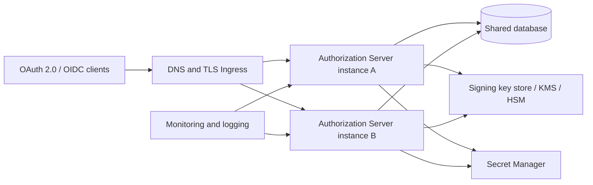

# Packaging the Application and Configuring the Production Environment

Taking an OAuth 2.0/OpenID Connect Authorization Server to production requires more than packaging Spring Boot into a JAR and running it on a server. This service manages clients, consents, authorization codes, access tokens, refresh tokens, and signing keys. Therefore, how you package, configure networking, store data, and manage keys all directly affect the ability to issue and verify tokens.

This lesson focuses on preparing a Spring Authorization Server application for repeatable deployment, per-environment configuration, and safe operation across multiple instances. The examples assume the application is built with Spring Boot; adjust the Java version, build plugins, and configuration to match the Spring Boot/Spring Authorization Server version your project uses.

## 1. Goals of a production deployment

A deployment that can operate reliably should meet the following goals:

- **Immutable artifact:** the same source code version produces the same identifiable artifact or image. Development, staging, and production environments run the same artifact; differences lie in runtime configuration.
- **Externalized configuration:** the issuer, database address, connection details, and resource limits are provided by the deployment environment or a configuration management system.
- **Persistent data:** registered clients, consents, and authorization state must survive application restarts or requests being routed to another instance.
- **Stable signing keys:** every instance can verify tokens issued by any other instance; private keys are not arbitrarily regenerated on each startup.
- **Consistent public addresses:** the issuer, discovery metadata, endpoints, and redirect URIs must reflect the exact address that clients access externally.
- **Observability and recoverability:** appropriate health checks, proper logging, backups, and deployment and rollback procedures are in place.

The Authorization Server typically sits on the critical path for login and token issuance across many applications. A misconfiguration can simultaneously break login flows, token refresh, or signature verification across the entire system.

## 2. Reference deployment architecture

In production, separate the application from shared components that have their own lifecycles:



The ingress or reverse proxy terminates HTTPS connections and routes requests to one of the instances. The instances share a database and access a single protected source of signing keys. The Secret Manager provides sensitive information at application startup or when the deployment platform mounts secrets into the workload.

This diagram does not mandate a specific product. The database can be a managed service or a cluster operated by your organization; the key store can be a KMS, HSM, or a secret manager with appropriate access controls. What matters is that every instance has the same view of authorization data and token verification keys.

## 3. Preparing Spring Authorization Server configuration

### 3.1. Fixing the issuer to the public address

The issuer is the identifier of the Authorization Server. This value appears in discovery metadata and the `iss` claim of JWTs. It must remain stable across deployments and across instances, and match the exact address that clients trust.

You can inject the issuer into `AuthorizationServerSettings` instead of hardcoding it in source code:

```java
@Configuration
public class AuthorizationServerDeploymentConfig {

    @Bean
    AuthorizationServerSettings authorizationServerSettings(
            @Value("${app.security.issuer}") String issuer) {
        return AuthorizationServerSettings.builder()
                .issuer(issuer)
                .build();
    }
}
```

In production configuration, supply the value from an environment variable or configuration system:

```yaml
app:
  security:
    issuer: ${AUTH_SERVER_ISSUER}
```

For example, the value is `https://auth.example.com`. Do not use a container's internal hostname as the public issuer. Also do not generate different issuers per replica, pod, or server IP address.

### 3.2. Reviewing related security configurations

Before packaging, verify that the following settings are managed per environment:

- Each client's redirect URIs are specific registered URIs. Avoid wildcards or rules that allow redirecting to arbitrary hosts.
- Client IDs, client types, authentication methods, grant types, scopes, and PKCE requirements match each application.
- Access tokens, refresh tokens, and authorization codes have lifetimes aligned with your security policy.
- The consent mechanism remains consistent across deployments.
- `SecurityFilterChain` beans protect the authorization endpoint, token endpoint, OIDC endpoints, and administrative endpoints with the right scope.
- CORS configuration allows only necessary origins. Do not open up CORS broadly to work around client configuration errors.

Do not disable CSRF across the entire application just because the Authorization Server has OAuth 2.0 endpoints. Apply protection rules per security filter chain and per endpoint type.

## 4. Packaging artifacts and images

### 4.1. Producing reproducible artifacts

Use the Maven Wrapper or Gradle Wrapper committed alongside the project so CI and developer machines run the same tool version. For example:

```bash
# Maven
./mvnw clean verify

# Gradle
./gradlew clean check bootJar
```

Choose the command corresponding to your actual build system; you do not need to run both. The build step should execute tests, check dependencies, and produce an executable JAR. Tag the version or attach the commit SHA so a running image can be traced back to the source code and build run.

Do not copy secrets, private keys, production config files, or client data into the JAR. The artifact should be identical across environments; environment-specific values are passed in at runtime.

### 4.2. Building an OCI image

If the project uses the Spring Boot Maven Plugin, you can build an image with buildpacks:

```bash
./mvnw spring-boot:build-image \
  -Dspring-boot.build-image.imageName=registry.example.com/security/authorization-server:1.0.0
```

With Gradle and the Spring Boot Gradle Plugin:

```bash
./gradlew bootBuildImage \
  --imageName=registry.example.com/security/authorization-server:1.0.0
```

Buildpacks let you build an image from a Spring Boot application without maintaining a Dockerfile yourself. If you use a Dockerfile, choose a JRE compatible with the application's target Java version, run as a non-root user, and copy only the necessary artifact into the image. Illustrative example:

```dockerfile
FROM eclipse-temurin:21-jre
WORKDIR /app
COPY target/authorization-server.jar /app/app.jar
USER 10001:10001
EXPOSE 8080
ENTRYPOINT ["java", "-XX:MaxRAMPercentage=75.0", "-jar", "/app/app.jar"]
```

The example above assumes the artifact is named `authorization-server.jar` and the application runs on Java 21. If your project uses Java 17 or another version, choose the corresponding runtime image. `MaxRAMPercentage` should be tuned according to the container's memory limit and the memory reserved for native memory, thread stacks, and off-heap components.

In CI, attach an immutable tag or digest to the image, store an SBOM, scan dependencies and the image for vulnerabilities, and sign the image following your organization's process. Avoid using the `latest` tag as the sole identifier for production because a tag can be repointed to different content.

## 5. Externalizing configuration per environment

### 5.1. Separating configuration from the artifact

Spring Boot supports configuration via `application.yml`, profiles, environment variables, and external configuration sources. You may keep non-sensitive defaults in the repository, but production must explicitly supply required values such as the issuer and database connection details.

Partial production configuration example:

```yaml
server:
  port: ${SERVER_PORT:8080}
  forward-headers-strategy: framework
  shutdown: graceful

spring:
  datasource:
    url: ${DB_URL}
    username: ${DB_USERNAME}
    password: ${DB_PASSWORD}
    hikari:
      minimum-idle: ${DB_POOL_MIN:5}
      maximum-pool-size: ${DB_POOL_MAX:20}
  lifecycle:
    timeout-per-shutdown-phase: 30s

app:
  security:
    issuer: ${AUTH_SERVER_ISSUER}

management:
  endpoints:
    web:
      exposure:
        include: health,info
  endpoint:
    health:
      probes:
        enabled: true
      show-details: never
      group:
        readiness:
          include: readinessState,db
```

This is an illustrative configuration, not a complete file for every application. Only enable `forward-headers-strategy: framework` when the application sits behind a trusted proxy that sets forwarded headers properly. If you do not use a reverse proxy or your platform uses a different mechanism, choose the appropriate strategy instead of copying the configuration verbatim.

When a required variable such as `AUTH_SERVER_ISSUER` or `DB_URL` is missing, the application should fail to start and report a clear configuration error. Do not set a fake production value as a default so that the application silently runs with the wrong issuer or database.

### 5.2. Distinguishing regular configuration from secrets

Values such as port, profile name, log level, and pool limits can usually be managed as regular configuration. The following values must be treated as secrets:

- Database passwords and service credentials.
- Private keys or KMS/HSM access credentials.
- Client secrets of confidential clients.
- Access tokens for administrative systems or secret managers.

Store secrets in a secret manager or your deployment platform's secret mechanism. Restrict read permissions by service account and environment. Do not commit secrets to Git, and do not bake secrets into Docker build arguments, image layers, logs, or diagnostic outputs. If a secret has been committed, removing it from the file does not invalidate the old secret; it must be revoked and reissued.

You can use a profile like `production` to enable appropriate settings, but profiles are not a place to protect secrets. For example, `SPRING_PROFILES_ACTIVE=production` only selects a configuration set; sensitive values must still come from a controlled secret source.

### 5.3. Configuring bounded database connections

Connection pools must be sized according to the total number of instances, not just a single instance. If each instance has a `maximum-pool-size` of 20 and there are 6 replicas, the application can open up to around 120 connections, not counting jobs or other services. This total must stay within the database limit while still leaving headroom for operations.

Set connection timeouts, query timeouts, and pool limits based on actual latency. Do not arbitrarily increase the pool size when the token endpoint is slow; first identify whether the bottleneck is in the database, CPU, signing keys, or a downstream service.

## 6. Persisting authorization data durably

Spring Authorization Server needs to store objects that are long-lived or reused across multiple requests. In-memory repositories are suitable for demos and simple tests, but they do not meet production requirements when the application restarts or runs across multiple replicas.

The interfaces that typically need JDBC implementations or an appropriate persistent storage mechanism:

- `RegisteredClientRepository`: registered client details, including client ID, authentication method, grant types, redirect URIs, and scopes.
- `OAuth2AuthorizationService`: authorization state and associated tokens, including authorization codes, access tokens, and refresh tokens depending on the grant configuration in use.
- `OAuth2AuthorizationConsentService`: consents that users have granted to clients.

Spring Authorization Server provides JDBC implementations such as `JdbcRegisteredClientRepository`, `JdbcOAuth2AuthorizationService`, and `JdbcOAuth2AuthorizationConsentService`. Concise configuration example:

```java
@Configuration
public class AuthorizationPersistenceConfig {

    @Bean
    RegisteredClientRepository registeredClientRepository(JdbcTemplate jdbcTemplate) {
        return new JdbcRegisteredClientRepository(jdbcTemplate);
    }

    @Bean
    OAuth2AuthorizationService authorizationService(
            JdbcTemplate jdbcTemplate,
            RegisteredClientRepository registeredClients) {
        return new JdbcOAuth2AuthorizationService(jdbcTemplate, registeredClients);
    }

    @Bean
    OAuth2AuthorizationConsentService authorizationConsentService(
            JdbcTemplate jdbcTemplate,
            RegisteredClientRepository registeredClients) {
        return new JdbcOAuth2AuthorizationConsentService(jdbcTemplate, registeredClients);
    }
}
```

The JDBC classes require the corresponding schema. Manage the schema with Flyway or Liquibase so changes are versioned, reviewable before deployment, and coordinated with rollback procedures. Obtain the initial schema from the documentation or resources for the exact Spring Authorization Server version you use; do not assume a schema from another version is fully compatible.

When deploying multiple replicas, every instance must use the same data source. This is especially important for authorization codes and refresh tokens: one request may be handled by instance A, and the next request may arrive at instance B. If each instance has its own data store or uses in-memory repositories, state will be inconsistent.

The database contains high-value security data. Restrict access according to the principle of least privilege, enable encryption in transit and at rest, perform regular backups, monitor for anomalous access, and test restore capability. Avoid logging token contents, authorization codes, or client secrets in query logs.

## 7. Managing JWT signing keys and JWKs

### 7.1. Keeping keys consistent across instances

If the Authorization Server issues JWTs, all instances need to use a centrally managed signing key source. Do not generate a new random key pair on each startup and keep it only in memory. If instance A signs a token with private key A while instance B only publishes public key B, tokens issued by A may fail verification when requests hit B. Restarts can also render still-valid tokens unverifiable.

Common options:

- KMS or HSM managing signing operations and key access permissions.
- A secret manager storing encrypted keys, which workloads are granted permission to read at startup.
- Platform-mounted volumes or secrets with restricted read permissions, if the operational model allows.

Every replica must use the same active key set and publish the same set of public JWKs. Private keys must never be placed in images, repositories, or logs. Assign separate permissions for signing operations; do not grant full key-store administration permissions to the application if it only needs to sign with a specific key.

### 7.2. Planning key rotation

Do not wait until a key expires or an incident occurs to think about rotation. A safe rotation procedure typically includes:

1. Create a new key in KMS/HSM or the secret manager and assign a unique `kid`.
2. Publish the new public key in JWKS before starting to sign with the new private key. This allows consumers to refresh their key caches.
3. Switch the Authorization Server to sign new tokens with the new key.
4. Continue publishing the old public key for as long as needed to verify previously issued tokens.
5. Remove the old public key only after the last token signed with that key has expired, plus clock skew and a safety margin for consumer JWKS caches.

Never reuse a `kid` for different key material. Track when signing with the new key started and the longest token lifetime to determine when the old key can be removed. Key recovery procedures must also be tested to avoid losing the ability to verify tokens after an incident.

JWT signing keys, TLS certificates, and data encryption keys serve different purposes. Manage their lifecycles and access permissions separately; replacing a TLS certificate does not mean you have rotated the JWT signing key.

## 8. Reverse proxies, TLS, and endpoint addresses

In many systems, TLS terminates at an ingress or load balancer and requests are forwarded to the application. The Authorization Server must recognize the correct public scheme, host, and port to generate accurate redirects and metadata.

Points to check:

- Clients access the Authorization Server over HTTPS; only allow HTTP on internal networks if your architecture and security policy permit it.
- The proxy sets `Forwarded` or `X-Forwarded-*` according to your deployment standard. Trust these headers only from controlled proxies; block untrusted direct access to the application so external clients cannot spoof the host or scheme.
- The configured issuer must match the public HTTPS address and the `iss` claim in tokens.
- Discovery metadata and the JWKS endpoint must be reachable by the parties that need them.
- Client redirect URIs must match the registered URIs exactly, including scheme, host, path, and port rules.
- Firewalls open only necessary ports. Administrative and actuator endpoints should not be broadly exposed publicly.

After deployment, check the discovery document at the OIDC path matching your configuration, typically `/.well-known/openid-configuration` under the issuer. Verify that the `issuer` field, published endpoints, and `jwks_uri` all point to the expected addresses.

## 9. Health checks, graceful shutdown, and logging

### 9.1. Distinguishing liveness and readiness

Health checks should help the platform decide when to restart a process and when to stop sending traffic to an instance:

- **Liveness:** indicates whether the process is alive. It should not depend on the database or external systems; if the database fails temporarily and liveness also fails, the platform may restart instances in bulk and worsen the incident.
- **Readiness:** indicates whether the instance is ready to accept requests. For an Authorization Server, the database is typically an essential dependency because tokens, clients, and consents need to be read or written. You can include the `db` health contributor in the readiness group as shown in the configuration example above.
- **Startup probe:** useful when the application needs time to start up, load configuration, or connect to dependencies before readiness reaches UP.

Expose only necessary endpoints, restrict access via network or security rules, and do not return internal details externally. Do not expose health details containing database hostnames, connection strings, or sensitive data.

### 9.2. Graceful shutdown

`server.shutdown: graceful` instructs Spring Boot to stop accepting new requests during shutdown and wait for in-flight requests within a configured limit. `spring.lifecycle.timeout-per-shutdown-phase` must align with the platform's termination grace period.

When running on Kubernetes or similar platforms, coordinate readiness, shutdown signals, and `terminationGracePeriodSeconds`. The platform should stop sending traffic before the process is forcefully terminated. Do not set the wait timeout too short, or in-flight token or refresh token requests will be cut off mid-flight.

### 9.3. Sufficient logging without leaking information

Logs should include timestamp, log level, service name, build version, trace/correlation ID, and processing outcomes needed for investigation. Strictly avoid logging access tokens, refresh tokens, authorization codes, client secrets, passwords, private keys, or the full `Authorization` header.

In production, avoid enabling DEBUG for security packages for extended periods. If temporary investigation is needed, limit the scope, duration, and log access permissions; also check logs from reverse proxies, APM, and HTTP clients because sensitive data may be recorded at those layers.

## 10. Horizontal scaling

An Authorization Server can run multiple replicas when instances share the database, issuer configuration, and signing key source. Instances should process requests independently; do not rely on sessions or data existing only in a single replica's heap to maintain authorization state.

Points to account for when scaling:

- **Database connection budget:** the total connections from all replicas must fit within the database limit. When increasing replicas, review the pool size before deploying.
- **Signing keys:** all replicas must sign and verify against the same key set. Test issuing a token on replica A and verifying it on replica B.
- **Authorization state:** persistent repositories must be shared. Sticky sessions are not a substitute for persistence and do not guarantee single-use refresh tokens are handled correctly.
- **System time:** synchronize clocks using NTP or the platform's time service. Clock drift can affect `iat`, `exp`, `nbf`, authorization codes, and token validation.
- **Resources:** monitor CPU, heap, garbage collection, thread counts, database latency, token endpoint error rate, and response time. Set appropriate resource requests/limits before configuring autoscaling.
- **Rolling deployments:** readiness must pass before receiving traffic; enough healthy replicas must remain available throughout updates. Use a PodDisruptionBudget or equivalent mechanism when supported by the platform.
- **Traffic limiting:** apply rate limiting and abuse protection at the ingress or appropriate layer, especially for the token endpoint and login endpoint. Policies must avoid inadvertently blocking legitimate application traffic.

If HTTP sessions are used for the login page or consent UI, determine clearly where sessions are stored and whether they need to be shared across replicas. Sharing sessions is a separate decision; it does not replace the authorization, client, and consent stores.

## 11. Deployment and rollback procedure

A production deployment can follow this sequence:

1. **Build:** run tests, produce the artifact/image, and record the version and digest.
2. **Configuration check:** verify the issuer, database, secrets, public endpoints, pool limits, and TLS/proxy configuration.
3. **Data preparation:** run migrations compatible with the upcoming application version; confirm the latest backup and restore capability.
4. **Key preparation:** confirm new instances can access the current key set; if rotating, publish public keys in the proper order.
5. **Deploy:** update the workload using a rolling or canary strategy; wait for readiness before shifting traffic.
6. **Smoke test:** verify discovery, JWKS, login, authorization code with PKCE, token exchange, and refresh token using a test client.
7. **Monitor:** observe error rates, latency, database connections, CPU, memory, and logs during the post-deployment window.

Application rollback is safe only when the database schema remains compatible with the previous version. Prefer the expand-and-contract migration pattern: add new structures first, deploy compatible code, migrate data if needed, and only remove old structures in a later release. Do not automatically roll back destructive migrations without a recovery plan.

Database backups must be tested with periodic restores. For signing keys, maintain a backup or recovery procedure approved by your organization's security policy. Losing the database or private key can disrupt token issuance and verification of still-valid tokens.

## 12. Pre-traffic production checklist

| Item | How to verify | Expected result |
|---|---|---|
| Artifact | Check version and image digest | Traceable to commit and build run |
| Configuration | Start with production configuration | Missing required variables cause startup to fail clearly |
| Issuer | Read discovery metadata and `iss` claim | Matches public issuer exactly |
| TLS/proxy | Call endpoints through ingress | Scheme, host, redirects, and metadata use public HTTPS |
| Persistence | Create client/consent and restart instance | Data persists after restart |
| Multiple replicas | Issue token on A, verify on B | Shared key set and required state |
| PKCE | Execute authorization code flow with PKCE | Code verifier is validated properly |
| Refresh token | Refresh according to configured policy | New token is issued and old state is handled properly |
| Key rotation | Check JWKS before, during, and after rotation | Old tokens remain verifiable for the required lifetime |
| Health check | Check liveness/readiness when dependency fails | Readiness reflects ability to receive traffic; liveness does not cause cascading restarts on DB failure |
| Logging | Search logs for tokens, codes, secrets | No sensitive authentication data present |
| Backup/restore | Test restoring into a test environment | Data can be restored per operational targets |

## 13. Common deployment mistakes

| Mistake | Consequence | Resolution |
|---|---|---|
| Using in-memory repositories in production | Loss of clients, consents, or authorizations on restart; replicas do not see the same state | Use persistent repositories and a shared database |
| Each replica generates its own signing key | Tokens issued by one replica may fail verification on another | Use a shared key source and consistent JWK management |
| Issuer is an internal hostname | Discovery, `iss` claim, or client issuer validation mismatches | Configure a stable public HTTPS issuer |
| Trusting forwarded headers from any source | URLs or redirects can be generated from a spoofed host/scheme | Trust only controlled proxies and block direct bypass paths |
| Baking secrets into images or Git | Secrets remain in history or image layers | Use a secret manager; revoke and rotate exposed secrets |
| Opening too large a pool per replica | Database runs out of connections when scaling | Size pools based on total replicas and database budget |
| Checking only liveness, not readiness | Instances with failed dependencies still receive requests | Configure readiness against essential dependencies |
| Removing old public key immediately upon key change | Still-valid tokens signed with the old key can no longer be verified | Retain old public keys for the token lifetime plus JWKS cache duration |
| Rolling back code after a destructive migration | Old version cannot read the schema or data | Use backward-compatible migrations and backup/restore procedures |

## Conclusion

Packaging a Spring Authorization Server for production involves preparing the artifact, runtime configuration, authorization data, signing keys, and network infrastructure together. When these components have clear lifecycles, a stable issuer, shared persistence, and properly scoped health checks, the service can be deployed repeatably, scaled across multiple replicas, and recovered from incidents while maintaining OAuth 2.0/OIDC flows such as authorization code with PKCE and refresh tokens.
