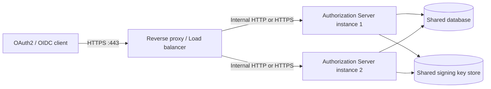

# Reverse Proxies, Load Balancers, and Establishing a Stable Public Issuer

When deploying Spring Authorization Server behind a reverse proxy or load balancer, the application typically only sees internal connections, such as `http://authorization-server:9000`. Meanwhile, clients and resource servers access the authorization server via a public address such as `https://auth.example.com`. If the application does not recognize external request details properly, it may generate URLs with the wrong scheme or host, issue tokens with an unstable `iss` claim, or return OIDC metadata pointing to internal addresses.

The goal of deployment configuration is to maintain a single public issuer for the entire cluster, forward proxy information across a trusted boundary, and ensure every instance shares authorization state and signing keys. These are the foundational requirements so clients can discover endpoints, exchange authorization codes, refresh tokens, and verify signatures consistently when requests are routed to any instance.

## 1. Understanding the external and internal topology

A common topology looks like this:



Clients should only know the public address `https://auth.example.com`. Internal DNS names, port `9000`, pod addresses, or individual instance hostnames are deployment details. When a request passes through a proxy, the application needs to know the public attributes verified by the proxy, typically including:

- External scheme: `https`.
- External host: `auth.example.com`.
- External port: `443`.
- Public prefix or context path, if the authorization server is mounted under a path such as `/auth`.
- Client IP address along the trusted proxy chain, if the application genuinely needs this information.

The reverse proxy typically terminates TLS, inspects connections, and forwards HTTP to the application over a private network. The load balancer distributes requests to one of several healthy instances. These two roles may live in the same component or across multiple tiers. Regardless of how many tiers the topology has, only proxies inside the trust boundary may determine forwarded headers.

## 2. Public issuer as the stable identifier of the authorization server

The issuer is the URI identifying the authorization server. In OpenID Connect, the `iss` claim in an ID Token must match the exact issuer trusted by the client. Discovery metadata also publishes this issuer along with endpoints such as authorization, token, and JWKS. Therefore, the issuer must represent the service's canonical public address, not an address that an instance happens to see in an incoming request.

For example, an authorization server cluster may run across multiple internal hosts, but all must use the same issuer:

```text
https://auth.example.com
```

This value must stay consistent across instances, environments, and corresponding client configurations. Do not use the following addresses as the issuer in production:

- `http://localhost:9000` or container hostnames.
- A private IP of a single instance.
- Arbitrary `Host` headers sent by clients.
- A URL that changes per request or per node.

Without a fixed issuer configured, Spring Authorization Server may derive the issuer from the current request. Behind a proxy, an internal request may carry the `http` scheme, an internal host, or a different port than the public address. In that case, metadata and tokens risk reflecting incorrect or inconsistent information. Configuring a static issuer eliminates this dependency.

### 2.1. Declaring the issuer in Spring Authorization Server

Set the issuer per environment in the application configuration. `app.security.issuer` below is an application-defined property:

```yaml
app:
  security:
    issuer: https://auth.example.com

server:
  forward-headers-strategy: framework
```

Register an `AuthorizationServerSettings` bean using that property:

```java
import org.springframework.beans.factory.annotation.Value;
import org.springframework.context.annotation.Bean;
import org.springframework.context.annotation.Configuration;
import org.springframework.security.oauth2.server.authorization.settings.AuthorizationServerSettings;

@Configuration
public class AuthorizationServerDeploymentConfiguration {

    @Bean
    AuthorizationServerSettings authorizationServerSettings(
            @Value("${app.security.issuer}") String issuer) {
        return AuthorizationServerSettings.builder()
                .issuer(issuer)
                .build();
    }
}
```

Spring Authorization Server uses `AuthorizationServerSettings` to determine the issuer and endpoint paths. Ensure the application has only one bean configuring this and that every instance receives the same value from deployment configuration. You can supply the value via environment variables or a secret/configuration manager; do not hardcode a single node's hostname in source code.

In the example above, the issuer has no trailing `/`. If your system chooses another URI format, keep one canonical form consistently across server configuration, metadata, client configuration, and test suites. Issuer matching is exact URI matching, so differences in scheme, host, port, or path all matter.

Each environment can have its own issuer, such as `https://auth.dev.example.com` and `https://auth.example.com`. Do not mix tokens from one environment with an issuer trusted in another environment.

### 2.2. Verifying discovery metadata

When OIDC is enabled, the discovery endpoint typically takes the form:

```text
https://auth.example.com/.well-known/openid-configuration
```

The authorization server may also publish OAuth 2.0 Authorization Server Metadata per RFC 8414 at the corresponding well-known endpoint. The exact path depends on the issuer and server version/configuration.

Public metadata must contain the configured issuer and endpoints reachable from the client's network. For example, URLs such as `authorization_endpoint`, `token_endpoint`, and `jwks_uri` must not point to internal hostnames like `authorization-server:9000`. Do not check only the `issuer` field; inspect all endpoint URLs and test accessing them from a network outside the cluster.

## 3. Reverse proxies must forward accurate public information

The proxy needs to set or overwrite forwarded headers based on the connection it actually terminates. Two common groups of headers are:

| Header | Meaning |
|---|---|
| `Forwarded` | Standard header per RFC 7239, which can carry `proto`, `host`, and `for` |
| `X-Forwarded-Proto` | External scheme, e.g. `https` |
| `X-Forwarded-Host` | External host, e.g. `auth.example.com` |
| `X-Forwarded-Port` | External port, e.g. `443` |
| `X-Forwarded-For` | Chain of IP addresses across proxies |
| `X-Forwarded-Prefix` | Public prefix if the proxy performs path mapping |

Choose one consistent forwarding approach. Avoid leaving `Forwarded` and `X-Forwarded-*` headers with conflicting values, because processing outcomes may depend on the framework or server configuration.

### 3.1. Nginx example when Nginx terminates TLS

The following example assumes Nginx receives HTTPS directly from clients while Spring instances run on a private network:

```nginx
upstream authorization_servers {
    least_conn;
    server authorization-server-1:9000 max_fails=3 fail_timeout=10s;
    server authorization-server-2:9000 max_fails=3 fail_timeout=10s;
}

server {
    listen 443 ssl;
    server_name auth.example.com;

    # ssl_certificate and ssl_certificate_key are configured here.

    location / {
        proxy_pass http://authorization_servers;
        proxy_http_version 1.1;

        proxy_set_header Host $host;
        proxy_set_header X-Forwarded-Host $host;
        proxy_set_header X-Forwarded-Proto https;
        proxy_set_header X-Forwarded-Port 443;
        proxy_set_header X-Forwarded-For $remote_addr;
        proxy_set_header X-Real-IP $remote_addr;
    }
}
```

In this configuration, Nginx overwrites the public headers rather than passing through client-supplied values verbatim. `X-Forwarded-For` is set to the address Nginx observes on the direct connection. If a trusted load balancer sits in front of Nginx, configure client IP extraction from that exact proxy range before forwarding the sanitized IP chain. Do not use arbitrary `X-Forwarded-For` values from the Internet as an authorization basis.

At the public tier, configure a default virtual host to reject unconfigured hostnames and serve only the canonical domain `auth.example.com`. This helps prevent an arbitrary `Host` from reaching the application through the same proxy.

If TLS terminates at an upstream load balancer, Nginx may receive only internal HTTP. In that case `$scheme` at Nginx is `http`, which does not reflect the public scheme. Take the public scheme only from the header overwritten by the trusted load balancer, while restricting connections to Nginx strictly to that load balancer. For example, you can forward `$http_x_forwarded_proto` after establishing the trust boundary at the front tier. Do not apply this approach if Internet clients can send that header directly to Nginx.

### 3.2. Protecting the trust boundary of forwarded headers

Forwarded headers are input data that can affect how the application constructs URLs, redirects, and client IP logs. If the application trusts headers set by clients themselves, an attacker can spoof the host or scheme, resulting in malicious URLs, open redirects, or falsified logs.

Deployment principles:

1. The edge proxy must strip or overwrite `Forwarded` and `X-Forwarded-*` headers coming from Internet requests before sending them to the backend.
2. Allow the backend to accept traffic only from identified proxies/load balancers; use firewalls, security groups, network policies, or mTLS depending on architecture.
3. Each proxy tier must have clear conventions for appending, overwriting, and trusting each element in the forwarded header chain.
4. Do not enable forwarded-header processing on a backend that can be reached directly from untrusted networks.
5. Do not use unsanitized `X-Forwarded-For` values for access control decisions or user identity.

Configuring `server.forward-headers-strategy` only instructs Spring to process these headers; it does not create a trust boundary in your network infrastructure by itself.

## 4. Letting Spring recognize external requests

Spring Boot supports the `server.forward-headers-strategy` property to choose how proxy information is handled:

| Value | Behavior |
|---|---|
| `NONE` | Do not process forwarded headers |
| `NATIVE` | Use the web server/container's native support |
| `FRAMEWORK` | Use Spring Framework's mechanism, typically via `ForwardedHeaderFilter` |

The `FRAMEWORK` configuration example was placed in `application.yml` in the issuer section. With this option, Spring can adjust request attributes such as scheme, host, port, and prefix based on forwarded headers. Consequently, components that build URLs from the request can generate URLs matching the public address.

Choose only one strategy suited to your container and actual topology. `NATIVE` may be appropriate when the container is already configured to handle proxy headers; `FRAMEWORK` is useful when you want to use Spring's filter. Do not enable multiple overlapping mechanisms without verifying their ordering and outcome. For Tomcat or specific containers, check the documentation for your Spring Boot version to see any additional required options.

A static issuer remains the canonical source of identity for the authorization server. Forwarded headers supplement public request information so the application handles redirects and URLs correctly; they should not become a mechanism for each request to alter the issuer.

## 5. Handling context paths and rewritten URLs

Some systems publish the authorization server at the domain root:

```text
https://auth.example.com/oauth2/authorize
```

Some systems mount the server under a prefix:

```text
https://example.com/auth/oauth2/authorize
```

In the second case, the issuer must usually reflect the public prefix, for example:

```text
https://example.com/auth
```

Crucially, how the proxy maps paths must match how the application understands its context path. There are two common approaches:

- Preserve the prefix when forwarding and configure the application to run under the corresponding context path.
- Strip the prefix at the proxy before forwarding; in that case configure the framework-supported forwarded-prefix mechanism and verify all generated URLs.

Do not configure an issuer containing `/auth` while the proxy strips the prefix and the application is unaware of the public prefix; also avoid letting the application generate duplicated `/auth/auth` paths. When changing path mappings, verify discovery metadata, login redirects, callback URIs, and actual OAuth2/OIDC endpoints.

Unless there is a specific requirement, hosting the authorization server on a dedicated hostname and serving from the root usually reduces path-rewriting complexity.

## 6. Running multiple instances behind a load balancer

A load balancer can send two consecutive requests of the same flow to two different instances. Therefore, every instance must agree on the same authorization server identity and have access to the data required to continue OAuth2/OIDC flows.

### 6.1. Sharing authorization data

In-memory implementations are useful for development or single-instance tests, but insufficient for production clusters. For example, `InMemoryRegisteredClientRepository`, `InMemoryOAuth2AuthorizationService`, and `InMemoryOAuth2AuthorizationConsentService` store data in each process's local memory. If the next request hits another node, that node may not find the client, authorization code, refresh token, or consent that was just created.

With Spring Authorization Server, you can use the JDBC implementations backed by a shared database:

```java
import org.springframework.context.annotation.Bean;
import org.springframework.jdbc.core.JdbcTemplate;
import org.springframework.security.oauth2.server.authorization.JdbcOAuth2AuthorizationConsentService;
import org.springframework.security.oauth2.server.authorization.JdbcOAuth2AuthorizationService;
import org.springframework.security.oauth2.server.authorization.OAuth2AuthorizationConsentService;
import org.springframework.security.oauth2.server.authorization.OAuth2AuthorizationService;
import org.springframework.security.oauth2.server.authorization.client.JdbcRegisteredClientRepository;
import org.springframework.security.oauth2.server.authorization.client.RegisteredClientRepository;

@Bean
RegisteredClientRepository registeredClientRepository(JdbcTemplate jdbcTemplate) {
    return new JdbcRegisteredClientRepository(jdbcTemplate);
}

@Bean
OAuth2AuthorizationService authorizationService(
        JdbcTemplate jdbcTemplate,
        RegisteredClientRepository registeredClientRepository) {
    return new JdbcOAuth2AuthorizationService(jdbcTemplate, registeredClientRepository);
}

@Bean
OAuth2AuthorizationConsentService authorizationConsentService(
        JdbcTemplate jdbcTemplate,
        RegisteredClientRepository registeredClientRepository) {
    return new JdbcOAuth2AuthorizationConsentService(
            jdbcTemplate, registeredClientRepository);
}
```

The corresponding imports live in the `org.springframework.security.oauth2.server.authorization` package. `JdbcRegisteredClientRepository` resides in the `client` subpackage. Use the SQL schema bundled with your exact Spring Authorization Server version for the registered client, authorization, and consent tables; manage schema changes with controlled migrations.

The shared database must meet appropriate durability, backup, connection-pool monitoring, and fault-tolerance requirements. Operations such as consuming an authorization code or updating a refresh token require consistency and atomic updates as dictated by OAuth2 flows. Avoid reading authorization state from lagging replicas if that could prevent a newly created or revoked token from appearing on the node handling the subsequent request.

### 6.2. Distinguishing authorization state from HTTP sessions

The `OAuth2AuthorizationService` database stores OAuth2 state such as authorization codes, access tokens, refresh tokens, and related attributes. The HTTP session, by contrast, holds user login session state, such as `SecurityContext`, saved requests to resume after login, or CSRF data.

Sharing authorization state does not automatically share HTTP sessions. If a user starts logging in on node A and the next request arrives at node B, node B must be able to read that session. You can use Spring Session with Redis or a compatible distributed session store. Sticky sessions on a load balancer can reduce node switching within a session, but they do not replace shared authorization data, session sharing for failover, or shared signing keys.

Session cookies must be configured appropriately for HTTPS, `Secure`, `HttpOnly`, and `SameSite` policies based on the actual login flow. When changing domains or context paths, re-verify cookie scope and redirect behavior.

### 6.3. Sharing signing keys and the JWK Set

Instances must sign tokens with a consistent key set and publish the corresponding JWK Set. If each instance generates its own RSA/EC key at startup, node A may issue a token with a private key whose public key is absent from node B's JWKS. Clients or resource servers fetching JWKS through the load balancer may verify tokens intermittently.

In production, store private keys in a shared key management store or suitable centralized signing mechanism, such as a secret manager, KMS, or HSM. Every instance must use the same active key material and publish the required public keys with stable `kid` values. Never place private keys in repositories or logs.

In Spring Authorization Server, `JWKSource<SecurityContext>` is the integration point that provides JWKs for signing and the JWKS endpoint. You can load a `JWKSet` from a protected key store and supply it to the selector:

```java
import com.nimbusds.jose.jwk.JWKSet;
import com.nimbusds.jose.jwk.source.JWKSource;
import com.nimbusds.jose.proc.SecurityContext;
import org.springframework.context.annotation.Bean;

@Bean
JWKSource<SecurityContext> jwkSource(KeySetProvider keySetProvider) {
    // KeySetProvider is an application component that reads the key set from a trusted key store.
    JWKSet jwkSet = keySetProvider.loadCurrentKeySet();
    return (selector, context) -> selector.select(jwkSet);
}
```

`KeySetProvider` here is an illustrative abstraction for your system's key-store integration; implement reading, access control, caching, and refreshing of the key set according to your actual infrastructure. Do not independently generate a new random key on each node on every startup.

When rotating keys, issue a new key with a new `kid`, publish the new public key on JWKS, and then switch instances to sign with the new key. Retain the old public key long enough for resource servers to verify previously issued tokens, at least until the corresponding tokens expire plus an operational buffer. Only then remove the old key. All nodes must transition according to the same plan.

## 7. Configuring the load balancer for safe operation

The load balancer should route requests to ready instances while stopping traffic to shutting-down or unhealthy instances. Essential points:

- Readiness health checks must reflect the ability to accept traffic, including connectivity to essential dependencies according to your system's policy.
- During deployments or scale-downs, drain the instance from the pool and wait for in-flight requests to complete before terminating the process.
- Keep issuer configuration, endpoint paths, forwarded-header strategy, and key sets consistent across instances.
- Configure proxy/load balancer timeouts appropriately for processing durations and required connections; avoid cutting off token endpoint requests mid-flight.
- Monitor error rates, latency, per-node request counts, database connections, key-reading errors, and token verification errors.
- Ensure instances have compatible schema versions and configurations throughout rolling deployments.

Do not use a health check that merely verifies the process is alive to conclude an instance is ready for traffic. Conversely, health checks should not turn an optional dependency into a reason to take down the entire cluster if your availability policy does not call for it.

## 8. Testing the issuer and proxy before going to production

Test from the perspective of a client outside the cluster, because calling internal hostnames directly does not prove public URLs are correct.

### 8.1. Checking metadata

```bash
curl --fail --silent --show-error \
  https://auth.example.com/.well-known/openid-configuration
```

Inspect the `issuer`, `authorization_endpoint`, `token_endpoint`, and `jwks_uri` fields. They must use the published public scheme, host, and path. If the system uses a path prefix, verify the prefix appears exactly once.

### 8.2. Checking the issuer in tokens

Execute a valid OIDC flow, obtain an ID Token, and decode its payload to inspect `iss`. The value must match the configured issuer exactly. Decoding the payload is only for inspecting contents; decoding does not replace verifying the signature, `aud`, `exp`, `nonce`, and other client security checks.

### 8.3. Testing consistency across nodes

In a test environment, send requests sequentially through the load balancer and verify:

1. Discovery metadata always publishes the same issuer and the same public endpoints.
2. A token issued by node A can be verified using the public key fetched via node B.
3. An authorization code generated when a request hits node A can be exchanged for tokens when the next request hits node B.
4. Refresh tokens and consents are read/updated consistently when requests traverse multiple nodes.
5. Login sessions continue working when the load balancer routes requests to another node, per the chosen session design.
6. After key rotation, old tokens remain verifiable during the expected window and new tokens are verified on every node.

### 8.4. Testing forwarded-header spoofing

Send test requests with spoofed `Host`, `Forwarded`, or `X-Forwarded-Host` headers from the client side. The edge proxy must overwrite or strip untrusted values. The published issuer must still be the canonical configured value. Also attempt to access the backend directly from an unauthorized network; the connection must be blocked at the network or corresponding protection layer.

Do not log authorization codes, access tokens, refresh tokens, ID Tokens, client secrets, or private keys during testing. You may log request IDs, handling nodes, endpoint statuses, and error codes for tracing.

## 9. Common errors and troubleshooting

| Symptom | Possible cause | Resolution |
|---|---|---|
| Discovery returns `http://` URLs even though clients use HTTPS | Proxy does not send the right proto or the application does not process forwarded headers | Check headers at each tier, `server.forward-headers-strategy`, and proxy boundaries |
| Metadata points to an internal hostname | Issuer is not configured statically or URLs are built from internal requests | Configure `AuthorizationServerSettings.issuer` with the public issuer and verify metadata |
| The `iss` claim changes between requests | Nodes receive different configurations or the issuer is inferred from requests | Synchronize issuer configuration and test requests across each node |
| Some tokens fail signature verification | Nodes use different key sets or JWKS caching/key rotation ran out of order | Share the key set, check `kid`, retain old public keys during transition |
| Authorization code not found during token exchange | Authorization data is stored in each node's local memory | Use an `OAuth2AuthorizationService` backed by shared storage |
| Users are prompted to log in again when requests switch nodes | HTTP sessions are not shared or sticky sessions no longer hold | Design distributed sessions or intentionally adjust routing strategy |
| URLs have duplicated prefixes or missing prefixes | Proxy path rewrite and application context path do not match | Standardize path mapping and inspect metadata and redirects |
| Redirects or logs record unfamiliar hosts | Backend trusts forwarded headers sent directly by clients | Block direct access, overwrite headers at the edge proxy, and trust only identified proxies |

## 10. Deployment checklist

- [ ] Public issuer is a canonical, stable HTTPS URI explicitly configured in `AuthorizationServerSettings`.
- [ ] All instances use the same issuer, endpoint paths, and environment configuration.
- [ ] Reverse proxy overwrites forwarded headers from public connections; backend accepts traffic only from trusted proxies.
- [ ] Spring processes forwarded headers using the strategy appropriate for the container.
- [ ] Context path and proxy rewrite rules match public URLs.
- [ ] Registered clients, authorizations, and consents are stored in a shared data store with appropriate schema and backups.
- [ ] HTTP sessions are shared or routed according to a tested design.
- [ ] Instances share signing keys; JWKS publishes all public keys needed during rotation periods.
- [ ] Readiness, draining, rolling deployment, and monitoring are configured for the load balancer.
- [ ] Discovery metadata, `iss` claim, JWKS, authorization codes, refresh tokens, and cross-node failover have been tested from outside the cluster.

A Spring Authorization Server cluster can scale safely when the public address is established consistently, proxies forward only trusted data, and every instance accesses the shared authorization state and signing keys. The load balancer can then distribute requests across nodes without altering the authorization server's identity or breaking OAuth2/OIDC flows.
