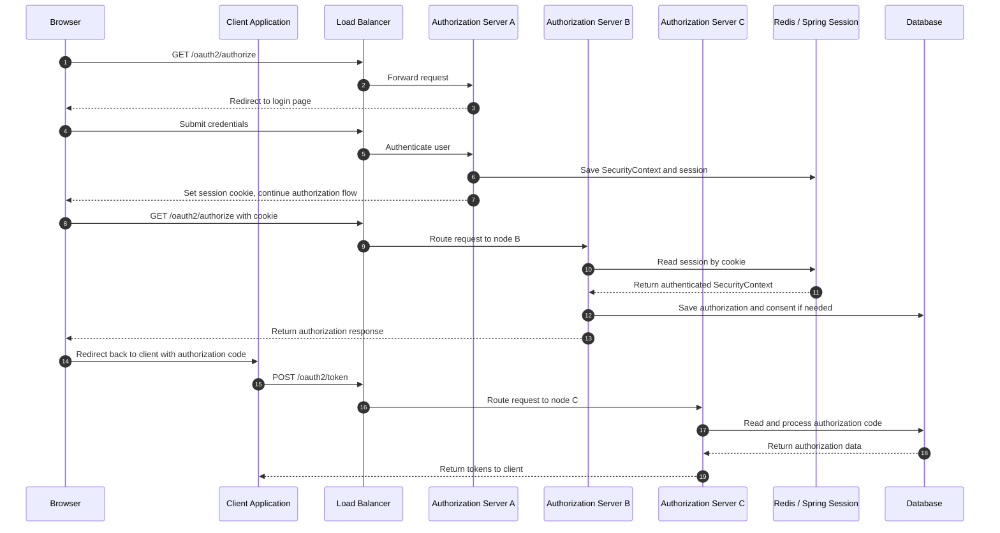

# Distributed Session Management and SSO Experience Consistency

When deploying Spring Authorization Server across multiple instances, users should log in once and continue through authorization requests without being prompted to log in again simply because the load balancer routed a request to another server. To achieve this, instances must observe the same login state, the same OAuth 2.0/OIDC data, and the same trust configuration. These are three state layers with distinct lifecycles; lumping them into a single "session" concept easily leads to misconfiguration.

This lesson explains how to design distributed sessions, shared authorization state persistence, and logout control in a Spring Authorization Server cluster. The goal is to preserve a consistent SSO experience when scaling instance counts, rolling out new versions, or routing requests across nodes.

## 1. Distinguishing state types in an SSO flow

An Authorization Server system typically involves multiple types of state participating in a single login flow:

| State | Contents | Appropriate store | Impact when switching nodes |
|---|---|---|---|
| Browser session at the Authorization Server | Session cookie, `SecurityContext`, authentication details, and login session data | Shared session store, typically Redis via Spring Session | The node handling the next request must be able to restore the logged-in user |
| Authorization and consent | Authorization codes, access tokens, refresh tokens, ID tokens, grant status, and consents | Shared database via `OAuth2AuthorizationService` and `OAuth2AuthorizationConsentService` | The node processing tokens must be able to read authorizations created on another node |
| OAuth client registration | Client IDs, secrets, redirect URIs, grant types, scopes, and client configuration | Shared database or configuration store via `RegisteredClientRepository` | Every node must enforce the same policies for a client |
| Token signing keys and provider metadata | Private keys, public keys, `kid`, issuer, and endpoint configuration | Centrally managed KMS/HSM or secret store; consistent configuration across all nodes | Tokens signed by one node must be verified properly by other nodes and token recipients |
| Session at the client application | Cookies and user login state at each application | Each application's own session store or authentication mechanism | Logging out of the Authorization Server does not automatically clear sessions in every client application |

`HttpSession` and `SecurityContext` answer the question: "Is this browser already logged in to the Authorization Server?" `OAuth2AuthorizationService` answers the question: "Which authorization does this authorization code or token belong to, and what state is it in?" The two questions are related, yet neither can substitute for the other.

For example, suppose a user logs in successfully on node A. If node B cannot read node A's session, node B may redirect the user back to the login page again. Conversely, if the session is shared but the authorization code lives only in node A's memory, a code-exchange request hitting node C will still fail. Therefore, putting `HttpSession` into Redis alone is not enough to build a consistent Authorization Server cluster.

## 2. What happens when an SSO flow traverses multiple nodes?

Suppose the load balancer distributes requests across three instances. The browser holds the Authorization Server's session cookie; instances read and write session data to Redis. Authorizations, consents, and client details are stored in a shared database.



Notice that the cookie carries only the session identifier. Actual authentication data is loaded from Redis. Authorization codes are processed against authorization records in the database. Requests to the token endpoint are typically sent from the client's backend and do not depend on the browser's login cookie.

## 3. Sharing sessions with Spring Session and Redis

In a default setup, sessions may reside in the servlet container's memory. This works for single-instance development, but does not guarantee another node can read the session. There are two common options when running multiple nodes:

- **Session affinity (sticky sessions):** the load balancer tries to route requests from a given browser back to the same node. This reduces session hopping between nodes, but does not fully handle node restarts, scale-in, maintenance, or sudden failures. It also does not share authorizations and consents.
- **Shared session store:** Spring Session replaces local `HttpSession` storage with a shared store such as Redis or JDBC. With Redis, any node can load the same session by cookie. This is usually the better choice for an Authorization Server cluster requiring high availability.

Sticky sessions can still be kept as a routing optimization, but system correctness should rely on a shared session store. Once sessions are shared, the load balancer can distribute requests to any healthy node.

### Configuring Spring Session Redis

With Spring Boot, add the corresponding Redis and Spring Session dependencies, such as `spring-boot-starter-data-redis` and `spring-session-data-redis` matching your Spring Boot version. When Spring Session Redis is on the classpath and Redis is configured, Spring Boot can auto-configure the session repository. The application does not need to declare `@EnableRedisHttpSession` if using this auto-configuration. For applications not using auto-configuration, configure Spring Session explicitly according to the guide for your version.

Illustrative configuration example in `application.yml`:

```yaml
spring:
  data:
    redis:
      host: redis.internal.example
      port: 6379
      username: authorization-server
      password: ${REDIS_PASSWORD}
      ssl:
        enabled: true
  session:
    redis:
      namespace: "auth-server:prod:sessions"
      flush-mode: on-save

server:
  servlet:
    session:
      timeout: 30m
      cookie:
        name: AUTH_SESSION
        http-only: true
        secure: true
        same-site: lax
```

Host values, credentials, and timeouts in the example must be adjusted per environment. Never store Redis passwords directly in the repository; provide them via a secret manager or managed environment variables. Use TLS, dedicated application ACLs, and network access restrictions for Redis. Namespaces separate sessions across applications or environments, preventing a staging cluster from accidentally reading production sessions.

Session cookies should be configured intentionally:

- `HttpOnly` prevents browser-side JavaScript from reading the session cookie.
- `Secure` requires the browser to send the cookie only over HTTPS.
- `SameSite=Lax` generally fits authorization code flows that use top-level GET navigation redirects. If the system uses cross-site POST callbacks, such as certain `form_post` implementations, re-evaluate cookie policy; `SameSite=None` requires `Secure` and should only be enabled when the flow genuinely requires it.
- Keep cookies host-only unless there is a requirement to share cookies across subdomains. Do not set a broad domain just so client applications can share the Authorization Server's cookie.

Configuration property names may vary across Spring Boot versions. Check the documentation for your running version and inspect the actual cookie in a browser after passing through the reverse proxy.

### Session lifetimes and lifecycle

Session timeout controls how long a user can continue a login session without re-authenticating. It is not the lifetime of access tokens or refresh tokens. Redis must enforce a TTL matching the session timeout; session renewals must be reflected in the shared store.

Choose lifetimes based on security policy and product experience. A system may need a maximum inactivity timeout, an absolute login session lifetime, and policies requiring re-authentication for sensitive operations. If only a single long TTL is used, abandoned sessions can linger longer than desired. If the TTL is too short, users may be prompted to log in again mid-SSO flow.

## 4. Storing authorizations, consents, and clients in a shared location

Spring Authorization Server provides abstractions for managing OAuth 2.0/OIDC data. In sample or development setups, in-memory implementations enable quick startup. In a multi-instance cluster, per-node in-memory implementations create isolated datasets and lose data when processes restart.

Components that must be shared include:

- `RegisteredClientRepository`: stores client registrations, redirect URIs, grant types, scopes, and related policies.
- `OAuth2AuthorizationService`: stores authorizations and credentials/tokens associated with each authorization.
- `OAuth2AuthorizationConsentService`: stores consents users have granted to clients.

For relational databases, Spring Authorization Server provides JDBC implementations. Minimal bean configuration example:

```java
@Configuration
public class AuthorizationPersistenceConfiguration {

    @Bean
    RegisteredClientRepository registeredClientRepository(JdbcTemplate jdbcTemplate) {
        return new JdbcRegisteredClientRepository(jdbcTemplate);
    }

    @Bean
    OAuth2AuthorizationService authorizationService(
            JdbcTemplate jdbcTemplate,
            RegisteredClientRepository registeredClientRepository) {
        return new JdbcOAuth2AuthorizationService(
                jdbcTemplate, registeredClientRepository);
    }

    @Bean
    OAuth2AuthorizationConsentService authorizationConsentService(
            JdbcTemplate jdbcTemplate,
            RegisteredClientRepository registeredClientRepository) {
        return new JdbcOAuth2AuthorizationConsentService(
                jdbcTemplate, registeredClientRepository);
    }
}
```

The JDBC classes must be imported from Spring Authorization Server, and the database must have the schema matching the library version. Manage schemas via controlled migrations such as Flyway or Liquibase; do not let every instance run migrations concurrently during production startup. Configure connection pools, transactions, and dedicated database permissions for the service.

An authorization code is a single-use credential. Under concurrent code handling, the system must ensure checking and marking the code as used happens consistently so two requests cannot exchange the same code. Use supported persistence implementations, transactions, and proper update mechanisms; do not build your own local cache as the source of truth for authorizations.

Session Redis and the authorization database have separate responsibilities. If Redis is healthy while the database is unreachable, users may still hold login sessions, yet the Authorization Server cannot complete creating or reading authorizations. If the database is healthy while Redis fails, nodes may fail to restore logins from cookies. Monitor and handle failures of both stores.

## 5. Keeping the issuer and signing keys consistent across instances

Every instance in a cluster must represent the same Authorization Server. The public issuer value must be uniform, such as `https://identity.example.com`, regardless of which node the load balancer routes internal requests to. Endpoint URLs published in OIDC metadata must also remain consistent.

Token signing keys must be managed centrally or distributed securely to instances. If each node generates an ephemeral key pair on startup, tokens signed by node A may fail verification when node B's public key is advertised, or newly issued tokens may become unverifiable after node restarts. The `JWKSource`/JWK Set configuration must provide the same active key set across the cluster and ensure `kid` points to the right key.

When rotating keys, publish the new public key before signing with the new private key; retain the old public key in the JWK Set long enough so unexpired issued tokens remain verifiable. Remove the old key only when no valid tokens still require it per system policy. Private keys should reside in KMS, HSM, or an access-controlled secret store; never bake them directly into container images.

If the Authorization Server runs behind a reverse proxy, configure forwarded-header handling and external URLs accurately. Mismatches between internal HTTP and public HTTPS can corrupt the issuer, redirect URIs, or `Secure` cookies, causing hard-to-reproduce login failures. Trust forwarded headers only from trusted proxies.

## 6. Logout and permission revocation are related operations

Logging out of the Authorization Server typically starts by clearing `SecurityContext` and invalidating `HttpSession`. With Spring Security, logout configuration can use the following operations:

```java
http.logout(logout -> logout
    .invalidateHttpSession(true)
    .clearAuthentication(true)
    .deleteCookies("AUTH_SESSION"));
```

When sessions are managed by Spring Session Redis, session invalidation must be recorded in the shared repository. Subsequent requests from the same browser will no longer restore the old login session. Verify the actual cookie name and configure logout consistently with the application's filter chain.

However, deleting the login session does not automatically invalidate all issued tokens. A JWT access token may continue to be accepted by resource servers until expiration if they only check signatures and claims. Refresh tokens also have their own lifecycle. When business requirements demand that logout simultaneously revokes permissions, explicitly define which authorizations or refresh tokens must be revoked, how resource servers observe revocation status, and the maximum window tokens remain valid.

Similarly, each client application usually maintains its own local session. Logging out of the Authorization Server does not automatically delete session cookies across all clients. If cross-application SSO logout is required, design an appropriate OIDC logout flow, such as RP-Initiated Logout or front-channel/back-channel logout mechanisms when supported by your library version and architecture. There must be a mapping between the user, the session at the identity provider, and sessions at clients to deliver logout signals to the right targets.

A user may also log in across multiple browsers or devices, corresponding to multiple distinct sessions. If a "log out all devices" feature exists, you need a way to look up and revoke all of a user's sessions, such as a repository supporting principal indexing or a dedicated mapping table. Invalidating a single session ID only logs out the current session.

## 7. Controlling consistency when running multiple instances

A cluster can still suffer SSO failures despite sharing Redis and a database if nodes do not adhere to the same operational rules:

**Avoid local caches as the primary data source.** If client registrations, consents, authorizations, or revocation statuses are cached locally per node, one node may continue using stale data after another node updates it. If caching is needed for performance, enforce explicit expiration and synchronized invalidation policies; security-critical data must still be checked against the shared source.

**Keep data versions compatible during rolling deployments.** During rolling deployments, different application versions may read and write Redis sessions concurrently. Changes to principal structures, custom session attributes, or serialized data types must remain backward-compatible while two versions coexist. Do not store custom objects in sessions that cannot be serialized or lack a clear upgrade strategy.

**Synchronize time across nodes.** JWTs contain `iat`, `nbf`, and `exp`; clock drift can cause tokens to be treated as not yet valid or prematurely expired. Synchronize OS clocks using a reliable NTP service and configure clock skew only within necessary bounds.

**Handle shared-store failures intentionally.** Lost connectivity to Redis or the database should never cause individual nodes to silently fall back to local in-memory sessions or authorizations, as that creates divergent login states. Design readiness/liveness probes, timeouts, bounded retries, and clear error responses. For authentication or token issuance operations, prefer failing safely when required state cannot be verified.

**Protect session data.** Sessions hold authentication details and may contain personal data. Minimize stored attributes, enforce TTLs, encrypt connections, restrict access permissions, and never log cookies, session IDs, authorization codes, access tokens, or refresh tokens. When tracing is needed, use non-secret correlation IDs.

## 8. Required test scenarios

Testing on only a single instance misses most distributed bugs. Run at least two production-configured instances connected to the same Redis, database, and signing key store.

| Scenario | How to execute | Expected outcome |
|---|---|---|
| Log in on node A, continue on node B | Force the load balancer to route the next authorize request to another node while preserving the cookie | Node B loads the session; the user does not have to log in again |
| Exchange authorization code on node C | Create code via node A/B, then send the token request to node C | Node C reads the authorization and consumes the code exactly once |
| Two requests exchanging the same code | Send two concurrent token requests using the same code | Only one request succeeds; the other is rejected |
| Log out on one node | Create session on node A, log out via node B, then send authorize request via node C | The old session is no longer restored |
| Session expiration | Let session exceed TTL, then resend the old cookie | The user must re-authenticate per policy |
| Redis temporarily unavailable | Disconnect Redis in a test environment | Session-dependent requests fail in a controlled manner; no local session fallback creates split state |
| Database unavailable | Disconnect database during authorization read or write | Authorization/token requests fail safely with appropriate logs/metrics |
| Signing key rotation | Issue tokens before and after key rotation | Still-valid tokens remain verifiable during the transition window |
| Callback over HTTPS proxy | Test redirects and cookies via the public hostname | Issuer, redirect URLs, and cookie attributes match public endpoints |
| Rolling deployment | Have two application versions read shared sessions during an upgrade | Existing sessions remain readable; no deserialization errors or unexpected logouts occur |

In addition to integration tests, verify redirect flows and cookie attributes in a real browser. Pure HTTP tests do not fully simulate browser `SameSite` rules, cookie policies, and redirect behavior.

## 9. Operating and observing the Authorization Server cluster

Track active session counts, sessions created/deleted/expired, Redis read/write errors, Redis latency, database connections, connection pools, and error rates at the authorization/token endpoints. These metrics help distinguish login failures caused by the session store from token issuance failures caused by authorization persistence.

Logs should record the handling node, endpoint, outcome, and correlation ID. Never log session cookies, session IDs, passwords, authorization codes, or tokens. When investigating a session, use protected internal identifiers with appropriate log retention limits.

Health checks should reflect actual serving capability. A node can still answer HTTP yet be unable to complete logins if Redis or the database is unavailable. Readiness should account for dependencies mandatory for authentication and token issuance flows; liveness should not cause the entire cluster to continuously restart just because a shared dependency experiences a disruption.

In production, establish recovery plans for Redis and the database, load shedding when dependencies slow down, failover testing, and post-recovery verification of login flows. Sessions are usually short-lived state, so requiring users to log in again after a major incident may be acceptable depending on product policy; authorization, client, and consent data require stronger backup/restore strategies.

## 10. Design checklist

- [ ] All instances share the Spring Session store and use the same per-environment namespace.
- [ ] Session cookies carry `HttpOnly`, `Secure`, `SameSite`, and domain/path matching real redirect flows.
- [ ] `RegisteredClientRepository`, `OAuth2AuthorizationService`, and `OAuth2AuthorizationConsentService` use durable storage shared across nodes.
- [ ] Authorization codes are handled with single-use enforcement under concurrent requests.
- [ ] Nodes share the same issuer, public endpoints, and signing key source; rotation preserves verification of old tokens.
- [ ] Logout invalidates the shared session; token revocation and client-side logout policies are defined separately.
- [ ] No silent fallback to local session/authorization state occurs when shared stores fail.
- [ ] Rolling deployments remain compatible with existing session data.
- [ ] Tests cover node switching, logout, expiration, Redis/database failures, and key rotation.
- [ ] Metrics and logs provide sufficient incident troubleshooting without exposing session IDs or tokens.

A Spring Authorization Server cluster delivers a consistent SSO experience when every node can restore browser login sessions, read and update OAuth 2.0/OIDC state together, and issue tokens under a unified issuer and key system. Clearly separating boundaries between sessions, authorizations, client sessions, and signing keys makes scaling, failover, and rolling deployments far more predictable.
