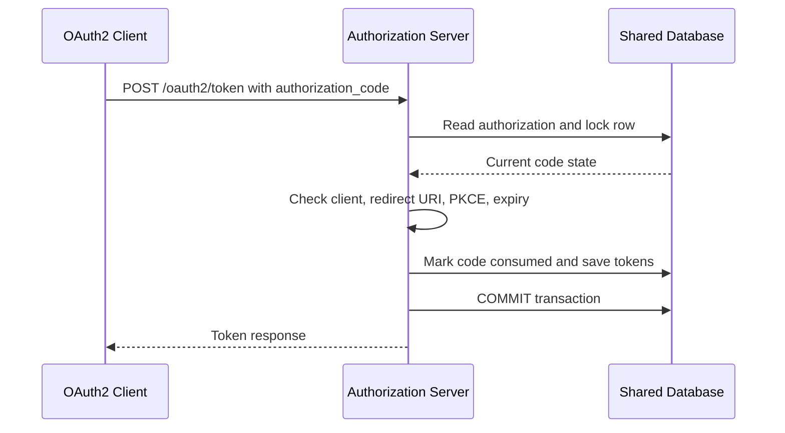

# Handling Concurrency When Redeeming Codes, Rotating Refresh Tokens, and Revoking Tokens

In a multi-instance Authorization Server, the same authorization code or refresh token may arrive in multiple nearly simultaneous requests. If each request reads a still-valid state before another request records consumption, multiple requests may simultaneously receive new tokens. This is a concurrency bug at the storage and transaction layer; enabling HTTPS, using JWTs, or adding more instances will not fix it on its own.

This lesson focuses on three state transitions in Spring Authorization Server that must be atomically protected: redeeming an authorization code for tokens, rotating a refresh token, and revoking tokens. The goal is to ensure only one request wins when consuming a single-use credential, every instance sees the same authoritative state, and revocation cannot be overwritten by an in-flight refresh request.

## 1. Security invariants to uphold

The Authorization Server must preserve the following invariants across all instances and all retry scenarios:

| Object | Valid transition | Invariant |
|---|---|---|
| Authorization code | `ACTIVE → CONSUMED` | A code can be successfully redeemed only once. |
| Refresh token | `ACTIVE → CONSUMED`, then issue next-generation token | A refresh token has only one successful use; old tokens must not be reactivated. |
| Refresh-token family | `ACTIVE → REVOKED` | When replay is detected under a strict policy, remaining active refresh tokens in the same family must be invalidated. |
| Authorization/grant | `ACTIVE → REVOKED` | No new refresh token may be issued after the grant has been revoked. |
| Access token | `ACTIVE → REVOKED/INVALIDATED` | Resource Servers must have a way to recognize revocation status if immediate effect is required. |

These states must live in storage shared across instances. A `synchronized` block, `ConcurrentHashMap`, session affinity, or in-memory lock coordinates requests only within a single process. When a second request lands on another instance, it sees neither that lock nor that memory.

## 2. Why can two requests redeem the same authorization code?

Suppose a browser sends the same authorization code twice due to a user double-click, a proxy retry, or a duplicate client request. Two instances can execute the following sequence:

1. Instance A reads the authorization and sees the code is neither expired nor invalidated.
2. Instance B reads the same authorization before A saves its changes and also sees the code is still valid.
3. Both pass client, redirect URI, and PKCE validation.
4. Both mint an access token, possibly a refresh token too, and save the authorization.
5. Both responses can return tokens for the same code.

This is a *check-then-act* race condition. A valid read does not guarantee the request still owns the right to consume the token at write time. Raising isolation levels globally is also insufficient if the read and update do not occur in the same transaction or lack an update condition that excludes competing requests.

For authorization codes, distinguish two moments: **validating the request** and **claiming the right to consume the code**. Only mark the code as used after verifying required inputs such as client, redirect URI, grant type, and PKCE. If you consume the code too early, an invalid request could make the user lose a valid code. Once validation succeeds, claiming consumption must be atomic.

## 3. Protecting authorization code redemption

### 3.1. Using transactions and row-level locking

One approach is to read the authorization with a row lock inside a transaction, validate the code, mark the code invalidated, and save the authorization in the same transaction. On databases that support it, the read can use `SELECT ... FOR UPDATE` on the row representing the authorization. A second request must wait until the first finishes; after acquiring the lock, it reads the updated state and is rejected because the code is already consumed.

```sql
-- Illustrative SQL; table and column names depend on the actual storage schema.
BEGIN;

SELECT id, authorization_code_value, authorization_code_expires_at,
       authorization_code_metadata
  FROM oauth2_authorization
 WHERE id = :authorization_id
 FOR UPDATE;

-- Within the same transaction:
-- 1. Validate code, client, redirect URI, PKCE, and expiration.
-- 2. Mark the authorization code as invalidated.
-- 3. Save the authorization along with the new access token/refresh token.
-- 4. COMMIT before sending the token response to the client.

COMMIT;
```

This illustrates the locking mechanism, not a statement to copy verbatim across all Spring Authorization Server schema versions. `SELECT ... FOR UPDATE` works only when the transaction genuinely encompasses reading, validation, and writing. If each step runs in its own transaction, the lock is released before state updates and the race condition remains.

### 3.2. Using compare-and-set or a unique constraint

Another option is conditional updating: only the request that observes state `ACTIVE` may transition it to `CONSUMED`. Check the updated row count; exactly one row means the request won, while zero rows means the code was already used, expired, or otherwise invalid.

```sql
UPDATE authorization_code_state
   SET state = 'CONSUMED', consumed_at = CURRENT_TIMESTAMP,
       version = version + 1
 WHERE code_fingerprint = :fingerprint
   AND state = 'ACTIVE'
   AND expires_at > CURRENT_TIMESTAMP;
```

`authorization_code_state` above is an application-managed extension table, not a mandatory default Spring Authorization Server table name. You can alternatively add a `version` column and conditional update statement on the existing authorization table. What matters is that the state predicate sits directly in the write statement, and the application proceeds to issue tokens only when `rowsUpdated == 1`.

Another design uses a claim table with a unique key to record consumed codes:

```sql
CREATE TABLE oauth2_code_redemption (
    authorization_id VARCHAR(100) NOT NULL PRIMARY KEY,
    code_fingerprint CHAR(64) NOT NULL UNIQUE,
    consumed_at TIMESTAMP NOT NULL
);
```

After validating the request, the application inserts a claim for the authorization code. Two requests inserting concurrently contend on the unique constraint and only one succeeds. Inserting the claim, marking the code invalidated, and saving the authorization/new tokens must occur in the same transaction. If a later step fails, the transaction rolls back the entire claim and related state. If the claim were saved in an independent transaction, a mid-flight failure could permanently lock the code even though no token was issued.

Never store raw authorization codes in claim tables or logs. You can store a fingerprint computed using HMAC-SHA-256 with a server secret key; use the fingerprint for lookups and comparisons without exposing the bearer credential. Manage the HMAC key as a secret and plan for its rotation.

### 3.3. Transaction boundaries in Spring Authorization Server

Spring Authorization Server uses `OAuth2AuthorizationService` to find and save `OAuth2Authorization`. `JdbcOAuth2AuthorizationService` is suitable for shared state in multi-instance environments; `InMemoryOAuth2AuthorizationService` is suitable only for testing or simple setups without shared durable state.

Using JDBC lets instances read the same store, but do not assume `findByToken` followed by `save` automatically forms an atomic consumption. Inspect the token endpoint execution path in your deployed version and add transaction boundaries alongside locking or compare-and-set at the redemption step. This can be done via a custom provider or a transactional service layer integrated into the token authentication flow. Do not put `@Transactional` on a method that wraps only the read while marking invalidated and saving tokens run outside the transaction.

In the processing flow, the desired sequence is:



The transaction must commit successfully before the token response is sent. If saving state fails or the commit outcome is indeterminate, the server must never return a success response based on unconfirmed data. For clients, a timeout after the server commits may cause a retry to receive `invalid_grant`; this is an inherent consequence of single-use credentials. Clients need to restart the authorization flow when the original response cannot be recovered.

## 4. Rotating refresh tokens safely

### 4.1. Enabling rotation in client configuration

When a refresh token is reused across multiple refreshes, a stolen token can continue being used for its entire lifetime. Rotation replaces the old refresh token with a new one on each successful refresh. In Spring Authorization Server, configure this explicitly with `reuseRefreshTokens(false)` on `TokenSettings`:

```java
TokenSettings tokenSettings = TokenSettings.builder()
        .reuseRefreshTokens(false)
        .accessTokenTimeToLive(Duration.ofMinutes(5))
        .refreshTokenTimeToLive(Duration.ofDays(30))
        .build();

RegisteredClient registeredClient = RegisteredClient.withId(UUID.randomUUID().toString())
        .clientId("web-client")
        .clientAuthenticationMethod(ClientAuthenticationMethod.CLIENT_SECRET_BASIC)
        .authorizationGrantType(AuthorizationGrantType.AUTHORIZATION_CODE)
        .authorizationGrantType(AuthorizationGrantType.REFRESH_TOKEN)
        .redirectUri("https://client.example.com/login/oauth2/code/app")
        .scope(OidcScopes.OPENID)
        .scope("profile")
        .tokenSettings(tokenSettings)
        .build();
```

This is an illustrative snippet; your application needs redirect URIs, scopes, authentication methods, and grant types tailored to the real client. `reuseRefreshTokens(false)` requires issuing a new refresh token during the refresh flow. It does not replace state synchronization across concurrent requests or multiple instances.

### 4.2. Race condition during concurrent refreshes

Suppose two requests concurrently submit refresh token `R1`:

| Time | Request A | Request B |
|---|---|---|
| T1 | Reads `R1`, sees active | |
| T2 | | Reads `R1`, also sees active |
| T3 | Generates access token and `R2` | Generates access token and `R3` |
| T4 | Saves `R1` invalidated, `R2` active | Saves `R1` invalidated, `R3` active |

If both requests finish, the client may receive two successor refresh tokens. Final state even depends on write order and how authorizations are stored; one token can be lost or both responses may remain valid. Therefore, refresh token rotation also requires atomic consumption.

With a dedicated refresh token state store, compare-and-set can be used:

```sql
UPDATE oauth2_refresh_token
   SET state = 'CONSUMED', consumed_at = CURRENT_TIMESTAMP
 WHERE token_fingerprint = :fingerprint
   AND state = 'ACTIVE'
   AND expires_at > CURRENT_TIMESTAMP;
```

Only the request that updates exactly one row may mint the next-generation refresh token. Marking the old token used, inserting the new token, updating `OAuth2Authorization`, and verifying the grant is still active must occur in one transaction. If zero rows are updated, the server must not issue new tokens.

### 4.3. Tracking refresh-token families and detecting replay

Each rotation should link the new token to the same `family_id` and increment `generation`. You can store a fingerprint instead of the raw token, along with fields such as `authorization_id`, `family_id`, `generation`, `state`, `issued_at`, `expires_at`, and `consumed_at`.

When a fingerprint already in `CONSUMED` state is submitted again, the server has evidence an old refresh token was replayed. Under a strict replay detection policy, the server revokes all remaining active refresh tokens in the family and marks the corresponding authorization revoked. The client receives `invalid_grant` and must re-run the authorization flow.

This policy has an operational consequence: two legitimate refresh requests sent concurrently by the same client can cause the second request to be flagged as replay. Therefore, clients should coordinate refreshes via a *single-flight* mechanism: at most one in-flight refresh request per session or grant; callers needing a fresh access token await that refresh result. Upon receiving the new refresh token, the client must atomically update its secure storage before subsequent requests use it.

Some systems introduce a short grace period to tolerate network retries. This must be designed carefully because re-accepting an old token weakens detection of an attacker replaying tokens. Use a grace period only when reliable client binding or retry identification exists, and specify deterministically which token is returned. Never mint multiple independent successors from the same refresh token.

## 5. Revoking tokens and handling races with refresh

Spring Authorization Server supports the token revocation endpoint per OAuth 2.0 Token Revocation. The revocation flow locates the authorization containing the token, marks the relevant token invalidated, and persists the change via `OAuth2AuthorizationService`. The application must clearly define revocation scope: only the submitted token, the entire refresh-token family, or the entire authorization grant.

When revoking a refresh token, policy usually requires invalidating remaining refresh tokens in the family or grant so no successor token can continue granting access. When revoking a grant, any in-flight refresh operation must check the grant's status within the same transaction and locking/CAS mechanism. If refresh and revoke update two separate records independently, a revoke could finish first while a concurrent refresh still writes a new refresh token afterward.

One protection is having both refresh and revoke lock the row representing the authorization or family. Refresh issues a successor token only if the parent status remains `ACTIVE`. Revoke transitions the parent status to `REVOKED` and invalidates child tokens inside the transaction. When the two compete, commit order decides the outcome; once revoke commits, no refresh request may issue an active token for that grant.

### 5.1. JWT revocation and Resource Server visibility

Storing an invalidated state in the Authorization Server does not make already-issued JWTs disappear. A Resource Server verifying JWTs locally by signature and claims will continue accepting the token until `exp` passes because it does not query revocation status at the Authorization Server.

If near-real-time revocation is required, pick a mechanism the Resource Server actually checks:

- Use opaque access tokens with the introspection endpoint; the Resource Server checks `active` before accepting tokens, accounting for cache TTLs.
- With JWTs, add an online status check or a denylist keyed by `jti`/authorization ID. Synchronization latency and caches across all Resource Servers must be controlled.
- Use short-lived access tokens to bound the window a token remains accepted when no online check exists.

Do not claim a JWT is instantly revoked if Resource Servers check only signatures and expiration. Introspection or denylist cache TTLs act as an upper bound on real revocation latency.

Per the revocation protocol, clients may receive a success response even when the submitted token is no longer recognized; this prevents the endpoint from leaking whether a token exists. Client authentication and authorization to call the endpoint must still be enforced. A success response from the endpoint also does not prove every Resource Server has received the revocation event; monitor state propagation to the enforcement points.

## 6. Designing for multi-instance and multi-region deployments

Authorization Server instances must share a store with strong enough consistency for code consumption, refresh, and revocation. Deployment principles:

1. **Use a single authoritative data source per transaction.** Credential validation and consumption must go to the primary or a store offering equivalent consistency guarantees. Reading from an asynchronous replica can return stale state after another instance already consumed a token.
2. **Do not rely on sticky sessions.** Subsequent requests may hit another instance due to retries, failover, or load-balancer rebalancing. Every instance must enforce the same state rules in the database.
3. **Keep transactions short.** Never call external services or wait on network I/O while holding row locks. Prepare necessary inputs, execute state transitions, and commit quickly.
4. **Use consistent time.** Prefer database time for expiration predicates inside update statements; synchronize system clocks via NTP so logs and token timestamps align.
5. **Fail closed when state cannot be confirmed.** If the database is unavailable, a lock times out, or a commit outcome is unknown, never issue tokens from stale caches. Clients may need to restart the authorization flow after an indeterminate timeout.
6. **Design failover and multi-region intentionally.** Two regions using independent asynchronous replicas could both accept the same token. If active-active is needed, use globally consistent writes or partition authorization ownership so only one region can consume a given credential.

Distributed locks can aid coordination, but should not be the sole safeguard if the database still allows two requests to update concurrently. If using external locks, implement leases, fencing tokens, and handling for processes that lose a lock yet continue writing. Conditional updates or unique constraints in the authoritative database usually form a cleaner final barrier.

## 7. Integrating with Spring Authorization Server's persistence model

`OAuth2Authorization` encapsulates authorization state and associated tokens such as authorization codes, access tokens, refresh tokens, and metadata. `OAuth2AuthorizationService` provides find, save, and remove operations. In multi-instance deployments:

- Use a durable implementation, typically `JdbcOAuth2AuthorizationService`, with migration-managed schemas and backups.
- Share `RegisteredClientRepository` and token configurations across instances so every client gets identical grant, lifetime, and rotation policies.
- Identify the extension point where the token endpoint validates and consumes codes/refresh tokens. Add transactions, row locking, or CAS right at the state transition point.
- When updating invalidated metadata, preserve other tokens and authorization metadata; avoid overwriting a newer record with an older object modified by a concurrent request.
- Ensure token issuance and authorization persistence share the same transaction boundary. If tokens are generated but persistence fails, never return a success response.

Do not use `InMemoryOAuth2AuthorizationService` for multi-instance clusters: each instance holds isolated state, restarts lose data, and requests can validate against divergent state. Also do not treat switching to JDBC as completing concurrency control; verify the implementation, transaction manager, isolation level, and write queries of your running version.

## 8. Observability and safe logging

Logs and metrics should help detect races, replays, and revocation latency without exposing bearer credentials. Never log authorization codes, access tokens, refresh tokens, client secrets, or raw token endpoint request bodies. Instead, record:

- `authorization_id`, `client_id`, `family_id`, and protected fingerprints;
- operation type: `code_redeem`, `refresh`, `refresh_reuse`, `revoke`;
- CAS outcome or updated row count, before/after state, and rejection reason;
- instance, region, transaction/trace ID, lock wait time, and commit latency;
- revocation event emission timestamp and Resource Server enforcement timestamp.

Track `invalid_grant` rates, re-submissions of already-used refresh tokens, unique constraint/CAS failures, lock waits/deadlocks, commit errors, and revocation propagation lag. Spikes may indicate clients sending parallel refreshes, proxy retries, broken state synchronization, or token theft. Analyze by client and family before concluding an attack is underway.

## 9. Testing concurrency scenarios

Sequential single-request tests do not prove atomicity. Generate true concurrent requests, ideally across multiple instances sharing the same production-like database engine and schema. Use barriers so threads start simultaneously, then verify both HTTP responses and persisted database state.

| Scenario | Expected outcome |
|---|---|
| N concurrent requests redeeming the same authorization code | Exactly one request succeeds; the rest receive invalid grant errors; only one set of tokens is persisted. |
| Two instances redeeming the same code | Same result as single-instance testing; independent of which node handles which request. |
| N concurrent requests refreshing the same refresh token | Only one request consumes the old token; others are rejected or trigger the defined replay policy; no unapproved multiple active successors exist. |
| Re-submitting an already consumed refresh token | Server recognizes the used state; if strict replay detection is enabled, the family is revoked. |
| Refresh racing with grant revocation | Once revoke commits, no refresh can issue an active token for that grant. |
| Database fails before or during commit | No success response is returned for uncommitted state; client receives a handleable error. |
| Wrong redirect URI or PKCE | Request is rejected and valid code is not accidentally consumed. |
| Resource Server checking a revoked access token | Outcome matches chosen mechanism: updated introspection/denylist or token remains valid only until expiration. |

Test against the real production database engine or Testcontainers for that engine. A simple H2 test may miss locking, isolation, unique constraint, and deadlock behavior of PostgreSQL, MySQL, or your target database. Add rollback tests: intentionally fail saving the authorization after claiming the code/refresh token, then confirm the entire transaction rolls back or state is handled safely per design.

## 10. Implementation checklist

- [ ] Authorization codes are consumed only after validating client, redirect URI, PKCE, and expiration.
- [ ] Code consumption uses row locks, CAS, or unique constraints inside a shared transaction.
- [ ] Refresh token rotation is configured explicitly with `reuseRefreshTokens(false)` when required by policy.
- [ ] Old refresh tokens are atomically consumed before successor tokens are issued.
- [ ] Family/generation tracking and an explicit refresh token replay policy exist.
- [ ] Clients execute at most one concurrent refresh request per grant and persist new tokens safely.
- [ ] Revoke and refresh lock or update the same authorization/family state to prevent issuing tokens after revocation.
- [ ] Resource Servers have a revocation enforcement mechanism matching token type and latency requirements.
- [ ] All instances use the same authoritative state store; single-use tokens are never validated against potentially stale replicas.
- [ ] Logs contain no raw tokens; metrics cover CAS conflicts, replays, lock waits, and revocation latency.
- [ ] Concurrency tests cover multiple requests, multiple instances, rollbacks, and refresh-vs-revoke races.

When these invariants hold, adding more instances does not weaken the single-use guarantees of authorization codes or refresh tokens. The database and transaction boundaries become the single arbiter of which request may advance state; instances issue tokens only after that state transition is confirmed.
