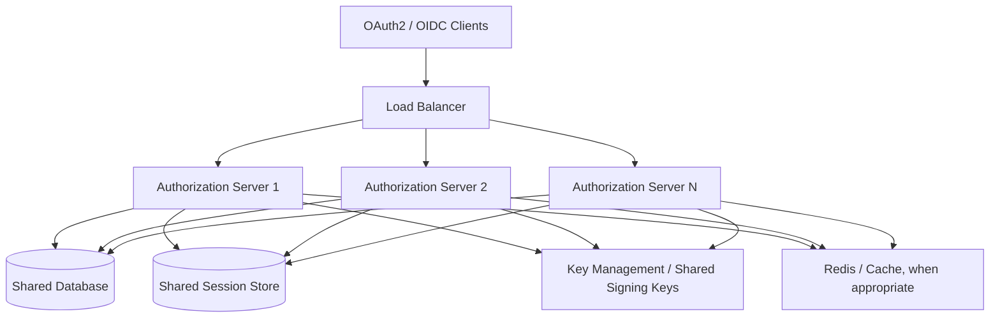

# Scaling, Connection Pools, Caching, and Resource Limits

An OAuth 2.0/OpenID Connect Authorization Server typically handles operations with varying resource profiles: user login and authorization code issuance, code-to-token exchange, token refresh, introspection, revocation, metadata reads, and key publication via JWKS. As client counts, users, or request volumes grow, simply adding more application instances does not necessarily make the system faster. Instances can contend for database connections, use isolated local session memory, sign tokens with inconsistent keys, or overload the key management service.

In Spring Authorization Server, a scalable deployment coordinates four areas: applications able to run across multiple instances, business state stored in a shared location, connection and processing resources deliberately bounded, and cacheable data selected according to each data type's consistency requirements.

After this lesson, you will be able to:

- Analyze common bottlenecks in token issuance and management flows.
- Design multiple Authorization Server instances sharing data and signing keys.
- Estimate connection pool sizing based on the database's connection budget.
- Select suitable data for caching and identify data that must be read from the authoritative source.
- Configure resource limits, health checks, graceful shutdown, and monitoring in deployment.

## 1. Understanding Authorization Server load

Not every endpoint consumes the same type of resource. A token request may read client data, validate an authorization code or refresh token, write authorization state, and sign an access token. The authorization code flow also depends on user login, sessions, and consent. The JWKS endpoint primarily serves public key reads, whereas introspection and revocation can place significant load on the authorization store.

| Activity | Commonly loaded components | What to observe |
|---|---|---|
| Authorization endpoint and login | Application CPU, session store, user authentication system | Login duration, session counts, authentication errors |
| Token endpoint | Token signing CPU, database, connection pool | Throughput, p95/p99 latency, pending pool waiters |
| Refresh token | Database and token state verification | Query latency, update contention, refresh failure rate |
| Introspection and revocation | Database or token state store | Query volume, latency, and state propagation lag |
| Discovery and JWKS | Application, HTTP caches, content delivery networks | Cache hit ratio, response time, key fetch errors |

Measure critical flows separately. A single aggregate requests-per-second figure can mask a database-bound token endpoint while the JWKS endpoint continues responding quickly.

## 2. Multi-instance architecture

A common deployment model places multiple Spring Authorization Server instances behind a load balancer. Instances share a single public issuer, a shared operational data store, and a consistent signing key source.



The load balancer distributes requests across healthy instances. Each instance can be created or replaced without losing stored authorization data. This requires data that must persist across requests to live in a shared store or a system with explicit synchronization mechanisms.

### 2.1. Distinguishing business state from session state

Spring Authorization Server provides abstractions for persisting client, authorization, and consent data. In JDBC deployments, the common components are:

- `JdbcRegisteredClientRepository`: stores registered client configurations.
- `JdbcOAuth2AuthorizationService`: stores authorizations, authorization codes, access tokens, refresh tokens, and related metadata.
- `JdbcOAuth2AuthorizationConsentService`: stores consents users have granted to clients.

JDBC repositories sharing a single database ensure every instance reads the same state. If using custom implementations, ensure all instances adhere to the same storage contract, atomic updates, and query rules. Never let each pod keep a separate `InMemory` copy for data that must survive across requests: the next request may hit another pod and fail to find the client or authorization just created.

Login sessions are a different kind of state. The Authorization Server may rely on Spring Security sessions to hold login identity, saved requests, CSRF tokens, and interactive consent state. If sessions reside only in one instance's memory, a subsequent request needing that session may fail when the load balancer routes the request to another instance. There are two ways to handle this:

1. Use Spring Session with a shared session store, such as Redis, so instances read and update the same session.
2. Use session affinity on the load balancer when operationally justified, while accepting that sessions may be lost if an instance fails.

For systems requiring high availability, a shared session store is usually more predictable. Whichever option you choose, test the full login, consent, callback, and logout flows when requests are handled by multiple instances.

### 2.2. Unifying configuration and server identity

All instances must publish the same issuer, such as `https://auth.example.com`. The issuer must match the value clients and resource servers use to validate tokens. Never let each pod derive the issuer from its internal hostname or private IP address.

When running behind a reverse proxy, configure the application to handle forwarded headers from trusted proxies. Trust headers like `Forwarded` or `X-Forwarded-*` only when requests genuinely pass through controlled proxies; trusting arbitrary headers from the Internet allows attackers to spoof URLs generated by the application.

Instances must also use identical client configurations, signing algorithms, token lifetimes, and authorization policies. Configuration changes should be rolled out synchronously or in a backward-compatible manner during transitions.

## 3. Designing and tuning connection pools

When using JDBC repositories, each instance needs connections to the database. Opening a new connection per operation is expensive, so applications use connection pools to reuse connections. Spring Boot typically integrates HikariCP by default when it is on the classpath.

A connection pool is a resource budget. If the pool is too small, requests wait for connections even when the database has spare capacity. If the pool is too large, multiple instances can open too many connections, exhausting database resources or increasing CPU and I/O contention.

### 3.1. Calculating the budget by maximum instance count

Calculate based on the maximum number of replicas the autoscaler can create, not just the replica count running at initial deployment.

An initial estimation formula:

\[
P_{instance} \leq
\left\lfloor
\frac{C_{database} - C_{reserve} - C_{other}}{N_{replicas,max}}
\right\rfloor
\]

Where:

- `C_database`: total connection limit of the database.
- `C_reserve`: connections reserved for administration, migrations, monitoring, and emergencies.
- `C_other`: expected connections from other applications or workers.
- `N_replicas,max`: maximum number of Authorization Server instances.
- `P_instance`: maximum `maximumPoolSize` per instance.

For example: the database permits 240 connections; 40 connections are reserved for administration and headroom; other workloads need 40 connections; the Authorization Server is permitted to scale up to 8 replicas. Remaining budget is 160 connections, giving an initial upper bound of 20 connections per replica. If maximum replicas increases to 10, the per-replica pool must be recalculated against the updated budget.

This is a starting upper bound for design, not proof that 20 connections is optimal. Measure real workload demand to determine the concurrent connections required. You can estimate average concurrency from throughput multiplied by connection hold time per operation, then verify with load testing and pool metrics.

### 3.2. Configuring HikariCP

Configuration example in `application.yml`:

```yaml
spring:
  datasource:
    url: ${AUTH_DB_URL}
    username: ${AUTH_DB_USERNAME}
    password: ${AUTH_DB_PASSWORD}
    hikari:
      pool-name: authorization-server-pool
      maximum-pool-size: 20
      minimum-idle: 5
      connection-timeout: 3000
      validation-timeout: 1000
      idle-timeout: 600000
      max-lifetime: 1500000
      keepalive-time: 300000
  lifecycle:
    timeout-per-shutdown-phase: 30s

server:
  shutdown: graceful
```

The values above are illustrative examples showing how limits are set. Tune them for your database, network infrastructure, replica count, and load test results. Key parameter roles:

| Parameter | Purpose | How to choose |
|---|---|---|
| `maximum-pool-size` | Caps connections in one instance's pool | Compute from system-wide connection budget and load tests |
| `minimum-idle` | Number of idle connections the pool tries to maintain | Choose based on baseline traffic and connection creation cost |
| `connection-timeout` | Maximum time to wait for a connection from the pool | Set a finite value so requests do not queue indefinitely |
| `validation-timeout` | Maximum time to validate a connection's health | Shorter than `connection-timeout` |
| `idle-timeout` | Time before an idle connection may be retired when above minimum-idle | Match fluctuating traffic and database policies |
| `max-lifetime` | Maximum lifetime of a connection in the pool | Shorter than lifetime limits imposed by the database or network |
| `keepalive-time` | Interval to probe/keep idle connections from being closed by infrastructure | Enable only when needed and set shorter than `max-lifetime` |

Tuning notes:

- Too long a `connection-timeout` holds request threads while waiting; too short turns brief traffic spikes into connection acquisition errors. Choose a timeout aligned with the endpoint's latency budget.
- `max-lifetime` should be lower than timeouts enforced by databases, proxies, or firewalls so the pool proactively replaces connections before infrastructure closes them. Do not pick a number blindly from examples.
- Do not set `maximum-pool-size` equal to the HTTP thread count. Many requests do not need the database simultaneously, and the database has its own processing ceiling.
- Keep transactions short. Avoid calling HTTP services, KMS, or external systems while holding a database transaction unless strictly necessary.
- Set appropriate query and transaction timeouts. A single hung SQL statement can hold a connection and exhaust the pool.
- Enable `leakDetectionThreshold` only as a diagnostic tool when suspecting connection leaks; too low a threshold generates false alarms for legitimate queries.

### 3.3. Monitoring pools and the database

Track at least the following metrics per instance:

- Active, idle, and total connection counts.
- Threads waiting for a connection (`pending`).
- Connection acquisition time and timeout counts.
- Query latency, transaction counts, and database error rates.
- Open connections on the database broken down by application.

If `active` frequently hits `maximumPoolSize` and `pending` rises, investigate slow queries or pool starvation before raising the pool size. If the database is already near its connection limit or database CPU is high, enlarging the pool can worsen the situation. If the pool rarely saturates yet endpoints are still slow, the bottleneck may lie in token signing, KMS, user login, networking, or another downstream service.

## 4. Caching and consistency requirements

Caching reduces read queries and response times, but caching also introduces copies that can become stale. For an Authorization Server, stale data can cause security bugs or incorrect authorization behavior. Therefore, classify data by change frequency and the consequences of reading stale data.

### 4.1. Cacheable data

Relatively static and widely publishable data is generally better suited:

- OIDC discovery metadata, such as endpoint lists and supported algorithms.
- Public JWKS used to verify token signatures.
- Immutable or infrequently changing configuration, provided clear refresh and cache invalidation mechanisms exist.

Discovery metadata and JWKS can be served via HTTP caches or CDNs if cache headers are set appropriately. When rotating keys, publish the new public key before issuing tokens signed with it, and retain the old public key long enough to verify still-valid tokens. Never let caches retain old JWKS longer than the system permits.

Client configurations may be cached in some read-heavy systems, but require invalidation workflows when a client is disabled, a secret changes, redirect URIs are updated, or policies are adjusted. A short TTL only shrinks the window stale data persists; it does not replace invalidation when changes must take effect immediately.

### 4.2. Data requiring an authoritative source

Avoid best-effort local caching for state that mutates during authorization issuance or revocation:

- Authorization codes, refresh tokens, and their consumption states.
- Revocation state or token status used for introspection.
- Consents that users may revoke or update.
- Authorizations currently being updated by another instance.

For example, if one instance keeps reading a cached entry indicating a refresh token is still valid after another instance revoked it, the system could accept an action that policy demands rejecting. Likewise, authorization codes are single-use credentials; concurrent handling must rely on atomic updates in the authoritative store to prevent code reuse.

For these data types, prioritize reads/writes through the shared `OAuth2AuthorizationService` and `OAuth2AuthorizationConsentService`. If specialized optimization is needed, design a distributed cache with invalidation, synchronization, race-condition handling, and explicit fail-closed rules; and test two instances handling the same token concurrently. Do not assume Redis automatically turns a cache into a safe authorization store.

### 4.3. Distinguishing self-verifiable JWTs from revocation state

Resource servers can verify JWT signatures locally using public keys fetched from JWKS. This reduces introspection requests, yet an already-issued JWT will typically continue verifying successfully until expiration unless the resource server checks revocation state elsewhere.

If near-real-time revocation is required, choose an appropriate mechanism, such as opaque tokens paired with introspection, a synchronized denylist, or short access token lifetimes. Every mechanism involves trade-offs across latency, database load, availability, and propagation delay. Decide explicitly what maximum revocation latency the product tolerates, then design caches and TTLs to meet that requirement.

## 5. Application resource limits

Adding replicas helps only when each instance and shared dependencies still have sufficient headroom. Budget for CPU, memory, threads, connections, request queues, and external calls.

### 5.1. CPU and token signing

Signing JWTs consumes CPU and may involve KMS/HSM calls over the network. Load grows as token issuance volume rises, signing algorithms or key sizes change, or KMS latency increases. Monitor signing duration, CPU, garbage collection, and KMS latency. If using KMS, enforce timeouts, concurrency limits, and bounded retry policies; unbounded retries can amplify load during KMS outages.

Never generate an independent signing key per instance. All instances must sign tokens using keys from the same managed key set published via JWKS. Private key distribution must follow secrets management procedures; avoid embedding private keys in images or logs.

### 5.2. Memory and threads

Set heap limits relative to the container's memory limit, leaving room for metaspace, thread stacks, direct buffers, native libraries, and monitoring agents. Containers can be OOM-killed even before heap reaches `-Xmx` if total process memory exceeds the container limit.

Too many HTTP threads will not make the database or KMS process faster. When downstream dependencies slow down, extra threads simply increase queued requests and memory usage. Bound threads and queues according to dependency capacity, and return controlled errors when thresholds are exceeded.

### 5.3. Timeouts and request limits

Configure timeouts across relevant layers: load balancer, reverse proxy, HTTP server, JDBC, transactions, and outbound service clients. Timeouts must align so a request is not held at a lower layer longer than the upper layer permits.

Limit request and header sizes to avoid unnecessary memory consumption. Apply per-client or per-endpoint rate limiting where appropriate, especially on token, introspection, and endpoints exposed to password guessing or abuse. Rate limits must account for legitimate per-client traffic and should use shared counters when requests are distributed across multiple instances.

## 6. Autoscaling, health checks, and graceful shutdown

Autoscaling should rely on metrics reflecting request-processing capacity, such as CPU, p95/p99 latency, queued requests, and thread utilization. For an Authorization Server, also examine connection pool utilization and database load. If the database is already saturated, adding replicas can increase connections and queries, degrading the entire system.

Set `maxReplicas` based on both database capacity and KMS/session-store limits. Whenever changing maximum replicas, recalculate the connection budget before deploying. You can configure asymmetric scale-out and scale-in thresholds to prevent constant replica oscillation.

Health checks must distinguish:

- **Liveness:** whether the process is alive and able to keep running. Do not fail liveness merely because a dependency is temporarily slow if restarting the instance will not resolve the issue.
- **Readiness:** whether the instance is ready to serve requests. Instances that are starting up, draining, or unable to serve core requirements can be removed from the load balancer.
- **Startup probe:** allows adequate time for the application to boot, load configuration, and initialize required components before other probes apply.

During new deployments or scale-in, graceful shutdown lets an instance stop accepting new requests and finish in-flight requests within a bounded window. Spring Boot configuration example:

```yaml
server:
  shutdown: graceful

spring:
  lifecycle:
    timeout-per-shutdown-phase: 30s
```

Load balancer drain duration and pod termination grace period must align with the graceful shutdown duration. Test with active token requests in flight and while removing an instance from the cluster. Do not allow shutdown to close database connections or the session store before in-flight requests finish.

## 7. High availability and key operations

Multiple instances increase availability only if shared dependencies are also fault-tolerant. Databases need backups, recovery procedures, replication monitoring, and failover runbooks. Redis used for sessions or caching needs persistence/replication configured according to acceptable data loss tolerances. KMS/HSM needs load limits and fallback plans for connectivity disruptions.

### 7.1. Consistent signing keys across instances

All instances must access the same active signing key set or signing service. If instance A signs tokens with key `K1` while instance B publishes only key `K2`, resource servers may fail to verify tokens depending on which JWKS they receive.

A safe key rotation workflow typically includes:

1. Create a new key in the key management system.
2. Publish the new public key in JWKS across all instances.
3. Wait for client and resource server JWKS caches to have a chance to refresh.
4. Switch instances to sign with the new key.
5. Retain the old public key in JWKS until tokens signed by the old key have expired plus any necessary safety buffer.
6. Remove the old key from the public key set once no valid tokens remain to verify.

The key transition timing must be consistent across instances. Use stable, unique `kid` values so resource servers select the proper key. Do not delete old private keys prematurely if previously signed data still needs handling or verification per system policy.

### 7.2. Database migrations and rolling deployments

When multiple application versions run concurrently during a rolling deployment, they may access the same schema simultaneously. Use backward-compatible migration strategies:

- Expand phase: add new columns or tables in a way that keeps the old version working.
- Deploy the new application and shift traffic gradually.
- Contract phase: remove old columns or structures only after no old version remains running.

Do not apply schema changes that break currently running versions at the same time. Migrations must be run in a controlled step with backups and rollback or roll-forward plans. Avoid having all replicas execute a migration concurrently unless it is specifically designed for concurrent execution.

## 8. Example scaling test scenarios

Suppose an Authorization Server has 3 replicas, uses JDBC for clients and authorizations, Redis for shared sessions, and a database with a finite connection limit. Before scaling up to 8 replicas, the operations team should verify:

| Scenario | Expected outcome |
|---|---|
| Authorization request hits instance A, next step hits instance B | Required session and authorization data are still found |
| Instance A stops after creating an authorization code | Instance B can process the code using state saved in the shared store |
| Two concurrent requests attempt to use the same authorization code | Only one operation succeeds per single-use rules |
| Refresh token revoked on instance A, next request hits B | Instance B reads updated state and rejects refresh per policy |
| New pod boots during a traffic spike | Readiness passes only after the pod can serve requests |
| Rolling deployment occurs while token requests run | In-flight requests drain within the configured shutdown limit |
| Signing keys are rotated | All instances publish consistent JWKS and resource servers verify both old and new tokens during transition |
| Autoscaler reaches maximum replicas | Total connections remain within the database budget |

During load testing, simulate both normal traffic and failure scenarios: elevated database latency, Redis disconnects, slow KMS, abrupt instance termination, and stale JWKS caches. Record success rates, p95/p99 latency, pending connection counts, CPU, memory, and recovery time. A load test that merely ramps requests smoothly will not reveal how the system behaves when dependencies degrade.

## 9. Pre-production checklist

- [ ] All instances share the same issuer, endpoint configurations, and token policies.
- [ ] Clients, authorizations, and consents reside in a shared store with appropriate durability.
- [ ] Login sessions and consents can continue when requests switch to another instance.
- [ ] All instances use a unified signing key set; JWKS publishes active keys and keys still needed for verification.
- [ ] `maximumPoolSize` is sized against maximum replicas and the database connection budget.
- [ ] Metrics cover pool active/idle/pending counts, query latency, and timeouts.
- [ ] Caches store only suitable data; authorization, refresh, and revocation states use an authoritative source.
- [ ] Appropriate timeouts, request size limits, rate limits, and thread/queue bounds are configured.
- [ ] Liveness, readiness, startup probes, and graceful shutdown have been tested.
- [ ] Migrations are compatible with rolling deployments and backup/recovery procedures exist.
- [ ] Load testing includes slow or disconnected dependency scenarios.

## Conclusion

The scalability of Spring Authorization Server depends on the entire request path: application instances, sessions, databases, connection pools, caches, and key-signing infrastructure. Start from real workload measurements, set explicit budgets for each dependency, keep authorization state consistent across instances, and cache only data that can tolerate refresh delays. When those foundations are in place, adding replicas increases throughput without compromising the reliability of OAuth 2.0 and OpenID Connect flows.
