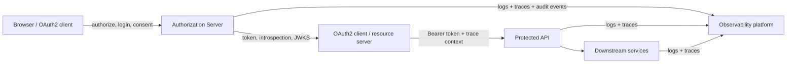
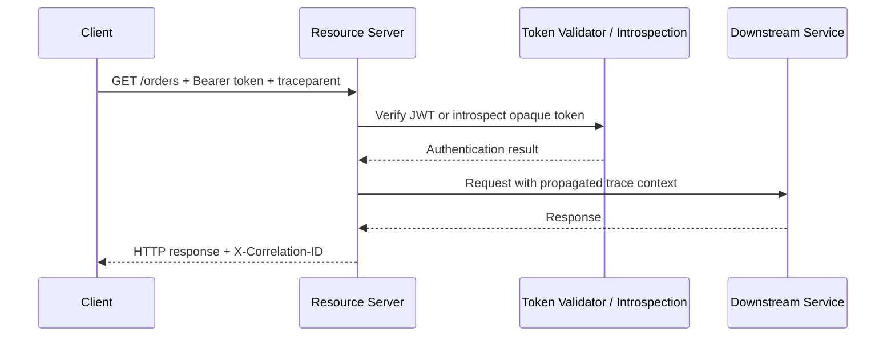

# Correlation IDs and Tracing Across Authorization Server, Client, and API

An OAuth 2.0/OpenID Connect flow typically spans multiple requests and multiple systems: the client redirects the browser to the Authorization Server, the user logs in and grants consent, the client exchanges the authorization code for tokens, and then calls a resource server. Each request may run on a different instance. When an error occurs, looking at a single service's logs is usually not enough to know where the request started, which components it passed through, and at which step it failed.

Correlation IDs and distributed tracing help connect these events into an investigable journey. A correlation ID provides a stable reference identifier for a request or a business flow; trace IDs and span IDs describe the relationships between distributed operations. With Spring Authorization Server, you must design how these identifiers are propagated and recorded so they support operations without exposing authorization codes, tokens, client secrets, sessions, or user data.

This lesson belongs to the `SPRING_SECURITY_OAUTH2_OIDC_AUTHORIZATION_SERVER` module, focusing on designing and operating an OAuth 2.0/OpenID Connect Authorization Server with Spring Authorization Server, including client and consent management, token issuance, PKCE, endpoint protection, and security flow testing.

## 1. Distinguishing Correlation ID, Trace ID, and Span ID

These three identifiers serve closely related purposes but are not interchangeable:

| Identifier | Scope | Purpose |
|---|---|---|
| Correlation ID / Request ID | A single request or a business flow by application convention | Finding related logs and audit events using an identifier that is easy to propagate across systems |
| Trace ID | One distributed trace | Grouping spans belonging to the same distributed journey |
| Span ID | One operation within a trace | Identifying a specific service or operation, while expressing parent/child relationships with other spans |

For example, an API call can produce a trace containing spans at the API gateway, resource server, business service, and database. Each span has its own span ID while sharing the same trace ID. A correlation ID can be preserved across services for quick log lookup, or attached to an authorization flow that spans longer than an individual HTTP trace.

Do not assume a correlation ID is always equal to a trace ID. A trace may exist only for the duration of a single request; a login flow may span multiple traces separated by browser redirects. Conversely, a retried request may create a new trace while still belonging to the same business operation's correlation ID.

## 2. Tracing Architecture for OAuth2/OIDC Flows

A typical system consists of the following components:



In service-to-service requests, W3C Trace Context is typically propagated via the `traceparent` header and optionally `tracestate`. Tracing libraries can automatically create spans and propagate context when HTTP clients are properly configured. A custom correlation ID, such as `X-Correlation-ID`, can be propagated in parallel to search logs or link audit events.

OAuth2 flows have an important characteristic: browser redirects create separate HTTP requests. Browsers do not automatically preserve distributed trace context from the `/oauth2/authorize` request across the login page, consent page, client callback, and `/oauth2/token` request. Therefore, do not assume a single trace ID will automatically span the entire authorization flow.

To link these steps, you can generate an internal flow identifier and store it alongside the authorization state or audit records. Each request still has its own trace; events are linked via `authorization_flow_id` or a server-managed correlation ID. Do not place trace IDs, span IDs, or internal identifiers into redirect query strings merely for tracing convenience.

## 3. Setting Up Distributed Tracing in Spring Boot

With Spring Boot 3 and Micrometer Observation/Tracing, you can use Actuator, a Micrometer Tracing bridge, and the corresponding exporter. Example dependencies when choosing OpenTelemetry:

```gradle
dependencies {
    implementation("org.springframework.boot:spring-boot-starter-actuator")
    implementation("io.micrometer:micrometer-tracing-bridge-otel")
    runtimeOnly("io.opentelemetry:opentelemetry-exporter-otlp")
}
```

Let Spring Boot manage versions through the project's dependency management/BOM. If the system uses Brave, choose the corresponding Brave bridge rather than installing both bridges simultaneously. The exporter must be configured to point to your organization's collector or tracing backend.

An illustrative configuration:

```yaml
spring:
  application:
    name: authorization-server

management:
  tracing:
    sampling:
      probability: 0.1
```

A sampling rate of `0.1` is only an example for an environment with substantial traffic. Development environments can sample everything for troubleshooting; production must choose a rate based on traffic, cost, data policy, and ingestion capacity. Do not use trace sampling as the mechanism for storing audit records: mandatory audit events must be recorded according to an independent retention policy.

When Spring Boot auto-configures Micrometer Tracing, HTTP server observations can create spans for incoming requests, and HTTP clients built through Spring-managed builders can propagate trace context. Verify the Spring Boot version, HTTP library, and how the application constructs clients to know which instrumentation is active.

### 3.1. Using Spring-Configured HTTP Clients

Example using `RestClient.Builder` injected by Spring Boot:

```java
import org.springframework.context.annotation.Bean;
import org.springframework.context.annotation.Configuration;
import org.springframework.web.client.RestClient;

@Configuration
class DownstreamClientConfiguration {

    @Bean
    RestClient inventoryClient(RestClient.Builder builder) {
        return builder
                .baseUrl("https://inventory.internal")
                .build();
    }
}
```

An auto-configured builder can integrate with observation and propagation according to Boot configuration. If you instantiate `new RestTemplate()`, `RestClient.create()`, or `WebClient.create()` manually outside auto-configuration, do not assume tracing interceptors/filters are attached. Use the injected builder or configure instrumentation explicitly.

With WebClient in reactive applications, use the injected `WebClient.Builder` and preserve context within the Reactor pipeline. ThreadLocal-based MDC is not a reliable source of context across every thread or scheduler in a reactive flow.

### 3.2. Reading the Current Trace

Micrometer Tracing provides `Tracer` to retrieve the current span when you need to add trace information to logs or audit events:

```java
import io.micrometer.tracing.Span;
import io.micrometer.tracing.Tracer;

void recordOperation(Tracer tracer) {
    Span currentSpan = tracer.currentSpan();
    if (currentSpan != null) {
        String traceId = currentSpan.context().traceId();
        String spanId = currentSpan.context().spanId();
        // Add traceId/spanId to event metadata or structured logs.
    }
}
```

When there is no current span, the request may not be instrumented, tracing may be disabled, or the code may be running outside a request. Do not generate a random trace ID yourself and call it the current trace. Let the tracing system manage trace context; correlation IDs can exist independently.

## 4. Generating and Propagating Correlation IDs

A correlation ID must have a bounded format, reasonable length, and carry no sensitive business data. A random UUID is a simple choice. Do not use an email address, username, phone number, session ID, or authorization code as a correlation ID.

### 4.1. Choosing Where to Generate IDs and Trust Boundaries

If the application is the entry point from the Internet, the application can generate a correlation ID for each request. If there is a trusted API gateway or ingress, the gateway can strip any incoming header with the same name sent by the client, generate a new ID, and forward that ID to the backend. The backend should only keep the ID from the header when the request comes from an authenticated gateway and backend network paths are appropriately restricted.

Validating the syntax of a header does not make its value trustworthy. An Internet client can send a syntactically valid string that intentionally collides with another request's ID. Therefore, the trust policy must be enforced at ingress or in the application based on request origin; never use correlation IDs as authentication or authorization data.

### 4.2. Filter for Servlet Applications

The following example illustrates a filter in an application behind a trusted gateway. The gateway is configured to overwrite `X-Correlation-ID`; the filter validates the format and generates a new ID if it is missing or invalid:

```java
import java.io.IOException;
import java.util.UUID;
import java.util.regex.Pattern;

import jakarta.servlet.FilterChain;
import jakarta.servlet.ServletException;
import jakarta.servlet.http.HttpServletRequest;
import jakarta.servlet.http.HttpServletResponse;
import org.slf4j.MDC;
import org.springframework.core.Ordered;
import org.springframework.core.annotation.Order;
import org.springframework.stereotype.Component;
import org.springframework.web.filter.OncePerRequestFilter;

@Component
@Order(Ordered.HIGHEST_PRECEDENCE)
public class CorrelationIdFilter extends OncePerRequestFilter {

    private static final String HEADER = "X-Correlation-ID";
    private static final String MDC_KEY = "correlationId";
    private static final Pattern SAFE_ID =
            Pattern.compile("[A-Za-z0-9][A-Za-z0-9._-]{0,63}");

    @Override
    protected void doFilterInternal(
            HttpServletRequest request,
            HttpServletResponse response,
            FilterChain filterChain) throws ServletException, IOException {

        String incoming = request.getHeader(HEADER);
        String correlationId = incoming != null && SAFE_ID.matcher(incoming).matches()
                ? incoming
                : UUID.randomUUID().toString();

        MDC.put(MDC_KEY, correlationId);
        response.setHeader(HEADER, correlationId);
        try {
            filterChain.doFilter(request, response);
        } finally {
            MDC.remove(MDC_KEY);
        }
    }
}
```

This filter is only safe when ingress sanitizes headers from the Internet and the backend cannot be called directly from untrusted sources. If the application receives traffic directly from the Internet, generate a new ID instead of accepting an arbitrary header. Register the filter once before filters that log the correlation ID; avoid registering it both as a servlet filter and adding the same instance into `SecurityFilterChain`.

`MDC` is ThreadLocal-backed. The `finally` block always clears the value so the next request on the same thread does not inherit the wrong ID. For async servlets, executors, schedulers, or Reactor, use an appropriate context propagation mechanism; do not expect MDC to propagate automatically across every thread.

### 4.3. Writing the Correlation ID to the Response

Returning `X-Correlation-ID` in the response helps callers provide a reference identifier when reporting errors. Return only a random identifier containing no internal data. Never return stack traces, trace sampling decisions, sensitive node names, or configuration details alongside this header.

If the gateway already generated the ID, the gateway and backend must agree on who is responsible for writing the response header so they do not overwrite it with two different values. Test both successful and error requests to confirm the header still appears when an exception handler builds the response.

## 5. Propagating Correlation IDs Across Services

Distributed tracing should propagate `traceparent` and `tracestate` through the library's instrumentation. If the organization also requires a custom correlation ID, propagate the dedicated header via an HTTP client interceptor. Example with synchronous `RestClient`:

```java
import org.slf4j.MDC;
import org.springframework.context.annotation.Bean;
import org.springframework.web.client.RestClient;

@Bean
RestClient accountClient(RestClient.Builder builder) {
    return builder
            .baseUrl("https://account.internal")
            .requestInterceptor((request, body, execution) -> {
                String correlationId = MDC.get("correlationId");
                if (correlationId != null) {
                    request.getHeaders().set("X-Correlation-ID", correlationId);
                }
                return execution.execute(request, body);
            })
            .build();
}
```

This interceptor only reads MDC on the same execution thread. For async/reactive clients, retrieve the correlation ID from the propagated context rather than reading ThreadLocal arbitrarily. Do not generate a new correlation ID at every downstream service if the goal is to preserve one end-to-end identifier; each service still gets its own trace/span IDs.

Services receiving the header must validate its format and enforce length limits before logging it. If a request crosses multiple trust boundaries, the gateway at each boundary must decide whether to preserve or replace the correlation ID. A header supplied by an untrusted source must never be used as proof that two requests belong to the same user.

## 6. Linking Steps of the Authorization Code Flow

An authorization flow consists of multiple independent HTTP requests:

1. The client initiates `/oauth2/authorize`.
2. The Authorization Server redirects the browser to login.
3. The user submits login credentials.
4. The server displays and receives the consent decision.
5. The server redirects the browser back to the client's callback with the authorization code and state.
6. The client sends the code to `/oauth2/token`.
7. The client calls the API using the access token.

Each step may create a different trace. To link the events, you can generate an internal `authorization_flow_id` upon receiving a valid authorization request and store it in the authorization data or audit record. When the code is exchanged, read the flow ID back from the authorization state to attach it to the token exchange event. When the client calls the API, the client can keep its business correlation ID in its server-side context, but should avoid putting internal identifiers into the access token unless the resource server has a clear need for them.

Spring Authorization Server allows storing custom attributes in `OAuth2Authorization` via its builder and metadata. Conceptual example:

```java
import java.util.UUID;

import org.springframework.security.oauth2.core.AuthorizationGrantType;
import org.springframework.security.oauth2.server.authorization.OAuth2Authorization;

OAuth2Authorization authorization = OAuth2Authorization
        .withRegisteredClient(registeredClient)
        .id(UUID.randomUUID().toString())
        .principalName(principalName)
        .authorizationGrantType(AuthorizationGrantType.AUTHORIZATION_CODE)
        .attribute("authorization_flow_id", authorizationFlowId)
        .build();
```

This is an example of metadata attached to an authorization; in the real flow, the authorization is created by the provider and additionally holds the request, principal, code, and token metadata. If you need to add attributes, use the customization mechanism appropriate for your version of Spring Authorization Server and ensure the JDBC repository can serialize/deserialize that metadata. Do not replace or manually construct the entire `OAuth2Authorization` in production flows just to record a correlation ID.

Do not propagate trace context by appending `traceparent`, trace IDs, or correlation IDs to `redirect_uri`, `state`, or `nonce`. `state` must be a client-managed random value to prevent CSRF and bind callbacks; `nonce` serves ID Token validation. Do not turn them into a carrier for observability data. If you need to link traces across redirects, store the link server-side via the authorization flow record or audit record.

## 7. Attaching Trace Context to Logs and Audit Events

Logs should contain structured fields for searching, filtering, and aggregation. A log event can include:

| Field | Purpose |
|---|---|
| `timestamp` | Time of occurrence, normalized to UTC |
| `service.name` | Name of the service emitting the event |
| `event.name` | Event name, e.g. `oauth2.authorization.denied` |
| `correlation_id` | Request or authorization flow reference identifier |
| `trace_id`, `span_id` | Link to the current distributed trace, if present |
| `client_id` | Authenticated client or safe client identifier |
| `grant_type` | Associated grant type |
| `endpoint` | Endpoint or operation handled |
| `outcome` | `success`, `denied`, `failure`, or an explicit business status |
| `error_code` | Standardized OAuth2 error code, if any |
| `principal_ref` | Pseudonymized internal reference identifier, if needed |

Example event with sensitive data removed:

```json
{
  "timestamp": "2026-11-16T10:15:30Z",
  "service.name": "authorization-server",
  "event.name": "oauth2.token.issued",
  "correlation_id": "req-8f1c2d",
  "trace_id": "4bf92f3577b34da6a3ce929d0e0e4736",
  "span_id": "00f067aa0ba902b7",
  "client_id": "orders-service",
  "grant_type": "client_credentials",
  "endpoint": "/oauth2/token",
  "outcome": "success"
}
```

Operational logs and audit trails have different objectives. Operational logs support debugging and can be sampled/rotated by volume; audit trails are evidence of security events that must be retained per policy, with separate access controls, integrity protections, and retention periods. Do not depend on whether a trace was sampled to decide whether to write an audit event.

Useful audit events include client registration/update, login success/failure, consent granted/revoked, authorization request denied, code/token issuance, refresh token rotation, token revocation, client authentication failure, and signing key changes. Record only the information needed to prove the event occurred.

## 8. Protecting Sensitive Data in Traces and Logs

OAuth2/OIDC requests contain many values that can become bearer credentials or enable session hijacking. Never record the following values in logs, span attributes, baggage, metric labels, or error messages:

- Authorization codes, access tokens, refresh tokens, ID Tokens, and token exchange subject tokens.
- Client secrets, private keys, client assertions, mTLS private keys, or DPoP proofs.
- `code_verifier`, session cookies, CSRF tokens, and the full `Authorization` header.
- Passwords, login credentials, emails/phone numbers, or unnecessary direct identifiers.
- Full callback query strings if they contain `code`, `state`, `error_description`, or user data.

Do not record the full URL of `/oauth2/authorize` or callbacks in span attributes if the URL contains query parameters. You may record the route template, endpoint name, and non-sensitive allowlisted parameters such as grant type, outcome, and scopes after evaluating data policy.

`baggage` is propagated across multiple services and may be recorded in telemetry backends. Only put non-sensitive, low-churn attributes genuinely needed for investigation into baggage; never put tokens, emails, direct subjects, or detailed authorization data into it. Limit the count and length of baggage items to avoid increasing payload size and cost.

Incoming trace context from external callers is also untrusted input. Do not trust `traceparent`, `tracestate`, or correlation IDs as caller identity. If spoofing protection or cross-tracking mitigation is required, configure ingress to handle trace context according to your organization's trust policy. Request authentication must still rely on TLS, client authentication, bearer tokens, mTLS, or the corresponding endpoint protection mechanism.

## 9. Tracing at Resource Servers and APIs

Resource servers typically receive requests with `Authorization: Bearer ...`. Spring Security validates the access token via a JWT decoder or opaque token introspector. Distributed tracing tracks request latency and downstream calls; security auditing records the required authentication/authorization decisions.

Example request flow:



If the API uses local JWT validation, requests do not necessarily call the Authorization Server on every access. The trace will show validation occurring inside the resource server. If opaque token introspection is used, a span calling the introspection endpoint may appear. Do not conclude a token was verified merely because a trace shows a request arriving at the API; inspect the authentication result and authorization decision in security events.

Do not attach access tokens or sensitive claims to spans. If investigating a specific token is required, you can use a one-way fingerprint generated through a secure process and stored only in a controlled audit system; do not use weak hashes or log partial tokens that could aid guessing. In most cases, correlation ID, client ID, grant type, timestamp, and outcome are sufficient.

## 10. Observing Performance Without Increasing Cardinality

Traces and logs are suited for investigating individual requests; metrics are suited for monitoring trends. Do not use high-cardinality or continuously changing values as metric labels, such as:

- Trace IDs, span IDs, or correlation IDs.
- User IDs, session IDs, authorization codes, or tokens.
- Full callback URLs, query strings, or free-form custom error messages.

Acceptable labels include service, endpoint template, grant type, HTTP status class, and normalized outcome. `client_id` should only be used as a label when the number of clients is bounded and cardinality has been evaluated; if there are many clients, aggregate by client type or keep client IDs in logs/traces instead of metrics.

Useful metrics for an Authorization Server include:

- Authorize/token/introspection/JWKS request counts by endpoint and outcome.
- Rates of `invalid_client`, `invalid_grant`, `invalid_scope`, and server errors.
- p50/p95/p99 latency of the token endpoint and introspection.
- Counts of login/consent successes, denials, or failures.
- Database connection errors, connection pool issues, key store errors, and telemetry exporter failures.
- Trace sampling rate and collector queue/export health.

Metrics need bounded, simple, and stable labels. Never create a new metric time series for every request.

## 11. Testing Correlation IDs and Distributed Traces

Tests must verify ID generation, propagation, context cleanup, and error handling. Baseline test cases:

1. Request without `X-Correlation-ID`: the server generates a valid ID and returns it in the response.
2. Request with a valid ID from a trusted gateway: the server preserves the ID according to policy.
3. Malformed or overly long header: the server replaces it with a new ID and does not log the malicious value.
4. Request failing inside a controller/filter: the ID is still present in logs/error responses and MDC is cleared in `finally`.
5. Two consecutive requests sharing a thread: the second request does not inherit the first request's correlation ID.
6. Downstream call: `traceparent` is propagated automatically and the correlation header is propagated if configured.
7. Authorization redirect: the flow ID is linked via server-side state/audit records and does not appear in query strings or tokens.
8. Resource server: the trace continues across the API and downstream services, while the token validation decision is recorded separately.

Example response header verification with MockMvc:

```java
import static org.springframework.test.web.servlet.request.MockMvcRequestBuilders.get;
import static org.springframework.test.web.servlet.result.MockMvcResultMatchers.header;
import static org.springframework.test.web.servlet.result.MockMvcResultMatchers.status;

mockMvc.perform(get("/actuator/health"))
        .andExpect(status().isOk())
        .andExpect(header().exists("X-Correlation-ID"));
```

This test assumes the filter applies to the actuator health endpoint. If the health endpoint is excluded from the filter by deployment policy, test an application endpoint within the filter's scope.

For trace propagation, use a test server or mock HTTP server to capture request headers from `RestClient`/`WebClient`. Verify that `traceparent` has a valid W3C format and the trace ID links to the active span. Do not hard-code trace IDs in production tests; you can create a test parent span and verify that child requests inherit the correct trace context.

## 12. Common Issues and Troubleshooting

| Symptom | Possible Cause | Resolution |
|---|---|---|
| Each service has a different correlation ID | Header is not propagated or each service generates a new ID | Configure the gateway and HTTP clients to preserve the same ID across trust boundaries |
| Trace breaks on downstream calls | Manually instantiated HTTP client, missing instrumentation, or lost Reactor context | Use auto-configured builders and verify propagation instrumentation |
| Logs lack `traceId`/`spanId` | No active span, sampling/export disabled, or log pattern missing MDC fields | Check tracer, sampling, instrumentation, and log pattern |
| Subsequent request logs contain previous request's ID | MDC not cleared or context not properly restored | Use `try/finally`, context propagation, and thread-reuse tests |
| Correlation ID arbitrarily controlled by client | Ingress forwards Internet headers without overwriting | Strip/overwrite the header at the gateway or generate a new ID in the app |
| Authorization trace does not bridge across callbacks | Redirects create independent HTTP requests/traces | Link via server-side authorization flow records/audit metadata |
| Some requests missing from tracing backend | Sampling or exporter queue/drop | Adjust sampling, check exporter, and keep audit trails independent |
| Tracing backend contains tokens or user data | Overly broad logging of URLs/headers/claims/baggage | Redact data, allowlist span attributes, and restrict baggage |
| Metrics cardinality grows rapidly | Using IDs or full URLs as labels | Move IDs to logs/traces and use aggregated labels |
| Client reports an error but logs cannot be found | Correlation ID not returned or not retained on the client | Return the response header, log structured fields, and store the ID on the client per policy |

## 13. Implementation Checklist

- [ ] Clearly distinguish correlation ID, trace ID, and span ID in operational documentation.
- [ ] Choose a single correlation ID generation point and define trust boundaries for incoming headers.
- [ ] Enforce ID format/length limits; never use IDs for authentication or authorization.
- [ ] Return the correlation ID in responses to help callers look up incidents.
- [ ] Configure Micrometer Tracing/OpenTelemetry and an exporter to a managed collector.
- [ ] Use instrumented HTTP client builders to propagate W3C trace context.
- [ ] Use context propagation mechanisms for async/reactive flows; clear MDC properly.
- [ ] Link authorization flows via server-side metadata/audit records instead of query parameters.
- [ ] Use structured logs with correlation ID and trace/span IDs when a span is active.
- [ ] Store audit trails independently of trace sampling and operational log retention.
- [ ] Never log tokens, authorization codes, verifiers, secrets, cookies, or unnecessary identifiers.
- [ ] Never put trace/correlation IDs into metric labels; monitor cardinality.
- [ ] Test error requests, downstream propagation, browser redirects, and multi-instance deployments.
- [ ] Configure access controls, retention periods, and redaction policies for log/trace/audit backends.

Correlation IDs help operations teams locate related events; distributed tracing shows latency and relationships between operations; audit trails preserve security evidence according to policy. When all three mechanisms are designed with proper boundaries, teams can trace flows from the Authorization Server to clients and APIs without turning telemetry into a store for credentials or sensitive data.
