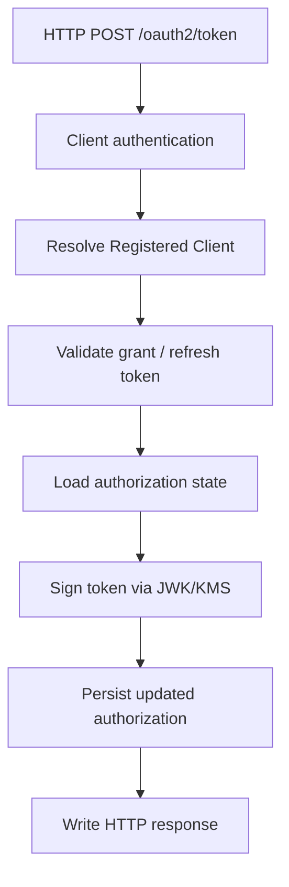

# Monitoring Latency, Authentication Errors, and Refresh Token Failure Rates

An Authorization Server sits directly in the path of login, token issuance, and session renewal. When the token endpoint slows down or refresh tokens repeatedly fail, users may be forced to log in again, applications can lose API access, and dependent services can experience sudden load spikes. Operations teams need to detect incidents early, distinguish client errors from infrastructure errors, and identify root causes without logging tokens or credentials.

This lesson guides you through building observability for Spring Authorization Server using Spring Boot Actuator, Micrometer, and a metrics/tracing collection system. The focus is on endpoint latency, client and user authentication errors, and refresh token failure rates. Examples use illustrative metric names; align naming conventions with your organization's monitoring system.

## 1. Identifying Signals to Monitor

Do not merely count HTTP 200 or HTTP 400 responses. A token endpoint can return HTTP 400 for valid OAuth errors such as `invalid_grant`, `invalid_client`, or `invalid_scope`; these errors carry distinct operational meanings. Conversely, HTTP 500, database timeouts, or KMS errors usually indicate a service-side incident.

Signal groups that should be monitored:

| Group | Metrics | Question to Answer |
|---|---|---|
| Traffic | Token endpoint request count over time | Is traffic rising or dropping abnormally? |
| Latency | p50, p95, p99, and max processing duration | How long do clients have to wait for a response? |
| Availability | Success rate and system error rate | Is the Authorization Server serving requests reliably? |
| Authentication | Error counts by grant type, authentication method, and error group | Are errors coming from client credentials, assertions, redirects, or users? |
| Refresh token | Total refreshes, successful refreshes, and failed refreshes | How many sessions are failing to renew? |
| Dependency | Database, KMS/HSM, LDAP/IdP, cache, introspection | Which dependency is adding latency or causing errors? |
| Runtime | CPU, heap, GC, threads, connection pools | Are resources exhausted or is processing bottlenecked? |

Define Service Level Objectives (SLOs) before creating alerts. For example, an operations team might target token endpoint p95 under 500 ms and system error rate below 0.5% over a 5-minute window. These are illustrative values; choose thresholds based on load, dependency latency, product requirements, and the criticality of the login flow.

## 2. Distinguishing Error Types

### 2.1. Client Authentication Errors

Client authentication occurs before the Authorization Server issues tokens. Common errors include:

- `invalid_client`: wrong client ID/secret, expired secret, disabled client, or incorrect authentication method.
- `invalid_client` with `private_key_jwt`: invalid assertion signature, incorrect `iss`/`sub`/`aud`, expired assertion, or replayed `jti`.
- mTLS failures: untrusted certificate, expired certificate, mismatch with the registered client, or TLS proxy not forwarding certificate identity properly.
- Wrong authentication method: client sends HTTP Basic while registered for `private_key_jwt`, or sends body credentials when the server requires another method.

A surge in `invalid_client` may result from a client deploying a new secret incorrectly, client clock skew, an outdated client JWKS, or credential probing. Distinguish these causes using standardized error groups and logs containing correlation IDs.

### 2.2. Authorization and Token Request Errors

Errors such as `invalid_grant`, `invalid_scope`, `unauthorized_client`, `unsupported_grant_type`, or `invalid_request` usually reflect request or authorization state issues:

- Expired or already-used authorization code, or client/redirect URI mismatch.
- Expired or revoked refresh token, token not belonging to the current client, or reuse after rotation.
- Client not authorized for the requested grant type or scope.
- Request missing required parameters or presenting multiple client authentication methods simultaneously.

These errors must be monitored, but do not automatically treat every OAuth 4xx error as an infrastructure incident. A sudden rate spike or a group of clients failing simultaneously is the signal that warrants investigation.

### 2.3. System Errors

Timeouts, HTTP 5xx, exhausted connection pools, database deadlocks, KMS/HSM errors, or internal token-signing errors typically indicate server-side failures. Track this group separately to compute availability and trigger operational alerts.

Do not infer root cause from HTTP status alone. A configuration error may map to 500; an invalid OAuth request may map to 400 per specification. Classify errors based on OAuth error codes, exception categories, and server-side processing outcomes.

## 3. Defining Metrics and Formulas

### 3.1. Token Endpoint Latency

Measure elapsed time from when the server begins processing the request until the response completes. Use histograms to compute percentiles in the monitoring system; never compute percentiles by averaging per-instance percentiles.

Suggested metrics:

| Metric | Type | Meaning |
|---|---|---|
| `oauth2.token.requests` | Counter | Total token endpoint requests processed |
| `oauth2.token.duration` | Timer/Histogram | Token endpoint request processing duration |
| `oauth2.token.failures` | Counter | Failed token requests by error group |
| `oauth2.auth.failures` | Counter | Client or user authentication failures |
| `oauth2.refresh.requests` | Counter | Total refresh token requests |
| `oauth2.refresh.failures` | Counter | Failed refresh token requests |
| `oauth2.refresh.duration` | Timer/Histogram | Refresh token processing duration |

When using Micrometer, a `Timer` already records count and total time; histograms can be enabled to compute percentiles/quantiles in the backend. Avoid creating a duplicate Counter with the same semantics if the timer already provides the request count.

### 3.2. Refresh Token Failure Rate

Clearly define the denominator before building dashboards. A common definition is:

\[
\text{Refresh failure rate} =
\frac{\text{failed refresh attempts}}{\text{total refresh attempts}} \times 100\%
\]

Here, `total refresh attempts` includes both successful and failed refresh requests processed at the token endpoint. Do not use total token endpoint requests as the denominator because client credentials and authorization code requests are not refresh attempts.

Also display the refresh system-error rate separately from business errors:

- `invalid_grant`: expired token, revoked token, wrong client, or replay under policy.
- `invalid_client`: client failed authentication during refresh.
- `server_error`/5xx/timeout: infrastructure or internal processing failure.
- Other validation errors: request failed grant preconditions.

When comparing service quality, you can count all failed refresh attempts. When detecting infrastructure incidents, use the server-error rate separately to avoid paging when clients send expired refresh tokens during normal behavior.

### 3.3. Cardinality and Metric Labels

Metric labels must have a bounded set of values. Safe labels typically include:

- `grant_type`: `authorization_code`, `client_credentials`, `refresh_token`, `device_code` if supported.
- `outcome`: `success`, `oauth_error`, `server_error`.
- `error_class`: a standardized set of codes such as `invalid_client`, `invalid_grant`, `invalid_scope`, `timeout`, `dependency_error`, `other`.
- `client_auth_method`: `client_secret_basic`, `client_secret_post`, `private_key_jwt`, `tls_client_auth`, `none`, `other`.
- `endpoint`: static endpoint name such as `token`, `introspect`, `revoke`, never a URL with path parameters.

Do not put access tokens, refresh tokens, authorization codes, client secrets, usernames, subjects, emails, `jti`, request IDs, or raw client IDs into metric labels. These values create very high cardinality and can leak data. For tenants or clients needing dedicated analysis, use controlled logs/tracing or group into bounded tiers/segments; do not attach every ID as a default label.

## 4. Enabling Spring Boot Actuator and Micrometer

Add Actuator and the registry matching your metrics system. Example for Prometheus:

```xml
<dependency>
    <groupId>org.springframework.boot</groupId>
    <artifactId>spring-boot-starter-actuator</artifactId>
</dependency>
<dependency>
    <groupId>io.micrometer</groupId>
    <artifactId>micrometer-registry-prometheus</artifactId>
</dependency>
```

With Gradle, declare the equivalent dependencies. Dependency versions should be managed by Spring Boot dependency management/BOM to avoid Micrometer version mismatches.

A baseline configuration:

```yaml
management:
  endpoints:
    web:
      exposure:
        include: health,info,prometheus
  endpoint:
    health:
      probes:
        enabled: true
      show-details: never
  metrics:
    distribution:
      percentiles-histogram:
        http.server.requests: true
        oauth2.operation.duration: true
      slo:
        oauth2.operation.duration: 100ms,250ms,500ms,1s,2s
```

This is an example configuration; histogram/SLO syntax may vary by Spring Boot/Micrometer version. Expose the Prometheus endpoint only on a controlled monitoring network. Do not expose all actuator endpoints publicly to the internet, and do not enable `show-details: always` on a public health endpoint.

Spring Boot typically creates HTTP metrics such as `http.server.requests` automatically. Use this metric to observe latency by route/status; add business OAuth metrics for grant type, outcome, and error class. Avoid measuring the same processing interval twice and summing two timers as if they were two distinct requests.

## 5. Instrumenting Latency and Processing Outcomes

### 5.1. Metric Recording Component

Create a shared component to record counters and timers. All tags must come from enums or controlled value sets:

```java
@Component
public class OAuth2Metrics {

    private final MeterRegistry registry;

    public OAuth2Metrics(MeterRegistry registry) {
        this.registry = registry;
    }

    public Timer.Sample start() {
        return Timer.start(registry);
    }

    public void finish(
            Timer.Sample sample,
            String operation,
            String grantType,
            String outcome,
            String errorClass) {

        String safeOperation = allow(operation,
                Set.of("token", "refresh", "introspect", "revoke"), "other");
        String safeGrant = allow(grantType,
                Set.of("authorization_code", "client_credentials",
                       "refresh_token", "device_code"), "other");
        String safeOutcome = allow(outcome,
                Set.of("success", "oauth_error", "server_error"), "other");
        String safeError = allow(errorClass,
                Set.of("none", "invalid_client", "invalid_grant",
                       "invalid_scope", "unauthorized_client", "timeout",
                       "dependency_error", "other"), "other");

        Timer timer = Timer.builder("oauth2.operation.duration")
                .tag("operation", safeOperation)
                .tag("grant_type", safeGrant)
                .tag("outcome", safeOutcome)
                .register(registry);
        sample.stop(timer);

        registry.counter("oauth2.operation.requests",
                "operation", safeOperation,
                "grant_type", safeGrant,
                "outcome", safeOutcome,
                "error_class", safeError).increment();
    }

    private String allow(String value, Set<String> allowed, String fallback) {
        return value != null && allowed.contains(value) ? value : fallback;
    }
}
```

This component illustrates handler-layer instrumentation. In a real application, call `finish` only once per request; use `finally` to ensure the timer stops even when an exception occurs. You can replace per-call `Set` allocations with immutable constants or enums. If using a timer that already includes count, you can omit the `oauth2.operation.requests` Counter to avoid duplicate data; the example keeps a separate Counter to illustrate attaching `error_class` to failure counts.

### 5.2. Placing Instrumentation in the Right Location

To measure the entire token endpoint, place instrumentation at the request processing boundary or in the token endpoint's success/failure handlers. To classify refresh tokens accurately, observe the outcome of the `refresh_token` flow at the corresponding provider/handler. Extension API names and filter setup may vary across Spring Authorization Server versions; integrate with the appropriate extension point for the version in use.

Do not wrap only `OAuth2AuthorizationService` and assume all refresh errors are counted: some errors such as client authentication, request validation, or grant validation can occur before the service is invoked. Conversely, do not instrument only controllers if the token endpoint is processed in the security filter chain. Verify that both success and every failure branch pass through the recorder exactly once.

One way to organize this is creating an adapter/recorder with a business API:

```java
public <T> T recordTokenOperation(
        String grantType,
        Supplier<T> operation) {
    Timer.Sample sample = metrics.start();
    String outcome = "success";
    String errorClass = "none";
    try {
        return operation.get();
    } catch (OAuth2AuthenticationException ex) {
        outcome = "oauth_error";
        errorClass = classifyOAuthError(ex.getError().getErrorCode());
        throw ex;
    } catch (RuntimeException ex) {
        outcome = "server_error";
        errorClass = classifyException(ex);
        throw ex;
    } finally {
        metrics.finish(sample, "token", grantType, outcome, errorClass);
    }
}
```

The snippet illustrates the logic pattern; `classifyOAuthError` and `classifyException` must map into a bounded list and never use exception messages as tags. If an exception is handled in a filter/handler without being rethrown, record the outcome in that handler rather than catching in an outer layer and mistakenly recording success.

### 5.3. Measuring Latency by Dependency

An overall token endpoint timer tells you how long callers wait, but does not explain why on its own. Create separate spans/timers for critical dependencies:

- Reading `RegisteredClientRepository`.
- Reading/writing `OAuth2AuthorizationService` and the consent store.
- Accessing the database connection pool and executing queries.
- Calling KMS/HSM to sign JWTs or decrypt credentials.
- Verifying `private_key_jwt`, mTLS certificates, or calling an upstream IdP if present.
- Calling external introspection or policy services if used by the architecture.

Do not create metrics for individual SQL statements with dynamic tags. Use tracing/APM to locate slow spans and aggregated metrics for dashboards. Compare endpoint p95 against database/KMS p95 to identify where time is spent.

## 6. Accurately Counting Successful and Failed Refresh Tokens

### 6.1. Choosing the Recording Point

Refresh tokens are handled at the token endpoint with `grant_type=refresh_token`. The measurement point must cover:

1. Client authentication.
2. Validating the refresh token and its corresponding authorization.
3. Checking the client, scopes, revocation status, expiration, and refresh token reuse policy.
4. Generating a new access token and a new refresh token if rotation is enabled.
5. Persisting authorization state and writing the response.

Counting only in the client SDK cannot tell whether the request even reached the Authorization Server. Counting only in `OAuth2AuthorizationService` misses errors occurring before the repository is called. The best observation point is token endpoint failure/success handling, combined with detailed spans at the provider and persistence layers.

### 6.2. Classifying Refresh Errors

A useful classification table:

| Group | Examples | Interpretation |
|---|---|---|
| `invalid_grant` | Expired, revoked, wrong-client, or replayed refresh token | State/credential error; monitor by trend |
| `invalid_client` | Wrong client secret or invalid assertion/certificate | Client configuration or credential error |
| `unauthorized_client` | Client not permitted to use the grant | Policy or client registration error |
| `invalid_request` | Missing refresh token or malformed request | Client integration error |
| `timeout` | Database/KMS/IdP timeout | Dependency incident or overload |
| `server_error` | Internal exception | Authorization Server-side incident |

An OAuth error code does not always reveal the ultimate root cause. For example, `invalid_grant` could be a normally expired token, a revoked token, or a reuse attack. If distinction is needed, log an additional standardized internal reason where the rejection decision is made, without exposing sensitive details in the OAuth response or high-cardinality metric labels.

### 6.3. Dashboard Formulas

Example using a `oauth2.refresh.attempts` Counter with an `outcome` tag:

```text
refresh_failure_rate =
  rate(refresh_attempts{outcome="failure"}[5m])
  /
  rate(refresh_attempts[5m])
```

When the denominator is 0, the dashboard should display `N/A` instead of 0% to avoid mistaking zero traffic for zero errors. Also compute:

- Refresh success rate.
- Refresh failure rate by error class.
- Absolute number of refresh attempts.
- Refresh server-error rate separately.
- p95/p99 refresh latency.

Do not look at ratios alone. If there was only one request and it failed, the rate is 100%, yet it may not be a widespread incident. Alerts should combine ratio, minimum request count, and time window.

## 7. Safe Structured Logging

Metrics show trends; structured logs help investigate a single request. A log event can contain:

```json
{
  "event": "oauth2.token.request",
  "timestamp": "2026-11-16T10:15:30Z",
  "outcome": "oauth_error",
  "grant_type": "refresh_token",
  "client_auth_method": "private_key_jwt",
  "error_class": "invalid_grant",
  "http_status": 400,
  "duration_ms": 42,
  "service_instance": "auth-server-2",
  "trace_id": "4bf92f3577b34da6a3ce929d0e0e4736"
}
```

The example contains no client ID, subject, or token. If an investigation requires identifying a specific client, use a controlled pseudonymized reference or look up audit records in a system with restricted access. Do not use a plain hash of a client secret/token as an identifier because it can still introduce guessing or correlation risks.

Never log:

- `Authorization` headers, access tokens, refresh tokens, ID tokens, or authorization codes.
- Client secrets, client assertion JWTs, private keys, passwords, or session cookies.
- Full request/response bodies of the token endpoint.
- Raw exception messages if they might contain SQL, credentials, or user data.

For OAuth errors, log a standardized `error_class` and correlation ID. If detailed debugging is needed, enable temporary logging in a narrow scope with restricted readers and duration; also inspect reverse proxies, APM, and HTTP clients to avoid leaks in other layers.

## 8. Distributed Tracing and Correlation

Use Micrometer Observation/Tracing or OpenTelemetry to link requests from ingress to the token endpoint, database, KMS, and dependencies. A trace should show:



Span names must be stable and contain no user/client/token IDs. Never use raw `client_id`, `sub`, `jti`, arbitrary scopes, or URLs with query strings as span names or metric tags. You can add categorical attributes such as `oauth.grant_type`, `oauth.client_auth_method`, `oauth.outcome`, and `oauth.error_class` if normalized and permitted by data policy.

Trace IDs can appear in logs to correlate layers. The tracing backend requires access control, sampling, and retention limits; not every failing request needs full payloads or verbose spans stored. For sensitive authentication errors, recording outcome and error class is sufficient.

## 9. Operational Dashboards

An Authorization Server dashboard should contain the following rows:

### 9.1. Token Endpoint Health

- Request rate by grant type.
- p50/p95/p99 latency.
- Success rate and server error rate.
- HTTP statuses and OAuth error classes.
- Per-instance comparison to spot an anomalous replica.

### 9.2. Client Authentication

- `invalid_client` counts by normalized authentication method.
- `private_key_jwt`, mTLS, or client secret failures by error class.
- Disabled client or credential rotation counts if corresponding business metrics exist.
- Error trends by deployment version.

### 9.3. Refresh Tokens

- Total refresh attempts and absolute failure counts.
- Refresh failure rate, success rate, and server failure rate.
- Distribution of `invalid_grant`, `invalid_client`, timeout, and dependency errors.
- p95/p99 refresh latency.
- Detected reuse rate if supported by the refresh token rotation policy.

### 9.4. Dependencies and Runtime

- Database pool active/idle/pending connections, query latency, and errors.
- KMS/HSM signing latency and errors.
- Heap, GC pauses, CPU, thread pools, and request queues.
- Cache hits/misses and timeouts if authorization state or clients are cached.

Dashboards must include time range and deployment version filters. Use filter variables with bounded cardinality; avoid allowing default dashboard queries across millions of client IDs.

## 10. Alerts and Alerting Thresholds

Alerts should detect user impact and provide clear investigation paths. Some reference rules:

| Alert | Illustrative Condition | Initial Action |
|---|---|---|
| High token endpoint latency | p95 exceeds SLO continuously for 5 minutes with sufficient traffic | Check DB, KMS, CPU, threads, and deployments |
| Elevated server errors | 5xx ratio exceeds threshold for 5 minutes | Inspect exceptions, dependencies, and logs by trace ID |
| Elevated client authentication failures | `invalid_client` spikes sharply against baseline | Check secret/key rotation, certificates, client rollouts, and credential-probing signs |
| Elevated refresh failure rate | Rate exceeds threshold with minimum failure count | Classify `invalid_grant`, `invalid_client`, and server errors |
| Refresh server failures | Timeouts/5xx rise on refresh requests | Check authorization store database and KMS |
| Single anomalous instance | One replica's p99 or errors exceed peers | Check config, key ring, connection pool, and node health |
| Dependency saturation | DB pending connections or KMS latency exceeds threshold | Shed load in a controlled manner and remediate dependency |

Do not alert merely because a single refresh token expired. Use baselines, minimum request counts, and error classification. For `invalid_grant`, examine the ratio over total refreshes and trends by client version; a post-deploy spike may indicate clients are still sending old refresh tokens after rotation.

Alerts should include an owner, severity, runbook link, metric query, and evaluation window. Use multi-window/multi-burn-rate alerts if the organization manages SLOs; avoid noisy alerts triggered by a single short data point.

## 11. Prometheus Query Examples

The following queries assume metrics are exported under the corresponding Prometheus names. Micrometer may append `_count`, `_sum`, or `_bucket` suffixes for Timers/Histograms; confirm the actual names at `/actuator/prometheus` before use.

### 11.1. Token Endpoint Request Rate

```promql
sum by (grant_type) (
  rate(oauth2_operation_requests_total{operation="token"}[5m])
)
```

### 11.2. p95 Token Latency

```promql
histogram_quantile(
  0.95,
  sum by (le) (
    rate(oauth2_operation_duration_seconds_bucket{
      operation="token"
    }[5m])
  )
)
```

### 11.3. Refresh Failure Rate

```promql
sum(rate(oauth2_operation_requests_total{
  operation="token",
  grant_type="refresh_token",
  outcome!="success"
}[5m]))
/
sum(rate(oauth2_operation_requests_total{
  operation="token",
  grant_type="refresh_token"
}[5m]))
```

In practice, if your metric is designed with `operation="refresh"`, use that value consistently. Use `clamp_min` or conditional expressions in dashboards to avoid division by zero; when there is no traffic, display N/A. In multi-instance deployments, aggregate the numerator and denominator before dividing.

### 11.4. Refresh Error Breakdown

```promql
sum by (error_class) (
  rate(oauth2_operation_requests_total{
    operation="token",
    grant_type="refresh_token",
    outcome!="success"
  }[5m])
)
```

Do not group by client ID or username in metrics. If you need to investigate a single client, use controlled traces/logs or audit records with restricted access.

## 12. Testing Observability

Do not only verify that `/actuator/prometheus` returns HTTP 200. Verify that metrics increment properly in each scenario and contain no sensitive data.

| Scenario | Expected Metric/Log |
|---|---|
| Successful client credentials | Token request count increments; timer records outcome success |
| Failed client authentication | Authentication failure counter increments with error class `invalid_client` |
| Invalid/expired authorization code | OAuth error is classified; code is never logged |
| Valid refresh token | Refresh attempts and successes increment; duration is recorded |
| Expired/revoked refresh token | Failure increments with `invalid_grant` or standardized reason group |
| Refresh token reuse | Reuse is recorded per policy; token is not exposed |
| Database timeout during refresh | Server/dependency error increments; trace highlights database span |
| Slow KMS signing | Token latency and KMS span increase; distinguishable from DB |
| Zero traffic | Dashboard displays N/A for failure rate |
| Multiple replicas | Metrics aggregate properly; same request is not double-counted |
| Log scan | No tokens, secrets, assertions, or Authorization headers |
| Cardinality test | Time series count does not grow with user/client/request IDs |

Run load tests in staging with controlled success/failure ratios. Establish baselines for p50/p95/p99, throughput, CPU, database pool, and KMS latency. Then simulate slow or unreachable dependencies to confirm alerts and runbooks work as expected.

## 13. Investigation Workflow When Metrics Degrade

When p95 token latency or refresh failure rate breaches the SLO:

1. Identify when it started and correlate with deployments, credential rotations, policy changes, or dependency incidents.
2. Determine the scope: all grant types or only refresh; all clients or a subset; all replicas or a single instance.
3. Separate OAuth errors, system errors, and dependency errors; never combine 4xx and 5xx into a single rate.
4. Open sample traces to inspect time spent in client authentication, authorization store, KMS, database, and response writing.
5. Check structured logs using trace ID; never search by dumping tokens or request bodies.
6. Cross-check client rollouts, refresh token rotation, and authorization store state.
7. Remediate the root cause, monitor metrics after the change, and document the timeline/incident.

Diagnostic indicators:

- p95 rises alongside DB pending connections: the pool or database may be bottlenecked.
- p95 rises while DB is normal and KMS spans increase: check the signing service, quota, or KMS network.
- Refresh failures show rising `invalid_grant` after a client deployment: check whether the client persists the new refresh token after rotation.
- `invalid_client` rises after credential rotation: check overlap windows and client authentication methods.
- Only one replica has high latency: check that instance's configuration, node, cache, connection pool, and key ring.
- Error rate rises while traffic is low: inspect absolute counts before concluding a widespread outage.

## 14. Common Implementation Mistakes

| Mistake | Consequence | Fix |
|---|---|---|
| Monitoring only HTTP 5xx | Misses `invalid_client`, `invalid_grant`, and high latency | Track OAuth error classes and business timers |
| Treating all 4xx as server incidents | Noisy alerts, inability to distinguish client errors from policy issues | Separate OAuth errors from system errors |
| Computing refresh failure over all token requests | Wrong denominator, meaningless ratio | Count only `grant_type=refresh_token` requests |
| Not measuring failures in token endpoint filters | Misses errors before calling the authorization service | Instrument appropriate success/failure handlers or providers |
| Putting raw client ID/user/token in metric tags | Cardinality explosion and data leaks | Use bounded tags and controlled logs/tracing |
| Measuring only overall latency | Cannot tell which dependency is slow | Add spans/timers for DB, KMS, and authorization store |
| Logging request bodies or Authorization headers | Exposes credentials and tokens | Structured log allowlists, redaction, and log scanning |
| Alerting on a single refresh failure | False alarms on normal token expiration | Combine ratio, minimum count, and baseline |
| Not testing metrics | Dashboards may display wrong values or double-count | Integration tests for success/failure and multi-instance |

## Conclusion

Effective observability for an Authorization Server combines latency, traffic, authentication outcomes, OAuth errors, and dependency health. Measuring refresh tokens separately from other grant types, classifying `invalid_grant`/`invalid_client`/system errors, and using the right denominator keep dashboards faithful to the actual session-renewal experience. Micrometer, Actuator, and tracing provide the necessary signals when placed at the right processing points, with bounded-cardinality tags and zero token or credential logging. When dashboards, alerts, and runbooks all build on these signals, operations teams can detect incidents early and diagnose root causes without exposing authentication data.
