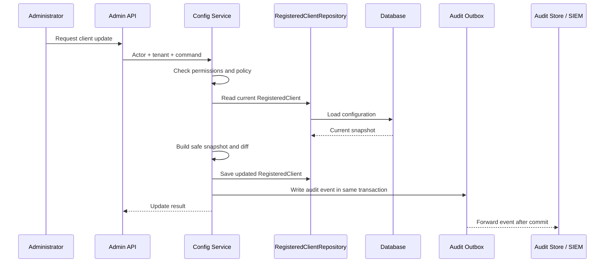

# Auditing Client, Tenant, and Token Policy Configuration Changes

A small change in OAuth 2.0/OIDC configuration can alter access permissions for many applications. Adding a redirect URI, expanding scopes, enabling a grant type, extending an access token lifetime, or changing a signing key can all affect the security boundary of the Authorization Server. When an incident occurs, operations teams need to answer who changed what, for which tenant or client, when it happened, whether the change succeeded, and which configuration is currently in effect.

Configuration auditing records the history of security-relevant changes to clients, tenants, and token policies. In Spring Authorization Server, objects such as `RegisteredClient`, `ClientSettings`, and `TokenSettings` provide part of client configuration; tenant models, administrative workflows, and shared policies are typically built by the application itself. Therefore, auditing must be designed in the configuration management business layer and connected to the Authorization Server repositories.

This lesson focuses on configuration change history. Token issuance logs, user authentication logs, and endpoint access logs are separate operational event groups; they can share collection infrastructure, but require their own taxonomy, volume planning, and retention policies.

## 1. Why Audit Configuration Changes

The Authorization Server is the trusted source issuing tokens to clients. If a client is granted a sensitive scope or allowed an inappropriate grant type, the impact can propagate to downstream APIs and data. If a tenant's issuer or domain configuration is changed, clients may authenticate against the wrong server. If a refresh token lifetime is extended, a stolen credential can maintain access longer than expected.

Configuration auditing helps achieve the following goals:

- **Accountability:** identify the actor as an administrator, service account, or pipeline; know which object and fields changed.
- **Incident investigation:** reconstruct the state before and after a change, when the change took effect, and related requests.
- **Change control:** support approval workflows, separation of duties, and detection of out-of-process changes.
- **Anomaly detection:** alert when scopes are expanded, PKCE is disabled, redirect URIs change, or token policies are relaxed.
- **Audit readiness:** provide searchable history, protected against unauthorized modification or deletion, and retained per organizational policy.

An audit record is valuable when it answers five questions: **who** performed the action, **what** they did, **which target** was affected, **when and from where** the action took place, and what the **outcome** was. For approved changes, include the reason, ticket ID, or approval trail if required by organizational procedures.

## 2. Identifying Changes to Record

Do not record only a generic event such as `CONFIG_UPDATED`. Use event names that describe the business action and keep enough detail for investigators to understand the impact.

### 2.1. Registered Client Changes

`RegisteredClient` represents a client registered with the Authorization Server. Changes that typically require auditing include:

- Creating, updating, disabling, re-enabling, or deleting a client.
- Changing `clientName`, token endpoint authentication methods, or allowed grant types.
- Adding, modifying, or removing redirect URIs and post-logout redirect URIs.
- Adding or removing scopes.
- Changing PKCE requirements, consent requirements, or other client settings.
- Changing authorization code, access token, or refresh token lifetimes, access token format, or refresh token handling.
- Rotating a client secret or changing key/JWK information used by the client.

Spring Authorization Server provides `RegisteredClientRepository` for saving and finding `RegisteredClient` instances. `RegisteredClient` holds `ClientSettings` and `TokenSettings`, allowing the management layer to construct safe snapshots from these values before and after updates.

### 2.2. Tenant Changes

Spring Authorization Server does not provide a complete administrative tenant model out of the box. A tenant is usually an application-domain or platform-domain concept. If the system supports multiple tenants, audit changes such as:

- Creating, activating, suspending, unlocking, or closing a tenant.
- Changing identifiers, domains, issuers, or host-to-tenant mappings.
- Changing the list of clients allowed to operate in a tenant.
- Changing login, consent, MFA, federation, or access-restriction policies.
- Changing tenant-specific default scopes, allowed grant types, token limits, or signing policies.
- Changing the tenant's links to key stores, IdPs, or user management systems.

Audits must use a stable `tenant_id`, not a mutable display name as the primary identifier. When a change affects the entire system, explicitly record `GLOBAL` scope; when a change affects a single tenant, record the specific `tenant_id`. If a global policy affects multiple tenants, store the policy version and applicability scope so affected tenants can be identified.

### 2.3. Token Policy Changes

Token policy can live across multiple layers. Part lives in a client's `TokenSettings`; part lives in `ClientSettings`; another part lives in Authorization Server configuration or an application-built policy engine. Audit both the configured values and the policy source that produced the effective value.

Security-relevant changes include:

- Authorization code, access token, and refresh token lifetimes.
- Allowing refresh token reuse versus requiring rotation on every refresh.
- Access token format, such as JWT versus reference token.
- ID token signing algorithm and application-managed JWT signing parameters.
- Allowed grant types, scopes, audiences, and claim mappings.
- Requirements for PKCE, consent, client authentication, or certificate-bound tokens.
- Token revocation rules, rate limits, and token issuance policies by tenant or client.

Not every attribute resides in `TokenSettings`. Custom policies need their own identifiers, versions, and schemas; do not log an unstructured configuration string and expect to query it accurately later.

## 3. Event Classification and Audit Record Design

A small, consistent taxonomy makes searching and alerting easier. For example:

| Group | Suggested Event Names | When to Record |
|---|---|---|
| Client | `CLIENT_CREATED`, `CLIENT_UPDATED`, `CLIENT_DISABLED`, `CLIENT_DELETED` | When Registered Client status or configuration changes |
| Client credentials | `CLIENT_SECRET_ROTATED`, `CLIENT_KEY_UPDATED` | When a client's secret or key information is replaced |
| Tenant | `TENANT_CREATED`, `TENANT_SUSPENDED`, `TENANT_SETTINGS_UPDATED` | When a tenant or tenant configuration changes |
| Policy | `TOKEN_POLICY_CREATED`, `TOKEN_POLICY_UPDATED`, `TOKEN_POLICY_ASSIGNED` | When a policy is created, updated, or assigned to a scope |
| Governance | `CONFIG_CHANGE_DENIED`, `CONFIG_CHANGE_APPROVAL_REJECTED` | When an operation is denied or an approval fails |

Event names form a data contract between the management service, audit system, dashboards, and SIEM. When evolving the taxonomy, version the schema and maintain the ability to read older events.

### 3.1. Recommended Fields

A configuration audit record should contain at a minimum:

| Field | Meaning |
|---|---|
| `event_id` | Unique ID for deduplication and lookup |
| `occurred_at` | UTC timestamp when the change was recorded |
| `event_type` | Business action type |
| `actor_type`, `actor_id` | User, service account, or pipeline performing the action |
| `tenant_id` | Affected tenant or `GLOBAL` |
| `target_type`, `target_id` | Client, tenant, or policy that changed |
| `outcome` | `SUCCESS`, `DENIED`, or `FAILED` |
| `changed_fields` | List of fields that changed |
| `before_snapshot`, `after_snapshot` | Safe snapshots before and after the change |
| `request_id`, `correlation_id` | Links to the associated request or trace |
| `source` | Admin API, console, automation, or pipeline |
| `reason`, `change_reference` | Reason or ticket/approval ID if present |
| `before_version`, `after_version` | Configuration version before and after |

IP address, user agent, authentication method, and step-up/MFA status can be added when permitted by policy. Collect only necessary data; identifying and network metadata also require appropriate retention periods and access controls.

### 3.2. Snapshots Must Exclude Sensitive Data

Audits need enough detail to explain a change, but must never become a secondary credential store. Never record the following values in snapshots or diffs:

- Client secrets, passwords, access tokens, refresh tokens, authorization codes, or ID tokens.
- Private keys, encryption keys, secret manager contents, or KMS/HSM access credentials.
- `Authorization` headers, session cookies, or unfiltered full administrative request bodies.

For client secret rotation, record only `secret_changed: true`, timestamp, credential version, or the new expiration time. Never record the old secret, new secret, or a hash of the secret. For signing key changes, record `kid`, algorithm, key reference, and public key fingerprint if needed; never record the private key.

Create an allowlist of fields permitted to appear in snapshots. This is safer than logging the entire object and trying to strip sensitive attributes afterward. Also inspect nested objects, exceptions, logging frameworks, and telemetry to prevent data leaks outside the primary audit record.

## 4. Example of a Client Update Event

Suppose an administrator adds the `orders.read` scope and an approved redirect URI for client `web-portal`. An audit event might look like this:

```json
{
  "eventId": "8d58e4de-85d1-4b88-9a82-97c1f8a10e51",
  "occurredAt": "2026-11-16T09:30:00Z",
  "schemaVersion": 1,
  "eventType": "CLIENT_UPDATED",
  "outcome": "SUCCESS",
  "actor": {
    "type": "USER",
    "id": "admin-17"
  },
  "tenantId": "tenant-42",
  "target": {
    "type": "REGISTERED_CLIENT",
    "id": "client-portal-01",
    "clientId": "web-portal"
  },
  "change": {
    "beforeVersion": 12,
    "afterVersion": 13,
    "changedFields": ["redirectUris", "scopes"],
    "before": {
      "redirectUris": ["https://portal.example.com/login/oauth2/code/app"],
      "scopes": ["openid", "profile"]
    },
    "after": {
      "redirectUris": [
        "https://portal.example.com/login/oauth2/code/app",
        "https://portal.example.com/alternate/callback"
      ],
      "scopes": ["openid", "profile", "orders.read"]
    }
  },
  "source": "admin-api",
  "requestId": "req-71d0f3",
  "reason": "Approved client integration change"
}
```

This is an illustrative schema example. IDs, tenants, URIs, and reasons in production must come from validated data. Snapshots contain only allowlisted attributes; no client secrets or tokens are present.

For denied operations, record `outcome: DENIED`, actor, tenant, target, requested action, and the appropriate rejection reason. Never log the full unvalidated payload because it may contain credentials or caller-controlled data.

## 5. Enforcing Tenant Boundaries

Multi-tenant auditing must protect both configuration data and audit data. A record with the wrong `tenant_id` can misdirect an investigation or expose another customer's administrative activity.

### 5.1. Resolving Tenant from a Trusted Source

Never treat a client-supplied `tenant_id` in the body or query parameter as proof of access rights. The tenant must be resolved from authenticated context, such as a managed host/issuer mapping, admin identity, and tenant administration permissions. Then verify the actor is authorized to operate on that tenant before reading or modifying configuration.

Spring Authorization Server does not provide a built-in shared tenant context across repositories. The application must decide how to partition data and resolve clients. Common patterns include:

- **System-wide unique client IDs:** use global `client_id` values and store an explicit tenant mapping. This fits standard flows that look up clients via `findByClientId` without a tenant parameter.
- **Per-tenant stores or Authorization Servers:** each tenant has its own repository or instance, yielding clearer data boundaries at higher operational cost.
- **Custom tenant resolution:** extend repositories or client resolution layers to include the authenticated tenant in every lookup. This must integrate consistently across authorization requests, the token endpoint, introspection, and related flows.

If two tenants are allowed to use the same `client_id`, a clear tenant resolution mechanism must exist across the entire flow. Simply adding `tenant_id` to a table while still calling a tenant-agnostic `findByClientId` query is insufficient. Do not rely on ad-hoc `ThreadLocal` usage without managing request lifecycle, async execution, and cleanup; tenant context must be propagated or restored in a controlled manner.

### 5.2. Recording Tenant ID on Every Related Event

Client events must carry the tenant owning the client. Policy events must indicate the applicability scope: global, tenant, or client. If an operation transfers a client from one tenant to another, record both source and destination tenants in a dedicated transfer event, alongside required permission checks and approvals.

When querying audit logs, enforce access control on the server side. Do not filter by tenant only in the UI. An administrator for tenant A must never be able to query tenant B's events by modifying URLs or API parameters.

## 6. Integrating Audits with Spring Authorization Server

Auditing should live in the configuration management service, where the system knows the actor, tenant, reason, and meaning of the change. Avoid scattering audit logic across controllers or relying solely on SQL logs, because SQL logs struggle to express business intent and may not know who requested the change.

A client update flow can follow this sequence:



`RegisteredClientRepository` is the client persistence contract of Spring Authorization Server. The management service should invoke this repository through a domain layer responsible for verifying tenant ownership and change permissions. When saving the client, the domain layer writes the audit event or outbox record at the same time.

### 6.1. Auditing Different Configuration Sources

Not every change goes through `RegisteredClientRepository`:

- Client configuration in the database should be audited in the client management service.
- Tenant policies stored in separate tables should be audited in the tenant management service.
- Global token policies packaged in application configuration should be linked to the commit, artifact digest, pipeline, approver, and deployment ID.
- Changes in a secret manager or KMS should pull audit logs from the key/secret management system and correlate them with `kid`, key reference, or credential version.

If configuration is reloaded from files or external systems, record the configuration version actually applied after reload. Recording a commit alone is insufficient if deployment fails or the application fails to load that version.

### 6.2. Do Not Confuse Configuration Audits with Token Issuance Events

Issuing a token does not mean client configuration changed. `CLIENT_UPDATED` or `TOKEN_POLICY_UPDATED` events belong to the administrative control plane; token issuance events belong to the runtime data plane. Both groups can be correlated via `client_id`, `tenant_id`, policy version, and correlation ID, but should not be mixed into a single event type.

Writing every token issuance into the same configuration audit table creates high write volume and makes querying administrative changes harder. Use a separate telemetry system for the token endpoint and correlate only when an investigation requires it. Never put raw token values into either log group.

## 7. Writing Configuration and Audit Atomically

A common bug is saving the client successfully while audit persistence fails, or writing the audit record while the client update rolls back. When configuration and audit live in the same database, write them in the same transaction. If audits are shipped to an external system, use a transactional outbox so you do not depend on a synchronous network call inside the transaction.

### 7.1. Transactional Outbox

Within a single transaction:

1. Read the current configuration version.
2. Verify permissions, tenant ownership, and change rules.
3. Build the new configuration and safe before/after snapshots.
4. Persist the new configuration.
5. Insert an outbox record with a unique `event_id`.
6. Commit the transaction.

A worker reads the outbox, ships events to the audit store or SIEM, and marks them delivered. Consumers must process idempotently by `event_id`, with retries and dead-letter handling. Never call the SIEM directly before saving the client; a SIEM network failure should not leave updates in a half-completed state.

If configuration and audit live in the same database, you can write directly to an append-only audit table in the same transaction. If the audit store is separate, an outbox in the configuration database serves as a reliable bridge. Monitor outbox lag, pending record counts, and delivery errors to detect stalled audit pipelines.

### 7.2. Failed and Denied Operations

A rolled-back update transaction will not retain an audit record written inside that transaction. For denied or failed operations, provide a separate recording path capable of persisting the failure outcome without exposing payloads. Record essential fields such as actor, tenant, target, action, outcome, request ID, and reason code; never log secrets or raw request content.

If the audit store is temporarily unavailable, the fallback policy must reflect the operation's sensitivity. For high-privilege changes, you may require durable audit persistence before allowing the change. For high-volume failure events, you can use a durable buffer and alert. Never silently drop events without metrics or alerts.

## 8. Java Model Example for Snapshots and Outbox

The following example illustrates how to structure the domain layer. `TenantAwareClientStore`, `ClientSnapshotFactory`, `ClientUpdater`, and `AuditOutboxRepository` are application-defined abstractions; they are not built-in Spring Authorization Server classes.

```java
public record SafeClientSnapshot(
        String clientName,
        Set<String> redirectUris,
        Set<String> postLogoutRedirectUris,
        Set<String> scopes,
        Set<String> grantTypes,
        Set<String> authenticationMethods,
        boolean requireProofKey,
        boolean requireAuthorizationConsent,
        Duration accessTokenTtl,
        Duration refreshTokenTtl,
        boolean reuseRefreshTokens,
        String accessTokenFormat) {
}
```

The snapshot contains only fields allowed for auditing. The factory constructs the snapshot from `RegisteredClient`, `ClientSettings`, and `TokenSettings`; if custom fields exist, the factory must apply the same allowlist approach.

```java
@Service
public class ClientConfigurationService {

    private final TenantAwareClientStore clients;
    private final ClientUpdater updater;
    private final ClientSnapshotFactory snapshots;
    private final AuditOutboxRepository outbox;

    public ClientConfigurationService(
            TenantAwareClientStore clients,
            ClientUpdater updater,
            ClientSnapshotFactory snapshots,
            AuditOutboxRepository outbox) {
        this.clients = clients;
        this.updater = updater;
        this.snapshots = snapshots;
        this.outbox = outbox;
    }

    @Transactional
    public void updateClient(
            TenantId tenantId,
            Actor actor,
            String clientId,
            UpdateClientCommand command,
            String correlationId) {

        RegisteredClient current = clients.requireForTenant(tenantId, clientId);
        SafeClientSnapshot before = snapshots.from(current);

        RegisteredClient updated = updater.apply(current, command);
        clients.validateChange(tenantId, actor, current, updated);

        SafeClientSnapshot after = snapshots.from(updated);
        Set<String> changedFields = snapshots.diff(before, after);

        if (changedFields.isEmpty()) {
            return;
        }

        clients.save(tenantId, updated);
        outbox.append(AuditEvent.clientUpdated(
                tenantId,
                actor,
                current.getId(),
                before,
                after,
                changedFields,
                correlationId,
                command.reason()));
    }
}
```

The example assumes client persistence and the outbox share the same transaction manager and database. In production, `TenantAwareClientStore` must verify tenant ownership, and `ClientUpdater` must permit changes only to allowed fields. Add version handling to prevent two administrators from overwriting each other's changes. You can use optimistic locking or an explicit version column in the configuration table; do not assume every default JDBC schema already includes a version column.

Never pass the full request object to `outbox.append`. Pass the safe snapshot created after filtering fields. For secret rotation, the snapshot reflects only that the credential state changed, without containing the credential.

## 9. Auditing Token Policies by Scope and Version

A system may apply policies in order of global, tenant, and then client. In that case, recording only an override value is insufficient to explain the effective policy actually in use.

For example:

| Scope | Access Token TTL | Refresh Token TTL | PKCE |
|---|---:|---:|---|
| Global default | 10 minutes | 8 hours | Required |
| Tenant `tenant-42` | 5 minutes | 4 hours | Required |
| Client `web-portal` | 5 minutes | 2 hours | Required |

When a tenant changes refresh token TTL from 4 hours to 6 hours, the event must indicate the policy ID, tenant scope, before/after versions, and the effective value for affected clients. If a client has its own override, that client's effective value might not change; this should be made explicit.

Each policy should have:

- A stable `policy_id` and a `policy_version` incremented on each update.
- `scope_type` and `scope_id`, such as `GLOBAL`, `TENANT`, or `CLIENT`.
- Policy contents normalized to a versioned schema.
- Actor, timestamp, reason, approval status, and configuration source.
- List of affected targets or scopes, or a query mechanism to reconstruct that scope.

When investigating a specific token, you can store the applied policy version in the authorization metadata or corresponding trace. This lets operations teams know which policy governed token issuance at that moment, even if the current policy has since changed.

### 9.1. Understanding Effective Scope of Changes

Policy changes typically affect newly issued tokens. An already-issued JWT still carries the claims and `exp` signed earlier; lowering access token TTL in configuration does not retroactively shorten existing JWTs. If already-issued tokens must be invalidated, use revocation, denylists, introspection, or additional validation policies suited to the token type and resource server architecture.

Similarly, changing allowed scopes does not automatically remove scopes already embedded in old access tokens. Refresh token policy changes must also clarify whether they apply to already-issued refresh tokens or only new ones. If a new policy must apply retroactively to old tokens, define explicit runtime rules and test that behavior.

When rotating signing keys, old public keys must remain in JWKS long enough to verify still-valid tokens signed with the old key. Audit events should record the old `kid`, new `kid`, algorithm, signing cutover time, and the planned time when the old public key can be removed.

## 10. Protecting Audit Integrity and Access

Audits lose value if someone with permission to edit configuration can also erase their own tracks. Separate configuration administration privileges from audit administration privileges.

- The application may only insert events; the application runtime account has no update or delete privileges on written audit records.
- Only a small group may query or export audit data; access to audit logs must itself be audited.
- Synchronize system clocks so timestamps are comparable across APIs, databases, workers, and SIEM.
- Forward a copy of events to a centralized log store with restricted write permissions and immutable/WORM storage if required by compliance.
- Optionally add event signatures or batch hash chains to detect tampering. If using hash chains, manage checkpoints and verification keys in an independent trust domain.
- Encrypt in transit and at rest; control backups, exports, and retention periods.
- Never allow tenant administrators to edit or delete their own tenant's events.

Hash chains do not replace access control, backups, or immutable storage. If an actor can modify both events and checkpoints, integrity verification loses meaning. Place the verification component in an independent privilege domain and verify results periodically.

## 11. Alerting on High-Risk Changes

Not every configuration change requires an immediate alert. Identify conditions that can escalate privileges or expand the attack surface, such as:

- Adding a redirect URI pointing to a new or untrusted domain.
- Adding sensitive scopes, new audiences, or broader grant types.
- Disabling PKCE, removing consent requirements, or weakening client authentication requirements.
- Increasing access token/refresh token TTL beyond approved thresholds.
- Re-enabling a disabled client or changing a client from public to confidential or vice versa.
- Changing the issuer, domain, or tenant mapping.
- Changing signing algorithms, key references, or JWKS configuration.
- Changing global policies affecting multiple tenants.
- Privileged actions executed off-hours, from an unfamiliar source, or by an infrequently used service account.

A good alert includes the actor, tenant, target, changed fields, filtered before/after values, severity, correlation ID, and a link to the audit record. Never include secrets or tokens in alert payloads. For high-impact changes, require two-person approval or step-up authentication before execution.

## 12. Querying, Reporting, and Operations

The audit store should support common queries:

- Change history for a specific client or tenant.
- All changes performed by an actor or service account within a time window.
- Changes to scopes, redirect URIs, grant types, or token TTLs.
- Denied change requests and failed administrative operations.
- Policy versions in effect at the time of token issuance.
- Events not yet delivered from the outbox to the SIEM.

Create indexes on `occurred_at`, `tenant_id`, `target_type`, `target_id`, `actor_id`, and `event_type` matching actual query patterns. For large JSON snapshots, index only filterable fields; avoid indexing entire payloads, which increases write overhead. Paginate using cursors or `(occurred_at, event_id)` pairs so results remain stable when multiple events share the same timestamp.

Dashboards can display change counts by tenant, actor, event type, and outcome; secret rotation counts; high-risk policy changes; outbox lag; delivery failure rates; and the age of the newest event. Never use a dashboard as the sole store. Authoritative records must live in an access-controlled, backed-up audit store.

Define retention periods according to security, contractual, and regulatory requirements. Upon expiration, delete or anonymize records following an approved procedure. Account for copies in SIEM, backups, exports, and analytics environments; deleting from the primary database while leaving uncontrolled copies still creates risk.

## 13. Testing Audits

Tests must verify completeness, accuracy, and data protection:

| Scenario | What to Verify |
|---|---|
| Create client | `CLIENT_CREATED` event exists with actor, tenant, and after snapshot |
| Update redirect URI or scope | Diff shows exact fields and safe before/after values |
| Rotate client secret | Credential rotation event exists without secret or secret hash |
| Update TokenSettings | Correct policy version and changed TTL/format/reuse values recorded |
| Tenant change | Event carries the right tenant and affected configuration scope |
| Unauthorized tenant | Operation is denied; no data from other tenants is read or modified |
| Failed update | No partial configuration state; failure event recorded per policy |
| Duplicate outbox delivery | Consumer handles idempotently without creating duplicate records |
| Temporary SIEM outage | Outbox retains events, retries, and alerts as backlog grows |
| Transaction rollback | Configuration and outbox roll back together when sharing a transaction |
| Audit query | Administrator can only read events for authorized tenants |
| Tamper check | Unauthorized edits/deletes are blocked or detected |
| Policy change | Old and new tokens behave according to defined effective-date rules |

Beyond unit tests for snapshots/diffs, run integration tests against a real test database to verify transactions, unique constraints, outbox behavior, and access controls. Test concurrent administrative flows to catch configuration overwrites; when using versioning, update requests must fail cleanly when an older version is stale.

## 14. Common Design Mistakes

| Mistake | Consequence | Remedy |
|---|---|---|
| Logging only `CONFIG_UPDATED` | Unclear which fields changed and which target was affected | Use business event types, explicit targets, and structured diffs |
| Logging the entire `RegisteredClient` | Risk of storing client secrets or sensitive data | Use allowlisted snapshots and test redaction |
| Logging only in controllers | Changes from jobs, pipelines, or other services are missed | Place auditing in domain services and every config write path |
| Sending logs to SIEM before commit | Audit records may exist for rolled-back changes | Use transactions and a transactional outbox |
| Writing audit after commit without outbox | Process may crash between commit and log dispatch | Write outbox records in the same transaction |
| Trusting client-supplied `tenant_id` | Risk of modifying config or reading audits of another tenant | Resolve tenant from trusted context and enforce server-side checks |
| Storing only policy overrides | Cannot reconstruct the effective policy | Record scope, version, source, and effective values |
| Assuming lowering TTL invalidates old JWTs | Old tokens may remain valid until `exp` | Use revocation or additional checks when needed |
| Letting admins edit or delete audits | Loss of accountability | Separate privileges and use append-only/immutable stores |
| Ignoring concurrent updates | One change can silently overwrite another | Use versioning or optimistic locking |

## Conclusion

Auditing configuration changes must accurately reflect the security meaning of administrative operations. Record the actor, tenant, target, outcome, version, and safe diff; connect auditing to the services managing `RegisteredClient`, tenants, and policies; use transactions/outboxes so events are never lost; and separate configuration write privileges from audit modification privileges. When events are structured and tied to policy versions, operations teams can investigate changes, detect abnormal privilege expansion, and explain exactly which policy applied to a client at any point in time.
