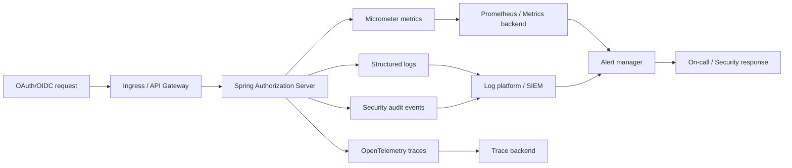

# Anomaly Detection and Alerting for Endpoint Abuse

An Authorization Server is the central point handling login, authorization code issuance, token issuance, introspection, revocation, and OIDC flows. As a result, a single endpoint can receive both legitimate traffic and credential probing, code guessing, excessive polling, or client configuration exploitation. Monitoring only CPU, memory, and HTTP 5xx responses can cause operations teams to miss an ongoing attack that returns OAuth 4xx errors that appear completely normal at the HTTP layer.

This lesson establishes how to observe and detect anomalies for Spring Authorization Server: identifying per-endpoint signals, emitting structured metrics and audit events, establishing baselines, writing actionable alerts, and pairing them with rate limiting. The goal is to detect abusive behavior early while keeping SSO and legitimate clients running smoothly.

## 1. Identifying the Observable Surface

Not every failed request is an attack. An expired authorization code, a user denying consent, or a retried refresh token can produce valid OAuth errors. Classify traffic by endpoint, client, grant type, outcome, and cadence before setting alerts.

| Endpoint/Flow | Signals to Watch | Potential Abusive Behavior |
|---|---|---|
| `/login` and authentication forms | Login failure rate, number of accounts targeted, IP/ASN distribution, user-agent | Password guessing, credential stuffing, password spraying |
| `/oauth2/authorize` | Requests per client, response type, redirect URI validation, authorization errors, consent denials | Client ID enumeration, repeated invalid redirect URIs, bulk authorization request generation |
| `/oauth2/token` | Grant type, client authentication outcome, code/PKCE/refresh token errors, latency | Client secret guessing, code replay, refresh token replay, token request bursts |
| `/oauth2/device_authorization` | Device codes created, client, scopes, expiry | Bulk transaction creation to spam or exhaust pending device authorization storage |
| Device verification | Invalid user codes, attempt counts, time from creation to verification | User code brute-forcing, transaction probing, verifying the wrong device |
| `/oauth2/introspect` | Request rate, calling client, active/inactive tokens, latency | Token enumeration, introspection privilege abuse, abnormal lookup load |
| `/oauth2/revoke` | Request rate, calling client, processing outcomes | Mass revocation or disruptive behavior from a client with compromised credentials |
| PAR endpoint | Request rate, client, request size, redirect/scope/PKCE errors, expired request URIs | Bulk pushed request creation, probing client configuration, or filling storage |
| JWKS and discovery | Access rate, status, latency, cache behavior | Endpoint scanning or unusual scraping traffic; also normally sees legitimate cache-refresh traffic |
| OIDC logout | Logout requests, client, redirect URI validation, session errors | Logout spam, probing unregistered redirect URIs |

Concrete endpoint paths can be changed in `AuthorizationServerSettings`, OIDC configuration, or application settings. Classify by logical endpoint and actual grant type rather than relying solely on default URLs.

## 2. Designing the Signal Model: Metrics, Logs, Audits, and Traces

Each type of telemetry answers a different question:

| Data Type | Primary Question | Used For |
|---|---|---|
| Metrics | How are traffic, error rates, and latency changing? | Dashboards, alerts, capacity planning |
| Structured application logs | At which step did a specific request fail? | Troubleshooting and event correlation |
| Security audit events | Which user/client performed which security action and with what outcome? | Investigation, compliance, tracking permission changes |
| Distributed traces | Which proxies, Authorization Server steps, and dependencies did the request traverse? | Isolating latency or cross-service errors |

Do not use one data type as a substitute for all others. Metrics should be compact, use bounded labels, and contain no user identifiers. Audit events need enough detail for investigation while protecting sensitive data. Traces connect technical components; never put access tokens or authorization codes into span attributes.

An observability pipeline can be structured as follows:



Metrics surface traffic patterns; audits/logs provide evidence to identify clients, pseudonymized subjects, or request origins; traces pinpoint failing dependencies. These systems should share a correlation ID or trace ID without sharing credentials.

## 3. Consistent Naming and Outcome Classification

Before building dashboards, agree on a taxonomy for endpoints and outcomes. For example:

| Classification Field | Sample Values |
|---|---|
| `endpoint` | `authorize`, `token`, `device_authorization`, `device_verification`, `introspect`, `revoke`, `par`, `login`, `logout`, `jwks`, `discovery` |
| `result` | `success`, `invalid_client`, `invalid_grant`, `invalid_request`, `access_denied`, `rate_limited`, `server_error`, `other_error` |
| `grant_type` | `authorization_code`, `refresh_token`, `client_credentials`, `device_code`, `token_exchange`, `unknown` |
| `client_class` | `confidential`, `public`, `first_party`, `partner`, `unknown` |
| `environment` | `production`, `staging`, `development` |

Values must be mapped from an internal allowlist or enum. Never use raw paths, query strings, exception messages, or OAuth error descriptions as metric labels because they can create huge cardinality and expose unwanted data.

Distinguish error groups:

- **Expected business errors:** `invalid_grant` from expired codes, `access_denied` from user consent denial, no-longer-valid refresh tokens.
- **Client/protocol errors:** `invalid_client`, `invalid_request`, `unsupported_grant_type`, redirect URI mismatches, wrong PKCE verifiers.
- **Protective signals:** rate limits, account/client lockouts, throttled device verification.
- **System errors:** database, Redis, KMS, introspection dependency, or token generator failures; HTTP 5xx and timeouts.

A single `invalid_grant` normally does not warrant paging. A burst of `invalid_client` from multiple origins, or a client sending thousands of token requests in a few minutes, requires investigation. Trend- and context-based alerts are far more useful than alerting on every HTTP 400.

## 4. Collecting Metrics with Micrometer

Spring Boot Actuator/Micrometer can provide HTTP metrics such as `http.server.requests`. Enable the internal metrics endpoint and scrape it with your metrics system; never expose management endpoints publicly to the Internet. Standard HTTP tags like method, URI template, status, and outcome help monitor overall health, but inspect configuration to ensure raw URIs containing IDs or query strings are not used as labels.

For OAuth-specific signals, create metrics with bounded labels. Example simple recorder:

```java
@Component
public class OAuthEndpointMetrics {

    private final MeterRegistry meterRegistry;

    public OAuthEndpointMetrics(MeterRegistry meterRegistry) {
        this.meterRegistry = meterRegistry;
    }

    public void record(String endpoint, String result, Duration elapsed) {
        Counter.builder("oauth.endpoint.requests")
                .description("OAuth endpoint requests by bounded outcome")
                .tag("endpoint", endpoint)
                .tag("result", result)
                .register(meterRegistry)
                .increment();

        Timer.builder("oauth.endpoint.duration")
                .description("OAuth endpoint request duration")
                .tag("endpoint", endpoint)
                .tag("result", result)
                .register(meterRegistry)
                .record(elapsed);
    }
}
```

`endpoint` and `result` must be normalized from the bounded lists defined earlier. Invoke the recorder from a filter or handler/provider at the point where the outcome is known. Never pass `client_id`, username, subject, IP, token, code, session ID, or URLs with query strings into metric tags. Attributes needed for per-client investigation should be stored in controlled audit events/logs and queried in the log platform.

Metrics should include at a minimum:

- Total requests by endpoint and outcome.
- Client/protocol error rate and HTTP 5xx rate.
- p50/p95/p99 latency by endpoint.
- Rate-limited request count.
- Failed login count and failed device verification count.
- Tokens issued by grant type and token format.
- Active/inactive introspection counts, along with latency and dependency errors.
- Pending authorizations, expired device flows, or `slow_down` polling responses if device flow is enabled.
- Dependency health: database, Redis, KMS/HSM, message broker, and audit sink.

Never create metrics per `sub`, IP, `jti`, authorization code, or token. High-cardinality labels drive up metrics costs and can cause ingestion outages right when attack traffic surges.

## 5. Emitting Structured Security Audit Events

Audit events should record security actions with enough outcome and context for investigation. Example schema:

```json
{
  "event_time": "2026-11-16T10:15:30.125Z",
  "event_type": "oauth.token.request.failed",
  "service": "authorization-server",
  "environment": "production",
  "endpoint": "token",
  "grant_type": "refresh_token",
  "client_id": "mobile-app",
  "client_class": "public",
  "result": "invalid_grant",
  "error_code": "invalid_grant",
  "subject_ref": "hmac:v2:7a4...",
  "source_ip_prefix": "203.0.113.0/24",
  "trace_id": "4bf92f3577b34da6a3ce929d0e0e4736",
  "correlation_id": "req-8f1c..."
}
```

This is an illustrative schema. `subject_ref` can be a pseudonymized identifier using HMAC with a separately managed key to correlate events without storing raw usernames or subjects. IP addresses should only be stored with approved purpose, retention, and access controls; mask or truncate to a prefix when full precision is unnecessary. `client_id` is usually not a secret, yet it can still be sensitive metadata in multi-tenant systems.

Never log or emit the following values in logs or audit events:

- Access tokens, refresh tokens, ID tokens, subject tokens, or actor tokens.
- Authorization codes, device codes, user codes, PAR `request_uri`, or PKCE verifiers.
- Client secrets, passwords, HTTP Authorization headers, cookies, or session IDs.
- Unfiltered full request bodies, query strings, or exception messages.

You may record a hashed `token_id`/`jti` if truly needed to correlate token lifecycles, provided retention and access controls are defined. Never log raw tokens for search convenience.

### Connecting Events to Spring Security and Spring Authorization Server

Spring Security publishes authentication events such as success/failure; Spring Authorization Server also provides endpoint-authentication-related events in corresponding versions. You can use a listener to translate events into audit records:

```java
@Component
public class AuthorizationAuditListener {

    private final SecurityAuditWriter auditWriter;

    public AuthorizationAuditListener(SecurityAuditWriter auditWriter) {
        this.auditWriter = auditWriter;
    }

    @EventListener
    public void onAuthenticationFailure(
            AbstractAuthenticationFailureEvent event) {
        auditWriter.writeAuthenticationFailure(
                classifyAuthentication(event.getAuthentication()),
                classifyFailure(event.getException()));
    }

    @EventListener
    public void onAuthenticationSuccess(AuthenticationSuccessEvent event) {
        auditWriter.writeAuthenticationSuccess(
                classifyAuthentication(event.getAuthentication()));
    }
}
```

This is a Spring Security-level integration example. For Spring Authorization Server-specific events, register listeners for the success/failure events emitted by the version you run to distinguish token endpoints, grant types, and clients. Event class/package names and authentication contents can vary by version; verify the API of your actual dependency. Never serialize entire `Authentication`, `OAuth2Authorization`, or exception objects into logs. Extract only allowlisted fields and strip credentials before writing.

Actions such as consent approval, client registration changes, key rotation, token revocation, or logout may require dedicated business audits. Do not rely on a single generic login event to cover every OAuth state change.

### Ensuring Audit Events Are Not Lost

Security audits have different reliability requirements than debug logs. For critical events such as token issuance/revocation, client changes, or key rotation, use a writer backed by a durable queue, transactional outbox, or a message broker configured for durability. Track metrics for queue depth, publish failures, retries, and oldest event age. Never ignore audit write errors without alerting.

The policy when the audit sink is unavailable must be decided according to risk level: bounded durable buffering, temporarily rejecting sensitive administrative actions, or entering an approved degraded mode. Neither block all login requests by default due to a transient log sink outage, nor silently drop critical security events.

## 6. Detecting Common Abuse Patterns

### 6.1. Password Guessing and Credential Stuffing

Signals include a rapidly rising login failure rate, many distinct usernames from one origin, one username attempted from many origins, or a few successful credentials following a string of failures. Combine IP/ASN, user-agent, client, timing, and authentication outcomes; never store passwords or password hashes in logs.

Distinguish password spraying from user typos: spraying typically has few attempts per account across many accounts and wide origin distribution. Credential stuffing can generate many attempts against known account lists with automated user-agents. Apply rate limits by IP, pseudonymized account identifier, client, and risk signals; avoid locking out masses of accounts solely based on a shared IP such as a corporate NAT.

### 6.2. Token Endpoint Abuse

Watch bursts of `invalid_client`, `invalid_grant`, refresh token reuse, PKCE mismatches, and token request rates per client. `invalid_grant` can result from expired authorization codes or legitimate client retries; inspect grant type, client, timing, and success ratios before/after errors.

Notable signals:

- A client's token request rate jumps manyfold above baseline.
- `invalid_client` rate rises simultaneously across many IPs or ASNs.
- Many authorization code exchanges fail, followed by an unusual successful code or client token issuance.
- Old refresh tokens are reused after rotation; check family/reuse detection if implemented by the application.
- Many requests present wrong PKCE verifiers or grant types not registered for the client.

### 6.3. Authorization Request and Redirect URI Probing

Track `invalid_request`, `unauthorized_client`, redirect URI mismatches, and disallowed response types by client. A legitimate client can send a bad request due to misconfiguration; multiple distinct redirect URIs or multiple client IDs probed from the same origin may indicate reconnaissance.

Do not page on every single redirect URI mismatch as a critical incident. Alert when there is a burst, multiple clients, or multiple unrelated hostnames, especially when accompanied by requests to other endpoints.

### 6.4. Device Flow Abuse

Track device authorization requests by client, pending transactions, user code verification failures, `slow_down`, expirations, and approval/denial ratios. A device polling at the proper interval while the user has not finished yet is not an attack. More suspicious signals include bulk device code creation, random user code guessing, or repeated verification failures from the same origin.

Cap pending transactions per client and origin; enforce TTLs on device codes; increase polling intervals when polling too fast. Never log `device_code` or `user_code`.

### 6.5. Introspection and Revocation Abuse

Introspection can generate heavy load because Resource Servers may call it per request or on cache misses. Distinguish legitimate resource server traffic from token enumeration: a client calling introspection on large numbers of tokens, high `active=false` ratios, or random token patterns may be suspicious. Monitor client credentials, request rate, active ratio, and latency separately.

Revocation bursts can stem from logout, incident response, or a compromised client. Compare revoked token counts by client, grant, time, and recent changes. Never use revocation responses to determine whether a token exists; per RFC 7009, the endpoint is designed not to act as a token-existence oracle.

### 6.6. PAR, Discovery, and JWKS Abuse

PAR requests can be larger than ordinary authorization requests and create temporary state in shared storage. Monitor request sizes, active request URI counts, expirations, client authentication errors, and request URIs used by the wrong client. Enforce body size limits and TTLs.

Discovery/JWKS normally see baseline traffic from clients caching keys or refreshing metadata. Alert only when traffic surges sharply, shows multi-path scanning patterns, or puts significant load on the application. Configure appropriate cache headers and CDN/reverse-proxy caching for public metadata/JWKS; ensure caching does not delay key rotation propagation beyond policy.

## 7. Establishing Baselines and Alert Thresholds

No single fixed threshold fits every Authorization Server. Baselines depend on client count, user count, peak hours, batch jobs, retry behavior, token lifetimes, and how Resource Servers use introspection. Collect data over a long enough window to observe workdays, weekends, batch cycles, and deployments.

One approach to setting thresholds:

1. Measure request rates, failure ratios, and p95/p99 by endpoint under normal conditions.
2. Break down by grant type and client class where data can be grouped in logs/SIEM.
3. Define minimum absolute count thresholds to avoid alerting on a handful of stray requests.
4. Compare against same-time-of-day baselines or rolling windows.
5. Add a sustained-duration condition to filter out brief spikes.
6. Validate thresholds against test traffic and legitimate load surges before enabling paging.

Use both absolute counts and ratios. For example, 5 `invalid_client` errors in one minute may be notable for a small client, yet negligible in a cluster handling millions of token requests per minute. Conversely, a high failure ratio on a low-traffic endpoint can still be an important signal.

## 8. Example Prometheus Alert Rules

Assume the application exports a `oauth_endpoint_requests_total` counter with two bounded labels, `endpoint` and `result`. The rules below only illustrate syntax and condition combinations; calibrate them to your production baseline:

```yaml
groups:
  - name: authorization-server-security
    rules:
      - alert: OAuthTokenInvalidClientBurst
        expr: sum(rate(oauth_endpoint_requests_total{endpoint="token",result="invalid_client"}[5m])) > 1
        for: 3m
        labels:
          severity: warning
        annotations:
          summary: "Spike in invalid_client at token endpoint"
          description: "Check client, request origin, and error distribution in security logs."

      - alert: OAuthDeviceVerificationFailures
        expr: sum(increase(oauth_endpoint_requests_total{endpoint="device_verification",result="invalid_request"}[5m])) > 30
        for: 2m
        labels:
          severity: warning
        annotations:
          summary: "Repeated device code verification failures"
          description: "Check for user-code guessing, request origins, and pending transactions."

      - alert: OAuthEndpointServerErrors
        expr: sum(rate(oauth_endpoint_requests_total{result="server_error"}[5m])) > 0.5
        for: 5m
        labels:
          severity: critical
        annotations:
          summary: "Elevated system error rate on Authorization Server"
          description: "Inspect database, Redis, KMS, thread pools, and dependencies."
```

The thresholds `1`, `30`, and `0.5` above are illustrative values, not production recommendations. If your metrics classify device verification failures under a different outcome, update the selector to match your actual taxonomy. Never create alerts on unverified metrics or without normal traffic baselines.

You can monitor failure ratios with PromQL:

```promql
sum(rate(oauth_endpoint_requests_total{endpoint="token",result=~"invalid_client|invalid_grant"}[5m]))
/
clamp_min(sum(rate(oauth_endpoint_requests_total{endpoint="token"}[5m])), 0.001)
```

Ratios must be paired with minimum request counts; when total traffic is near 0, a single error can produce a 100% ratio. Set absolute thresholds and `for` durations to reduce false alarms.

Never put `client_id`, username, IP, or `jti` into counter labels just to build per-entity alerts. Use log/SIEM queries or cardinality-bounded analytics systems to group by client/origin during investigation. For critical clients with dedicated SLAs, you can create separate metrics for a tightly managed client list after evaluating cardinality.

## 9. Alerting from Logs/SIEM

Some detections require combining multiple attributes that metrics should not carry. Conceptual query example:

```text
event_type = "oauth.token.request.failed"
AND error_code = "invalid_client"
GROUP BY client_id, source_ip, 5m
HAVING count() > threshold
```

Or detecting one origin probing many accounts:

```text
event_type = "authentication.failure"
GROUP BY source_ip, 10m
HAVING distinct_count(subject_ref) > threshold
```

These are pseudo-queries; actual syntax depends on the SIEM. Restrict access to fields that can identify users or IP addresses. When correlating the same subject is necessary, use a pseudonymized identifier with an HMAC key managed and rotated per policy. Avoid queries containing tokens, passwords, or authorization codes.

Combining multiple signals reduces false positives: for example, an `invalid_client` burst + many new IPs + a client with no prior traffic from that region carries higher confidence than a single condition alone. Also maintain time-bounded allowlists for test jobs or synthetic monitors rather than permanent exemptions.

## 10. Combining Alerts with Rate Limiting and Endpoint Protection

Alerts provide detection; rate limiting reduces impact during investigation. Place limits at the edge/API gateway to block traffic before requests consume Authorization Server resources, while also enforcing in-application limits for sensitive operations requiring authenticated context.

| Endpoint | Appropriate Rate-Limit Key | Additional Measures |
|---|---|---|
| Login | IP/network + account pseudonym + client | Progressive delay, MFA/step-up, account protection |
| Device authorization | Client + IP/network + pending transaction count | TTL, pending cap, CAPTCHA/step-up at verification if appropriate |
| Device verification | IP/network + user-code attempt + transaction | Attempt limit, short code with sufficient entropy, non-enumerating error messages |
| Token | Authenticated client + IP/network; per grant | Client credential protection, PKCE for authorization code, reuse detection for refresh token rotation |
| Introspection | Authenticated resource server client | Per-client quota, connection pool, and TTL-based cache |
| PAR | Authenticated client + IP/network | Body size limit, request URI TTL, and request quota |
| Revocation | Authenticated client | Burst auditing, per-client limit, avoid creating a token-existence oracle |

With multiple instances, rate-limit counters must use a shared store or an API gateway with distributed state. Limits kept only in per-pod memory can be bypassed by spreading requests across instances. Use token bucket or leaky bucket algorithms to allow brief legitimate bursts while capping sustained rates.

When rejecting due to rate limits, return HTTP 429 and `Retry-After` if appropriate for the endpoint/client protocol. Do not alter OAuth error semantics arbitrarily. Do not lock out an entire client simply because one shared IP exceeded a threshold; choose keys, lockout durations, and unlock mechanisms based on risk. Rate limiting needs a dashboard of blocked requests to catch overly strict configurations.

## 11. Alert Severity and Response Workflow

Classify severity by impact and signal confidence:

| Severity | Examples | Action |
|---|---|---|
| Info | Brief peak-hour spike, slight non-sustained failure ratio uptick | Record on dashboard, do not page |
| Warning | `invalid_client` burst, rising device verification failures, single client exceeding baseline | Open a ticket or notify ops/security teams, inspect logs by client/origin |
| Critical | Sustained token endpoint 5xx, introspection dependency down, multiple clients under credential attack, or signs of successful token abuse | Page on-call, execute runbook mitigations, and assess impact scope |

An alert runbook should specify:

1. Endpoint, metric/log query, and detection window.
2. Client, grant type, request origin, and recent deployments around that time.
3. How to distinguish legitimate retries, batch traffic, and credential probing.
4. Temporary mitigations: rate limiting, blocking high-confidence malicious origins, rotating compromised client secrets, revoking tokens/families per policy, or temporarily disabling a client.
5. How to verify mitigations do not disrupt SSO or legitimate clients.
6. How to preserve evidence, correlation IDs, audit events, and action timestamps.
7. Conditions for lifting mitigations and who is authorized to approve client/key changes.

Never automatically revoke all tokens or disable a client from a single alert alone. For high-impact actions, require corroboration across multiple signals and appropriate approval workflows. Automated throttling based on validated thresholds is viable, provided it has bounds, expiration, and rollback mechanisms.

## 12. Operational and Security Dashboards

A consolidated dashboard should be organized into groups:

- **Traffic:** request rate by endpoint, grant type, and client class; success/failure ratios.
- **Authentication abuse:** login failures, `invalid_client`, device verification failures, rate-limited requests.
- **Token lifecycle:** tokens issued, refreshed, revoked, introspection active/inactive, and refresh token reuse if tracked.
- **Performance:** p50/p95/p99 latency, 4xx/5xx, timeouts, and thread/connection pool saturation.
- **Dependencies:** database, Redis, KMS/HSM, message broker, audit sink, and log pipeline.
- **Security posture:** new/modified clients, key rotation, redirect URI changes, scope/consent changes, and admin actions.

Enable drill-down from metrics to logs using trace ID or correlation ID. Dashboards must never display access tokens, refresh tokens, raw usernames, or session IDs. Panels displaying specific client/subject data require access controls.

## 13. Testing Detection Capabilities

Do not only test that the application returns the right errors; verify that telemetry and alerts also detect simulated scenarios. In staging, build safe test scenarios using synthetic clients and users:

1. Send a small number of failed logins below threshold: metrics increment without paging.
2. Generate an `invalid_client` burst exceeding threshold: warning alert fires after the `for` duration.
3. Generate repeated device verification failures: metrics, audits, and alerts classify the endpoint correctly.
4. Call introspection with a non-existent token: returns `active=false`, not recorded as a server error.
5. Call the token endpoint with a valid client and valid grant: does not trigger abuse alerts.
6. Induce controlled HTTP 5xx in a test dependency: availability alert fires and points to the right dependency.
7. Temporarily disable the audit sink in staging: queue/error metrics rise and the audit pipeline alert fires.
8. Send headers/queries containing synthetic token-like strings: log sanitizer does not record sensitive values.
9. Spread traffic across multiple instances: rate limits still apply cluster-wide.
10. Recover after mitigation: alerts resolve, legitimate traffic flows, and evidence is preserved.

Alert tests must also verify false positives. For example, a scheduled introspection batch job can cause a legitimate spike; synthetic monitors may also generate intentional login failures. Register them with dedicated clients, environment tags, and explicit schedules instead of disabling alerts globally.

## 14. Implementation Checklist

- [ ] Maintain a list of observed logical endpoints and grant types.
- [ ] Keep metric labels bounded; never use tokens, subjects, usernames, IPs, or raw URLs as labels.
- [ ] Track metrics for traffic, outcomes, latency, rate limits, and dependency health.
- [ ] Emit structured audit events with correlation IDs and allowlisted fields.
- [ ] Ensure tokens, codes, secrets, cookies, session IDs, and passwords never appear in logs/traces.
- [ ] Back critical audit events with durable buffering/retries and alert when the sink fails.
- [ ] Calibrate baselines to reflect peak hours, batch jobs, and legitimate client behavior.
- [ ] Combine absolute thresholds, failure ratios, and sustained durations in alerts.
- [ ] Configure alerts for `invalid_client` bursts, device verification abuse, token endpoint 5xx, and dependency failures.
- [ ] Enforce distributed rate limits across multiple instances with `Retry-After` where appropriate.
- [ ] Maintain runbooks covering verification, mitigation, rollback, and evidence preservation.
- [ ] Rehearse alerts, false positives, audit sink outages, and recovery in staging.

Effective endpoint abuse detection combines traffic signals, OAuth outcomes, audit events, and client context. Metrics show what is changing; audits/logs explain which requests caused the change; alerts and rate limits enable operations teams to respond in a controlled way. When taxonomy, baselines, data protection, and runbooks are designed together, the Authorization Server can detect anomalous behavior without turning normal protocol errors into constant alert fatigue.
