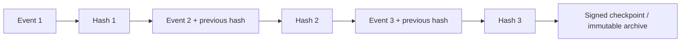
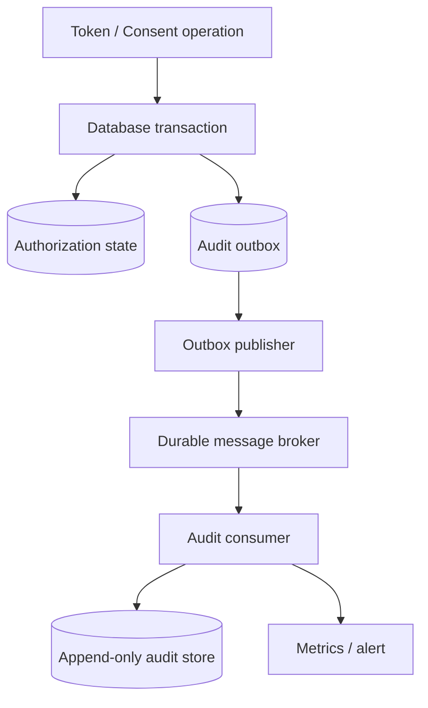

# Retention Policies, Access Control, and Audit Trail Integrity

An Authorization Server handles high-value security data: user identities, registered clients, consents, authorization codes, access tokens, refresh tokens, ID tokens, login events, and authorization decisions. An audit trail helps operations teams investigate incidents, verify administrative actions, and prove policy enforcement. However, if too much data is stored or too many people can access logs, the audit system itself can become a leak vector for credentials and personal data.

A sound audit policy must clearly define **what to record, how long to keep it, who can view it, who can change it, how tampering or deletion is detected, and how expired data is handled**. With Spring Authorization Server, audit records must be distinguished from operational data actively used to grant permissions. The audit trail records events and operational evidence; the authorization store holds the state required to process OAuth/OIDC flows. The two stores can be linked via correlation IDs, but logs must never become a mirror of the token store.

After this lesson, you will be able to:

- Design retention policies by event type and intended purpose.
- Restrict read, export, administrative, and deletion permissions on audit records under least privilege.
- Protect audit trails using append-only storage, hash chains, signatures, or WORM.
- Record token issuance, refresh, revocation, consent, and administrative events without exposing credentials.
- Use a transactional outbox to reduce the risk of losing audit events during business updates.
- Design verifiable archiving, backup, legal hold, and expired-data deletion workflows.

## 1. Distinguishing the Audit Trail from Authorization Data

An audit trail is a record of an action or event: who performed it, what action occurred, on which target, when, with what outcome, and in which component it was handled. Authorization data is the state the Authorization Server needs to process subsequent requests, such as an unused authorization code, an active refresh token, or granted consent.

| Data | Purpose | Typical Lifecycle |
|---|---|---|
| Registered client | Identifies client, redirect URIs, grants, and policies | Exists until client is modified or decommissioned |
| Authorization/consent | Handles token issuance, refresh, revocation, and consent | Follows token lifetime, authorization state, and business policy |
| Access/refresh token | Credential to access resources or request new tokens | Follows expiration, revocation, and state-storage rules |
| Audit event | Investigation, monitoring, proving actions | Follows retention policy and legal/business requirements |
| Application/security log | Error diagnosis and operations | Typically shorter than audit records, depending on need |
| Metrics/traces | Tracking trends, latency, and request flows | Follows telemetry retention cycles; typically holds no sensitive payloads |

Never use audit logs as a token recovery store. When a refresh token is revoked, the revocation state must be updated in the authoritative authorization store. Audit events record only that the revocation occurred, its outcome, and correlation metadata.

## 2. Identifying Events to Record

Start with actions that carry security significance or affect access permissions. For an Authorization Server, events can be grouped as follows:

| Group | Example Events | Useful Fields |
|---|---|---|
| Client lifecycle | Creating, editing, disabling, or deleting a RegisteredClient | Client ID, actor, policy changes, outcome |
| Client authentication | Success/failure, authentication method | Client ID if identified, auth method, general reason |
| Authorization | Initiating authorization, issuing code, denying request | Client ID, internal subject as identifier/pseudonym, normalized redirect URI, scopes |
| Consent | Granting, updating, or revoking consent | Subject, client ID, before/after scopes, actor, and outcome |
| Token lifecycle | Access token issuance, refresh, revocation, introspection decision | Reference token ID/hash, token type, scopes, expiry, outcome |
| Security policy | Invalid redirect URI, invalid scope, PKCE failure | Error category, client ID if present, correlation ID |
| Key management | Creating, activating, rotating, or retiring signing keys | `kid`, algorithm, actor, timestamp, outcome; never private keys |
| Administration | Configuration changes, operator privileges, retention policies | Actor, resource, filtered before/after, approval/reference |
| Operations | Database/KMS/replay store failures affecting requests | Dependency, status, duration, impact, and correlation ID |

Not every metadata or JWKS read request needs to become an individual audit event. High-volume public endpoints are usually better served by access logs and aggregated metrics. Create audit records only when an event has investigative or policy-evidence value.

### 2.1. Designing the Audit Event Schema

An audit record should have a stable, versioned structure so the schema can evolve:

```json
{
  "eventId": "01J...",
  "schemaVersion": 1,
  "occurredAt": "2026-11-16T09:30:00Z",
  "recordedAt": "2026-11-16T09:30:00.120Z",
  "eventType": "oauth.token.issued",
  "outcome": "SUCCESS",
  "actor": {
    "type": "CLIENT",
    "id": "orders-service"
  },
  "subjectRef": "sub-hmac:...",
  "resource": {
    "type": "ACCESS_TOKEN",
    "ref": "token-ref:..."
  },
  "attributes": {
    "grantType": "client_credentials",
    "scopes": ["orders.read"],
    "expiresAt": "2026-11-16T09:45:00Z"
  },
  "correlationId": "req-...",
  "source": "authorization-server-2"
}
```

This is a structural example, not a Spring-mandated schema. `subjectRef` and `resource.ref` should be reference identifiers or pseudonyms suited to investigative needs. Never put access tokens, refresh tokens, authorization codes, client secrets, private keys, passwords, session cookies, or full JWTs into `attributes`.

Include at a minimum:

- `eventId`: unique identifier for deduplication and lookup.
- `schemaVersion`: schema version of the event.
- `occurredAt`: timestamp when the event occurred according to the source clock.
- `recordedAt`: timestamp when the audit system received and persisted the event.
- `eventType` and `outcome`: standardized event name and result.
- `actor`/`subject`: the acting party and affected target, data-minimized.
- `correlationId`/`traceId`: links to the associated request and telemetry.
- `source`: instance or component that emitted the event.
- `integrity metadata`: sequence number, previous hash, or signature if integrity protection is enabled.

Keep event names stable, such as `oauth.authorization.denied`, `oauth.token.issued`, `oauth.token.revoked`, `oidc.consent.updated`, and `admin.client.updated`. Avoid putting dynamic data or PII into event names.

## 3. Storage Policies and Retention Periods

Retention policies must be defined based on purpose, sensitivity, access frequency, investigative needs, and applicable regulations. No single retention period fits every system or jurisdiction. Product, security, legal, and operations teams must approve concrete periods before deployment.

### 3.1. Data Classification

| Data Group | Examples | Retention Principle |
|---|---|---|
| Credentials and tokens | Access tokens, refresh tokens, client secrets | Do not store in audit logs; operational stores retain per token lifecycle and policy |
| Identifying data | Subject, email, IP, user agent | Store only with a clear purpose; pseudonymize or truncate when sufficient |
| Security audit events | Client auth failures, revocations, consent changes | Retain per approved investigation window and compliance requirements |
| Admin change records | Client, key, policy, and operator role changes | Retain per change-control and internal audit requirements |
| Diagnostic logs | Stack traces, debug details, request timing | Short retention; strip secrets and unnecessary user data |
| Metrics/traces | Latency, error rates, dependency status | Retain per operational analysis needs; avoid sensitive payloads |
| Archive/WORM | Closed-period audit records | Follow approved long-term retention or legal hold |

### 3.2. Setting Retention by Purpose

For each event category, document:

1. Purpose: fraud detection, unauthorized access investigation, configuration change proof, or regulatory compliance.
2. Data owner: team responsible for approving and reviewing retention.
3. Online retention: duration requiring fast query access.
4. Archive retention: duration requiring storage with infrequent access.
5. Retention clock trigger: `occurredAt`, `recordedAt`, contract termination, or another approved milestone.
6. Legal hold rules: who can place, approve, review, and lift holds.
7. Expiration workflow: deletion, anonymization, or cryptographic key destruction; completion evidence must be retained.

An illustrative policy example:

| Record Type | Online | Archive | Deletion Condition |
|---|---:|---:|---|
| High-severity security events | 90 days | Per approved investigation policy | Retention expired and no legal hold |
| Client/role/key changes | 180 days | Per internal audit schedule | Change-control retention period expired |
| Diagnostic logs | 14 days | No archive by default | Automatic expiration |
| Aggregated metrics | 30 days granular | 12 months aggregated | Analysis need ended |

These numbers are examples for designing the mechanism. Do not apply them as legal advice or default periods. Actual periods must align with organizational, contractual, and regulatory requirements.

### 3.3. Verifiable Deletion and Anonymization

Upon expiration, the system must enforce the policy across primary storage, search indexes, replicas, caches, and backup copies on the published lifecycle schedule. Deleting a record from the primary table while leaving it intact in a search index or export fails to fulfill deletion requirements.

Ways to reduce identifying data:

- Pseudonymize subjects using HMAC with a managed private key rather than directly hashing guessable emails or usernames.
- Retain only a subnet or coarse geographic region when a full IP address is unnecessary.
- Strip query parameters and headers that may contain tokens or PII from access logs.
- Keep the pseudonym-to-identity mapping in a separate store with restricted access if investigations truly require reversibility.
- Once the purpose ends, delete the mapping or destroy the encryption key per approved policy.

Do not use unkeyed hashes on low-entropy data such as emails or usernames if anonymization is the goal; values can be recovered via dictionary attacks. Pseudonymization is also not equivalent to anonymization if the organization still retains the ability to link back to an individual.

## 4. Access Control for the Audit Trail

Audit data can contain sensitive details about users, clients, network addresses, and security activity. Access privileges must be separated by duty and restricted to the minimum necessary.

### 4.1. Roles and Permissions

| Role | Appropriate Permissions |
|---|---|
| Application service | Write events per allowed schema; no read/delete access to audit history |
| Security analyst | Search and read events within assigned scope; no modification or deletion |
| Incident responder | Read more sensitive event fields during an active incident with valid ticket/approval |
| Auditor | Read records and integrity proofs; cannot modify source data |
| Retention operator | Run approved archive/expiry jobs; cannot unilaterally alter policy |
| Security administrator | Manage audit permissions and configuration; sensitive actions require dual control |
| Storage administrator | Administer storage infrastructure; cannot read encrypted content by default |

Never share a single administrative account across the application, analysts, and storage operators. Separate event-writing permissions from read/export permissions and retention-administration permissions. Anyone able to alter audit configuration should not be able to silently erase the history of that very change.

### 4.2. Applying Least Privilege

Design permissions around specific actions:

- `audit:write`: write events via API/queue; granted only to service identities.
- `audit:read`: search and read events within a tenant or system scope.
- `audit:read-sensitive`: view approved sensitive fields.
- `audit:export`: export data; enforce record limits, allowed formats, and audit the export action.
- `audit:manage-retention`: execute or modify retention policies through an approval workflow.
- `audit:integrity-verify`: read hashes/signatures and run integrity verification.

These permissions are policy examples. Map them to roles, authorities, scopes, or your existing policy engine. With Spring Security, protect administrative endpoints with explicit authorization rules and also enforce checks at the service layer to prevent bypassing controls on internal calls.

Method security example:

```java
@PreAuthorize("hasAuthority('audit:read')")
public Page<AuditEventView> search(AuditSearchCriteria criteria) {
    return auditRepository.search(criteria);
}

@PreAuthorize("hasAuthority('audit:export')")
public ExportReceipt export(AuditExportRequest request) {
    return auditExportService.export(request);
}
```

This example assumes method security and authority mapping are enabled in the application. Never accept roles or authorities from request parameters; identity and permissions must come from the authenticated SecurityContext.

### 4.3. Controlling Queries and Exports

An account permitted to read audits should not automatically be able to download the entire history. Enforce limits on:

- Query time ranges and records per page.
- Tenants, clients, or data domains the user is authorized to view.
- Visible sensitive fields; mask subjects, IPs, or metadata when unnecessary.
- Maximum export size and permitted formats.
- Lifetime of export files and download permissions.
- Logging the actor, reason, filters, and record count for every export.

Do not allow arbitrary filtering on secret fields or unbounded queries that overload the audit store. Export files must also be encrypted, time-limited, and protected with access controls at least as strict as the source data.

## 5. Preserving Audit Trail Integrity

Read-only UI permissions reduce the risk of log tampering through the interface, but are not enough to stop a storage administrator from altering data directly. Add one or more tamper-detection layers and an independent copy.

### 5.1. Append-Only Storage and Privilege Separation

The audit writer may only append events. The writer account cannot update or delete existing records. Retention jobs run under a separate identity and may only delete expired partitions or objects per policy. Auditors have read and verification privileges with no write privileges.

At the database layer, you can grant SQL `INSERT`-only to writers and `SELECT` to readers, restricting `UPDATE`/`DELETE` on audit tables. Triggers or stored procedures can help protect schemas, yet database administrators can still alter settings. Therefore, periodically publish snapshots/hashes to an independent store that source-database operators cannot modify.

### 5.2. Hash Chains

A hash chain links the current record to the previous record's hash. If a record in the middle of the chain is modified or deleted, recomputing the hash will no longer match subsequent hashes.



A simple formula:

\[
H_i = SHA256(H_{i-1} \parallel Canonical(E_i))
\]

Where `E_i` is the `i`-th event, `Canonical` is deterministic serialization with stable field ordering, `H_0` is a defined initial seed, and `\parallel` denotes byte concatenation. Never hash arbitrary JSON directly if field ordering, encoding, or timestamp formatting can vary across serializations.

Hash chains require monotonically increasing sequence numbers and a checkpointing mechanism. If an attacker can rewrite the entire chain and recompute hashes from the start, a hash chain alone cannot prove history was unaltered. Periodically sign checkpoints using an independently managed key and store checkpoints in an immutable system or separate administrative account.

### 5.3. Signatures and Checkpoints

A checkpoint can contain:

- Stream/partition ID and sequence range.
- Starting and ending hashes of the batch.
- Checkpoint creation timestamp.
- Hash algorithm and canonicalization version.
- Key ID used to sign the checkpoint.
- Digital signature or MAC under the chosen trust model.

The private key signing checkpoints must be managed in KMS/HSM or a separate secret boundary with access auditing and key rotation procedures. Do not reuse the access token signing key if purpose and usage permissions can be separated. Auditors need the public key or an independent verification mechanism along with key rotation history to verify older checkpoints.

### 5.4. WORM and Immutable Storage

Write Once Read Many (WORM) or object lock prevents modifying or deleting objects during the configured retention period. A common workflow:

1. Batch audit events with a manifest and hashes.
2. Sign the manifest/checkpoint.
3. Write the batch and manifest to object storage with a retention lock.
4. Verify object version, lock mode, and retention duration.
5. Periodically read back and verify hashes/signatures.

WORM does not replace access control. Lock down object write permissions, retention modification permissions, bucket deletion permissions, and account admin privileges. When using compliance mode or governance mode, understand the provider's bypass permissions and legal hold workflows.

## 6. Emitting Audit Events in Spring Authorization Server

Spring Security provides authentication events, and Spring Authorization Server provides abstractions for handling authorizations/tokens. However, do not assume every business OAuth/OIDC event is automatically emitted as a complete set of audit-ready application events. Identify where events originate in your application and actively publish events at controlled services/providers or boundaries.

### 6.1. Creating Internal Audit Events

Example of an immutable event:

```java
public record AuditEvent(
        String eventId,
        Instant occurredAt,
        String eventType,
        String outcome,
        String actorType,
        String actorId,
        String subjectRef,
        String correlationId,
        Map<String, Object> attributes) {
}
```

When issuing tokens, record only essential details such as client ID, grant type, scopes, token type, expiration time, outcome, and a token reference that cannot be used as a credential. Do not record the token value or all claims without an approved purpose.

One way to build a reference is taking an HMAC of the token value with a dedicated audit key. This supports correlating events for the same token without storing the bearer credential. Never use raw token values as primary keys or pass them in query URLs.

### 6.2. Publishing Events at Service Boundaries

For example, a business service issuing tokens can invoke an audit publisher once the outcome is determined:

```java
public OAuth2AccessToken issueToken(TokenCommand command) {
    try {
        OAuth2AccessToken token = tokenIssuer.issue(command);
        auditPublisher.publish(AuditEventFactory.tokenIssued(command, token));
        return token;
    } catch (OAuth2AuthenticationException ex) {
        auditPublisher.publish(AuditEventFactory.tokenDenied(command, ex));
        throw ex;
    }
}
```

This is an example at the application service layer; `TokenCommand`, `tokenIssuer`, and `auditPublisher` are application-defined components. For standard Spring Authorization Server token endpoints, choose the appropriate provider or service extension to record events, avoiding filters that log request/response bodies since bodies may contain credentials.

Spring Security authentication events can be helpful for authentication success/failure, provided the appropriate publisher/listener is configured and you verify which events are actually emitted in your application version. User authentication events do not automatically replace audit events for token issuance, consent changes, revocations, or client administration.

### 6.3. Preventing Audits from Exposing Credentials

Never record the following data in audit events or ordinary logs:

- `Authorization` headers, Bearer access tokens, or refresh tokens.
- Authorization codes, PKCE verifiers, client secrets, or client assertion JWTs.
- Passwords, OTPs, recovery codes, private keys, or secret store contents.
- Full session cookies or CSRF tokens.
- Full request/response bodies of the token endpoint.
- PII claims unnecessary for auditing purposes.

Replace them with investigable yet non-reusable information: event ID, client ID, token type, scopes, `kid`, error category, correlation ID, and HMAC token fingerprint. For authentication errors, record a general reason such as `CLIENT_AUTHENTICATION_FAILED`; exception details belong only in filtered diagnostic logs with stricter access control.

## 7. Preventing Audit Event Loss: Transactional Outbox

If an application updates authorization state in the database and then publishes an audit event directly to a message broker, two failure modes can occur:

- Database commit succeeds while event publishing fails: the business action happened, but the audit event is lost.
- Event publishing succeeds while the database rolls back: the audit trail records an action that never actually committed.

A transactional outbox closes this gap by writing both the business state change and the outbox record inside the same database transaction. A separate publisher reads the outbox and forwards events to the audit pipeline. Consumers must be idempotent because messages may be redelivered.



Key design points:

- Outbox rows contain a unique event ID, sanitized payload, timestamp, and delivery state.
- Write authorization state and the outbox row in the same transaction if they share a transaction manager.
- The publisher delivers at least once; consumers deduplicate by event ID.
- Retries use backoff and limits; failed events go to a monitored dead-letter queue.
- Expose metrics for pending outbox count, oldest event age, publish failures, and consumer lag.
- Do not delete outbox rows before broker acknowledgment per the delivery contract.

If the authorization store and audit outbox reside in two systems without a shared transaction, use an explicit synchronization/reconciliation mechanism such as event sourcing, CDC, or an idempotent workflow. Never claim cross-system atomicity merely because two operations appear inside the same Java method.

## 8. Archiving, Backup, and Recovery

An audit trail is only valuable if it can be read and verified after an incident. Backups must preserve the data, schema/version, integrity metadata, encryption key references, and recovery runbooks.

### 8.1. Storage Tiering

An architecture can be tiered into:

- **Hot store:** recent data, frequently queried, properly indexed.
- **Warm archive:** infrequently accessed data, lower cost, still queryable via defined workflows.
- **Immutable archive:** signed batches protected by retention locks.
- **Backup:** independent recovery copy with access control and encryption.

Tier transitions must preserve event ID, sequence, timestamp, schema version, and hash/checkpoint metadata. After archiving, verify that an older record can still be retrieved and verified without relying on the hot store's indexes.

### 8.2. Recovery Testing

Periodically rehearse:

1. Restore an audit batch from backup into an isolated environment.
2. Verify record counts, sequence numbers, and event IDs.
3. Verify the hash chain and checkpoint signatures.
4. Verify the public keys/certificates needed to validate signatures remain available.
5. Reconcile sample events against the source outbox or signed manifests.
6. Record recovery duration and any discrepancies.

Do not check only that the backup job reported success. Prove that the data is genuinely readable and integrity verification passes after restoration. Backups must also be protected from accounts that have permission to delete the audit source.

## 9. Legal Hold and Data Deletion Workflows

A legal hold temporarily suspends deletion for a dataset due to an investigation, dispute, or approved obligation. Only authorized individuals may place or lift a hold. Every action must record a ticket/reference, actor, timestamp, data scope, and reason.

Retention jobs must:

- Run against an approved policy version.
- Process only records past expiration that are not under legal hold.
- Support dry-run or count previews before bulk deletion.
- Record eligible record counts, deleted record counts, and errors.
- Implement safe retries and avoid accidentally deleting unexpired partitions.
- Propagate deletion/expiry to indexes, replicas, and exports per defined procedures.
- Retain a deletion receipt or policy-execution audit event without retaining the deleted payload itself.

Never allow an operator to both self-approve a retention change and execute data deletion without independent oversight. For immutable/WORM data, design retention at write time; never assume objects can be deleted arbitrarily before the object lock expires.

## 10. Monitoring Audit Pipeline Health

The audit pipeline itself must be observed like a critical dependency. Recommended metrics:

| Metric | Meaning | Signal to Investigate |
|---|---|---|
| `audit_events_created_total` | Events created by type/outcome | Abnormal surge or drop relative to business traffic |
| `audit_outbox_pending` | Events awaiting publish | Continuously growing or failing to drain |
| `audit_oldest_pending_seconds` | Age of oldest unsent event | Exceeds delivery SLO |
| `audit_publish_failures_total` | Publish errors | Sudden spike or sustained errors |
| `audit_consumer_lag_seconds` | Consumer lag | Events arriving too late at the audit store |
| `audit_integrity_verification_failures_total` | Hash/signature failures | Any increase requires immediate investigation |
| `audit_retention_failures_total` | Retention job failures | Expired data persisting beyond policy |
| `audit_export_total` | Data export counts | Unusual export activity |

Metric labels should not contain high-cardinality `client_id`, subject, token reference, or IP values. Use event type and outcome as labels; identifying details belong in the access-controlled audit store.

Configure alerts for sustained outbox backlogs, audit store write failures, integrity verification failures, missed retention jobs, and exports exceeding thresholds. If the audit pipeline is mandatory for token issuance, define behavior when the pipeline is disrupted: block token issuance, write to a durable local outbox, or accept bounded delay. Base this decision on approved risk tolerance and SLOs; never let the request path silently drop events.

## 11. Production Deployment Checklist

- [ ] Maintain an event catalog and designated data owners.
- [ ] Audit events include schema version, event ID, timestamp, actor, outcome, and correlation ID.
- [ ] Never log access tokens, refresh tokens, authorization codes, secrets, passwords, or private keys.
- [ ] Define separate retention policies by data category and purpose.
- [ ] Approve online, archive, legal hold, and deletion timelines.
- [ ] Minimize or pseudonymize subjects/IPs/PII where appropriate.
- [ ] Application writers have append-only access; readers, exporters, and retention operators have separate privileges.
- [ ] Exports are bounded, encrypted, and audited.
- [ ] Implement a hash chain or integrity mechanism matched to the threat model.
- [ ] Checkpoints are signed and stored in an independent administrative domain.
- [ ] WORM/object lock and bypass permissions are configured and verified.
- [ ] Token/consent state and audit trails are stored according to their separate roles.
- [ ] Outbox or durable delivery mechanisms are tested under broker failures.
- [ ] Consumers are idempotent with dead-letter handling.
- [ ] Backup restoration is tested and integrity is verified.
- [ ] Retention jobs support dry-run, legal holds, and deletion receipts.
- [ ] Metrics and alerts cover backlogs, write failures, integrity, and retention.
- [ ] Incident response and emergency access procedures are rehearsed.

## Conclusion

An Authorization Server's audit trail must provide enough information to investigate and prove actions without becoming a store for credentials or excessive personal data. Classify data, set purpose-driven retention, separate write/read/export/delete privileges, and protect integrity with append-only storage and independent checkpoints. Transactional outboxes, backup restore drills, and pipeline monitoring ensure audit events remain retrievable and verifiable when incidents occur.
