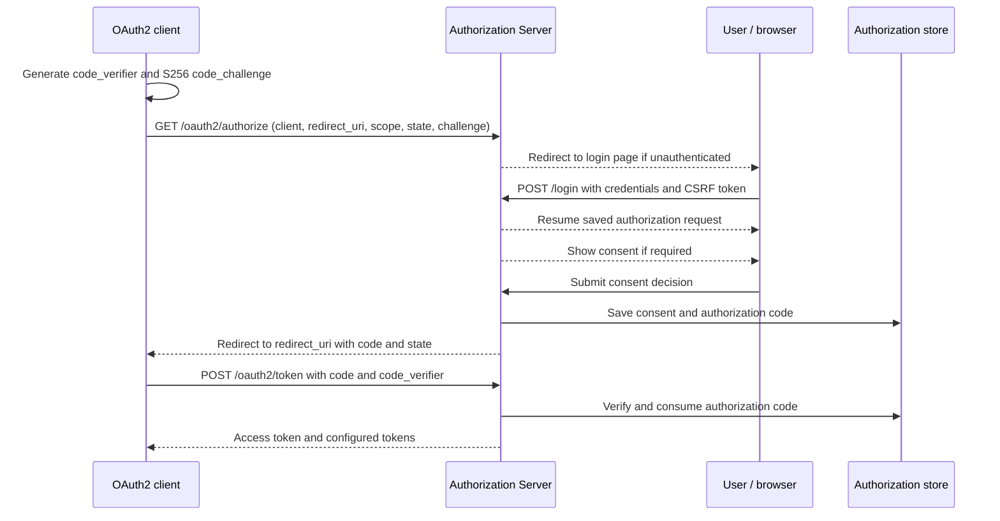

# Testing Authorization Code, PKCE, login, and consent

The Authorization Code flow only completes when the Authorization Server validates the request, the user logs in, the user decides on consent when required, the server issues an authorization code, and the client exchanges the code for tokens. With PKCE, the code can only be exchanged when the client supplies the exact `code_verifier` corresponding to the `code_challenge` sent in the authorize step. Functional testing must walk through this entire chain to catch errors in client configuration, login sessions, the consent page, redirect URIs, CSRF handling, or the token endpoint.

This lesson belongs to the `SPRING_SECURITY_OAUTH2_OIDC_AUTHORIZATION_SERVER` module, focusing on designing and operating an OAuth 2.0/OpenID Connect Authorization Server with Spring Authorization Server. The examples use Spring Security Test and MockMvc; the same principles can be applied to browser testing or integration environment tests.

## 1. Breaking down the flow to test

An Authorization Code flow with PKCE and consent typically proceeds as follows:



Each step has its own contract. The authorization endpoint validates the client, response type, redirect URI, scopes, and PKCE parameters. Login authenticates the user and maintains the session. Consent records the scopes the user approves. The token endpoint verifies the code, client, redirect URI, and PKCE before issuing tokens.

Tests should be divided into three layers:

- **Unit tests:** test PKCE challenge generation helpers, scope selection rules, and custom application logic.
- **Integration tests:** start the real Spring Security filter chain and Spring Authorization Server, using MockMvc to call login, authorize, consent, and token endpoints.
- **End-to-end tests:** run a browser or test client against public URLs, verifying redirects, cookies, CSRF, and the actual consent UI.

MockMvc verifies the HTTP contract and SecurityContext inside the application, but it does not replace browser testing for JavaScript, browser cookies, SameSite, or a production reverse proxy.

## 2. Registering a client for testing

A public client generally cannot keep a client secret secure, so it must use PKCE. A `RegisteredClient` can be configured as follows:

```java
import org.springframework.security.oauth2.core.AuthorizationGrantType;
import org.springframework.security.oauth2.server.authorization.client.ClientAuthenticationMethod;
import org.springframework.security.oauth2.server.authorization.client.RegisteredClient;
import org.springframework.security.oauth2.server.authorization.settings.ClientSettings;

RegisteredClient webClient = RegisteredClient.withId("web-client-row-1")
        .clientId("web-client")
        .clientAuthenticationMethod(ClientAuthenticationMethod.NONE)
        .authorizationGrantType(AuthorizationGrantType.AUTHORIZATION_CODE)
        .redirectUri("https://client.example.test/callback")
        .scope("openid")
        .scope("profile")
        .scope("orders.read")
        .clientSettings(ClientSettings.builder()
                .requireProofKey(true)
                .requireAuthorizationConsent(true)
                .build())
        .build();
```

`requireProofKey(true)` requires PKCE for the client's authorization requests. `requireAuthorizationConsent(true)` requires user approval of scopes when a matching consent does not yet exist. Enabling both in the fixture lets tests verify the exact policy the application intends to enforce.

If you need to test a confidential client, register an additional client with `ClientAuthenticationMethod.CLIENT_SECRET_BASIC`, store the secret encoded with `PasswordEncoder`, and still enable PKCE if required by policy. When calling the token endpoint, the confidential client must authenticate using its registered method, such as HTTP Basic. A public client uses `ClientAuthenticationMethod.NONE` and sends `client_id` in the token request per the OAuth2 profile.

Do not reuse the same client across all test cases if those tests require different policies. Create separate fixtures for a PKCE-required client, a client not requiring consent, a confidential client, or clients with different redirect URI sets. This ensures each test expresses one clear condition.

## 3. Generating and verifying PKCE S256

PKCE generates a random secret `code_verifier` on the client side. The client sends a hash of the verifier as `code_challenge` in the authorization request, then sends the original verifier in the token request. The Authorization Server recomputes the challenge and compares the two values.

With the `S256` method:

\[
\text{code\_challenge} = \text{BASE64URL\_NO\_PADDING}(\text{SHA256}(\text{code\_verifier}))
\]

A Java helper used in tests:

```java
import java.nio.charset.StandardCharsets;
import java.security.MessageDigest;
import java.security.NoSuchAlgorithmException;
import java.util.Base64;

static String s256(String verifier) throws NoSuchAlgorithmException {
    byte[] digest = MessageDigest.getInstance("SHA-256")
            .digest(verifier.getBytes(StandardCharsets.US_ASCII));
    return Base64.getUrlEncoder().withoutPadding().encodeToString(digest);
}
```

The verifier must be generated randomly using a cryptographic random number generator in a real client and conform to the length and character set of RFC 7636. In tests, a fixed valid string can be used for reproducibility, but never use a fixed verifier in production.

```java
String codeVerifier = "dBjftJeZ4CVP-mB92K27uhbUJU1p1r_wW1gFWFOEjXk";
String codeChallenge = s256(codeVerifier);
```

Do not send `code_verifier` in the authorization request. Do not send `code_challenge` instead of the verifier in the token request. If a test uses the same string for both parameters, it is no longer properly testing the S256 flow.

## 4. Testing the authorization request and redirect URI

A basic authorization request contains these parameters:

| Parameter | Role |
|---|---|
| `response_type=code` | Requests an authorization code |
| `client_id` | Registered client identifier |
| `redirect_uri` | Exact registered callback URI |
| `scope` | Permissions requested by the client |
| `state` | Value used by the client to bind request and callback, preventing client-side CSRF |
| `code_challenge` | PKCE challenge |
| `code_challenge_method=S256` | Challenge hashing method |

Example MockMvc request after the user is authenticated:

```java
import static org.springframework.security.test.web.servlet.request.SecurityMockMvcRequestPostProcessors.user;
import static org.springframework.test.web.servlet.request.MockMvcRequestBuilders.get;
import static org.springframework.test.web.servlet.result.MockMvcResultMatchers.status;

MvcResult result = mockMvc.perform(get("/oauth2/authorize")
        .with(user("alice").roles("USER"))
        .param("response_type", "code")
        .param("client_id", "web-client")
        .param("redirect_uri", "https://client.example.test/callback")
        .param("scope", "openid profile")
        .param("state", "state-test-123")
        .param("code_challenge", codeChallenge)
        .param("code_challenge_method", "S256"))
    .andExpect(status().is3xxRedirection())
    .andReturn();
```

Because the client requires consent, the first redirect may lead to the configured consent page. Only after consent completes does the response redirect to the client's redirect URI with `code` and `state`. For tests not focused on consent, you can use a client fixture with `requireAuthorizationConsent(false)` or pre-create the consent during test setup.

Negative cases should include:

- Nonexistent `client_id`: the authorization request is rejected.
- Unsupported `response_type`: the server returns a protocol error.
- `redirect_uri` does not exactly match a registered URI: the server does not redirect a code to an untrusted URI.
- Unregistered or disallowed scope: the server rejects or handles it per the application's scope policy.
- Missing `state` in a client flow requiring state: the client should not accept a callback without a matching state.
- Missing `code_challenge` when the client requires PKCE: no authorization code is issued.
- Unsupported `code_challenge_method` or malformed challenge: the request is rejected.

When testing an invalid redirect URI, do not only assert the status code. Verify that the response does not contain a redirect to the arbitrary URI provided in the request and that no authorization code is issued. The server must not use an unvalidated redirect URI to return OAuth2 errors.

## 5. Testing login and session handling

Authorization requests often arrive when the user is not yet logged in. Spring Security saves the request to continue later, redirects the browser to the login page, and resumes authorization after a successful login.

### 5.1. Verifying the login requirement

Send a GET to `/oauth2/authorize` without an authenticated user. The result is normally a redirect to the login page, with the session saving the request to resume. Verify that `Location` points to the login endpoint configured by the application and that a session is created when needed.

Do not use `.with(user("alice"))` in this test, because that request post-processor places the principal directly into the SecurityContext and bypasses real form login. `.with(user(...))` is suitable for testing authorization logic after login, whereas the login flow needs HTTP requests sent to the login endpoint.

### 5.2. Successful login

Example testing form login with MockMvc:

```java
import static org.springframework.security.test.web.servlet.request.SecurityMockMvcRequestPostProcessors.csrf;
import static org.springframework.test.web.servlet.request.MockMvcRequestBuilders.get;
import static org.springframework.test.web.servlet.request.MockMvcRequestBuilders.post;
import static org.springframework.test.web.servlet.result.MockMvcResultMatchers.status;

MvcResult loginPage = mockMvc.perform(get("/login"))
        .andExpect(status().isOk())
        .andReturn();

MockHttpSession session = (MockHttpSession) loginPage.getRequest().getSession(false);

MvcResult loginResult = mockMvc.perform(post("/login")
        .session(session)
        .with(csrf())
        .param("username", "alice")
        .param("password", "correct-password"))
    .andExpect(status().is3xxRedirection())
    .andReturn();
```

After a successful login, verify that the response redirects back to the saved authorization request or the default page per the success handler configuration. Continue the authorize request with the same session to confirm the user is recognized and the flow advances to consent or callback. MockMvc does not follow redirects automatically; the test must read `Location` and issue the next request using that session.

### 5.3. Failed login

Submit a wrong password and verify that the server redirects to the login page with the configured error state. No authorization code is created, no consent is recorded, and the session does not contain an authenticated user SecurityContext. If the application has rate limiting or account lockout, test that policy separately so login tests do not depend on the number of prior test runs.

### 5.4. CSRF and session cookies

Form login is normally protected by CSRF. POST login tests must send a valid CSRF token; tests with a missing or wrong token must be rejected per Spring Security configuration. A custom consent form must also include a CSRF token if its POST handler falls under CSRF protection.

When running browser tests, verify that the session cookie has `HttpOnly`, `Secure` over HTTPS, and a `SameSite` attribute appropriate for how the client initiates the authorization flow. Some cross-domain login flows can be affected by browser cookie policies. MockMvc only inspects cookie headers emitted by the application; browser tests on an HTTPS environment are needed to confirm real behavior.

## 6. Testing consent and approved scopes

Consent is the user's decision allowing a client to access a set of scopes. The consent page should clearly display the client name, application description, and requested permissions. The user can approve all, approve partially if supported by the application, or deny.

With Spring Authorization Server, a client can enable `requireAuthorizationConsent(true)`. Applications often configure a custom consent page on the authorization endpoint:

```java
http.oauth2AuthorizationServer(authorizationServer ->
        authorizationServer.authorizationEndpoint(authorizationEndpoint ->
                authorizationEndpoint.consentPage("/oauth2/consent")));
```

The consent route and UI are implemented by the application. Tests must use the application's actual route and form contract. With a standard consent page, the form typically posts the user's decision and selected scope list back to the authorization endpoint; field names and view rendering must match the real implementation.

### 6.1. First-time consent

For a principal with no prior consent for the client, send an authorization request asking for `openid profile orders.read`. Verify that the server sends the user to the consent page. The page content should show the right client, requested scopes, and approve/deny actions. Do not display unrequested scopes or client info taken from unverified parameters.

After the user approves, verify:

1. The authorization response redirects to the registered redirect URI.
2. The callback contains an authorization code and preserves `state` from the request.
3. Consent is saved via `OAuth2AuthorizationConsentService` for the right client and principal.
4. The saved authority set includes only the scopes approved by the user.
5. Tokens are issued according to the approved scopes and client policy.

### 6.2. Denying consent

Submit a denial decision using the application's consent form. The Authorization Server must return the `access_denied` error via the valid redirect URI, preserve `state` so the client can correlate the response, and issue no authorization code. Do not record a successful consent for a denied request.

### 6.3. Approving partial scopes

If the UI allows selecting individual scopes, request multiple scopes but approve only a subset. Verify that the authorization response and tokens include only the permitted scopes according to the defined behavior. On a subsequent authorize request, the server may prompt for additional consent for the unapproved scopes.

Do not assume every application must allow partial consent. If the application's UI supports only approve-all or deny, tests must verify that exact policy.

### 6.4. Reusing and revoking consent

After consent is saved, send another authorization request with the same client, principal, and already-approved scope set. If the consent remains valid and covers the scopes, the consent page can be skipped. Verify that user A's consent is not used for user B and client A's consent is not used for client B.

If the application supports revoking consent, delete the consent via `OAuth2AuthorizationConsentService` or the corresponding UI flow, then send the authorization request again. The server must prompt for consent again for the revoked permissions. Test persistence across restarts or across nodes if consent is stored in a shared database.

## 7. Exchanging the authorization code at the token endpoint

After receiving the callback, the client sends the authorization code along with the redirect URI and PKCE verifier to the token endpoint. For a public client, the request includes `client_id`; for a confidential client, the request also authenticates using the registered client authentication method.

Example code exchange for a public client:

```java
import static org.springframework.test.web.servlet.request.MockMvcRequestBuilders.post;
import static org.springframework.test.web.servlet.result.MockMvcResultMatchers.jsonPath;
import static org.springframework.test.web.servlet.result.MockMvcResultMatchers.status;

import org.springframework.http.MediaType;

mockMvc.perform(post("/oauth2/token")
        .contentType(MediaType.APPLICATION_FORM_URLENCODED)
        .param("grant_type", "authorization_code")
        .param("client_id", "web-client")
        .param("code", authorizationCode)
        .param("redirect_uri", "https://client.example.test/callback")
        .param("code_verifier", codeVerifier))
    .andExpect(status().isOk())
    .andExpect(jsonPath("$.access_token").isNotEmpty())
    .andExpect(jsonPath("$.token_type").value("Bearer"));
```

If the `openid` scope was requested and OIDC is enabled, the response may include an ID Token. Verify the signature, issuer, audience, expiration, and `nonce` (if the request included a nonce) using a suitable OIDC client or verifier; merely checking that `id_token` is non-empty does not prove the token is valid.

For a confidential client using HTTP Basic, add `.with(httpBasic("confidential-client", "client-secret"))` and omit `client_id` if the client authentication method requires identification via Basic. Do not send multiple client authentication methods in the same request.

### 7.1. Wrong or missing PKCE verifier

Each negative case needs a freshly generated authorization code, because a code can only be used once. Test these cases:

- `code_verifier` matches challenge: token endpoint issues tokens.
- Verifier does not match challenge: token endpoint returns `invalid_grant`.
- Missing verifier when code was issued for a PKCE-required client: token endpoint rejects.
- Code created with an S256 challenge but client sends the verifier from a different flow: token endpoint rejects.
- Previously exchanged code: subsequent request is rejected, even with the right verifier.

Ensure client authentication succeeds and the code is still unexpired in wrong-verifier tests. If the client secret is also wrong or the code has expired, an `invalid_client`/`invalid_grant` result does not prove the PKCE validator ran.

### 7.2. Mismatched redirect URI and client

Exchanging a code with a redirect URI different from the one used in the authorization request must be rejected. Exchanging a code using a different client must also be rejected. Do not issue tokens when any condition bound to the code does not match.

An authorization code is bound to the original client and redirect URI. Do not use a new redirect URI supplied in the token endpoint request to alter the callback after the code has been issued.

## 8. Checking state, nonce, and client-side callbacks

The Authorization Server returns `state` intact if the client sent a valid state. The client is responsible for comparing the callback state with the state saved for the initial request; the Authorization Server cannot confirm on its own that the browser returned to the right client session.

With OIDC, the client may send a `nonce` in the authorization request. If a nonce is present, the ID Token must contain the same nonce per OIDC rules. Callback tests must verify:

- `state` in the callback matches the request the client initiated.
- `nonce` in the ID Token matches the nonce saved by the client.
- The authorization code is exchanged only in the matching session and redirect URI.
- Error callbacks or mismatched states do not create a client login session.

Do not use `state` as a substitute for PKCE. PKCE binds the authorization code to the client holding the verifier; state helps the client correlate the response with the request and prevent CSRF in the redirect flow. The two mechanisms complement each other.

## 9. Integration test suite with MockMvc

An integration test class typically boots the real application with SecurityFilterChain, AuthorizationServerSettings, RegisteredClientRepository, OAuth2AuthorizationService, and OAuth2AuthorizationConsentService:

```java
@SpringBootTest
@AutoConfigureMockMvc
class AuthorizationCodeFlowIntegrationTest {

    @Autowired
    MockMvc mockMvc;

    @Autowired
    RegisteredClientRepository registeredClientRepository;

    @Autowired
    OAuth2AuthorizationService authorizationService;

    @Autowired
    OAuth2AuthorizationConsentService consentService;

    // Create client and test data before each test.
    // Execute authorize -> login/consent -> callback -> token exchange.
    // Clean up authorizations, consents, and clients after the test.
}
```

This is a skeleton to guide fixture structure, not a complete standalone compilable test class. The application must provide test users, a password encoder, security chains, a consent controller/page, and matching endpoint configuration. If using a database, initialize the test schema via migrations or SQL scripts compatible with the Spring Authorization Server version.

When cleaning up data, delete authorizations and consents by test client/principal, and remove registered client fixtures. Do not share client IDs or principals across tests running in parallel if shared data could be deleted across tests. For test databases, consider transaction rollbacks or separate databases per test suite; verify that MockMvc requests and the persistence layer participate in the same transaction as intended.

## 10. Functional test matrix

| Group | Scenario | Expected outcome to verify |
|---|---|---|
| Authorization request | Valid client, redirect URI, and response type | Request proceeds to login, consent, or callback |
| Authorization request | Nonexistent client or wrong redirect URI | Request rejected, no code redirected to unknown URI |
| PKCE | Matching S256 challenge and verifier | Code exchange succeeds |
| PKCE | Missing challenge when client requires PKCE | No code issued |
| PKCE | Wrong or missing verifier | Token endpoint rejects with `invalid_grant` |
| Login | Unauthenticated user | Redirects to login and saves request to resume |
| Login | Valid username/password | Session authenticated and authorization continues |
| Login | Wrong password or missing CSRF | Login fails, no code issued |
| Consent | No prior consent | Displays consent page with right client and scopes |
| Consent | User approves | Saves consent and returns code with state |
| Consent | User denies | Returns `access_denied`, no code issued |
| Consent | Existing consent covers requested scopes | Consent page can be skipped |
| Token endpoint | Unexpired code, matching client, redirect, and verifier | Issues tokens |
| Token endpoint | Code replay, different client, or different redirect | Rejected, no tokens issued |
| OIDC | `openid` scope and nonce present | Valid ID Token, nonce preserved |
| Multi-instance | Authorization/consent created on node A, resumed on node B | State read consistently |

## 11. Common mistakes when writing tests

| Symptom | Common cause | Resolution |
|---|---|---|
| Authorization request returns `invalid_client` | Client fixture not saved or wrong `client_id` | Verify repository and client config before sending request |
| Request jumps straight to consent when test expects login | MockMvc attached a user or session is still logged in | Separate login tests from pre-authenticated authorize tests; create a fresh session |
| Does not return to authorization request after login | Session not preserved between GET authorize and POST login | Reuse the same `MockHttpSession`, check saved request and success handler |
| POST login returns 403 | Missing or invalid CSRF token | Send `.with(csrf())` and preserve the matching session |
| Consent page does not appear | Consent already saved from an earlier test or client does not require consent | Clean `OAuth2AuthorizationConsentService` and check `requireAuthorizationConsent` |
| Callback has no code | Consent incomplete, scopes denied, or authorization request errored | Check consent decision and error query parameter |
| Token endpoint returns `invalid_grant` with valid verifier | Code already used, expired, wrong redirect URI, or missing authorization state | Generate a new code and verify each binding before testing PKCE |
| Wrong PKCE test still succeeds | Client lacks `requireProofKey` or test is using a different client | Verify client fixture and challenge stored in authorization state |
| State mismatch in callback | Test reads wrong redirect or client fails to track state per request | Extract `state` from the right callback and validate on client side |
| Consent tests affect each other | Consent persists in shared database or context | Clean data by principal/client and isolate parallel tests |
| MockMvc passes but browser fails | Cookies, SameSite, HTTPS, JavaScript, or proxy untested | Add browser tests on a production-like HTTPS environment |

## 12. Pre-release checklist

- [ ] Public clients enforce PKCE and use the `S256` method.
- [ ] Authorization requests validate client, response type, redirect URI, and scopes.
- [ ] Invalid redirect URIs never receive codes or arbitrary error redirects.
- [ ] Unauthenticated users are redirected to login and the original request is saved.
- [ ] Successful login resumes the right authorization request; failed login issues no code.
- [ ] Login and consent forms comply with CSRF protection.
- [ ] The consent page displays the accurate client and requested scopes.
- [ ] Consent is saved for the right client and principal; denial returns `access_denied`.
- [ ] Existing consent skips the screen only when it still covers all requested scopes.
- [ ] Callbacks preserve `state`; OIDC ID Tokens preserve `nonce` when requested.
- [ ] The token endpoint exchanges codes only when client, redirect URI, and PKCE verifier are valid.
- [ ] Code replay, wrong verifier, missing verifier, and mismatched redirect URI are all rejected.
- [ ] Authorizations and consents are persisted durably and consistently across multiple instances.
- [ ] Browser tests verify cookies, redirects, and consent UI over HTTPS.
- [ ] Authorization codes, tokens, passwords, and client secrets do not appear in logs or test reports.

A reliable Authorization Code flow must maintain linkage from the authorization request through the callback and token exchange. When tests verify login, consent, state, redirect URI, and PKCE within a single flow, the development team can catch integration bugs before real clients rely on the Authorization Server.
