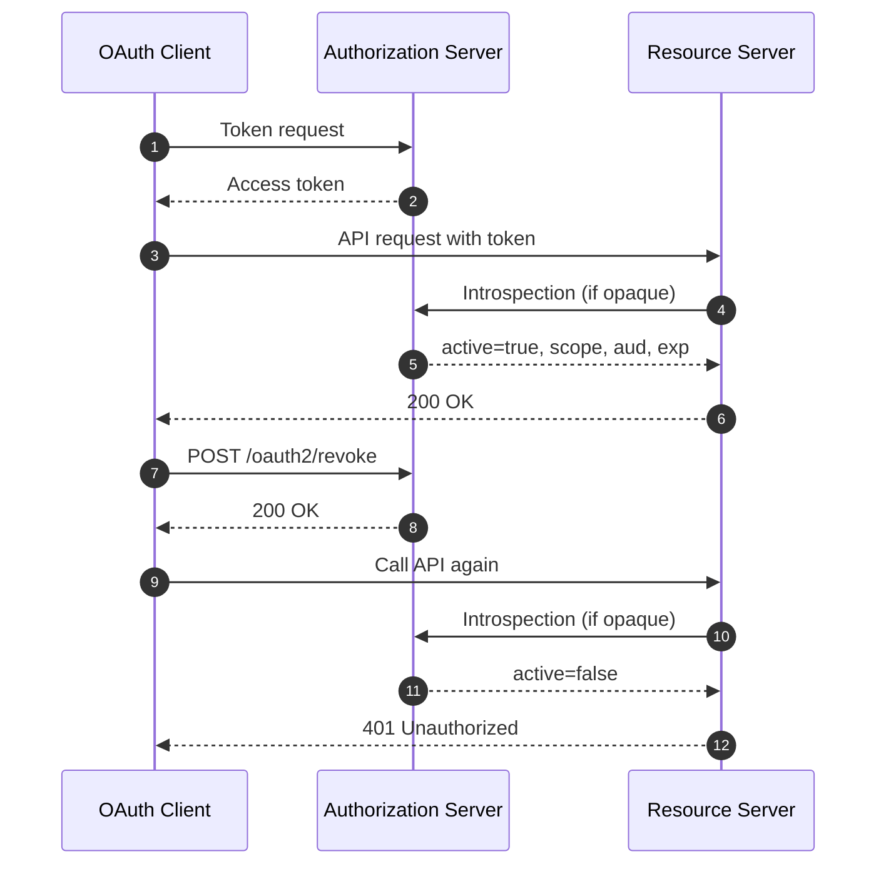

# Testing JWT claims, reference tokens, introspection, and revocation

Spring Authorization Server can issue access tokens as self-contained JWTs or reference tokens (opaque tokens). These two formats lead to different verification and revocation mechanisms on the Resource Server. A JWT carries claims for the Resource Server to verify locally via signature and policy; a reference token is an unpredictable identifier that must be introspected to learn its current status and permissions. Both formats require testing issuer, audience, scopes, expiration, and token lifecycle.

This lesson guides you through building a functional test suite for token claims, per-client access token format selection, introspection and revocation testing, and verifying behavior at the Resource Server. The goal is to prove tokens are issued according to contract, revoked tokens are no longer accepted under the chosen mechanism, and APIs allow only the right audience and scopes.

## 1. Distinguishing JWTs and reference tokens

| Characteristic | JWT access token | Reference/opaque access token |
|---|---|---|
| Contents visible to client | Base64URL-encoded and signed claims; not confidentially encrypted by default | Random/opaque identifier string carrying no readable claims |
| Verification at Resource Server | Can verify signature and claims locally | Calls the introspection endpoint or uses a trusted lookup mechanism |
| Network dependency on verification | No need to call Authorization Server per request when using local verification | Must query token state, typically via introspection; can be cached with a TTL |
| State changes/revocation | A Resource Server verifying only signatures does not know a token was revoked | Introspection can return `active=false` once state is updated |
| Per-request cost | Lower per verification, in exchange for key management and JWKS caching | Adds latency and load to the introspection endpoint |
| When appropriate | APIs needing distributed verification, accepting short lifetimes and bounded revocation windows | Permissions needing near-real-time state checks or keeping claims server-side |

JWTs are only signed, not encrypted. Anyone holding the token can read its header and payload. Never put passwords, secrets, sensitive data, or unnecessary personal information into claims. A reference token is also a bearer credential; protect it like an access token and never log it.

Do not confuse an access token with an ID token. An ID token is meant for an OIDC client, its `aud` is typically the client ID, and it describes a user authentication event. An access token is meant for a Resource Server, and its `aud` must identify the target API/resource per policy. A Resource Server must never accept an ID token in place of an access token merely because both are JWTs.

## 2. Defining the claims contract to test

For a JWT access token, a typical contract includes these attributes:

| Claim | Meaning | Condition to verify |
|---|---|---|
| `iss` | Issuer minting the token | Exactly matches the configured trusted issuer |
| `sub` | Subject of the token | Accurate user or workload per grant and policy |
| `aud` | Resource receiving the token | Contains the target API's audience; reject tokens meant for other APIs |
| `exp` | Expiration timestamp | Token rejected after this point, accounting for configured clock skew |
| `iat` | Issued-at timestamp | Not in the future beyond allowed clock skew |
| `nbf` | Not-before timestamp, if present | Token must be rejected before becoming valid |
| `jti` | Token identifier, if issued | Unique per policy and useful for audit/denylist |
| `scope` or `scp` | Granted permissions | Contains only approved scopes allowed by client and resource |
| `client_id` | Client bound to the token | Matches the client that executed the grant |
| `token_use` or internal type claim | Distinguishes token purpose if used by the app | Resource Server checks the exact token type |

Claim names and types may vary depending on token customizers. Scopes may be represented as a space-delimited string or a list; write assertions matching the actual format. A JWT `aud` may be a single string or an array of strings. Do not assume every token contains every claim in the table; define required claims explicitly per grant and token format.

For ID tokens, also test OIDC claims such as `aud`, `azp` when multiple audiences exist, `nonce` if the client sent a nonce, and `auth_time` when `max_age` is requested. These claims do not substitute for access token checks at the Resource Server.

## 3. Configuring and testing custom JWT claims

Spring Authorization Server uses `OAuth2TokenGenerator` to mint tokens. For JWT access tokens, you can use `OAuth2TokenCustomizer<JwtEncodingContext>` to add claims according to server-side policy:

```java
@Bean
OAuth2TokenCustomizer<JwtEncodingContext> jwtTokenCustomizer() {
    return context -> {
        if (OAuth2TokenType.ACCESS_TOKEN.equals(context.getTokenType())) {
            context.getClaims().claim(
                    "client_id", context.getRegisteredClient().getClientId());
            context.getClaims().claim("token_use", "access_token");
        }
    };
}
```

This is a minimal example. Never add a claim merely because the client sent a parameter with the same name. If you need `tenant`, `roles`, `aud`, or business permissions, obtain the data from the authenticated principal, client registration, or a server-side policy store. If using per-API audiences, determine the audience from a validated resource policy; never blindly copy a request `audience` into the token.

If one customizer produces both access tokens and ID tokens, check `context.getTokenType()` and add claims only to the appropriate type. Do not put `token_use=access_token` into an ID token or OIDC authentication claims into an access token without a clear reason.

Token issuance tests should verify claims after verifying the signature with a trusted decoder:

```java
Jwt jwt = jwtDecoder.decode(accessToken);

assertThat(jwt.getIssuer())
        .isEqualTo(URI.create("https://identity.example.com"));
assertThat(jwt.getSubject()).isEqualTo("user-123");
assertThat(jwt.getAudience()).contains("orders-api");
assertThat(jwt.getClaimAsString("token_use")).isEqualTo("access_token");
assertThat(jwt.getExpiresAt()).isAfter(Instant.now());
```

If scopes are stored in a string-typed `scope` claim:

```java
String scopeClaim = jwt.getClaimAsString("scope");
assertThat(Arrays.asList(scopeClaim.split("\\s+")))
        .containsExactlyInAnyOrder("orders.read", "orders.write");
```

If the application stores scopes as a list or an `scp` claim, use the corresponding accessor. Tests should also verify that tokens do not contain unrequested scopes, out-of-policy audiences, sensitive claims, or data from unauthenticated requests.

## 4. Configuring reference tokens per client

Spring Authorization Server supports access token formats via `TokenSettings`. Example registering a client that uses reference tokens:

```java
RegisteredClient reportingClient = RegisteredClient
        .withId(UUID.randomUUID().toString())
        .clientId("reporting-service")
        .clientSecret(passwordEncoder.encode(secretFromVault))
        .clientAuthenticationMethod(ClientAuthenticationMethod.CLIENT_SECRET_BASIC)
        .authorizationGrantType(AuthorizationGrantType.CLIENT_CREDENTIALS)
        .scope("reports.read")
        .tokenSettings(TokenSettings.builder()
                .accessTokenFormat(OAuth2TokenFormat.REFERENCE)
                .accessTokenTimeToLive(Duration.ofMinutes(5))
                .build())
        .build();

registeredClientRepository.save(reportingClient);
```

The secret in the example must come from a secret manager and be encoded with the `PasswordEncoder` matching client authentication configuration. Never put real secrets in source control.

Other clients can continue using JWTs:

```java
TokenSettings jwtTokenSettings = TokenSettings.builder()
        .accessTokenFormat(OAuth2TokenFormat.SELF_CONTAINED)
        .accessTokenTimeToLive(Duration.ofMinutes(5))
        .build();
```

Choose the format based on client and resource server needs. Reference tokens do not automatically guarantee instant revocation if the Resource Server caches introspection results for too long. JWTs do not automatically support instant revocation if the Resource Server only validates signatures. Both formats still need appropriate TTLs, scopes, and audiences.

## 5. Enabling introspection and revocation endpoints

In the Authorization Server's filter chain, enable the endpoints according to your Spring Authorization Server version:

```java
http.with(authorizationServerConfigurer, authorizationServer ->
        authorizationServer
                .tokenIntrospectionEndpoint(Customizer.withDefaults())
                .tokenRevocationEndpoint(Customizer.withDefaults()));
```

The default endpoints are typically `/oauth2/introspect` and `/oauth2/revoke`; verify via `AuthorizationServerSettings` or server metadata if the application customized the paths.

Introspection and revocation are endpoints for authenticated clients per configuration. Do not expose them as public APIs allowing anyone to look up tokens. Register clients with an appropriate authentication method, grant least privilege, and allow access only to clients that genuinely need to introspect or revoke.

Example introspection request:

```bash
curl -X POST https://identity.example.com/oauth2/introspect \
  -u 'reporting-service:<client-secret>' \
  -H 'Content-Type: application/x-www-form-urlencoded' \
  --data-urlencode 'token=<access-token>' \
  --data-urlencode 'token_type_hint=access_token'
```

Response for an active token may contain:

```json
{
  "active": true,
  "scope": "reports.read",
  "client_id": "reporting-service",
  "token_type": "Bearer",
  "exp": 1790000000,
  "iat": 1789999700,
  "sub": "service-account-reporting",
  "aud": ["reports-api"],
  "iss": "https://identity.example.com"
}
```

This is an illustrative response; fields besides `active` depend on the token, provider, and configuration. Clients must treat `active` as the primary condition. Never assume a token is active merely because introspection returns HTTP 200: `{"active": false}` is also a valid 200 response.

## 6. Testing introspection

With a valid issued token stored in the authorization store, call the endpoint through an authenticated client:

```java
@Test
void introspectionReportsIssuedReferenceTokenAsActive() throws Exception {
    String referenceToken = tokenFixtures.issuedReferenceToken();

    mockMvc.perform(post("/oauth2/introspect")
                    .with(httpBasic("reporting-service", "test-secret"))
                    .contentType(MediaType.APPLICATION_FORM_URLENCODED)
                    .param("token", referenceToken)
                    .param("token_type_hint", "access_token"))
            .andExpect(status().isOk())
            .andExpect(jsonPath("$.active").value(true))
            .andExpect(jsonPath("$.client_id").value("reporting-service"))
            .andExpect(jsonPath("$.scope").value("reports.read"));
}
```

The test fixture must mint the token through the real flow or persist the authorization with the proper schema. Do not invent a random token string and expect introspection to recognize it.

Key introspection test cases:

| Scenario | Expected result |
|---|---|
| Valid, unexpired reference token | `active=true` and matching claims |
| Nonexistent token | HTTP success with `active=false` |
| Expired token | `active=false` |
| Revoked token | `active=false` after state update |
| Wrong or missing client authentication | Client authentication rejected |
| Client unauthorized to call introspection | Rejected per endpoint policy |
| Token belonging to another client | Result per provider's ownership/authorization rules; no unauthorized data leaked |
| Mismatched token type hint | Server must still identify the right token or return inactive per implementation; never trust hint as proof of validity |

Never return the raw token or full authorization object in the response. The introspection response should publish only the claims needed by the Resource Server according to the agreed profile.

## 7. Testing revocation

RFC 7009 defines the revocation endpoint. The client submits the token to revoke, optionally with `token_type_hint`:

```bash
curl -X POST https://identity.example.com/oauth2/revoke \
  -u 'reporting-service:<client-secret>' \
  -H 'Content-Type: application/x-www-form-urlencoded' \
  --data-urlencode 'token=<access-token>' \
  --data-urlencode 'token_type_hint=access_token'
```

A valid revocation request typically returns HTTP 200 even when the token is already inactive or nonexistent. This behavior avoids creating an oracle for attackers to probe whether a token string is valid. Therefore, do not write tests expecting 404 for an unknown token. Verify the resulting state afterward via introspection or Resource Server access.

Example testing the revoke-then-introspect sequence:

```java
@Test
void revokedReferenceTokenBecomesInactive() throws Exception {
    String referenceToken = tokenFixtures.issuedReferenceToken();

    mockMvc.perform(post("/oauth2/revoke")
                    .with(httpBasic("reporting-service", "test-secret"))
                    .contentType(MediaType.APPLICATION_FORM_URLENCODED)
                    .param("token", referenceToken)
                    .param("token_type_hint", "access_token"))
            .andExpect(status().isOk());

    mockMvc.perform(post("/oauth2/introspect")
                    .with(httpBasic("reporting-service", "test-secret"))
                    .contentType(MediaType.APPLICATION_FORM_URLENCODED)
                    .param("token", referenceToken)
                    .param("token_type_hint", "access_token"))
            .andExpect(status().isOk())
            .andExpect(jsonPath("$.active").value(false));
}
```

Test additional cases:

- Revoking a valid token by a client permitted to revoke it.
- Revoking an already-expired or already-revoked token remains idempotent per the endpoint contract.
- Nonexistent tokens leak no existence info via differing status codes or bodies.
- Another client cannot revoke tokens outside its scope of authority, unless policy permits a specific administrator/relying service.
- Revoking a refresh token affects the related token chain appropriately per the authorization grant policy.
- After revocation, authorization persistence marks the token/authorization invalid; introspection returns inactive.

Do not assume every token in the same authorization is revoked identically across all versions or custom implementations. Verify the actual behavior of `OAuth2AuthorizationService`, the revocation provider, and the relationship between access tokens and refresh tokens in your application.

## 8. JWT revocation and limits of local verification

This is the sharpest difference between the two formats. When a Resource Server verifies a JWT solely via signature, issuer, audience, and expiration, it does not ask the Authorization Server whether the token has been revoked. Having the revocation endpoint update the authorization store does not automatically inform a stateless Resource Server that the token was revoked.

Example scenario:

1. The Authorization Server issues a JWT access token with `exp` 5 minutes in the future.
2. The client calls the revocation endpoint, and the server marks the token revoked in the authorization store.
3. The Resource Server validates only the JWT signature and claims locally.
4. The JWT can still be accepted until expiration because the Resource Server has not received the revocation state.

If near-instant revocation effect is required, choose one of these strategies:

- Use reference tokens and introspection per request or with a short cache TTL matching requirements.
- With JWTs, check a denylist by `jti` or authorization state at the Resource Server; ensure reliable state updates and distribution.
- Emit revocation events so Resource Servers update caches/denylists; design retries, replay, and recovery when subscribers disconnect.
- Use short-lived JWT access tokens and accept a maximum revocation window equal to the token's remaining lifetime.

Never claim "a revoked JWT is rejected immediately" if the Resource Server only performs local signature validation. Tests must reflect the real strategy: if there is no state channel, test that expired tokens are rejected and document the revocation window; if there is a denylist/event bus, test propagation time and failover.

## 9. Configuring the Resource Server to verify JWTs

The Resource Server must verify at least signature, issuer, expiration, and audience. Spring Security lets you compose default validators with an audience validator:

```java
@Bean
JwtDecoder jwtDecoder() {
    String issuer = "https://identity.example.com";
    NimbusJwtDecoder decoder = (NimbusJwtDecoder)
            JwtDecoders.fromIssuerLocation(issuer);

    OAuth2TokenValidator<Jwt> issuerAndTime =
            JwtValidators.createDefaultWithIssuer(issuer);
    OAuth2TokenValidator<Jwt> audience = jwt ->
            jwt.getAudience().contains("orders-api")
                    ? OAuth2TokenValidatorResult.success()
                    : OAuth2TokenValidatorResult.failure(
                            new OAuth2Error("invalid_token",
                                    "Required audience is missing", null));

    decoder.setJwtValidator(
            new DelegatingOAuth2TokenValidator<>(issuerAndTime, audience));
    return decoder;
}
```

This is an example for a JWT access token intended for `orders-api`. Use the issuer and audience configured for each environment. If the Resource Server needs to distinguish access tokens from ID tokens, add a validator for the appropriate claim/token profile. Do not check signatures alone, because a JWT with a valid signature could still have been issued for a different API.

Resource Server tests should include:

- JWT with valid issuer, audience, lifetime, and scopes: allowed to access matching endpoints.
- JWT with valid signature but wrong audience: returns 401.
- JWT with wrong issuer or invalid signature: returns 401.
- Expired JWT or before `nbf`: returns 401.
- Valid JWT missing required scope: returns 403.
- ID token with valid signature that is not an access token: rejected per token profile.

## 10. Configuring the Resource Server for opaque token introspection

For reference tokens, the Resource Server can use Spring Security's opaque token support. Example configuration in `application.yml`:

```yaml
spring:
  security:
    oauth2:
      resourceserver:
        opaquetoken:
          introspection-uri: https://identity.example.com/oauth2/introspect
          client-id: orders-api-resource-server
          client-secret: ${INTROSPECTION_CLIENT_SECRET}
```

Client credentials here are the Resource Server's credentials for calling introspection, not end-user credentials. Keep the secret in a secret manager. Grant the client only the necessary introspection permission and restrict network access to the endpoint.

Spring Security converts active/introspection attributes into an `Authentication` and authorities. Scope-to-authority mapping must align with `@PreAuthorize`, such as `SCOPE_orders.read`. If using a custom introspector or authority converter, test both active-token handling and scope mapping.

Test cases for opaque tokens:

1. Introspection returns `active=true` with sufficient scopes: endpoint allows access.
2. Introspection returns `active=true` but missing scope: endpoint returns 403.
3. Introspection returns `active=false`: Resource Server returns 401.
4. Introspection endpoint unavailable or client credentials invalid: Resource Server fails closed and never treats the token as active.
5. Cached introspection with TTL: after revocation, token is not accepted beyond the allowed cache TTL; if instant revocation is required, avoid long caches.

## 11. End-to-end lifecycle testing

An integration scenario can run through the following sequence:



With JWT local validation, the introspection step does not occur. Test scenarios must reflect the chosen revocation mechanism rather than assuming the Resource Server magically knows status from the Authorization Server.

Test both client types together if the system supports both JWTs and reference tokens. Verify that `TokenSettings` is actually applied per `RegisteredClient`; do not test only one default client and assume all clients use the same format.

## 12. Functional test matrix

| Group | Test case | Expected outcome |
|---|---|---|
| JWT claims | Valid issuer, subject, audience, lifetime, scopes | Claims match contract and signature verifies |
| JWT claims | Wrong issuer, audience, signature, `exp`, or `nbf` | Resource Server rejects |
| JWT claims | Custom claim taken from untrusted input | Not reflected in token |
| Token format | JWT client | Access token is a self-contained JWT per configuration |
| Token format | Reference client | Access token is opaque and found via introspection |
| Introspection | Active token | Returns `active=true` and required metadata |
| Introspection | Unknown, expired, or revoked token | Returns `active=false` |
| Introspection | Wrong client authentication | Rejected |
| Revocation | Revoke valid token | Endpoint responds per RFC 7009; subsequent state is inactive in store/introspection |
| Revocation | Unknown or already-revoked token | Does not leak token existence via differing response |
| JWT revocation | Resource Server verifies signature only | Token may remain valid until `exp`; verify designed boundary |
| JWT revocation | With denylist/events | Token rejected once revocation state propagates |
| Resource Server | Active token with sufficient scopes | 200 or matching business response |
| Resource Server | Active token missing required scope | 403 |
| Resource Server | Inactive token or wrong audience | 401 |

## 13. Completion checklist

- [ ] Identified which clients use JWTs and which clients use reference tokens.
- [ ] JWT claims include issuer, subject, audience, lifetime, and scopes per policy.
- [ ] Custom claims are sourced from trusted server-side data; no secrets or unnecessary sensitive data included.
- [ ] Resource Server verifies signature, issuer, audience, expiration, and authorities.
- [ ] Introspection endpoint requires client authentication and exposes only needed claims.
- [ ] Active, inactive, expired, and revoked tokens are tested separately.
- [ ] Revocation endpoint does not reveal whether a token exists through differing responses.
- [ ] Reference tokens are rejected once introspection returns inactive, accounting for cache TTL.
- [ ] JWT revocation limits are documented; denylist/events or short TTLs exist if fast effect is needed.
- [ ] End-to-end tests distinguish 401 (invalid token) from 403 (insufficient permissions).
- [ ] Logs contain no access tokens, refresh tokens, client secrets, or authorization headers.

A reliable token system must test both token contents and token status throughout its lifecycle. JWTs fit when Resource Servers can validate claims locally and accept the designed revocation window; reference tokens fit when centralized status checks are needed. Regardless of approach, issuer, audience, scopes, expiration, and introspection/revocation permissions must be tested as one unified contract between the Authorization Server and Resource Server.
