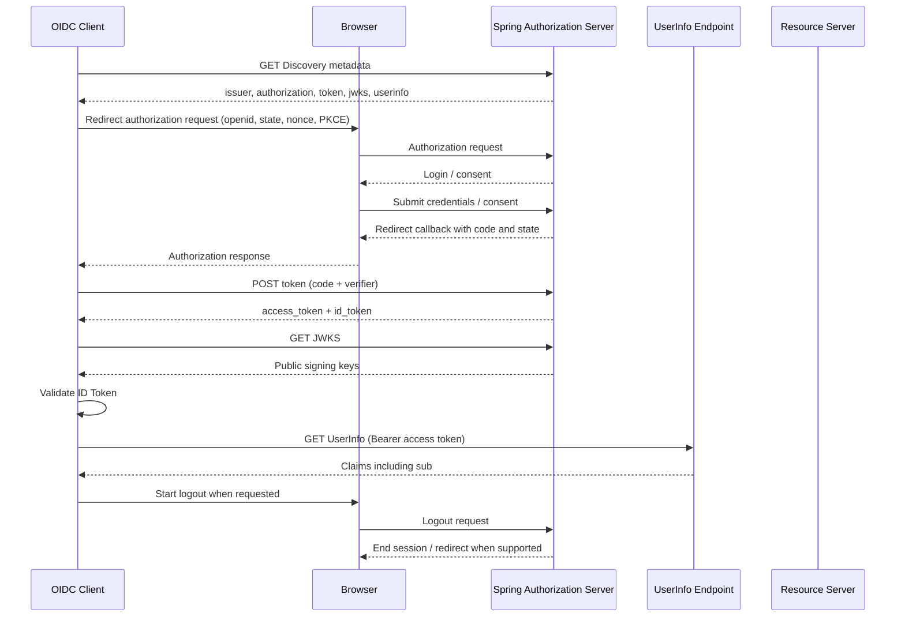

# Testing OIDC Discovery, ID Token, UserInfo, and Logout

An Authorization Server can issue access tokens successfully and still fail to satisfy OpenID Connect (OIDC) completely. A client needs to discover the provider's configuration via Discovery, receive and verify an ID Token, call UserInfo using the access token, and end the login session according to the logout mechanism supported by the system. A bug at any step can prevent the application from logging users in, show the wrong user details, or keep a login session active after the user has logged out.

With Spring Authorization Server, OIDC functional testing must run through the application's actual endpoints and configuration. This lesson focuses on the flow from Discovery through ID Token, UserInfo, and logout, while showing how to verify responses, claims, sessions, and error cases. Optional endpoints are tested only when the application has configured and published the corresponding capability.

After this lesson, you will be able to:

- Verify the OpenID Provider Configuration and published endpoints.
- Execute an authorization code flow with `openid`, `state`, `nonce`, and PKCE.
- Verify the signature, issuer, audience, expiration, and nonce of an ID Token.
- Call UserInfo with an access token and match `sub` against the ID Token.
- Test local logout and RP-Initiated Logout according to system capabilities.
- Inspect sessions, cookies, redirects, and invalid token or request cases.

## 1. OIDC testing scope and flow

OAuth 2.0 focuses on resource access delegation. OIDC adds a user authentication layer and the ID Token format so the client knows the identity of the logged-in subject. Therefore, a test that only checks an access token or calls a protected API does not prove OIDC works.

A typical OIDC authorization code flow consists of these steps:

1. The client fetches Discovery metadata to find the issuer and endpoints.
2. The client generates `state`, `nonce`, and a PKCE verifier and challenge.
3. The client redirects the browser to the authorization endpoint with a scope containing `openid`.
4. The user logs in and grants consent if required.
5. The Authorization Server redirects the browser back to the registered callback with an authorization code and `state`.
6. The client exchanges the code for tokens. The OIDC response may contain an access token and an ID Token.
7. The client validates the ID Token, including its signature and required claims.
8. The client may call UserInfo using the access token to retrieve permitted claims.
9. When the user ends the session, the client performs logout via the implemented mechanism.



Actual endpoints come from Discovery metadata or `AuthorizationServerSettings`. Do not assume every application uses the same default paths or enables every OIDC feature.

## 2. Preparing the test environment

Create a dedicated OIDC client for testing with known properties:

| Attribute | Test example |
|---|---|
| Client ID | `web-oidc-test` |
| Client type | Confidential web client |
| Grant type | Authorization Code |
| Authentication method | `client_secret_basic` |
| Redirect URI | `https://client.example.test/login/oauth2/code/test` |
| Post-logout redirect URI | `https://client.example.test/logout/callback` if supported and registered |
| Scope | `openid profile email` |
| PKCE | `S256` |

The values above are illustrative fixtures. In real tests, use the exact redirect URI, authentication method, scopes, and logout policy of the configured `RegisteredClient`. Secrets are for testing only and must never be written to logs or source control.

Also prepare:

- A test user account with claims to inspect, such as subject, display name, and email.
- A test client capable of retaining `state`, `nonce`, and `code_verifier` across steps.
- An HTTP client or browser automation tool to follow redirects and cookies.
- A Resource Server or JWT decoder to inspect ID Tokens and access tokens.
- A database/session store that can be reset so tests remain repeatable.

Use isolated test data for each run. Authorization codes are normally single-use; sessions, consents, and refresh tokens can also alter state across test runs.

## 3. Testing OpenID Provider Discovery

Discovery lets clients locate the issuer, endpoints, and capabilities advertised by the OpenID Provider. A client typically starts from the configured issuer and downloads the OpenID Provider Configuration at the corresponding well-known location. For an issuer containing a path, follow OIDC Discovery URL construction rules; do not concatenate strings arbitrarily or strip the issuer's path.

### 3.1. Checking metadata responses

Discovery tests should verify:

- The response succeeds and is valid JSON.
- `issuer` matches the exact issuer trusted by the client, including scheme, host, port, and path if any.
- `authorization_endpoint`, `token_endpoint`, and `jwks_uri` exist and are reachable from the client's deployment location.
- `userinfo_endpoint` is published when UserInfo is enabled.
- `end_session_endpoint` is published when the provider supports RP-Initiated Logout.
- `response_types_supported`, `subject_types_supported`, and `id_token_signing_alg_values_supported` reflect the actual configuration.
- `scopes_supported` and `claims_supported`, if published, do not advertise capabilities the system does not provide.
- `token_endpoint_auth_methods_supported` reflects the supported client authentication methods.

Do not require an optional field to appear in every deployment. Compare metadata against enabled features and the contract clients rely on.

Example with MockMvc, assuming the test knows the Discovery path configured by the application:

```java
mockMvc.perform(get(discoveryEndpoint))
        .andExpect(status().isOk())
        .andExpect(content().contentTypeCompatibleWith(MediaType.APPLICATION_JSON))
        .andExpect(jsonPath("$.issuer").value(issuer))
        .andExpect(jsonPath("$.authorization_endpoint").isNotEmpty())
        .andExpect(jsonPath("$.token_endpoint").isNotEmpty())
        .andExpect(jsonPath("$.jwks_uri").isNotEmpty())
        .andExpect(jsonPath("$.response_types_supported").isArray());
```

`discoveryEndpoint` and `issuer` must come from the test configuration. If the application does not enable UserInfo or the logout endpoint, assert those fields only when they are part of the deployment's contract.

### 3.2. Checking URLs and reverse proxies

A common defect is Discovery returning internal URLs such as a pod hostname, an in-cluster service address, or HTTP when clients connect over HTTPS. This can happen when the application sits behind a reverse proxy without handling forwarded headers properly.

In an integration environment, verify all published URLs:

1. Use the expected public scheme and host.
2. Do not point to `localhost`, internal IPs, or cluster-only hostnames.
3. Include the exact path prefix if the application is published under a context path.
4. Are reachable from the client and Resource Server networks.
5. The issuer in Discovery matches the ID Token's `iss` claim.

Trust `Forwarded` or `X-Forwarded-*` headers only from controlled reverse proxies. Never configure the application to trust headers sent by arbitrary Internet requests, as that can corrupt URLs generated in metadata or redirects.

## 4. Testing the OIDC authorization request

Clients request OIDC by including the `openid` scope in the authorization request. To test binding between request and response, the client must generate and retain `state`, `nonce`, and the PKCE verifier.

Example of key parameters:

```text
response_type=code
client_id=web-oidc-test
redirect_uri=https://client.example.test/login/oauth2/code/test
scope=openid profile email
state=<random-state>
nonce=<random-nonce>
code_challenge=<base64url-sha256>
code_challenge_method=S256
```

`state` protects the redirect flow and helps the client correlate the callback with the initiated request. `nonce` binds the ID Token to the authentication request and is verified by the client after receiving the token. PKCE protects the authorization code from being used by a party lacking the verifier. These values are managed by the client; tests must prove the client preserves the right values throughout the flow.

### 4.1. Success scenario

1. The client generates `state`, `nonce`, verifier, and challenge using an appropriate random generator.
2. The client redirects the browser to the authorization endpoint with a scope containing `openid`.
3. The user logs in with the test account.
4. The user grants consent if required by policy.
5. The Authorization Server redirects to the exact callback URI with code and state.
6. The client compares the received state with the saved state.
7. The client exchanges the code at the token endpoint using the matching verifier.
8. The client receives the ID Token and verifies it before creating a login session.

Do not mark login as successful merely because the token endpoint returned HTTP 200. The client must verify the ID Token signature and claims before trusting the user's identity.

### 4.2. Error scenarios

| Scenario | Expected result to verify |
|---|---|
| Missing `openid` scope | Do not treat the response as an OIDC flow with an ID Token |
| Unregistered redirect URI | Authorization Server rejects the request and does not redirect to an arbitrary URI |
| Invalid client ID | Request rejected |
| User denies consent | Client receives an appropriate authorization error |
| Callback state mismatch | Client rejects the callback and does not create a login session |
| Missing nonce in request when client requires nonce verification | Client cannot verify request binding per policy |
| Wrong PKCE verifier | Token endpoint rejects code exchange |
| Reused authorization code | Token endpoint rejects |

Test both server-side and client-side behavior. For example, the Authorization Server may return a valid callback, but the client must reject it on its own if `state` does not match. That is a client-side check; testing only server endpoints cannot prove the client validated `state`.

## 5. Testing the ID Token

An ID Token is a JWT containing authentication claims about the user and the authentication event. The client must verify the signature and claims per OIDC before using `sub` or identity attributes.

### 5.1. Claims to verify

| Claim | Meaning | Functional assertion |
|---|---|---|
| `iss` | OpenID Provider issuing the token | Matches the trusted issuer and Discovery metadata |
| `sub` | Subject identifier | Non-empty; used as user identifier per policy |
| `aud` | Client receiving the ID Token | Contains the application's client ID |
| `exp` | Expiration timestamp | Token is unexpired, accounting for policy clock skew |
| `iat` | Issued-at timestamp | Within valid time range |
| `nonce` | OIDC request binding | Matches the nonce sent by the client |
| `azp` | Authorized party | Checked per OIDC rules when multiple audiences exist or where required |
| `auth_time` | User authentication timestamp | Checked when request uses `max_age` or policy requires it |

`aud` may be a string or an array of audiences. The client must handle the format properly and verify the client ID is present in the audience. When multiple audiences exist, check `azp` per OIDC rules. Do not just check that a claim exists; verify its value matches the request.

### 5.2. Verifying signatures with JWKS

The client or test harness fetches public keys from `jwks_uri` in Discovery, reads `kid` in the JWT header, and selects the matching key. It then verifies the signature using an algorithm published by the provider and permitted by the client.

With Spring Security, `NimbusJwtDecoder` can verify signatures and use the default issuer validator. Add a validator for the client's audience:

```java
NimbusJwtDecoder decoder = NimbusJwtDecoder
        .withJwkSetUri(jwkSetUri)
        .build();

OAuth2TokenValidator<Jwt> issuerValidator =
        JwtValidators.createDefaultWithIssuer(issuer);

OAuth2TokenValidator<Jwt> audienceValidator = jwt ->
        jwt.getAudience().contains(clientId)
                ? OAuth2TokenValidatorResult.success()
                : OAuth2TokenValidatorResult.failure(
                        new OAuth2Error("invalid_token", "Invalid audience", null));

decoder.setJwtValidator(new DelegatingOAuth2TokenValidator<>(
        issuerValidator, audienceValidator));
```

This snippet illustrates composing validators. An OIDC client also needs to check `nonce` in the authentication request's context because the expected nonce belongs to each individual request, not a shared static configuration value. Never replace signature verification with merely decoding the JWT payload.

### 5.3. Invalid ID Token cases

Create validly signed test tokens while altering individual claims to ensure the client validates properly:

- Issuer differs from the trusted provider.
- Audience does not include the client ID.
- Token is expired.
- Invalid signature or `kid` missing from JWKS.
- Signing algorithm not in the allowlist.
- Nonce does not match the authorization request.
- `azp` invalid when multiple audiences are present.
- `auth_time` fails `max_age` when the client sends that parameter.

Each case must cause the client to reject the ID Token and create no authenticated login session. Use genuinely signed JWTs in tests; a pre-authenticated mock `Jwt` bypasses signature and JWKS verification paths.

## 6. Testing the UserInfo Endpoint

UserInfo is an OIDC endpoint returning claims about the authenticated subject. The client calls the endpoint using the access token in the HTTP Bearer header. An ID Token is not a credential for calling UserInfo.

```http
GET /userinfo HTTP/1.1
Host: auth.example.test
Authorization: Bearer <access-token>
```

The `/userinfo` path is an example. Obtain the actual URL from `userinfo_endpoint` in Discovery metadata.

### 6.1. Success scenario

1. Complete the authorization code flow with scope `openid profile email`.
2. Receive the access token and ID Token.
3. Call UserInfo using the access token.
4. Verify the JSON response contains `sub`.
5. Match UserInfo's `sub` against `sub` in the ID Token.
6. Verify profile/email claims according to configured scopes, consent, and user data.

Example testing the endpoint with MockMvc:

```java
mockMvc.perform(get(userInfoEndpoint)
        .header(HttpHeaders.AUTHORIZATION, "Bearer " + accessToken))
    .andExpect(status().isOk())
    .andExpect(content().contentTypeCompatibleWith(MediaType.APPLICATION_JSON))
    .andExpect(jsonPath("$.sub").value(expectedSubject));
```

This test assumes `accessToken` is a real token issued from the test flow and the security filter chain is configured to authenticate access tokens. Do not send an ID Token in the Bearer header for UserInfo requests.

### 6.2. Access permissions and claims

Standard OIDC scopes typically map to claim groups:

| Scope | Claim group that may be requested |
|---|---|
| `profile` | `name`, `family_name`, `given_name`, `preferred_username`, `picture`, and other profile claims |
| `email` | `email`, `email_verified` |
| `address` | `address` |
| `phone` | `phone_number`, `phone_number_verified` |

Requesting a scope does not guarantee the provider must return every claim in that group. The response also depends on user data, consent, and application policy. Tests should determine which claims are actually provided in the test environment and assert that exact contract.

### 6.3. UserInfo error cases

| Request | Expected result to verify |
|---|---|
| No Bearer token | Access denied with an appropriate challenge |
| Invalid token or bad signature | Rejected |
| Expired token | Rejected |
| Revoked token if endpoint checks state | Rejected per policy |
| Access token lacks required scope | Does not return out-of-scope claims; rejects if policy requires scope |
| Using ID Token instead of access token | Authentication rejected |
| Subject has no data or lacks access permission | Responds per policy without leaking another user's data |

The UserInfo response must have a `sub` consistent with the ID Token's subject. If `sub` differs, the client must reject the result because it may have received data from a different subject.

## 7. Testing Logout

Logout in an OIDC system has multiple layers. Distinguish between logging out of the local session at the Authorization Server, logging out of the relying party application, and OIDC RP-Initiated Logout. Clearing a cookie on the client does not automatically end the session at the Authorization Server or other applications.

### 7.1. Local logout at the application

If the application uses Spring Security form login, the `/logout` endpoint typically handles local logout per `LogoutFilter` configuration. Tests must verify:

- The logout request uses the HTTP method and CSRF token required by security configuration.
- The current session is invalidated.
- The security context is cleared.
- The session cookie is cleared or expired per configuration.
- Accessing a protected endpoint after logout requires re-authentication.
- Post-logout redirect goes to the configured URL.

Example with MockMvc:

```java
mockMvc.perform(post("/logout")
        .with(user("alice"))
        .with(csrf()))
    .andExpect(status().is3xxRedirection());
```

This example only illustrates an application using form logout with CSRF. Check sessions/cookies and re-access a protected endpoint within the same test flow to prove the session ended. Do not assume the relying party application's logout endpoint is the Authorization Server's OIDC logout endpoint.

### 7.2. RP-Initiated Logout

If the Authorization Server supports RP-Initiated Logout, the client can navigate the browser to the `end_session_endpoint` published in Discovery. Requests typically include `id_token_hint` so the provider identifies the relevant login session. `post_logout_redirect_uri` is accepted only if registered or permitted by policy; the client can pass `state` to correlate the logout response with the original request.

General flow:

1. The client stores the ID Token received during the login session.
2. The user chooses to log out in the relying party application.
3. The client navigates the browser to `end_session_endpoint` with `id_token_hint` and supported logout parameters.
4. The Authorization Server identifies the related session and ends it per configuration.
5. If a valid `post_logout_redirect_uri` is provided, the browser is redirected to that URI and `state` is returned per contract.
6. The client clears its local session and no longer treats the user as logged in.

Exact parameters and behaviors depend on the Spring Authorization Server version, endpoint configurer, and application policy. Test RP-Initiated Logout only if the endpoint is enabled and published; do not infer the endpoint exists just because Discovery or ID Tokens work.

### 7.3. Post-logout checks

After a successful logout, run these checks using the same browser session:

- The old session cookie no longer grants access to protected resources.
- Sending a new authorization request does not silently reuse the terminated session.
- If the provider requires re-interaction, the browser is redirected to the login page.
- Redirects go only to registered or permitted URIs.
- Returned `state` matches the value sent by the client.
- The relying party client clears its local session and retains no authenticated principal.

Do not assume already-issued access tokens automatically become invalid just because the user logged out of the browser. An access token may remain valid until expiration or until revoked via the mechanism implemented by the system. If logout is required to invalidate tokens, test revocation/introspection or the corresponding session/token binding mechanism.

### 7.4. Logout error cases

| Scenario | Expected result to verify |
|---|---|
| Unregistered `post_logout_redirect_uri` | Unsafe redirect rejected |
| Invalid or unacceptable `id_token_hint` | Handled per endpoint policy; never terminates another user's session by mistake |
| `state` altered along the redirect | Client rejects mismatched logout response |
| Session already expired prior to logout | Endpoint handles safely without accidentally creating a new session |
| User logs out locally while provider session remains active | Test documents actual behavior and product requirements; do not confuse with RP-Initiated Logout |
| Logout endpoint not enabled | Discovery must not advertise a nonexistent capability; client handles per app policy |

If the system implements front-channel logout, back-channel logout, or session management extensions, write separate tests for each mechanism. They have distinct behaviors and contracts; do not treat them as automatic side effects of RP-Initiated Logout.

## 8. Testing sessions and browser behavior

Some OIDC behaviors depend on cookies, redirects, and sessions, so they cannot be verified completely by calling endpoints independently. Use browser automation or an HTTP client with a cookie jar to test the real redirect chain.

Items to verify:

- The session persists across the authorization request, login, and consent.
- Cookies have `Secure`, `HttpOnly`, and `SameSite` attributes suited to cross-site redirects.
- Client callbacks do not mix up sessions or states from another login attempt.
- Logout clears the right cookies and sessions within the committed scope.
- Post-login and post-logout redirects never lead to hosts outside the trusted list.
- Reverse proxies produce the right public scheme and host.
- Browser back navigation does not revive a terminated login session.

MockMvc is useful for testing filter chains and server responses. To verify SameSite, real cookies, multi-host redirects, and browser behavior, run integration tests over HTTPS in staging or dedicated browser tests.

## 9. Recommended OIDC functional test suite

| Test group | Key scenario | Expected outcome |
|---|---|---|
| Discovery | Fetch metadata from public issuer | Accurate issuer and endpoints; capabilities reflect configuration |
| Authorization | Request with `openid`, state, nonce, and PKCE | Accurate login/consent and callback |
| ID Token | Verify signature and claims | Valid issuer, audience, nonce, and lifetime |
| ID Token negative | Wrong signature, issuer, audience, nonce, or expired | Client rejects login |
| UserInfo | Call with access token | JSON has `sub` matching ID Token and claims per policy |
| UserInfo negative | Missing token, wrong token, or using ID Token | Access denied |
| Local logout | Log out of app or current session | Local session terminated |
| RP-Initiated Logout | Navigate to end-session endpoint | Provider session ends and valid redirect occurs if supported |
| Logout negative | Invalid redirect URI or wrong state | No off-policy redirect; client rejects bad response |
| Browser integration | Cookies, redirects, HTTPS, and cross-flow sessions | Behavior works on a real browser |

Run both positive and negative tests. An endpoint returning 200 does not prove the response is right; inspect JSON fields, claims, cookies, redirects, sessions, and login state afterward.

## 10. Organizing automation

The test suite can be organized by feature:

```text
src/test/java/.../oidc/
  DiscoveryMetadataTest.java
  OidcAuthorizationCodeFlowTest.java
  IdTokenValidationTest.java
  UserInfoEndpointTest.java
  LocalLogoutTest.java
  RpInitiatedLogoutTest.java
  OidcBrowserSessionTest.java
```

Filenames are examples only. Keep tests in packages and modules matching the real application.

Implementation suggestions:

- Use MockMvc or WebTestClient for contract and filter-chain tests.
- Use a test database or Testcontainers if clients, consents, and authorizations are stored with JDBC.
- Use genuinely signed JWTs and a test JWKS endpoint to test ID Tokens.
- Use an HTTP client with a cookie jar or browser automation for redirects and logout.
- Use a controllable `Clock` when testing `exp`, `iat`, `auth_time`, or session durations.
- Clean up sessions, consents, and authorization data after each test to avoid run-order dependencies.
- Never log access tokens, ID Tokens, authorization codes, nonces, verifiers, or client secrets.

Layer your pipeline: fast Discovery/JWKS contract tests on pull requests; authorization code, ID Token, and UserInfo in integration builds; browser logout, cookies, and reverse proxy tests in pre-release/staging. Tests sharing stateful fixtures should be serialized or given isolated data per test.

## 11. OIDC pre-release checklist

- [ ] Discovery returns the accurate issuer and enabled endpoints.
- [ ] Endpoint URLs use the public scheme/host without leaking internal addresses.
- [ ] Authorization code flow with `openid` scope completes.
- [ ] Client validates `state` and `nonce`.
- [ ] PKCE S256 works per client policy.
- [ ] ID Token has a valid signature and claims matching the client.
- [ ] `iss`, `sub`, `aud`, `exp`, `iat`, and nonce are verified.
- [ ] `azp` and `auth_time` are verified when the scenario requires them.
- [ ] UserInfo is called with an access token.
- [ ] UserInfo `sub` matches ID Token `sub`.
- [ ] Scopes and consent restrict the returned claims.
- [ ] Missing, invalid, expired, or under-privileged tokens are rejected.
- [ ] Local logout terminates sessions per configuration.
- [ ] RP-Initiated Logout is tested if the endpoint is enabled.
- [ ] Post-logout redirects and state are verified.
- [ ] Cookies, CSRF, HTTPS, and reverse proxies are tested in an integrated environment.
- [ ] Tests never write tokens, codes, secrets, or verifiers to logs.

## Conclusion

OIDC functional testing must follow the entire user journey: the client discovers the provider, initiates authorization, verifies the ID Token, retrieves claims from UserInfo, and ends the session. Verify both returned data and client/browser behavior, especially issuer, audience, nonce, `sub`, cookies, and redirects. For logout, clearly define which session scope is terminated and test the RP-Initiated Logout endpoint only when the provider actually supports that capability.
