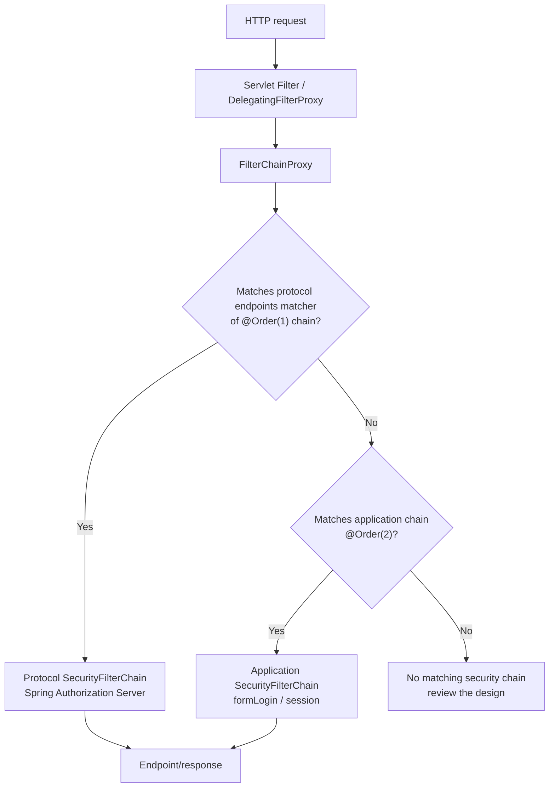
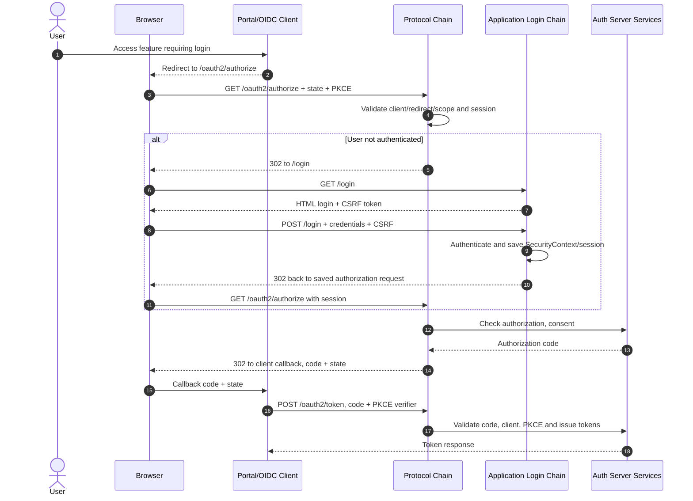

# Protocol SecurityFilterChain and Application Login SecurityFilterChain

A Spring Boot application acting as an **OAuth 2.0/OpenID Connect Authorization Server** typically has to handle two groups of HTTP requests with very different characteristics:

- **OAuth2/OIDC protocol requests**: issuing authorization codes, exchanging codes for tokens, authenticating OAuth clients, distributing JWKS, publishing metadata, introspection, revocation, and UserInfo.
- **Application login requests**: rendering the login form, authenticating accounts, creating user sessions, serving error pages/static assets, and handling local logout.

To ensure these two groups adhere to their respective policies, Spring Security lets you configure multiple `SecurityFilterChain` beans with explicit matchers and ordering. The goal of this lesson in the **Processing Architecture** chapter is to explain how chains are selected, coordinated, and tested when designing **SPRING_SECURITY_OAUTH2_OIDC_AUTHORIZATION_SERVER** — a system for learning how to configure, secure, test, and operate an Authorization Server with Spring Security and Spring Authorization Server.

Running example throughout: `login.example.com` runs Spring Authorization Server; Portal is an OIDC client; an employee logs in at `/login`, and Portal then calls `/oauth2/token` to obtain tokens. The example addresses are placeholders, not endpoints you can use directly outside a deployed environment.

## 1. Which layers does a request pass through?

In a Servlet application, a request passes through the servlet container's filters, where a `DelegatingFilterProxy` named `springSecurityFilterChain` forwards it to Spring Security's `FilterChainProxy`. `FilterChainProxy` holds a collection of `SecurityFilterChain` instances. Each chain has a **RequestMatcher** that defines its request scope and an ordered list of security filters.



**Key principle:** `FilterChainProxy` iterates through chains in order and executes **the first chain whose matcher matches**. A request does not run through both chains sequentially. When `/oauth2/authorize` redirects the user to `/login`, the browser issues a **new** HTTP request; that new request can then be handled by the second chain.

### 1.1. Distinguishing the two types of request matchers

| Component | What does it decide? | Example |
|---|---|---|
| `http.securityMatcher(...)` | Should the request **enter** this chain? | Select the protocol chain by SAS endpoints |
| `http.authorizeHttpRequests(...requestMatchers(...))` | Is a request already inside the chain **authorized**? | Permit `/assets/**` in the application chain |
| `@Order(1)`, `@Order(2)` | Which chain is **evaluated first**? | Protocol chain before application chain |
| `anyRequest()` in authorization | Rule for remaining requests **within the current chain** | `anyRequest().authenticated()` |

A common mistake is declaring only `authorizeHttpRequests(a -> a.requestMatchers("/oauth2/**").authenticated())` and thinking the chains are separated. That configuration is an authorization rule; it **does not restrict the chain's matcher**. If the highest-priority chain has a default matcher covering all URLs, it can swallow `/login` as well and prevent downstream chains from ever being used.

### 1.2. Why shouldn't you limit the protocol chain with `"/oauth2/**"` manually?

Spring Authorization Server does not only expose `/oauth2/*` paths. It can serve metadata at `/.well-known/oauth-authorization-server`, OIDC Discovery at `/.well-known/openid-configuration`, UserInfo at `/userinfo`, OIDC logout at `/connect/logout`, and other endpoints depending on enabled features. Paths can also be customized via `AuthorizationServerSettings`.

Therefore, your configuration should use **`OAuth2AuthorizationServerConfigurer.getEndpointsMatcher()`** to identify protocol requests rather than guessing path patterns manually.

## 2. What are the responsibilities of the two SecurityFilterChains?

### 2.1. OAuth2/OIDC protocol chain

Spring Authorization Server configures filters and `AuthenticationProvider` implementations specialized for the protocol: handling authorization requests, client authentication, token requests, grant types, revocation, introspection, authorization consent, and enabled OpenID Connect endpoints.

| Example request | Function | What to control |
|---|---|---|
| `GET /oauth2/authorize` | Start the Authorization Code Flow | Registered client, redirect URI, scope, user session, PKCE |
| `POST /oauth2/token` | Exchange code/refresh token or client credentials | Client authentication where applicable, grant type, and token policy |
| `GET /oauth2/jwks` | Publish public keys to verify signed tokens | Public keys only; must have a `JWKSource` |
| `GET /.well-known/oauth-authorization-server` | OAuth2 metadata | Issuer/endpoints match configuration |
| `GET /.well-known/openid-configuration` | OIDC Discovery | OIDC enabled, accurate issuer |
| `GET /userinfo` | OIDC UserInfo | Valid Bearer access token and appropriate claims/scope |
| `POST /oauth2/introspect` | Query token status | Valid OAuth client per introspection policy |
| `POST /oauth2/revoke` | Revoke a token | Client authentication and protocol constraints |
| `/connect/logout` | OIDC RP-Initiated Logout when supported | Configuration and protocol checks for id token/redirect |

Not every endpoint is available in every version or configuration. JWKS requires an appropriate key source; OIDC endpoints must be enabled, and certain features are optional. Public endpoints are handled according to protocol logic. You should not apply `permitAll()` to the **entire protocol chain** to try to "fix" discovery endpoint errors.

The protocol chain supports both **front-channel** requests involving a browser (`/oauth2/authorize`) and **back-channel** requests from a client (`/oauth2/token`). These two request types require different error behaviors; the token endpoint should never return an HTML login page.

### 2.2. Application login chain

The application chain handles URLs for user authentication and UI:

- `GET /login`: renders the default or custom login page.
- `POST /login`: processes the password/authentication mechanism configured by the application.
- `POST /logout`: terminates the local session when form-style logout is registered.
- `/assets/**`, `/error`: UI resources requiring appropriate access policies.
- Custom routes for MFA, federated login, error reporting, and session management.

Both chains belong to the same application and can **share the same HttpSession and SecurityContext persistence mechanism**. The application chain authenticates the user; when the browser resumes the authorization request, the protocol chain can read the authenticated identity from session state. Splitting into two chains does not require two servers or two user stores.

### 2.3. Request routing table

| URL/method | Expected chain | Typical outcome |
|---|---|---|
| `GET /oauth2/authorize` | Protocol `@Order(1)` | Validates request; may require login |
| `GET /login` | Application `@Order(2)` | HTML login |
| `POST /login` | Application `@Order(2)` | Form authentication, CSRF, session |
| `POST /oauth2/token` | Protocol `@Order(1)` | Token JSON or OAuth2 error |
| `GET /.well-known/openid-configuration` | Protocol `@Order(1)` | Discovery JSON when OIDC is enabled |
| `GET /oauth2/jwks` | Protocol `@Order(1)` | Public JWK set when configured |
| `GET /userinfo` | Protocol `@Order(1)` | OIDC UserInfo when token is valid |
| `POST /logout` | Application `@Order(2)` | Local logout |
| `GET /assets/login.css` | Application `@Order(2)` | Static CSS permitted |
| `GET /api/orders` in same process | Should have a separate API chain | Returns Bearer/API response, avoids HTML redirect |

## 3. Java configuration for two SecurityFilterChains

The example uses common APIs from **Spring Boot 3.x, Spring Security 6.x, and Spring Authorization Server 1.x**, specifically `HttpSecurity.with(...)`. Other Spring/Authorization Server versions may change packages or APIs; always pin dependency versions when applying this.

```java
package example.authserver.security;

import org.springframework.context.annotation.Bean;
import org.springframework.context.annotation.Configuration;
import org.springframework.core.annotation.Order;
import org.springframework.http.MediaType;
import org.springframework.security.config.Customizer;
import org.springframework.security.config.annotation.web.builders.HttpSecurity;
import org.springframework.security.oauth2.server.authorization.config.annotation.web.configurers.OAuth2AuthorizationServerConfigurer;
import org.springframework.security.web.SecurityFilterChain;
import org.springframework.security.web.authentication.LoginUrlAuthenticationEntryPoint;
import org.springframework.security.web.util.matcher.MediaTypeRequestMatcher;

@Configuration(proxyBeanMethods = false)
public class AuthorizationServerSecurityConfig {

    @Bean
    @Order(1)
    SecurityFilterChain authorizationServerSecurityFilterChain(
            HttpSecurity http) throws Exception {

        OAuth2AuthorizationServerConfigurer authorizationServerConfigurer =
                OAuth2AuthorizationServerConfigurer.authorizationServer();

        http
            .securityMatcher(
                authorizationServerConfigurer.getEndpointsMatcher())
            .with(authorizationServerConfigurer, authorizationServer ->
                authorizationServer.oidc(Customizer.withDefaults()))
            .authorizeHttpRequests(authorize -> authorize
                .anyRequest().authenticated())
            .exceptionHandling(exceptions -> exceptions
                .defaultAuthenticationEntryPointFor(
                    new LoginUrlAuthenticationEntryPoint("/login"),
                    new MediaTypeRequestMatcher(MediaType.TEXT_HTML)))
            .oauth2ResourceServer(oauth2 -> oauth2
                .jwt(Customizer.withDefaults()));

        return http.build();
    }

    @Bean
    @Order(2)
    SecurityFilterChain applicationSecurityFilterChain(
            HttpSecurity http) throws Exception {

        http
            .authorizeHttpRequests(authorize -> authorize
                .requestMatchers("/assets/**", "/error").permitAll()
                .anyRequest().authenticated())
            .formLogin(Customizer.withDefaults());

        return http.build();
    }
}
```

### 3.1. Explaining the architecture-defining lines

1. **`@Order(1)`** ensures the protocol chain is evaluated before the fallback chain. Ordering must be coordinated with other chains if the application also exposes APIs or actuator endpoints.
2. **`getEndpointsMatcher()`** scopes chain #1 to the exact endpoints managed by the Authorization Server. This prevents missing OIDC discovery, UserInfo, or specially configured endpoints.
3. **`with(authorizationServerConfigurer, ...)`** installs Spring Authorization Server's filters/handlers and enables OIDC functionality per the sample API.
4. **`anyRequest().authenticated()`** sets the catch-all rule inside the protocol chain. Public protocol endpoints have appropriate handling configured by the Authorization Server; this rule **does not mean** JWKS/discovery require login.
5. **`LoginUrlAuthenticationEntryPoint("/login")`** is only applied as the entry point for HTML requests in this example—typically a browser going through the Authorization Code Flow. Token requests may require different OAuth errors and must not be forced to redirect to form login.
6. **`oauth2ResourceServer(...jwt(...))`** enables Bearer token authentication for endpoints such as OIDC UserInfo; this does not turn the protocol chain into a general business Resource Server.
7. The application chain does not call `securityMatcher(...)`, so it acts as the fallback matcher running default form login. If you want to customize `GET /login`, you must provide the corresponding page.

### 3.2. Beans still required beyond the two chains

Two `SecurityFilterChain` beans are not enough to build a complete Authorization Server. The application also needs:

- **`RegisteredClientRepository`** to register clients, redirect URIs, grants, authentication methods, and scopes.
- **`OAuth2AuthorizationService`** and **`OAuth2AuthorizationConsentService`** to store authorizations/codes/tokens and consents across their lifecycle.
- **`AuthorizationServerSettings`** to define the issuer and endpoint settings.
- **`JWKSource<SecurityContext>`** to supply signing keys; private keys need secure storage and a rotation plan.
- **`JwtDecoder`** as required by OIDC/JWT endpoint features.
- **`UserDetailsService`, `AuthenticationProvider`**, or IdP integration to authenticate user accounts in the application chain.

Common decoder bean pattern:

```java
@Bean
JwtDecoder jwtDecoder(JWKSource<SecurityContext> jwkSource) {
    return OAuth2AuthorizationServerConfiguration.jwtDecoder(jwkSource);
}
```

Make sure to import `JwtDecoder`, `JWKSource`, `SecurityContext`, and `OAuth2AuthorizationServerConfiguration` from the corresponding libraries. This bean only supports decoding/verifying JWTs; it **does not replace generating and storing the JWK signing key source**.

Example issuer configuration:

```java
@Bean
AuthorizationServerSettings authorizationServerSettings() {
    return AuthorizationServerSettings.builder()
            .issuer("https://login.example.com")
            .build();
}
```

`issuer` must stay consistent with metadata, `iss` in tokens, and the actual public address. When the application sits behind a reverse proxy/load balancer, configure forwarded headers according to a trusted proxy list and keep redirect URIs accurate.

## 4. How does the Authorization Code login flow traverse both chains?

Suppose Portal has registered `client_id`, `redirect_uri`, and `authorization_code`; the user does not yet have a session at the Authorization Server.



Key details to get right:

- `GET /oauth2/authorize` runs on the protocol chain; `GET /login` and `POST /login` are two new requests running on the application chain.
- After login, `SecurityContext` is restored on the protocol chain according to the configured state persistence. Do not accidentally configure global stateless mode, which would drop the browser session.
- The `RequestCache`/`SavedRequest` mechanism allows returning to the original authorization request. A custom login success handler that always redirects to `/home` can break the OAuth flow if it ignores the saved request.
- If the client requires consent, the browser may also go through a consent page; this is a permission approval step, distinct from entering a password.
- `state` and PKCE mitigate attacks at the **OAuth protocol** layer; the CSRF token protects **cookie-based web forms**. They do not replace one another.
- The client must verify `state`, the ID token (in OIDC), and redirect conditions per the protocol; the fact that the user has logged in at the AS does not remove client-side responsibilities.

### 4.1. Who receives the password and who receives the client secret?

`POST /login` is handled by `UsernamePasswordAuthenticationFilter` (when using `formLogin`), processing **end-user** credentials through `AuthenticationProvider` instances such as `DaoAuthenticationProvider`. `POST /oauth2/token` is handled by protocol components and may require **client authentication**.

Example token request for a background service:

```http
POST /oauth2/token HTTP/1.1
Host: login.example.com
Authorization: Basic <base64(client_id:client_secret)>
Content-Type: application/x-www-form-urlencoded

grant_type=client_credentials&scope=orders.read
```

The Basic value is the **OAuth client**'s credential, not an end-user's username/password. In the `client_credentials` flow there is no form login request because the authenticating actor is a service. For public clients without a client secret, the authentication method and PKCE must conform to the registered client/grant type.

## 5. Why must protocol endpoints not automatically redirect to the login page?

An "unauthenticated" response can be handled by an `AuthenticationEntryPoint`. For a browser at `/oauth2/authorize`, a `302 /login` redirect is usually appropriate. For `/oauth2/token` or `/userinfo`, the OAuth client expects a protocol-compliant HTTP response/body, such as `invalid_client`, `invalid_grant`, or a Bearer error. Receiving HTML instead of the expected JSON/HTTP error can cause clients to misinterpret the response, retry indefinitely, or leak information through unexpected redirects.

| Scenario | Correct target behavior |
|---|---|
| Unauthenticated browser hits a valid authorization request | May `302` to `/login` |
| `GET /login` | Return valid HTML form |
| Incorrect client secret at `/oauth2/token` | OAuth2 client authentication error, not HTML login |
| Expired/reused authorization code or wrong PKCE | `invalid_grant`, typically HTTP `400` |
| `GET /userinfo` missing token | Appropriate Bearer/OIDC response, do not render login form |
| Metadata/JWKS | Public JSON data per configuration |
| User is authenticated but lacks API business permissions | Resource Server rejects it, typically `403` |

Do not collapse every error into `401` or `403`: Spring Authorization Server and the OAuth2 specification distinguish client authentication, authorization request, grant, and token validation errors. `AccessDeniedHandler` handles insufficient permissions, whereas `AuthenticationEntryPoint` typically handles authentication requirements; individual protocol endpoints also have their own error handlers.

The two "quick fixes" below often cause side effects:

```java
// Caution: forcing all requests to redirect to HTML login breaks machine clients.
http.exceptionHandling(e -> e.authenticationEntryPoint(
        new LoginUrlAuthenticationEntryPoint("/login")));

// Caution: disabling CSRF application-wide because the token endpoint failed.
http.csrf(csrf -> csrf.disable());
```

Instead, check **which chain the request enters**, the client type, HTTP method, content type, and actual entry point. Keep Spring Authorization Server's defaults for protocol endpoints before adding customizations, and handle CSRF on the login page under its own rules.

## 6. Session, SecurityContext, CSRF, and logout

### 6.1. Sessions maintain user state across requests

An Authorization Server using form login typically needs an HTTP session for the browser. After authentication, Spring Security stores the `Authentication` state in `SecurityContext` via the configured persistence/restoration mechanism; upon returning to `/oauth2/authorize`, the protocol chain can recognize that the user is logged in.

Do not enforce `SessionCreationPolicy.STATELESS` on both chains just because `/oauth2/token` looks like a REST API. Stateless fits a **Bearer-token-only Resource Server** in many architectures, whereas session-based form login/SSO requires state.

| State type | Location and meaning |
|---|---|
| `HttpSession` at AS | Login session, CSRF/request cache depending on configuration |
| `SecurityContext` | Authenticated user identity within the request |
| Authorization code and consent | Stored in `OAuth2AuthorizationService` and the consent service |
| Access/refresh token | Independent lifecycle from the local session; verified or introspected at the Resource Server |
| Portal/OIDC client session | The client application's session, separate from the AS session |

### 6.2. CSRF has its own scope

`POST /login` and `POST /logout` in a cookie-based web application require proper CSRF protection. Protocol endpoints like `POST /oauth2/token` have their own authentication and request handling configured by Spring Authorization Server. Do not disable CSRF globally just to make the token endpoint work; doing so can expose other web forms or endpoints.

If you add a custom login/consent page, verify which chain owns that route and whether a valid CSRF token/session is submitted. OAuth `state`, OIDC `nonce`, and PKCE serve different protocol protection layers and are not CSRF tokens that can replace form protection.

### 6.3. Local logout and OIDC logout differ

`POST /logout` usually belongs to the application chain and clears the AS session according to the configured logout handlers. `/connect/logout` is the OIDC logout endpoint when supported/enabled and can process `id_token_hint`, post-logout redirects, and protocol conditions. Ending a session at the Authorization Server **does not automatically revoke all unexpired access tokens** or clear every cookie across clients.

The application must define clear policies for local logout, SSO session logout, token revocation, and coordination across OIDC clients. When near-instant logout is required, evaluate access token TTL, introspection/revocation capabilities, and integration constraints.

## 7. When you want to use a custom login page

If using Thymeleaf or MVC, you can replace the application chain bean in section 3 with:

```java
@Bean
@Order(2)
SecurityFilterChain applicationSecurityFilterChain(HttpSecurity http)
        throws Exception {
    http
        .authorizeHttpRequests(authorize -> authorize
            .requestMatchers("/login", "/assets/**", "/error").permitAll()
            .anyRequest().authenticated())
        .formLogin(form -> form
            .loginPage("/login")
            .permitAll());

    return http.build();
}
```

This is an **alternative**, not an extra bean declared alongside one with the same role. You must then provide `GET /login` returning the form page with `username` and `password` inputs, `POST /login` action, and a CSRF token matching `CsrfTokenRepository`. With a template engine like Thymeleaf, you can use the CSRF binding provided by Spring Security.

Be sure to test returning to the authorization request after login. Common pitfalls when customizing include:

- `/login` is not covered by `permitAll()` or lacks a GET handler → redirect loop/404.
- The form is missing a CSRF token or the session cookie is not sent → `403`.
- A custom success handler always redirects to a dashboard → loses the OAuth `SavedRequest`.
- Custom MFA or social login callbacks are placed under the wrong matcher/chain.
- `/assets/**` resources are blocked → CSS/JS fail to load, causing a broken UX.

### 7.1. Custom consent page

The authorization endpoint belongs to the protocol chain. If you specify a custom consent page, the application must actually implement that UI route and submit the permission choices according to the contract expected by Spring Authorization Server. A custom consent page might **not fall under the protocol endpoints matcher** if a custom route outside SAS endpoints is defined; in that case, the page-rendering request is handled by the application chain. Do not assume every path starting with `/oauth2/` always belongs to the protocol chain.

## 8. If the same application also hosts a Resource Server/API

Separating the Authorization Server from an Orders API usually keeps security boundaries clearer. If the same Spring Boot process also serves `/api/**` accepting only access tokens, declare a dedicated API chain **after the protocol chain and before the web login chain**:

```java
@Bean
@Order(2)
SecurityFilterChain apiSecurityFilterChain(HttpSecurity http)
        throws Exception {
    http
        .securityMatcher("/api/**")
        .authorizeHttpRequests(authorize -> authorize
            .anyRequest().authenticated())
        .oauth2ResourceServer(oauth2 -> oauth2
            .jwt(Customizer.withDefaults()))
        .sessionManagement(session -> session
            .sessionCreationPolicy(SessionCreationPolicy.STATELESS))
        .csrf(csrf -> csrf.disable()); // Only for pure Bearer APIs, without cookies.

    return http.build();
}

// When adding the @Order(2) API chain, change the application login chain to @Order(3).
```

This example only illustrates **chain scoping**. The Resource Server must still configure `JwtDecoder`/validators with proper issuer, audience, expiration, and scope checks, and enforce business permissions in the API. Only disable CSRF as shown if the API endpoints truly do not use cookies/sessions and do not serve cookie-based browser requests. If cookies are supported, security requirements must be designed separately.

Do not use a form-login chain with `anyRequest().authenticated()` to protect a Bearer API: an API client without a token could receive `302 /login` instead of `401` per the Bearer protocol.

## 9. Troubleshooting and operations

| Symptom | Possible cause | Verification step |
|---|---|---|
| `POST /oauth2/token` returns `302 /login` | Wrong matcher/order; HTML entry point applied too broadly | Check protocol matcher, @Order, proxy path, Accept |
| `GET /login` returns 404 | Custom `loginPage` without controller/template | Check GET handler or enable default `formLogin` |
| `GET /login` redirect loop | Login route blocked or forwarded headers misconfigured | Check `permitAll`, matcher, and proxy |
| `POST /login` returns 403 | Invalid CSRF token/cookie | Inspect form, session, CSRF repository |
| Login succeeds but does not return to `/oauth2/authorize` | Success handler discards `SavedRequest` | Check `RequestCache` and redirect logic |
| OIDC metadata returns 404 | OIDC not enabled / endpoint path mismatch | Check OIDC configurer, settings, version |
| JWKS missing or inconsistent across nodes | Missing `JWKSource`; random key generated on restart | Check key signing, persistent store, rotation |
| `/userinfo` does not accept Bearer token | Missing JWT decoder/resource-server filter or wrong token | Check OIDC/UserInfo chain and token |
| API returns HTML instead of JSON/401 | API routed to form-login chain | Add dedicated API matcher/chain |
| Wrong issuer/callback behind proxy | Public URL/forwarded headers/cookie policy | Check deployment URL and trusted proxies |

### 9.1. Targeted logging

In a development environment, you can enable:

```yaml
logging:
  level:
    org.springframework.security.web.FilterChainProxy: TRACE
    org.springframework.security: DEBUG
```

Observe which chain and filters execute for `/oauth2/authorize`, `/login`, `/oauth2/token`, and metadata. TRACE can log extensive details, so restrict it to dev/test; do not leave it enabled permanently in production, and never log raw secrets, authorization codes, ID/access tokens, passwords, or session cookies.

**Production operational choices:** manage a consistent public issuer, store signing keys in a secret manager/KMS or appropriate secure vault, persist authorizations/consents durably, enforce least-privilege client permissions, deploy TLS, protect against brute-force attacks, and monitor OAuth error rates and per-endpoint latency. With multiple nodes, share session/authorization state properly or design the architecture accordingly; all nodes must publish and use a consistent signing key set during key rotation.

## 10. Testing the path between the two chains

A useful test must prove **correct routing** and **correct security outcomes**, not just check for a generic HTTP 200.

| Scenario | Condition/HTTP request | Expected result |
|---|---|---|
| Open login page | Unauthenticated `GET /login` | Valid HTML login, no loop |
| Authorization request | Valid client and redirect; user not logged in | Browser redirected to login |
| Session persistence | Login succeeds, keep cookie, return to authorize | Continues flow without re-prompting for password unnecessarily |
| Form CSRF | `POST /login` without valid CSRF token | Rejected, no login session granted |
| Valid client credentials | Client registered for grant/scope, valid secret | Protocol-compliant token response |
| Wrong client secret | `POST /oauth2/token` with invalid credentials | OAuth2 error, no HTML login |
| Replayed authorization code | Exchange used code or wrong `code_verifier` | `invalid_grant`, no token issued |
| OIDC discovery | `GET /.well-known/openid-configuration` | JSON with accurate issuer/endpoints if OIDC is enabled |
| JWKS | `GET /oauth2/jwks` | Public JWK only, no private key material |
| UserInfo | Missing/invalid Bearer token | Appropriate OIDC/Bearer error |
| Dedicated API | `GET /api/orders` without Bearer token | Appropriate API response, no HTML redirect |
| Local logout | `POST /logout` with/without CSRF | Outcome matches policy and CSRF rules |
| Multi-node | Authorization request, login, callback via load balancer | Session, issuer, and JWKS work consistently |

Example external verification commands:

```bash
# OIDC Discovery (if enabled).
curl -i https://login.example.com/.well-known/openid-configuration

# JWKS (if a signing key source is configured).
curl -i https://login.example.com/oauth2/jwks

# Login page via application chain.
curl -i https://login.example.com/login

# Token endpoint: requires a registered client and matching scope permissions.
curl -i -X POST https://login.example.com/oauth2/token \
  -u "$CLIENT_ID:$CLIENT_SECRET" \
  -d "grant_type=client_credentials" \
  -d "scope=orders.read"
```

Environment variables in the example represent credentials retrieved from a secrets manager; never hardcode secrets in code or public terminal history. When testing interactions, use `MockMvc`/`spring-security-test` for filter-level policies, alongside at least one integration test with a **real AS**, real client, PKCE, login form, session cookie, token endpoint, and OIDC discovery. A pre-mocked `Authentication` only proves part of authorization; it **does not** prove the full transition from the login chain to the protocol chain.

## 11. Pre-deployment design checklist

1. Protocol chain has higher `@Order` precedence and uses `getEndpointsMatcher()`; application chain serves intentionally as fallback.
2. `/login` and UI assets are served by the right chain; the login form has CSRF protection and sessions are secured.
3. The token endpoint handles client authentication and responses per OAuth2; machine clients are never redirected to HTML.
4. Discovery and JWKS publish consistent issuer/public keys; private keys are protected and rotated on schedule.
5. The Authorization Code flow preserves `SavedRequest`, `state`, PKCE, and consent when needed; callback URIs match registration.
6. OIDC UserInfo, logout, and optional endpoints are only used after configuring the required features/beans.
7. Any Bearer API in the same application has its own chain with audience/scope checks; never use form login to simulate API security.
8. Logs and tests distinguish chain routing, authentication, authorization, and protocol layers; never log sensitive tokens/credentials.

### Self-check questions

1. Why can `GET /oauth2/authorize` send a user to `/login` even though the two URLs belong to different chains?
2. How does `securityMatcher(...)` differ from `authorizeHttpRequests(...requestMatchers(...))`?
3. Why is `getEndpointsMatcher()` more reliable than the `/oauth2/**` pattern?
4. If `POST /oauth2/token` returns `302` instead of a JSON OAuth error, which layers should you inspect?
5. Why can `SessionCreationPolicy.STATELESS` work for a Bearer API yet break form login/SSO flows?
6. When implementing a custom consent/login page, what determines which chain handles the UI request?
7. Why does local logout not immediately invalidate all access tokens?

**Core takeaway:** Spring Security selects a `SecurityFilterChain` by **RequestMatcher and order**, not by a subjective assumption about whether a request "belongs to login" or "belongs to OAuth". The protocol chain handles OAuth2/OIDC endpoints; the application chain handles form login, sessions, and UI. They coordinate across consecutive HTTP requests and securely persisted user state. Properly separating these two chains is the foundation for a Spring Boot Authorization Server that is protocol-compliant, testable, and lower risk.
