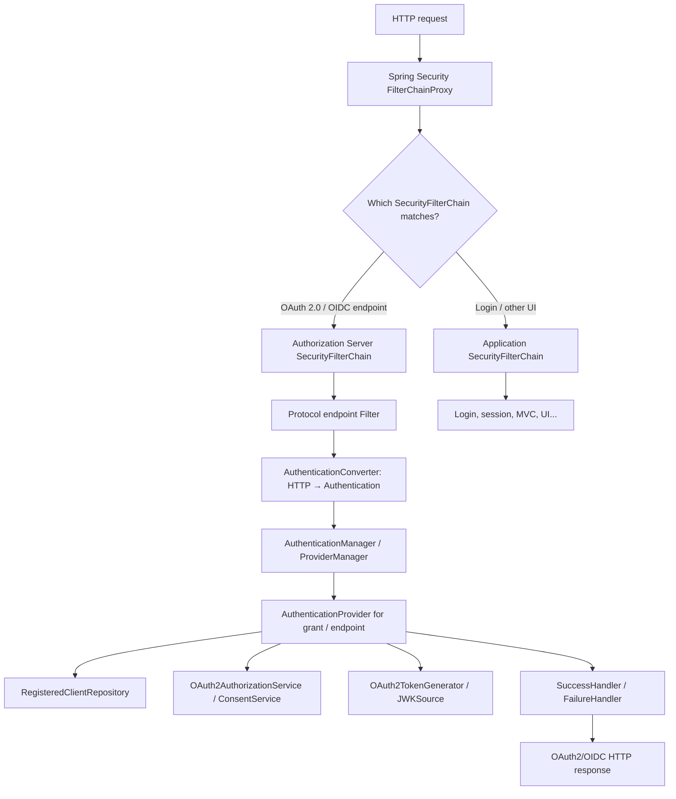
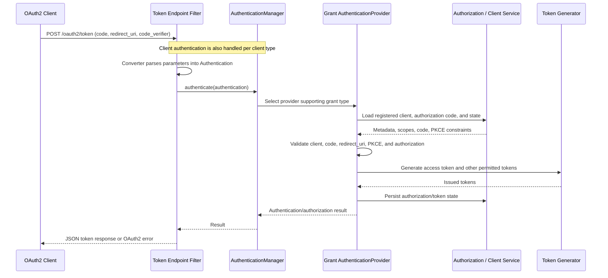

# OAuth2AuthorizationServerConfigurer and Protocol Configuration Points

## 1. Context: configuring an Authorization Server means configuring an HTTP processing pipeline

An **OAuth 2.0/OpenID Connect (OIDC) Authorization Server** receives requests with very different semantics: users approving permissions at `/oauth2/authorize`, applications exchanging authorization codes at `/oauth2/token`, APIs querying token status at `/oauth2/introspect`, or clients discovering metadata via `/.well-known/...` endpoints.

In Spring Boot, **Spring Security** manages HTTP filters, authentication objects, and access rules. **Spring Authorization Server** (or built-in Authorization Server support in newer Spring Security releases) adds filters and components for handling OAuth 2.0/OIDC protocols. **`OAuth2AuthorizationServerConfigurer`** is the central configuration point that registers those components into `HttpSecurity` and lets you customize the behavior of each protocol endpoint.

This lesson belongs to the **Processing Architecture** chapter of module `SPRING_SECURITY_OAUTH2_OIDC_AUTHORIZATION_SERVER`, supporting the goal of designing, configuring, securing, testing, and operating an authorization server with Spring Security/Spring Authorization Server. The focus is on **which components a request passes through**, **where extension points attach**, **what must be configured together**, and **how to verify they work properly**.

### Expected outcomes

After this lesson, you will be able to:

1. Trace the path from `SecurityFilterChain` through filters, converters, providers, services, token generators, and response handlers.
2. Place `OAuth2AuthorizationServerConfigurer` properly and distinguish it from `oauth2Login()` or `oauth2ResourceServer()`.
3. Identify endpoint customization methods, core beans, and issuer/path configuration.
4. Design test cases for login, token issuance, introspection, revocation, OIDC, configuration errors, and integration errors.

> **Version scope:** Primary examples use **Spring Authorization Server 1.x with Spring Security 6.x** APIs, including `OAuth2AuthorizationServerConfigurer.authorizationServer()` and `HttpSecurity.with(...)`. **Spring Security 7.x** provides `HttpSecurity.oauth2AuthorizationServer(...)` and differs on which endpoints are enabled by default. When writing real code, verify the exact dependency version set and corresponding reference guide; do not copy imports across major lines without cross-checking.

## 2. Where the Configurer sits in the processing architecture

The diagram below summarizes the path of an OAuth 2.0 request. Each endpoint uses its applicable filters/providers, so the diagram shows the **general architectural pattern**, rather than claiming every request executes every step.



There are three layers of responsibility to distinguish:

- **`SecurityFilterChain`** selects the filter set for a request, governing authentication and HTTP security rules. `@Order` and `RequestMatcher` determine which chain receives a request first.
- **`OAuth2AuthorizationServerConfigurer`** registers protocol endpoint configuration into the chain, including filters, request converters, client/grant authentication mechanisms, success/failure handlers, and customization points.
- **Repositories, services, token generators, and settings** provide the data and policies that providers need to execute accurately: whether a client is registered, whether a code is still valid, which scopes are granted, how tokens are signed, and what the issuer is.

**The Configurer does not directly manage users, databases, or long-lived secrets.** It wires those components into the protocol flow. User authentication can use `formLogin()`, another login mechanism, or IdP integration, while API access control remains the **Resource Server**'s responsibility.

## 3. Configuring two SecurityFilterChains in Spring Authorization Server 1.x

An easy-to-reason-about structure places a high-priority chain for OAuth 2.0/OIDC endpoints and a second chain serving the login screen and application pages.

```java
@Configuration
@EnableWebSecurity
public class SecurityConfig {

    @Bean
    @Order(1)
    SecurityFilterChain authorizationServerSecurityFilterChain(HttpSecurity http)
            throws Exception {

        OAuth2AuthorizationServerConfigurer authorizationServerConfigurer =
                OAuth2AuthorizationServerConfigurer.authorizationServer();

        http
            // Select only endpoints belonging to the Authorization Server.
            .securityMatcher(authorizationServerConfigurer.getEndpointsMatcher())
            .with(authorizationServerConfigurer, authorizationServer ->
                authorizationServer
                    .oidc(Customizer.withDefaults()) // Enable OpenID Connect.
            )
            .authorizeHttpRequests(authorize ->
                authorize.anyRequest().authenticated()
            )
            .exceptionHandling(exceptions -> exceptions
                .defaultAuthenticationEntryPointFor(
                    new LoginUrlAuthenticationEntryPoint("/login"),
                    new MediaTypeRequestMatcher(MediaType.TEXT_HTML)
                )
            );

        return http.build();
    }

    @Bean
    @Order(2)
    SecurityFilterChain applicationSecurityFilterChain(HttpSecurity http)
            throws Exception {

        http
            .authorizeHttpRequests(authorize ->
                authorize.anyRequest().authenticated()
            )
            .formLogin(Customizer.withDefaults());

        return http.build();
    }
}
```

This example illustrates **filter chain configuration**, not a standalone runnable application: you must add dependencies, registered clients, a user store/mechanism, signing keys/JWK, and supporting beans. Imports for `HttpSecurity`, `SecurityFilterChain`, `Customizer`, `LoginUrlAuthenticationEntryPoint`, `MediaTypeRequestMatcher`, `Order`, and the configurer must match your version.

Analyzing the key lines:

1. **`@Order(1)`** places the Authorization Server chain ahead of the application chain. Spring Security selects the **first matching chain**; chains do not stack for the same request.
2. **`securityMatcher(authorizationServerConfigurer.getEndpointsMatcher())`** scopes this chain to the protocol endpoints managed by the configurer. This is the **chain's** scope, distinct from `requestMatchers(...)` inside `authorizeHttpRequests` which decides authorization **after a chain is selected**.
3. **`with(authorizationServerConfigurer, ...)`** installs protocol configuration into `HttpSecurity`. `oidc(Customizer.withDefaults())` enables OIDC support; a bare OAuth 2.0 setup does not enable all OIDC features by default.
4. **`anyRequest().authenticated()`** sets the general policy for requests entering the chain; certain protocol endpoints are handled by filters under protocol-specific rules, such as client authentication and grant validation.
5. **`defaultAuthenticationEntryPointFor(..., text/html)`** sends unauthenticated browser users to `/login`. Machine-to-machine requests such as `POST /oauth2/token` must still receive protocol-compliant OAuth 2.0 errors on bad credentials; never convert every error into an HTML redirect.
6. **The second chain** serves `/login` because the login page endpoint **does not belong** to the protocol endpoint set. Without a proper login chain, user-facing Authorization Code flows cannot complete correctly.

### 3.1. Why not put everything in one chain?

Splitting chains lets you target the exact **paths, authentication types, and error handling**. For example, an unauthenticated browser request to `/oauth2/authorize` requires interactive login; a `client_credentials` request to `/oauth2/token` requires protocol-level client authentication; and `/login` needs form handling and CSRF protection.

Splitting chains **does not automatically** guarantee security. If a matcher is too broad, unrelated endpoints may get wrong rules. If a matcher is too narrow or `@Order` is wrong, protocol requests can fall into the application chain and return unexpected 302/HTML or 404 responses.

### 3.2. Syntax in Spring Security 7.x

When using built-in Authorization Server support in Spring Security 7.x, the reference documentation shows the DSL syntax:

```java
@Bean
SecurityFilterChain authorizationServerSecurityFilterChain(HttpSecurity http)
        throws Exception {

    http.oauth2AuthorizationServer(authorizationServer ->
            authorizationServer.oidc(Customizer.withDefaults()));

    return http.build();
}
```

This snippet only illustrates **the DSL call difference**. In a real application, you still need to configure authorization rules, login handling, repositories, issuer, and keys accordingly. Do not mix Spring Security 7.x DSL examples with incompatible 1.x imports/configurers.

## 4. Deep dive into the pipeline: how does a request become a decision?

Consider a `POST /oauth2/token` request with `grant_type=authorization_code`:



Typical steps:

1. **The endpoint filter** receives the request and invokes an **`AuthenticationConverter`** to parse HTTP data into an appropriate `Authentication`.
2. **`AuthenticationManager`** dispatches to the **`AuthenticationProvider`** supporting that request type, such as the provider for authorization code, client credentials, or refresh token.
3. The provider queries **`RegisteredClientRepository`** and **`OAuth2AuthorizationService`** to verify client configuration, grant type, scope, code, expiration, and related constraints.
4. The provider asks **`OAuth2TokenGenerator`** to generate valid tokens, persists state via the service, and returns the result.
5. **The success handler** builds the protocol response (typically JSON); **the failure handler** turns errors into appropriate OAuth 2.0 responses, such as `invalid_request`, `invalid_client`, or `invalid_grant` depending on the cause.

**Client authentication** usually has its own handler in the chain before or alongside grant validation. Not every request requires a client secret: a public client registered with `ClientAuthenticationMethod.NONE` is governed by its policy and requires PKCE for the Authorization Code Flow. Never assume `client_secret_basic` applies to browser/mobile apps that cannot keep a secret confidential.

### 4.1. Where should you extend?

If you need a new grant type, you typically add a **converter** to read parameters and a **provider** to validate the grant and policies. If you only want to add controlled business claims to a JWT, prefer a **token customizer** instead of replacing the entire token endpoint. If you only want a custom consent UI, configure the **authorization endpoint consent page** and build the view.

Understanding this keeps you from modifying filters directly or writing a custom `/oauth2/token` controller that bypasses protocol checks provided by the framework.

## 5. Configuration groups of OAuth2AuthorizationServerConfigurer

Its configuration methods fall into **foundational data** and **protocol endpoint** groups.

### 5.1. Foundational components group

| Configuration method | Corresponding component | Practical meaning |
| --- | --- | --- |
| `registeredClientRepository(...)` | `RegisteredClientRepository` | Looks up client ID, authentication methods, grant types, redirect URIs, scopes, PKCE/consent settings |
| `authorizationService(...)` | `OAuth2AuthorizationService` | Manages authorizations, authorization codes, access/refresh tokens, and validity/revocation state |
| `authorizationConsentService(...)` | `OAuth2AuthorizationConsentService` | Stores scopes/authorities a user has approved for a client |
| `authorizationServerSettings(...)` | `AuthorizationServerSettings` | Defines the issuer and protocol endpoint URIs |
| `tokenGenerator(...)` | `OAuth2TokenGenerator` | Generates authorization codes, access tokens, refresh tokens, and ID tokens where applicable |

The configurer can resolve these components as **Spring beans** instead of requiring you to pass each object directly in the DSL. When customizing, defining explicit beans often makes it easier to reuse services in tests and manage their lifecycle. If you both expose a bean and pass a different instance directly, verify which instance is actually used so state is not split.

### 5.2. Client authentication and OAuth 2.0 endpoints group

| Method | Flow or endpoint | When to customize |
| --- | --- | --- |
| `clientAuthentication(...)` | Client authentication on endpoints requiring it | Adding authentication methods, converters/providers, controlled error handling |
| `authorizationEndpoint(...)` | `/oauth2/authorize` | Custom consent page, special parameter checks, custom validators |
| `pushedAuthorizationRequestEndpoint(...)` | `/oauth2/par` | Pushed Authorization Requests (PAR), input policy validation |
| `deviceAuthorizationEndpoint(...)` | `/oauth2/device_authorization` | Issuing codes for input-constrained devices |
| `deviceVerificationEndpoint(...)` | `/oauth2/device_verification` | Page where users enter a user code / approve a device |
| `tokenEndpoint(...)` | `/oauth2/token` | Converters/providers for grants, token responses, and errors |
| `tokenIntrospectionEndpoint(...)` | `/oauth2/introspect` | Checking token status for authorized clients |
| `tokenRevocationEndpoint(...)` | `/oauth2/revoke` | Revoking tokens per policy, handling results/errors |
| `authorizationServerMetadataEndpoint(...)` | OAuth 2.0 metadata | Adding standards-compliant metadata for supported features |

Depending on the version, certain endpoints (especially **Device Flow**, **PAR**, and **Client Registration**) have different default states. For example, Spring Authorization Server 1.5.x documentation lists Device Authorization/Verification in the default configuration; Spring Security 7.x documentation describes Device Flow as an endpoint group that must be enabled. **Check both your version and the live instance's metadata**, rather than inferring availability solely from the presence of a DSL method.

### 5.3. OpenID Connect group

`oidc(...)` activates `OidcConfigurer`, with typical sub-configurers:

| Configuration point | Common endpoint | Purpose |
| --- | --- | --- |
| `providerConfigurationEndpoint(...)` | `/.well-known/openid-configuration` | Serves OIDC Provider metadata |
| `userInfoEndpoint(...)` | `/userinfo` | Returns user claims based on access token, scope, and policy |
| `logoutEndpoint(...)` | `/connect/logout` | Handles supported OIDC logout flows |
| `clientRegistrationEndpoint(...)` | `/connect/register` | Dynamic OIDC client registration when enabled and authorized |

**Dynamic OIDC Client Registration** is typically **disabled by default**. Spring Security 7.x also has a separate **OAuth 2.0 Client Registration** configuration; do not confuse OAuth 2.0 client registration with OIDC registration, and do not expose this capability publicly without explicit authorization and governance.

## 6. Customizing an endpoint: from requirement to DSL

Suppose the application needs a **custom consent screen** explaining `orders.read` and `orders.write` scopes. You can use the authorization endpoint extension point:

```java
OAuth2AuthorizationServerConfigurer authorizationServerConfigurer =
        OAuth2AuthorizationServerConfigurer.authorizationServer();

http
    .securityMatcher(authorizationServerConfigurer.getEndpointsMatcher())
    .with(authorizationServerConfigurer, authorizationServer ->
        authorizationServer
            .authorizationEndpoint(authorizationEndpoint ->
                authorizationEndpoint.consentPage("/oauth2/consent"))
            .oidc(Customizer.withDefaults())
    )
    .authorizeHttpRequests(authorize ->
        authorize.anyRequest().authenticated());
```

**`/oauth2/consent`** here is a UI route the application must implement; HTML is not generated automatically. The page must display the client name and scopes safely, load the right transaction data, enforce CSRF on form submission, and submit the decision back to the Authorization Server in the expected format. It may belong to the application chain rather than the Authorization Server endpoints matcher.

There are three levels of customization, from narrow to broad:

| Level | Example | Risks to weigh |
| --- | --- | --- |
| Changing parameters/endpoint settings | Consent page, allowed grants, redirect URI, issuer | Wrong URIs or scopes lead to interoperability failures |
| Adding/adjusting authentication processing | Authentication converter/provider, validator, success/failure handler | Missing standard checks, wrong error codes, leaking sensitive info |
| Replacing protocol flows | Custom grant, custom token format, external system integration | Must rigorously define threat model, authorization state, persistence, revocation, and compatibility |

**Principle:** Extend via configurer and provider APIs before creating duplicate filters or controllers for the same endpoint. If you replace a default validator, preserve foundational protocol checks; testing overrides for `localhost` must never become open exceptions in production.

## 7. Core beans behind the Configurer

### 7.1. RegisteredClientRepository and client policies

**`RegisteredClient`** holds each client's metadata: ID, secret (for confidential clients), authentication methods, grant types, redirect URIs, scopes, client settings, and token settings.

Example of a backend client permitted to use Authorization Code and PKCE:

```java
RegisteredClient registeredClient = RegisteredClient.withId(
                UUID.randomUUID().toString())
        .clientId("orders-web")
        // Supply a client secret encoded by PasswordEncoder here.
        .clientSecret(encodedClientSecret)
        .clientAuthenticationMethod(
                ClientAuthenticationMethod.CLIENT_SECRET_BASIC)
        .authorizationGrantType(AuthorizationGrantType.AUTHORIZATION_CODE)
        .authorizationGrantType(AuthorizationGrantType.REFRESH_TOKEN)
        .redirectUri("https://app.example.com/login/oauth2/code/orders-web")
        .scope(OidcScopes.OPENID)
        .scope("orders.read")
        .clientSettings(ClientSettings.builder()
                .requireProofKey(true)
                .requireAuthorizationConsent(true)
                .build())
        .build();

// Register registeredClient via RegisteredClientRepository.
```

`encodedClientSecret` is an **encoded** value passed into the bean from a secrets manager; the snippet omits defining it to avoid embedding real secrets in documentation. For a **public client**, configure `ClientAuthenticationMethod.NONE` and require PKCE; never pretend a client secret embedded in JavaScript/mobile code can stay confidential.

In real deployments:

- `InMemoryRegisteredClientRepository` suits demos and tests.
- `JdbcRegisteredClientRepository` or a storage-backed repository supports durable client management, backups, migrations, and administrative access control.
- Establish a **client secret rotation** process, restrict grant types, and validate redirect URIs strictly against registered values.

### 7.2. OAuth2AuthorizationService and ConsentService

**`OAuth2AuthorizationService`** reads/writes `OAuth2Authorization`, including codes, tokens, verification attributes, and expired/revoked state. **`OAuth2AuthorizationConsentService`** reads/writes permissions a user has granted to each client when consent is enabled.

In-memory implementations speed up development but fail when running **multiple instances** or needing state across restarts: an authorization code issued on instance A may arrive at the token endpoint on instance B; without a shared store, code exchange fails. In production systems, choose shared, consistent storage with cleanup policies and data protection.

### 7.3. OAuth2TokenGenerator, JWKSource, and JwtDecoder

**`OAuth2TokenGenerator`** issues tokens according to context and client configuration. With JWT access tokens (`SELF_CONTAINED`), the system needs signing and proper key management; with opaque access tokens (`REFERENCE`), token persistence/lookup and introspection are key.

- **`JWKSource<SecurityContext>`** provides keys for signing and publishes **public keys** at JWKS. The `/oauth2/jwks` endpoint is only configured when a suitable JWK source exists.
- **`JwtDecoder`** verifies JWTs in flows that need to parse tokens, including OIDC UserInfo/Client Registration in Spring Authorization Server 1.x configurations.
- **`OAuth2TokenCustomizer<JwtEncodingContext>`** lets you add controlled claims—such as tenant ID or business permissions—without replacing the token generator just to alter claims.

Example decoder bean using Spring Authorization Server 1.x API:

```java
@Bean
JwtDecoder jwtDecoder(JWKSource<SecurityContext> jwkSource) {
    return OAuth2AuthorizationServerConfiguration.jwtDecoder(jwkSource);
}
```

**Do not generate a random signing key on every startup in production.** Such restarts make previously issued JWTs unverifiable. Store private keys in an appropriate key management system, manage `kid`, publish keys via JWKS, perform overlapped rotation, and have an emergency key revocation policy.

### 7.4. Token Customizer: adding claims to the right token type

```java
@Bean
OAuth2TokenCustomizer<JwtEncodingContext> jwtTokenCustomizer() {
    return context -> {
        if (OAuth2TokenType.ACCESS_TOKEN.equals(context.getTokenType())) {
            context.getClaims().claim("service", "orders-api");
        }
    };
}
```

This snippet shows where customization happens; it does not prove an API checks `aud` or business permissions. In production, add only meaningful claims sourced from trusted data, control target audiences, minimize personal data, and never confuse access tokens with ID tokens. If you declare your own `OAuth2TokenGenerator`, ensure the customizer is wired into that generator; do not assume a bean is picked up automatically in every custom setup.

## 8. AuthorizationServerSettings: paths and issuer

The protocol configurer relies on addresses and identifiers in **`AuthorizationServerSettings`**. This is where you set the **issuer** and protocol endpoint URIs when designing public URLs.

```java
@Bean
AuthorizationServerSettings authorizationServerSettings() {
    return AuthorizationServerSettings.builder()
            .issuer("https://auth.example.com")
            .authorizationEndpoint("/oauth2/v1/authorize")
            .tokenEndpoint("/oauth2/v1/token")
            .tokenIntrospectionEndpoint("/oauth2/v1/introspect")
            .tokenRevocationEndpoint("/oauth2/v1/revoke")
            .jwkSetEndpoint("/oauth2/v1/jwks")
            .build();
}
```

If you apply this example, **clients and Resource Servers must be configured with the customized endpoints** or discover them via metadata. Custom URIs must be tested in sync with reverse proxies, load balancers, legacy clients, and integration documentation.

**Issuer** must be a stable identifier consistent with the `iss` claim in tokens and metadata. Behind a proxy, do not let the app accidentally emit an issuer like `http://localhost:9000` or an internal hostname. If issuer is left unset, some mechanisms infer it from the incoming request; across multiple proxies or hostnames, this easily causes mismatches and unintended trust boundaries. Prefer configuring an explicit canonical issuer and trusting forwarded headers only from trusted proxies.

### 8.1. Metadata is a contract with clients

Discovery/metadata documents inform clients of URLs such as the authorization endpoint, token endpoint, JWKS URI, and supported capabilities. Do not edit metadata to **advertise** a method or endpoint that is not actually implemented; clients will fail during integration.

Example metadata verification commands:

```bash
curl -i https://auth.example.com/.well-known/oauth-authorization-server
curl -i https://auth.example.com/.well-known/openid-configuration
curl -i https://auth.example.com/oauth2/v1/jwks
```

Metadata paths can be affected by issuer configuration, context paths, or deployment version; the `curl` examples only apply when OIDC/JWKS are enabled and the real issuer is `https://auth.example.com`. Compare URLs returned in metadata against the instance's actual paths rather than assuming they are right after modifying settings.

## 9. Map of protocol endpoints and authentication requirements

| Common endpoint | Primary request | Components/conditions to watch |
| --- | --- | --- |
| `/oauth2/authorize` | Browser-based authorization request | User session, redirect URI, scope, PKCE, consent |
| `/oauth2/token` | Exchange code, refresh token, client credentials, or supported grant | Client authentication where applicable, grant validator, authorization service, token generator |
| `/oauth2/introspect` | Inspect token status | Authentication of caller allowed to introspect; metadata disclosure policy |
| `/oauth2/revoke` | Revoke token | Client authentication/permissions; authorization state |
| `/oauth2/jwks` | Fetch public keys | Requires JWKSource; **never** expose private keys |
| `/.well-known/oauth-authorization-server` | OAuth 2.0 metadata | Content must match actual issuer and supported endpoints |
| `/oauth2/par` | Pushed Authorization Request | Supported features/client auth methods per configuration |
| `/oauth2/device_authorization` | Initiate Device Authorization Grant | Client allowed grant type and matching endpoint |
| `/oauth2/device_verification` | User enters/approves device user code | User authentication, code TTL, brute-force protection |
| `/.well-known/openid-configuration` | OIDC provider metadata | Only when OIDC is enabled |
| `/userinfo` | Fetch user claims | OIDC, valid Bearer access token, scope, and claim mapper |
| `/connect/logout` | OIDC logout | Validate request, client/logout URI per policy |
| `/connect/register` | OIDC Dynamic Client Registration | Usually disabled by default; requires explicit enabling and protection |

This list is a design map, **not a guarantee that every endpoint is open** in all versions. Beyond endpoints, check which grant types are registered for **each** `RegisteredClient`: the existence of the token endpoint does not mean a client may use `client_credentials`, `authorization_code`, refresh tokens, or device codes.

## 10. Enabling OIDC does not mean you have a complete identity system

Enabling `.oidc(Customizer.withDefaults())` allows the Authorization Server to act as an **OpenID Provider** supporting ID tokens, discovery, UserInfo, and logout according to configured capabilities. However, the application still needs:

- **User authentication** via Spring Security and an identity store, or integration with another IdP.
- **Login session workflow and browser security**: cookies, session fixation protection, CSRF, MFA where appropriate.
- **Signing keys** and `JwtDecoder` for OIDC flows that require them, with a consistent issuer.
- **Consent and claim policies**: do not issue claims beyond granted scopes, and avoid placing sensitive data in ID tokens or UserInfo.
- **Account/session lifecycle management**: account locking, password changes, logout, and suspicious activity monitoring.

For example, enabling OIDC and exposing `/userinfo` does not automatically secure an Orders API. The API must configure Spring Security **Resource Server**, validate access tokens, and enforce business permissions separately. **An ID token meant for an OIDC Client** is not an authorization credential for calling APIs.

## 11. Advanced configuration: adding grants and altering endpoint processing

### 11.1. Adding a custom grant type

Suppose a company has a credential type verified by an external system. A custom grant requires at minimum:

1. An `AuthenticationConverter` for the token endpoint to read `grant_type` and parameters, returning an `Authentication` representing the request.
2. An `AuthenticationProvider` to validate the client, grant permission, input credential, scope, and policies, then invoke the token generator/service.
3. The grant type value registered on the appropriate `RegisteredClient`.
4. Tests covering success path, invalid credentials, excessive scopes, code/token replay, and logging rules.

Register the converter/provider via `tokenEndpoint(...)` and verify compatibility with defaults. **A custom grant is no excuse to skip client authentication or reuse grants/tokens from another user.** In most cases, prefer standard grants like Authorization Code + PKCE or Client Credentials; only extend when a clear protocol need has been analyzed.

### 11.2. PAR and Device Flow

**PAR (Pushed Authorization Requests)** lets clients send numerous authorization parameters over a direct back-channel connection to the Authorization Server, then pass a `request_uri` reference at the authorization endpoint. This reduces parameter exposure in the browser while still requiring validation of client, scope, redirect URI, and transaction binding.

**Device Authorization Grant** fits TVs/input-constrained devices: the device displays a code while the user authenticates and approves via a browser on another device. The server must manage device/user codes, TTLs, polling intervals, rate limits, and standard responses like pending/slow down. When configuring these endpoints, check default enabled/disabled status for your Spring version rather than relying solely on the presence of a DSL method.

## 12. Security boundaries to keep intact

**A Configurer does not replace a threat model.** Critical rules for operating systems:

1. **HTTPS and canonical issuer**: enforce TLS for public endpoints; trust forwarded headers only from controlled proxies.
2. **Strict Redirect URIs**: allow only exact registered redirect URIs per protocol rules; avoid wildcards and open redirects.
3. **PKCE `S256`**: enforce for Authorization Code, especially public clients; never treat a secret in SPA/mobile code as confidential.
4. **Least-privilege scopes and grant types**: never turn a `RegisteredClient` into a client permitted every grant and every scope.
5. **Keep CSRF protection in context**: do not disable CSRF application-wide to "fix" form login or consent errors; identify which protocol endpoints the framework configures separately.
6. **Never leak tokens/credentials**: never log authorization codes, client secrets, code verifiers, refresh tokens, or raw bearer tokens, even in custom exception handlers.
7. **Abuse prevention**: rate limiting/token abuse monitoring, user-code guessing controls, login brute-force protection, account lockout/MFA as needed.
8. **Signing keys and token lifecycle**: protect private keys, manage `kid`/rotation, TTLs, refresh token reuse/rotation, and revocation mechanisms.
9. **Proper Resource Server role**: a valid JWT signature is not enough; APIs must check issuer, audience when required, expiration, scopes, and record-level permissions.
10. **Control admin/client-registration endpoints**: dynamic client registration or metadata customization can widen the attack surface; enforce explicit administrative authorization.

A common mistake is putting `permitAll()` on the entire chain because `/.well-known/openid-configuration` or JWKS need public access. That change can unintentionally weaken HTTP policies. Let protocol filters and specific rules handle each request type; test both public and authenticated endpoints after any chain change.

## 13. Configuration test matrix

| Test | Where to verify | Expected outcome |
| --- | --- | --- |
| Accessing authorization endpoint without session | Authorization Server chain and login chain | Browser receives valid login path; no redirect loop |
| Authorization Code + PKCE with valid client/scope/redirect | Authorization endpoint + token endpoint | Code exchanges once for tokens; tokens carry expected issuer and scopes |
| Redeeming code with wrong `code_verifier`, used code, or mismatched redirect URI | Token endpoint/provider | Rejected with appropriate OAuth 2.0 error; no token issued |
| Sending `client_credentials` with wrong secret or disallowed grant | Client authentication + token endpoint | Rejected; never returns HTML page instead of OAuth error |
| Querying OAuth metadata and OIDC discovery | Metadata endpoints | Issuer/endpoint URLs match public URL and live config |
| Querying JWKS | JWK Set endpoint | Contains only appropriate public keys; no private key leak |
| Accessing UserInfo with missing, expired, or wrong-scope token | OIDC UserInfo | Rejected per policy; no unauthorized claims returned |
| Introspecting an active token and a revoked token | Introspection + authorization service | Status reflects current store; only authorized callers may introspect |
| Instance restart or request switching between two instances | AuthorizationService/ConsentService/JWK | Codes/consents/tokens obey policy; signing keys remain stable and verifiable |
| Wrong `@Order` or missing endpoint matcher | FilterChainProxy | Test catches requests hitting the wrong chain (302 HTML, 404, or misplaced 403) |
| Changing paths in AuthorizationServerSettings | Client, discovery, proxy, and Resource Server | URLs/issuer and metadata stay aligned, not stuck on old paths |
| Testing app before and after enabling OIDC | OIDC configurer/JwtDecoder | OIDC endpoints respond properly when enabled; required beans present |

### 13.1. Tips for observing errors in test environments

When encountering **404 at `/oauth2/token`**, first check whether the URL matches `AuthorizationServerSettings` and whether the request enters the right chain. **302 to `/login` instead of token JSON** usually indicates a matcher/chain issue or misconfigured authentication entry point. **`invalid_client`** points to `RegisteredClient` settings and authentication methods; **`invalid_grant`** typically involves the code, redirect URI, PKCE, refresh token, or authorization state. Issuer mismatch errors at a Resource Server usually stem from the public issuer, metadata, or proxy headers.

Do not diagnose from HTTP status codes alone; inspect **endpoint type, OAuth error code, SecurityFilterChain selection result, and correlation ID**. Enable selective debug/trace logging in development, mask sensitive fields, and disable overly verbose logging in production.

## 14. Architectural scenario: from requirements to configuration points

System components:

- **Orders Web** uses Authorization Code + PKCE and OIDC for user login.
- **Reports Service** uses Client Credentials to read reporting APIs under the service's own authority.
- **Orders API** and **Reports API** act as Resource Servers.
- **Authorization Server** publishes a stable issuer and JWKS, persisting clients and authorizations in durable storage.

Implementation steps:

1. Register two `RegisteredClient` entries with **separate** grants, redirect URIs, scopes, and token settings.
2. Put protocol endpoints in the Authorization Server chain via `OAuth2AuthorizationServerConfigurer`, enabling OIDC for Orders Web.
3. Use the login chain to authenticate employees and collect consent where appropriate; do not require user login flows for Reports Service.
4. Configure `OAuth2AuthorizationService` and `OAuth2AuthorizationConsentService` to preserve state across multiple instances.
5. Configure `JWKSource`, issuer, and rotation; have APIs verify access tokens against the right issuer/audience and business policies.
6. Test both successful token issuance and failure cases: code replay, wrong PKCE, unauthorized scopes, introspection, revocation, and wrong issuer.

Important distinction: **the Authorization Server is responsible for issuing tokens per protocol/policy**, but **Orders API** must still prevent a user from accessing another organization's orders even when the token contains `orders.read`.

## 15. Takeaways

**`OAuth2AuthorizationServerConfigurer` is the central configuration linking the Spring Security HTTP pipeline to OAuth 2.0/OIDC endpoints.** It coordinates filters, converters/providers, and customization hooks, while repositories, services, generators, signing keys, and settings supply the data and policies required by the protocol.

When you need to change system behavior, target the right layer:

| Design question | Configuration/object to inspect |
| --- | --- |
| Which chain does a request enter? | `@Order`, `securityMatcher`, `SecurityFilterChain` |
| Which client is allowed which grant/scope? | `RegisteredClient`, `RegisteredClientRepository` |
| Where are authorization codes and tokens stored? | `OAuth2AuthorizationService` |
| Which scopes has a user consented to? | `OAuth2AuthorizationConsentService`, authorization endpoint |
| How do I change paths or issuer? | `AuthorizationServerSettings`, metadata, proxy |
| How do I add a JWT claim? | `OAuth2TokenCustomizer<JwtEncodingContext>` |
| How do I alter token request processing? | `tokenEndpoint(...)`, converter/provider |
| How do I enable OIDC? | `oidc(...)`, JwtDecoder/JWKSource, login, and related OIDC components |
| Why did the API reject a token? | Check issuer/audience/scope/JWKS on the Resource Server, not just the configurer |

### References

- [Spring Authorization Server 1.x — Configuration Model](https://docs.spring.io/spring-authorization-server/reference/configuration-model.html)
- [Spring Authorization Server 1.x — Core Model / Components](https://docs.spring.io/spring-authorization-server/reference/core-model-components.html)
- [Spring Authorization Server 1.x — Protocol Endpoints](https://docs.spring.io/spring-authorization-server/reference/protocol-endpoints.html)
- [Spring Authorization Server 1.x — Getting Started](https://docs.spring.io/spring-authorization-server/reference/getting-started.html)
- [Spring Security 7.x — Authorization Server Configuration Model](https://docs.spring.io/spring-security/reference/servlet/oauth2/authorization-server/configuration-model.html)
- [RFC 6749 — OAuth 2.0 Authorization Framework](https://www.rfc-editor.org/rfc/rfc6749)
- [RFC 8414 — OAuth 2.0 Authorization Server Metadata](https://www.rfc-editor.org/rfc/rfc8414)
- [OpenID Connect Core 1.0](https://openid.net/specs/openid-connect-core-1_0.html)
