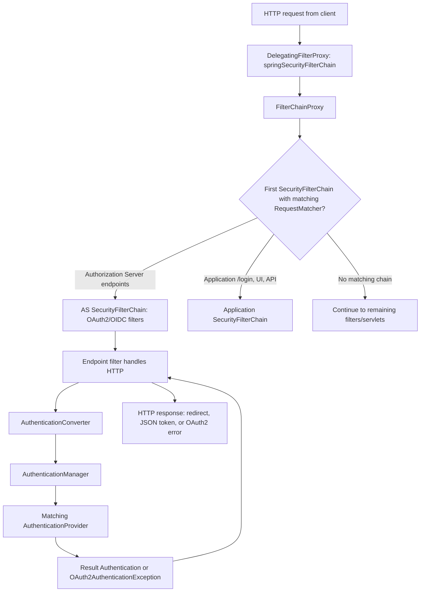
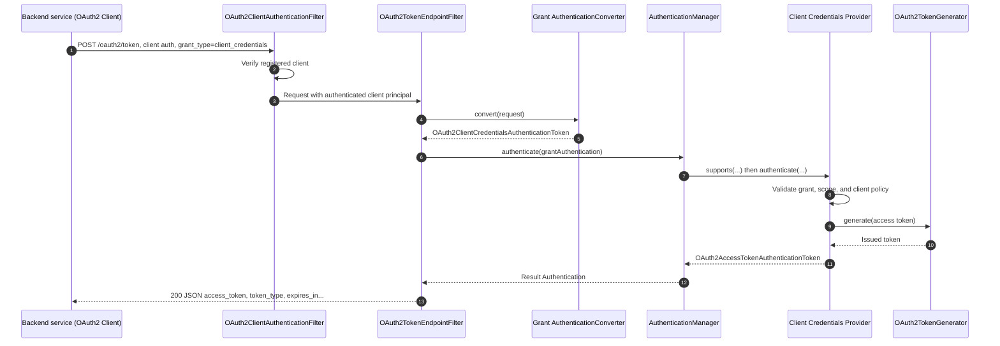
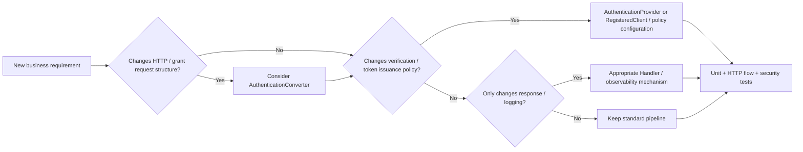

# Filter Pipeline, AuthenticationConverter, and AuthenticationProvider

## 1. Overview

In the **Processing Architecture** chapter of module `SPRING_SECURITY_OAUTH2_OIDC_AUTHORIZATION_SERVER`, the goal is to understand how an HTTP request becomes an authentication/authorization decision and ultimately an OAuth 2.0 or OpenID Connect (OIDC) response. This is foundational knowledge to **design, configure, secure, test, and operate an Authorization Server with Spring Security and Spring Authorization Server in Spring Boot**.

Three core concepts:

| Component | Question it answers | Primary responsibility |
| --- | --- | --- |
| **Filter / Filter chain** | "Which security mechanism does this request go through?" | Intercepts HTTP requests at the matching endpoint; creates and sends the response or forwards processing |
| **AuthenticationConverter** | "What kind of authentication request does this request represent?" | Reads protocol parameters/headers, validates input format, and produces an unauthenticated `Authentication` |
| **AuthenticationProvider** | "Is that authentication request valid and accepted?" | Validates client, grant, permissions, and stored state; issues the resulting `Authentication` upon success |

An **AuthenticationManager** coordinates between the Converter/Filter and the Providers. In typical setups, `ProviderManager` iterates over the `AuthenticationProvider` instances that support the current `Authentication` type.

Key point: **an AuthenticationConverter does not issue tokens**, **an AuthenticationProvider is not a Servlet Filter**, and **a Filter should not contain the full authentication business logic**. These components collaborate to separate protocol parsing, verification, and HTTP response handling.

### Expected outcomes

After this lesson, you will be able to:

1. Trace a request from the Servlet Filter into Spring Security and Spring Authorization Server.
2. Distinguish how `SecurityFilterChain`, `AuthenticationConverter`, and `AuthenticationProvider` are selected.
3. Explain the `/oauth2/authorize` and `/oauth2/token` flows, including the separate **client** authentication step.
4. Use Token Endpoint extension points to add Converters/Providers while preserving standard logic.
5. Pinpoint errors, write meaningful tests, and avoid weakening protocol security checks.

## 2. Two pipeline layers: Spring Security and Authorization Server

When a Spring Boot application running on the Servlet stack receives a request, the high-level flow is:



`DelegatingFilterProxy` bridges from the Servlet filter chain to the Spring Security bean; `FilterChainProxy` holds the list of `SecurityFilterChain` instances and picks **the first chain matching the request**. A typical request only passes through the filters of that selected chain. Therefore:

- **`@Order` on `SecurityFilterChain`** governs priority across chains; the narrow Authorization Server matcher should precede the broader application matcher.
- **Filter ordering within a chain** is determined by Spring Security and its configurers. This is separate from ordering between chains.
- **`AuthenticationConverter`** does not choose the `SecurityFilterChain`. A converter only runs once the corresponding filter receives the request.
- **`AuthenticationProvider.supports(...)`** does not decide which URLs are protected. It only identifies which `Authentication` class the provider can process.

For example, a `POST /oauth2/token` request enters the Authorization Server chain, is processed first by the OAuth2 client authentication filter, and then reaches the Token Endpoint filter for grant processing. A `GET /login` request is typically handled by the application chain to render or process user login.

## 3. Common Spring Authorization Server filters

Spring Authorization Server provides filters per endpoint group. The table below lists typical roles; default endpoints can change via `AuthorizationServerSettings`, and some filters are present only when the corresponding feature is configured/enabled.

| Filter | Typical endpoint | Responsibility |
| --- | --- | --- |
| `OAuth2AuthorizationEndpointFilter` | `/oauth2/authorize` | Handles authorization requests, user authentication state, consent, and authorization codes |
| `OAuth2ClientAuthenticationFilter` | Endpoints requiring client authentication, typically including `/oauth2/token` | Authenticates the **OAuth2 client** identity via secret, private key JWT, or registered method |
| `OAuth2TokenEndpointFilter` | `POST /oauth2/token` | Converts grant requests to `Authentication`, invokes the manager, and produces token/error responses |
| `OAuth2TokenIntrospectionEndpointFilter` | `POST /oauth2/introspect` | Checks token validity per the introspection protocol |
| `OAuth2TokenRevocationEndpointFilter` | `POST /oauth2/revoke` | Handles token revocation requests |
| OIDC endpoint filters | OIDC discovery, UserInfo, logout, etc. | Provides OIDC behavior when enabled and configured |

Do not read this table as a promise of the **exact order of every filter** in every version; filter ordering is assembled by `OAuth2AuthorizationServerConfigurer` and Spring Security configurations. The architectural takeaway is that each filter owns **a specific HTTP/protocol surface**.

### Distinguishing client authentication from user authentication

This is a very common point of confusion:

- **OAuth2 client authentication:** verifies the application presenting `client_id` and its allowed authentication method—for example, a confidential client using `client_secret_basic` at the Token Endpoint.
- **End-user authentication:** the user signs in via form, MFA, or another mechanism during the authorization request. This typically belongs to Spring Security login filters.
- **Authorization grant validation:** verifies `authorization_code`, `refresh_token`, `client_credentials`, or another supported grant along with its conditions.

A code-exchange request at the Token Endpoint may require **both client authentication** (depending on client type) **and authorization code/PKCE validation**. Never equate an authenticated client with an authorized user or a valid grant.

## 4. AuthenticationConverter: from HTTP request to Authentication

In Spring Security Servlet, the core contract is:

```java
public interface AuthenticationConverter {
    Authentication convert(HttpServletRequest request);
}
```

The `convert` method has three important outcomes:

1. **Return an `Authentication`:** the converter recognizes the request and builds an object describing the authentication request. At this stage, it is typically **unauthenticated**.
2. **Return `null`:** the converter does not handle this request; the coordinator may try the next converter.
3. **Throw `AuthenticationException`** (often `OAuth2AuthenticationException`): the request matches the type handled by the converter, but has a formatting error or violates protocol rules. Endpoint filters normally translate this into the appropriate OAuth2 error response.

Example request:

```http
POST /oauth2/token HTTP/1.1
Host: auth.example.com
Authorization: Basic <client-credentials-base64>
Content-Type: application/x-www-form-urlencoded

grant_type=client_credentials&scope=reports.read
```

The `client_credentials` converter reads `grant_type` and related parameters, then produces an `OAuth2ClientCredentialsAuthenticationToken`. This object represents **the grant processing request**, not the final Bearer Access Token returned to the client.

### Representative converters at the Token Endpoint

| Converter | Request type it interprets |
| --- | --- |
| `OAuth2AuthorizationCodeAuthenticationConverter` | `grant_type=authorization_code` with `code`, `redirect_uri`, and `code_verifier` where applicable |
| `OAuth2RefreshTokenAuthenticationConverter` | `grant_type=refresh_token` with refresh token and optional scope |
| `OAuth2ClientCredentialsAuthenticationConverter` | `grant_type=client_credentials` and requested scope |
| Additional converters by version/feature | Device Authorization Grant, Token Exchange, or custom grants |

Converters can be composed via `DelegatingAuthenticationConverter`: it tries each converter in order and uses the first non-`null` result. The actual list is built by the configurer and may vary by version and enabled features.

**Do not move client secret verification, database permission lookups, or token signing into a converter.** Converters should only perform protocol recognition, parameter normalization, and input syntax/precondition checks.

### What converters should check

- Does `grant_type` match the selected converter?
- Are required parameters present, single-valued, non-empty, and within reasonable size bounds?
- Are the HTTP method, content type, and request structure supported by the endpoint? (Partially enforced by the filter/endpoint.)
- Invalid fields should be turned into an `OAuth2Error`, such as `invalid_request`, rather than throwing an unhandled runtime exception.
- Never read client secrets, codes, refresh tokens, or assertions to write them into logs, metric labels, or exception messages.

For OAuth2 requests using form data, do not assume `request.getParameter(...)` has only a single value: inputs like `grant_type=x&grant_type=y` must be handled according to protocol syntax validation policies.

## 5. AuthenticationManager and AuthenticationProvider

After the Converter produces an `Authentication`, the endpoint filter calls `AuthenticationManager.authenticate(authentication)`. The provider contract is:

```java
public interface AuthenticationProvider {
    Authentication authenticate(Authentication authentication)
            throws AuthenticationException;

    boolean supports(Class<?> authentication);
}
```

- `supports(...)` indicates whether the provider can handle **this object type**. It does not guarantee the request is valid.
- `authenticate(...)` verifies actual conditions and returns an `Authentication` on success.
- A provider may return `null` to let another provider continue if the manager setup supports chaining, or throw `AuthenticationException` to reject.
- With `ProviderManager`, provider ordering can affect outcomes, especially when multiple providers support the same type and an earlier provider returns a result.

Representative providers:

| Provider | Authentication request type | Primary checks |
| --- | --- | --- |
| `OAuth2AuthorizationCodeRequestAuthenticationProvider` | Authorization request at Authorization Endpoint | Client, redirect URI, scope, response type, authentication/consent state |
| `OAuth2AuthorizationCodeAuthenticationProvider` | Authorization code exchange request | Issued code, expiration, client, redirect URI, PKCE, granted permissions |
| `OAuth2RefreshTokenAuthenticationProvider` | Refresh request | Refresh token validity, owning client, granted scope, token policy |
| `OAuth2ClientCredentialsAuthenticationProvider` | Client credentials request | Authenticated client, permitted grant type and scope, token issuance policy |
| Client authentication providers | `OAuth2ClientAuthenticationToken` variants | Secret/private key JWT or matching client authentication method |

Several providers **issue tokens via `OAuth2TokenGenerator`** and persist state via `OAuth2AuthorizationService`. In practice, the decision of whether a token may be issued combines `RegisteredClientRepository`, `OAuth2Authorization` state, scope/grant policies, and principal details.

### Distinguishing three Authentication forms

```text
1) Client authentication request:
   OAuth2ClientAuthenticationToken  -> authenticates application identity

2) Grant request at the Token Endpoint:
   OAuth2AuthorizationCodeAuthenticationToken
   OAuth2RefreshTokenAuthenticationToken
   OAuth2ClientCredentialsAuthenticationToken
                                      -> verifies eligibility to receive tokens

3) Successful token issuance result:
   OAuth2AccessTokenAuthenticationToken
                                      -> used to build the JSON token response
```

The class name of a request object does not imply `isAuthenticated() == true`. Nor does an `Authentication` always represent an **end user**: it can represent a client or a token issuance request.

## 6. Reading the pipeline through the Authorization Code flow

Suppose a web app has `client_id=web-client`, a registered redirect URI, and the user wants to sign in via OIDC with scopes `openid profile`.

```mermaid
sequenceDiagram
    autonumber
    actor User as User
    participant Browser as Browser
    participant Client as Backend OIDC Client
    participant AS as Authorization Endpoint Filter
    participant AC as Converter / Provider (authorization)
    participant Store as Authorization Service
    participant Token as Token Endpoint Filter
    participant AM as AuthenticationManager / Provider
    Browser->>AS: GET /oauth2/authorize?...response_type=code
    AS->>AC: Convert request to Authentication
    AC->>AC: Validate client, redirect, scope, PKCE
    AS-->>Browser: Redirect to login if no session
    User->>Browser: Log in / approve consent if required
    Browser->>AS: Resume authorization request
    AS->>AC: Verify principal, consent
    AC->>Store: Persist authorization/code
    AS-->>Browser: 302 redirect_uri?code=...&state=...
    Browser->>Client: GET /callback?code=...&state=...
    Client->>Token: POST /oauth2/token, code + client authentication
    Note over Token: Client authentication filter establishes client identity beforehand when needed
    Token->>AM: Authentication from authorization_code converter
    AM->>Store: Look up and validate code + state
    AM->>AM: Validate redirect, PKCE, grant; issue tokens
    AM->>Store: Save token/authorization state
    AM-->>Token: Result Authentication containing tokens
    Token-->>Client: JSON token
    Client-->>Browser: Create application session and web response
```

The diagram summarizes two distinct endpoints; in practice a **backend client** (confidential client) calls the Token Endpoint over the back channel and receives JSON, rather than the browser receiving tokens directly. The browser only passes through redirects and callbacks as in standard web architecture.

### Why are there two distinct phases?

**Phase A – Authorization Endpoint:**

1. The filter intercepts `/oauth2/authorize`.
2. The converter parses `response_type=code`, `client_id`, `redirect_uri`, `scope`, `state`, and PKCE parameters.
3. The provider checks the registered client, authorization preconditions, and user state; if needed, login/consent proceeds.
4. On success, the Authorization Server creates an authorization code, stores transaction details, and redirects the user back to the client.

**Phase B – Token Endpoint:**

1. The client submits the code to `POST /oauth2/token` (along with `code_verifier` if using PKCE).
2. Client authentication runs according to the registered client type/method; **a public client must never pretend to hold a trustworthy client secret**.
3. `OAuth2TokenEndpointFilter` uses the Converter to build `OAuth2AuthorizationCodeAuthenticationToken`.
4. The Provider checks that the code is unexpired/unused, bound to the matching client and redirect URI, verifies PKCE, and enforces token policy.
5. The Provider/token generator issues an Access Token; for valid OIDC requests an ID Token may be included; a Refresh Token is issued only if the grant and policy permit it.
6. The Filter returns a success JSON payload or the corresponding OAuth2 error.

**`state`** is verified by the OIDC/OAuth2 client against its saved value when receiving the redirect. **PKCE** is verified by the AS during code exchange. **`nonce`** (when using OIDC) is bound into the ID Token and must be validated by the client per OIDC rules. All three serve distinct roles.

## 7. Reading the pipeline through the Client Credentials flow

The `client_credentials` flow fits server-side services calling APIs under their own application identity, **with no end user** involved in the token exchange.



Do not assume client credentials always arrive via `client_secret_basic`: the AS may be configured to support other methods. However, because this is a **confidential-client grant**, the request must satisfy the corresponding client authentication policy, and `client_credentials` never produces an ID Token for a user.

## 8. SecurityFilterChain configuration in Spring Boot

The sample below illustrates Spring Security 6.x and Spring Authorization Server 1.x in versions supporting `OAuth2AuthorizationServerConfigurer.authorizationServer()`. This snippet shows the **filter chain**; to run as a functional Authorization Server, the project also needs beans such as `RegisteredClientRepository`, `OAuth2AuthorizationService`, JWT/JWK signing components, and user configuration.

```java
import org.springframework.context.annotation.Bean;
import org.springframework.context.annotation.Configuration;
import org.springframework.core.annotation.Order;
import org.springframework.http.MediaType;
import org.springframework.security.config.Customizer;
import org.springframework.security.config.annotation.web.builders.HttpSecurity;
import org.springframework.security.oauth2.server.authorization.config.annotation.web.configurers.OAuth2AuthorizationServerConfigurer;
import org.springframework.security.web.SecurityFilterChain;
import org.springframework.security.web.authentication.LoginUrlAuthenticationEntryPoint;
import org.springframework.security.web.util.matcher.MediaTypeRequestMatcher;

@Configuration
public class AuthorizationServerSecurityConfig {

    @Bean
    @Order(1)
    SecurityFilterChain authorizationServerSecurityFilterChain(HttpSecurity http)
            throws Exception {
        OAuth2AuthorizationServerConfigurer configurer =
                OAuth2AuthorizationServerConfigurer.authorizationServer();

        http
            .securityMatcher(configurer.getEndpointsMatcher())
            .with(configurer, server -> server
                .oidc(Customizer.withDefaults())
            )
            .authorizeHttpRequests(authorize -> authorize
                .anyRequest().authenticated()
            )
            .exceptionHandling(exceptions -> exceptions
                .defaultAuthenticationEntryPointFor(
                    new LoginUrlAuthenticationEntryPoint("/login"),
                    new MediaTypeRequestMatcher(MediaType.TEXT_HTML)
                )
            );

        return http.build();
    }

    @Bean
    @Order(2)
    SecurityFilterChain applicationSecurityFilterChain(HttpSecurity http)
            throws Exception {
        http
            .authorizeHttpRequests(authorize -> authorize
                .anyRequest().authenticated()
            )
            .formLogin(Customizer.withDefaults());

        return http.build();
    }
}
```

**What this configuration means:**

- The `@Order(1)` chain matches only endpoints managed by the configurer so Authorization Server filters handle the right requests.
- The `@Order(2)` chain handles application requests (including `/login`) and provides the user login mechanism.
- `.oidc(Customizer.withDefaults())` enables supported OIDC features; this is different from merely adding the `openid` scope to a client.
- `LoginUrlAuthenticationEntryPoint` redirects HTML requests requiring authentication to the login page. Protocol/token requests must not be turned arbitrarily into HTML login pages.
- Do not disable CSRF globally just because the Token Endpoint accepts POST. Standard Authorization Server configuration sets endpoint security requirements per the protocol; application forms/endpoints still require proper CSRF policies.

**Version note:** Configuration APIs can change across Spring Security/Spring Authorization Server releases. When integrating into a real project, check the documentation for the exact version managed by Spring Boot.

## 9. Extending the Token Endpoint with Converter and Provider

Spring Authorization Server exposes extension hooks on `OAuth2TokenEndpointConfigurer`. Two notable groups of methods:

| Hook | Purpose |
| --- | --- |
| `accessTokenRequestConverter(...)` | Add a converter for a grant request format |
| `accessTokenRequestConverters(...)` | Access the converter list to add, replace, or reorder |
| `authenticationProvider(...)` | Add a provider to handle grant authentication |
| `authenticationProviders(...)` | Access the provider list to add/replace/reorder |
| `accessTokenResponseHandler(...)` | Customize response handling upon successful token issuance |
| `errorResponseHandler(...)` | Customize Token Endpoint error response handling |

**Principle:** a brand-new grant needs a matching Converter/Provider pair. However, if you only need an extra check on an existing grant, you rarely need to rewrite the entire token-issuance algorithm; you can place an extra validation step ahead of the default provider. The example below demonstrates this exact pattern.

### 9.1. Example: validating a request ID and client policy during client credentials issuance

Suppose an internal system requires clients using `client_credentials` to send an `X-Request-Id` header for operational correlation, while restricting this grant to a specific set of clients. This is an **application-specific policy used to study extension points**, not an OAuth 2.0 standard requirement.

**The additional Converter** recognizes the grant, validates the header, and delegates standard parameter parsing to the built-in converter:

```java
import jakarta.servlet.http.HttpServletRequest;
import org.springframework.security.core.Authentication;
import org.springframework.security.oauth2.core.AuthorizationGrantType;
import org.springframework.security.oauth2.core.OAuth2Error;
import org.springframework.security.oauth2.core.OAuth2ErrorCodes;
import org.springframework.security.oauth2.core.OAuth2AuthenticationException;
import org.springframework.security.oauth2.core.endpoint.OAuth2ParameterNames;
import org.springframework.security.oauth2.server.authorization.web.authentication.OAuth2ClientCredentialsAuthenticationConverter;
import org.springframework.security.web.authentication.AuthenticationConverter;

public final class RequestIdCheckingConverter implements AuthenticationConverter {

    private final AuthenticationConverter delegate =
            new OAuth2ClientCredentialsAuthenticationConverter();

    @Override
    public Authentication convert(HttpServletRequest request) {
        String grantType = request.getParameter(OAuth2ParameterNames.GRANT_TYPE);

        if (!AuthorizationGrantType.CLIENT_CREDENTIALS.getValue().equals(grantType)) {
            return null; // Let other grant converters handle it
        }

        String requestId = request.getHeader("X-Request-Id");
        if (requestId == null || requestId.isBlank() || requestId.length() > 128) {
            throw new OAuth2AuthenticationException(new OAuth2Error(
                    OAuth2ErrorCodes.INVALID_REQUEST,
                    "Missing or invalid X-Request-Id",
                    null));
        }

        // Do not manually instantiate OAuth2ClientCredentialsAuthenticationToken.
        // The default converter still validates standard grant parameters.
        return delegate.convert(request);
    }
}
```

**The additional Provider** checks the allowed client list. It acts purely as a *policy pre-check*: returning `null` lets `ProviderManager` continue to the default `client_credentials` provider, where actual token issuance occurs.

```java
import java.util.Set;
import org.springframework.security.authentication.AuthenticationProvider;
import org.springframework.security.core.Authentication;
import org.springframework.security.core.AuthenticationException;
import org.springframework.security.oauth2.core.OAuth2Error;
import org.springframework.security.oauth2.core.OAuth2ErrorCodes;
import org.springframework.security.oauth2.core.OAuth2AuthenticationException;
import org.springframework.security.oauth2.server.authorization.authentication.OAuth2ClientAuthenticationToken;
import org.springframework.security.oauth2.server.authorization.authentication.OAuth2ClientCredentialsAuthenticationToken;

public final class AllowedClientsProvider implements AuthenticationProvider {

    private final Set<String> allowedClientIds;

    public AllowedClientsProvider(Set<String> allowedClientIds) {
        this.allowedClientIds = Set.copyOf(allowedClientIds);
    }

    @Override
    public Authentication authenticate(Authentication authentication)
            throws AuthenticationException {
        OAuth2ClientCredentialsAuthenticationToken grant =
                (OAuth2ClientCredentialsAuthenticationToken) authentication;

        if (!(grant.getPrincipal() instanceof OAuth2ClientAuthenticationToken client)
                || !client.isAuthenticated()
                || client.getRegisteredClient() == null) {
            throw new OAuth2AuthenticationException(OAuth2ErrorCodes.INVALID_CLIENT);
        }

        if (!allowedClientIds.contains(client.getRegisteredClient().getClientId())) {
            throw new OAuth2AuthenticationException(new OAuth2Error(
                    OAuth2ErrorCodes.UNAUTHORIZED_CLIENT,
                    "Client is not permitted by policy",
                    null));
        }

        return null; // Let the default provider handle and issue the token
    }

    @Override
    public boolean supports(Class<?> authentication) {
        return OAuth2ClientCredentialsAuthenticationToken.class
                .isAssignableFrom(authentication);
    }
}
```

To wire these two components, extend the `with(configurer, server -> ...)` call from section 8 as follows:

```java
.with(configurer, server -> server
    .oidc(Customizer.withDefaults())
    .tokenEndpoint(tokenEndpoint -> tokenEndpoint
        .accessTokenRequestConverters(converters ->
            converters.add(0, new RequestIdCheckingConverter()))
        .authenticationProviders(providers ->
            providers.add(0, new AllowedClientsProvider(
                Set.of("reporting-service", "billing-service"))))
    )
)
```

The snippet above is the **corresponding replacement inside the configuration chain** in the method shown earlier, not a standalone Java statement. Add `import java.util.Set;` when assembling the code.

For a `client_credentials` request, the converter checks the header and returns the authentication object; the provider checks the policy and defers token issuance to the default provider. For other grants, the converter returns `null` and the provider's `supports` returns `false`, allowing the respective default handlers to continue operating normally.

> Note: only introduce an `X-Request-Id` check into a system when it is an agreed contract with clients. Never trust a client-supplied request ID as proof of identity. The allowed client list should be managed via configuration/policy rather than hardcoded in production code. For basic grant policies, prefer configuring `RegisteredClient` properly before adding custom providers.

### 9.2. When truly implementing a custom grant

If the business requires a completely different grant, such as an analyzed and approved extension grant:

1. Define an **`AuthorizationGrantType`** along with the request structure, required parameters, and error messages.
2. Create an **`OAuth2AuthorizationGrantAuthenticationToken`** subclass to carry parsed data.
3. Write an **`AuthenticationConverter`**: recognize only that grant, validate inputs, and return the request authentication or an OAuth2 error.
4. Write an **`AuthenticationProvider`**: verify the authenticated client, registered grant, business constraints, and permissions/scopes; invoke `OAuth2TokenGenerator` properly, persist `OAuth2Authorization`, and return the result.
5. Register the converter/provider via the Token Endpoint configurer and enable the grant on the `RegisteredClient`.
6. Test the full success path, forged inputs, replay/re-issuance, permission limits, revocation, and operational impact.

Do not invent a custom grant merely to bypass Authorization Code + PKCE or replace secure client authentication. Custom grants expand the attack surface and increase the cost of maintaining protocol compliance.

## 10. Where are OAuth2 errors generated?

A request can be rejected at several places:

| Symptom/flow | Typical inspection point | What to investigate |
| --- | --- | --- |
| `invalid_client` | Client authentication filter/provider | Invalid secret, assertion, authentication method, or client registration |
| `invalid_request` | Converter / endpoint filter | Missing, duplicate, malformed, or structurally invalid parameters |
| `unsupported_grant_type` | Token Endpoint / grant dispatcher | Unsupported or unrecognized grant |
| `unauthorized_client` | Grant AuthenticationProvider | Client is not permitted to use this grant |
| `invalid_grant` | Authorization Code / Refresh Token Provider | Expired, reused, or revoked code/token, client mismatch, failed PKCE, or grant conditions |
| `invalid_scope` | Grant/authorization Provider | Invalid scope or scope exceeding permitted bounds |
| `server_error` | Internal component during processing | Infrastructure, token signing, persistence, or server error to investigate |

The table describes **typical origins**, not a rigid mapping across every request or version. At the Authorization Endpoint, protocol errors may be returned via **redirect** with `error` when the redirect URI is valid; at the Token Endpoint, errors normally return **OAuth2 JSON** with the corresponding HTTP status. Do not collapse all errors into `401` or `403`.

Example of a missing header under the policy in section 9:

```http
HTTP/1.1 400 Bad Request
Content-Type: application/json

{
  "error": "invalid_request",
  "error_description": "Missing or invalid X-Request-Id"
}
```

This is an **illustrative response from the custom converter**. Never put secrets, raw authorization codes, refresh tokens, JWTs, or client assertions into `error_description` or logs to "make debugging easier".

## 11. Testing the pipeline layer by layer

### 11.1. Testing a converter in isolation

For `RequestIdCheckingConverter`, the test suite should cover:

| Input | Expected result |
| --- | --- |
| `grant_type=authorization_code` | `convert(...)` returns `null` |
| `grant_type=client_credentials`, missing header | `OAuth2AuthenticationException`, code `invalid_request` |
| Empty header or longer than 128 characters | `invalid_request` error |
| Valid header and valid grant parameters | Returns `OAuth2ClientCredentialsAuthenticationToken` from delegate |
| Valid header but malformed grant request | Delegate rejects with protocol error |

You can use Spring Test's `MockHttpServletRequest`; set method, content type, and parameters accurately to match Token Endpoint requests. Unit testing a converter does not prove the client was authenticated, as that belongs to other components.

### 11.2. Testing the policy provider

Construct an `OAuth2ClientCredentialsAuthenticationToken` containing an appropriate client principal and verify:

- Unauthenticated client or missing `RegisteredClient` → rejected with `invalid_client`.
- Authenticated client not on allowlist → rejected with `unauthorized_client`.
- Permitted client → returns `null` so the manager continues to the default provider.
- `supports` returns true only for the intended authentication type.

Follow up with an **integration test** verifying the default provider is actually invoked after the pre-check. Unit testing `return null` alone does not prove the system successfully issues tokens.

### 11.3. Testing the full HTTP flow

Using `MockMvc`, WebTestClient (for the corresponding web stack), or HTTP/integration test tools, verify:

1. A Token Endpoint request without client credentials → rejected per protocol.
2. Valid client + `client_credentials` + valid `X-Request-Id` → receives Access Token when registered for the grant/scope.
3. Missing request ID → `invalid_request`; client outside allowlist → `unauthorized_client`.
4. `authorization_code` still works properly: generates code, exchanges code once, checks PKCE and redirect URI.
5. Expired/revoked Refresh Token or replayed code → appropriate error; no sensitive data leaked.
6. `GET /login` is handled by the application chain, while `POST /oauth2/token` routes through the Authorization Server chain.
7. The Resource Server validates Access Tokens for the right audience/scope rather than trusting an ID Token as a Bearer Token.

Illustrative HTTP command when the client is registered for `client_credentials` with the policy above:

```bash
curl -i -X POST https://auth.example.com/oauth2/token \
  -u 'reporting-service:<client-secret>' \
  -H 'Content-Type: application/x-www-form-urlencoded' \
  -H 'X-Request-Id: demo-request-001' \
  --data-urlencode 'grant_type=client_credentials' \
  --data-urlencode 'scope=reports.read'
```

`<client-secret>` is a placeholder; never put real secrets into shell history on shared machines. Depending on the registered client authentication method, you may need to replace `-u` with another client authentication mechanism.

### 11.4. Observability and debugging

In development environments, you can enable **controlled** DEBUG logs for Spring Security and Spring Authorization Server to observe chains, endpoints, and error categories:

```yaml
logging:
  level:
    org.springframework.security: DEBUG
    org.springframework.security.oauth2.server.authorization: DEBUG
```

Do not leave DEBUG enabled long-term in production if data exposure is a risk; inspect actual log output before shipping to monitoring systems. Record **correlation ID**, endpoint name, grant type, error code, and latency; avoid logging tokens and secrets. Do not rely on DEBUG logs to assert security correctness in the absence of integration tests.

## 12. Common architectural mistakes

### 12.1. Wrong SecurityFilterChain order or matcher

If an application chain with `anyRequest()` is placed at `@Order(1)`, the subsequent Authorization Server chain may **never be selected**. Result: the Token Endpoint gets intercepted by form login and returns HTML/redirects or unexpected `404/403` responses.

**Fix:** place the AS endpoints matcher on the higher-priority chain; verify chain selection in logs/tests; keep the application chain for `/login` and remaining routes.

### 12.2. Having a Converter perform authentication instead of only converting

Having a converter query token/credential stores and directly issue JWTs mixes responsibilities, complicates testing, and makes replay protections easy to miss. Keep verification and decision-making in the Provider and `OAuth2TokenGenerator` per the pipeline design.

### 12.3. Unregistered or misordered Provider

If a provider supporting the same request type as a default provider is placed **after** the default provider, the extra check may never run because the earlier provider already returns a result. For a pre-check provider returning `null`, make sure it runs first and a default provider follows to complete processing. Verify with integration tests.

### 12.4. Treating client-supplied data as authority

`scope`, `client_id`, `redirect_uri`, `X-Tenant`, and any client-sent parameters are **untrusted inputs**. Never issue a token with client-declared scopes/tenants without validating them against `RegisteredClient`, the principal, and system policies.

### 12.5. Disabling security layers "to make the endpoint work"

Arbitrary `permitAll()`, global `csrf.disable()`, or skipping client authentication can make a happy-path test pass while breaking security guarantees. Understand which client authentication method fits public vs. confidential clients, enforce PKCE, and apply CSRF appropriately per endpoint/form page.

### 12.6. Failing to distinguish protocol errors from generic HTTP errors

OAuth2 defines error codes such as `invalid_client`, `invalid_grant`, and `invalid_request`. Do not let a `NullPointerException` render an HTML stack trace or map everything to a generic `500` lacking protocol context. At the same time, never leak internal data inside error JSON.

## 13. Responsibility diagram when designing a new feature



Specifically, **you do not necessarily need a custom provider** if the requirement is simply "which grants may this client use?", "how long does a token live?", or "which scopes are registered?". Those policies are handled by `RegisteredClient`, `ClientSettings`, `TokenSettings`, or built-in configuration.

## 14. Summary and review questions

Keep the processing pipeline relationships in mind:

```text
HTTP request
  -> Matching SecurityFilterChain
  -> OAuth2/OIDC endpoint Filter
  -> AuthenticationConverter
  -> AuthenticationManager
  -> AuthenticationProvider
  -> TokenGenerator / AuthorizationService (when needed)
  -> Successful Authentication or OAuth2 exception
  -> Endpoint Filter builds HTTP response
```

**Knowledge self-check:**

1. How does `@Order` on a `SecurityFilterChain` differ from converter/provider ordering?
2. Why can a Converter return `null` without it being considered an error?
3. When does `OAuth2ClientAuthenticationFilter` process a request before `OAuth2TokenEndpointFilter`?
4. Why is successful client authentication not sufficient on its own to issue an Access Token?
5. If you want to add a scope/allowlist check, why must you consider the default provider and provider ordering?
6. For an `invalid_grant` error during code exchange, would you inspect the converter or the provider first, and why?
7. Why should JWT signing keys or token issuance rules never be placed inside an `AuthenticationConverter`?
8. What must you test to prove a custom provider returning `null` still allows the default provider to succeed?

**Official references to cross-check with your version:**

- [Spring Authorization Server — Protocol Endpoints](https://docs.spring.io/spring-authorization-server/reference/protocol-endpoints.html)
- [Spring Authorization Server — Configuration Model](https://docs.spring.io/spring-authorization-server/reference/configuration-model.html)
- [Spring Security — Architecture](https://docs.spring.io/spring-security/reference/servlet/architecture.html)
- [Spring Security — Authentication Architecture](https://docs.spring.io/spring-security/reference/servlet/authentication/architecture.html)
- [OAuth 2.0 Authorization Framework — RFC 6749](https://www.rfc-editor.org/rfc/rfc6749)
- [Proof Key for Code Exchange — RFC 7636](https://www.rfc-editor.org/rfc/rfc7636)
