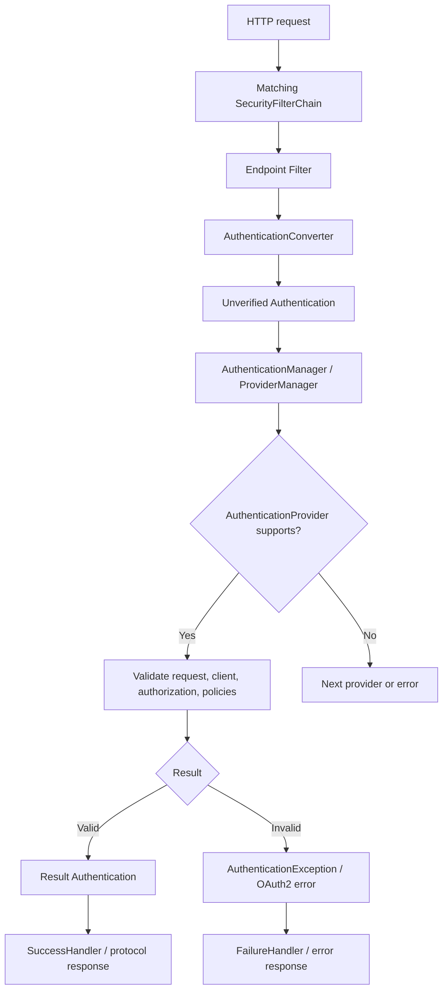
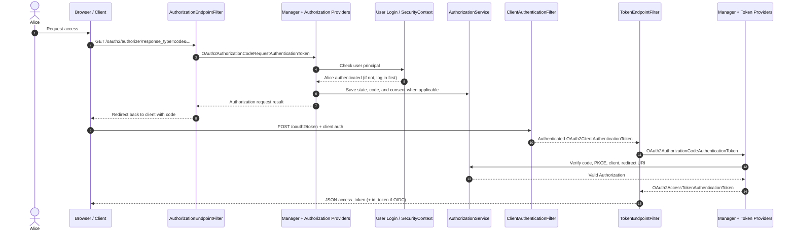

# AuthenticationManager and AuthenticationToken Types in Authorization Server

## 1. Context: why does an Authorization Server need multiple authentication steps?

When implementing an OAuth 2.0/OpenID Connect (OIDC) Authorization Server in Spring Boot with **Spring Security** and **Spring Authorization Server (SAS)**, the word *authentication* appears in many places, yet it does not always mean "end-user login".

Consider three operations:

1. A user enters a username and password on the `/login` page.
2. An OAuth 2.0 client sends `client_id` and `client_secret` to `/oauth2/token`.
3. An identified client sends `grant_type=authorization_code` with an authorization code to exchange for an access token.

All three require verification, yet their **subjects**, **credentials/evidence**, and **acceptance rules** differ. Spring Security uses the `AuthenticationManager` and `AuthenticationProvider` contracts to coordinate these checks. SAS adds specialized `Authentication` types for each OAuth 2.0/OIDC protocol request.

The goal of this lesson in the **Processing Architecture** chapter is to answer:

- Where does `AuthenticationManager` sit in the Authorization Server filter chain?
- Why do classes sharing the "AuthenticationToken" suffix represent **in-flight requests under verification**, **verified results**, and **issued** OAuth 2.0 tokens?
- Which class groups handle user login, client authentication, authorization requests, token requests, consent, and additional endpoints?
- Where should validators/providers be extended while preserving the framework's security checks?

> **Version scope:** Primary class names and configuration examples illustrate **Spring Authorization Server 1.5.x** on Spring Security 6.x. Starting with **Spring Security 7.x**, Authorization Server support is integrated into Spring Security and configuration APIs change. The `Authentication` → `AuthenticationManager` → `AuthenticationProvider` principle remains foundational; check the Javadoc and Reference Guide for your exact project version.

## 2. The Authentication contract in Spring Security

### 2.1. `Authentication` and `AbstractAuthenticationToken`

`org.springframework.security.core.Authentication` is the interface representing both an **authentication request** and an **authentication result**. Common methods:

| Member | Meaning | What to watch out for |
| --- | --- | --- |
| `getPrincipal()` | Identity or subject associated with the request | May be an end user, an OAuth client, or a nested `Authentication`; do not assume a username |
| `getCredentials()` | Evidence to be verified | May be a password, client secret, code, or related data; never log it |
| `getAuthorities()` | Authorities attached to the object by the authentication mechanism | Not directly equivalent to OAuth scopes or resource-level permissions |
| `getDetails()` | Additional metadata depending on authentication type | Do not treat arbitrary values from the request as trustworthy |
| `isAuthenticated()` | Result status of the authentication step | `true` must come from a trusted verification mechanism; never set it manually to bypass checks |

`AbstractAuthenticationToken` is the base class for many implementations. In practice, a class name ending in `AuthenticationToken` usually means **a Java object implementing `Authentication`**, not a JWT string or an access token sent over the network.

Example in password-based login:

```java
// Illustrates the Spring Security contract only, not a complete login handler.
Authentication request =
        UsernamePasswordAuthenticationToken.unauthenticated("alice", rawPassword);

Authentication verified = authenticationManager.authenticate(request);
// verified.getPrincipal() is typically UserDetails or a system-specific principal.
// verified.isAuthenticated() reflects the result produced by the provider.
```

The password must be verified by an appropriate provider (typically `DaoAuthenticationProvider` using `UserDetailsService` and `PasswordEncoder`). In real applications, Spring Security's login filters already handle creating the token, invoking the manager, handling errors, and populating `SecurityContext`; do not write custom endpoints that bypass those steps.

### 2.2. `AuthenticationManager`: the coordination entry point

The core contract is concise:

```java
public interface AuthenticationManager {
    Authentication authenticate(Authentication authentication)
            throws AuthenticationException;
}
```

The common implementation is `ProviderManager`. It evaluates `AuthenticationProvider` instances capable of handling the supplied `Authentication` class:

```java
public interface AuthenticationProvider {
    Authentication authenticate(Authentication authentication)
            throws AuthenticationException;

    boolean supports(Class<?> authentication);
}
```

Each provider decides whether it supports that request type, validates conditions, and either returns a processed `Authentication` or throws an `AuthenticationException`. With `ProviderManager`, a provider may return `null` when it cannot handle the request so the manager tries the next provider; do not assume the manager always calls every provider. Provider ordering and exception handling affect outcomes, so never replace the default list arbitrarily.



This flow illustrates the **protocol processing pattern**. Each filter can have its own converter, manager, and handlers. `FilterChainProxy` selects a `SecurityFilterChain` via request matchers; `AuthenticationManager` does not decide which filter a request URL enters.

### 2.3. Distinguishing three easily confused concepts

| Concept | Data type / representation | Purpose |
| --- | --- | --- |
| **Spring `AuthenticationToken`** | Java object such as `OAuth2ClientCredentialsAuthenticationToken` | Carries the request/result for providers to evaluate during processing |
| **OAuth 2.0 authorization code** | Short-lived code string issued by the Authorization Server | Evidence for the client to exchange for tokens at the token endpoint |
| **OAuth 2.0 access/refresh token or OIDC ID token** | Protocol-issued token, either JWT or opaque | Sent to clients/APIs according to each token type's intended role |

For example, `OAuth2AccessTokenAuthenticationToken` is **the result object inside the token endpoint handler**, holding the issued access token and response metadata. This Java object **is not** the `access_token` string itself in the JSON response; `OAuth2AccessToken` and related token objects are carried inside that result.

## 3. Where AuthenticationManagers sit in the Authorization Server

SAS configures groups of filters and providers dedicated to protocol endpoints. **Do not imagine a single `AuthenticationManager` handling everything from user login through every grant.** Endpoints are wired with their applicable provider sets, and user login can even live in a separate security chain.

| Processing layer | Common filter | Representative manager/providers | Evidence being verified |
| --- | --- | --- | --- |
| End-user login | `UsernamePasswordAuthenticationFilter` or another login filter | Manager with `DaoAuthenticationProvider` / matching provider | Username/password, passkey, or IdP assertion |
| OAuth 2.0 client authentication | `OAuth2ClientAuthenticationFilter` | `ClientSecretAuthenticationProvider`, `JwtClientAssertionAuthenticationProvider`, `PublicClientAuthenticationProvider`, etc. | Secret, client assertion, certificate, or public client details |
| Authorization endpoint | `OAuth2AuthorizationEndpointFilter` | `OAuth2AuthorizationCodeRequestAuthenticationProvider`, `OAuth2AuthorizationConsentAuthenticationProvider` | Authorization request, user status, and consent |
| Token endpoint | `OAuth2TokenEndpointFilter` | `OAuth2AuthorizationCodeAuthenticationProvider`, `OAuth2RefreshTokenAuthenticationProvider`, `OAuth2ClientCredentialsAuthenticationProvider`, etc. | Code, refresh token, grant request |
| Introspection/revocation | `OAuth2TokenIntrospectionEndpointFilter`, `OAuth2TokenRevocationEndpointFilter` | Endpoint-specific providers | Token to inspect or revoke |
| OIDC UserInfo/logout and extensions | Corresponding filter when enabled | Feature-specific providers | Bearer credential, logout request, or related protocol data |

**Version and configuration determine the actual active providers**: mechanisms such as TLS client authentication, Device Authorization, Pushed Authorization Request, Token Exchange, or OIDC endpoints may require dedicated beans/configuration. The list above describes responsibility groups, not a guarantee that every endpoint is enabled in every project.

### 3.1. Distinguishing user authentication and client authentication

**User login** answers: "Who is the end user interacting in this browser?" The result is an `Authentication` representing the user, usually held in the login session's `SecurityContext`.

**OAuth client authentication** answers: "Is the application calling the token endpoint genuinely the registered client?" The result is typically an `OAuth2ClientAuthenticationToken`, letting the token endpoint know which `RegisteredClient` has been authenticated.

A confidential client using `client_secret_basic` can authenticate successfully **without any user logged in**. Conversely, a user logged in on the authorize page **does not automatically grant the client an access token**: the authorization request must still satisfy redirect URI, scope, PKCE, consent, and grant checks.

### 3.2. `SecurityContext` is not an OAuth 2.0 token store

`SecurityContextHolder` provides the current thread's `SecurityContext`, usually containing the `Authentication` of the principal verified by the framework. In a browser flow, that may be the end user; in a token endpoint call after client authentication, that may be the OAuth client.

To store authorization codes, refresh/access token state, client bindings, and consent, SAS relies on abstractions such as:

- `RegisteredClientRepository`: source of client metadata and permitted methods/flows;
- `OAuth2AuthorizationService`: `OAuth2Authorization` state and associated tokens;
- `OAuth2AuthorizationConsentService`: permissions approved by the user;
- `OAuth2TokenGenerator`: generates tokens from the authorization context;
- `AuthorizationServerSettings`: issuer and endpoint URIs.

These components **serve** providers; they do not replace `AuthenticationManager`. Nor should you store long-lived access tokens directly in an HTTP session and treat that as an OAuth 2.0 token issuance mechanism.

## 4. Map of AuthenticationToken types in SAS

### 4.1. Login and OAuth client authentication group

| Type | Subject being verified | Role |
| --- | --- | --- |
| `UsernamePasswordAuthenticationToken` | End user logging in with username/password | Common Spring Security type; not an OAuth grant token |
| `OAuth2AuthenticationToken` | End user logged in via `oauth2Login()` in a client app | OAuth/OIDC Client login result; not a token issuance request to SAS |
| `OAuth2ClientAuthenticationToken` | OAuth client calling an endpoint requiring client authentication | Carries `clientId`, authentication method, and upon verification attaches `RegisteredClient` |

`OAuth2ClientAuthenticationFilter` uses `AuthenticationConverter` implementations such as `ClientSecretBasicAuthenticationConverter`, `ClientSecretPostAuthenticationConverter`, `JwtClientAssertionAuthenticationConverter`, or `PublicClientAuthenticationConverter` per configuration. Corresponding providers evaluate credentials and registered rules. For instance, a public client with `ClientAuthenticationMethod.NONE` **does not mean every request is blindly trusted**; public client conditions and PKCE/grant rules must still be verified.

### 4.2. Authorization Endpoint group: requesting authorization and consent

| AuthenticationToken | Where it appears | Primary provider |
| --- | --- | --- |
| `OAuth2AuthorizationCodeRequestAuthenticationToken` | `GET /oauth2/authorize`: client requests code with `response_type=code`, redirect URI, scope, PKCE, etc. | `OAuth2AuthorizationCodeRequestAuthenticationProvider` |
| `OAuth2AuthorizationConsentAuthenticationToken` | Submitting a consent decision after the user is authenticated | `OAuth2AuthorizationConsentAuthenticationProvider` |

The class name `OAuth2AuthorizationCodeRequestAuthenticationToken` includes **Request** to distinguish it from **exchanging the code at the token endpoint**. At the authorization endpoint, the system checks user authentication, client metadata, redirect URI, PKCE, and consent; a successful outcome can issue an authorization code and redirect the client.

Do not read `getPrincipal()` on every `AuthenticationToken` and cast it to `UserDetails`; at other endpoints, the principal may be an `OAuth2ClientAuthenticationToken` or another principal type.

### 4.3. Token Endpoint group: token issuance requests

The following tokens are **grant request** types, typically extending `OAuth2AuthorizationGrantAuthenticationToken`:

| AuthenticationToken | `grant_type` | Handling provider |
| --- | --- | --- |
| `OAuth2AuthorizationCodeAuthenticationToken` | `authorization_code` | `OAuth2AuthorizationCodeAuthenticationProvider` |
| `OAuth2RefreshTokenAuthenticationToken` | `refresh_token` | `OAuth2RefreshTokenAuthenticationProvider` |
| `OAuth2ClientCredentialsAuthenticationToken` | `client_credentials` | `OAuth2ClientCredentialsAuthenticationProvider` |
| `OAuth2DeviceCodeAuthenticationToken` | `urn:ietf:params:oauth:grant-type:device_code` | `OAuth2DeviceCodeAuthenticationProvider` |
| `OAuth2TokenExchangeAuthenticationToken` | `urn:ietf:params:oauth:grant-type:token-exchange` | `OAuth2TokenExchangeAuthenticationProvider` |

`OAuth2TokenEndpointFilter` uses the corresponding `AuthenticationConverter` implementations to translate HTTP parameters into the right token type before calling the manager. Grants/extensions must be supported by the version and permitted by client policy. There is no default `grant_type=password` in SAS.

Upon successful token issuance, the provider usually returns `OAuth2AccessTokenAuthenticationToken`. `OAuth2AccessTokenResponseAuthenticationSuccessHandler` uses that result to build the **OAuth 2.0 JSON token response**, rather than treating the `AuthenticationToken` object itself as the HTTP payload.

### 4.4. Token management and add-on features group

| AuthenticationToken | Responsibility | What to distinguish |
| --- | --- | --- |
| `OAuth2TokenIntrospectionAuthenticationToken` | Receives token status inspection requests | Not the Spring Security object used to validate every Bearer JWT at a Resource Server |
| `OAuth2TokenRevocationAuthenticationToken` | Receives token revocation requests | Does not mean every JWT at APIs immediately becomes invalid |
| `OAuth2DeviceAuthorizationRequestAuthenticationToken` | Request to initiate Device Authorization | Distinct from exchanging a device code for an access token |
| `OAuth2DeviceVerificationAuthenticationToken` | User verifying a request from a device | Requires UI and a user login step |
| `OAuth2DeviceAuthorizationConsentAuthenticationToken` | Consent in the device flow | Requires authorization policies and state |
| `OidcUserInfoAuthenticationToken` | Handles OIDC UserInfo requests when OIDC is enabled | Involves Bearer token validation and emitting appropriate claims |
| `OidcLogoutAuthenticationToken` | Handles OIDC logout when enabled | Does not automatically clear every session and every client token |

Depending on the version, there are also tokens for Pushed Authorization Request or Client Registration. You do not need to memorize the entire list: trace **endpoint → converter → token type → provider → result**. That relationship is essential when debugging or extending.

### 4.5. Classes often mistaken for Authorization Server tokens

- `BearerTokenAuthenticationToken` is the request type when a **Resource Server** receives a Bearer token over HTTP, not a `grant_type` request sent to the token endpoint.
- `JwtAuthenticationToken` is typically the authenticated JWT result at a Resource Server.
- `OAuth2AccessToken`, `OAuth2RefreshToken`, and `OidcIdToken` are **objects representing issued tokens**, not all of which implement `Authentication`.
- `OAuth2Authorization` is the authorization state managed by the Authorization Server, **not** an `AuthenticationToken` instance.

## 5. Tracing Authorization Code + PKCE

Suppose client `web-portal` wants scope `orders.read` for user `alice`. The flow has two distinct parts: **requesting a code at the authorization endpoint** and **exchanging the code at the token endpoint**.



Step-by-step walkthrough:

1. **Chain and converter selection.** `OAuth2AuthorizationEndpointFilter` receives the authorize request. `OAuth2AuthorizationCodeRequestAuthenticationConverter` creates `OAuth2AuthorizationCodeRequestAuthenticationToken`.
2. **User authentication if needed.** If no suitable user authentication exists, Spring Security redirects to the login flow. After successful login, the authorize request resumes via the session/request cache mechanism.
3. **Provider validates the authorization request.** `OAuth2AuthorizationCodeRequestAuthenticationProvider` uses `RegisteredClientRepository` and related settings to validate the request; if consent is required, the user completes the approval step before proceeding.
4. **Issue authorization code.** Authorization/code state is managed via `OAuth2AuthorizationService`; the short-lived code is returned to the client through a secure redirect.
5. **Authenticate the OAuth client at the token endpoint.** `OAuth2ClientAuthenticationFilter` verifies the client secret, assertion, or public-client mechanism. The outcome is a trusted `OAuth2ClientAuthenticationToken` for the token issuance step.
6. **Validate the `authorization_code` grant.** `OAuth2AuthorizationCodeAuthenticationConverter` creates `OAuth2AuthorizationCodeAuthenticationToken`. The provider verifies that the code is unused/unexpired, bound to the client and redirect URI, checks PKCE, and validates authorization state.
7. **Issue tokens.** The provider uses services and `OAuth2TokenGenerator` to issue configured tokens; success is wrapped in `OAuth2AccessTokenAuthenticationToken` so the handler renders JSON.

**Key takeaway:** a valid code does not prove a valid client; an authenticated client cannot redeem a code belonging to another client; and a logged-in user does not allow bypassing PKCE or consent.

## 6. Tracing Client Credentials and Refresh Token

### 6.1. Client Credentials: no end user

For example, service `billing-worker` sends:

```http
POST /oauth2/token HTTP/1.1
Host: auth.example.com
Authorization: Basic <base64-encoded-client-credentials>
Content-Type: application/x-www-form-urlencoded

grant_type=client_credentials&scope=invoices.read
```

The `Authorization` string here is a **placeholder**, not a real credential.

The process involves two distinct logical checks:

1. `OAuth2ClientAuthenticationFilter` converts client credentials into `OAuth2ClientAuthenticationToken`; the provider matches `RegisteredClient` metadata, authentication method, and secret/signature.
2. `OAuth2TokenEndpointFilter` creates `OAuth2ClientCredentialsAuthenticationToken`. `OAuth2ClientCredentialsAuthenticationProvider` verifies the grant type and permitted scopes, then issues the appropriate access token.

The token represents the **client identity**, not user `alice`. If an API requires end-user ownership, `client_credentials` does not replace Authorization Code or a controlled delegation model.

### 6.2. Refresh Token: renewing previously granted authority

With `grant_type=refresh_token`, the converter creates `OAuth2RefreshTokenAuthenticationToken`. The provider must verify that the token is still valid, bound to the right client, conforms to registered policies and constraints before issuing a new access token; how the old refresh token is handled depends on `TokenSettings` and server policy.

This **is not an operation requiring the user to re-enter a password on every refresh**. However, security policies may require re-authentication, revoke sessions, or reject refreshes when account state or permissions change.

## 7. Configuration example: extending a validator at the right layer

Suppose business rules allow only client `reporting-service` to request scope `orders.export` under the `client_credentials` grant, even if client registration administration were ever misconfigured. This is an **additional policy** at the grant-request layer, so you can extend the validator on `OAuth2ClientCredentialsAuthenticationProvider`.

Example in **Spring Authorization Server 1.5.x** configuration style; imports and required beans such as `RegisteredClientRepository`, `OAuth2AuthorizationService`, `JWKSource`/token generator, user accounts, and the login chain are omitted:

```java
@Bean
@Order(1)
SecurityFilterChain authorizationServerSecurityFilterChain(HttpSecurity http)
        throws Exception {

    OAuth2AuthorizationServerConfigurer as =
            OAuth2AuthorizationServerConfigurer.authorizationServer();

    http.securityMatcher(as.getEndpointsMatcher())
        .with(as, server -> server
            .tokenEndpoint(tokenEndpoint -> tokenEndpoint
                .authenticationProviders(providers -> providers.forEach(provider -> {
                    if (provider instanceof OAuth2ClientCredentialsAuthenticationProvider p) {
                        p.setAuthenticationValidator(
                            OAuth2ClientCredentialsAuthenticationValidator
                                .DEFAULT_SCOPE_VALIDATOR
                                .andThen(context -> {
                                    boolean exportRequested = context.getAuthentication()
                                            .getScopes().contains("orders.export");
                                    boolean approvedClient =
                                            "reporting-service".equals(
                                                context.getRegisteredClient().getClientId());

                                    if (exportRequested && !approvedClient) {
                                        throw new OAuth2AuthenticationException(
                                            new OAuth2Error(OAuth2ErrorCodes.INVALID_SCOPE));
                                    }
                                }));
                    }
                }))
            ))
        .authorizeHttpRequests(authorize -> authorize.anyRequest().authenticated());

    return http.build();
}
```

Explanation:

- `authenticationProviders(...)` provides the list of providers configured for the **token endpoint**. The example targets `OAuth2ClientCredentialsAuthenticationProvider` specifically instead of adding a catch-all provider for every `Authentication`.
- `DEFAULT_SCOPE_VALIDATOR.andThen(...)` **preserves the default scope validation** before enforcing the extra policy. If you replace a validator and forget to invoke the default check, clients could request unregistered scopes.
- Throwing `OAuth2AuthenticationException` with error `invalid_scope` lets the token endpoint convert it into a protocol-compliant error response. Never turn the exception into HTTP 200 or expose credentials.
- This example applies specifically to the **Client Credentials Grant**; the authorization endpoint, code grant, Resource Server, and per-record permissions still have independent checks.
- In production systems, client identities are maintained in durable storage under approval policies; disallowed clients should be rejected during client administration in addition to this safeguard.

If the application uses **Spring Security 7.x**, Authorization Server configuration uses an entry point like `http.oauth2AuthorizationServer(...)` instead of the 1.5.x pattern above; verify the exact API for your version before copying examples. Do not mix package/configurer versions in the same snippet.

### 7.1. When a custom grant/provider is genuinely needed

An extension grant usually requires three aligned pieces:

```text
HTTP parameters
    -> custom AuthenticationConverter
    -> custom OAuth2AuthorizationGrantAuthenticationToken
    -> custom AuthenticationProvider (supports the exact token type)
    -> validate client + grant + proof + replay rules + permissions
    -> OAuth2AuthorizationService / OAuth2TokenGenerator
    -> OAuth2AccessTokenAuthenticationToken
    -> token response handler
```

Simply creating a class named `MyAuthenticationToken` does not make SAS recognize a new grant automatically. The converter and provider must be registered on the token endpoint, enforce all security constraints, and emit protocol errors. Only implement a custom grant when no standard option fits; **never recreate the Resource Owner Password Credentials grant** to bypass secure login flows.

## 8. What happens when authentication fails?

| Step | Failure example | Response / inspection point |
| --- | --- | --- |
| User login | Wrong password, locked account | `AuthenticationException` at login layer; handled by login page handler |
| Client authentication | Wrong client secret or assertion | Usually returns `invalid_client`; does not proceed to grant success |
| Authorization request | Unregistered redirect URI or invalid scope | OAuth 2.0 authorization request error; must never redirect to untrusted URIs |
| Authorization code grant | Expired/reused code, wrong PKCE | Usually `invalid_grant`; no access token issued |
| Client Credentials | Disallowed scope | `invalid_scope` or applicable policy error |
| Token introspection | Client not authorized to introspect | Endpoint auth/permission error; never leak token state improperly |
| Resource Server | Bearer JWT with bad signature/issuer/audience | 401 at API; 403 when authenticated but lacking policy permission |

`AuthenticationManager` is not responsible for writing HTTP responses directly. Endpoint filters and `AuthenticationFailureHandler` determine the format and error code. In particular, the authorization endpoint safely redirects certain errors back to the client, whereas the token endpoint returns JSON; never "standardize" all errors onto a single HTML page.

To debug, trace **endpoint + `AuthenticationToken` type + selected converter/provider + protocol error code**. Never write `authentication.toString()`, `getCredentials()`, codes, refresh tokens, access tokens, or client secrets directly into production logs.

## 9. Architectural pitfalls to avoid

### 9.1. Assuming every `AuthenticationToken` is an access token

In Java code, `OAuth2ClientCredentialsAuthenticationToken` represents the request at the token endpoint; the client actually receives an `OAuth2AccessToken` serialized as `access_token`. Naming variables `token` for both easily leads to type errors or mixing up data sources.

### 9.2. Calling `SecurityContextHolder.getContext().getAuthentication()` and always casting to a user

At the authorization endpoint, the principal is typically the logged-in end user; at the token endpoint, `SecurityContext` may hold the OAuth client. Determine the principal based on **endpoint and flow**, not merely from a generic security context lookup.

### 9.3. Calling `setAuthenticated(true)` manually to bypass a provider

This breaks trust boundaries. Only a provider/handler that has verified credentials and rules may produce a successful authenticated result under Spring Security's contract.

### 9.4. Declaring `supports(Authentication.class)` too broadly in a custom provider

A provider accepting too many types can intercept standard providers, misprocess requests, or create a validation bypass. Support **only the exact `AuthenticationToken` type** for your extension and attach the provider to the right endpoint.

### 9.5. Replacing a validator and dropping default checks

For example, customizing scopes at the token endpoint must still validate registered scopes; customizing authorization requests must preserve redirect URI and related checks. Whenever overriding a default, prove with negative tests that baseline protections still hold.

### 9.6. Confusing an authenticated client with an authorized end user

An authenticated client may have no user at all. `client_credentials` does not carry per-username personal data permissions; scope issuance and resource access checks must follow separate policies.

### 9.7. Confusing Spring `AuthenticationManager` with `AuthorizationManager`

`AuthenticationManager` verifies `Authentication`. `AuthorizationManager` / `authorizeHttpRequests` rules decide whether a request or action **is permitted**. An `authenticated` principal is not automatically authorized to invoke a given API or admin endpoint.

### 9.8. Thinking calling `OAuth2TokenGenerator` completes the flow

The token generator produces tokens from context and configuration; it does not replace client verification, one-time code checks, PKCE, scopes, consent, user policies, or persistence. Providers and services cooperate to maintain protocol boundaries.

## 10. Test matrix by AuthenticationToken type

| Case | Input | Expected result |
| --- | --- | --- |
| Valid user login | `UsernamePasswordAuthenticationToken` with valid credentials | Provider verifies user; session holds appropriate principal |
| Invalid user login | Wrong password / locked account | Login fails; never turns into client authentication |
| Valid Client Credentials | Valid client, `grant_type=client_credentials`, granted scope | Client authenticates, then provider issues token for client |
| Wrong secret | Valid `client_id`, wrong secret | `invalid_client`; no token issued |
| Missing client grant | Client not registered for `client_credentials` | Rejected even with a valid secret |
| Invalid scope | `OAuth2ClientCredentialsAuthenticationToken` with ungranted scope | Unauthorized scope rejected |
| Authorization Code + PKCE | User login, valid consent, matching code and verifier | Code exchanged successfully once |
| Replayed Authorization Code | Code already redeemed and submitted again | Token endpoint rejects with `invalid_grant` |
| Wrong PKCE | `code_verifier` does not match `code_challenge` | Token rejected |
| Altered Redirect URI | URI at code exchange differs from valid request | Rejected when protocol rules require a match |
| Expired or foreign Refresh Token | `OAuth2RefreshTokenAuthenticationToken` with invalid token | No new access token issued |
| Unauthorized revocation/introspection | Invalid client or caller lacking endpoint permission | Token state not leaked; proper error response |
| UserInfo with invalid credential | Bad/expired/insufficient-scope Bearer token | No OIDC claims returned |
| Resource Server receives ID token instead of access token | `Authorization: Bearer <id-token>` | API rejects based on token type/audience rules |

**Testing strategy:** test both "the right provider handles the right token" via HTTP-endpoint integration tests and **secure rejection** for invalid credentials, grants, codes, redirect URIs, PKCE, scopes, and data permissions. When inspecting responses, distinguish user authentication, client authentication, grant errors, and Resource Server errors instead of lumping everything under "authentication failed".

## 11. Practice questions

A team builds an Authorization Server with two clients:

- `web-portal`: a web app logging users in with Authorization Code + PKCE, requesting `openid` and `orders.read`.
- `billing-worker`: a backend service using Client Credentials, requesting `invoices.read`.

Answer the following:

1. When `web-portal` redirects to `/oauth2/authorize`, which `AuthenticationToken` class represents the code request? What happens if the user is not logged in yet?
2. At `/oauth2/token`, why must both `OAuth2ClientAuthenticationToken` and `OAuth2AuthorizationCodeAuthenticationToken` be processed?
3. When `billing-worker` requests a token, does the authenticated principal represent the client or a user? Which permissions must be checked?
4. If you want to add a rule "only approved clients may receive `invoices.export`", which validator/provider should it go into? Why keep the default validator?
5. After SAS returns `OAuth2AccessTokenAuthenticationToken`, what does the client actually receive? Which class/token will the API use to verify the Bearer token?

**Hints:**

1. `OAuth2AuthorizationCodeRequestAuthenticationToken` and the authorization request provider; Spring Security triggers user login before completing authorization if no principal is present.
2. One step confirms the client is allowed to call the endpoint; the other validates the authorization code, PKCE, grant, and authorization state.
3. Client Credentials represents the **client**; check grant and scopes, while the Resource Server must still enforce API permissions.
4. Extend `OAuth2ClientCredentialsAuthenticationProvider` (or apply client administration policies), retain the default scope validator, and add negative tests.
5. The client receives a JSON token response; the Resource Server typically uses a Bearer token filter with JWT or opaque token validation, rather than receiving `OAuth2AccessTokenAuthenticationToken`.

## 12. References and takeaways

To verify classes, providers, and configuration APIs for your exact version, consult:

- [Spring Authorization Server 1.5.x — Protocol Endpoints](https://docs.spring.io/spring-authorization-server/reference/protocol-endpoints.html): converters, `AuthenticationManager`, providers, and default endpoint handlers.
- [Spring Authorization Server 1.5.x — Configuration Model](https://docs.spring.io/spring-authorization-server/reference/configuration-model.html): client authentication, repositories, token generator, and extension points.
- [Spring Security 7.x — Authorization Server Protocol Endpoints](https://docs.spring.io/spring-security/reference/servlet/oauth2/authorization-server/protocol-endpoints.html): Authorization Server APIs and configuration in Spring Security 7.
- [Spring Security — Authentication Architecture](https://docs.spring.io/spring-security/reference/servlet/authentication/architecture.html): `Authentication`, `AuthenticationManager`, `ProviderManager`, and `AuthenticationProvider`.
- [RFC 6749](https://www.rfc-editor.org/rfc/rfc6749), [RFC 7636](https://www.rfc-editor.org/rfc/rfc7636): OAuth 2.0 and PKCE requirements that providers must uphold.

Remember the processing pipeline: **HTTP request → AuthenticationConverter → AuthenticationToken → AuthenticationManager → AuthenticationProvider → result → handler**. In an Authorization Server, an `AuthenticationToken` may refer to an end user, a client, or a specific grant. Accurately distinguishing **who is authenticated, what is authorized, and which token is issued** is essential to configuring, extending, testing, and operating an Authorization Server safely.
