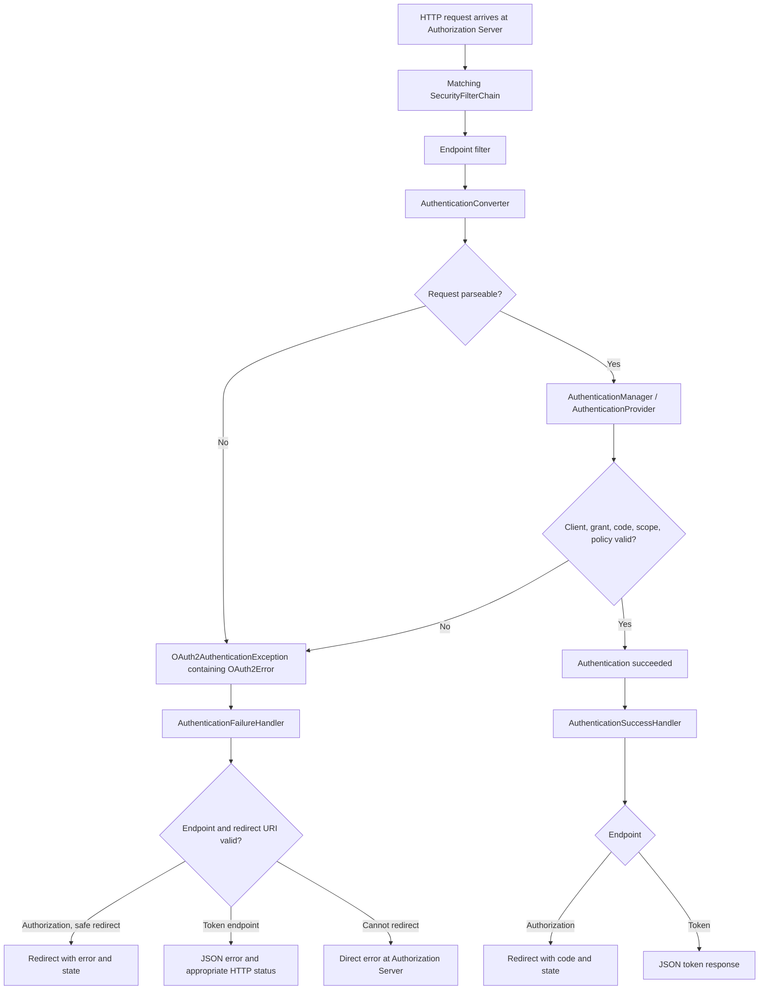

# Handling Success Responses, Failure Responses, and OAuth2Error

In a **Spring Boot** application using **Spring Security** and **Spring Authorization Server** to implement OAuth 2.0/OpenID Connect (OIDC), processing the request correctly is only half the job. The other half is **returning a protocol-compliant response**: a successful authorization request typically ends with a browser redirect carrying an authorization code, whereas a successful token request returns JSON containing tokens. When an error occurs, the OAuth 2.0 error code, how the error is transmitted, the HTTP status, and where redirects are permitted all depend on the endpoint.

This lesson in the **Processing Architecture** chapter guides you through distinguishing success and failure branches, understanding `OAuth2Error`, tracing the flow from filter to authentication provider and response handler, customizing safely, testing, and operating an Authorization Server. This knowledge is essential for designing a reliable authorization system while avoiding returning HTML from the token endpoint, redirecting to invalid URLs, or leaking secrets through `error_description`.

## 1. Three outcome levels to distinguish

A request passes through protocol recognition, authentication, and HTTP representation layers. You should not collapse all failures into a single generic JSON HTTP error.

| Level | Question | Example |
|---|---|---|
| **Business/protocol** | Are the grant/client/scope/code/PKCE valid and permitted? | Reused authorization code → `invalid_grant` |
| **Error model** | Which failure outcome must be reported to the client? | `OAuth2Error(errorCode, description, uri)` |
| **Endpoint response** | Is success/error sent via redirect or JSON, and with what status and headers? | Authorization error → safe redirect; token error → JSON, typically 400 |

Therefore, **the `error` code is not an HTTP status**, and catching an exception does not guarantee the right response has been produced. Endpoints have different contracts:

| Endpoint | Typical success | Typical failure |
|---|---|---|
| `/oauth2/authorize` (Authorization Code) | `302` to registered redirect URI with `code`, plus `state` if present | Redirect with `error` when URI is trustworthy; otherwise direct error at the AS |
| `/oauth2/token` | `200` JSON with `access_token` and `token_type` | OAuth 2.0 JSON error, typically `400`; `invalid_client` may be `401` |
| `/oauth2/introspect` | Token status JSON per RFC 7662 | Client auth or request error per introspection contract |
| `/oauth2/revoke` | Response per RFC 7009, without confirming token existence | Client/request error per revocation rules |
| Resource Server API | `2xx` permitted data | `401`/`403` per Bearer error and API policy |

**Never mechanically map Resource Server error codes** such as `invalid_token`/`insufficient_scope` into token endpoint error codes. They belong to different protocol layers.

## 2. Path from HTTP request to success/failure handlers

Spring Authorization Server provides endpoint filters and `AuthenticationProvider` implementations to execute grants. The main branches can be visualized as follows:



This is a **general model**, not a mandatory strict order for every filter. Client authentication at the token endpoint can occur **before** the token grant in `OAuth2ClientAuthenticationFilter`; user login and consent at the authorization endpoint can span multiple requests.

### 2.1. Role of each Spring component

| Component | Responsibility | Common misconception |
|---|---|---|
| `OAuth2AuthorizationEndpointFilter` | Handles authorization requests and authorization outcomes | Not every request immediately issues a code; login/consent steps may occur |
| `OAuth2TokenEndpointFilter` | Converts token requests, calls providers, and writes responses | Success is token JSON; never redirects to login |
| `OAuth2ClientAuthenticationFilter` | Authenticates confidential clients or other client authentication methods | `invalid_client` can occur before `OAuth2TokenEndpointFilter` |
| `AuthenticationConverter` | Parses and validates form/query parameters into an `Authentication` object | Malformed requests can fail right at this stage |
| `AuthenticationProvider` | Validates grant/authorization code, scope, PKCE, and policy | May throw `OAuth2AuthenticationException` |
| `AuthenticationSuccessHandler` | Writes the endpoint-specific success response | Authorization success and token success have different formats |
| `AuthenticationFailureHandler` | Writes the endpoint-specific error response | Not every error is allowed to redirect |

A typical Authorization Code flow undergoes **two separate success responses**: the authorization endpoint issues a code through the browser, and then the token endpoint exchanges the code for tokens via a direct request. Do not merge them into one step.

## 3. `OAuth2Error` and `OAuth2AuthenticationException`

### 3.1. What does `OAuth2Error` contain?

`org.springframework.security.oauth2.core.OAuth2Error` represents a protocol-level error. Primary fields:

| Java property | OAuth response field | Meaning |
|---|---|---|
| `errorCode` | `error` | **Error code** for client branching; required in OAuth error responses |
| `description` | `error_description` | Brief human-readable explanation, optional |
| `uri` | `error_uri` | URI to explanatory documentation, optional |

`OAuth2Error` **contains no HTTP status** and does not write responses itself. `OAuth2AuthenticationException` wraps `OAuth2Error` so the downstream handler can emit the response matching the endpoint.

Example inside the validation branch of a custom grant/provider:

```java
import org.springframework.security.oauth2.core.OAuth2AuthenticationException;
import org.springframework.security.oauth2.core.OAuth2Error;
import org.springframework.security.oauth2.core.OAuth2ErrorCodes;

// allowedScopes and requestedScope belong to the custom provider context.
if (!allowedScopes.contains(requestedScope)) {
    OAuth2Error error = new OAuth2Error(
        OAuth2ErrorCodes.INVALID_SCOPE,
        "Requested scope is not permitted",
        null
    );
    throw new OAuth2AuthenticationException(error);
}
```

This is an **illustrative snippet inside a provider**, not a standalone runnable class. The provider only identifies the error; the endpoint handler decides whether the response is a redirect or JSON. When standard grants suffice, you usually do not need a custom provider or manual error code mapping.

### 3.2. Common error codes

| `error` | Endpoint/context | Typical cause |
|---|---|---|
| `invalid_request` | Authorization/token | Missing, duplicate, malformed parameter, or invalid request |
| `unauthorized_client` | Authorization/token | Client is not authorized to use the requested flow/grant |
| `access_denied` | Authorization | User or AS denied the request, e.g., rejected consent |
| `unsupported_response_type` | Authorization | `response_type` is not supported/permitted |
| `invalid_scope` | Authorization/token | Scope is invalid or exceeds permitted scopes |
| `server_error` | Authorization | AS encountered an error preventing request completion |
| `temporarily_unavailable` | Authorization | AS is temporarily unable to handle the request |
| `invalid_client` | Token/client authentication | Invalid client or client authentication failed |
| `invalid_grant` | Token | Code/refresh token/grant is invalid, expired, reused, or fails binding/PKCE |
| `unsupported_grant_type` | Token | `grant_type` is not supported |

The primary codes come from **RFC 6749** standard error groups. For OIDC, there are also specific codes such as `login_required`, `interaction_required`, or `consent_required` when the OP cannot fulfill an authentication request—for example, when `prompt=none` prohibits showing interactive UI.

### 3.3. Do not lump all errors into `invalid_request`

Two requests both resulting in HTTP 400 may require different error codes:

- Unsupported `grant_type` → `unsupported_grant_type`.
- Client not permitted to use the grant → `unauthorized_client`.
- Expired/reused authorization code → `invalid_grant`.
- Invalid requested scope → `invalid_scope`.
- Missing required parameter → `invalid_request`.

Clients rely on the **error code**, not `error_description` prose, to decide whether to fix the request, start a new authorization flow, or ask an admin to update configuration.

## 4. Authorization endpoint: browser-based success and failure

### 4.1. Authorization Code flow success

Suppose client `portal-web` registered redirect URI `https://portal.example.com/login/oauth2/code/company`. After the AS authenticates the user, evaluates consent if needed, and approves the request, the authorization endpoint may return:

```http
HTTP/1.1 302 Found
Location: https://portal.example.com/login/oauth2/code/company?code=AUTH_CODE&state=STATE_123
Cache-Control: no-store
```

`AUTH_CODE` and `STATE_123` are placeholders. `state` is echoed back when included in the authorization request so the client can match it against the original transaction session. An authorization code is sensitive, short-lived, and single-use; **it is not yet an access token**.

If the browser is initially sent to `/login` or a consent form, that is an **intermediate step**, not authorization code issuance. The final handler generates the code/redirect only after all conditions are satisfied.

### 4.2. Errors with a valid redirect URI

Once the client and redirect URI have been **verified as valid**, a user denying consent can produce:

```http
HTTP/1.1 302 Found
Location: https://portal.example.com/login/oauth2/code/company?error=access_denied&state=STATE_123
```

This is still an **HTTP redirect**, carrying an OAuth failure outcome. The client must check `error` before looking for `code`, verify `state`, and then display or handle the outcome per application UX. Never attempt a token exchange when the callback only contains `error`.

### 4.3. Errors when the redirect URI cannot be trusted

For example, an attacker sends:

```http
GET /oauth2/authorize?response_type=code&client_id=portal-web&redirect_uri=https%3A%2F%2Fevil.example%2Fcallback&scope=openid HTTP/1.1
Host: identity.example.com
```

If `evil.example` **is not a valid registered URI** for `portal-web`, the AS must reject the request **without redirecting to that URI**. Depending on configuration, the system may display an error page or return the error directly at the AS. You must not apply a rule like "all authorization errors redirect", because that creates an **open redirect** and can leak authorization results.

### 4.4. Why aren't authorization errors JSON by default?

A web OAuth2 Client initiates an authorization request and waits for the browser redirect at its registered redirect URI. If the AS returns `400` with JSON `{"error":"access_denied"}` in a case where redirecting is allowed, the client may never receive the callback and the login flow hangs. Conversely, when the request lacks a trusted client/redirect URI, **never redirect arbitrarily just to preserve UX flow**.

Choosing redirect versus direct error depends on **URI trustworthiness and endpoint rules**, not on whether you want a pretty error message.

## 5. Token endpoint: HTTP JSON response

### 5.1. Success when exchanging an authorization code

A confidential client sends a backend request over HTTPS:

```http
POST /oauth2/token HTTP/1.1
Host: identity.example.com
Content-Type: application/x-www-form-urlencoded
Authorization: Basic <REDACTED_CLIENT_AUTH>

grant_type=authorization_code&code=AUTH_CODE&redirect_uri=https%3A%2F%2Fportal.example.com%2Flogin%2Foauth2%2Fcode%2Fcompany&code_verifier=CODE_VERIFIER
```

Illustrative successful token response for an OIDC Authorization Code flow:

```http
HTTP/1.1 200 OK
Content-Type: application/json;charset=UTF-8
Cache-Control: no-store
Pragma: no-cache

{
  "access_token": "REDACTED_ACCESS_TOKEN",
  "token_type": "Bearer",
  "expires_in": 300,
  "scope": "openid profile documents.read",
  "id_token": "REDACTED_ID_TOKEN"
}
```

In OAuth 2.0, `access_token` and `token_type` are required fields of a successful token response; `expires_in`, `scope`, and `refresh_token` depend on the grant and issuance policies. For a valid OIDC Authorization Code request, the OP must also issue `id_token` per OIDC. **A refresh token is not always issued.**

Do not confuse the token endpoint's `200 JSON` with the authorization endpoint's `302 redirect code`. The two responses occur in **two independent phases**.

### 5.2. Failure when exchanging a code

An invalid, reused, or PKCE-mismatched code typically yields `invalid_grant`:

```http
HTTP/1.1 400 Bad Request
Content-Type: application/json;charset=UTF-8
Cache-Control: no-store
Pragma: no-cache

{
  "error": "invalid_grant",
  "error_description": "Authorization grant is invalid"
}
```

`error_description` is optional; its wording should not be treated as a stable contract. When client authentication fails via HTTP Basic, the token endpoint may use `401 Unauthorized` and `WWW-Authenticate` per protocol rules, along with `error=invalid_client`. Do not force every token endpoint error to HTTP 400 if that conflicts with the HTTP authentication scheme in use.

### 5.3. Token endpoint error matrix

| Condition | Expected error code in typical scenarios | Related check |
|---|---|---|
| Missing `grant_type` or malformed data | `invalid_request` | Converter/validation |
| Unsupported grant type | `unsupported_grant_type` | Endpoint/grant registrations |
| Client not permitted to use grant | `unauthorized_client` | Registered client and grant policy |
| Wrong client secret/auth key | `invalid_client` | Client authentication filter/provider |
| Expired/reused/wrong-client code | `invalid_grant` | Authorization storage and client binding |
| Wrong `code_verifier` | `invalid_grant` | PKCE and code challenge |
| Invalid/revoked refresh token | `invalid_grant` | Refresh token storage/revocation |
| Invalid requested scope | `invalid_scope` | Allowed scopes and token grant policy |

If a request violates **multiple conditions at once**, processing order determines which error surfaces first. For example, an incorrect client secret can be rejected before the AS even looks up the authorization code. Tests must provide valid fixtures at other layers when targeting a specific error code.

## 6. Differences from standard Spring Security errors

In the Spring ecosystem, not every exception is handled by the same handler.

### 6.1. OAuth2AuthenticationException

When an `AuthenticationConverter` or `AuthenticationProvider` detects an OAuth 2.0 rule violation, it can throw `OAuth2AuthenticationException` carrying an `OAuth2Error`. The endpoint filter/failure handler converts that into a redirect or JSON. A custom grant/provider should use the accurate OAuth error code rather than throwing `IllegalArgumentException` or leaking database exceptions.

### 6.2. AuthenticationException, AccessDeniedException, and ExceptionTranslationFilter

Spring Security also provides `AuthenticationException`, `AccessDeniedException`, `AuthenticationEntryPoint`, `AccessDeniedHandler`, and `ExceptionTranslationFilter` for application access control. These components are important, yet **OAuth2 endpoints have their own handlers and response contracts**.

For example:

- Unauthenticated user at the authorization endpoint → the system may redirect to login via web authentication; this is not a token grant result yet.
- Confidential client fails authentication at the token endpoint → returns `invalid_client`, **never** redirects to the user login page.
- Resource Server API rejects an access token → `401` and usually `WWW-Authenticate: Bearer`; this error is not `invalid_grant`.
- Authenticated user lacks permission to read an API record → typically `403`; distinct from `access_denied` due to rejected consent.

### 6.3. ControllerAdvice does not cover security filters

Spring MVC's `@RestControllerAdvice` normally handles exceptions thrown inside controllers. Spring Authorization Server's OAuth2 endpoints are processed in the **Spring Security filter chain**, before any MVC controller. Consequently, a global MVC exception handler will not catch `OAuth2AuthenticationException` instances already intercepted and rendered by filters. To customize token/authorization responses, use **the right endpoint filter/configurer hook**.

## 7. Customizing responses in Spring Authorization Server

### 7.1. Where to configure endpoint handlers

Example configuration structure using the DSL from Spring Authorization Server versions supporting `HttpSecurity.with(...)`:

```java
@Bean
@Order(1)
SecurityFilterChain authorizationServerChain(HttpSecurity http) throws Exception {
    OAuth2AuthorizationServerConfigurer authorizationServer =
        OAuth2AuthorizationServerConfigurer.authorizationServer();

    http.securityMatcher(authorizationServer.getEndpointsMatcher())
        .with(authorizationServer, server -> server
            .oidc(Customizer.withDefaults())
            .authorizationEndpoint(endpoint -> {
                // endpoint.authorizationResponseHandler(...);
                // endpoint.errorResponseHandler(...);
            })
            .tokenEndpoint(endpoint -> {
                // endpoint.accessTokenResponseHandler(...);
                // endpoint.errorResponseHandler(...);
            }))
        .authorizeHttpRequests(auth -> auth
            .anyRequest().authenticated())
        .exceptionHandling(ex -> ex
            .defaultAuthenticationEntryPointFor(
                new LoginUrlAuthenticationEntryPoint("/login"),
                new MediaTypeRequestMatcher(MediaType.TEXT_HTML)
            ));

    return http.build();
}
```

This is a **configuration skeleton showing extension points**, not a standalone runnable app. You still need `RegisteredClientRepository`, issuer settings, signing key/JWK source, authorization/consent persistence, and a `SecurityFilterChain` for user login. DSL/bean APIs may vary by version, so check the reference guide for your version.

Common extension points:

| Endpoint configurer | Success handler | Failure handler |
|---|---|---|
| Authorization endpoint | `authorizationResponseHandler(...)` | `errorResponseHandler(...)` |
| Token endpoint | `accessTokenResponseHandler(...)` | `errorResponseHandler(...)` |

Handlers implement `AuthenticationSuccessHandler` / `AuthenticationFailureHandler` respectively. **Replacing a handler means taking responsibility for writing the protocol response**: status, redirect URI, `state`, JSON shape, cache headers, and security rules. If your goal is only observation/auditing, prefer observability hooks or delegate to the standard handler rather than rewriting OAuth2 serializers unnecessarily.

### 7.2. Errors in a custom AuthenticationProvider

A custom provider should report cause-accurate errors while avoiding leaking internal state. For example:

```java
// Pseudocode placed inside a custom provider after loading authorization.
if (authorizationNotFound || codeAlreadyUsed || codeExpired) {
    OAuth2Error error = new OAuth2Error(
        OAuth2ErrorCodes.INVALID_GRANT,
        "The authorization grant is invalid",
        null
    );
    throw new OAuth2AuthenticationException(error);
}
```

The variables are placeholders for custom provider domain logic. For built-in grants, Spring Authorization Server already provides validation and handlers; **do not reimplement them just to change `error_description`**. Keep single-use code checks, expiration, client binding, redirect URI, and PKCE enforcement intact.

### 7.3. Client authentication errors can happen before the token endpoint

If the client secret is wrong, `OAuth2ClientAuthenticationFilter` can reject the request before `OAuth2TokenEndpointFilter` runs. Thus, replacing `tokenEndpoint.errorResponseHandler(...)` does not necessarily alter all `invalid_client` responses. Trace **which filter actually catches the exception**, pick the right extension point, and test invalid client authentication scenarios.

### 7.4. Do not turn all errors into JSON or HTTP 500

A handler that "catches every `Exception`, calls `response.setStatus(500)`, and writes `{"message":"error"}`" can break:

- Authorization endpoint redirects (losing `code`/`error`/`state`).
- Token error responses where clients expect the `error` field.
- Important headers like `WWW-Authenticate` and `Cache-Control`.
- Distinguishing client configuration mistakes from system outages for safe operations.

Customize only when there is a concrete requirement, and regression-test the entire endpoint contract afterward.

## 8. Data security in success and error responses

### 8.1. Do not reflect secrets in error_description

This is an **unsafe** response:

```json
{
  "error": "invalid_client",
  "error_description": "Client portal-web failed secret check. Provided secret: abc123"
}
```

Safer response:

```json
{
  "error": "invalid_client"
}
```

`error_description`, `error_uri`, and error page content are **external output surfaces**. Never put client secrets, passwords, refresh tokens, authorization codes, SQL, stack traces, private keys, internal hostnames, or personal data in them. Diagnostics should rely on correlation IDs and masked internal logs.

### 8.2. Do not redirect to unverified URIs

The AS must validate `client_id`, registered redirect URI, grant, and matching rules **before replying to authorization via a client URI**. A bad `redirect_uri` must be handled with a direct error at the AS; never use a request-supplied URL string to build `Location`, even when sending a *failure response*. Redirecting to an unfamiliar origin creates an open redirect and risks leaking codes, errors, or state.

### 8.3. Headers and storage

- Token responses carry sensitive credentials and need `Cache-Control: no-store` and `Pragma: no-cache` per RFC 6749.
- Never log raw `Authorization` headers, `code_verifier`, codes, access tokens, refresh tokens, or session cookies in access logs, traces, exceptions, or telemetry.
- When responses pass through a browser, consider `Referrer-Policy`, `Secure`/`HttpOnly`/`SameSite` cookies, CSRF protection, and clean callback redirect URLs.
- Serve the token endpoint over HTTPS; even for direct requests, misconfigured proxies/APMs can log headers or bodies.
- Each Resource Server must validate its access tokens: signature or introspection, issuer, expiration, audience, and API scopes/permissions. Never accept an ID Token as an access token.

### 8.4. System failures are not always invalid_grant

Database outages, inability to fetch signing keys, or infrastructure errors should not be misreported as `invalid_grant` to "be safer": that code tells the client **the grant is invalid**, causing bad client behavior and hiding operational incidents. Return a safe failure per the endpoint contract without exposing internals, and record telemetry with a correlation ID for investigation. On the authorization endpoint, still obey the rule of redirecting only to trusted URIs.

## 9. How should the OAuth2 Client interpret responses?

A compliant client must handle both success and failure:

1. On the authorization callback, verify `state` bound to the transaction session; if `error` is present, abort the code-exchange branch and only call the token endpoint when a valid `code` exists.
2. On `access_denied`, display an appropriate permission-denied message and avoid an infinite consent retry loop.
3. On `invalid_grant`, never retry the same used/expired authorization code; initiate a fresh authorization flow only if appropriate.
4. On `invalid_client`, check backend/registered client configuration and client secret; never display secrets to users.
5. On transient errors, apply bounded context-aware retries; never blindly replay one-time requests.
6. On token success, validate the ID Token when acting as an OIDC RP, store tokens securely, and call APIs using access tokens with the right audience/scopes.

Clients must never infer success merely from HTTP `302` or `200`: a `302` callback may carry `error`, and a `200` token response must contain protocol-valid fields and values.

## 10. Testing success and failure contracts

Unit tests on an `AuthenticationProvider` only verify authorization decisions; **integration tests traversing the filter chain** verify the actual HTTP response.

### 10.1. Test matrix

| Scenario | What to assert |
|---|---|
| Valid authorization request | Redirects to registered URI with `code`/`state`, no access token in URL |
| User not logged in | Triggers proper login flow; does not erroneously issue a code |
| Consent denied | Redirects to valid URI with `error=access_denied` and `state` if sent |
| Unregistered redirect URI | Never produces a `Location` pointing to the untrusted URI |
| Valid token request | `200`, JSON `access_token`/`token_type`, no-cache headers |
| Reused/expired authorization code | JSON error `invalid_grant`, no new token issued |
| Wrong PKCE verifier | `invalid_grant`, no token issued |
| Wrong client secret | `invalid_client`, status/`WWW-Authenticate` matching auth method |
| Unsupported grant type | `unsupported_grant_type` |
| Disallowed scope | `invalid_scope` or error matching policy layer |
| Token endpoint missing parameter | `invalid_request` or matching code, never HTML login |
| Infrastructure failure | No leaked secret, stack trace, SQL, or private key info |
| Resource Server receives ID Token | Rejected because the token is not meant for API access |

### 10.2. MockMvc test example for invalid_grant

Suppose the test environment registers confidential client `portal-web` with secret `test-client-secret` and enables the Authorization Code grant:

```java
@SpringBootTest
@AutoConfigureMockMvc
class TokenEndpointErrorTests {
    @Autowired
    MockMvc mvc;

    @Test
    void unknownAuthorizationCodeReturnsInvalidGrant() throws Exception {
        mvc.perform(post("/oauth2/token")
                .with(httpBasic("portal-web", "test-client-secret"))
                .contentType(MediaType.APPLICATION_FORM_URLENCODED)
                .param("grant_type", "authorization_code")
                .param("code", "nonexistent-code")
                .param("redirect_uri",
                    "https://portal.example.com/login/oauth2/code/company")
                .param("code_verifier", "example-verifier-for-test-only"))
            .andExpect(status().isBadRequest())
            .andExpect(content().contentTypeCompatibleWith(MediaType.APPLICATION_JSON))
            .andExpect(jsonPath("$.error").value("invalid_grant"));
    }
}
```

The example requires appropriate Spring Test/MockMvc imports and fixtures; values are **test-only data**, not real credentials. If the client is unregistered or the secret is wrong, the response may be `invalid_client` before the AS even checks the code. This test illustrates a nonexistent code; **to test PKCE**, first issue a real code with a `code_challenge`, then redeem it with a mismatched `code_verifier`.

### 10.3. Two redirect branches must be tested independently

**Valid URI branch:** initiate an authorization request with a registered client/redirect URI, trigger an error condition such as denied consent, and assert `Location` has the expected valid host/URI, `error` parameter, and `state`. **Checking HTTP 302 alone is not enough.**

**Invalid URI branch:** send a request with a redirect URI pointing to an unregistered origin. Assert that the AS rejects it **without redirecting to that origin**. Direct-error HTTP status may vary by configuration, but the redirect security rule is mandatory.

### 10.4. Cases to test after replacing a custom handler

If you attach custom success/failure handlers for auditing or correlation IDs, re-verify:

- Authorization success still carries `code`/`state`; authorization failure still responds at a safe redirect URI.
- Token success remains token JSON; token failure remains JSON with the right `error`.
- Client authentication failures still hit the right filter branch and return `invalid_client`.
- Cache-control headers, `WWW-Authenticate` when needed, and `Content-Type` are preserved.
- Raw codes, tokens, client secrets, code verifiers, and private keys are never exposed in body/headers/logs.
- Non-browser grants like `client_credentials` still execute properly under client permissions.

## 11. Common architectural mistakes

| Anti-pattern | Why it is dangerous | Correct approach |
|---|---|---|
| One JSON handler for all OAuth requests | Web clients fail to receive redirect/code/error/state | Respect each endpoint's contract |
| Returning `302 /login` on token endpoint when client secret is wrong | Machine clients receive HTML instead of an OAuth error | Return `invalid_client` via client authentication |
| Returning `invalid_request` for every error | Clients cannot distinguish root causes | Pick the accurate `OAuth2ErrorCodes` value |
| Redirecting all authorization errors to input `redirect_uri` | Open redirect and leakage risk | Verify redirect URI first |
| Returning `{"message":"bad code"}` instead of `{"error":"invalid_grant"}` | Standard clients cannot parse protocol error codes | Keep the `error` field |
| Printing stack traces/secrets into `error_description` | Leaks security-sensitive data | Short description, masked internal logs |
| Returning access tokens on authorization redirects | Exposes tokens in browser, breaks Authorization Code flow | Issue code first, tokens at token endpoint |
| Custom provider skipping code/PKCE checks | Enables replay or unauthorized code exchange | Preserve standard security checks and test them |
| Asserting only HTTP status in tests | Misses wrong body, `Location`, or headers | Test the complete protocol response |

## 12. Diagnostic workflow for unexpected responses

1. **Identify endpoint and grant.** Is this authorization, token, client authentication, introspection, OIDC, or a Resource Server API?
2. **Locate the handling filter.** Check `SecurityFilterChain` matcher, endpoint filter, converter, and provider.
3. **Determine the failure path.** Is the exception `OAuth2AuthenticationException`, a Spring auth/authz error, or a system error? Which handler wrote the response?
4. **Inspect `error`/status/`Location`.** Confirm whether JSON body or redirect is expected; never rely solely on `error_description`.
5. **Verify source data.** Registered client, redirect URI, grant/scope, consent, code lifetime, PKCE, issuer, and token state.
6. **Cross-check tests and specs.** Is `state` present when expected, JSON fields accurate, status and headers intact, and no redirects to invalid URIs?
7. **Analyze masked logs.** Use correlation IDs while avoiding logging tokens, secrets, codes, or personal data.

This workflow separates client request mistakes, authorization policy rejections, authentication errors, and operational failures, preventing you from modifying the wrong error handler when the true root cause lies in client registration or token storage.

## 13. Summary

- **`OAuth2Error`** models standard error codes; **`OAuth2AuthenticationException`** propagates errors so the endpoint handler can render the HTTP response.
- **The authorization endpoint** uses redirects for success/error when the URI is verified; never redirect errors to untrusted URIs.
- **The token endpoint** returns token JSON or OAuth error JSON. `invalid_client`, `invalid_grant`, and `invalid_scope` carry distinct meanings rather than just being aliases for HTTP 400.
- In **Spring Authorization Server**, filters, converters, providers, and success/failure handlers have separate responsibilities. Customize at the right extension point and preserve the protocol contract.
- Test all **error codes, statuses, bodies, redirects, `state`, headers, and credential protections** before operating an Authorization Server in production.

Mastering response processing architecture enables you to design, configure, secure, test, and operate an OAuth 2.0/OIDC Authorization Server on Spring Boot while ensuring OAuth2 Clients and Resource Servers interpret outcomes consistently.

## 14. Normative references

- [RFC 6749 — OAuth 2.0 Authorization Framework](https://www.rfc-editor.org/rfc/rfc6749): §4.1.2 (authorization response), §4.1.2.1 (authorization error), §5.1 (token success), §5.2 (token error).
- [RFC 6750 — Bearer Token Usage](https://www.rfc-editor.org/rfc/rfc6750): Bearer errors on Resource Servers.
- [RFC 7636 — Proof Key for Code Exchange](https://www.rfc-editor.org/rfc/rfc7636): `code_challenge` and `code_verifier`.
- [RFC 9700 — Best Current Practice for OAuth 2.0 Security](https://www.rfc-editor.org/rfc/rfc9700): OAuth2 security protections.
- [OpenID Connect Core 1.0](https://openid.net/specs/openid-connect-core-1_0.html): OIDC flows, ID Tokens, and authentication errors.
- [Spring Authorization Server Reference](https://docs.spring.io/spring-authorization-server/reference/): endpoint configurers and protocol customization.
- [Spring Security Reference](https://docs.spring.io/spring-security/reference/): authentication, exception handling, and OAuth2.
