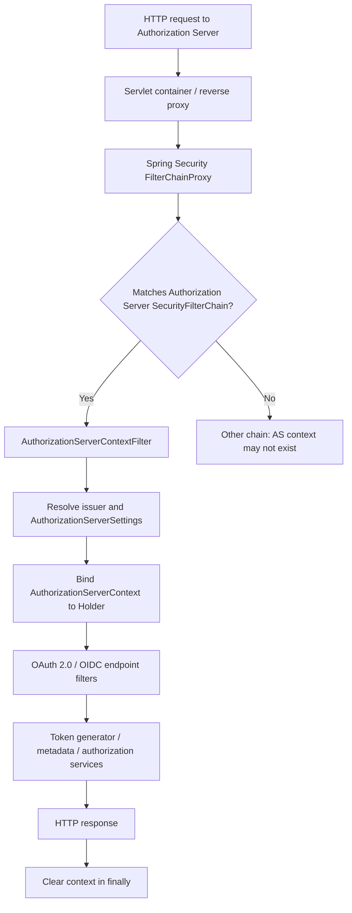
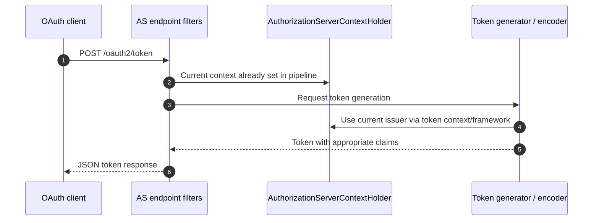
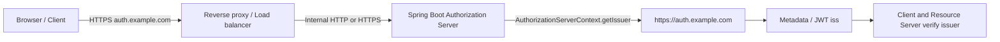

# Role of AuthorizationServerContext and the Current Issuer

## 1. Problem statement: which issuer is the Authorization Server handling the request for?

In the **Processing Architecture** chapter of module **SPRING_SECURITY_OAUTH2_OIDC_AUTHORIZATION_SERVER**, we examine an important detail when designing, configuring, securing, testing, and operating an OAuth 2.0/OpenID Connect Authorization Server with Spring Security and Spring Authorization Server on Spring Boot: **how do processing components know the identity of the Authorization Server serving the current request?**

When an application calls `/oauth2/authorize`, `/oauth2/token`, or an OpenID Connect endpoint, filters, token generators, and metadata generators all need a single consistent way to determine the **issuer**. That is the role of `AuthorizationServerContext`.

For example, users access the Authorization Server at:

```text
https://auth.example.com
```

The published public issuer may be:

```text
https://auth.example.com
```

A signed ID Token may carry claims:

```json
{
  "iss": "https://auth.example.com",
  "sub": "user-123",
  "aud": "demo-web",
  "iat": 1770000000,
  "exp": 1770000300
}
```

Timestamps and identities in the example are illustrative only. Token recipients must verify that `iss` matches the trusted issuer, alongside validating the signature, `aud`, expiration, and other protocol requirements. **The issuer is not merely a URL for concatenating paths**: it is the security identifier of the Authorization Server, used to bind metadata and tokens to the right issuer.

After this lesson, you will be able to:

- Explain how `AuthorizationServerContext`, `AuthorizationServerContextHolder`, and `AuthorizationServerSettings` differ.
- Trace how Spring Authorization Server sets up the context over an HTTP request lifecycle.
- Retrieve and use the current issuer in the right places while avoiding reading the context when no matching request exists.
- Distinguish the issuer from endpoint URLs, internal hostnames, `redirect_uri`, `audience`, and Spring Security's `SecurityContext`.
- Analyze the impact of reverse proxies, TLS, multiple hostnames, and multi-tenant architectures on issuer resolution.
- Design tests that detect issuer inconsistencies across metadata, tokens, and recipient configurations.

## 2. Three components to distinguish

### 2.1. `AuthorizationServerSettings`: effective server configuration

`AuthorizationServerSettings` holds settings for the Authorization Server, such as the **issuer** and endpoint paths. A simple configuration bean:

```java
import org.springframework.context.annotation.Bean;
import org.springframework.context.annotation.Configuration;
import org.springframework.security.oauth2.server.authorization.settings.AuthorizationServerSettings;

@Configuration
public class AuthorizationServerConfig {

    @Bean
    AuthorizationServerSettings authorizationServerSettings() {
        return AuthorizationServerSettings.builder()
                .issuer("https://auth.example.com")
                .build();
    }
}
```

In this example, `https://auth.example.com` is a **fixed issuer** explicitly specified for the deployment environment. Endpoints such as authorization, token, JWK Set, introspection, and revocation use the library version's defaults unless customized further.

`AuthorizationServerSettings` **is not an object describing the logged-in user**, not a repository storing authorization codes, and not an HTTP request/response. It is the **configuration source** so protocol components produce consistent information.

### 2.2. `AuthorizationServerContext`: Authorization Server state for the current request

In Spring Authorization Server, `AuthorizationServerContext` represents **the Authorization Server context active in the current execution flow**. Key accessible fields include:

```java
AuthorizationServerSettings settings = context.getAuthorizationServerSettings();
String issuer = context.getIssuer();
```

These two lines have distinct meanings:

- `getAuthorizationServerSettings()` supplies the Authorization Server settings used by the context.
- `getIssuer()` supplies the **issuer resolved for the current context**. This is the most critical value when components need to know who is issuing a token.

In a single-issuer system with explicit configuration, both values look straightforward: the current issuer is simply the configured issuer. When issuer is omitted or in multi-issuer systems, resolution depends on **the request and Authorization Server configuration**. Therefore, never blindly infer the issuer from an internal hostname or concatenate URLs manually.

### 2.3. `AuthorizationServerContextHolder`: access point to the current thread's context

`AuthorizationServerContextHolder` provides access to the context attached to the **current request-processing thread**. In how Spring Authorization Server works on the servlet stack, the holder stores a thread-scoped context set up and cleared by framework components across the request lifecycle.

```java
import org.springframework.security.oauth2.server.authorization.context.AuthorizationServerContext;
import org.springframework.security.oauth2.server.authorization.context.AuthorizationServerContextHolder;

AuthorizationServerContext context = AuthorizationServerContextHolder.getContext();

if (context != null) {
    String currentIssuer = context.getIssuer();
    // Use issuer within the appropriate request-processing scope.
}
```

`getContext()` **can return `null`** if called outside the scope where the Authorization Server establishes the context—for example, from a scheduled job, another thread, or an endpoint outside the relevant filter chain. Hence, never call `AuthorizationServerContextHolder.getContext().getIssuer()` indiscriminately without considering execution scope.

| Object | Question it answers | Typical scope |
| --- | --- | --- |
| `AuthorizationServerSettings` | With what settings is the Authorization Server configured? | Application configuration bean. |
| `AuthorizationServerContext` | For the request being processed, what are the effective issuer and settings? | One Authorization Server request execution. |
| `AuthorizationServerContextHolder` | Where can running components retrieve the current context? | Framework-managed request execution thread. |
| `SecurityContextHolder` | Who is the current security principal (`Authentication`)? | Spring Security context of the execution thread. |

**Key distinction:** `AuthorizationServerContext` tells you **which Authorization Server** is serving; `SecurityContext` tells you **which subject** is authenticated. A token endpoint authenticating a confidential client and an authorization endpoint handling a user session can share the same issuer while having different authentication contexts.

## 3. Context lifecycle in the processing architecture

### 3.1. From HTTP request to protocol endpoints

Spring Authorization Server integrates into Spring Security servlet via a `SecurityFilterChain` for protocol endpoints. Inside the Authorization Server configuration, an internal component creates and binds `AuthorizationServerContext` to the processing thread, commonly referred to as **`AuthorizationServerContextFilter`**.



Step-by-step explanation:

1. The client sends a request to the Authorization Server's public URL. The container and proxy layers forward it into the Spring Boot application.
2. `FilterChainProxy` selects the matching `SecurityFilterChain`. The protocol chain is configured by Spring Authorization Server via `OAuth2AuthorizationServerConfigurer`.
3. The context component resolves the effective issuer based on `AuthorizationServerSettings` and request details when needed.
4. `AuthorizationServerContext` is bound to `AuthorizationServerContextHolder`; downstream protocol components can read the same context.
5. The endpoint executes logic such as client authentication, authorization code validation, consent handling, or token/metadata generation.
6. Once processing finishes, the framework clears the context from the holder so subsequent requests never accidentally see leftover context.

The diagram shows **logical roles**; exact ordering among security filters depends on framework version and configuration. You do not need to register `AuthorizationServerContextFilter` manually in a properly configured Spring Authorization Server app. Managing the holder manually in ad-hoc ways easily introduces context-leak bugs across requests.

### 3.2. Why must the context be request-scoped?

Suppose a server handles two requests nearly simultaneously:

```text
Request A: https://auth.example.com/oauth2/token
Request B: https://auth.example.com/oauth2/authorize
```

Each request can have a different principal and grant; components need a consistent issuer **for that specific request**. Never store the current issuer in a mutable `static` variable or singleton field overwritten by concurrent requests. In systems supporting multiple issuers, doing so also risks cross-tenant mix-ups.

Thread-bound context works conveniently for synchronous servlet requests, but it does not automatically propagate safely across asynchronous threads. Places such as `@Async`, executors, scheduled jobs, or message consumers should receive an **explicit issuer/tenant identifier** from business data if genuinely needed, rather than expecting the holder to be populated.

### 3.3. Context vs. authorization state and session

`AuthorizationServerContext` **is not**:

- **HTTP session:** where login state or browser session data is kept.
- **`OAuth2AuthorizationService`:** where authorization state, codes, access/refresh tokens, and related metadata are stored per Spring Authorization Server's model.
- **`RegisteredClientRepository`:** where registered client configurations live.
- **`SecurityContext`:** where Spring Security's `Authentication` is stored.
- **`HttpServletRequest`:** the full HTTP request data such as URL, headers, cookies, and remote address.

The context focuses strictly on **effective Authorization Server identity/settings**, giving protocol components a consistent identifier without repeatedly re-reading config and request URLs.

## 4. What is the current issuer and how is it resolved?

### 4.1. Meaning of issuer in OAuth 2.0 and OpenID Connect

**Issuer** is the URL identifier of the party issuing tokens and metadata. In OpenID Connect, the `iss` claim in an ID Token must match the exact issuer the client expects based on provider configuration/discovery. In OAuth 2.0, the issuer is also central to Authorization Server metadata and supported issuer-identification mechanisms.

A typical issuer:

```text
https://auth.example.com
```

An issuer may include a path, for example:

```text
https://auth.example.com/tenant-a
```

However, the issuer must be a protocol-compliant, stable, and consistent URL containing no query string or fragment. In real internet deployments, use **HTTPS** and a trusted public domain; `http://localhost` is appropriate only for local exercises.

Do not confuse different URL kinds:

| Concept | Example | Role |
| --- | --- | --- |
| Issuer | `https://auth.example.com` | Authorization Server/OP identifier. |
| Authorization endpoint | `https://auth.example.com/oauth2/authorize` | Where clients send authorization requests. |
| Token endpoint | `https://auth.example.com/oauth2/token` | Where clients exchange codes or use valid grants for tokens. |
| JWK Set endpoint | `https://auth.example.com/oauth2/jwks` | Publishes public JWKs for signature verification. |
| Client redirect URI | `https://client.example.com/login/oauth2/code/demo-web` | Callback address registered by the client, **not the issuer**. |
| JWT `aud` | `https://api.example.com` or resource identifier | Intended recipient of the token, **not the issuer**. |
| Internal upstream | `http://auth-service:9000` | Proxy-to-app upstream address, **must never become the public issuer**. |

### 4.2. Explicitly configured issuer

For a stable production environment, the clearest approach is declaring the public issuer in `AuthorizationServerSettings`:

```java
@Bean
AuthorizationServerSettings authorizationServerSettings() {
    return AuthorizationServerSettings.builder()
            .issuer("https://login.example.com")
            .build();
}
```

Then `AuthorizationServerContext.getIssuer()` during normal requests returns the configured issuer. This avoids relying on whatever hostname or scheme the app observes behind a proxy.

Still, **setting issuer does not fix the whole infrastructure automatically**: browsers must still reach HTTPS properly, redirects must be valid, and metadata/endpoints returned to clients must be reachable from the client's network. If `issuer` differs from the real URL served by the system, clients will still hit connection or verification errors.

### 4.3. When issuer is not explicitly configured

If configuration omits issuer, Spring Authorization Server can resolve the issuer from the current request URL according to the version's mechanism. This is convenient for local demos, but understand the practical limitation:

```text
Client accesses:        https://login.example.com
Proxy sends to backend: http://auth-service:9000
Backend may observe:    scheme=http, host=auth-service, port=9000
```

If the app misidentifies its public address, metadata or token issuer claims may reflect internal names, HTTP schemes, or an unexpected host. Consequently, token recipients see `iss` mismatching the configured issuer, or clients are pointed at unreachable URLs.

Never rely on untrusted `Host` headers, `request.getRequestURL()`, or `X-Forwarded-Host` to determine the issuer. When deploying behind a reverse proxy, configure a **stable public issuer**, and configure/trust forwarded headers only at controlled infrastructure boundaries.

### 4.4. Context paths and issuers containing paths

Issuer `https://auth.example.com/tenant-a` is a completely different identifier from `https://auth.example.com` or `https://auth.example.com/tenant-b`. Comparing `iss` must use exact string equality per protocol rules; **never** strip paths, append slashes, or swap hostnames to force distinct issuers to match.

Also do not assume every endpoint can be built via string concatenation `issuer + "/oauth2/token"`. Endpoint paths may be customized, proxies may rewrite paths, and in multi-issuer systems URL structure must align with official routing rules. Read endpoint URLs from metadata when clients support discovery, and verify against the trusted issuer.

## 5. Who uses the issuer during processing?

### 5.1. Metadata and discovery generation

An Authorization Server/OIDC Provider publishes metadata so clients learn its endpoints, capabilities, and issuer identity.

Simplified example response from OpenID Provider Configuration:

```json
{
  "issuer": "https://auth.example.com",
  "authorization_endpoint": "https://auth.example.com/oauth2/authorize",
  "token_endpoint": "https://auth.example.com/oauth2/token",
  "jwks_uri": "https://auth.example.com/oauth2/jwks",
  "response_types_supported": ["code"],
  "subject_types_supported": ["public"],
  "id_token_signing_alg_values_supported": ["RS256"]
}
```

This is illustrative JSON, not guaranteed to match every field of an actual version/config. For OIDC, a common discovery endpoint is:

```text
GET https://auth.example.com/.well-known/openid-configuration
```

In Spring Authorization Server, OpenID Connect endpoints must be **enabled via OIDC configuration**; merely having the dependency does not enable all endpoints identically. For OAuth Authorization Server metadata, RFC 8414 defines `/.well-known/oauth-authorization-server` with URL placement rules relative to the issuer.

`issuer`, `authorization_endpoint`, `token_endpoint`, and `jwks_uri` must all describe a reachable, properly configured system. `AuthorizationServerContext` helps metadata generators use the effective issuer, but it is not responsible for validating external hostnames or certificates.

### 5.2. Token issuance and the `iss` claim

During JWT issuance, the token generator needs the effective issuer to set claims per token type and configuration. In Spring Authorization Server, contexts such as `JwtEncodingContext` can provide `AuthorizationServerContext` to token customization logic.



At the application level, a token customizer can read the context passed by the framework:

```java
import org.springframework.context.annotation.Bean;
import org.springframework.security.oauth2.core.OAuth2TokenType;
import org.springframework.security.oauth2.server.authorization.context.AuthorizationServerContext;
import org.springframework.security.oauth2.server.authorization.token.JwtEncodingContext;
import org.springframework.security.oauth2.server.authorization.token.OAuth2TokenCustomizer;

@Bean
OAuth2TokenCustomizer<JwtEncodingContext> issuerAwareCustomizer() {
    return tokenContext -> {
        AuthorizationServerContext serverContext =
                tokenContext.getAuthorizationServerContext();

        if (OAuth2TokenType.ACCESS_TOKEN.equals(tokenContext.getTokenType())
                && serverContext != null) {
            String currentIssuer = serverContext.getIssuer();
            // Can use currentIssuer to decide business claims
            // based on the configured and verified issuer.
            // Do not manually overwrite "iss" if the framework manages it.
        }
    };
}
```

This snippet illustrates **how to read the data** without modifying JWT contents. Without a real business requirement, you do not need a customizer just to inspect the issuer. Specifically, never overwrite `iss` to a different value inside `JwtEncodingContext.getClaims()` to "patch" an issuer error; fix the configuration or routing producing the wrong context.

**Distinguishing token formats:** an Access Token can be a JWT or an opaque token depending on configuration. Never assume every access token has a JWT payload with `iss` for clients to decode directly. For JWTs, verifiers check signature and claims per purpose. For opaque tokens, Resource Servers typically use introspection and matching validation policies.

### 5.3. How Resource Servers and OAuth clients trust an issuer

Example of a Resource Server using Spring Security to validate JWTs from a fixed issuer:

```yaml
spring:
  security:
    oauth2:
      resourceserver:
        jwt:
          issuer-uri: https://auth.example.com
```

When configured with `issuer-uri` as supported by Spring Security, the Resource Server can fetch metadata/JWK Set to set up token verification and validate the issuer. **The issuer must match exactly** the trusted source configured on the Resource Server; never accept arbitrary `iss` values self-declared by incoming tokens.

However, `issuer-uri` alone does not satisfy every security requirement: APIs must still validate appropriate `aud`, token type if needed, scopes/authorities, expiration, and access conditions. Different Resource Servers can have distinct audiences and policies even when trusting the same Authorization Server.

For an OIDC client, checking `iss` on the ID Token against the trusted issuer is essential, alongside verifying signature, audience (`aud` usually tied to client ID), expiration, and `nonce` when required by the flow. **Access Tokens and ID Tokens are never interchangeable.**

## 6. Getting the current issuer in code: proper usage and limits

### 6.1. Reading directly from `AuthorizationServerContextHolder`

If a component is **guaranteed to be called within an Authorization Server request lifecycle**, it can inspect the issuer like this:

```java
import org.springframework.security.oauth2.server.authorization.context.AuthorizationServerContext;
import org.springframework.security.oauth2.server.authorization.context.AuthorizationServerContextHolder;

public final class CurrentIssuerSupport {

    private CurrentIssuerSupport() {}

    public static String requireCurrentIssuer() {
        AuthorizationServerContext context = AuthorizationServerContextHolder.getContext();
        if (context == null || context.getIssuer() == null) {
            throw new IllegalStateException(
                    "No AuthorizationServerContext in the current request");
        }
        return context.getIssuer();
    }
}
```

This is a utility illustrating scope usage, not a mandatory framework class. Only call it when the caller knows the context must exist; if invoked from a regular REST controller, scheduled task, or out-of-band business service, throwing an exception may be the **expected behavior** since no current issuer applies.

If business logic needs the issuer later (such as an event-publishing job or async audit writer), **pass the issuer explicitly as a parameter** when creating the task:

```java
// Inside Authorization Server processing where context exists:
String issuer = CurrentIssuerSupport.requireCurrentIssuer();
auditService.recordAuthorizationEvent(issuer, "authorization_granted");

// Business-layer method receiving issuer explicitly:
void recordAuthorizationEvent(String issuer, String action) {
    // Save audit record keyed by issuer without reading ThreadLocal on another thread.
}
```

The second snippet is pseudocode illustrating explicit parameter passing, not standalone compilable Java. In real logs/audits, avoid writing authorization codes, Access Tokens, refresh tokens, client secrets, or sensitive data.

### 6.2. Prefer framework-provided context when already available

Certain Spring Authorization Server callbacks or specialized contexts expose `AuthorizationServerContext` directly on their API. When you receive such a context (for example inside `JwtEncodingContext`), prefer reading from the object provided by the framework instead of reaching back into the holder.

This reduces reliance on implicit thread state, makes component inputs explicit, and improves testability. Still, you never need to construct or attach the context manually for callbacks where the framework already provides it.

### 6.3. When not to use the holder

| Situation | Appropriate approach |
| --- | --- |
| `@Scheduled` job processing stored tokens | Read issuer from persisted records/tenant configuration; do not expect the holder to be set. |
| `@Async`, `CompletableFuture`, custom executor | Pass issuer/tenant ID explicitly into the task. |
| Service called from both OAuth endpoints and admin APIs | Do not let the service depend blindly on the holder; pass parameters per service contract. |
| Unit test of business class without a servlet request | Pass issuer as a test parameter or mock the abstraction instead of setting hidden ThreadLocals needlessly. |
| Need fixed issuer URL at startup | Inject `AuthorizationServerSettings`; do not read the holder outside requests. |

Remember that **what business logic needs is not always the "current issuer"**. If a task processes an authorization issued yesterday by a different issuer, read that authorization's issuer from trusted persisted data rather than from an unrelated current HTTP request.

## 7. Reverse proxies, HTTPS, and common issuer errors

### 7.1. Traffic through a load balancer



When a proxy terminates TLS, the backend may see `http://auth-service:9000` instead of the public HTTPS address. Some systems pass `Forwarded` or `X-Forwarded-*` headers to convey the original scheme, host, and port. Spring Boot offers configuration options for forwarded headers, such as:

```yaml
server:
  forward-headers-strategy: framework
```

This is only illustrative when the app **genuinely sits behind a trusted proxy**. Depending on your server/proxy and deployment environment, the container's native strategy or another configuration may be better suited. The proxy must strip/overwrite client-supplied forwarded headers before forwarding requests to the backend; otherwise, attackers can manipulate URLs computed by the app.

For a single-issuer Authorization Server, setting `AuthorizationServerSettings.builder().issuer("https://auth.example.com")` keeps the identity stable. Even so, you must still verify actual endpoint paths, public hostnames, HTTPS/cookie policies, redirects, and published metadata.

### 7.2. Errors caused by inconsistent issuers

| Symptom | Possible cause | Investigation step |
| --- | --- | --- |
| Resource Server reports invalid issuer | JWT `iss` differs from trusted `issuer-uri` | Compare exact token claim, metadata, and server configuration. |
| OIDC client reports issuer mismatch | Discovery publishes an issuer different from ID Token or client expectation | Check issuer configuration, discovery URL, hostname, and reverse proxy. |
| Metadata contains internal URLs or HTTP | Server saw wrong scheme/host when building URLs | Configure public issuer, trusted forwarded headers, routing, and HTTPS. |
| Requests to the same service emit different `iss` | Issuer inferred from unstable hostnames or multi-host routing | Pin canonical issuer or implement a proper multi-issuer strategy. |
| Recipient cannot fetch JWKS | `jwks_uri` points to wrong host/path or is network-blocked | Check metadata, public routing, and JWKS endpoint access. |
| After domain rename, old tokens are rejected | Old issuer differs from new issuer; verifier no longer trusts old issuer | Plan migration, token lifetimes, and phased issuer trust. |

**Never "fix" errors by disabling issuer verification.** A validly signed token issued by a different issuer may still be unauthorized for your system. Allowing arbitrary issuers breaks a critical trust boundary.

### 7.3. Issuer and Host header injection risk

An app building public URLs from untrusted `Host` or `X-Forwarded-Host` headers can emit metadata, redirects, or tokens containing a client-influenced issuer. An Authorization Server **inferring issuer per request** must be especially careful because the same app may be reached under multiple hostnames.

Defenses include:

- Restrict allowed hostnames/issuers at both infrastructure and application layers.
- Configure an explicit public HTTPS issuer for single-issuer deployments.
- Trust forwarded headers only from authenticated proxies that overwrite incoming client headers.
- Test requests with unexpected `Host` or forwarded headers to catch unintended issuer changes.
- Never concatenate the issuer with a user-supplied redirect URI or alter metadata based on untrusted request parameters.

## 8. Multiple issuers and multi-tenant architectures

### 8.1. One application, multiple issuing identities

An Authorization Server can serve multiple organizations or tenants, each identified by its own issuer:

```text
Tenant A: https://auth.example.com/tenant-a
Tenant B: https://auth.example.com/tenant-b
```

These two URLs are **two distinct issuers** despite sharing a hostname and Spring Boot process. Tenant A's tokens are not automatically accepted by Tenant B or Tenant B's Resource Servers. `AuthorizationServerContext.getIssuer()` enables per-request components to know which tenant's configuration and data to use.

Spring Authorization Server versions supporting **multiple issuers** provide a corresponding setting, for example:

```java
@Bean
AuthorizationServerSettings authorizationServerSettings() {
    return AuthorizationServerSettings.builder()
            .multipleIssuersAllowed(true)
            .build();
}
```

Exact APIs and support scope depend on your Spring Authorization Server version; check the **multi-tenancy** documentation for the exact version in use. Flipping a flag does not by itself turn an application into a secure multi-tenant system.

### 8.2. Components that must be partitioned by issuer

Beyond context/issuer, a multi-tenant architecture must address:

| Component | Question when serving multiple issuers |
| --- | --- |
| `RegisteredClientRepository` | Which issuer owns `client_id`, and which tenant's endpoints may a client use? |
| `OAuth2AuthorizationService` | Could an authorization code or token from one tenant be read/exchanged under another tenant? |
| `OAuth2AuthorizationConsentService` | How is user-to-client consent partitioned? |
| `JWKSource` and signing keys | Which key set/signing policy belongs to each issuer, and which JWKS is published? |
| Accounts, sessions, and authentication | Which users/identity providers may log into each tenant? |
| Metadata and endpoint routing | How is each request matched to the right issuer and its corresponding metadata? |
| Audit, cache, rate limiting | Are data and limits isolated per issuer/tenant? |

In this architecture, the issuer serves as both a **protocol identifier** and a key for selecting tenant configuration; however, mapping an issuer to a tenant must rely on a trusted configuration source/allowlist. Never read an arbitrary client-supplied issuer string and blindly select secrets, signing keys, or databases from it.

### 8.3. Why can't you just overwrite the `iss` claim?

Suppose Tenant A and Tenant B share the same registered clients and authorization store, while a customizer simply rewrites JWT `iss` based on request path. That could mint a token appearing to belong to B from an A transaction. The danger lies not in the `iss` field alone, but in **the inconsistency across the entire authentication, authorization, issuance, and verification lifecycle**.

Properly, the issuer is determined at context/routing resolution and propagated consistently into client lookup, authorization, consent, signing keys, and metadata generation. Resource Servers accept only permitted issuers and validate tokens under matching policies.

## 9. Systematically testing the current issuer

### 9.1. Hands-on check with a single issuer

Suppose a development environment places the issuer at:

```text
http://localhost:9000
```

Register the bean:

```java
@Bean
AuthorizationServerSettings authorizationServerSettings() {
    return AuthorizationServerSettings.builder()
            .issuer("http://localhost:9000")
            .build();
}
```

After enabling OIDC and starting the Authorization Server, inspect discovery using PowerShell:

```powershell
curl.exe -i http://localhost:9000/.well-known/openid-configuration
```

In the JSON response, inspect `issuer` and endpoints like `authorization_endpoint`, `token_endpoint`, and `jwks_uri`. The expected `issuer` value is **`http://localhost:9000`**. This example is strictly for `localhost`; real deployments must use HTTPS.

Next, run an Authorization Code Flow with a validly registered client requesting `openid` scope to obtain an **ID Token**. Decode the JWT payload to **observe** the `iss` claim (decoding payload is not signature verification), then check:

```text
issuer in discovery == ID Token iss == issuer trusted by the OIDC client
```

Also verify the token using a proper OIDC/JWT library rather than merely Base64URL-decoding it. Recipients must validate signature, `aud`, expiration, and `nonce` where required by the flow.

### 9.2. Minimum test matrix

| Case | Action | Expected result |
| --- | --- | --- |
| Explicit issuer | Configure fixed HTTPS issuer and query discovery | Metadata publishes the exact configured issuer. |
| Valid token | Issue ID Token via OIDC flow | `iss` matches trusted issuer and signature/claims are valid. |
| Wrong issuer at Resource Server | Configure `issuer-uri` different from token issuer | Resource Server rejects JWT with mismatched issuer. |
| Behind reverse proxy | Call public URL, inspect metadata and endpoint URLs | No internal hostnames leaked; scheme/host stay consistent. |
| Unexpected Host header | Send test request with disallowed host in test env | Issuer does not change unexpectedly; request is handled or rejected at the right layer. |
| Outside protocol request | Read holder from scheduled job or another thread | Does not assume context exists; logic uses explicitly passed issuer. |
| Two issuers/tenants, if supported | Send tenant-specific requests and check metadata/tokens | No cross-tenant mix-up of issuer, client, authorization, keys, or policies. |

**You do not necessarily need to write integration tests for every row right in this lesson**; the goal is understanding pass/fail conditions. In real products, these scenarios should become automated security test cases.

### 9.3. A concrete error analysis scenario

A system sits behind a reverse proxy:

```text
Public URL:             https://login.example.com
Backend URL:            http://authorization-server:9000
Discovery issuer:       http://authorization-server:9000
ID Token iss:           http://authorization-server:9000
OIDC client expected:   https://login.example.com
```

The client rejects the ID Token due to an issuer mismatch. Even though the JWT signature is valid, the recipient **is right to reject it**, because the token claims to be issued by a different identifier than the trusted issuer.

Resolution steps:

1. Confirm the supported public issuer: `https://login.example.com`.
2. Configure `AuthorizationServerSettings.issuer` to that issuer and verify the proxy path.
3. Ensure TLS, hostname, forwarded headers, and public endpoint routing are all accurate.
4. Restart per deployment procedure and verify discovery/JWKS/new ID Tokens.
5. Verify the OIDC client trusts the exact issuer without relaxing validation rules to silence the error.

If tokens were already issued under the old issuer, plan migration and token expiration; changing the issuer changes **the issuer's identity**, which can cause previously issued tokens to be rejected.

## 10. Misconceptions to avoid

1. **"`AuthorizationServerContext` holds user info."** False. It holds effective Authorization Server info; user/client authentication lives in separate mechanisms.
2. **"`AuthorizationServerContextHolder` can be called anywhere at any time."** False. The holder is bound to the active request lifecycle and may be empty in background threads or out-of-chain endpoints.
3. **"The issuer is simply the internal server hostname."** False. The issuer is a designed, trusted public identifier; proxies and containers may use different hostnames.
4. **"As long as the JWT signature is valid, any `iss` is fine."** False. Issuer is an independent and critical verification condition.
5. **"Issuer is the same as redirect URI or audience."** False. They have distinct purposes and owners.
6. **"Changing `iss` in a customizer is enough for multi-tenancy."** False. Partitioning clients, authorizations, consents, keys, and policies establishes true tenant boundaries.
7. **"Configuring `issuer` on the backend guarantees HTTPS."** False. TLS and certificates must actually operate at the network edge, with public URLs routed properly.
8. **"An OAuth Access Token is always a JWT."** False. Access Tokens can be opaque; you cannot validate them by decoding a nonexistent payload.

## 11. Self-check exercises

### Exercise 1: Explain the context lifecycle

Draw a diagram from `FilterChainProxy` to `/oauth2/token`, marking when the context is set, where the token generator reads the issuer, and when the context is cleared. Explain why a singleton service must never store `currentIssuer` in a mutable field shared across requests.

### Exercise 2: Distinguish issuer from other URLs

Given these values:

```text
issuer            = https://auth.example.com
token endpoint    = https://auth.example.com/oauth2/token
redirect_uri      = https://app.example.com/callback
resource audience = https://api.example.com
internal upstream = http://auth-service:9000
```

Explain which field is used to check `iss` and why `redirect_uri` or `internal upstream` must never be used as the issuer.

### Exercise 3: Reverse proxy

An API reports `Invalid issuer`, and discovery returns an internal HTTP URL. Propose an investigation order and configuration fix without disabling issuer verification. Also describe how to test that a spoofed `Host` header cannot alter the public issuer.

### Exercise 4: Tenant A and Tenant B

Two tenants share one Spring Boot cluster. Build a table listing which data must be separated by issuer, and describe the consequences if `RegisteredClientRepository` accidentally returns Tenant A's client while handling a Tenant B request.

### Mastery checklist

- [ ] Can distinguish `AuthorizationServerSettings`, `AuthorizationServerContext`, `AuthorizationServerContextHolder`, and `SecurityContextHolder`.
- [ ] Can describe how the context is established, used, and cleared within an Authorization Server request flow.
- [ ] Can explain why `context.getIssuer()` is the effective issuer, not necessarily the backend hostname.
- [ ] Knows to configure an explicit issuer for a fixed single-issuer deployment over HTTPS.
- [ ] Knows where not to read the holder directly (background threads, scheduled tasks, services outside requests).
- [ ] Can explain how discovery, ID Tokens, and recipient configuration must agree on the issuer.
- [ ] Can identify proxy/forwarded header risks and issuer-mixing risks in multi-tenant environments.
- [ ] Can design at least one positive test and one negative rejection test for issuer.

## 12. References and next steps

- [Spring Authorization Server Reference](https://docs.spring.io/spring-authorization-server/reference/) — Authorization Server configuration model, token generation, endpoints, and OIDC.
- [Spring Authorization Server API: AuthorizationServerContext](https://docs.spring.io/spring-authorization-server/docs/current/api/org/springframework/security/oauth2/server/authorization/context/AuthorizationServerContext.html) — interface to access issuer and settings in the current context.
- [Spring Authorization Server API: AuthorizationServerContextHolder](https://docs.spring.io/spring-authorization-server/docs/current/api/org/springframework/security/oauth2/server/authorization/context/AuthorizationServerContextHolder.html) — access point for context in the processing thread.
- [Spring Security Reference](https://docs.spring.io/spring-security/reference/) — servlet filter architecture, `SecurityContext`, and JWT Resource Server.
- [Spring Boot Reference](https://docs.spring.io/spring-boot/reference/) — application configuration and forwarded-header strategies.
- [RFC 8414 — OAuth 2.0 Authorization Server Metadata](https://www.rfc-editor.org/rfc/rfc8414) — issuer semantics and discovery metadata.
- [RFC 9207 — OAuth 2.0 Authorization Server Issuer Identification](https://www.rfc-editor.org/rfc/rfc9207) — using issuer to identify the Authorization Server in authorization responses where applicable.
- [OpenID Connect Core 1.0](https://openid.net/specs/openid-connect-core-1_0.html) — `iss` and ID Token validation conditions.
- [OpenID Connect Discovery 1.0](https://openid.net/specs/openid-connect-discovery-1_0.html) — issuer and OP configuration metadata.

**Core takeaway:** `AuthorizationServerContext` ensures Spring Authorization Server components agree on the effective issuer and settings within a request. A stable issuer configuration, trusted proxy boundaries, and recipient-side issuer verification are essential for an Authorization Server to issue tokens under the right identity and operate securely.
