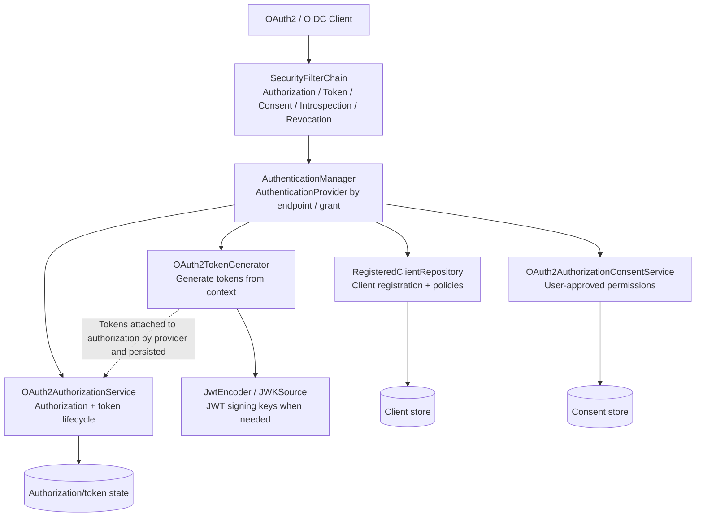
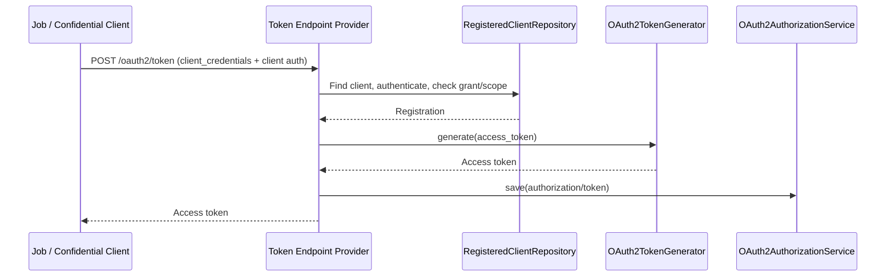
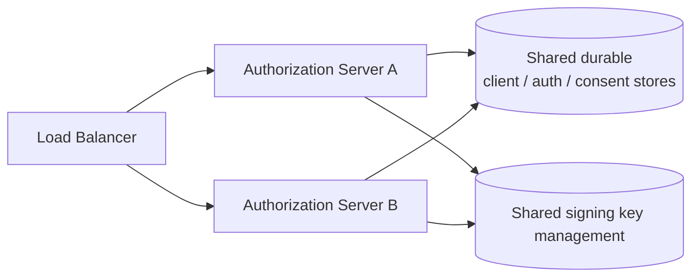

# Relationship Between Repository, Authorization Service, Consent Service, and Token Generator

## 1. The big picture

In the **Spring Security OAuth2/OIDC Authorization Server** module, the goal is to design, configure, secure, test, and operate an **OAuth 2.0/OpenID Connect Authorization Server** using **Spring Security and Spring Authorization Server** in a **Spring Boot** application. When studying the **processing architecture**, you must distinguish four components that frequently appear side by side:

1. **`RegisteredClientRepository`**: defines *which applications* may participate in the protocol and what settings are registered for each.
2. **`OAuth2AuthorizationService`**: records *a specific authorization/token grant instance* and the lifecycle of authorization codes, access tokens, refresh tokens, and related metadata.
3. **`OAuth2AuthorizationConsentService`**: remembers *which permissions a user has approved* for a client when consent is required.
4. **`OAuth2TokenGenerator<?>`**: *generates token values* (JWTs, opaque access tokens, refresh tokens, etc.) from the context assembled by authentication providers.

These four components **collaborate but never replace one another**. The repository is not a token store; consent is not an active authorization; the generator is not a database; and the authorization service does not dictate JWT signing algorithms.

### Learning outcomes

- Diagram the data flow across protocol endpoints, authentication providers, and the four components above.
- Distinguish `clientId` from `RegisteredClient`'s internal ID, stored consent from current scopes, and generated tokens from persisted tokens.
- Explain how Authorization Code + PKCE, Refresh Token, and Client Credentials use different subsets of these components.
- Configure JDBC persistence and token generators for multi-instance deployments while identifying security, token lifecycle, and revocation concerns.
- Verify processing flows when encountering `invalid_client`, `invalid_grant`, missing consent, JWT signing errors, or unresolvable tokens.

## 2. Where these components sit in Spring Authorization Server architecture

Spring Security routes HTTP requests through a `SecurityFilterChain`; endpoint filters convert requests into appropriate `Authentication` objects and dispatch them to `AuthenticationManager` and grant/endpoint **authentication providers**. Providers coordinate repositories, services, and generators; incoming requests never invoke repositories directly according to client wishes.



The diagram shows **logical relationships**, not an exact call sequence for every grant or library version. A provider may check scopes/consent before creating a code; the Token Endpoint may look up a persisted authorization before invoking the generator; not every request touches all four components.

### Responsibility table

| Component | Primary object / key | Common APIs | Generates tokens? | Persists data? |
| --- | --- | --- | --- | --- |
| `RegisteredClientRepository` | `RegisteredClient`; lookup by internal ID or `clientId` | `save`, `findById`, `findByClientId` | No | Yes, client registration data |
| `OAuth2AuthorizationService` | `OAuth2Authorization`; authorization ID or token + token type | `save`, `remove`, `findById`, `findByToken` | No | Yes, grant and token state |
| `OAuth2AuthorizationConsentService` | `OAuth2AuthorizationConsent`; `registeredClientId` + `principalName` | `save`, `remove`, `findById` | No | Yes, user consent |
| `OAuth2TokenGenerator<?>` | `OAuth2TokenContext` | `generate` | **Yes** | **No** |

**Rule of thumb:** the repository answers **"which client, which policies?"**; the authorization service answers **"what state is this grant/token in?"**; the consent service answers **"which permissions has this user approved for this client?"**; and the token generator answers **"which token type to create, with what contents?"**.

## 3. `RegisteredClientRepository`: source of truth for clients

### 3.1. The `RegisteredClient` model

`RegisteredClient` is Spring Authorization Server's model representing a registered client. Common properties:

- `id`: **stable internal identifier** of the record, referenced by authorizations and consents.
- `clientId`: client identifier sent in OAuth requests; **not a secret**.
- `clientSecret` and `clientAuthenticationMethods`: how the client authenticates (for confidential clients); secrets must be protected/hashed properly.
- `authorizationGrantTypes`: whether the client may use `authorization_code`, `refresh_token`, `client_credentials`, etc.
- `redirectUris`: registered callback addresses for redirect flows.
- `scopes`: maximum set of scopes the client is allowed to request.
- `clientSettings`: e.g., `requireProofKey` (PKCE), `requireAuthorizationConsent`.
- `tokenSettings`: e.g., access/refresh token TTLs and access token format.

Java example registering a server-side web client:

```java
RegisteredClient portal = RegisteredClient.withId("client-internal-portal")
        .clientId("portal-web")
        .clientSecret("{bcrypt}<bcrypt-hash-created-securely>")
        .clientAuthenticationMethod(ClientAuthenticationMethod.CLIENT_SECRET_BASIC)
        .authorizationGrantType(AuthorizationGrantType.AUTHORIZATION_CODE)
        .authorizationGrantType(AuthorizationGrantType.REFRESH_TOKEN)
        .redirectUri("https://portal.example.com/login/oauth2/code/portal-web")
        .scope(OidcScopes.OPENID)
        .scope(OidcScopes.PROFILE)
        .scope("orders.read")
        .clientSettings(ClientSettings.builder()
                .requireProofKey(true)
                .requireAuthorizationConsent(true)
                .build())
        .tokenSettings(TokenSettings.builder()
                .accessTokenTimeToLive(Duration.ofMinutes(10))
                .build())
        .build();
```

This illustrates the API structure; you must import the corresponding classes, generate a real bcrypt hash, and save the registration via the repository. Never copy placeholder secrets as production credentials.

Repositories usually use one of two implementations:

| Implementation | Characteristics | When to use |
| --- | --- | --- |
| `InMemoryRegisteredClientRepository` | Stored in process memory; does not sync across instances or survive restarts. | Demos, unit/integration tests, minimal setups. |
| `JdbcRegisteredClientRepository` | Uses a JDBC database and corresponding client schema. | Systems needing durable registrations, management/rotation, and multiple instances. |

You can implement `RegisteredClientRepository` yourself to load clients from another source, provided you maintain consistent lookup, accurate secrets/grants, and stable `id` values.

### 3.2. Distinguishing `id` and `clientId`

Suppose a client sends `client_id=portal-web`:

1. The system looks up the registration via `findByClientId("portal-web")`.
2. The registration has `id="client-internal-portal"`.
3. `OAuth2Authorization` and `OAuth2AuthorizationConsent` records reference this **internal ID**.

If every restart calls `RegisteredClient.withId(UUID.randomUUID().toString())` for the same `clientId` while authorization/consent data is persisted durably, those references break. Therefore, **never generate a new internal ID for an already-existing client** during migrations, seeding, or redeployments.

### 3.3. What the repository does not do

The repository does not verify user passwords, decide whether the user grants consent in the current interaction, generate JWTs, or track whether an authorization code was already redeemed. It only supplies client metadata/policies so other providers and services can enforce the protocol.

## 4. `OAuth2AuthorizationService`: lifecycle of an authorization grant

### 4.1. What does `OAuth2Authorization` hold?

An `OAuth2Authorization` represents the state of **a specific authorization/grant** and typically contains:

| Data | Meaning |
| --- | --- |
| `id` | Authorization ID, distinct from the client's ID. |
| `registeredClientId` | Foreign reference to `RegisteredClient.id`. |
| `principalName` | Subject bound to the authorization (user or client depending on grant). |
| `authorizationGrantType` | Grant that created the authorization. |
| `authorizedScopes` | Scopes actually granted for this authorization. |
| Tokens and metadata | Authorization code, access token, refresh token, ID token (if present), issued/expires timestamps, token claims/metadata, invalidated status, etc. |
| Attributes | Grant/flow-specific data added by providers as needed. |

Tokens inside `OAuth2Authorization` are wrapped in objects carrying **metadata**, such as invalidated state. This is essential to enforce single-use authorization codes and check status at token/introspection/revocation endpoints.

Typical operations:

```java
OAuth2Authorization authorization =
        authorizationService.findByToken(codeValue, new OAuth2TokenType("code"));

// After the provider validates grant/PKCE, generates tokens, and updates the authorization:
authorizationService.save(updatedAuthorization);

// Under a revocation/cleanup policy:
authorizationService.remove(updatedAuthorization);
```

This snippet illustrates lookup and persistence APIs, **not a DIY Token Endpoint flow**. In real apps, Spring Authorization Server's authentication providers verify clients, codes, PKCE, and token state. Never replace `findByToken` with ad-hoc plaintext token queries unless you fully understand the security constraints.

Common implementations:

- `InMemoryOAuth2AuthorizationService`: suits tests/demos; state is lost when the process exits.
- `JdbcOAuth2AuthorizationService`: persists authorizations in a database; requires the matching schema and `JdbcTemplate`.
- Custom service: uses another store or storage layout, while preserving OAuth2 token lookup and state semantics.

### 4.2. Why do JWTs still need an authorization service?

**Self-contained JWT** access tokens can have their signature, `iss`, `aud`, `exp`, and claims verified by a Resource Server **without calling back to the Authorization Server on every request**. Yet the Authorization Server still records authorization/token state to:

- track authorization codes, refresh tokens, and grant lifecycles;
- handle token revocation/introspection and status lookups per server design;
- correlate tokens with the client, scopes, and principal of the issuance event;
- support auditing and lifecycle policies when implemented by the application.

**Important limitation:** marking a JWT access token as revoked in the Authorization Server's database **does not automatically make every Resource Server reject that JWT immediately** if Resource Servers validate JWTs purely offline. Near-real-time revocation requires deliberate design—short-lived access tokens, status checks, controlled denylists/caching, or switching to opaque tokens + introspection where appropriate.

### 4.3. Authorization service and transactions

In token issuance, the token generator creates tokens first, and the provider saves the updated authorization after full verification. Consistency must prevent returning a token whose state failed to persist, or re-using a code due to race conditions. JDBC support does not automatically wrap **everything** from HTTP receipt to state storage in a distributed transaction. When scaling across instances, verify concurrency, uniqueness, single-use enforcement, and transactional behavior of your implementation.

## 5. `OAuth2AuthorizationConsentService`: user-approved permissions

### 5.1. Consent is distinct from login and tokens

**Authentication** proves a user's identity; **authorization/consent** decides whether a client may receive specific permissions. A user who logged in successfully may still not have approved a client to access their profile or order data.

`OAuth2AuthorizationConsent` stores pairs keyed by:

```text
(registeredClientId, principalName)  ->  consented authorities/scopes

Example:
("client-internal-portal", "alice") -> [SCOPE_profile, SCOPE_orders.read]
```

Providers can read saved consent, compare it against requested scopes, send the user to a consent page when needed, and update consent after approval. Whether consent is prompted again also depends on `ClientSettings.requireAuthorizationConsent`, scope types, custom logic, and the specific request.

**Saved consent does not mean the client automatically gets arbitrary scopes.** Providers must still check client registration, requested scopes, and other rules. Consent is also not an access token: while consent exists, prior tokens may already be expired or revoked, and vice versa.

### 5.2. API and persistence

```java
OAuth2AuthorizationConsent consent =
        consentService.findById("client-internal-portal", "alice");

// When the user approves and the provider builds updated consent:
consentService.save(updatedConsent);

// If remembered permissions must be withdrawn:
consentService.remove(updatedConsent);
```

Implementations:

- `InMemoryOAuth2AuthorizationConsentService`: convenient for examples and tests.
- `JdbcOAuth2AuthorizationConsentService`: persists consent durably in a database.
- Custom service: customizes policy or backend storage while keeping identifier/authority semantics intact.

If your project offers a "Withdraw consent" button, merely deleting the consent record **does not automatically invalidate all previously issued access/refresh tokens**. These are two distinct lifecycle management actions: removing consent and revoking corresponding authorizations/tokens. Design a dedicated workflow aligned with your system's data policy.

### 5.3. When is the consent service bypassed?

`client_credentials` typically has no interactive user, so **there is no resource-owner consent UI**. The Authorization Server still uses registrations and generators and may persist authorization/token state, without relying on end-user consent. Likewise, not every refresh token request prompts the user for consent again.

## 6. `OAuth2TokenGenerator`: generates tokens without storing state

### 6.1. Meaning of `OAuth2TokenContext`

Authentication providers prepare a context when issuing a token. `OAuth2TokenContext` can hold:

- `registeredClient`: client policies, including `TokenSettings`.
- `principal`: `Authentication` associated with the grant.
- `authorizationServerContext`: issuer and Authorization Server context data.
- `authorizationGrantType`, `authorizationGrant`: grant type and verified request.
- `authorizedScopes` and current `authorization` (if any).
- `tokenType`: target token to generate, such as access token, refresh token, or OIDC ID token.

The generator consumes this context and returns the corresponding token; it **does not re-validate the HTTP request, authenticate clients on behalf of the provider, persist tokens to a repository, or decide user consent**.

### 6.2. Common generators

| Generator | Typical token type | Dependencies |
| --- | --- | --- |
| `OAuth2AuthorizationCodeGenerator` | Authorization code for `authorization_code` flow. | Authorization request context; random code and policy TTL. |
| `JwtGenerator` | Self-contained JWT access token and OIDC ID token when context fits. | `JwtEncoder`; asymmetric signing typically relies on `JWKSource<SecurityContext>`. |
| `OAuth2AccessTokenGenerator` | Opaque/reference access token per `TokenSettings.accessTokenFormat`. | Context and token metadata; does not sign JWTs. |
| `OAuth2RefreshTokenGenerator` | Refresh token when grant/policy allows. | Context, grant type, and client settings. |
| `DelegatingOAuth2TokenGenerator` | Coordinates child generators; uses the matching result. | Must include generators for every expected token type. |

Normally, `DelegatingOAuth2TokenGenerator` invokes registered generators in sequence and returns the token created by the matching generator (or `null` if none supports that token type/context). Thus **generator order and membership** matter when customizing.

For access tokens:

- `OAuth2TokenFormat.SELF_CONTAINED` (JWT): Resource Servers can verify signature/claims independently.
- `OAuth2TokenFormat.REFERENCE` (opaque): Resource Servers typically call the Authorization Server's **Token Introspection Endpoint** to check whether the token is active and what permissions it carries, or use an equivalent architectural check.

Token format depends on `RegisteredClient.tokenSettings` and generator wiring; changing `tokenSettings` without the matching generator causes token issuance to fail.

### 6.3. Token customizers are not token stores

Spring Authorization Server supports customizing JWT claims via `OAuth2TokenCustomizer<JwtEncodingContext>` and opaque token claims via `OAuth2TokenCustomizer<OAuth2TokenClaimsContext>`. Customizers add or adjust token contents **at generation time**; they do not replace `OAuth2AuthorizationService` for state persistence, nor do they override registered/consented permissions.

Example adding a single technical claim to a **JWT access token**:

```java
@Bean
OAuth2TokenCustomizer<JwtEncodingContext> jwtClaimsCustomizer() {
    return context -> {
        if (OAuth2TokenType.ACCESS_TOKEN.equals(context.getTokenType())) {
            context.getClaims().claim("token_issuer_app", "spring-authorization-server");
        }
    };
}
```

When declaring your own `OAuth2TokenGenerator`, **wire the customizer into that generator explicitly**; never assume default auto-configuration attaches customizers to your custom bean automatically. Never put sensitive data, unnecessary personal info, or internal secrets into a JWT just because it is signed; JWT payloads are normally readable via decoding.

## 7. Collaboration sequence in Authorization Code + PKCE

This flow best illustrates each component's role. Suppose:

- `portal-web` is registered in `RegisteredClientRepository` with `authorization_code`, `refresh_token`, PKCE, and suitable scopes.
- User `alice` logs in via browser.
- The client requests `openid profile orders.read`; per policy, the system requires consent.

```mermaid
sequenceDiagram
    autonumber
    participant C as Browser / OAuth2 Client
    participant P as Authorization Server Providers
    participant R as RegisteredClientRepository
    participant S as OAuth2AuthorizationConsentService
    participant A as OAuth2AuthorizationService
    participant G as OAuth2TokenGenerator
    C->>P: GET /oauth2/authorize (client_id, scope, PKCE...)
    P->>R: findByClientId(client_id)
    R-->>P: RegisteredClient + policy
    P->>P: Authenticate user; validate request and PKCE challenge
    P->>S: Check recorded consent (when required)
    S-->>P: Approved permissions / none yet
    opt New consent required
        P-->>C: Consent UI
        C->>P: User approves requested scopes
        P->>S: save(consent)
    end
    P->>G: generate(authorization_code)
    G-->>P: Authorization code
    P->>A: save(authorization + code)
    P-->>C: Redirect to client with code
    C->>P: POST /oauth2/token (code, verifier, client auth...)
    P->>R: Lookup/authenticate client
    P->>A: findByToken(code)
    A-->>P: Persisted Authorization
    P->>P: Validate code, client, PKCE, redirect URI
    P->>G: generate(access/id/refresh tokens where applicable)
    G-->>P: Token objects
    P->>A: save(updated authorization, code invalidated)
    P-->>C: Token response
```

Note that the diagram only depicts **functional relationships** among components. Depending on grant type, OIDC scopes, consent, and version, intermediate state creation/saving timing may vary; authorization codes are also produced by the framework's generator. Keep in mind: **providers coordinate**, **generators create**, **services persist**, and **repositories/consent govern preconditions**.

### 7.1. Security checkpoints at each step

| Step | Key component | Rules to enforce |
| --- | --- | --- |
| Receive authorization request | Repository + provider | `client_id` exists, redirect URI is registered, scopes/grant are permitted. |
| User authentication / consent | Authentication + consent service | User identity verified; consented scopes do not exceed client allowance; CSRF enforced on consent UI. |
| Issue authorization code | Token generator + authorization service | Random code, short TTL; bound to right client, redirect URI, and PKCE challenge. |
| Exchange code for tokens | Authorization service + provider | Code valid/unused; client authentication, PKCE verifier, and redirect match; replay prevented. |
| Issue tokens | Token generator | Right token type/format, issuer, signature, TTL, scopes, and claims. |
| Save outcome | Authorization service | Consistent token state, code invalidated, valid refresh token policy. |

For example, if `client_id` does not exist, tweaking `OAuth2TokenGenerator` will **not** make the request succeed; the problem is registration. If code exchange fails with `invalid_grant` because the code was already used, tweaking the consent service will **not** fix the root cause either.

## 8. Comparing different grants

### 8.1. Client Credentials

Machine-to-machine flow with no end user:



In this flow, the consent service has no user to interact with. `principalName` in the authorization typically represents the client rather than a user account. Never interpret this token as representing a human user's identity.

### 8.2. Refresh Token

When a client requests a new access token using a refresh token:

1. The provider authenticates the client per applicable method and checks that `refresh_token` grant is allowed via registration.
2. `OAuth2AuthorizationService.findByToken(refreshToken, OAuth2TokenType.REFRESH_TOKEN)` looks up the authorization and verifies the token is not expired/invalidated.
3. The provider enforces scope policies, subject checks, and token settings.
4. The generator produces a new access token, and potentially a new refresh token depending on rotation/reuse settings.
5. The authorization service persists the updated state, invalidating the old token if policy requires, before completing the response.

User consent is usually **not re-prompted** on every refresh request. That does not mean a refresh request may exceed the originally authorized scopes.

### 8.3. OIDC ID Token

When an OIDC flow includes `openid` and matching conditions, `JwtGenerator` can produce an **ID token** conveying authentication results to the client. An ID token never replaces an access token for calling APIs. The authorization service may retain related metadata/tokens, yet Resource Servers must verify **access tokens meant for their APIs**, never accepting ID tokens arbitrarily.

### 8.4. Summary table

| Grant / flow | Repository | Authorization service | Consent service | Generator |
| --- | --- | --- | --- | --- |
| Authorization Code + PKCE | Checks client/grant/redirect/PKCE policy | Stores code, then tokens and used state | Reads/writes when user consent is required | Generates code, access token, refresh/ID token where applicable |
| Client Credentials | Authenticates confidential client, scopes/grant | Stores authorization and access token state | Usually unused | Generates access token |
| Refresh Token | Checks client and grant policy | Looks up old token, updates authorization and rotation | Usually not re-prompted | Generates access token and new refresh token if applicable |
| Token Introspection | Authenticates caller per config | Looks up token and status | Not a token lookup store | Normally generates no new token |
| Token Revocation | Authenticates caller per config | Updates/revokes token state | Does not automatically delete consent | Generates no new token |

## 9. JDBC configuration: three stores must align

In a production Authorization Server, configuring all three services durably with JDBC is very common. Example using **Spring Authorization Server 1.5.x** APIs:

```java
import org.springframework.context.annotation.Bean;
import org.springframework.context.annotation.Configuration;
import org.springframework.jdbc.core.JdbcTemplate;
import org.springframework.security.oauth2.server.authorization.JdbcOAuth2AuthorizationConsentService;
import org.springframework.security.oauth2.server.authorization.JdbcOAuth2AuthorizationService;
import org.springframework.security.oauth2.server.authorization.OAuth2AuthorizationConsentService;
import org.springframework.security.oauth2.server.authorization.OAuth2AuthorizationService;
import org.springframework.security.oauth2.server.authorization.client.JdbcRegisteredClientRepository;
import org.springframework.security.oauth2.server.authorization.client.RegisteredClientRepository;

@Configuration(proxyBeanMethods = false)
public class AuthorizationDataConfiguration {

    @Bean
    RegisteredClientRepository registeredClientRepository(JdbcTemplate jdbcTemplate) {
        return new JdbcRegisteredClientRepository(jdbcTemplate);
    }

    @Bean
    OAuth2AuthorizationService authorizationService(
            JdbcTemplate jdbcTemplate,
            RegisteredClientRepository registeredClientRepository) {
        return new JdbcOAuth2AuthorizationService(
                jdbcTemplate, registeredClientRepository);
    }

    @Bean
    OAuth2AuthorizationConsentService authorizationConsentService(
            JdbcTemplate jdbcTemplate,
            RegisteredClientRepository registeredClientRepository) {
        return new JdbcOAuth2AuthorizationConsentService(
                jdbcTemplate, registeredClientRepository);
    }
}
```

### Why do both authorization and consent services take the repository?

They must resolve **which client an internal ID refers to** and map to the client model when reading/writing records. All three services can share a database or use separate storage, though if separated you must guarantee referential integrity, consistency, availability, and data lifecycle alignment.

**Prerequisites before running:** configure `DataSource`, `JdbcTemplate`, JDBC driver, the exact tables/schema for your Spring Authorization Server version, and initial client records. The constructors above **do not create schemas, seed clients, add indexes, or encrypt sensitive columns for you**. In real deployments, use controlled schema migrations (Flyway/Liquibase or equivalent).

### Database checks to verify

- **Stable identifiers:** client records never change `id` across runs; authorizations/consents reference the right client.
- **Sensitive token data:** the authorization service can store token values/claims/attributes; restrict DB privileges, encrypt data at rest, and secure backups and logs.
- **TTL and cleanup policies:** expired authorizations accumulate without cleanup jobs; purge safely according to state and audit policies.
- **Concurrency:** test single-use authorization code exchange, refresh token rotation, retries, and multiple instances. Never treat a standalone `findByToken` call as a distributed lock.
- **Query performance:** token lookups must be fast with proper schemas and indexes; measure real load if introspection is called frequently.
- **Version compatibility:** schema migrations, column types, and metadata serialization can change across framework upgrades.

## 10. Declaring a custom token generator: cover all token types

If the application wants explicit control over JWTs, opaque access tokens, or refresh tokens, it can provide an `OAuth2TokenGenerator<?>` bean. Illustrative example:

```java
import com.nimbusds.jose.proc.SecurityContext;
import com.nimbusds.jose.jwk.source.JWKSource;
import org.springframework.context.annotation.Bean;
import org.springframework.context.annotation.Configuration;
import org.springframework.security.oauth2.jwt.NimbusJwtEncoder;
import org.springframework.security.oauth2.server.authorization.token.DelegatingOAuth2TokenGenerator;
import org.springframework.security.oauth2.server.authorization.token.JwtGenerator;
import org.springframework.security.oauth2.server.authorization.token.OAuth2AccessTokenGenerator;
import org.springframework.security.oauth2.server.authorization.token.OAuth2AuthorizationCodeGenerator;
import org.springframework.security.oauth2.server.authorization.token.OAuth2RefreshTokenGenerator;
import org.springframework.security.oauth2.server.authorization.token.OAuth2TokenGenerator;

@Configuration(proxyBeanMethods = false)
public class TokenGeneratorConfiguration {

    @Bean
    OAuth2TokenGenerator<?> tokenGenerator(JWKSource<SecurityContext> jwkSource) {
        OAuth2AuthorizationCodeGenerator codeGenerator =
                new OAuth2AuthorizationCodeGenerator();
        JwtGenerator jwtGenerator =
                new JwtGenerator(new NimbusJwtEncoder(jwkSource));
        OAuth2AccessTokenGenerator opaqueGenerator =
                new OAuth2AccessTokenGenerator();
        OAuth2RefreshTokenGenerator refreshGenerator =
                new OAuth2RefreshTokenGenerator();

        return new DelegatingOAuth2TokenGenerator(
                codeGenerator, jwtGenerator, opaqueGenerator, refreshGenerator);
    }
}
```

The example assumes the app already has a **`JWKSource<SecurityContext>` aligned** with managed signing keys. For production, store private keys in a secure vault, preserve keys across restarts, and plan intentional key rotation. Discovery/JWKS endpoints, issuer, `JwtDecoder` (when needed), and Resource Servers must agree on the chosen keys and algorithms.

**Risk of overriding defaults:** if you return only `new JwtGenerator(...)`, flows needing authorization codes, opaque access tokens, or refresh tokens may lack a matching generator (depending on how providers invoke the generator). If you instantiate `JwtGenerator` yourself and also define `OAuth2TokenCustomizer<JwtEncodingContext>`, attach the customizer explicitly, for example:

```java
JwtGenerator jwtGenerator = new JwtGenerator(new NimbusJwtEncoder(jwkSource));
jwtGenerator.setJwtCustomizer(jwtClaimsCustomizer);
```

A custom generator bean also does not create a `JWKSource` or replace `OAuth2AuthorizationService`: generated tokens must still be attached to the authorization by the provider and saved when applicable.

## 11. Operations and security design by responsibility

### 11.1. Data loss across restarts

Suppose an Authorization Server starts with:

```text
RegisteredClientRepository       = JDBC
OAuth2AuthorizationService        = InMemory
OAuth2AuthorizationConsentService = InMemory
OAuth2TokenGenerator              = JWT + Refresh
```

After a restart, client metadata in JDBC remains intact, but in-memory authorization codes, refresh tokens, and consents **disappear**. Clients may still authenticate at the Token Endpoint, yet existing refresh tokens cannot be found and users may be re-prompted for consent. This is **not a JWT generator bug**, but a storage boundary issue.

### 11.2. Multi-instance operation



If both instances share durable data stores and consistent key management, `/authorize` on A and `/token` on B can query the same authorization state **provided** other pieces like HTTP login sessions and transient flow data are also shared or routed appropriately. JDBC for the three services does not replace **session management** design.

If each instance generates its own fresh JWT signing key, tokens minted by A may fail verification against JWKS/decoders from B. If authorization services are isolated in-memory, a code issued on A cannot be found on B. Thus, state persistence and key management are **two independent requirements** in distributed deployments.

### 11.3. Scopes, consent, and claims

Distinguish three levels:

1. **Registered scopes:** permissions the client *may request*, read from `RegisteredClient.scopes`.
2. **Consented scopes:** permissions the user approved (when consent applies), read from `OAuth2AuthorizationConsentService`.
3. **Authorized scopes of the current grant:** permissions **actually granted** and saved on `OAuth2Authorization`; the token generator populates claims from this context and active policies.

Never assume the intersection of these three sets is identical across all flows: `client_credentials` has no user consent, scopes may undergo special handling, and applications may enforce extra policies. The invariant to test is that **tokens never grant permissions beyond what server policy allows**.

### 11.4. When revoking permissions

If a user withdraws consent, the application must decide whether to also revoke active authorizations/refresh tokens. If an administrator disables a client, review all active tokens/authorizations for that client. If access tokens are self-contained JWTs verified offline by Resource Servers, revoking in the authorization store will not block those JWTs before expiry. Organizations need explicit policies for token lifetimes, rotation, introspection, and revocation.

## 12. Troubleshooting by component

| Symptom | First component to inspect | Investigation path |
| --- | --- | --- |
| `invalid_client` at Token Endpoint | Client authentication + `RegisteredClientRepository` | `client_id`, secret/key, method, registration existence, secret encoding. |
| `unauthorized_client` / disallowed grant | `RegisteredClientRepository` | `authorizationGrantTypes`, client policy, redirect/flow. |
| `invalid_scope` | Registration + authorization provider | Registered scopes, actually requested scopes, and issuance policy. |
| User re-prompted for consent after restart | `OAuth2AuthorizationConsentService` | In-memory vs. JDBC, `principalName`, stable `registeredClientId`, saved consent. |
| Authorization code exchange fails | `OAuth2AuthorizationService` + provider | Expired/used code, missing after restart, PKCE/redirect/client mismatch. |
| Active refresh token suddenly gives `invalid_grant` | Authorization service + `TokenSettings` | Expired/revoked/rotated token, unshared storage, replay. |
| Cannot generate JWT / signing failure | Token generator, `JwtEncoder`, `JWKSource` | Signing key, algorithm, `kid`, token format, customizer. |
| Opaque access token fails Resource Server validation | Generator + introspection + authorization service | Token format, introspection client auth, lookup/expiry, and storage. |
| JWT still accesses APIs after revocation | Resource Server design | Offline JWT does not check revocation state; evaluate token TTL/introspection/denylist. |
| ID token missing expected claims | OIDC + `JwtGenerator`/customizer | OIDC enablement, `openid` scope, `JwtEncodingContext`, and provider behavior. |

**Effective debugging:** start from the failing HTTP endpoint/grant, inspect security logs with sensitive fields masked, verify client registration, confirm the service beans present in Spring's `ApplicationContext`, and then examine the token generator. Never log raw tokens, authorization codes, client secrets, private keys, or PKCE verifiers in production.

## 13. Integration testing checklist

Using one sample client and user set, verify:

1. **Client lookup:** `findByClientId` returns the right client; `RegisteredClient.id` does not change across restarts or migrations.
2. **Consent:** initial consent saves the exact authorized scopes; subsequent flows reuse it per policy; deleting consent triggers re-evaluation.
3. **Authorization Code + PKCE:** code is persisted and retrievable; redeeming with the right verifier succeeds; reused, wrong-verifier, and expired codes are rejected.
4. **Token issuance:** access token carries accurate issuer, audience, scopes, expiry, and token type; JWT signatures verify against published public keys; opaque tokens introspect as authorized.
5. **Refresh token:** refreshes follow policy, old tokens invalidate on rotation; invalid grants/scopes are blocked.
6. **Restart/multi-instance:** codes/refresh tokens/consents persist and work across instances as designed; JWKs stay consistent; login sessions are handled properly.
7. **Revocation:** revoking a token updates state; account for offline JWT validity limits and test introspection paths when used.
8. **Data store:** schema migrations succeed, queries use appropriate indexes, backups/logs never leak tokens, and cleanup runs on schedule.

When writing tests, distinguish **service unit tests** from **HTTP flow integration tests**. Mocking `OAuth2TokenGenerator` verifies the provider calls the generator, yet does not prove a JWT signature is valid. Conversely, validating a JWT signature does not prove authorization codes are single-use or that consent was persisted.

## 14. Summary by example

Imagine a booking management app: `booking-web` is allowed to request `booking.read` and `booking.write`.

- **The repository** stores client `booking-web` along with its redirect URI, PKCE requirement, grants, and allowed scopes.
- **The consent service** records that user `alice` approved `booking.read` for that client, but has not approved `booking.write`.
- When `alice` starts a new Authorization Code flow also requesting `booking.write`, the provider re-evaluates consent before completing the request; **previously saved consent never expands permissions on its own**.
- Once the grant succeeds, **the generator** creates the authorization code and needed tokens; **the authorization service** persists the code/tokens, principal, internal client ID, actually granted scopes, and lifecycle state.
- When the client refreshes tokens, the authorization service looks up the refresh token first and then the generator mints new tokens. When an admin revokes access, coordinate consent policy and authorization/token revocation.

Therefore, never collapse all four responsibilities into a single "token database" unless you have a deliberate abstraction proving all boundaries remain intact. In Spring Authorization Server, separate interfaces allow **controlled** testing, storage swapping, and token generation customization as long as protocol flows remain consistent.

## 15. References

- [Spring Authorization Server — Core Model / Components](https://docs.spring.io/spring-authorization-server/reference/core-model-components.html): `RegisteredClient`, `OAuth2Authorization`, `OAuth2AuthorizationConsent`, and service interfaces.
- [Spring Authorization Server — Configuration Model](https://docs.spring.io/spring-authorization-server/reference/configuration-model.html): configuring services, generators, and endpoint configurers.
- [Spring Authorization Server — Protocol Endpoints](https://docs.spring.io/spring-authorization-server/reference/protocol-endpoints.html): authentication providers and endpoint/grant handling responsibilities.
- [Spring Authorization Server — Implement core services with JPA](https://docs.spring.io/spring-authorization-server/reference/guides/how-to-jpa.html): considerations for persisting Authorization Server models in a database.
- [Spring Authorization Server — Customize claims and authorities](https://docs.spring.io/spring-authorization-server/reference/guides/how-to-custom-claims-authorities.html): customizing access token claims.
- [Spring Security — OAuth2 Resource Server JWT](https://docs.spring.io/spring-security/reference/servlet/oauth2/resource-server/jwt.html): validating JWTs on a Resource Server.
- [RFC 6749 — OAuth 2.0](https://www.rfc-editor.org/rfc/rfc6749): grants, authorizations, and clients.
- [RFC 7636 — PKCE](https://www.rfc-editor.org/rfc/rfc7636): binding authorization codes to code verifiers.
- [RFC 7009 — Token Revocation](https://www.rfc-editor.org/rfc/rfc7009) and [RFC 7662 — Token Introspection](https://www.rfc-editor.org/rfc/rfc7662): token lifecycle and status inspection.

**Architectural conclusion:** providers coordinate the protocol; `RegisteredClientRepository` manages client identity/policies, `OAuth2AuthorizationConsentService` holds user consent, `OAuth2AuthorizationService` tracks authorization/token state, and `OAuth2TokenGenerator` mints tokens from context. Only when all four components are consistently configured across client IDs, scopes, token formats, persistence, and signing keys can an Authorization Server process OAuth2/OIDC accurately and operate reliably.
