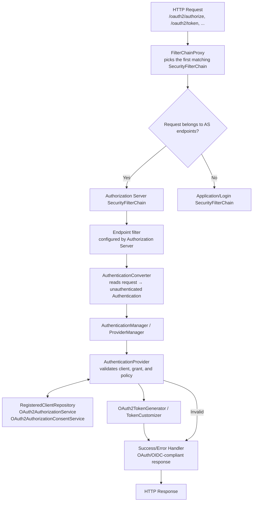

# Standard Extension Points and the Limits of Modifying Internal Filters

## 1. Architectural problem: customizing without breaking the protocol

When building an **OAuth 2.0/OpenID Connect (OIDC) Authorization Server** with **Spring Security** and **Spring Authorization Server** in a Spring Boot application, business requirements often go beyond sample configurations:

- Adding claims such as `tenant_id` to JWT access tokens.
- Allowing only certain clients to request sensitive scopes.
- Integrating user authentication with an enterprise database.
- Adding a client authentication mechanism or extension grant.
- Customizing login pages, consent pages, and error responses.
- Persisting authorizations, tokens, and consents in a shared database.
- Attaching a correlation ID for request tracing without logging tokens.

A tempting approach is to locate the filter handling `/oauth2/authorize` or `/oauth2/token` and replace it, alter its order, or modify its logic directly. However, an OAuth/OIDC endpoint does more than handle HTTP: it must validate clients, grants, redirect URIs, scopes, PKCE, code state, consent permissions, tokens, metadata, and standards-compliant error responses.

**Central principle:** Start with the **public extension points provided by Spring Authorization Server/Spring Security**. Only add an HTTP-layer filter when the requirement truly concerns cross-cutting HTTP handling and no suitable hook exists at the protocol, authentication, or service layer.

This lesson helps you:

1. Map a request's path through Spring Security and Authorization Server.
2. Pick the right extension API for each requirement.
3. Distinguish **protocol-level** extensions from modifying **filter internals**.
4. Recognize the hazards of replacing filters, bypassing providers, or minting tokens manually.
5. Test and operate customized configurations in multi-instance Spring Boot environments.

> Illustrative API names are based on the modern Spring Security/Spring Authorization Server model. Method signatures and availability must be verified against your project's exact dependency versions; this lesson focuses on architecture and extension boundaries.

## 2. Map of an Authorization Server request flow

In a Spring Boot application using Spring Security servlet, requests enter the appropriate security filter chain. With Spring Authorization Server, `OAuth2AuthorizationServerConfigurer` configures components for standard endpoints along with public customization hooks.



This diagram is a general model for endpoints handling authentication/token issuance. Discovery, JWK Set, OIDC, or administrative endpoints may follow different paths; not every endpoint issues tokens or runs through a single `AuthenticationProvider`.

Different layers carry different responsibilities:

| Layer | Responsibility | Preferred customization path |
|---|---|---|
| **SecurityFilterChain / RequestMatcher** | Selects which requests receive security policies | `securityMatcher`, filter chain order, `authorizeHttpRequests` |
| **Endpoint configurer** | Registers/adjusts OAuth/OIDC endpoints | `OAuth2AuthorizationServerConfigurer` and endpoint DSLs |
| **AuthenticationConverter** | Parses HTTP data into an `Authentication` request | Endpoint-supported converter extensions |
| **AuthenticationProvider** | Validates requests and enforces grant rules | Custom provider or configuring built-in providers via hooks |
| **Repository / Service** | Persists and queries clients, authorizations, consents | Public service and repository interfaces |
| **TokenGenerator / TokenCustomizer** | Creates tokens and enriches claims | `OAuth2TokenGenerator`, `OAuth2TokenCustomizer` |
| **Success/Error Handler** | Emits protocol-compliant HTTP responses | Endpoint response/error handler hooks |
| **Spring Security login** | Authenticates end users and maintains sessions | `AuthenticationProvider`, `UserDetailsService`, login page, session management |
| **Resource Server** | Validates access tokens and authorizes APIs | `oauth2ResourceServer`, `JwtDecoder`, opaque introspector, authorization policies |

**Key point:** An Authorization Server filter is the protocol execution point, not necessarily the right extension point for business logic. When changing *how a grant is verified*, replacing or adding an `AuthenticationProvider` via the DSL has a far clearer blast radius than replacing an entire endpoint filter.

## 3. Distinguishing three kinds of customization

### 3.1. Configuration customization: the default first choice

Many requirements are solved by built-in configuration:

- `RegisteredClient`: client authentication methods, allowed grant types, redirect URIs, scopes.
- `ClientSettings`: PKCE requirements, consent requirements, and client-level policies.
- `TokenSettings`: authorization code/access token/refresh token lifetimes, token format, refresh token reuse.
- `AuthorizationServerSettings`: issuer and endpoint paths per version capabilities.
- `OAuth2AuthorizationService`, `OAuth2AuthorizationConsentService`: persisting authorization and consent state.

Configuration customization reuses standard validations and flows. For example, to require PKCE for a client, enable `requireProofKey(true)` in `ClientSettings` instead of writing a filter to inspect `code_challenge` manually.

### 3.2. Policy and processing customization: using extension APIs

When a requirement introduces custom logic at a well-defined stage, use the hook for that stage:

- Adding claims → `OAuth2TokenCustomizer`.
- Validating an extension grant → `AuthenticationConverter` + `AuthenticationProvider` on the Token Endpoint.
- Adding a new client authentication mechanism → client authentication hooks and dedicated providers.
- Mapping OIDC UserInfo claims → mapper/provider mechanisms supported by the OIDC endpoint.
- Changing how authorizations/consents are stored → implement the service interfaces.
- Adding auditing/tracing → appropriate instrumentation, events, handlers, or hooks; use a filter only when capturing HTTP-level traits.

Test both **success paths and failure paths**. A new converter whose token type is unrecognized by any provider will never complete the grant; a provider that issues tokens without saving the authorization breaks revocation, introspection, and refresh.

### 3.3. HTTP infrastructure customization: filters are conditional

A servlet filter can be appropriate for setting a correlation ID, applying security headers, or enforcing HTTP-level request constraints. However, it is not the default place to:

- Handle authorization code exchanges manually.
- Bypass PKCE or client authentication.
- Mint OAuth access tokens directly.
- Handle consent manually.
- Rewrite protocol errors into HTTP 200.
- Mutate the token store from unauthenticated request data.

**Criteria for choosing a filter:** the logic genuinely belongs at the HTTP layer, can be expressed independently of protocol state, does not alter endpoint decisions, and has a well-defined position in the chain.

## 4. Scoping SecurityFilterChain properly

An application hosting an Authorization Server alongside a login page usually needs **at least two security filter chains**: one for AS endpoints and one for web/login functionality. Common setup with modern configurer APIs:

```java
@Configuration
@EnableWebSecurity
class AuthorizationServerSecurityConfiguration {

    @Bean
    @Order(1)
    SecurityFilterChain authorizationServerSecurityFilterChain(
            HttpSecurity http) throws Exception {

        OAuth2AuthorizationServerConfigurer authorizationServer =
                OAuth2AuthorizationServerConfigurer.authorizationServer();

        http
            .securityMatcher(authorizationServer.getEndpointsMatcher())
            .with(authorizationServer, as ->
                    as.oidc(Customizer.withDefaults()))
            .exceptionHandling(exceptions -> exceptions
                .defaultAuthenticationEntryPointFor(
                    new LoginUrlAuthenticationEntryPoint("/login"),
                    new MediaTypeRequestMatcher(MediaType.TEXT_HTML)));

        return http.build();
    }

    @Bean
    @Order(2)
    SecurityFilterChain applicationSecurityFilterChain(
            HttpSecurity http) throws Exception {

        http
            .authorizeHttpRequests(auth -> auth
                .anyRequest().authenticated())
            .formLogin(Customizer.withDefaults());

        return http.build();
    }
}
```

This structure **illustrates how chains are split**, not a standalone runnable app. The app still needs appropriate beans/configuration for client repository, authorization service, consent service, JWK/signing keys, issuer, user authentication, and needed OIDC mechanisms. Other requirements such as protecting the UserInfo Endpoint with access tokens must be verified and configured according to your framework version/capabilities.

At runtime, `FilterChainProxy` normally picks **the first matching `SecurityFilterChain`**. Therefore:

1. **`@Order` governs priority across chains.** If a catch-all chain precedes the AS chain, OAuth/OIDC endpoints may not be processed as intended.
2. **`securityMatcher` defines a chain's scope**, not authorization rules inside it. `authorizeHttpRequests` decides which requests must be authenticated or permitted within that matched scope.
3. **OIDC endpoints may need to be included in the AS matcher** via the configurer before building the chain; avoid hardcoding path lists manually and missing discovery, UserInfo, or customized endpoints.
4. **The `/login` page typically belongs to the application chain**, so ensure unauthenticated AS requests can reach the real login flow.
5. **Never disable CSRF or authentication globally** just to "make `/oauth2/token` work". Endpoint CSRF and authorization should follow the official configurer and per-client/request semantics.

### 4.1. `securityMatcher` vs. `requestMatchers`

Compare:

```java
http.securityMatcher("/oauth2/**");       // Selects whether this chain applies
http.authorizeHttpRequests(auth ->
    auth.requestMatchers("/public/**").permitAll()
        .anyRequest().authenticated());   // Decides permissions inside the chain
```

These are two isolated lines illustrating meaning, **not a complete configuration to copy**. Using only `/oauth2/**` can miss `/.well-known/openid-configuration` or other OIDC endpoints. `authorizationServer.getEndpointsMatcher()` is the safer choice for endpoints managed by the configurer.

## 5. Supported extension points at OAuth 2.0 endpoints

Spring Authorization Server exposes endpoint configuration branches (DSL) for attaching converters, providers, and handlers within specific scopes. Exact hook names may differ across versions, yet the groupings below represent the long-term structure.

| Endpoint / flow | Representative hooks | When to use | Never use to |
|---|---|---|---|
| **Authorization Endpoint** | `authorizationEndpoint(...)`: authorization request converter, authentication provider, consent page, response/error handler | Customize code request handling, consent, or responses | Arbitrarily redefine `response_type` or skip redirect/CSRF/state checks |
| **Token Endpoint** | `tokenEndpoint(...)`: access token request converter, authentication provider, response/error handler | Add valid grants, enforce token issuance policies | Return tokens manually while skipping the authorization store |
| **Client Authentication** | `clientAuthentication(...)`: authentication converter/provider, success/error handler | Add or integrate client authentication methods | Trust a self-declared `client_id` without verifying credentials |
| **Token Revocation** | `tokenRevocationEndpoint(...)`: provider/handlers per available API | Customize revocation handling/auditing | Treat clearing a browser session as revoking OAuth tokens |
| **Token Introspection** | `tokenIntrospectionEndpoint(...)`: provider/handlers per available API | Serve token status checks | Return `active=true` without validating the token and caller permissions |
| **OIDC** | `oidc(...)` and related endpoint configurers | Enable discovery, UserInfo, and supported OIDC features | Mint ID tokens manually without issuer, audience, nonce, and signature rules |

Spring Authorization Server's DSL typically offers methods to add a single converter/provider or customize the existing converter/provider list. **Do not wipe out all default providers** and install one catch-all provider for every grant: default providers enforce numerous standardized security checks.

### 5.1. Customizing the Token Endpoint

This example only shows **where to attach** a fully implemented extension grant. Hypothetical classes `CustomGrantAuthenticationConverter` and `CustomGrantAuthenticationProvider` must be built separately:

```java
OAuth2AuthorizationServerConfigurer authorizationServer =
        OAuth2AuthorizationServerConfigurer.authorizationServer();

http
    .securityMatcher(authorizationServer.getEndpointsMatcher())
    .with(authorizationServer, as -> as
        .tokenEndpoint(tokenEndpoint -> tokenEndpoint
            .accessTokenRequestConverter(
                new CustomGrantAuthenticationConverter())
            .authenticationProvider(
                customGrantAuthenticationProvider)));
```

The provider here should be supplied via dependency injection or constructed with required services. The snippet above is a **hook integration snippet**, not a standalone runnable extension grant.

For a new grant, complete all steps:

1. Pick an unambiguous `grant_type` identifier, avoiding collisions with standard grants or improper URIs.
2. Have the Converter parse and syntax-check parameters and emit an unauthenticated `Authentication`.
3. Have the Provider accept only its supported authentication type in `supports(...)`.
4. Have the Provider verify the authenticated client, that the grant is registered for the client, and all grant-specific conditions.
5. Have the Provider resolve allowed scopes, prepare `OAuth2TokenContext`, and invoke `OAuth2TokenGenerator`.
6. Have the Provider persist `OAuth2Authorization` and token state via `OAuth2AuthorizationService`.
7. Route results through standard HTTP response handlers; raise errors with appropriate `OAuth2Error`/`OAuth2AuthenticationException` types.

Do not design a custom grant simply because a standard flow is not yet well understood. Authorization Code + PKCE and Client Credentials cover most needs; extension grants enlarge the attack surface and maintenance burden.

### 5.2. How do Converter, Provider, and Handler differ?

Suppose the Token Endpoint receives a custom-defined parameter:

```text
POST /oauth2/token
grant_type=urn:example:grant-type:custom
assertion=...
```

Ideal separation of responsibilities:

- **Converter:** Validates request structure (required parameters, missing/duplicate parameters per rules) and builds `CustomGrantAuthenticationToken`. The converter **does not decide** whether the assertion is business-valid, does not sign JWTs, and does not write to databases.
- **Provider:** Verifies the assertion, validates the authenticated client, checks grant/scope/policy, calls the token generator, and persists authorization state. The provider returns an authenticated `Authentication` on success.
- **Handler:** Translates the outcome into a standard HTTP response, preserving headers, cache behavior, and OAuth error semantics; it is not where you decide which client gets authorized.

Separating tasks this way allows independent testing: malformed requests → converter/endpoint; invalid credentials → provider; wrong JSON/status → handler. Cramming everything into a single filter makes failures hard to trace, hard to test, and prone to violating specs.

## 6. Customizing tokens: prefer `OAuth2TokenCustomizer`

Adding a claim to a JWT access token **does not require rewriting the Token Endpoint filter** or manually building JWTs with another library. Spring Authorization Server supports `OAuth2TokenCustomizer<JwtEncodingContext>`.

Example adding an application-classification claim (value is illustrative only):

```java
@Bean
OAuth2TokenCustomizer<JwtEncodingContext> jwtTokenCustomizer() {
    return context -> {
        if (OAuth2TokenType.ACCESS_TOKEN.equals(
                context.getTokenType())) {

            String clientId =
                    context.getRegisteredClient().getClientId();

            context.getClaims().claim(
                    "application_id", clientId);
        }
    };
}
```

**Scope of this example:** Only alters claims of **JWT access tokens** produced through the matching token generator mechanism. It does not automatically apply to opaque access tokens or implicitly alter ID tokens. To enrich ID tokens, target the ID token type branch while respecting OIDC rules. For opaque tokens, use the separate hook based on `OAuth2TokenClaimsContext`.

Security guidelines:

- Claims placed in access tokens must come from **trusted data**; never copy a client-supplied `tenant_id` verbatim.
- Never embed secrets, passwords, refresh tokens, or unnecessary personal data in JWTs; JWT payloads are readable by token holders unless separately encrypted.
- Never alter `iss`, `aud`, `sub`, or `exp` arbitrarily for business convenience; they govern token verification.
- Resource Servers must **actively enforce** any new claim if it gates access; merely placing a claim in a token creates no access control.
- Register an `OAuth2TokenCustomizer` consistently with your active token generator; if you declare a custom `OAuth2TokenGenerator`, verify that your customizer is attached to it.

### 6.1. When is a custom `OAuth2TokenGenerator` warranted?

`OAuth2TokenCustomizer` suffices for adding or adjusting claims on supported token types. A custom `OAuth2TokenGenerator` is only warranted when changing **how tokens are created** in ways standard generators cannot satisfy, such as integrating an internal token format with special structural requirements.

When replacing a generator, preserve essential contracts: token type, grant type, audience, expiration, signing/verification compatibility, state persistence for revocation/introspection, and Resource Server interoperability. For a simple "add a claim" need, replacing the generator adds unnecessary risk.

## 7. Client policies and persistence: service-layer extension points

Requirements frequently misimplemented with filters include **"grant only client X certain scopes", "give each client a different TTL", "store consent in a database", "disable tokens when a user disconnects"**. These are primarily configuration, policy, and persistence concerns.

### 7.1. Client registration

```java
RegisteredClient client = RegisteredClient
    .withId(UUID.randomUUID().toString())
    .clientId("orders-bff")
    .clientSecret(passwordEncoder.encode(secretFromSecureStore))
    .clientAuthenticationMethod(
        ClientAuthenticationMethod.CLIENT_SECRET_BASIC)
    .authorizationGrantType(
        AuthorizationGrantType.AUTHORIZATION_CODE)
    .authorizationGrantType(
        AuthorizationGrantType.REFRESH_TOKEN)
    .redirectUri("https://app.example.com/login/oauth2/code/orders-bff")
    .scope(OidcScopes.OPENID)
    .scope("orders.read")
    .clientSettings(ClientSettings.builder()
        .requireProofKey(true)
        .requireAuthorizationConsent(true)
        .build())
    .tokenSettings(TokenSettings.builder()
        .accessTokenTimeToLive(Duration.ofMinutes(10))
        .refreshTokenTimeToLive(Duration.ofDays(7))
        .build())
    .build();
```

This is a **confidential backend client** example: the secret is loaded from a secure store and never exposed to browsers. The registration ensures the client may only request registered grants/scopes while enforcing PKCE, consent, and TTLs. Providers still verify these constraints at request time.

### 7.2. Service interfaces instead of modifying filters for token storage

Public abstractions include:

| Interface | Managed data | Extension scenarios |
|---|---|---|
| `RegisteredClientRepository` | Registered clients | Reading from database, client administration config |
| `OAuth2AuthorizationService` | Authorizations, codes, tokens, and metadata | JDBC or durable store; policy-driven queries/revocation |
| `OAuth2AuthorizationConsentService` | Principal consent per registered client | Saving/updating/withdrawing consent |
| `OAuth2TokenGenerator` | How tokens are created | Changing token issuance when customizers are insufficient |
| `JWKSource<SecurityContext>`, signing keys, and decoders | Key material and signature verification | Secure key storage, key rotation, serving JWKS per design |

Spring Authorization Server ships `InMemory...` implementations suited for demos and JDBC implementations for core stores. Multi-instance apps need shared authorization/consent state and consistent key management. Reaching into `OAuth2TokenEndpointFilter` fields to query a token DB is the wrong layer unless a specific version exposes a supported extension API.

### 7.3. Scenario: "restrict sensitive scopes by tenant"

There are three distinct control layers:

1. **Registration:** Is the client registered for that scope?
2. **Authorization policy:** Is the user/tenant allowed to be granted that scope in this request?
3. **Resource Server:** Does the current access token have permission to access the **specific data object**?

You can enforce the policy in an `AuthenticationProvider`, an exposed authorization mechanism, or a service called by the provider, while the API still enforces business permissions. A filter inspecting the `scope` string in the URL cannot replace these checks, since client requests vary and actually issued scopes must be decided by trusted logic.

## 8. Customizing user login and consent at the right layer

An Authorization Server handles both **user authentication** and **client authorization**. These two processes do not live entirely inside the same filter:

- **User login:** Customized via Spring Security—`AuthenticationProvider`, `UserDetailsService`, MFA flows, `formLogin`, and session policies.
- **OAuth consent:** Customized via `authorizationEndpoint(...)`, `consentPage(...)`, policies, and `OAuth2AuthorizationConsentService`.
- **Client authentication:** Customized via `clientAuthentication(...)` and matching providers/converters for client secrets, private key JWT, mTLS, or supported methods.

**Do not confuse the user principal with client authentication.** The Token Endpoint can authenticate a client independently of any user HTTP session. Client Credentials has no end user. A filter reading `SecurityContextHolder.getContext().getAuthentication()` and assuming it represents an "authorized user" causes semantic bugs across endpoints and grant types.

### 8.1. Custom login page

Spring Security can configure a login page in the application chain:

```java
http
    .authorizeHttpRequests(auth -> auth
        .requestMatchers("/login", "/assets/**").permitAll()
        .anyRequest().authenticated())
    .formLogin(form -> form
        .loginPage("/login")
        .permitAll());
```

This snippet only illustrates login configuration; the application must actually serve `GET /login`, handle credentials securely, and keep CSRF/session flows consistent. Never replace the Authorization Endpoint filter just to render a login screen.

### 8.2. Custom consent page

For clients requiring consent, the Authorization Server can route to an application-provided consent page. That page must accurately display the client, requested scopes, and existing approvals; the submission form must prevent CSRF/tampering and never let the client dictate granted permissions.

UI/consent customization should build on Authorization Endpoint hooks and the consent service. **Never implement consent by generating authorization codes manually inside a controller**: doing so bypasses protocol pipeline checks.

## 9. Customizing OIDC: do not mint ID tokens in a filter

OIDC builds on OAuth 2.0 to authenticate users for clients/Relying Parties. Enabling `oidc(...)` on the Authorization Server provides features such as OIDC Provider Configuration, UserInfo, and endpoints supported by that version.

OIDC customizations typically fall into these groups:

| Need | Suitable extension point |
|---|---|
| Enable OIDC and discovery | `oidc(Customizer.withDefaults())` and `AuthorizationServerSettings` |
| Adjust ID token claims | `OAuth2TokenCustomizer<JwtEncodingContext>` targeting ID token type with trusted data |
| Return extra UserInfo claims | Mapper/service supported by the OIDC UserInfo Endpoint |
| Customize re-authentication | Login/`max_age`/`prompt` policies per version support |
| Add OIDC logout | Supported OIDC logout mechanisms and OP/RP session policies |

Never create an ID token by taking a JWT access token and renaming it. ID tokens have specific rules for `iss`, `sub`, `aud`, `exp`, `iat`, `nonce` when applicable, signing algorithms, RP verification, and OIDC claims. UserInfo also requires an authorized access token and must guard personal data per scopes/consent.

To change how ID tokens are verified on the **client**, configure **Spring Security OAuth2 Client/OIDC RP**—not a filter on the **Authorization Server**.

## 10. Distinguishing public extensions from internal details

Not every class marked `public` in Java is a **stable extension contract**. A filter class may be `public` so the framework can instantiate it, yet altering its internals, grabbing internal instances, or depending on its fields/state is not necessarily a supported API.

| Customization approach | Expected stability | Reason |
|---|---|---|
| Configuring via `RegisteredClient`, `ClientSettings`, `TokenSettings` | High per documented API | Configuration contract designed for users |
| Implementing `OAuth2AuthorizationService`/`ConsentService` | High per public interfaces | Decouples persistence from protocol logic |
| `OAuth2TokenCustomizer` and documented endpoint DSLs | Higher than internal hacks | Hooks have explicit placement and semantics |
| Extending providers/converters through published hooks | Suitable when honoring full contract | Separates parsing, validation, and issuance |
| Narrowly scoped custom `OncePerRequestFilter` | Conditional | Depends on chain order and exception handling; suits cross-cutting HTTP work |
| Manually instantiating or replacing default OAuth/OIDC filters | High risk | May miss protocol checks or break across versions |
| Reflecting private fields, overriding internal methods, mutating `FilterChainProxy` directly | Very high risk | No stability contract; fragile on upgrades |
| Intercepting requests to emit `access_token`/`id_token` manually | Severe risk | Bypasses lifecycle, validation, storage, and response semantics |

A practical rule: **ask which layer the desired change belongs to**. If the answer is "client permissions", "claims", "grants", "consent", or "state persistence", there is almost always a better layer than a filter.

## 11. When is a custom filter appropriate, and how should it be bounded?

Suppose operations needs a correlation ID on every Authorization Server HTTP request to link trace logs across services. A filter that **reads/generates a request ID and places it into MDC/tracing context** makes sense because it does not decide who receives tokens.

Example wiring into the right chain (assuming `correlationIdFilter` is safely implemented and **not auto-registered separately in the servlet container**):

```java
http
    .securityMatcher(authorizationServer.getEndpointsMatcher())
    .addFilterBefore(
        correlationIdFilter,
        SecurityContextHolderFilter.class)
    .with(authorizationServer,
        as -> as.oidc(Customizer.withDefaults()));
```

This example only illustrates **where to place a cross-cutting filter** in a `SecurityFilterChain`. It does not mean correlation IDs strictly require a custom filter: systems can also use OpenTelemetry, Micrometer Tracing, gateways/proxies, or built-in instrumentation.

### 11.1. Safety conditions when adding a filter

- **Exact scope:** Apply the filter only to the required endpoint/chain; avoid running unintentionally across every app endpoint.
- **Clear ordering:** Anchor only against filters or positions supported by Spring Security and verified on your version. Avoid relying on internal filter positions lacking stability guarantees.
- **No duplicate registration:** When a Filter bean is auto-registered by Boot in the servlet container and also added to a Spring Security chain, it can execute out of scope or twice. Control registration explicitly.
- **Do not break responses:** Never consume the request body completely, commit the response early, swallow exceptions, or alter OAuth error statuses/headers unless implementing a protocol requirement at the proper hook.
- **Never log credentials:** Never log `Authorization` headers, codes, access/refresh tokens, client secrets, session cookies, or full request bodies.
- **Never replace validation:** Request structure and authorization decisions belong to converters/providers and policy services.
- **Clean up ThreadLocal/MDC:** Whether the filter succeeds or throws an exception, clean up in `finally` to prevent data leaks across pooled threads.
- **Test all branches:** Success, OAuth errors, unauthenticated redirects, login, preflight if any, refresh, revocation, and OIDC.

### 11.2. Why modifying endpoint filters directly is error-prone

OAuth/OIDC filters coordinate closely with many default-configured pieces: request matchers, authentication converters, authentication managers, response handlers, error handlers, context holders, redirects, and persistence. Replacing one with a custom filter risks:

1. Skipping checks for **exact redirect URI matching**, client type, PKCE, or single-use authorization codes.
2. Issuing tokens with the wrong issuer, audience, scope, or lifetime.
3. Failing to persist tokens in the authorization store, breaking revocation/introspection/refresh.
4. Returning HTTP 200 for invalid requests or leaking internal errors.
5. Breaking `state`, `nonce`, consent, or login redirect mechanics.
6. Bypassing client authentication at the Token Endpoint, such as `private_key_jwt` or `client_secret_basic`.
7. Breaking OIDC metadata, discovery, or UserInfo support.
8. Making framework upgrades painful due to reliance on changed internal details.

If a requirement truly demands changing a rule without a public API hook, verify extension contracts, check official extension-grant/configuration mechanisms, write compatibility tests, and consider upstream contributions. Internal patching is a costly architectural decision, not a routine customization step.

## 12. Choosing the right hook for real-world requirements

| Requirement | Hook/extension point to choose | Why not use an internal filter |
|---|---|---|
| Client must use PKCE | `ClientSettings.requireProofKey(true)` | Framework already enforces grant validation |
| Client requires consent | `ClientSettings.requireAuthorizationConsent(true)` + consent service/UI | Consent has durable state and its own policy |
| JWT access token carries `tenant_id` | `OAuth2TokenCustomizer<JwtEncodingContext>` | Claims belong at token-generation time |
| Shorter access tokens for riskier clients | `TokenSettings` per registered client | TTL belongs to issuance policy |
| Add an allowed grant | Converter + provider on Token Endpoint | Needs grant validation and token generator/service |
| Add a client credential mechanism | Client authentication converter/provider | Client authentication has distinct semantics from user login |
| Authenticate users with MFA | Spring Security authentication flow/provider | MFA belongs to the user authentication layer |
| Persist authorizations in JDBC | Appropriate `OAuth2AuthorizationService` | State storage is not a filter's job |
| Persist consents in JDBC | Appropriate `OAuth2AuthorizationConsentService` | Avoids mixing consent with tokens |
| Upgrade signing algorithms/key vault | JWK source, key management, token/JWT encoder | Never sign JWTs directly inside an HTTP filter |
| Customize UserInfo payload | Supported OIDC UserInfo mapping | Must respect scopes, subject, and access token checks |
| Emit success/failure events | Appropriate events/handlers/instrumentation | Avoids leaking tokens or breaking responses |
| Correlation ID on all HTTP requests | Properly scoped tracing/MDC filter | This is an HTTP concern; a custom filter can fit |
| Rate limit the Token Endpoint | API gateway/proxy or risk-assessed rate-limiting component | Abuse protection should run ahead of token logic, cluster-wide, with compliant error responses |
| OIDC logout | Supported logout/session mechanisms | Logout does not automatically revoke every token |

### 12.1. Decision example: "block clients from inactive tenants"

Requirement: Only registered clients belonging to an active tenant may exchange authorization codes.

**Sound design:**

- Configure `RegisteredClientRepository` to reflect permitted clients.
- At the appropriate client/authorization validation point, invoke a tenant policy service using trusted server-side data.
- Preserve all framework checks for client credentials, redirect URI, PKCE, code lifecycle, and scopes.
- Emit rejection audit events without credentials.

**Flawed design:** A filter reads `tenant` from a client-supplied header and waves the request through or mints a JWT directly. Headers lack trusted binding to the principal/client, and token issuance gets detached from the protocol pipeline.

### 12.2. Decision example: "we want nicer error responses"

The Token Endpoint emits OAuth-compliant error responses such as `invalid_client`, `invalid_grant`, and `invalid_request`. Replacing them with arbitrary JSON like `{"success":false,"message":"..."}` can break compliant clients and leak information.

To improve UX safely:

- Use endpoint-published handlers to adjust only **customizable parts**.
- Preserve status codes, headers, and OAuth error semantics.
- Render user-friendly messages in the **client's** UI mapped from protocol error codes.
- Never return internal details such as "client secret off by 1 character", SQL queries, or stack traces.

## 13. Testing extension points and filter boundaries

Customized code may compile and build cleanly while violating the protocol. Test both **desired behavior** and **invariants that must never break**.

### 13.1. Testing layers

| Layer | What to prove |
|---|---|
| **Converter unit tests** | Valid requests yield expected `Authentication`; missing/duplicate/invalid parameters are rejected |
| **Provider unit tests** | Validates client, grant, policy, scope, token generator calls, and accurate errors |
| **Token customizer unit tests** | Adds claims only to intended token types; leaks no sensitive data |
| **SecurityFilterChain integration tests** | Requests hit the right chain/endpoint; login, exception handling, and CSRF work |
| **Protocol tests** | Authorization Code + PKCE, OIDC, refresh, revocation, and introspection obey specs |
| **Resource Server tests** | Accepts only access tokens with valid issuer/audience/scope; rejects ID tokens |
| **Multi-instance tests** | Clients, consents, authorization state, and keys are shared consistently |
| **Upgrade regression tests** | Hooks, handlers, and endpoint matchers still behave accurately on newer versions |

### 13.2. Minimum test matrix

| Case | Expected outcome |
|---|---|
| `/oauth2/authorize` with valid client and redirect URI | Enters AS chain, enforces user login/consent per policy |
| Unregistered redirect URI | Rejected, no code issued |
| Authorization Code + valid PKCE verifier | Code exchanges successfully for tokens |
| Wrong PKCE, expired code, or reused code | Rejected with appropriate OAuth error |
| Token Endpoint missing/wrong client credentials | No token issued |
| Grant not registered for client | Rejected |
| Token customizer enabled | New claim appears only in the configured token type |
| Calling API with JWT ID token | Resource Server rejects it |
| Disallowed scope | Scope exceeding policy is never silently granted |
| Consent denied | Denied permissions are not issued |
| Revoked refresh token | Cannot be used to mint new tokens |
| OIDC Discovery, UserInfo when enabled | Right matcher, security checks, and compliant payload |
| Custom filter throws exception | No leaked tokens, response stays intact, MDC cleaned up |
| Spring Security/SAS upgrade | All tests above preserve expected behavior |

### 13.3. Observing to verify chain routing

When `404`, `401`, `403`, or a redirect loop occurs, separate three questions:

1. **Did the request match the right SecurityFilterChain?** Inspect matchers, chain ordering, and endpoint configuration.
2. **If in the right chain, where did the request stop?** Authentication entry point, converter, provider, validation, handler, or downstream service?
3. **Is stopping there protocol-compliant?** Distinguish Token Endpoint OAuth errors from Resource Server HTTP authorization failures or interactive login prompts.

You can enable Spring Security debug/trace logging in development with appropriate data masking, combined with metrics/tracing to follow request paths. Never enable logging modes that expose credentials in production; many token requests carry sensitive secrets directly in headers/bodies.

## 14. Upgradeability and operations

Spring Authorization Server evolves across releases: configurer classes, endpoint hooks, default providers, Spring Security filter ordering, and Spring Boot integrations can shift. Maintain stability by:

1. **Pinning dependency versions deliberately.** Consult version-matched reference docs; do not mix snippets from old and new API generations.
2. **Concentrating customizations on public APIs.** Isolate providers, converters, policy services, and token customizers into independently tested components.
3. **Keeping code minimal around SecurityFilterChain.** Never copy entire internal framework configurations just to change one claim or page.
4. **Managing state storage and keys separately from filters.** Ensure DB migrations, key rotation, issuer, consents, sessions, and token validity work across multiple nodes.
5. **Using OAuth/OIDC contracts as regression criteria.** Specifically test PKCE, redirect matching, client authentication, issuer/audience, and RFC error cases.
6. **Designing observability up front.** Track `invalid_client`/`invalid_grant` rates, Token Endpoint latency, consent denial rates, introspection errors, and refresh anomalies without logging raw tokens.
7. **Catching changes before rollout.** Test in staging with multiple clients, grants, sessions, optional OIDC endpoints, and a rollback plan.

### 14.1. A warning sign to rethink your design

If a small change like adding a claim forces you to:

- Instantiate or copy the entire `OAuth2TokenEndpointFilter`,
- Replace `AuthenticationManager` with logic supporting only one grant,
- Use reflection to access private fields inside a configurer,
- Mint authorization codes/ID tokens inside a controller,
- Override the entire response while discarding OAuth error structure,

stop and look for a different extension API. That usually indicates **intervening at the wrong layer**, not a lack of access to internal code.

## 15. Review checklist for Authorization Server customizations

Before approving a change, a reviewer should be able to answer:

- **Right need:** Is this adjusting configuration, policy, persistence, tokens, UI, or HTTP infrastructure?
- **Right layer:** Does it use existing configurers/services/providers/converters/customizers?
- **Right scope:** Which endpoints, grants, clients, and token types does the hook affect?
- **Invariants preserved:** Are client auth, redirect URI, PKCE, scope, consent, code replay, and token lifecycle checks still intact?
- **RFC compliant:** Do errors, tokens, and metadata remain compliant with OAuth 2.0 and OIDC?
- **Session clarity:** Does it distinguish client authentication from user login, and consent from authorization?
- **No credential leaks:** Are headers/bodies/tokens kept out of logs, redirects safe, and secrets kept out of claims?
- **Multi-instance ready:** Are services, keys, and tracing consistent across nodes?
- **Upgrade-ready:** Is it built on documented APIs and covered by regression tests?
- **Filter bounds:** If adding a filter, are chain order, double registration, exception paths, and cleanup tested?

### Knowledge summary

Spring Security and Spring Authorization Server deliberately separate **HTTP filters**, the **authentication pipeline**, **authorization policies**, **token generation**, and **persistence**. Standard extension points let you customize the exact responsibility while keeping built-in protocol checks intact:

- `RegisteredClient`, `ClientSettings`, `TokenSettings` for client capabilities and policies.
- `AuthenticationConverter` / `AuthenticationProvider` via endpoint DSLs for grant processing and specialized authentication.
- `OAuth2TokenCustomizer` / `OAuth2TokenGenerator` for token issuance.
- `OAuth2AuthorizationService` / `OAuth2AuthorizationConsentService` for authorization and consent state.
- Spring Security authentication/login for user sign-in.
- Custom servlet filters, only when needed, for narrowly scoped and explicitly ordered cross-cutting HTTP tasks.

**Never treat internal filters as the default extension point.** Avoiding direct filter tampering keeps the Authorization Server OAuth/OIDC-compliant, prevents security gaps during customization, simplifies testing, and preserves stability across Spring upgrades.

## References

- [Spring Authorization Server — Reference](https://docs.spring.io/spring-authorization-server/reference/)
- [Spring Authorization Server — Protocol Endpoints](https://docs.spring.io/spring-authorization-server/reference/protocol-endpoints.html)
- [Spring Authorization Server — Core Model / Components](https://docs.spring.io/spring-authorization-server/reference/core-model-components.html)
- [Spring Authorization Server — How-to Guides](https://docs.spring.io/spring-authorization-server/reference/guides/how-to.html)
- [Spring Security — Servlet Architecture](https://docs.spring.io/spring-security/reference/servlet/architecture.html)
- [Spring Security — Multiple SecurityFilterChain](https://docs.spring.io/spring-security/reference/servlet/configuration/java.html#_multiple_httpsecurity_instances)
- [RFC 6749 — The OAuth 2.0 Authorization Framework](https://www.rfc-editor.org/rfc/rfc6749)
- [RFC 7636 — Proof Key for Code Exchange (PKCE)](https://www.rfc-editor.org/rfc/rfc7636)
- [RFC 9700 — Best Current Practice for OAuth 2.0 Security](https://www.rfc-editor.org/rfc/rfc9700)
- [OpenID Connect Core 1.0](https://openid.net/specs/openid-connect-core-1_0.html)
