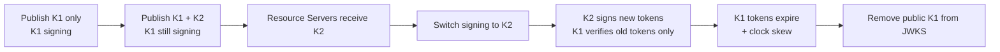

# Testing key rotation, JWKS caching, and tokens signed with retired keys

An Authorization Server signs JWT access tokens using a private key. The Resource Server fetches the corresponding public key from a JSON Web Key Set (JWKS) to verify signatures. When a system rotates keys, both sides do not necessarily update at the exact same instant: the Authorization Server may already be signing with a new key while a Resource Server still holds the old JWKS in cache. This situation is normal if the rotation procedure is designed properly. Conversely, removing the old public key too early can cause still-valid tokens to be rejected by some Resource Servers while others accept them because their caches still retain the old key.

Security testing must prove the entire key lifecycle: publishing the new key, switching signing keys, continuing to verify old tokens while valid, removing the old key after a safe cutoff, and handling emergencies when a compromised key must be revoked immediately. This lesson focuses on Spring Authorization Server, the JWKS endpoint, and Spring Security Resource Servers using JWTs.

After this lesson, you will be able to:

- Distinguish active signing keys, verification-only keys, and retired keys.
- Design a key rotation sequence so Resource Servers receive the new public key before new tokens are issued.
- Test old tokens against fresh, stale, and newly refreshed JWKS caches.
- Verify behavior when a token is signed with a key no longer in the JWKS.
- Detect bugs caused by duplicate `kid` values, inconsistent multi-instance configurations, or stale cache retention.
- Test emergency revocation when a private key is suspected or confirmed to be compromised.

## 1. Components to test

An asymmetrically signed JWT typically has a header containing the algorithm and `kid` (Key ID). `kid` helps the Resource Server select the right public key from the JWKS. A JWKS is a set of JWKs; each JWK describes a key and the attributes required to use it.

| Component | Role | What to test |
|---|---|---|
| Private signing key | Signs JWTs at the Authorization Server | Only the selected active key is used to sign new tokens |
| Public verification key | Verifies JWT signatures at the Resource Server | The public key remains published while corresponding tokens are still valid |
| `kid` | Key identifier in JWT header and JWKS | Unique, stable, and matches the signing key |
| JWKS endpoint | Publishes public keys usable for verification | Returns the right key set without exposing private key material |
| JWKS cache | Reduces JWKS fetches by Resource Servers | Has TTL, refresh, and failure behavior aligned with policy |
| JWT decoder | Checks signatures and claims | Rejects bad signatures, expired tokens, and invalid issuer or audience |

In Spring Authorization Server, `JWKSource<SecurityContext>` is a core component supplying keys for JWT encoding and the JWKS endpoint. Specific setups may use a dynamic JWK source or an externally managed key store. Regardless of approach, clearly separate two sets:

- Allowed signing key set: contains the active key's private key and only keys permitted to continue signing.
- Published public key set: contains the current public key and prior public keys still required to verify unexpired tokens.

These two sets need not be identical. Once signing stops with an old key, the system can remove the old private key from the signing component while keeping the old public key in the JWKS for an overlap window.

## 2. Safe key rotation sequence

Suppose the system is signing with key `K1` and preparing to transition to `K2`. The standard sequence publishes the new public key first, then switches signing. Once no new tokens are signed with `K1`, retain `K1`'s public key until all tokens signed with it have expired plus allowed clock skew.



### 2.1. Publish before use

First, create `K2` in the key management system. Add `K2`'s public key to the JWKS alongside `K1`'s public key, while continuing to sign tokens with `K1`. Wait until Resource Servers and intermediate caches have had a chance to pick up the updated JWKS. Only then switch the Authorization Server to sign with `K2`.

If tokens are issued with `K2` before its public key is published, Resource Servers holding an older JWKS may fail to find the new `kid` and reject valid tokens. Some decoders automatically reload the JWKS upon encountering an unknown `kid`, but you should not rely solely on that behavior as a substitute for a controlled rollout sequence.

The minimum wait before switching signers can be expressed as:

\[
T_{sign(K2)} \geq T_{publish(K2)} + C_{max} + P
\]

Where `C_max` is the maximum duration a cache may retain a stale JWKS and `P` is the configuration propagation/rollout margin. Concrete values must account for decoder caches, CDNs, or reverse proxies in use. Confirm by fetching the JWKS along the exact Resource Server path before switching signers.

### 2.2. Retain the old public key long enough

Let:

- `T_switch`: the timestamp when the system stops signing new tokens with `K1`.
- `L_max`: the maximum lifetime of tokens signed with `K1`.
- `S`: the maximum clock skew tolerated by Resource Servers.

The earliest safe time to consider removing `K1`'s public key from the JWKS is:

\[
T_{remove} \geq T_{switch} + L_{max} + S
\]

For example, if tokens have a 15-minute maximum lifetime and Resource Servers allow 60 seconds of clock skew, stopping `K1` signing at 10:00 means keeping the old public key until at least past 10:16. In practice, add an operational buffer if the system has multiple issuers, multiple token types, or staggered deployment schedules.

JWKS caching still matters. Before signing with `K2`, verify the new public key has propagated to Resource Servers or that reliable refresh is active. When removing `K1`, Resource Servers may hold an older JWKS snapshot briefly; however, expired tokens signed with `K1` must still be rejected by `exp` validation even while the old public key remains cached.

Keeping the old public key in the JWKS does not mean continuing to sign with the old private key. Access to the old private key for signing processes can be revoked immediately after switching to `K2`, while its corresponding public key remains published to verify existing tokens.

### 2.3. Rules for `kid`

Each time a new key is generated, assign a fresh, unique `kid` within the JWKS scope. Never reuse a `kid` from a retired key. If a Resource Server holds a stale cache and receives a token sharing an existing `kid` signed by a new key, it may pick the wrong old public key and reject the token. Reusing `kid` values also complicates incident troubleshooting.

Verify JWK attributes match the signing algorithm, such as `kty`, `use`, `key_ops`, and `alg` when published. The Authorization Server must select the right private key for the configured algorithm. The Resource Server must verify signatures using allowed algorithms only; never infer the algorithm from untrusted token headers to accept arbitrary algorithms.

## 3. Testing the Authorization Server JWKS endpoint

Testing the JWKS endpoint directly catches issues before Resource Server tests run. Use the actual endpoint configured in `AuthorizationServerSettings`; the default path is typically `/oauth2/jwks`, though applications may customize it.

Checks should include:

1. The endpoint responds successfully and returns a valid JWKS payload.
2. Every key has a unique `kid`.
3. The JWKS contains the public keys needed to verify current tokens and unexpired older tokens.
4. The JWKS does not expose private key parameters such as `d`, `p`, `q`, `dp`, `dq`, or `qi` for RSA keys.
5. When adding a new key, the JWKS returns both the new and old keys during the transition window.
6. Once the retention window ends, the JWKS no longer returns the retired public key.
7. All instances behind a load balancer return the same `kid` set within a given rollout stage.
8. HTTP cache headers, if configured, reflect the TTL and refresh policy expected by the system.

Example checking JWKS structure with Nimbus JOSE + JWT:

```java
String jwksJson = mockMvc.perform(get(jwkSetEndpoint))
        .andExpect(status().isOk())
        .andReturn()
        .getResponse()
        .getContentAsString();

JWKSet jwkSet = JWKSet.parse(jwksJson);

Set<String> keyIds = jwkSet.getKeys().stream()
        .map(JWK::getKeyID)
        .collect(Collectors.toSet());

assertThat(keyIds).hasSize(jwkSet.getKeys().size());

for (JWK jwk : jwkSet.getKeys()) {
    assertThat(jwk.getKeyID()).isNotBlank();
    assertThat(jwk.isPrivate()).isFalse();
}
```

This illustrative snippet assumes the test has configured `MockMvc`, `jwkSetEndpoint`, and the Nimbus JOSE + JWT libraries. If the endpoint returns JSON via an HTTP client or WebTestClient, you can keep the same assertions after extracting the response body.

Do not check only key count. Verify the exact expected `kid` set, algorithm, key type, and required public attributes. A JWKS with two keys that contains the wrong key or misses the active `kid` is still a failure.

## 4. Generating test tokens with specific keys

To test older tokens, generate genuinely signed JWTs using the corresponding private key. Do not use Spring Security Test's `jwt()` for this purpose: that request post-processor creates an already-authenticated `Jwt` inside the test context and bypasses JWKS loading, key selection, and decoder signature verification.

You can use Nimbus to generate RSA keys and sign test JWTs. The example below creates tokens with a specific `kid`:

```java
static RSAKey generateRsaKey(String kid) throws JOSEException {
    return new RSAKeyGenerator(2048)
            .keyID(kid)
            .generate();
}

static String signToken(
        RSAKey signingKey,
        Instant issuedAt,
        Instant expiresAt
) throws JOSEException {
    JWTClaimsSet claims = new JWTClaimsSet.Builder()
            .issuer("https://auth.example.test")
            .subject("alice")
            .audience("orders-api")
            .issueTime(Date.from(issuedAt))
            .expirationTime(Date.from(expiresAt))
            .build();

    JWSHeader header = new JWSHeader.Builder(JWSAlgorithm.RS256)
            .keyID(signingKey.getKeyID())
            .type(JOSEObjectType.JWT)
            .build();

    SignedJWT signedJWT = new SignedJWT(header, claims);
    signedJWT.sign(new RSASSASigner(signingKey.toPrivateKey()));
    return signedJWT.serialize();
}
```

In the test, generate two key pairs with distinct `kid` values:

```java
RSAKey oldKey = generateRsaKey("rsa-2026-01");
RSAKey newKey = generateRsaKey("rsa-2026-02");

String oldToken = signToken(
        oldKey,
        Instant.now(),
        Instant.now().plusSeconds(900)
);

String newToken = signToken(
        newKey,
        Instant.now(),
        Instant.now().plusSeconds(900)
);
```

When running time-controlled tests, use a fixed `Clock` for claim generation and validators so tests do not depend on machine execution speed. The snippet above only illustrates signing; in real tests, pass the same `issuedAt` timestamp and derive `expiresAt` from it.

## 5. Testing Resource Server against changing JWKS

Resource Servers typically configure `JwtDecoder` using a JWKS URI. In Spring Security, you can build a decoder with `NimbusJwtDecoder.withJwkSetUri(...)` and attach validators for issuer, audience, and application claim rules.

```java
NimbusJwtDecoder jwtDecoder = NimbusJwtDecoder
        .withJwkSetUri(jwkSetUri)
        .build();

jwtDecoder.setJwtValidator(
        JwtValidators.createDefaultWithIssuer("https://auth.example.test")
);
```

In a real application, add an `aud` check appropriate for the API. A valid signature and matching issuer alone are not enough to prove the token was issued for the intended Resource Server.

### 5.1. Using a mutable JWKS server in tests

Create an HTTP stub for the JWKS endpoint. The stub reads an `AtomicReference<JWKSet>` or mutable fixture so tests can explicitly publish different key sets. You can use MockWebServer, WireMock, or the project's existing test HTTP server.

Initial setup:

```java
AtomicReference<JWKSet> publishedJwks = new AtomicReference<>(
        new JWKSet(oldKey.toPublicJWK())
);
```

The HTTP stub returns `publishedJwks.get().toString()` for JWKS requests. After the Resource Server fetches the JWKS initially, the test can update the published key set:

```java
publishedJwks.set(new JWKSet(List.of(
        oldKey.toPublicJWK(),
        newKey.toPublicJWK()
)));
```

At each stage, test both a previously created decoder and a fresh decoder created after the JWKS changed. The fresh decoder tests what an uncached Resource Server sees. The older decoder tests behavior when the cache is already warm.

### 5.2. Matrix of outcomes to verify

| JWKS stage | Token signed by K1 | Token signed by K2 | Purpose |
|---|---|---|---|
| K1 only | Accepted if unexpired | Rejected because K2 public key is absent | Verify initial state |
| K1 and K2, K1 still signing | Accepted | K2 signature can be verified if test token created | Verify new key distribution |
| K1 and K2, K2 signing | Accepted | Accepted | Verify transition window |
| K2 only after K1 expires | Real K1 token is expired and rejected; unexpired test token rejected after decoder refreshes JWKS | Accepted if claims valid | Verify old key removal |
| K2 only while decoder still caches old JWKS | May continue verifying K1 signature until cache updates; token must still pass `exp` check | Accepted if claims valid | Verify cache impact |

Do not assert that every decoder immediately rejects K1 tokens the moment the JWKS endpoint removes K1. A decoder may still hold the old JWKS in cache. Exact behavior depends on the configured cache and refresh mechanism. Tests must control TTL or actively refresh caches to confirm each state.

### 5.3. Testing tokens signed with a retired key

Once the JWKS contains only `K2`, create a fresh decoder to simulate a Resource Server that just started or just refreshed its cache. Because this decoder lacks `K1`'s public key, an unexpired token signed with `K1` must be rejected since no matching key is found. Tokens signed with `K2` must be accepted when signatures and claims are valid.

Example `JwtDecoder`-level assertions:

```java
assertThatThrownBy(() -> freshDecoder.decode(oldToken))
        .isInstanceOf(JwtException.class);

assertThat(freshDecoder.decode(newToken).getSubject())
        .isEqualTo("alice");
```

Specific exception subclasses may vary by Spring Security version and Nimbus failure reason. At the security contract level, what matters is that the decoder never produces an authenticated `Jwt` for tokens whose key cannot be found or whose signature is invalid.

Next, send that exact token through the Resource Server filter chain:

```java
mockMvc.perform(get("/api/orders")
        .header(HttpHeaders.AUTHORIZATION, "Bearer " + oldToken))
    .andExpect(status().isUnauthorized());
```

`/api/orders` is a protected endpoint in the sample application. Integration tests must use a real `JwtDecoder` pointing to the JWKS stub, rather than replacing the decoder with a mock that returns success. Using only Spring Security Test's `jwt()` cannot verify rejection of tokens signed by retired keys.

## 6. Testing caches: warm, cold, and refreshed

A thorough JWKS cache test should separate at least three states:

- **Cold cache:** the Resource Server has not fetched the JWKS yet. It must fetch the latest key set from the endpoint.
- **Warm cache:** the Resource Server fetched the JWKS previously. It may continue using the cached key set until TTL or refresh policy requires an update.
- **Refreshed cache:** the Resource Server re-fetched the JWKS after the endpoint changed. It must use the new key set.

For each state, inspect the number of calls to the JWKS endpoint, which `kid` values the decoder can resolve, and token verification outcomes. Do not assert only the endpoint's HTTP response; what matters is that the decoder actually observes the change.

### 6.1. Testing TTL and refresh timing

Configure a short, deterministic cache TTL in tests. Warm the cache with a K1 token, change the JWKS from K1 to K1 + K2 or K2 only, then test before and after TTL expiration. If the caching library or configuration supports a controllable clock, use a fake clock so tests do not wait in real time.

Distinguish the internal `JwtDecoder`/Nimbus cache from HTTP caches at a CDN or reverse proxy. `Cache-Control` headers on JWKS responses may govern intermediate HTTP caches, but do not assume they control internal cache TTLs in every Nimbus version. Measure and configure each layer according to your actual system behavior.

A useful test should prove:

1. A cold decoder fetches the JWKS and verifies tokens carrying a currently published `kid`.
2. When the JWKS endpoint changes, a warm decoder may continue using the old cache within the configured window.
3. Once the cache refreshes, the decoder sees the exact new `kid` set.
4. Tokens signed by retired keys are rejected after that refresh.
5. If the JWKS endpoint becomes temporarily unreachable, using stale cache or failing requests follows the chosen operational policy.

Do not assume every Nimbus version or Spring Security setup shares the same default TTL. Configure caching explicitly via the API of your version and test behavior against the application's exact dependency version. If a CDN or reverse proxy sits in front of the JWKS endpoint, test caching at that layer as well.

### 6.2. Testing refresh failures

Simulate the following scenarios:

- The JWKS endpoint returns `5xx`.
- Connections to the JWKS endpoint time out.
- The response is invalid JSON or fails to parse as a JWK Set.
- The JWKS unexpectedly returns an empty key list.
- A token carries a `kid` that was never published.
- Cache still holds an old public key while the endpoint has already removed it.

Clearly define system behavior when refresh fails. A decoder might continue using cached keys for a period; this increases availability but also extends how long a removed key can still verify tokens. For key compromise incidents, this risk must be handled via emergency revocation procedures rather than relying on normal TTLs.

## 7. Testing emergency revocation for compromised keys

Scheduled key rotation and compromised-key revocation are two distinct scenarios. During normal rotation, keep the old public key until old tokens expire to avoid disruption. When a private key leaks, the goal may be to stop forged tokens from being accepted as quickly as possible. Emergency procedures may require immediately removing the public key from JWKS, disabling private key usage, flushing caches, and applying additional token revocation controls.

A self-contained JWT can be accepted by a Resource Server without calling the Authorization Server. Therefore, deleting a key from the JWKS does not automatically purge cached public keys across all Resource Servers. If a decoder retains the compromised key, it can continue validating tokens signed with that private key until its cache refreshes or is invalidated.

An incident drill should include:

1. Generate valid tokens with `K1` and warm JWKS caches across multiple Resource Servers.
2. Simulate detecting that private key `K1` is compromised.
3. Stop using `K1` to sign new tokens and remove `K1`'s public key from the JWKS.
4. Trigger cache purge/invalidation or decoder refresh across Resource Servers.
5. Send previously issued `K1` tokens to each Resource Server and measure the time from incident onset until every processor rejects the token.
6. Verify tokens signed with `K2` continue to be accepted.
7. Test nodes that cannot reach the JWKS during the incident and verify their failover policy.

If immediate revocation is required, consider adding stateful mechanisms such as introspection, denylists, or short access token lifetimes. With opaque tokens, Resource Servers typically call introspection to check status; with self-contained JWTs, immediate revocation requires an additional state propagation channel or an explicitly designed alternative strategy.

Measure revocation propagation time rather than testing only a single request after changing the JWKS. A multi-instance system may have some nodes refreshed while others still hold stale caches. Drill results must show which nodes still accept the token and for how long.

## 8. Testing multiple instances and rolling deployments

In production, Authorization Server instances may update sequentially. If each instance uses local key files or isolated configurations, instance A might sign with `K2` before instance B publishes `K2`'s public key. A Resource Server receiving a token from A while fetching JWKS from B may fail signature verification.

Test across deployment states:

| Cluster state | Condition to verify |
|---|---|
| All instances on old version | JWKS and old signing key are consistent |
| Some instances received public K2 | All JWKS endpoints behind load balancer publish K2 before K2 tokens exist |
| Some instances switched to signing K2 | All Resource Servers can fetch public K2 |
| All instances signing with K2 | No instance unexpectedly continues issuing tokens with K1 |
| K1 removed from JWKS | All K1 tokens are past validity or emergency revocation is active |

Send multiple requests to the JWKS endpoint through the load balancer and collect the `kid` set from each response. If you can route directly to individual instances in test environments, check each node directly. Verify tokens issued by every instance using a decoder configured with the same JWKS URI as production Resource Servers.

Additionally, test pod restarts or autoscaling during key rotation. New instances must load the correct key set and must not self-generate an isolated key unpublished by sibling instances. If keys are fetched from KMS or a secret store, test permissions, timeouts, and behavior when the key management service is temporarily unavailable.

## 9. Security flaws and misconfigurations to proactively seek

| Flaw | Consequence | Detection assertion or scenario |
|---|---|---|
| Signing with K2 before publishing public K2 | Resource Servers with older JWKS reject new tokens | K2 token rejected by decoder with warm old cache |
| Deleting public K1 before K1 tokens expire | Users with unexpired tokens face inconsistent auth failures | K1 token fails on cold decoder while still unexpired |
| Reusing `kid` | Decoders may pick wrong key from cache | Two distinct keys sharing a `kid` must fail the test |
| One instance publishes a different JWKS than peers | Verification depends on which node served JWKS | Compare `kid` sets across all nodes |
| JWKS exposes private key material | Token-signing capability leaked | Assert no private parameters exist |
| Decoder accepts algorithms outside allowlist | Forgery or algorithm downgrade risk | Token with disallowed algorithm must be rejected |
| Missing `iss` or `aud` validation | Valid tokens from another issuer/API accepted | Wrong issuer or audience tokens must be rejected |
| Cache fails to refresh after key compromise | Forged tokens continue being accepted | Measure time from purge until all nodes reject |
| Testing only with `jwt()` | Bypasses real signatures and JWKS | Integration tests must send genuinely signed Bearer JWTs |

Besides the table above, test `exp`, `nbf`, `iat`, and clock skew. Expired tokens must be rejected even when the signature is valid and the public key remains in the JWKS. Tokens with a future `nbf` must be rejected per time policy. If the application uses custom claims for authorization, test them at the proper authorization layer after signature and standard claims pass verification.

## 10. Recommended test suite

A reliable key rotation test suite should cover these groups:

| Group | Input | Expected outcome |
|---|---|---|
| JWKS contract | Authorization Server JWKS endpoint | Valid JSON, unique `kid`s, no private key material |
| Publish-before-use | JWKS has K1 + K2, signer still uses K1 | Cold and warm decoders can both verify K2 tokens once K2 is published |
| Signer switch | Tokens issued before and after switch | New tokens carry K2 `kid`; old unexpired tokens still verify |
| Old-key retention | Unexpired K1 token and JWKS still holds public K1 | K1 token accepted if all claims valid |
| Old-key removal | JWKS has K2 only, decoder refreshed | K1 token rejected; K2 token accepted |
| Cache expiration | Cache holds stale JWKS, endpoint updated | Decoder switches to new key set after configured TTL/refresh |
| Expired old token | K1 token expired, public K1 still in JWKS | Token rejected due to `exp` |
| Unknown key | Token carries `kid` absent from JWKS | Decoder rejects token |
| Invalid signature | Tampered payload or signed by different private key | Decoder rejects token |
| Wrong issuer/audience | Valid signature but invalid claims | Decoder rejects token |
| Emergency revoke | Cache held K1 before incident | All Resource Servers reject K1 tokens within target SLA |
| Cluster consistency | Multiple Authorization Server instances | All instances return consistent key sets and issue valid `kid`s |

Run this suite in CI pipelines before releasing changes to key sources, the JWKS endpoint, decoders, caches, or token configurations. Scenarios such as KMS outage drills and emergency revocation can run in staging on an operational cadence.

## 11. Pre-release key change checklist

- [ ] New key has a unique `kid` and policy-compliant signing algorithm.
- [ ] New public key appears on every instance's JWKS before signers switch to the new key.
- [ ] New tokens carry the new `kid` and verify successfully with a production-like decoder.
- [ ] Unexpired older tokens still verify during the old-key retention window.
- [ ] The old private key is no longer selected to sign new tokens after the switchover point.
- [ ] The old public key is removed from JWKS only after old token lifetime plus clock skew.
- [ ] Cold, warm, and refreshed cache states each have dedicated tests.
- [ ] Tokens signed with a retired key are rejected once the cache refreshes.
- [ ] Expired tokens are rejected even while their public key remains published.
- [ ] JWKS does not expose private key material.
- [ ] Issuer, audience, expiration, not-before, and algorithm are validated.
- [ ] Cache purge procedures and emergency revocation drills exist for key compromise.
- [ ] Cluster instances publish identical key sets and enforce identical signing policies.

## Conclusion

Safe key rotation requires synchronizing public key publication, signer switching, token lifetimes, and Resource Server caching. Tests must use genuinely signed JWTs and decoders fetching real JWKS endpoints to observe cold, warm, and refreshed cache behavior. Once an old key is retired, tokens signed with it should only be rejected after caches observe the updated state; during routine rotation, this moment must occur after old tokens expire plus clock skew. For compromised keys, establish emergency revocation procedures and measure propagation time across every Resource Server.
