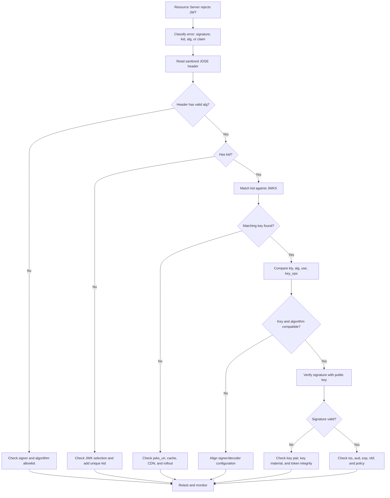
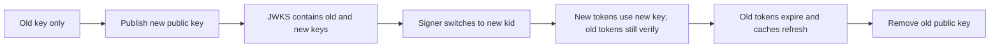

# JWT Signature Errors, Missing kid, Algorithm Mismatch, or Out-of-Sync JWKS

When a Resource Server rejects a JWT issued by the Authorization Server, the cause may lie in the signature, key selection, JWS algorithm, or public key data distributed via JWKS. These errors frequently appear after key rotation, multi-instance deployments, signing configuration changes, or cache updates on the Resource Server side.

In a system using Spring Authorization Server, you must monitor both where tokens are issued and where tokens are verified. The Authorization Server signs JWTs with a private key; the Resource Server retrieves public keys from the JSON Web Key Set (JWKS) to verify them. Both sides must agree on the algorithm, `kid`, active key set, and issuer. This lesson explains how to distinguish errors, gather safe evidence, inspect Spring Security configuration, and restore service without weakening verification policies.

## 1. Distinguishing Error Categories

A compact JWS-formatted JWT normally has three dot-separated parts:

```text
BASE64URL(header).BASE64URL(payload).BASE64URL(signature)
```

The header typically contains `alg` and may contain `kid`. The payload contains claims such as `iss`, `sub`, `aud`, `iat`, and `exp`. The signature is computed from the header, payload, and signing key using the chosen algorithm.

The following errors are related but not identical:

| Symptom | Meaning | Where to Check First |
|---|---|---|
| `kid` not in JWKS or no matching key found | The verifier cannot select a public key to try | JWT header, JWKS currently used by the Resource Server |
| `kid` is missing | Token does not specify a concrete key; can be ambiguous with multiple keys | JWK configuration and header emitted by the signer |
| `alg` is unsupported or disallowed | Algorithm in header is not on the allowlist or incompatible with the key | Algorithm policy on signer and decoder |
| `Invalid signature` | A key was selected, yet signature verification fails or signed data does not match | Key pair, key material, algorithm, altered token |
| Stale or out-of-sync JWKS | Resource Server has not received the new public key or still uses an old key set | JWKS endpoint, CDN/proxy, decoder cache, and rollout |
| Invalid `issuer`, `audience`, `exp`, or `nbf` | Signature may be valid, yet claim validation fails | Claims in token and Resource Server validators |

Do not lump all cases together as a "bad JWT signature" error. For example, a token with a valid signature but the wrong `aud` must be rejected because it was not intended for that API; that is a claim validation error, not a cryptographic error. Accurate classification helps locate the failing layer and avoids altering signing config when the real problem is issuer or audience.

## 2. Understanding the Role of alg, kid, and JWKS

### 2.1. `alg` Specifies the Signature Algorithm

`alg` in the JOSE header indicates the JWS algorithm used for signing. Common values:

| Algorithm | Key Type | Description |
|---|---|---|
| `RS256` | RSA | RSASSA-PKCS1-v1_5 with SHA-256 |
| `PS256` | RSA | RSASSA-PSS with SHA-256 |
| `ES256` | EC P-256 | ECDSA with SHA-256 |
| `EdDSA` | OKP/Edwards | EdDSA signature, depending on library and version support |

You cannot use an RSA public key to verify an ECDSA signature, nor treat `RS256` and `PS256` as the same algorithm merely because both use RSA. Key type, algorithm, JWK parameters, and the decoder allowlist must all be compatible.

### 2.2. `kid` Helps Select the Right Key

`kid` (Key ID) is the identifier of a key in the JWK set. When the Authorization Server holds multiple keys, the signer typically puts the active key's `kid` into the JWT header. The Resource Server uses that value to look up the matching JWK in JWKS.

`kid` is neither a secret nor proof that a key is trustworthy. It is merely a key-selection hint within a pre-configured trusted JWKS source. Never fetch arbitrary URLs from headers such as `jku` or `x5u` to load keys, as doing so can introduce SSRF vulnerabilities or let the token sender control the key source used for verification.

Per the JOSE specification, `kid` may be omitted if the verifier can select the key another way. However, when multiple keys coexist during rotation, a missing `kid` often causes ambiguous key selection or depends on library-specific behavior. For systems issuing JWTs with key rotation, assign a unique `kid` to each key and include the corresponding `kid` in every token's header.

### 2.3. JWKS Publishes Public Keys

JWKS is a JSON object containing a `keys` array. A public RSA JWK typically includes `kty`, `kid`, `use`, `alg`, `n`, and `e`; an EC JWK typically includes `kty`, `kid`, `crv`, `x`, and `y`. `use` is normally `sig` for signature verification keys; if `key_ops` is present, `verify` aligns with the public key role.

A public JWKS must never contain private key material such as RSA's `d`, `p`, `q`, `dp`, `dq`, or `qi`. Private keys must remain solely inside a secure key store or signing service. A JWK that keeps the same `kid` while its underlying key material changes makes caching and verification unpredictable; never reuse a `kid` for different key material.

## 3. Gathering Evidence Before Changing Configuration

When the error appears, record the start time, application version, environment, affected tenant/client, and blast radius. Determine whether the failure affects all tokens or only tokens signed after a deployment/rotation.

Collect the following information:

1. Expected `issuer` and the `jwks_uri` published in discovery metadata.
2. JOSE header of a failing token: `alg`, `kid`, `typ`, and other relevant headers.
3. Public metadata list of JWKs at the endpoint: `kid`, `kty`, `use`, `alg`, `key_ops`, and corresponding public parameters.
4. Token issuance time, key switchover time, and JWKS cache duration.
5. Sanitized logs from the Authorization Server, Resource Server, proxy/CDN, and key management system.
6. Replica status: running version, active key set, and signing `kid`.

Do not log full access tokens, refresh tokens, or ID tokens during investigation. If you need to compare two tokens, record only sanitized headers, timestamps, `kid`, issuer, and safe fingerprints per internal procedures. Never paste production tokens into public JWT decoder websites. Decoding headers/payloads only reads the data; it does not verify signatures and does not prove a token is valid.

You can read discovery metadata and JWKS with these commands, replacing the URL with your environment's verified endpoint:

```bash
curl --fail --silent --show-error \
  https://auth.example.com/.well-known/openid-configuration

curl --fail --silent --show-error \
  https://auth.example.com/oauth2/jwks \
  | jq '.keys[] | {kid, kty, use, alg, key_ops}'
```

The JWKS path should come from the `jwks_uri` field in discovery metadata or managed trusted configuration. For example, `/oauth2/jwks` is the typical path in Spring Authorization Server, though it may differ if the application customized endpoints.

If you need to inspect the JOSE header, use an approved internal tool and handle tokens only in a secure environment. Base64URL decoding is not verification. A signature is valid only after the cryptographic library verifies it with a trusted public key and all required claims pass validation.

## 4. Overall Diagnostic Workflow



Follow this sequence to isolate the fault. Do not rotate keys or relax algorithm checks before determining which JWKS the Resource Server is using and which key signed the failing token.

## 5. Handling Missing kid or Unmatched kid Errors

### 5.1. Distinguishing Missing kid from Mismatched kid

These two cases have different causes:

- **Header has no `kid`:** the signer did not include a key ID in the JWT or the JWK configuration lacks a key ID. When multiple keys exist, the decoder may fail to select a unique key.
- **Header has `kid`, but JWKS lacks that value:** the public key has not been published yet, the Resource Server is using a stale JWKS, the token came from an instance using a different key, or the signer and JWKS endpoint do not share the same key set.

Compare the `kid` string exactly, including case sensitivity and special characters. The `kid` in the header must match the `kid` of the corresponding JWK. Do not infer a key from its array index in `keys`; JWK order carries no identity guarantee.

### 5.2. Attaching a Stable Key ID When Creating a JWK

With Nimbus JOSE + JWT, a JWK built from an RSA key pair can be assigned a key ID and algorithm as follows:

```java
RSAKey signingJwk = new RSAKey.Builder(publicKey)
        .privateKey(privateKey)
        .keyID("auth-signing-2026-02")
        .keyUse(KeyUse.SIGNATURE)
        .algorithm(JWSAlgorithm.RS256)
        .build();
```

This snippet illustrates describing an existing signing key. `publicKey` and `privateKey` must form a valid pair; in production, private keys should come from KMS/HSM or a controlled key store. Do not generate a fresh key pair in memory on every application startup.

The public portion can be represented via `signingJwk.toPublicJWK()` when publishing or inspecting separately. The JWKS endpoint must publish public information only. Never return full JWKs containing private parameters in admin APIs or logs.

### 5.3. Verifying Headers Emitted by the Signer

After configuring the key ID, issue a fresh test token and verify the JOSE header contains the expected `kid` and `alg`. Old tokens do not retroactively change their headers when signer configuration updates. If a token was signed prior to rotation, it still needs the old public key until it expires or is revoked by an appropriate mechanism.

If the Authorization Server runs multiple replicas, inspect tokens from each replica. All instances must use the same key ring or shared signing service and publish the same set of public keys. If one replica emits a `kid` absent from the public JWKS, fix key distribution and eliminate unmanaged per-instance key state.

## 6. Handling Algorithm Mismatches

### 6.1. Cross-Checking Three Places

When `alg` mismatches, compare three layers:

1. **Signer:** the algorithm the Authorization Server actually uses to sign JWTs.
2. **JWK:** `kty`, `alg` (if present), `use`, `key_ops`, and corresponding curve/key size.
3. **Decoder:** the set of algorithms permitted by the Resource Server.

For example, `RS256` requires an RSA key; `ES256` requires EC P-256. If a JWK declares `alg: RS256` while the token header says `PS256`, some libraries reject the JWK during key selection. If the decoder only allows `RS256`, a `PS256` token must also be rejected even though the key pair is RSA.

### 6.2. Allowing Only the Chosen Algorithm

With Spring Security Resource Server, you can configure `NimbusJwtDecoder` using a known JWKS URI and accept only `RS256`:

```java
@Bean
JwtDecoder jwtDecoder(
        @Value("${app.security.issuer}") String issuer,
        @Value("${app.security.jwk-set-uri}") String jwkSetUri) {

    NimbusJwtDecoder decoder = NimbusJwtDecoder
            .withJwkSetUri(jwkSetUri)
            .jwsAlgorithm(SignatureAlgorithm.RS256)
            .build();

    decoder.setJwtValidator(JwtValidators.createDefaultWithIssuer(issuer));
    return decoder;
}
```

Relevant imports include `NimbusJwtDecoder`, `JwtDecoder`, `JwtValidators`, and `SignatureAlgorithm` in Spring Security OAuth2/Jose. This example assumes the Resource Server accepts only `RS256`. If the system uses another algorithm, configure the exact approved allowlist; do not enable every algorithm just to "make tokens work."

If using Spring Boot properties, you can externalize the issuer or JWKS URI outside the artifact. For example:

```yaml
spring:
  security:
    oauth2:
      resourceserver:
        jwt:
          issuer-uri: https://auth.example.com
```

When using `issuer-uri`, Spring Security can fetch metadata and the JWKS URI from discovery. When configuring `jwk-set-uri` directly, you must still validate the issuer with an appropriate validator; configuring only the JWKS URI does not prove the token's `iss` claim matches the expected Authorization Server.

### 6.3. Do Not Downgrade Policy to Bypass Errors

Never accept `alg: none`, never skip signature checks, never switch from asymmetric to symmetric algorithms merely for temporary compatibility, and never trust an algorithm declared by the token without an allowlist. The algorithm must be dictated by the application's trusted configuration.

If migrating from `RS256` to `PS256` or `ES256`, roll out with a compatibility plan: verify library and client support, publish the new public key, configure decoders to accept the approved set of algorithms during transition, and then switch the signer. Once no old tokens remain, remove the old algorithm from the allowlist. Each step needs clear timing and rollback criteria.

## 7. When kid Matches Yet Signature Is Still Invalid

If the Resource Server finds a JWK with the matching `kid` and compatible algorithm yet still reports invalid signature, check these possibilities:

- **Mismatched public/private key pair:** the signer used private key A, while JWKS publishes public key B.
- **Key replaced under the same `kid`:** an old key ID was reused for new key material; the decoder or CDN still caches the old public key.
- **Wrong key type or parameters:** the JWK's `kty`, `crv`, `n`, `e`, or public parameters do not correspond to the signing key.
- **Wrong key usage:** the JWK has a `use` or `key_ops` value unsuitable for signature verification.
- **Altered token:** header or payload was modified, the token was truncated, characters were appended, URL decoding was mangled, or invalid whitespace was introduced.
- **Signer used a different algorithm:** token header and signer config disagree, or one instance issues tokens under stale configuration.
- **Decoder fetched the wrong key source:** `jwks_uri` points to another environment, another tenant, or an old endpoint.

For RSA, you can compare the public key fingerprint or `n` and `e` parameters from the JWK against the public key expected by operations. For EC, compare `crv`, `x`, and `y`. Never compare private material via logs or paste private keys into online tools.

Check whether the token remains intact throughout transit. A reverse proxy or middleware must never decode/re-encode, alter headers, or modify the JWT payload. If the application stores tokens in a database or passes them via cookies/headers, verify there is no string truncation, escaping, or encoding transformation.

## 8. Out-of-Sync or Stale-Cached JWKS

### 8.1. Verifying the Right JWKS Source

Start from the token's issuer. Fetch discovery metadata for that exact issuer and confirm the `jwks_uri` field. Then call this URI from:

- The machine or container running the Resource Server.
- The internal network where the decoder makes its requests.
- Different network zones or clusters if multiple environments exist.

Compare the response, HTTP status, TLS certificate, DNS resolution, and `keys` contents. A browser reaching JWKS does not prove a Resource Server pod can reach it too. Check outbound proxies, firewalls, DNS, trust stores, and network permissions from the actual runtime.

### 8.2. Checking Caches at Every Layer

JWKS can be cached in multiple places:

- Resource Server or JOSE library remote JWK set cache.
- HTTP client or reverse proxy.
- CDN or API gateway in front of the JWKS endpoint.
- DNS resolver or service discovery.
- Authorization Server replicas reading key data from different sources.

When a new `kid` has not appeared yet, verify the actual response received by the decoder and when it was cached. Inspect `Cache-Control`, `ETag`, and `Last-Modified` if used by the endpoint or proxy. An overly long cache TTL can delay rotation; an overly short TTL increases request load on the Authorization Server. Choose values based on traffic, availability requirements, and propagation time.

Do not assume restarting the Resource Server is the right fix. Restarting may clear in-memory caches in some setups, but it will not fix a wrong JWKS endpoint, a stale CDN, or out-of-sync Authorization Server replicas. Refresh caches only through mechanisms supported by the library and platform after identifying the root cause.

### 8.3. Synchronizing Key Rings Across Instances

A common scenario is replica A loading a new key while replica B still uses the old key. The load balancer can route tokens to A or B; discovery/JWKS requests can also be answered by a different replica. Consequently, a token signed by A carries the new `kid` while a JWKS response from B does not yet contain that public key.

To prevent this:

- Use a single controlled key store or configuration source for all replicas.
- Ensure all instances read the same key set and active `kid`.
- Switch the signer only after the new public key is uniformly published.
- Query JWKS through the load balancer multiple times and from individual instances during rollout.
- Monitor the loaded key ring version or public key fingerprint on every replica.

Do not rely on sticky sessions to mask out-of-sync state. Tokens can be verified by different APIs, different services, or after a replica restarts; the entire system must share identical verification capabilities.

## 9. Zero-Downtime Key Rotation

Rotation must include an overlap period between the old key and the new key. Reference sequence:

1. Generate a new key pair in KMS/HSM or a protected key store; assign a new, unique `kid`.
2. Distribute the new public key to the JWKS endpoint of every instance.
3. Verify Resource Servers and caches can see the new public key. Wait an appropriate propagation interval for caches and infrastructure.
4. Switch the Authorization Server to sign new tokens with the new private key; confirm JWT headers carry the new `kid`.
5. Keep publishing the old public key in JWKS to verify tokens already issued under the old key.
6. Remove the old public key only after the last token signed by the old key has expired, plus clock skew, cache TTL, and an operational safety margin.



During the overlap period, JWKS can contain both old and new keys. The signer starting to use the new key does not mean you can delete the old key immediately. Removal timing must account for the longest-lived token signed by the old key, clock skew tolerated by validators, Resource Server caches, and propagation delay.

If an old private key is found to be compromised, emergency procedures may require revoking tokens, stopping trust in the old key, or shortening the overlap window. This is a security incident response and may cause old tokens to fail; coordinate with Resource Servers, clients, and API owners following an approved runbook. Never keep a compromised key merely to preserve compatibility.

## 10. Configuring Spring Authorization Server and Resource Server

### 10.1. Authorization Server Signing Key Source

Spring Authorization Server uses `JWKSource<SecurityContext>` to supply keys to JWT encoders and the JWKS endpoint. In real environments, this source must read from a persistent key store or KMS/HSM integration. Never generate random keys on every startup if tokens must be verified across multiple instances or across restarts.

An architectural illustration:

```java
@Bean
JWKSource<SecurityContext> jwkSource(KeyRingProvider keyRingProvider) {
    return (selector, context) -> {
        JWKSet publicAndSigningKeys = keyRingProvider.currentJwkSet();
        return selector.select(publicAndSigningKeys);
    };
}
```

`KeyRingProvider` is an application abstraction, not a built-in Spring Authorization Server class. It must provide a validated key set with stable `kid` values, public keys for JWKS, and private key signing access for the signer. If using an HSM/KMS where private keys cannot be exported, integrate a signer compatible with `JwtEncoder` rather than assuming private keys can be loaded into the JVM.

When changing the key ring, update the shared data source and confirm the JWKS endpoint publishes the right public keys. If an application instance caches the key set locally, implement a reload mechanism and observe reload status per instance.

### 10.2. Resource Server Using Trusted Issuer or JWKS URI

The Resource Server needs the issuer or JWKS URI from trusted configuration. With an issuer URI, Spring Security can discover metadata and configure issuer-based verification. With a directly configured JWKS URI, you must configure an issuer validator as shown in the algorithm section.

Beyond signature and issuer, applications often need to validate `aud` to guarantee the token was issued for the right API. Validators should check additional domain claims such as tenant, scope, or token type when required by the architecture. Signature verification alone is not sufficient to grant access.

If the system serves multiple issuers or tenants, mapping an issuer to a decoder must rely on a managed issuer allowlist. Never construct a decoder by concatenating an arbitrary issuer string from the request, and never load JWKS from an untrusted URL supplied by the token.

## 11. Distinguishing Signature Errors from Claim and Time Errors

Even after the signature verifies, the Resource Server must still validate claims. Commonly confused cases:

| Error | Check | Fix |
|---|---|---|
| Wrong `iss` | Does the issuer claim match the configured issuer? | Align issuer and discovery; do not skip issuer validation |
| `aud` excludes current API | Was the token issued for this resource server? | Check audience at issuance and validator config |
| `exp` in the past | Has the token expired? | Issue a new token; check clocks and TTL |
| `nbf` in the future | Is the token not yet valid or is the clock skewed? | Synchronize clocks and review issuance time |
| Anomalous `iat` | Is system time or token data inaccurate? | Check NTP and signer clock |
| Wrong scope/authority | Signature and claims valid, yet permissions insufficient | Check scope mapping and authorization rules |

Synchronize time via NTP or the platform's time service across the Authorization Server, Resource Server, and related nodes. Clock skew can cause tokens to look expired or not yet valid; it is never a reason to disable signature verification.

## 12. Symptom and Remediation Matrix

| Observed Symptom | Common Cause | Remediation |
|---|---|---|
| New tokens fail with `no matching key` right after rotation | New public key not published yet or stale JWKS cache | Publish key before switching signer; check cache and replicas |
| Token header lacks `kid` | JWK has no key ID or signer omits key ID from header | Assign stable `kid`, issue new token, and inspect header |
| Only some requests fail signature check | Some replicas sign with a different key or return a different JWKS | Compare key ring/fingerprint per instance and synchronize rollout |
| All old tokens fail after restart | Application generates a new key at startup | Use persistent keys; publish old public key if old tokens still need verification |
| `kid` exists, yet invalid signature | Mismatched public key, key replaced under same `kid`, or altered token | Compare public key, fingerprint, and token transit path |
| Decoder reports unsupported algorithm | `alg` outside allowlist or unsupported by library | Align approved algorithms on signer and decoder |
| JWKS endpoint returns new key, yet pod reports missing key | Stale decoder cache or proxy cache | Verify response from runtime, cache policy, and supported refresh |
| JWKS endpoint intermittently lacks `kid` | Authorization Server replicas do not share the same key set | Use a shared key source and uniform rollout |
| Signature valid, yet token rejected | Wrong issuer, audience, timestamp, or policy | Check claim validators and system clocks |
| Only one tenant fails | Tenant resolver points to wrong issuer/JWKS or out-of-sync per-tenant key ring | Check tenant mapping, issuer, and that tenant's key source |

## 13. Essential Logs, Metrics, and Alerts

Resource Server logs should record enough context to classify failures without exposing tokens. Useful fields include:

- UTC timestamp, service name, build version, and instance ID.
- Configured issuer or managed issuer identifier.
- `kid`, `alg`, and normalized error category.
- Configured JWKS URI or key source ID; never log URLs containing credentials.
- HTTP status and latency when fetching JWKS, plus cache status if provided by the library.
- Request/correlation ID, and authenticated client or tenant ID when safely determinable.
- Signature verification outcome separate from claim validation outcome.

Never log compact JWTs, full payloads, signatures, private keys, or the `Authorization` header. Avoid logging token-sender-controlled strings directly without length limits and character sanitization.

Metrics to monitor:

- Count of rejected JWTs grouped by `unknown_kid`, `invalid_signature`, `unsupported_alg`, `invalid_issuer`, `invalid_audience`, `expired`, and `not_yet_valid`.
- JWKS request success/failure rate, fetch latency, and cache refresh count.
- Number of published `kid` values and the `kid` actively used by the signer.
- Out-of-sync lag across replicas if the system reports key ring versions.
- API 401/403 rates after every rotation or deployment.

Alert on unknown `kid` values, algorithms outside the allowlist, unreachable JWKS, sudden spikes in signature errors, or replicas reporting differing key set fingerprints. Do not alert per individual request at high volume; aggregate by service, issuer, and time window to prevent alert storms.

## 14. Production Incident Response Workflow

When errors disrupt API traffic, follow this order:

1. **Assess scope:** identify affected issuers, tenants, clients, APIs, replicas, and token cohorts. Compare tokens before and after the deployment or rotation timestamp.
2. **Preserve evidence:** capture sanitized headers, `kid`, `alg`, JWKS responses, application versions, timestamps, and relevant logs. Never store intact tokens or secrets.
3. **Verify trusted sources:** inspect discovery metadata, issuer, `jwks_uri`, TLS, and JWKS responses from inside the Resource Server runtime.
4. **Compare keys:** confirm `kid`, `kty`, `alg`, `use`, `key_ops`, and actual public keys match the signer.
5. **Inspect rollout/caches:** determine whether all Authorization Server replicas publish the same key set and which cache the Resource Server is reading.
6. **Remediate root cause:** synchronize the key ring, publish missing public keys, fix endpoints, or restore approved algorithm configuration. If a private key was compromised, trigger emergency rotation and appropriate revocation.
7. **Test end-to-end:** verify fresh tokens, still-valid older tokens, discovery, JWKS, issuer, audience, and critical APIs.
8. **Monitor and document:** monitor error rates post-recovery, and document the timeline, root cause, impact, and preventive actions.

Never disable signature validation or accept all algorithms to reduce 401 errors. A temporary measure such as rolling back the signer is safe only if the old private key was not compromised, the old public key remains trustworthy, and tokens issued during the transition are handled deliberately.

## 15. Testing to Prevent Recurrence

Establish automated tests for these scenarios:

| Scenario | Expected Result |
|---|---|
| Token signed by active key with `kid` present in JWKS | Valid signature and claim validation succeeds |
| Token with nonexistent `kid` | Rejected; log classified as `unknown_kid` |
| Token without `kid` when multiple keys exist | Handled per explicit policy; no arbitrary key selection |
| Token using `alg` outside allowlist | Rejected |
| Token using key incompatible with `alg` | Rejected |
| Payload or header modified after signing | Signature verification fails |
| New public key published before signer switches keys | Both old and new tokens verify during overlap |
| Token signed with old key during overlap window | Still verifies while old public key remains in JWKS |
| Old public key removed after safety window | New tokens remain valid; old tokens expired or handled per policy |
| One replica has out-of-sync key ring | Health/metric or deployment gate detects it before receiving traffic |
| JWKS endpoint temporarily unreachable | Cache/failure behavior is deterministic; alerts fire and recovery works |
| Wrong issuer or audience | Rejected even when signature is valid |
| Clock skew | Tests for `exp`, `nbf`, `iat` reflect the exact clock skew policy |

Maintain integration tests running Authorization Server and Resource Server with production-like configuration. Test rotation across multiple instances and real caches; unit tests on a standalone `JwtDecoder` will not catch CDN, DNS, or rollout bugs.

## 16. Mistakes to Avoid

- Generating a new signing key on every startup and expecting older tokens to keep verifying.
- Using the same `kid` for two different key pairs.
- Deleting the old public key immediately after the signer switches to the new key.
- Checking JWKS only from a developer laptop instead of from the Resource Server runtime.
- Assuming that because a token decodes, its signature is valid.
- Trusting `kid` as proof of authenticity or fetching keys from arbitrary URLs in JWT headers.
- Relaxing allowlists, skipping signature checks, or accepting `alg: none` as a temporary workaround.
- Merely restarting pods without investigating caches, endpoints, or out-of-sync key rings.
- Treating `iss`, `aud`, `exp`, and `nbf` errors as signature errors.
- Logging raw tokens or private keys during investigation.

## Conclusion

Diagnosing JWT issues requires separating key selection, algorithm checks, signature verification, and claim validation. When `kid` values are stable, signers and decoders agree on algorithms, JWKS is published consistently, and rotation includes an overlap window, Spring Authorization Server can issue tokens for multiple Resource Servers without verification disruptions. Resolve every incident using sanitized headers, trusted public keys, cache state, and per-replica evidence—never weaken JWT verification to mask configuration bugs.
