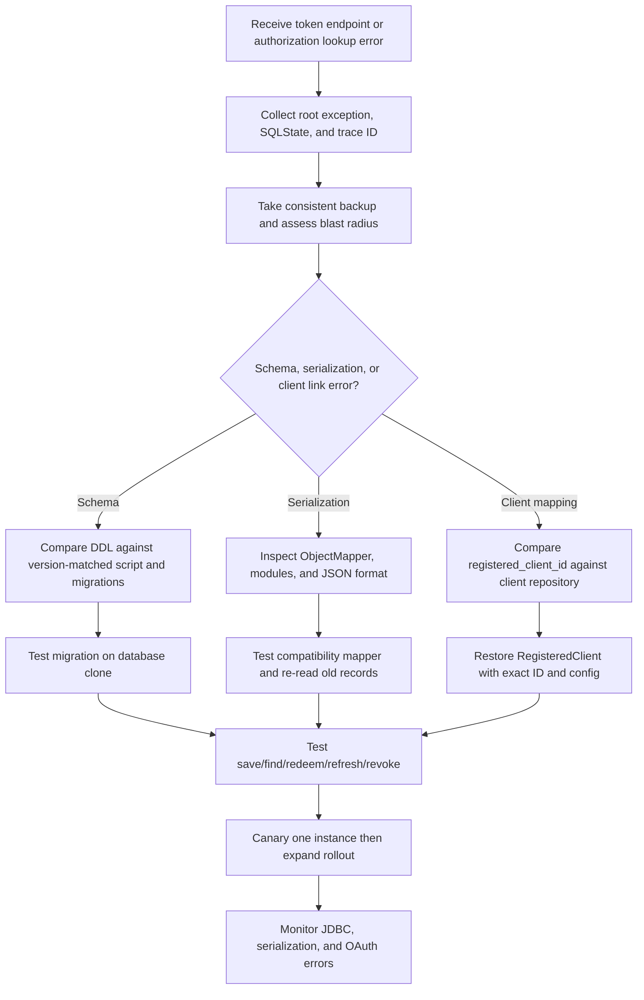

# JDBC Schema, Serialization, and Authorization Recovery Errors

When Spring Authorization Server moves from in-memory storage to JDBC, errors typically appear in three places: the database structure does not match the library version, authorization data cannot be deserialized by Jackson, or an authorization record can no longer link to its registered `RegisteredClient`. These failures can cause the token endpoint, refresh tokens, consent, or token revocation to fail even when the OAuth 2.0 configuration looks valid on the surface.

This lesson explains how to diagnose and recover from those errors in a long-running or multi-instance Authorization Server. The focus is keeping authorization data consistent with the schema and application code, preserving client identifiers across deployments, and restoring access without exposing bearer tokens.

## 1. Identifying the Failing Layer Before Making Changes

`OAuth2AuthorizationService` stores authorizations along with authorization codes, access tokens, refresh tokens, ID tokens, and related metadata. `RegisteredClientRepository` stores the client configurations referenced by authorizations. If the application persists consent separately, `OAuth2AuthorizationConsentService` also needs a durable store.

With JDBC, common implementations are:

| Component | JDBC Implementation | Required Stored Data |
|---|---|---|
| Registered client | `JdbcRegisteredClientRepository` | Client record, grant types, redirect URIs, scopes, authentication methods, and token settings |
| Authorization | `JdbcOAuth2AuthorizationService` | Authorization record and grant tokens/metadata |
| Authorization consent | `JdbcOAuth2AuthorizationConsentService` | Scopes and authorities approved by the user for the client |

Before modifying data, determine which stage failed the request: reading the client, reading the authorization, writing the authorization, serializing attributes, or verifying tokens at the Resource Server. Preserve the root exception, SQLState, vendor error code, operation name, and trace ID. Never put token values or full token endpoint requests into logs for diagnosis.

| Symptom | Common Cause | First Check |
|---|---|---|
| `BadSqlGrammarException`, missing table/column error | Migrations not run, wrong schema, or column names mismatch library version script | Actual schema and applied migrations |
| `DataIntegrityViolationException`, data too long or cannot be null | Data type, length, nullability, or constraint does not fit stored data | DDL of the column named in the exception |
| `CannotGetJdbcConnectionException`, `DataAccessResourceFailureException` | Database unreachable, connection pool exhausted, wrong credentials, or network issue | DataSource, pool metrics, database permissions, and connectivity from the exact instance |
| `JsonMappingException`, `InvalidTypeIdException`, `InvalidDefinitionException` | Jackson cannot serialize or deserialize an attribute, principal, or Authentication type | `OAuth2AuthorizationRowMapper`'s ObjectMapper and types inside `attributes` |
| RegisteredClient not found when reading authorization | Client record missing or `registered_client_id` no longer matches internal ID | Link between `oauth2_authorization.registered_client_id` and `oauth2_registered_client.id` |
| One instance reads data, another fails | Instances use different schemas, migrations, ObjectMappers, or dependency versions | Compare runtime configuration across instances |

Do not attribute every `/oauth2/token` failure to `invalid_grant`. A JDBC or serialization error is an infrastructure/data failure; diagnose from the root exception before concluding the user's credentials are invalid.

## 2. Checking the JDBC Schema

### 2.1. Using the Exact Schema for the Library Version

Spring Authorization Server ships sample SQL schemas for its JDBC repositories/services. Take the script bundled with the exact dependency version your application runs, then adapt it carefully for your database vendor and schema conventions. Never copy DDL from a different version or copy an H2 script verbatim into PostgreSQL, MySQL, or SQL Server.

Standard tables are typically named:

- `oauth2_registered_client` for `JdbcRegisteredClientRepository`;
- `oauth2_authorization` for `JdbcOAuth2AuthorizationService`;
- `oauth2_authorization_consent` for `JdbcOAuth2AuthorizationConsentService`.

Table names, column names, LOB types, and lengths must match the SQL statements used by the implementation. If your organization renamed tables or columns, you must supply a matching repository/implementation with custom SQL; changing DDL unilaterally causes default queries to keep failing.

In production, manage DDL with Flyway or Liquibase. Every schema change needs a reviewed migration, tested on the same database engine as production, with a rollback/restore plan. Avoid enabling automatic schema initialization on every application startup, as it can cause out-of-order migrations, DDL permission failures, or drift across instances.

### 2.2. Verifying the Right Database, Schema, and Permissions

An application with multiple `DataSource` beans or profiles can accidentally write RegisteredClients to database A while reading authorizations from database B. Similarly, a database user may connect successfully yet lack `SELECT`, `INSERT`, or `UPDATE` privileges, or resolve tables in a different default schema.

Check the following:

1. `JdbcRegisteredClientRepository`, `JdbcOAuth2AuthorizationService`, and the consent service use the intended DataSource.
2. All instances in the cluster point to the same authoritative database/schema and migration version.
3. The database user has read/write permissions on the required tables; the migration account holds separate DDL permissions if required by policy.
4. Schema qualification, `search_path`, database/catalog, and identifier casing are consistent.
5. Connection pools do not hand out stale connections or connect to the wrong database due to old secret/profile config.

You can use `information_schema` to inspect the actual structure. The syntax below is supported by many RDBMS engines; adjust the schema filter for your database:

```sql
SELECT table_schema,
       table_name,
       column_name,
       data_type,
       character_maximum_length,
       is_nullable
  FROM information_schema.columns
 WHERE table_name IN (
       'oauth2_registered_client',
       'oauth2_authorization',
       'oauth2_authorization_consent'
 )
 ORDER BY table_schema, table_name, ordinal_position;
```

Compare the output against the schema script for your exact dependency version. Pay special attention to columns storing authorization codes, access tokens, refresh tokens, ID tokens, metadata, attributes, and scope fields. Columns holding JSON or token values may need sufficiently large text/LOB types. If a column is narrower than the actual payload, writes can fail or silently truncate data depending on database and settings.

### 2.3. Classifying Errors by SQLState

SQLState helps narrow down failures quickly, though vendor error codes and database messages remain authoritative. Common code groups include:

| SQLState (Common) | Meaning | Investigation Direction |
|---|---|---|
| `42P01` (PostgreSQL), `42S02` (some RDBMS) | Table/relation not found | Check migrations, default schema, and table names |
| `42703` (PostgreSQL) | Column not found | Compare DDL with the running dependency's SQL script |
| `22001` | String data too long | Check column length, payload size, and widening migration |
| `23502` | NOT NULL violation | Identify missing required column and why mapper produced null |
| `23505` | Unique constraint violation | Check duplicate seed data, write retries, and actual constraints |
| `08xxx` group | Connection failure | Check database, network, timeouts, and connection pool |
| `28xxx` group | Database authentication failure | Check username, password, secret rotation, and login privileges |
| `42501` (PostgreSQL) | Insufficient privilege | Grant appropriate permissions to runtime or migration user |

Codes vary by vendor and driver. Extract `SQLException.getSQLState()` and the vendor error code from the exception chain, rather than reading only Spring's wrapper exception.

### 2.4. Checking the RegisteredClient Identifier

`registered_client_id` in `oauth2_authorization` references the **internal ID** of `RegisteredClient`, not the `client_id` sent by OAuth applications in protocol requests. When seeding clients, if every restart generates a new random UUID and stores it as a different client record, existing authorizations may point to an ID that no longer exists.

Example query checking the link, selecting only non-sensitive identifier columns:

```sql
SELECT a.id AS authorization_id,
       a.registered_client_id,
       c.id AS stored_client_id,
       c.client_id
  FROM oauth2_authorization a
  LEFT JOIN oauth2_registered_client c
    ON c.id = a.registered_client_id
 WHERE a.id = :authorization_id;
```

If `stored_client_id` is `NULL`, verify whether the client was deleted or re-seeded with a new ID. Restore the client record with the exact internal ID and matching config if possible. Do not create a new RegisteredClient merely sharing the same `client_id` and assume old authorizations will re-link automatically.

In seed data, use stable IDs and persist configuration in a durable repository. For example:

```java
RegisteredClient webClient = RegisteredClient.withId("web-client-registration-v1")
        .clientId("web-client")
        // Add client authentication, grants, redirect URIs, scopes, and token settings.
        .build();
```

This snippet illustrates only a stable ID; real configuration must be complete and remain compatible with existing authorizations. Never put raw client secrets into logs or migration files.

## 3. Diagnosing Authorization Serialization Errors

### 3.1. Why Can Reading an Authorization Still Fail When the Schema Is Right?

`JdbcOAuth2AuthorizationService` maps JDBC rows into `OAuth2Authorization`. Attributes and metadata are converted via Jackson. A record may have been written successfully, yet subsequent reads fail if the ObjectMapper does not know how to reconstruct a custom Authentication, principal, or attribute type.

Common scenarios:

- The application puts a custom principal/Authentication class into the authorization without registering the corresponding Jackson mixin or module.
- The application replaces the ObjectMapper used by the JDBC row mapper and omits Spring Security or Spring Authorization Server modules.
- A new release renames a package, class structure, or property while the database still holds JSON in the older format.
- Some instances run different mappers or classpaths during a rolling deployment.
- `attributes` contains runtime objects unsuitable for long-term persistence, such as servlet requests, thread-bound objects, lambdas, or entities lacking stable serialization rules.

Exceptions such as `InvalidDefinitionException`, `InvalidTypeIdException`, `UnrecognizedPropertyException`, or `MismatchedInputException` usually indicate a JSON mapping failure. Extract the offending type and property name from the stack trace; there is no need to print the entire authorization JSON, as it may contain tokens and user-identifying data.

### 3.2. Registering Jackson Modules for the JDBC Row Mapper

When customizing `JdbcOAuth2AuthorizationService`, configure `OAuth2AuthorizationRowMapper` with the Spring Security and Spring Authorization Server modules. The pattern below shows module registration; verify API signatures against your dependency version:

```java
import com.fasterxml.jackson.databind.Module;
import com.fasterxml.jackson.databind.ObjectMapper;
import java.util.List;

import org.springframework.context.annotation.Bean;
import org.springframework.jdbc.core.JdbcOperations;
import org.springframework.security.jackson2.SecurityJackson2Modules;
import org.springframework.security.oauth2.server.authorization.JdbcOAuth2AuthorizationService;
import org.springframework.security.oauth2.server.authorization.OAuth2AuthorizationService;
import org.springframework.security.oauth2.server.authorization.client.RegisteredClientRepository;
import org.springframework.security.oauth2.server.authorization.jackson2.OAuth2AuthorizationServerJackson2Module;

@Bean
OAuth2AuthorizationService authorizationService(
        JdbcOperations jdbcOperations,
        RegisteredClientRepository registeredClientRepository) {

    JdbcOAuth2AuthorizationService service =
            new JdbcOAuth2AuthorizationService(jdbcOperations, registeredClientRepository);

    JdbcOAuth2AuthorizationService.OAuth2AuthorizationRowMapper rowMapper =
            new JdbcOAuth2AuthorizationService.OAuth2AuthorizationRowMapper(
                    registeredClientRepository);

    ClassLoader classLoader = JdbcOAuth2AuthorizationService.class.getClassLoader();
    List<Module> securityModules = SecurityJackson2Modules.getModules(classLoader);

    ObjectMapper objectMapper = new ObjectMapper();
    objectMapper.registerModules(securityModules);
    objectMapper.registerModule(new OAuth2AuthorizationServerJackson2Module());

    rowMapper.setObjectMapper(objectMapper);
    service.setAuthorizationRowMapper(rowMapper);
    return service;
}
```

If the application uses custom principals or attributes, register explicit mixins/modules for each stored type. That type must have a stable JSON representation and remain deserializable across restarts and upgrades. Test serializing and deserializing a representative authorization in a standalone test before deploying.

Never enable broad polymorphic default typing for database-backed data to fix missing type errors. Stored data can be tampered with or compromised; letting Jackson instantiate arbitrary classes by type ID widens the deserialization attack surface. Use explicitly scoped modules and mixins permitting only the types the application genuinely requires.

### 3.3. Keeping Data Formats Compatible Across Upgrades

JSON in the database outlives any single application process. A Java class change can render records written by a previous version unreadable. Before releasing changes to principals, Authentication objects, or attributes:

1. Identify the actual types currently stored in existing authorizations.
2. Add compatibility deserializers/mixins supporting the old format.
3. Test reading records written by the previous version and writing them under the new version.
4. If data transformation is needed, run a backed-up, idempotent, scoped migration.
5. Remove support for the old format only after confirming no remaining authorizations require reading it.

During a rolling deployment, all instances sharing one database must understand formats written by other instances. Deploy the new mapper capable of reading old data first; only afterward begin writing the new format. If two versions are incompatible, coordinate deployment ordering or pause writes during the migration window.

## 4. Safe Authorization Recovery

### 4.1. Preserving Data Before Intervening

When a schema or serialization error is detected, avoid dropping tables, deleting all authorizations, or running bulk updates before understanding the impact. First take a consistent snapshot/backup of the RegisteredClient, authorization, and consent tables; where supported by the database, use backup/PITR per operational procedures. Record the application version, dependency versions, migration version, error timestamp, and affected client/user scope.

If the failure started immediately after a migration, compare the live schema against the previous version and the executed migration. If it started after a code deployment, compare the ObjectMapper, classpath, and new attribute types. Never run data-repair migrations on production before testing against a backup or staging clone.

### 4.2. Recovering Missing Client Records

An authorization requires its corresponding RegisteredClient to continue token operations and enforce client policies. If the client record was deleted or its internal ID changed:

- Restore the record from backup or the canonical config source using the exact `id` referenced by authorizations.
- Verify that `client_id`, grant types, redirect URIs, authentication methods, scopes, and token settings still match existing authorizations.
- Verify the secret is encoded with the active PasswordEncoder; never put raw old secrets into SQL or logs.
- If the exact configuration or credentials cannot be restored, evaluate revoking the grant and requiring the user to re-authorize.

Do not rewrite `registered_client_id` across many authorizations to point to a new ID just to silence lookup errors. Doing so can bind an old grant to a different client policy and grant unintended access.

### 4.3. Recovering Incompatible Serialized Data

If an old attribute type no longer has a matching class, there are two options. Prefer restoring readability with a controlled compatibility mixin/deserializer. If the data structure must change, write a targeted transformation migration and retain the original data for reference.

For a corrupted authorization that cannot be safely migrated, evaluate impact by token type:

- Unrecoverable authorization codes or refresh tokens may force clients to restart the authorization flow.
- Opaque access tokens usually rely on introspection status; once the authorization is invalidated, the Resource Server receives `active=false` after the revocation state is persisted and propagated.
- Already-issued JWTs may still be accepted by Resource Servers until `exp` if Resource Servers verify signatures and claims locally. Deleting JDBC rows does not automatically invalidate already-issued JWTs. If immediate blocking is required, you need a denylist/introspection or revocation-checking mechanism enforced by the Resource Server.

Never reconstruct authorization codes or refresh tokens manually by editing strings in the database. Tokens are bearer credentials; only the Authorization Server should issue new tokens through an authenticated flow. If data cannot be recovered reliably, revoking affected grants and requiring re-authentication/consent is a far more controllable option.

### 4.4. Recommended Recovery Sequence



Before reopening full traffic, verify authorization read/write operations, code redemption, token refresh, consent, and revocation. Verify Resource Servers observe revocation state per the designed mechanism. If restoring a backup from an earlier point in time, evaluate tokens issued after the backup timestamp and handle them per security policy.

## 5. Common Errors and Resolutions

| Scenario | Diagnosis | Resolution |
|---|---|---|
| `oauth2_authorization` does not exist | Authorization migration did not run or ran in the wrong schema | Apply version-matched DDL to the configured schema; verify via `information_schema` |
| Table exists, but token metadata column is missing | DDL came from an older version or migration stopped halfway | Compare all columns against the dependency script; write a tested additive migration |
| Saving authorization fails with length exceeded | Text/LOB or varchar column is too short | Identify the failing field and widen the column type per vendor; never truncate tokens/metadata |
| Reading authorization throws `InvalidTypeIdException` | JSON contains a type ID unrecognized by the current mapper | Restore compatible module/mixin and test reading legacy data |
| Reading authorization throws `InvalidDefinitionException` | Custom principal/attribute lacks serializer/deserializer | Create a mixin/module for that specific type or store a stable DTO instead of runtime objects |
| After restart, authorization cannot find RegisteredClient | Client's internal ID changed or record was deleted | Restore the record with the exact referenced ID and config |
| Only one node fails | Node uses a different dependency, mapper, profile, or schema | Compare artifact version, DataSource, migration version, and bean config across nodes |
| After restore, old JWTs still call APIs | Resource Server validates JWTs locally without checking revocation state | Use denylist/introspection or wait for policy-configured expiration; review access token lifetime |

## 6. Testing Before and After Recovery

Test against the same database engine and driver as production. H2 is useful for fast feedback, but it cannot substitute for testing migrations, LOB types, JSON, constraints, and transactions on your actual PostgreSQL, MySQL, or SQL Server engine.

Test cases to include:

| Test Case | Verification Goal |
|---|---|
| Initialize empty database with current migrations | Required tables, columns, constraints, and indexes exist |
| Upgrade from previous version's schema | Migration completes and legacy data remains readable |
| Save and reload `OAuth2Authorization` | Principal, attributes, metadata, and token state are restored accurately |
| Read authorization written by prior application version | Mapper is backward-compatible with older data |
| Seed/restart RegisteredClient | Internal ID stays stable; existing authorizations still resolve the client |
| Redeem authorization code, refresh, and revoke | JDBC operations complete and final state is accurate |
| Read persisted consent | Consent and scopes survive restarts |
| Two instances sharing one database | Both read the same schema and data format |
| Restore backup in a test environment | Application boots, reads authorizations, and handles tokens per restored state |
| Resource Server receives a revoked token | Behavior matches configured introspection, denylist, or `exp` bounds |

In serialization tests, build a representative `OAuth2Authorization` carrying the attributes your application actually stores, persist it via JDBC, and read it back through the row mapper. A test calling only `ObjectMapper.writeValueAsString()` does not prove the JDBC row mapper and schema can round-trip that data.

## 7. Operational Observability and Data Protection

Monitor these indicators to catch failures before wide impact:

- JDBC error rates by SQLState, vendor code, and operation (`save`, `findByToken`, `remove`);
- Jackson error counts by exception class and attribute type;
- RegisteredClient lookup misses by internal client registration ID;
- connection pool active/idle counts, pending acquires, timeouts, query latency, and deadlocks;
- counts of authorizations/consents saved, read, revoked, and failed per application version.

Logs should include correlation ID, instance ID, application version, grant type, client ID, and authorization ID where appropriate. Never log authorization codes, access tokens, refresh tokens, client secrets, ID tokens, or full `attributes` JSON. When token correlation is needed, use a protected HMAC fingerprint that cannot be reversed by ordinary lookup.

The authorization database contains data capable of continuing grant usage and may hold token values. Restrict table read access for runtime accounts, encrypt backups, enforce DBA access controls, and audit data operations. Never copy production dumps to development environments without a process to protect or scrub sensitive data.

## 8. Pre-Closure Incident Checklist

- [ ] Root exception, SQLState/vendor code, and failing JDBC operation identified.
- [ ] Schema verified against scripts matching the exact Spring Authorization Server version and database vendor.
- [ ] Migrations are versioned, tested on a database clone, and have a restore plan.
- [ ] `RegisteredClientRepository`, `OAuth2AuthorizationService`, and consent service use the intended DataSource/schema.
- [ ] RegisteredClient internal IDs are stable and all authorizations reference existing client records.
- [ ] Jackson row mapper registers the required Spring Security and Spring Authorization Server modules.
- [ ] Custom principals/Authentications/attributes have compatible serializers/deserializers and round-trip tests.
- [ ] Rolling deployments do not produce two data formats that instances cannot cross-read.
- [ ] Corrupted records are recovered or revoked within the assessed scope; no bulk deletion to hide errors.
- [ ] Redeem, refresh, consent, revoke, and Resource Server behavior verified post-recovery.
- [ ] Logs/metrics do not expose bearer tokens, client secrets, or sensitive authorization JSON.

When schemas, mappers, and client identifiers are managed as part of the same release lifecycle, authorizations survive restarts, upgrades, and database restores without depending on any single instance's local state. Handle every incident from the failing layer, then re-verify the entire storage and token enforcement path before returning the cluster to service.
