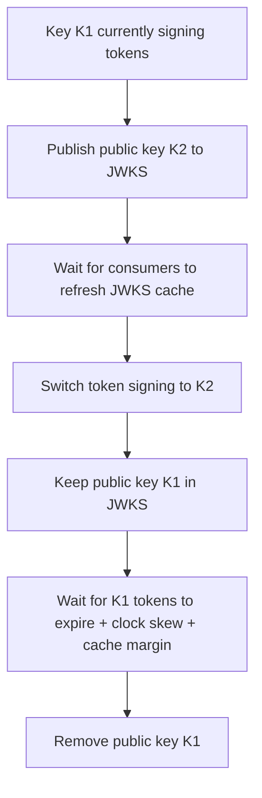

# Preserving Issuer, Subject, Keys, and Claims Contracts During Upgrades

Upgrading Spring Authorization Server can change how the application generates metadata, maps users to `sub`, signs JWTs, publishes the JWK Set, or adds custom claims. A small change in any of these areas can cause OIDC clients to reject ID tokens, Resource Servers to reject access tokens, users to be identified as different accounts, or still-valid tokens to fail verification.

Therefore, the issuer, subject identifier, signing keys, and claims must be treated as compatibility contracts with external systems. This article explains how to capture pre-upgrade contracts, keep identifiers stable, rotate keys with an overlap period, evolve claims compatibly, and test tokens issued before and after the upgrade.

## 1. Identifying What Must Be Preserved

An Authorization Server can change its internal implementation across versions, but clients and Resource Servers depend on external protocol values. Before upgrading, inventory the following contracts:

| Contract | Dependent Components | Risk of Unplanned Change |
|---|---|---|
| Issuer (`iss`) | OIDC clients, Resource Servers, metadata caches, token validators | Clients report issuer mismatch; old and new tokens belong to two different trust domains |
| Subject (`sub`) | Client applications, authorization systems, auditing, and account linking | A user is treated as someone else or loses data linkage |
| Signing key and `kid` | Resource Servers, OIDC clients, JWKS caches, token verification systems | New tokens cannot be verified or old tokens lose their public key |
| Signing algorithm | JWT libraries, gateways, HSM/KMS, and Resource Servers | Consumers do not support the new algorithm or reject tokens |
| Audience (`aud`) | Resource Servers and API gateways | Tokens are rejected or accepted at the wrong API |
| Standard claims | Clients and Resource Servers | Wrong data type, semantics, or claim lifetime |
| Custom claims | Integrated apps, policy engines, and downstream services | Consumers break when claims are renamed, removed, or change type |
| Metadata and endpoint URLs | OIDC discovery, OAuth client registration, JWKS caches | Clients call wrong endpoints or receive inconsistent issuers |

Do not record only configuration in source code. Save metadata samples, scrubbed token headers/payloads, public JWK Sets, claim contracts, client registrations, and test results from the running version. This serves as the reference dataset when deploying the new version.

## 2. Keeping the Issuer Stable

The issuer is the identifier of the Authorization Server. Example:

```text
https://identity.example.com
```

This value must match exactly across `AuthorizationServerSettings`, OIDC discovery metadata, and the token's `iss` claim. Do not allow the issuer to change when renaming an internal service, changing a Kubernetes namespace, changing a container port, or moving TLS termination to another proxy.

Declare the public issuer explicitly:

```java
@Bean
AuthorizationServerSettings authorizationServerSettings() {
    return AuthorizationServerSettings.builder()
            .issuer("https://identity.example.com")
            .build();
}
```

If the issuer comes from deployment configuration, ensure every instance in the same environment receives the exact same value:

```yaml
app:
  security:
    issuer: https://identity.example.com
```

After upgrading, fetch OIDC discovery via the public hostname and compare `issuer` against the baseline. Also inspect `authorization_endpoint`, `token_endpoint`, `jwks_uri`, and other published OIDC endpoints. When running behind a reverse proxy, verify forwarded headers and scheme/host/path prefix so URLs do not revert to an internal hostname or HTTP.

### If Changing the Issuer Is Unavoidable

Changing the issuer changes the provider identifier, not just a simple domain rename. Already-issued tokens carrying the old issuer retain that value; updating metadata does not fix the `iss` claim inside existing tokens. OIDC clients and Resource Servers typically perform exact issuer matching, so exceptions accepting both values should not be added indefinitely.

If migrating to a new issuer is necessary:

1. Publish a migration plan and define the window during which both trust domains coexist.
2. Register the new issuer in clients and Resource Servers via explicit configuration; never blindly trust an issuer read from a token.
3. Keep old endpoints/metadata active long enough to serve still-valid tokens, authorization codes, and refresh tokens per policy.
4. Decide explicitly whether old tokens are accepted until expiration, exchanged/migrated, or revoked at a cutoff time.
5. Issue new tokens with the new issuer only after consumers trust that issuer.
6. Monitor request volume using the old issuer and retire support only when no valid flows depend on it.

A new issuer can be deployed as a new Authorization Server with its own configuration, metadata, and keys. If one application serves multiple issuers concurrently, routing and trust configurations must be isolated; never select an issuer by reflecting the `Host` header or a request parameter.

## 3. Preserving the Subject Identifier

`sub` is the subject identifier within the issuer's scope. Clients commonly use it as the key for account linking, user data, access control, or auditing. Therefore, `sub` must remain stable across logins and upgrades, even when usernames, emails, display names, or user table structures change.

Do not use mutable attributes as subject identifiers:

- Email addresses can change, be re-verified, or be reassigned to someone else.
- Usernames can change according to organizational policy.
- Display names are not guaranteed to be unique.
- Phone numbers can be recycled.
- Database IDs can change during system consolidations or data migrations.

Prefer an immutable internal identifier or a separately managed subject mapping. For example, the application can maintain a mapping table:

| issuer | internal principal ID | subject identifier |
|---|---|---|
| `https://identity.example.com` | `user-10042` | `00u7f2c9a1` |
| `https://identity.example.com` | `user-10043` | `00u8a3d5b4` |

Illustrative values contain no personal information. The mapping must be unique within the issuer and must not be reused for another person after an account is deleted.

### Public and Pairwise Subjects

OIDC supports public or pairwise subject identifiers. With public subjects, the same user receives the same `sub` across clients under that issuer. With pairwise subjects, a user receives different `sub` values per sector/client group to limit cross-application activity correlation.

If the system uses pairwise subjects, preserve the mapping between internal users and sector identifiers. Changing domains, redirect URIs, or sector calculation logic can alter `sub` even when the user has not changed. Before changing algorithms or sector mappings, audit all affected clients and plan data re-linking. Do not switch from pairwise to public or vice versa in a single upgrade without evaluating privacy and compatibility impacts.

### Checking Subject Mapping During Upgrades

- The same principal logging in before and after the upgrade must receive the same `sub` under the current policy.
- Two different principals must never receive the same `sub` within the issuer.
- Changing an email or username does not change `sub`.
- Merged accounts must have clear rules for retaining or mapping old subjects.
- Deleted accounts must never allow an old subject to be assigned to a new person.
- With pairwise subjects, the same sector keeps the same mapping; different sectors yield different results by design.

If the subject format must change, maintain an alias/mapping table from old subjects to internal identifiers during the transition period. Only authorized applications should access this mapping; do not emit a secondary claim exposing the old `sub` to every client.

## 4. Preserving Signing Keys and Token Verification

Resource Servers verify JWTs using public keys in the JWK Set. The token header usually contains `kid` so consumers choose the right key. If an upgrade causes the application to generate a new key pair on every startup or change `kid` without planning, already-issued tokens can become unverifiable.

Principles to uphold:

- Private keys are stored in KMS, HSM, or a controlled secret store; never randomly regenerated on application startup.
- `kid` is stable for a given key and never reused for a different key.
- Public JWKS contains only the public keys needed for verification; never publish private keys.
- Signing algorithms are explicitly allowlisted on both Authorization Server and Resource Servers.
- All instances share the same public key set and the same signing key selection rules.
- Old keys remain in JWKS long enough to verify unexpired tokens and allow JWKS caches to refresh.

Conceptual example of configuring a durable JWK source:

```java
@Bean
JWKSource<SecurityContext> jwkSource(KeyStore keyStore) {
    RSAKey activeSigningKey = keyStore.loadActiveRsaSigningKey();
    RSAKey previousPublicKey = keyStore.loadPreviousRsaSigningKey().toPublicJWK();
    JWKSet publishedKeys = new JWKSet(
            List.of(activeSigningKey, previousPublicKey));

    return (selector, context) -> selector.select(publishedKeys);
}
```

`KeyStore` in the example is an application abstraction for reading managed keys; `loadPreviousRsaSigningKey()` returns the old key to convert into a public-only JWK. Do not replace this with code that generates an RSA key inside the bean on every startup. The JWK Set is shared for both signing key selection and JWKS publishing; the token encoder must select the active key containing private material, while the JWKS endpoint must publish only the public projection. During the transition period, the list holds the private JWK of the active key alongside the public-only JWK of the old key. When switching to a new key, change the active key and retain the old public JWK until the overlap window ends. Verify key selection and public projection behavior for the exact library version in use.

## 5. Key Rotation with an Overlap Window

Never deploy a new version and immediately delete the old key. A safe key rotation procedure has these stages:



Detailed sequence:

1. Create a new key in KMS/HSM or an approved keystore; assign a unique new `kid`.
2. Publish the new public key in JWKS while continuing to sign with the old key.
3. Wait for Resource Servers and clients with JWKS caches to fetch the new key. Check cache headers, refresh intervals, and refresh-on-unknown-`kid` behavior.
4. Switch all instances to sign with the new key; verify new tokens carry the new `kid` and a valid signature.
5. Keep the old public key in JWKS until all tokens signed by the old key have expired, plus clock skew and a cache/deployment margin.
6. Remove the old public key only after confirming no valid tokens still need it.

If changing algorithms, such as RSA to EC, confirm consumers support the new algorithm before issuing tokens with it. During the transition period, both keys can be published simultaneously and approved algorithms allowed; never permit insecure algorithms or trust the token's `alg` header blindly. Algorithm changes and `kid` changes are two separate changes and should be tested independently.

### Common Key Rotation Errors

| Symptom | Cause | Remediation |
|---|---|---|
| New token reports `kid` not found | JWKS has not published the new key or cache has not refreshed | Publish public key before switching signing; check JWKS cache and routing |
| Old token fails verification | Old public key removed too early | Restore the public key if safe and still needed; extend overlap to match token TTL |
| Some nodes can sign, others cannot | Key sets or active keys differ across instances | Use a shared key source and uniform config; check rollout |
| JWKS has the same `kid` for two keys | Reused `kid` | Assign a unique new `kid` and check consumer caches |
| Resource Server rejects algorithm | Consumer allowlist not updated | Update algorithm policy before issuing tokens with the new algorithm |
| Private key appears in JWKS | JWK Set built from private keys without stripping private parameters when publishing | Serialize public projection only; audit logs, caches, and exposure scope |

## 6. Preserving the Claims Contract

Claims are an API contract between the Authorization Server and consumers. Changing `roles: ["OPS"]` to `roles: "OPS"`, changing `tenant_id` from string to number, or altering the semantics of `scope` can break downstream applications even when the JWT signature remains valid.

Document a contract table for each token type:

| Claim | Applicable Tokens | Contract to Specify |
|---|---|---|
| `iss` | ID token and JWT access token | Exact and stable issuer |
| `sub` | ID token and access token when subject present | Mapping source, uniqueness scope, public/pairwise, and lifecycle rules |
| `aud` | ID token/access token | Permitted consumers and data type |
| `exp`, `iat`, `nbf` | JWT | Time unit, clock skew, and maximum lifetime |
| `scope`/`scp` | Access token | Representation and meaning of each scope |
| `client_id`/`azp` | Per token type and profile | Meaning of authenticated client or authorized party |
| `nonce`, `auth_time`, `acr`, `amr` | ID token when corresponding OIDC request present | Issuance conditions and how consumers validate them |
| Custom claims | Per client/resource | Data type, trusted source, requiredness, and version |

Do not mix the ID token contract with the access token contract. ID tokens are issued to OIDC clients to confirm authentication outcomes; access tokens are issued to call Resource Servers. `aud` and the claim set of the two token types can differ. Resource Servers should not accept an ID token merely because it is a JWT signed by the same issuer.

### Rules for Compatible Claim Changes

- Adding an optional claim is usually more compatible than changing or removing an existing claim, though you still must check whether consumers use strict parsers.
- Do not change a claim's data type under the same name.
- Do not change a claim's meaning without updating the contract and consumers.
- Do not turn scopes into roles or vice versa simply by renaming a claim.
- Do not remove a claim that consumers rely on as an identifier key or authorization condition.
- Do not place sensitive data into a JWT merely because the payload is signed.
- If versioning is needed, use an explicit version claim or a new token profile; maintain readability of old tokens during the transition window.

Example customizer scoping claims by token type:

```java
@Bean
OAuth2TokenCustomizer<JwtEncodingContext> jwtTokenCustomizer(
        SubjectIdResolver subjectIdResolver,
        EntitlementService entitlementService) {

    return context -> {
        if (OAuth2TokenType.ACCESS_TOKEN.equals(context.getTokenType())) {
            context.getClaims().claim("token_use", "access_token");
            context.getClaims().claim("claims_version", 1);
            context.getClaims().claim("entitlements",
                    entitlementService.forPrincipal(context.getPrincipal()));
        }

        if (OidcParameterNames.ID_TOKEN.equals(context.getTokenType().getValue())) {
            context.getClaims().subject(subjectIdResolver.resolve(
                    context.getPrincipal(), context.getRegisteredClient()));
        }
    };
}
```

This is an example illustrating separation of token contracts; context APIs and token type constants must be verified against the Spring Authorization Server version in use. `SubjectIdResolver` must return a stable mapping. `EntitlementService` must read from a trusted source and add only entitlements the client/resource is permitted to receive. Do not use `claims_version` to justify changing the meaning of an old claim without migrating consumers.

## 7. Maintaining Compatibility with Already-Issued Tokens

After an upgrade, previously issued tokens may still be valid. Define how consumers will handle legacy tokens:

| Legacy Token Component | What to Maintain During Transition |
|---|---|
| Old issuer | Validators continue trusting the exact issuer until tokens expire or an explicit migration completes |
| Old subject | Old mapping remains resolvable; never mis-map to another user |
| Old `kid` | Old public key remains in JWKS and endpoint continues serving it |
| Old claims | Resource Servers continue reading old types/semantics until tokens expire or the compatibility window closes |
| Old reference tokens | Authorization store and introspection continue reading stored tokens |
| Old refresh tokens | Token store, client binding, rotation state, and expiry continue obeying policy |

If changing the storage schema for `OAuth2Authorization`, `RegisteredClient`, or consents, database migrations must preserve records needed for still-valid tokens. For serialized data, test reading records written by the old version; never assume serialization classes or JSON representations remain compatible across every upgrade.

Apply the expand-contract strategy:

1. **Expand:** add new columns/claims/fields in a way the old version can ignore or still read.
2. **Dual-read:** the new version reads both old and new formats during the transition period.
3. **Dual-write (if needed):** write data in the new format while keeping old mappings/fields long enough for old consumers.
4. **Migrate:** convert existing data via a job that checks counts, uniqueness, and rollback capability.
5. **Observe:** monitor usage rates of the old format and parse/validation errors.
6. **Contract:** remove old fields, keys, or code paths only after old tokens and consumers no longer depend on them.

Do not run destructive migrations before taking backups and verifying restore capability. If old refresh tokens cannot be read after an upgrade, users may be forced to log in again; evaluate this decision for UX and security impact rather than letting it happen unexpectedly.

## 8. Phased Upgrade Procedure

A practical workflow should separate code, data, issuer, subject, and key changes into observable steps:

### Phase A — Capture Baseline

- Fetch OIDC discovery metadata and OAuth authorization server metadata.
- Save the public JWKS, list of `kid` values, algorithms, and active key status.
- Generate representative test tokens for authorization code, client credentials, and refresh token flows; save scrubbed fixtures.
- Record `iss`, `sub`, `aud`, `exp`, `scope`, `client_id`, custom claims, and data types.
- Record subject mappings for test principals, including pairwise mappings if applicable.
- Inspect JWT and reference tokens currently issued per client.

### Phase B — Test the New Version in Staging

- Use the same issuer and subject mapping data as production.
- Use an anonymized database copy and test keys; never copy production private keys into staging.
- Verify the new version can read old authorizations, clients, consents, and token stores.
- Use the current version of Resource Servers/clients to verify tokens issued by the new version.
- Use the new version to verify tokens issued by the current version.
- Test discovery, JWKS, redirects, issuer, and subject through staging's public URL.

### Phase C — Compatible Rollout

- For rolling deployments, ensure every instance reads the same data and public key set.
- Publish the new public key before switching the signing key.
- Preserve the old claim format or emit new claims additively.
- Keep endpoints and metadata stable.
- Monitor token validation failures, issuer mismatches, unknown `kid` errors, subject lookup failures, and authorization deserialization errors.

### Phase D — Complete Migration

- Switch signing keys after consumers have fetched the new public key.
- Stop emitting old claims after consumers have migrated and old tokens have expired.
- Remove the old public key once no valid tokens need verification with that key.
- Remove old mappings/fields only after confirming no dependencies remain.
- Update contract documentation, dashboards, and runbooks.

## 9. Testing Compatibility of Pre- and Post-Upgrade Tokens

The most important test is bidirectional verification. Testing only new tokens does not prove old tokens remain valid; testing only old tokens does not prove current consumers understand new claims.

| Token | Validator/Consumer | Expected Result |
|---|---|---|
| Issued before upgrade | New Resource Server | Verifies successfully if unexpired and contract preserved |
| Issued after upgrade | Current Resource Server | Verifies successfully during rolling rollout if backward compatibility is needed |
| Issued before upgrade | New OIDC client | Issuer, signature, audience, nonce, and subject are valid |
| Issued after upgrade | Current OIDC client | Claims retain semantics and data types |
| Signed with old key | New JWKS | Old public key remains published and verifiable |
| Signed with new key | All Resource Servers | Consumers fetched the new public key and accept the algorithm |
| Old reference token | New introspection | Active/revoked state is read accurately from persistence |
| Old refresh token | New token endpoint | Rotation, expiry, client binding, and reuse policy behave properly |

Example test verifying an old token with the new version's decoder:

```java
@Test
void newResourceServerAcceptsUnexpiredTokenFromPreviousRelease() {
    Jwt jwt = newReleaseJwtDecoder.decode(previousReleaseTokenFixture);

    assertThat(jwt.getIssuer())
            .isEqualTo(URI.create("https://identity.example.com"));
    assertThat(jwt.getSubject()).isEqualTo("user-10042");
    assertThat(jwt.getAudience()).contains("orders-api");
    assertThat(jwt.getClaimAsString("token_use")).isEqualTo("access_token");
}
```

The fixture must be signed with a representative test key from the previous release and remain unexpired at test time. Do not use an expired token and conclude the new decoder is incompatible.

Example test verifying subject stability across versions:

```java
@Test
void subjectIdentifierDoesNotChangeAfterUpgrade() {
    String oldSubject = previousReleaseSubjectFixture.forPrincipal("user-10042");
    String newSubject = upgradedSubjectIdResolver.resolve("user-10042");

    assertThat(newSubject).isEqualTo(oldSubject);
}
```

This test should include cases where email, username, profile, and database migrations change to prove `sub` does not depend on mutable attributes.

## 10. Verifying JWKS and Signing Keys After Upgrade

After deployment, fetch the JWKS from the public endpoint:

```bash
curl -sS https://identity.example.com/oauth2/jwks
```

Verify:

- The new `kid` is present in JWKS before new tokens are signed with that key.
- The old `kid` remains present during the overlap window.
- None of `d`, `p`, `q`, `dp`, `dq`, `qi`, or other private key material appears in the public response.
- `kty`, `use`, `key_ops`, `alg`, and key size/curve comply with policy.
- All instances return the same public key set at any given point in the rollout.
- New tokens carry the right `kid` header and Resource Servers verify the signature.

Check Resource Server JWKS caches. Some consumers refresh only on an unknown `kid`; others refresh on a TTL. If caches live too long, new tokens may temporarily be rejected. Do not work around this by disabling signature verification or accepting any key; fix the key publishing sequence and cache refresh behavior.

## 11. Post-Upgrade Monitoring and Rollback Triggers

Track compatibility-specific metrics:

| Metric/Event | Sign Requiring Investigation |
|---|---|
| JWT validation failure | Spike after deployment or after key rotation |
| Unknown `kid` | Resource Server cannot find the corresponding public key |
| Issuer mismatch | Metadata, tokens, or validators disagree on issuer |
| Subject mapping failure | Principal has no mapping or `sub` changed unexpectedly |
| Claim parse/type error | Consumer receives wrong claim type or missing required claim |
| JWKS endpoint | 5xx responses, cache inconsistency, or missing public keys |
| Introspection inactive/error | Token store fails to read old authorization or dependency error |
| Refresh token failure | Old token unreadable, client binding, or rotation state mismatch |
| Authorization persistence error | Old record fails deserialization/migration |

If new tokens fail verification across multiple Resource Servers, halt signing key switching or roll back the release issuing new tokens per the runbook. If subject mapping changed, stop data migration and restore the mapping from backup before consumers record incorrect identities. Do not roll back the database by deleting records created after deployment if clients have already used them; a reconciliation plan is required.

Code rollback does not necessarily roll back issuer, subject mapping, or key rotation changes. Those changes may already have been cached by consumers or used to create new data. Therefore, identity and key migrations must have their own forward-fix/compatibility plans rather than relying solely on reverting to an old container image.

## 12. Pre-Release Checklist

- [ ] Public issuer is unchanged outside plan and matches metadata and `iss` claim.
- [ ] All instances use the same issuer, endpoint configuration, and trust policy.
- [ ] `sub` is derived from a stable mapping; email/username is never used as the identifier key.
- [ ] Public/pairwise subject policy is preserved; pairwise mappings are not recalculated unexpectedly.
- [ ] Unexpired legacy tokens remain verifiable with old public keys and old claim contracts.
- [ ] New key is published before signing; `kid` is unique; no private keys appear in JWKS.
- [ ] Consumers support the new signing algorithm before tokens using it are issued.
- [ ] Standard and custom claims preserve data types/semantics; changes have explicit versioning and migration.
- [ ] ID tokens and access tokens are tested against their separate contracts.
- [ ] Legacy reference tokens, refresh tokens, and authorization persistence remain readable.
- [ ] Bidirectional tests exist between old/new tokens and Resource Servers/OIDC clients.
- [ ] Dashboards cover issuer mismatch, unknown `kid`, claim validation failure, and subject mapping failure.
- [ ] Overlap, rollback/forward-fix plan, and retirement timing for old keys/claims are documented.

A safe upgrade preserves the identities consumers already trust while allowing internal implementation changes step by step. Preserve the issuer and subject first, publish keys via an overlap process, maintain versioned claims contracts, and prove through tests that both pre- and post-upgrade tokens are verified by the right consumers. When these contracts are under control, upgrading Spring Authorization Server causes minimal disruption to SSO and token-dependent APIs.
