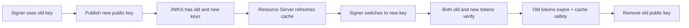

# Maintaining Active Tokens During the Transition Period

Upgrading an Authorization Server is not merely replacing an application version. During the transition window, the system may simultaneously run multiple versions of Spring Authorization Server, multiple signing key sets, multiple database schema versions, and multiple Resource Servers holding different caches. Without compatibility preparation, unexpired access tokens may be rejected, refresh tokens may fail to exchange, or active clients may be forced into unexpected re-authentication.

The goal of this lesson is to plan the upgrade so already-issued tokens continue to be verified and used per policy until expiration or intentional revocation. Components that must be coordinated include the issuer, signing algorithms and keys, JWKS, token formats, `OAuth2AuthorizationService`, `RegisteredClientRepository`, refresh tokens, client authentication, and Resource Servers.

Not every token type is maintained in the same way. JWT access tokens are typically verified locally via public keys and claims; opaque tokens require introspection or a state lookup mechanism; refresh tokens must be processed by the Authorization Server and the authorization store. Tokens must be classified before selecting a transition strategy.

## 1. Defining the Scope of Tokens to Maintain

Before changing the system, build an inventory for each issuer, tenant, client, and Resource Server. At a minimum, you must know:

- Token format: JWT or opaque/reference token.
- Issuer (`iss`), audience (`aud`), token type, and critical claims/authorities.
- Signing algorithm (`alg`), `kid`, currently published public keys, and maximum token lifetime.
- Access token, refresh token, and authorization code lifetimes, plus clock skew accepted by Resource Servers.
- Revocation mechanism: stateless JWT, introspection, denylist, token version, or database-stored status.
- Storage locations for authorizations, refresh tokens, clients, and consents; schema version and serialization format.
- Client authentication methods, credential rotation, and mTLS/DPoP binding if used.
- Which Resource Servers trust which issuer/JWKS, how long JWKS is cached, and which token formats are supported.

Example inventory table:

| Component | Current Version | What to Maintain During Transition |
|---|---|---|
| Issuer | `https://auth.example.com` | Keep unchanged if possible |
| JWT access token | RS256, `kid=as-key-01`, 10-minute TTL | Old public key remains in JWKS for the full token lifecycle |
| New JWT access token | RS256, `kid=as-key-02` | Resource Servers recognize the new key before signer uses it |
| Refresh token | Opaque, stored in authorization store | New version must read old authorizations |
| Client | Current Client ID and grants | Preserve ID, grants, scopes, and required policies |
| Resource Server | JWKS cache up to 15 minutes | Able to read both old and new keys |

Values in the table are examples only. Pull actual TTLs from `TokenSettings`, client configurations, and runtime policy. If multiple clients have different lifetimes, calculate based on the maximum value across clients still permitted to issue tokens.

## 2. Distinguishing Access Tokens, Refresh Tokens, and Authorization State

### 2.1. Already-Issued JWT Access Tokens

A signed JWT is an immutable snapshot of headers and claims at the time of issuance. Upgrading `TokenSettings` configuration or reducing TTL does not change `exp`, scopes, or claims in an existing JWT. If the signature is valid, issuer/audience match, the token has not expired, and it has not been revoked under the mechanism checked by the Resource Server, the token can still be accepted.

For JWTs signed with an old key, Resource Servers must continue having the corresponding public key in the JWKS or trust store. Removing the old public key too early causes unexpired tokens to be rejected with `kid` not found or signature verification errors.

### 2.2. Opaque Access Tokens

Opaque tokens do not contain JWT claims for a Resource Server to verify on its own. Resource Servers typically call an introspection endpoint or use a trusted state lookup mechanism. During the transition period, introspection must still locate old tokens and return the required status, scopes, audience, or metadata.

If migrating from opaque to JWT, Resource Servers must be deployed to support the new format before the Authorization Server begins issuing new tokens. If migrating from JWT to opaque, Resource Servers need an introspection client and endpoint access before opaque tokens are issued. Never switch token formats at a single point in time and expect all APIs to automatically understand both.

### 2.3. Refresh Tokens and Authorization State

Refresh tokens typically have longer lifetimes than access tokens. With Spring Authorization Server's JDBC implementation, `OAuth2AuthorizationService` stores authorizations and related token details; refresh requests must be able to read state created by the previous version.

Retain authorization data, client IDs, token metadata, and revocation status until refresh tokens expire or are revoked. Just because an old public key is no longer needed for JWT access tokens does not mean you can delete authorization records containing still-valid refresh tokens.

If refresh tokens are self-contained JWTs, retain the public key used to verify them until those tokens expire or are revoked through an appropriate mechanism. If refresh tokens are opaque and stored in a database, the ability to read records, check status, and enforce rotation policies is decisive.

## 3. Keeping the Issuer Stable During Upgrades

The issuer is the Authorization Server's identifier and is routinely checked by Resource Servers. Whenever possible, keep the public issuer unchanged throughout the upgrade:

```java
@Bean
AuthorizationServerSettings authorizationServerSettings(
        @Value("${app.security.issuer}") String issuer) {
    return AuthorizationServerSettings.builder()
            .issuer(issuer)
            .build();
}
```

Example configuration:

```yaml
app:
  security:
    issuer: ${AUTH_SERVER_ISSUER:https://auth.example.com}
```

Never let individual replicas derive an issuer from a hostname, pod name, or internal address. Discovery metadata, `iss` claims, token endpoints, and `jwks_uri` must remain consistent.

If changing the issuer is unavoidable, treat it as a separate protocol migration. Resource Servers must trust both the old and new issuers for a bounded period, use the corresponding validator/decoder for each issuer, and continue accepting old tokens until expiration or revocation. Never disable issuer validation or accept arbitrary issuers to preserve compatibility.

When supporting multiple issuers, do not just add both URIs to a list and ignore the issuing source. Map tokens to decoders based on a verified issuer and a governed issuer allowlist. Never fetch JWKS from a URL supplied by an untrusted token or request.

## 4. Retaining Old Public Keys During Signing Key Rotation

This is the most critical requirement for JWT access tokens. A safe procedure uses an overlap period during which JWKS publishes both old and new public keys.

### 4.1. Key Transition Sequence

1. Generate a new key pair in KMS/HSM or a secure keystore; assign a new, unique `kid`.
2. Update the key ring so JWKS publishes the new public key alongside the old public key.
3. Verify all Authorization Server replicas return the same JWKS; check from the Resource Server's network.
4. Wait for propagation and JWKS cache durations based on actual configuration.
5. Switch the signer to the new private key; new tokens must carry the new `kid`.
6. Retain the old public key in JWKS to verify previously issued tokens.
7. Remove the old public key only after the last token signed with that key has expired, plus clock skew, cache duration, and an operational safety margin.



Never reuse a `kid` for different key material. If key material changes while keeping the same `kid`, one Resource Server may cache the old public key while another instance returns the new public key, causing hard-to-reproduce signature errors.

### 4.2. Calculating When to Remove the Old Public Key

A conservative calculation:

```text
remove_old_public_key_after =
    last_issued_at_with_old_key
    + maximum_lifetime_of_tokens_signed_by_old_key
    + accepted_clock_skew
    + maximum_jwks_cache_age
    + propagation_safety_margin
```

If multiple JWT types are signed by the same key, take the longest lifetime among all active types, including access tokens, ID tokens, or JWT refresh tokens if used. Cache and propagation margins must be grounded in actual Resource Server, CDN, and proxy settings.

Even when an online revocation check exists, retain the public key until tokens expire or are revoked per plan. Some components verify signatures before checking revocation status; removing the key too early still triggers technical errors and complicates investigation.

### 4.3. Configuring JWKSource in Spring Authorization Server

Spring Authorization Server uses `JWKSource<SecurityContext>` to supply keys to the signer and the JWKS endpoint. Architectural example:

```java
@Bean
JWKSource<SecurityContext> jwkSource(KeyRingProvider keyRingProvider) {
    return (selector, context) ->
            selector.select(keyRingProvider.currentJwkSet());
}
```

`KeyRingProvider` is an application abstraction. During the overlap window, `currentJwkSet()` must contain both old and new public keys, while the signer must select the currently active private key. Do not assume the selector will automatically choose the new signing key as intended if the key set contains multiple matching private keys; explicitly configure signing key selection or `JwtEncoder` for the version in use.

If private keys reside in KMS/HSM and cannot be exported, integrate an appropriate signer rather than loading private keys into the JVM. JWKS must publish only public material; never expose private parameters in responses.

## 5. Maintaining Resource Servers During the Transition

Resource Servers must be updated before the Authorization Server issues tokens using a new configuration. For JWTs, ensure the decoder trusts the issuer, can fetch the new JWKS, and allows approved algorithms.

Example Resource Server using an issuer URI:

```yaml
spring:
  security:
    oauth2:
      resourceserver:
        jwt:
          issuer-uri: https://auth.example.com
```

If a Resource Server configures the JWKS URI directly, it must still validate the issuer with a validator. Do not validate signatures alone. Maintain an explicit algorithm allowlist; when switching algorithms during an overlap window, allow only approved algorithms supported by the library.

### 5.1. Checking JWKS Caches

JWKS can be cached in decoders, HTTP clients, reverse proxies, or CDNs. An endpoint returning the new key on a developer workstation does not prove every production pod has received that key.

Check:

- `jwks_uri` in the discovery metadata of the issuer in use.
- JWKS responses from each network/cluster running Resource Servers.
- `Cache-Control`, `ETag`, and `Last-Modified` if infrastructure uses them.
- Library cache refresh intervals and behavior upon encountering an unknown `kid`.
- Key ring synchronization across Authorization Server replicas.

Do not restart all Resource Servers as a first step without knowing the root cause. Restarting may flush caches, but it will not fix a misconfigured endpoint or unsynchronized replicas. Use supported cache refresh mechanisms and monitor `unknown_kid` and `invalid_signature` errors after updating.

### 5.2. Supporting Multiple Algorithms or Token Formats

If changing `RS256` to `PS256` or `ES256`, Resource Servers must support the new algorithm before the signer switches to it. Allow both old and new algorithms concurrently only as long as necessary. Once old tokens expire, remove the old algorithm from the allowlist.

If switching from JWT to opaque tokens or vice versa, Resource Servers must have handling paths for both formats during the transition window. Two token formats cannot be processed by the same simple `JwtDecoder`. You can roll out per API/resource, use an authentication manager resolver, or use a routing layer that determines token type based on trusted configuration. Never guess token types from unverified data and bypass signature/introspection checks.

For opaque tokens, configure the introspection client, endpoint, and access permissions before the Authorization Server issues opaque tokens. Introspection must read old tokens throughout their remaining valid lifetime. Monitor latency, network errors, and `active` status to catch issues.

## 6. Keeping Refresh Tokens and the Authorization Store Compatible

Refresh tokens are a common source of post-upgrade disruption because they rely on persisted data and client configuration. A Resource Server may continue verifying old access tokens while clients cannot refresh because the new version cannot read authorization records.

### 6.1. Using Durable and Shared Persistence

In Spring Authorization Server, the key abstractions include:

- `RegisteredClientRepository`: looks up client settings used for authentication and grant processing.
- `OAuth2AuthorizationService`: stores authorizations and associated tokens.
- `OAuth2AuthorizationConsentService`: stores user-granted consents.

If using JDBC, `JdbcOAuth2AuthorizationService` and JDBC repositories need a shared database or a synchronization mechanism with suitable consistency. Old and new replicas must observe compatible authorization, refresh token, and client state throughout the rollout.

Do not use in-memory repositories in production when tokens must survive restarts or multiple replicas. If in-memory was used previously, switching to JDBC cannot recover already-lost refresh tokens; plan for re-authentication or an appropriate transition window.

### 6.2. Expand-and-Contract Schema Migration

Never apply breaking schema changes in the same deployment as new code. Follow this sequence:

1. **Expand:** add new tables/columns/indexes so the old application version still runs.
2. **Deploy compatible code:** release a version capable of reading both old and new schemas or writing compatible structures.
3. **Backfill:** convert data in resumable batches; verify counts and integrity.
4. **Switch:** shift read/write paths to the new structure once data is ready.
5. **Observe:** keep the old schema during the rollback window and monitor refresh/introspection errors.
6. **Contract:** drop old columns/tables in a later release only after no old version or rollback depends on them.

Spring Authorization Server JDBC uses a version-specific schema. Compare migrations against the schema and documentation of the exact dependency version; do not rename columns, change data types, or alter token metadata serialization while older application instances still need to read them. If a custom `OAuth2AuthorizationService` stores serialized objects, changing classes or serializers requires the ability to read previous-version data.

### 6.3. Keeping Registered Clients Compatible

Refresh requests are processed against the registered client. Preserve `client_id`, grant types, scopes, client authentication methods, and necessary settings until old refresh tokens expire or are revoked. Changing the client authentication method or secret in the same rollout can prevent clients from authenticating during refresh.

Credential rotation requires its own compatibility window. If the system stores only one client secret at a time, do not assume both old and new secrets can be accepted simultaneously unless that mechanism has been implemented. You can use public-key authentication, credential versioning, or a controlled credential rotation workflow; any approach must preserve client identity and avoid secret exposure.

### 6.4. Refresh Token Rotation and Replay

If refresh token rotation is enabled, each refresh can issue a new refresh token and invalidate the old one. During upgrades, preserve these semantics or implement an explicit transition. Do not accidentally turn single-use refresh tokens into reusable ones, or vice versa, just because defaults changed between versions.

Test two concurrent refresh requests with the same refresh token. The system must behave consistently and enforce replay protection per policy. When reuse is detected, act according to the application's security policy; do not wipe all authorizations for a client or tenant without scoping accurately.

## 7. Maintaining Opaque Tokens and Introspection

For opaque access tokens, Resource Servers call the introspection endpoint to determine whether a token is still active. During the upgrade:

- Keep the introspection endpoint and Resource Server credentials active.
- The new Authorization Server version must read old token records and revocation status.
- If running two Authorization Servers in parallel, ensure both share state or route introspection to the store holding the authoritative data.
- Keep scope, audience, subject, and tenant mappings consistent.
- Test revoked, expired, and active tokens issued before the upgrade.

If changing the introspection endpoint or Resource Server client authentication, update Resource Servers first and keep the old endpoint during the overlap window. Never return `active=true` just because a token record is missing; tokens with unknown state must be rejected.

## 8. Parallel Deployment and Rolling Upgrades

A common strategy is rolling out the new version incrementally while the old version continues serving requests. Both versions must be compatible regarding issuer, database, client registration, and key ring.

```mermaid
sequenceDiagram
    participant RS as Resource Servers
    participant Old as Authorization Server v1
    participant New as Authorization Server v2
    participant DB as Shared authorization database
    participant JWKS as Shared JWKS/key ring
    RS->>JWKS: Fetch old and new public keys
    Old->>JWKS: Keep old key; publish new key
    New->>JWKS: Read same key ring
    Old->>DB: Continue handling old authorizations
    New->>DB: Read old authorizations and refresh tokens
    Old-->>RS: Tokens may be signed with old key
    New-->>RS: New tokens may be signed with new key
    RS->>JWKS: Verify both kids during overlap
```

### 8.1. Recommended Deployment Sequence

1. **Prepare Resource Servers:** update trust/JWKS, validators, and support for new token formats if applicable.
2. **Expand database:** run backward-compatible migrations and verify backup/restore.
3. **Synchronize key ring:** publish the new public key across all JWKS endpoints before the signer uses it.
4. **Deploy new Authorization Server:** canary a portion of traffic; verify reading old clients, authorizations, consents, and refresh tokens.
5. **Shift traffic:** gradually increase request share to the new version as metrics remain stable.
6. **Switch signer:** only after Resource Servers have received the new public key.
7. **Monitor legacy tokens:** watch `kid`, issuer, refresh success, introspection, and 401/`invalid_client` errors.
8. **End overlap:** after token lifetimes and rollback conditions expire, remove legacy configuration layer by layer.

If old and new instances issue tokens concurrently during rollout, both public key sets must exist in the shared JWKS. Resource Servers must be able to verify tokens from every replica. Never let a load balancer return different JWKS responses depending on which instance answers.

### 8.2. Canary and Expansion Criteria

Increase traffic only when these metrics remain stable:

- Token issuance success rate and `invalid_client` error rate.
- Refresh token success rate and detected refresh token reuse count.
- Rate of Resource Servers returning 401 due to `unknown_kid`, `invalid_signature`, issuer, or audience.
- Introspection latency and error rate if using opaque tokens.
- Read/write errors in `OAuth2AuthorizationService`, `RegisteredClientRepository`, and consent store.
- Readiness rate, database connections, and replication lag if applicable.

Set rollout halt thresholds before deploying. For example, if refresh failure rates spike or an unpublished `kid` appears, pause traffic expansion and resolve the root cause first.

## 9. Rollback Without Losing Token Verification

Rolling back the application does not automatically roll back all key and data state. Before upgrading, build a compatibility matrix:

| Component | Must Old Version Read After Rollback? | Condition |
|---|---|---|
| Database schema | Yes | Expand migration maintains compatibility with old code |
| Authorization records | Yes | Old serializer/schema can still read current records |
| Registered Clients | Yes | Required client ID, grants, and auth methods preserved |
| Key ring/JWKS | Yes | Old version still publishes public keys of new tokens if rolling back after switching signer |
| Resource Server | Yes | Continues trusting required issuer and public keys |
| Token format | Yes | Old version supports issued format or traffic is routed appropriately |

If the new version already issued tokens with the new key, rolling back to the old version must still keep the new public key in JWKS so Resource Servers can verify those tokens. The old version may need configuration to read the new key ring even if it does not use the new private key for signing.

Never run a destructive rollback migration once new data has been written. Use a forward fix or controlled restore. If rollback loses the ability to read new refresh tokens, clients may require re-authentication; identify and communicate this beforehand in the operational plan.

## 10. Changing Token Policy Without Disruption

Certain policy changes do not apply retroactively to already-issued tokens:

- Reducing access token TTL does not shorten `exp` on existing JWTs.
- Removing a scope from a client does not remove that scope from existing tokens.
- Changing audience policy does not alter signed `aud` claims.
- Changing refresh token reuse/rotation does not retroactively transform issued tokens or old authorization states.

If existing tokens must be invalidated early, an explicit mechanism is required: authorization revocation, status introspection, `jti`-based denylist, token versioning, or forced re-authentication. With stateless JWTs, Resource Servers cannot know a token has been revoked without an additional state-check point. Weigh revocation propagation delay, system load, and availability when choosing a mechanism.

Policy changes should be rolled out to a small scope first, measured, and then expanded. Record policy versions and effective timestamps to investigate which policy issued a given token.

## 11. Tokens Bound to mTLS or DPoP

If access tokens are bound to an mTLS certificate (`cnf.x5t#S256`) or a DPoP key (`cnf.jkt`), maintaining tokens also requires maintaining proof of possession of the corresponding key.

- **mTLS:** Resource Servers must continue trusting old certificates for the remaining lifetime of certificate-bound tokens. When rotating certificates, new tokens must be issued and bound to the new thumbprint. Existing tokens do not transfer automatically to the new certificate.
- **DPoP:** clients must keep using the private key matching `cnf.jkt` of the existing token. When rotating DPoP keys, clients need new tokens; proofs from the new key are invalid for the old token.
- **Client assertions:** if a client uses `private_key_jwt` to refresh tokens, the Authorization Server must continue accepting the client's current public key and provide an overlap window when rotating client keys.

Do not remove old trust anchors or public keys solely because the Authorization Server was upgraded. Calculate retention periods based on remaining valid tokens, credential expiration, revocation policy, and Resource Server caches.

## 12. Pre-, During-, and Post-Upgrade Verification Runbook

| Phase | Item to Verify | Expected Outcome |
|---|---|---|
| Pre-upgrade | Inventory issuer, token formats, TTLs, `kid`, clients, and Resource Servers | Dependency list and maximum lifetimes documented |
| Pre-upgrade | Database backup and restore test | Ability to restore authorization state verified |
| Pre-upgrade | Schema/serializer compatibility check | Old and new versions read required data |
| Pre-upgrade | Publish new public key | JWKS contains both old and new keys |
| During rollout | Resource Servers receive new key | Newly signed tokens do not cause `unknown_kid` |
| During rollout | New version reads old refresh tokens | Refresh succeeds per policy |
| During rollout | Old/new Authorization Servers share issuer and consistent state | No client/authorization split-brain occurs |
| During rollout | Monitor 401s, invalid signatures, `invalid_client`, and refresh failures | No abnormal spikes |
| Post-rollout | Unexpired legacy tokens remain verifiable | No unplanned forced re-logins |
| Post-rollout | New tokens verified and new policy active | Claims and scopes match new version |
| Post-overlap | No valid tokens depend on old key | Old public key can be safely removed |
| Post-overlap | Old refresh tokens expired/revoked and records processed per retention | Data cleanup can proceed per procedure |

## 13. Required Regression Tests

Create a test token suite before upgrading and retain the metadata needed to verify them afterward. Never store production tokens in repositories or test fixtures. Use tokens issued in staging with production-like lifetimes and claims.

Test cases:

1. JWT access tokens signed with the old key remain verified by Resource Servers after deploying the new version.
2. JWT access tokens signed with the new key are verified by all updated Resource Servers.
3. Tokens with wrong issuer, audience, signature, or expired timestamps are still rejected.
4. Legacy opaque tokens remain introspectable and revoked tokens still return inactive.
5. Legacy refresh tokens exchange for new tokens after the Authorization Server upgrade.
6. Used or revoked refresh tokens cannot be replayed in violation of policy.
7. Legacy authorization records and consents are read accurately after schema migration.
8. Existing clients still authenticate during the defined credential overlap window.
9. mTLS/DPoP-bound tokens still require matching certificate/key proofs.
10. Application rollback does not cause Resource Servers to lose public keys for tokens issued during rollout.
11. JWKS caches and multiple replicas do not produce divergent results per instance.
12. New TTL/scope changes are not mistaken for retrofitting old tokens.

Test in an integration environment with databases, caches, proxies, and replica counts close to production. Unit testing a single `JwtDecoder` cannot prove rollout, caching, or refresh token persistence work properly.

## 14. Common Incidents and Troubleshooting

| Symptom | Common Cause | Remediation |
|---|---|---|
| Legacy tokens fail with `unknown_kid` after deploy | Old public key was removed or new JWKS omits old key | Restore old public key and inspect cache/replicas |
| New tokens fail with `unknown_kid` | Signer switched keys before new public key propagated | Publish key first, wait for propagation, then switch signer |
| Only some APIs return 401 | Resource Servers differ in caches, algorithm allowlists, or issuers | Compare decoder configs and JWKS responses per service |
| Legacy refresh tokens return `invalid_grant` | Authorization record lost, schema/serializer incompatible, or token revoked | Inspect `OAuth2AuthorizationService`, migrations, and token state |
| Refresh fails with `invalid_client` | Client ID/auth method/secret changed incompatibly | Restore credential overlap or client migration process |
| Introspection returns inactive for legacy tokens | New version fails to read token record or queries wrong store | Synchronize authorization store and check introspection routing |
| New tokens carry different issuer | Issuer configuration differs across replicas/profiles | Standardize issuer; if issuer migration is mandatory, trust both boundedly |
| Rollback causes signature errors on new tokens | Old version does not publish new public key | Share key ring and verify JWKS before/after rollback |
| Legacy mTLS/DPoP tokens stop working | Old certificate or DPoP key was removed | Keep old binding until expiration or issue new tokens per plan |
| Legacy tokens keep privileges after scope reduction | Old JWT retains signed scope claim | Use revocation/introspection/denylist if early revocation is required |

## 15. Operational Principles

- Keep the issuer stable unless a mandatory migration requires changing it.
- Publish new public keys before signing tokens with new private keys.
- Retain old public keys until related token lifetimes and caches expire.
- Keep the authorization store, Registered Clients, and consents compatible during rollout.
- Use expand-and-contract database migrations and maintain rollback capability.
- Deploy Resource Server updates before changing token formats or algorithms.
- Monitor access tokens, refresh tokens, introspection, and validation errors separately.
- Never disable signature/issuer/audience validation to bypass compatibility issues.
- Revoke tokens or force re-authentication only with an explicit decision on scope and impact.

## Conclusion

Maintaining tokens during an upgrade requires coordinating cryptography, data, and deployment order. For JWTs, keep old public keys in JWKS until tokens expire and Resource Servers refresh caches; for opaque tokens, keep introspection and authorization state compatible; for refresh tokens, ensure the new version reads old authorization records, clients, and consents. When the issuer stays stable, schemas are expanded compatibly, Resource Servers are prepared ahead of time, and rollbacks preserve the necessary key ring, the system can upgrade versions without causing unplanned disruptions to still-valid tokens.
