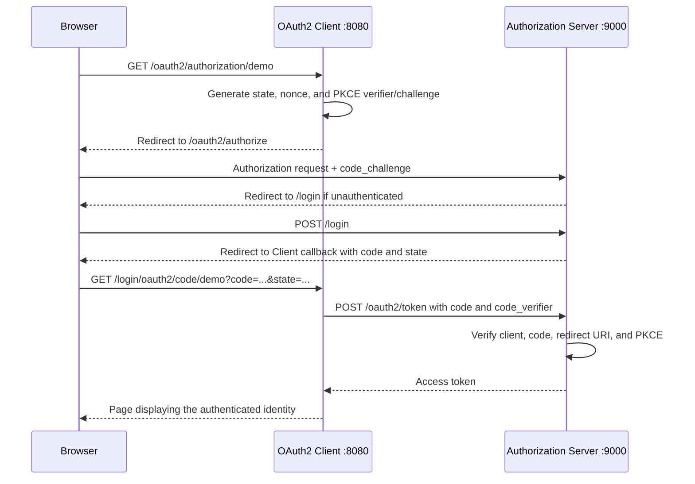

# Building a Minimal Authorization Server with One OAuth2 Client

In this lab, you build a Spring Authorization Server that issues authorization codes and access tokens for a single OAuth2 Client. The client is a separate Spring Boot application that uses Spring Security OAuth2 Client to redirect the user to the Authorization Server, receive the callback, and exchange the code for a token. The Authorization Server authenticates the user, validates the client and redirect URI, verifies PKCE, and then issues a signed token.

The setup uses two applications to clearly show the boundary between where tokens are issued and where tokens are used:

| Application | Local Address | Responsibility |
|---|---|---|
| Authorization Server | `http://localhost:9000` | User login, OAuth2 Client authentication, issuing authorization codes and JWT access tokens |
| OAuth2 Client | `http://localhost:8080` | Initiating authorization requests, handling callbacks, and storing issued tokens |

The client uses the Authorization Code grant with PKCE S256. The lab uses a single local user, a single client registration, in-memory storage, and a temporary RSA key to keep the focus on the flow. The final sections point out which components must be replaced when moving to production.

## 1. Overall Flow



`state` binds the callback to the authorization request initiated by the client. `code_verifier` is a short-lived secret held by the client; the Authorization Server only receives `code_challenge` at the authorize step and verifies the verifier at the code exchange step. The client does not need to read or manually handle tokens in the browser if tokens are stored on the backend of the Spring Boot application.

## 2. Preparing the Two Applications

Create two independent Spring Boot projects; you can use the same Spring Boot 3 and Spring Security 6 versions compatible with the chosen Spring Authorization Server version. Let dependency management manage the Spring Framework and Spring Security versions; if the BOM does not manage Spring Authorization Server, declare a compatible version according to the project's release documentation.

**Authorization Server** requires the following dependencies in `build.gradle`:

```gradle
dependencies {
    implementation("org.springframework.boot:spring-boot-starter-web")
    implementation("org.springframework.boot:spring-boot-starter-security")
    implementation("org.springframework.security:spring-security-oauth2-authorization-server")

    testImplementation("org.springframework.boot:spring-boot-starter-test")
    testImplementation("org.springframework.security:spring-security-test")
}
```

**OAuth2 Client** requires:

```gradle
dependencies {
    implementation("org.springframework.boot:spring-boot-starter-web")
    implementation("org.springframework.boot:spring-boot-starter-security")
    implementation("org.springframework.boot:spring-boot-starter-oauth2-client")

    testImplementation("org.springframework.boot:spring-boot-starter-test")
    testImplementation("org.springframework.security:spring-security-test")
}
```

Keep the two projects in two separate directories so each application can be started and stopped independently. Do not add the Resource Server dependency to this lab because the client only needs to log in and receive a token; protecting APIs with access tokens is covered in another lab.

## 3. Configuring the Authorization Server

In the Authorization Server project, create `application.yml`:

```yaml
server:
  port: 9000

app:
  security:
    issuer: http://localhost:9000
  demo:
    client-secret: ${DEMO_CLIENT_SECRET}
    user-password: ${DEMO_USER_PASSWORD}
```

Before running, set the two environment variables `DEMO_CLIENT_SECRET` and `DEMO_USER_PASSWORD` to values dedicated to the local lab. Do not commit secrets or passwords to the repository. The issuer must match the exact address the client uses to discover metadata; when deploying, replace it with a stable HTTPS public URL.

### 3.1. Creating a Local User and PasswordEncoder

Create a user to log in to the Authorization Server. Use BCrypt to store the encoded password in `UserDetailsService`:

```java
import org.springframework.beans.factory.annotation.Value;
import org.springframework.context.annotation.Bean;
import org.springframework.context.annotation.Configuration;
import org.springframework.security.core.userdetails.User;
import org.springframework.security.core.userdetails.UserDetailsService;
import org.springframework.security.crypto.bcrypt.BCryptPasswordEncoder;
import org.springframework.security.crypto.password.PasswordEncoder;
import org.springframework.security.provisioning.InMemoryUserDetailsManager;

@Configuration
public class UserConfiguration {

    @Bean
    PasswordEncoder passwordEncoder() {
        return new BCryptPasswordEncoder();
    }

    @Bean
    UserDetailsService userDetailsService(
            PasswordEncoder passwordEncoder,
            @Value("${app.demo.user-password}") String userPassword) {

        return new InMemoryUserDetailsManager(
                User.withUsername("alice")
                        .password(passwordEncoder.encode(userPassword))
                        .roles("USER")
                        .build());
    }
}
```

The `alice` account is for lab use only. Production requires integrating a real identity store, password/MFA policies, and account lifecycle management. Do not use `InMemoryUserDetailsManager` as the user store for a production cluster.

### 3.2. Creating an RSA Key Pair and JWK Source

The Authorization Server signs JWT access tokens with a private key and publishes the public key via the JWK Set endpoint. Use a temporary RSA key pair in the lab:

```java
import java.security.KeyPair;
import java.security.KeyPairGenerator;
import java.security.NoSuchAlgorithmException;

import org.springframework.context.annotation.Bean;
import org.springframework.context.annotation.Configuration;

@Configuration
public class SigningKeyConfiguration {

    @Bean
    KeyPair rsaKeyPair() throws NoSuchAlgorithmException {
        KeyPairGenerator generator = KeyPairGenerator.getInstance("RSA");
        generator.initialize(2048);
        return generator.generateKeyPair();
    }
}
```

Create a `JWKSource` from the key pair:

```java
import java.security.KeyPair;
import java.security.interfaces.RSAPrivateKey;
import java.security.interfaces.RSAPublicKey;
import java.util.UUID;

import com.nimbusds.jose.jwk.JWKSet;
import com.nimbusds.jose.jwk.RSAKey;
import com.nimbusds.jose.jwk.source.JWKSource;
import com.nimbusds.jose.proc.SecurityContext;
import org.springframework.context.annotation.Bean;
import org.springframework.context.annotation.Configuration;

@Configuration
public class JwkConfiguration {

    @Bean
    JWKSource<SecurityContext> jwkSource(KeyPair rsaKeyPair) {
        RSAKey rsaKey = new RSAKey.Builder((RSAPublicKey) rsaKeyPair.getPublic())
                .privateKey((RSAPrivateKey) rsaKeyPair.getPrivate())
                .keyID(UUID.randomUUID().toString())
                .build();

        JWKSet jwkSet = new JWKSet(rsaKey);
        return (selector, context) -> selector.select(jwkSet);
    }
}
```

On every startup, the example above generates a new key and `kid`. Old tokens cannot be verified after the application restarts. This is an intentional choice for a short-lived lab; production must load stable keys from a KMS/HSM or secret manager, maintain a consistent `kid`, and have a key rotation process. Private keys must never be placed in the repository or shared with the OAuth2 Client.

### 3.3. Registering an OAuth2 Client

The client registration defines the client ID, authentication method, grant type, redirect URI, and allowed scopes. Register a confidential client with the Authorization Code grant, authenticated via HTTP Basic, and requiring PKCE:

```java
import java.time.Duration;
import java.util.UUID;

import org.springframework.beans.factory.annotation.Value;
import org.springframework.context.annotation.Bean;
import org.springframework.context.annotation.Configuration;
import org.springframework.security.crypto.password.PasswordEncoder;
import org.springframework.security.oauth2.core.AuthorizationGrantType;
import org.springframework.security.oauth2.core.oidc.OidcScopes;
import org.springframework.security.oauth2.server.authorization.client.ClientAuthenticationMethod;
import org.springframework.security.oauth2.server.authorization.client.InMemoryRegisteredClientRepository;
import org.springframework.security.oauth2.server.authorization.client.RegisteredClient;
import org.springframework.security.oauth2.server.authorization.client.RegisteredClientRepository;
import org.springframework.security.oauth2.server.authorization.settings.ClientSettings;
import org.springframework.security.oauth2.server.authorization.settings.TokenSettings;

@Configuration
public class ClientRegistrationConfiguration {

    @Bean
    RegisteredClientRepository registeredClientRepository(
            PasswordEncoder passwordEncoder,
            @Value("${app.demo.client-secret}") String clientSecret) {

        RegisteredClient client = RegisteredClient.withId(UUID.randomUUID().toString())
                .clientId("demo-client")
                .clientSecret(passwordEncoder.encode(clientSecret))
                .clientAuthenticationMethod(ClientAuthenticationMethod.CLIENT_SECRET_BASIC)
                .authorizationGrantType(AuthorizationGrantType.AUTHORIZATION_CODE)
                .redirectUri("http://localhost:8080/login/oauth2/code/demo")
                .scope(OidcScopes.OPENID)
                .scope(OidcScopes.PROFILE)
                .scope("message.read")
                .clientSettings(ClientSettings.builder()
                        .requireProofKey(true)
                        .requireAuthorizationConsent(false)
                        .build())
                .tokenSettings(TokenSettings.builder()
                        .accessTokenTimeToLive(Duration.ofMinutes(5))
                        .build())
                .build();

        return new InMemoryRegisteredClientRepository(client);
    }
}
```

`redirectUri` must match the exact callback declared by the client. `CLIENT_SECRET_BASIC` requires the client to authenticate at the token endpoint using HTTP Basic. `requireProofKey(true)` forces the client to prove it holds the PKCE verifier when exchanging the code. `requireAuthorizationConsent(false)` keeps the lab focused on the minimal flow; when consent is enabled, you need to build a consent page and handle the user's decision.

`InMemoryRegisteredClientRepository` only holds clients in memory. Upon restart, the registration is recreated with a new internal ID. Production should use `JdbcRegisteredClientRepository` or a persistent store, manage schemas with migrations, and protect client creation/update operations.

### 3.4. Declaring Authorization and Consent Services

Spring Authorization Server needs a place to store authorization state and consent. For a single lab instance, use the in-memory implementations:

```java
import org.springframework.context.annotation.Bean;
import org.springframework.context.annotation.Configuration;
import org.springframework.security.oauth2.server.authorization.InMemoryOAuth2AuthorizationConsentService;
import org.springframework.security.oauth2.server.authorization.InMemoryOAuth2AuthorizationService;
import org.springframework.security.oauth2.server.authorization.OAuth2AuthorizationConsentService;
import org.springframework.security.oauth2.server.authorization.OAuth2AuthorizationService;

@Configuration
public class AuthorizationStoreConfiguration {

    @Bean
    OAuth2AuthorizationService authorizationService() {
        return new InMemoryOAuth2AuthorizationService();
    }

    @Bean
    OAuth2AuthorizationConsentService authorizationConsentService() {
        return new InMemoryOAuth2AuthorizationConsentService();
    }
}
```

The authorization service stores authorization codes, access tokens, and grant flow metadata. The consent service stores the scopes the user has approved if the application enables consent. Both in-memory implementations lose data when the process stops and are not shared across multiple instances.

### 3.5. Configuring the Issuer and JWT Decoder

The issuer is the stable identifier of the Authorization Server. Set the issuer explicitly in `AuthorizationServerSettings`:

```java
import org.springframework.beans.factory.annotation.Value;
import org.springframework.context.annotation.Bean;
import org.springframework.context.annotation.Configuration;
import org.springframework.security.oauth2.server.authorization.settings.AuthorizationServerSettings;

@Configuration
public class AuthorizationServerSettingsConfiguration {

    @Bean
    AuthorizationServerSettings authorizationServerSettings(
            @Value("${app.security.issuer}") String issuer) {
        return AuthorizationServerSettings.builder()
                .issuer(issuer)
                .build();
    }
}
```

When OpenID Connect is enabled, provide a `JwtDecoder` so OIDC endpoints that need to verify JWTs work properly:

```java
import com.nimbusds.jose.proc.SecurityContext;
import com.nimbusds.jose.jwk.source.JWKSource;
import org.springframework.context.annotation.Bean;
import org.springframework.context.annotation.Configuration;
import org.springframework.context.annotation.Primary;
import org.springframework.security.oauth2.jwt.JwtDecoder;
import org.springframework.security.oauth2.server.authorization.config.annotation.web.configuration.OAuth2AuthorizationServerConfiguration;

@Configuration
public class OidcConfiguration {

    @Bean
    @Primary
    JwtDecoder jwtDecoder(JWKSource<SecurityContext> jwkSource) {
        return OAuth2AuthorizationServerConfiguration.jwtDecoder(jwkSource);
    }
}
```

### 3.6. Configuring SecurityFilterChain

The Authorization Server has its own filter chain, ordered before the application login chain. Enable OIDC so the client can discover metadata and receive an ID Token when requesting the `openid` scope:

```java
import org.springframework.context.annotation.Bean;
import org.springframework.context.annotation.Configuration;
import org.springframework.core.annotation.Order;
import org.springframework.security.config.Customizer;
import org.springframework.security.config.annotation.web.builders.HttpSecurity;
import org.springframework.security.oauth2.server.authorization.config.annotation.web.configurers.OAuth2AuthorizationServerConfigurer;
import org.springframework.security.web.SecurityFilterChain;

@Configuration
public class SecurityConfiguration {

    @Bean
    @Order(1)
    SecurityFilterChain authorizationServerSecurityFilterChain(HttpSecurity http)
            throws Exception {

        OAuth2AuthorizationServerConfigurer authorizationServerConfigurer =
                OAuth2AuthorizationServerConfigurer.authorizationServer();

        http.securityMatcher(authorizationServerConfigurer.getEndpointsMatcher())
                .with(authorizationServerConfigurer, authorizationServer ->
                        authorizationServer.oidc(Customizer.withDefaults()))
                .authorizeHttpRequests(authorize -> authorize.anyRequest().authenticated());

        return http.build();
    }

    @Bean
    @Order(2)
    SecurityFilterChain applicationSecurityFilterChain(HttpSecurity http)
            throws Exception {

        http.authorizeHttpRequests(authorize -> authorize
                        .requestMatchers("/assets/**", "/error").permitAll()
                        .anyRequest().authenticated())
                .formLogin(Customizer.withDefaults());

        return http.build();
    }
}
```

The Authorization Server chain handles OAuth2/OIDC endpoints. The second chain handles the login page and the remaining application requests. Keep default CSRF protection for form login. Do not disable CSRF globally just to make the token endpoint work; the token endpoint uses POST per the protocol and is handled in its own filter chain.

## 4. Configuring the OAuth2 Client

In the client project, configure `application.yml`:

```yaml
server:
  port: 8080

spring:
  security:
    oauth2:
      client:
        registration:
          demo:
            provider: local-auth
            client-id: demo-client
            client-secret: ${DEMO_CLIENT_SECRET}
            client-authentication-method: client_secret_basic
            authorization-grant-type: authorization_code
            redirect-uri: "{baseUrl}/login/oauth2/code/{registrationId}"
            scope:
              - openid
              - profile
              - message.read
            client-name: Demo Authorization Server
        provider:
          local-auth:
            issuer-uri: http://localhost:9000
```

Set `DEMO_CLIENT_SECRET` to the same value configured on the Authorization Server. With the local address, `{baseUrl}` produces the callback `http://localhost:8080/login/oauth2/code/demo`, matching the server-side registration. If you use `127.0.0.1` on one side and `localhost` on the other, the URIs will differ and the Authorization Server must reject the request.

`issuer-uri` allows Spring Security Client to fetch provider metadata from the Authorization Server. Through OIDC discovery, the client determines the authorization endpoint, token endpoint, JWKS URI, and OIDC endpoints without hardcoding each URL.

### 4.1. Enforcing PKCE on the Client Side

The client needs to send an S256 `code_challenge` in the authorization request. Configure a resolver so Spring Security adds the PKCE parameters:

```java
import org.springframework.context.annotation.Bean;
import org.springframework.context.annotation.Configuration;
import org.springframework.security.oauth2.client.registration.ClientRegistrationRepository;
import org.springframework.security.oauth2.client.web.DefaultOAuth2AuthorizationRequestResolver;
import org.springframework.security.oauth2.client.web.OAuth2AuthorizationRequestCustomizers;
import org.springframework.security.oauth2.client.web.OAuth2AuthorizationRequestResolver;

@Configuration
public class OAuth2ClientSecurityConfiguration {

    @Bean
    OAuth2AuthorizationRequestResolver authorizationRequestResolver(
            ClientRegistrationRepository registrations) {

        DefaultOAuth2AuthorizationRequestResolver resolver =
                new DefaultOAuth2AuthorizationRequestResolver(
                        registrations, "/oauth2/authorization");
        resolver.setAuthorizationRequestCustomizer(
                OAuth2AuthorizationRequestCustomizers.withPkce());
        return resolver;
    }
}
```

Attach the resolver to the OAuth2 Login filter chain:

```java
import org.springframework.context.annotation.Bean;
import org.springframework.context.annotation.Configuration;
import org.springframework.security.config.Customizer;
import org.springframework.security.config.annotation.web.builders.HttpSecurity;
import org.springframework.security.oauth2.client.web.OAuth2AuthorizationRequestResolver;
import org.springframework.security.web.SecurityFilterChain;

@Configuration
public class ClientSecurityConfiguration {

    @Bean
    SecurityFilterChain clientSecurityFilterChain(
            HttpSecurity http,
            OAuth2AuthorizationRequestResolver authorizationRequestResolver)
            throws Exception {

        http.authorizeHttpRequests(authorize -> authorize
                        .requestMatchers("/error").permitAll()
                        .anyRequest().authenticated())
                .oauth2Login(oauth2 -> oauth2
                        .authorizationEndpoint(endpoint -> endpoint
                                .authorizationRequestResolver(authorizationRequestResolver)));

        return http.build();
    }
}
```

The resolver generates a random verifier and stores the necessary details in the client's authorization request repository; the code challenge is sent to the Authorization Server. When the callback arrives, the client retrieves the corresponding verifier to exchange the code. Never log the verifier or store it in an unprotected cookie.

### 4.2. Creating a Page to Display the Logged-In User

Because the client requests the `openid` scope, Spring Security provides an `OidcUser` after verifying the ID Token and processing UserInfo according to configuration:

```java
import org.springframework.security.core.annotation.AuthenticationPrincipal;
import org.springframework.security.oauth2.core.oidc.user.OidcUser;
import org.springframework.security.oauth2.client.annotation.RegisteredOAuth2AuthorizedClient;
import org.springframework.security.oauth2.client.OAuth2AuthorizedClient;
import org.springframework.web.bind.annotation.GetMapping;
import org.springframework.web.bind.annotation.RestController;

@RestController
public class HomeController {

    @GetMapping("/")
    public String home(@AuthenticationPrincipal OidcUser user) {
        return "Login successful. Subject: " + user.getSubject();
    }

    @GetMapping("/token-info")
    public String tokenInfo(
            @RegisteredOAuth2AuthorizedClient("demo") OAuth2AuthorizedClient client) {

        return "Access token expires at: " + client.getAccessToken().getExpiresAt()
                + "; scopes: " + client.getAccessToken().getScopes();
    }
}
```

The `/token-info` endpoint only displays the expiration time and scopes without returning the access token to the browser. In real applications, avoid displaying tokens in the UI or writing tokens to logs. The client backend can use `OAuth2AuthorizedClient` to call a resource server via an appropriately configured HTTP client.

## 5. Starting Up and Executing the Authorization Flow

Open two terminals in the two projects. Ensure the environment variables are set in both processes.

1. Start the Authorization Server on port `9000`.
2. Start the OAuth2 Client on port `8080`.
3. Open a browser at `http://localhost:8080/oauth2/authorization/demo`.
4. The client creates the authorization request, PKCE challenge, and redirects the browser to the Authorization Server.
5. Log in with user `alice` and password `DEMO_USER_PASSWORD`.
6. The Authorization Server validates the client, redirect URI, scopes, and PKCE challenge, then returns an authorization code to the client callback.
7. The client automatically sends the code along with the verifier to the token endpoint and stores the token in `OAuth2AuthorizedClient`.
8. The browser is redirected to `/`, displaying the user's subject.
9. Open `/token-info` to view the access token expiration time and granted scopes.

There is no need to manually copy authorization codes or access tokens between the two applications. Spring Security OAuth2 Client handles the callback, exchanges the code, and stores the authorized client in the backend.

## 6. Verifying Metadata and Endpoints

Before browser testing, verify that the Authorization Server publishes OIDC discovery metadata:

```bash
curl --fail --silent --show-error \
  http://localhost:9000/.well-known/openid-configuration
```

Check the `issuer`, `authorization_endpoint`, `token_endpoint`, `jwks_uri`, `userinfo_endpoint`, and `end_session_endpoint` fields if the logout endpoint is published. The URLs must use a host and scheme reachable by the client. For the lab, the issuer is `http://localhost:9000`; production must use HTTPS and a stable public issuer.

Check the JWK Set endpoint:

```bash
curl --fail --silent --show-error \
  http://localhost:9000/oauth2/jwks
```

The response contains the public key along with `kid` so clients or resource servers can verify JWT signatures. The JWK Set must never publish private keys. Do not expose private keys in responses or logs.

## 7. Testing Common Error Cases

| Scenario | Expected Result | Where to Check |
|---|---|---|
| User enters wrong password | Login fails, no code is issued | Form login and authentication provider |
| Non-existent Client ID | Authorization request is rejected | `RegisteredClientRepository` |
| Redirect URI mismatch | Request is rejected; code is not redirected to an unknown URI | Client registration and authorization endpoint |
| Wrong client secret | Token endpoint returns `invalid_client` | Client authentication provider |
| Missing or wrong PKCE verifier | Token endpoint rejects code exchange, typically with `invalid_grant` | PKCE validation at the token endpoint |
| Already used authorization code | Second code exchange request is rejected with `invalid_grant` | Authorization state and code consumption |
| Unregistered scope | Authorization request is rejected with `invalid_scope` | `RegisteredClient.getScopes()` |
| Issuer does not match client metadata | Client cannot discover or verify the provider | `AuthorizationServerSettings` and `issuer-uri` |

Each time you test an invalid verifier or replay, you must initiate a new authorization request to obtain a new code. An authorization code can only be used once. When testing redirect URIs, confirm that the server does not redirect to an arbitrary URI supplied by the request.

### 7.1. Testing PKCE Independently

The Authorization Server sets `requireProofKey(true)`. To prove this policy works:

- Verify the authorization request includes `code_challenge` and `code_challenge_method=S256`.
- Using the exact verifier generated by the client: token exchange succeeds.
- Using a different verifier: token exchange fails.
- Omitting the verifier in the token request: token exchange fails.

Do not log verifiers or write them into test reports. Only use short-lived test values and clear authorization data after completing tests.

### 7.2. Testing Client Authentication

The client registration uses `CLIENT_SECRET_BASIC`, so the client must send the client ID and secret via HTTP Basic when calling the token endpoint. Replacing the secret with a wrong value in a test environment must result in `invalid_client`. Do not switch to `client_secret_post` just to avoid a configuration error; the method used to send the secret must match the registered `clientAuthenticationMethod`.

## 8. Enabling Consent When the Application Requires User Approval

The lab sets `requireAuthorizationConsent(false)` to keep the flow short. When the application needs users to review and approve scopes, change it to:

```java
.clientSettings(ClientSettings.builder()
        .requireProofKey(true)
        .requireAuthorizationConsent(true)
        .build())
```

When consent is enabled, the Authorization Server needs an application-provided consent page displaying the client name and requested scopes. The form must submit the approve/deny decision to the consent processing endpoint according to the Spring Authorization Server contract. Only persist consent after a valid decision; denied requests must not issue an authorization code.

Consent should be stored per both client and principal. Do not apply one user's consent to another user, or one client's consent to another client. In production, store consent persistently and provide a way to view and revoke granted permissions.

## 9. Configuring Logout and Login Sessions

Logging out of the OAuth2 Client and logging out of the Authorization Server are two separate operations. The client may clear its local session while the login session at the Authorization Server remains active; the next authorization request may not ask the user to re-enter their password. If implementing OIDC RP-Initiated Logout, you need to configure the logout endpoint, register a post-logout redirect URI, and use `OidcClientInitiatedLogoutSuccessHandler` on the client.

Do not confuse local logout with access token revocation. An issued JWT access token typically remains valid until `exp` unless the resource server has a revocation check or denylist mechanism. When immediate access termination is needed, an appropriate revocation/introspection strategy must be in place.

## 10. Implementation Errors and Troubleshooting

| Symptom | Common Cause | Resolution |
|---|---|---|
| Client cannot find provider configuration | Wrong issuer URI or unreachable discovery endpoint | Check `/.well-known/openid-configuration` and the exact issuer |
| `redirect_uri` mismatch | Host, port, path, or scheme does not match | Synchronize the callback URI on the client and `RegisteredClient` |
| `invalid_client` at token endpoint | Wrong secret, wrong encoding, or mismatched auth method | Check environment variables and `CLIENT_SECRET_BASIC` |
| `invalid_grant` on code exchange | Code expired, already used, wrong redirect URI, or mismatched verifier | Start a new authorization flow and check each constraint |
| Missing `code_challenge` | Client has not configured a PKCE resolver | Attach `OAuth2AuthorizationRequestCustomizers.withPkce()` |
| JWK Set returns 404 | Security chain has not enabled endpoints or path was changed | Check Authorization Server config and discovery metadata |
| Old tokens fail verification after restart | Lab generates a new key pair on each run | Use persistent keys and publish old public keys during rotation overlap |
| Repeated login loop | Cookie/session not preserved or callback uses a different host | Check session cookies, redirect URI, and the host used by the browser |
| Consent not displayed | `requireAuthorizationConsent` is false or consent already exists | Check client settings and consent store |

## 11. Moving from Lab to Production

The lab uses in-memory stores and startup-generated keys to reduce setup steps. Before taking an Authorization Server to production, replace these components:

1. **Client registration:** use a persistent repository, a client approval process, secret management, and rotation.
2. **Authorization state and consent:** use a shared database, appropriate transactions, and backup/restore.
3. **Signing keys:** store private keys in a KMS/HSM or secret manager; share a consistent key set across instances and maintain a rotation process.
4. **Issuer and HTTPS:** publish a stable public issuer, configure a reverse proxy, and only trust forwarded headers from trusted proxies.
5. **User authentication:** integrate an appropriate identity provider or user store, MFA, and account protection policies.
6. **PKCE and redirect URI:** require PKCE for public clients, validate exact redirect URIs, and avoid arbitrary wildcards.
7. **Consent:** display scopes clearly, store decisions per user/client, and support revocation.
8. **Session:** set appropriate `Secure`, `HttpOnly`, and `SameSite` cookies; share sessions when running multiple instances.
9. **Observability and audit:** record login, consent, client authentication, and token issuance without logging secrets, codes, or tokens.
10. **Testing:** test code replay, PKCE, secret expiry, issuer, JWKS, failover, and key rotation behavior.

Do not assume enabling HTTPS alone completes security. The Authorization Server must also protect private keys, client secrets, authorization state, sessions, and consent data; each component has its own lifecycle and access controls.

## 12. Deliverables After the Lab

- [ ] Authorization Server running at `http://localhost:9000`.
- [ ] OIDC discovery metadata and JWK Set endpoints returning valid data.
- [ ] A single `RegisteredClient` with the Authorization Code grant and exact redirect URI.
- [ ] Client authentication using HTTP Basic with an encoded secret in the registration.
- [ ] PKCE S256 required and the client sending valid challenge/verifier values.
- [ ] User `alice` successfully logging in via the Authorization Server's form login.
- [ ] OAuth2 Client running at `http://localhost:8080` and handling the callback automatically.
- [ ] Client receiving the access token and displaying subject, scopes, and expiration without exposing the token.
- [ ] Wrong client secret, wrong redirect URI, wrong verifier, and code replay all rejected.
- [ ] In-memory components and temporary keys clearly identified as lab-only.

Once completed, you have a minimal Authorization Server capable of authenticating users and issuing tokens to a real OAuth2 Client. The Authorization Code + PKCE flow runs end-to-end from browser to token endpoint, laying the foundation to expand into consent, refresh tokens, multiple clients, and Resource Servers.
