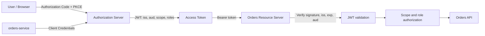

# Issuing JWTs with Roles, Audience, and Scope Policies for APIs

In this lab, you configure Spring Authorization Server to issue JWT access tokens for an orders API. The token contains `scope` to represent OAuth2 permissions, `roles` to represent user roles, and `aud` to identify which API is permitted to accept the token. The Resource Server verifies the signature, issuer, expiration, and audience before mapping scopes/roles into Spring Security authorities.

The goal is three layers of control working together: the token must be issued for the right client and scopes; the token must target the right API; and the caller must hold the appropriate role when performing sensitive operations. This lesson belongs to the `SPRING_SECURITY_OAUTH2_OIDC_AUTHORIZATION_SERVER` module, focusing on designing and operating an OAuth 2.0/OpenID Connect Authorization Server with Spring Authorization Server, from client/consent management to token issuance, PKCE, endpoint protection, and security flow testing.

## 1. Lab Scenario and Architecture

We build an Authorization Server and a Resource Server in the same Spring Boot application to keep the lab concise. In real deployments, the two roles usually live in separate services.

| Component | Responsibility |
|---|---|
| Authorization Server | Client registration, user/client authentication, consent handling, and issuing JWT access tokens |
| `orders-web` | Public client using Authorization Code + PKCE, allowed to request `orders.read` and `orders.write` |
| `orders-service` | Confidential client using Client Credentials, allowed to request only `orders.read` |
| Resource Server `/api/**` | Verifies signature, issuer, audience, and expiration; converts `scope`/`roles` into authorities |
| Orders API | Allows reads by scope, writes by scope combined with role, and restricts admin endpoints by role |



In the lab, the audience is fixed to `orders-api` to illustrate a single resource server. When a system has multiple APIs, the audience must be selected based on the resource the client is authorized to access, according to configuration or a validated resource indicator. Do not issue the same audience to every client simply because configuration is easier.

## 2. Project Preparation

The example uses Spring Boot 3, Spring Security 6, and a Spring Authorization Server version compatible with the Spring Boot BOM. Manage versions via the project's dependency management; do not mix incompatible Spring Security or Authorization Server versions.

With Gradle:

```gradle
dependencies {
    implementation("org.springframework.boot:spring-boot-starter-web")
    implementation("org.springframework.boot:spring-boot-starter-security")
    implementation("org.springframework.security:spring-security-oauth2-authorization-server")
    implementation("org.springframework.boot:spring-boot-starter-oauth2-resource-server")

    testImplementation("org.springframework.boot:spring-boot-starter-test")
    testImplementation("org.springframework.security:spring-security-test")
}
```

The `spring-security-oauth2-authorization-server` dependency must align with the project's Spring Security release line. If the BOM in use does not yet manage this artifact version, explicitly declare a compatible Spring Authorization Server version. The `@Bean` methods in the following sections need to reside in one or more `@Configuration` classes; you can group related beans into the same class to reduce file count.

Configure the local environment in `application.yml`:

```yaml
server:
  port: 9000

app:
  security:
    issuer: http://localhost:9000

demo:
  clients:
    orders-service:
      secret: ${ORDERS_SERVICE_CLIENT_SECRET}
  users:
    alice-password: ${DEMO_ALICE_PASSWORD}
    bob-password: ${DEMO_BOB_PASSWORD}
```

Set the environment variables `ORDERS_SERVICE_CLIENT_SECRET`, `DEMO_ALICE_PASSWORD`, and `DEMO_BOB_PASSWORD` before running. Use lab-specific credentials. In production, the issuer must be a stable HTTPS public URL; client secrets and passwords must come from a secret manager or secure configuration management system.

## 3. Generating JWT Signing Keys for the Lab Environment

The Authorization Server signs JWTs with a private key and publishes the public key via the JWK Set endpoint. The following example creates an RSA key pair at application startup:

```java
import java.security.KeyPair;
import java.security.KeyPairGenerator;
import java.security.NoSuchAlgorithmException;

import org.springframework.context.annotation.Bean;
import org.springframework.context.annotation.Configuration;

@Configuration
class LabKeyConfiguration {

    @Bean
    KeyPair rsaKeyPair() throws NoSuchAlgorithmException {
        KeyPairGenerator generator = KeyPairGenerator.getInstance("RSA");
        generator.initialize(2048);
        return generator.generateKeyPair();
    }
}
```

Create a JWK source from the key pair:

```java
import java.security.KeyPair;
import java.security.interfaces.RSAPrivateKey;
import java.security.interfaces.RSAPublicKey;
import java.util.UUID;

import com.nimbusds.jose.jwk.JWKSet;
import com.nimbusds.jose.jwk.RSAKey;
import com.nimbusds.jose.jwk.source.JWKSource;
import com.nimbusds.jose.proc.SecurityContext;
import org.springframework.context.annotation.Bean;

@Bean
JWKSource<SecurityContext> jwkSource(KeyPair rsaKeyPair) {
    RSAKey rsaKey = new RSAKey.Builder((RSAPublicKey) rsaKeyPair.getPublic())
            .privateKey((RSAPrivateKey) rsaKeyPair.getPrivate())
            .keyID(UUID.randomUUID().toString())
            .build();

    JWKSet jwkSet = new JWKSet(rsaKey);
    return (selector, context) -> selector.select(jwkSet);
}
```

This is a temporary key for the lab. On every startup, the key and `kid` change; old tokens will no longer verify against the new key. Production needs to store persistent keys in a KMS/HSM or secret manager, follow a rotation process, and provide the same key set across all instances. Do not store private keys in source control.

## 4. Registering Clients and Scope Policies

Create two clients with different permissions. The public client uses PKCE; the service client uses Client Credentials and is granted read-only permission.

```java
import java.time.Duration;
import java.util.UUID;

import org.springframework.beans.factory.annotation.Value;
import org.springframework.context.annotation.Bean;
import org.springframework.security.crypto.password.PasswordEncoder;
import org.springframework.security.oauth2.core.AuthorizationGrantType;
import org.springframework.security.oauth2.server.authorization.client.ClientAuthenticationMethod;
import org.springframework.security.oauth2.server.authorization.client.InMemoryRegisteredClientRepository;
import org.springframework.security.oauth2.server.authorization.client.RegisteredClient;
import org.springframework.security.oauth2.server.authorization.client.RegisteredClientRepository;
import org.springframework.security.oauth2.server.authorization.settings.ClientSettings;
import org.springframework.security.oauth2.server.authorization.settings.TokenSettings;

@Bean
RegisteredClientRepository registeredClientRepository(
        PasswordEncoder passwordEncoder,
        @Value("${demo.clients.orders-service.secret}") String serviceSecret) {

    RegisteredClient webClient = RegisteredClient.withId(UUID.randomUUID().toString())
            .clientId("orders-web")
            .clientAuthenticationMethod(ClientAuthenticationMethod.NONE)
            .authorizationGrantType(AuthorizationGrantType.AUTHORIZATION_CODE)
            .authorizationGrantType(AuthorizationGrantType.REFRESH_TOKEN)
            .redirectUri("http://127.0.0.1:8080/login/oauth2/code/orders")
            .scope("openid")
            .scope("profile")
            .scope("orders.read")
            .scope("orders.write")
            .clientSettings(ClientSettings.builder()
                    .requireProofKey(true)
                    .build())
            .tokenSettings(TokenSettings.builder()
                    .accessTokenTimeToLive(Duration.ofMinutes(5))
                    .refreshTokenTimeToLive(Duration.ofHours(8))
                    .reuseRefreshTokens(false)
                    .build())
            .build();

    RegisteredClient serviceClient = RegisteredClient.withId(UUID.randomUUID().toString())
            .clientId("orders-service")
            .clientSecret(passwordEncoder.encode(serviceSecret))
            .clientAuthenticationMethod(ClientAuthenticationMethod.CLIENT_SECRET_BASIC)
            .authorizationGrantType(AuthorizationGrantType.CLIENT_CREDENTIALS)
            .scope("orders.read")
            .build();

    return new InMemoryRegisteredClientRepository(webClient, serviceClient);
}
```

The Redirect URI must match the exact callback of the lab client. The public client has no secret because browsers cannot safely keep secrets; PKCE binds the code to the client holding `code_verifier`. The service client is a confidential client so it authenticates with a secret via HTTP Basic. Do not grant `orders.write` to the service client in this example.

`InMemoryRegisteredClientRepository` is suitable for a single-instance lab. Production should use a persistent repository such as `JdbcRegisteredClientRepository` or an appropriate data store, with migrations, backups, and clear synchronization/caching mechanisms.

## 5. Configuring Users and Passwords

Create two users to test different roles. Alice has permission to manage orders; Bob only has read permission:

```java
import org.springframework.beans.factory.annotation.Value;
import org.springframework.context.annotation.Bean;
import org.springframework.security.core.userdetails.User;
import org.springframework.security.core.userdetails.UserDetailsService;
import org.springframework.security.provisioning.InMemoryUserDetailsManager;
import org.springframework.security.crypto.bcrypt.BCryptPasswordEncoder;
import org.springframework.security.crypto.password.PasswordEncoder;

@Bean
PasswordEncoder passwordEncoder() {
    return new BCryptPasswordEncoder();
}

@Bean
UserDetailsService userDetailsService(
        PasswordEncoder passwordEncoder,
        @Value("${demo.users.alice-password}") String alicePassword,
        @Value("${demo.users.bob-password}") String bobPassword) {

    return new InMemoryUserDetailsManager(
            User.withUsername("alice")
                    .password(passwordEncoder.encode(alicePassword))
                    .roles("ORDER_MANAGER", "ORDER_READER")
                    .build(),
            User.withUsername("bob")
                    .password(passwordEncoder.encode(bobPassword))
                    .roles("ORDER_READER")
                    .build());
}
```

`roles(...)` automatically adds the `ROLE_` prefix to authorities. Thus Alice has `ROLE_ORDER_MANAGER` and `ROLE_ORDER_READER`; Bob only has `ROLE_ORDER_READER`. The in-memory user store is for demonstration only. Real systems must fetch roles from a trusted identity source and have processes for updating and revoking permissions.

## 6. Configuring the Issuer and Authorization Server

The issuer must be stable and identical across all instances. Configure `AuthorizationServerSettings` via an environment property:

```java
import org.springframework.beans.factory.annotation.Value;
import org.springframework.context.annotation.Bean;
import org.springframework.security.oauth2.server.authorization.settings.AuthorizationServerSettings;

@Bean
AuthorizationServerSettings authorizationServerSettings(
        @Value("${app.security.issuer}") String issuer) {
    return AuthorizationServerSettings.builder()
            .issuer(issuer)
            .build();
}
```

Register the decoder that Spring Authorization Server requires for OIDC endpoints that use JWTs:

```java
import com.nimbusds.jose.proc.SecurityContext;
import org.springframework.context.annotation.Bean;
import org.springframework.context.annotation.Primary;
import org.springframework.security.oauth2.jwt.JwtDecoder;
import org.springframework.security.oauth2.server.authorization.config.annotation.web.configuration.OAuth2AuthorizationServerConfiguration;
import com.nimbusds.jose.jwk.source.JWKSource;

@Bean
@Primary
JwtDecoder jwtDecoder(JWKSource<SecurityContext> jwkSource) {
    return OAuth2AuthorizationServerConfiguration.jwtDecoder(jwkSource);
}
```

The JWK Set endpoint is provided by Spring Authorization Server according to metadata; with default settings it is typically `/oauth2/jwks`. Discovery metadata publishes the issuer and endpoints. When deploying behind a reverse proxy, check the public scheme/host and forwarded headers so metadata does not point to an internal hostname.

## 7. Adding Audience and Roles to the JWT Access Token

Spring Authorization Server automatically issues standard claims such as issuer, subject, issued-at, expiration, and scope. We use `OAuth2TokenCustomizer<JwtEncodingContext>` to add the audience and role claims to the access token.

In the lab, all access tokens issued for the Orders API have audience `orders-api`. Only add user roles to the token; client credentials do not represent a user, so user roles must not be assigned from the client principal.

```java
import java.security.Principal;
import java.util.Set;
import java.util.TreeSet;
import java.util.stream.Collectors;

import org.springframework.context.annotation.Bean;
import org.springframework.security.core.Authentication;
import org.springframework.security.core.GrantedAuthority;
import org.springframework.security.oauth2.core.AuthorizationGrantType;
import org.springframework.security.oauth2.server.authorization.OAuth2Authorization;
import org.springframework.security.oauth2.server.authorization.authentication.OAuth2ClientAuthenticationToken;
import org.springframework.security.oauth2.server.authorization.OAuth2TokenType;
import org.springframework.security.oauth2.server.authorization.token.JwtEncodingContext;
import org.springframework.security.oauth2.server.authorization.token.OAuth2TokenCustomizer;

@Bean
OAuth2TokenCustomizer<JwtEncodingContext> jwtTokenCustomizer() {
    return context -> {
        if (!OAuth2TokenType.ACCESS_TOKEN.equals(context.getTokenType())) {
            return;
        }

        context.getClaims().audience(Set.of("orders-api"));

        if (AuthorizationGrantType.CLIENT_CREDENTIALS.equals(context.getAuthorizationGrantType())) {
            return;
        }

        Authentication userAuthentication = null;
        OAuth2Authorization authorization = context.getAuthorization();
        if (authorization != null) {
            userAuthentication = authorization.getAttribute(Principal.class.getName());
        }

        if (userAuthentication == null
                && !(context.getPrincipal() instanceof OAuth2ClientAuthenticationToken)) {
            userAuthentication = context.getPrincipal();
        }

        if (userAuthentication != null) {
            Set<String> roles = userAuthentication.getAuthorities().stream()
                    .map(GrantedAuthority::getAuthority)
                    .filter(authority -> authority.startsWith("ROLE_"))
                    .map(authority -> authority.substring("ROLE_".length()))
                    .filter(Set.of("ADMIN", "ORDER_MANAGER", "ORDER_READER")::contains)
                    .collect(Collectors.toCollection(TreeSet::new));

            if (!roles.isEmpty()) {
                context.getClaims().claim("roles", roles);
            }
        }
    };
}
```

The customizer applies only to JWT access tokens. `scope` is managed by Spring Authorization Server based on the grant and registration; do not replace scopes with roles. `roles` is filtered against an allowlist to avoid leaking every internal authority into the token. For authorization code and refresh token grants, the authorization state can store the user principal; the customizer reads the stored principal to preserve roles when issuing a new access token. Client credentials is explicitly excluded so it never receives user roles.

In a multi-API system, do not attach `orders-api` to every access token. Choose the audience from the resource requested by the client and permitted by the server, and verify the client is allowed to access that resource. Do not trust an arbitrary audience sent by the client.

## 8. Configuring the Resource Server to Verify Issuer and Audience

A valid signature only proves the token was signed by a trusted key. The Resource Server must also check the issuer, expiration, and audience. Create a dedicated decoder for the Orders API using the corresponding public key and a validator requiring audience `orders-api`:

```java
import java.security.KeyPair;
import java.security.interfaces.RSAPublicKey;

import org.springframework.beans.factory.annotation.Value;
import org.springframework.context.annotation.Bean;
import org.springframework.context.annotation.Qualifier;
import org.springframework.security.oauth2.core.OAuth2Error;
import org.springframework.security.oauth2.core.OAuth2TokenValidator;
import org.springframework.security.oauth2.core.OAuth2TokenValidatorResult;
import org.springframework.security.oauth2.jwt.DelegatingOAuth2TokenValidator;
import org.springframework.security.oauth2.jwt.Jwt;
import org.springframework.security.oauth2.jwt.JwtDecoder;
import org.springframework.security.oauth2.jwt.JwtValidators;
import org.springframework.security.oauth2.jwt.NimbusJwtDecoder;

@Bean
@Qualifier("apiJwtDecoder")
JwtDecoder apiJwtDecoder(
        KeyPair rsaKeyPair,
        @Value("${app.security.issuer}") String issuer) {

    NimbusJwtDecoder decoder = NimbusJwtDecoder
            .withPublicKey((RSAPublicKey) rsaKeyPair.getPublic())
            .build();

    OAuth2TokenValidator<Jwt> audienceValidator = jwt ->
            jwt.getAudience().contains("orders-api")
                    ? OAuth2TokenValidatorResult.success()
                    : OAuth2TokenValidatorResult.failure(new OAuth2Error(
                            "invalid_token",
                            "Required audience orders-api is missing",
                            null));

    decoder.setJwtValidator(new DelegatingOAuth2TokenValidator<>(
            JwtValidators.createDefaultWithIssuer(issuer),
            audienceValidator));

    return decoder;
}
```

`JwtValidators.createDefaultWithIssuer` checks the issuer and default timestamps; the additional validator checks the audience. Separate this decoder from the Authorization Server's `jwtDecoder` bean so the Orders API-specific audience is not enforced on other OIDC purposes, such as ID Tokens or UserInfo.

The lab uses the same key pair in a single process for simplicity. If the Resource Server is a separate service, it should obtain the JWK Set URI from issuer metadata and cache public keys by `kid`, while configuring the corresponding issuer/audience validators. Do not share the private key with the Resource Server; a resource server only needs the public key.

## 9. Mapping Scope and Roles to Authorities

`JwtGrantedAuthoritiesConverter` maps scopes in the JWT into authorities prefixed with `SCOPE_` by default. We add a mapper for the `roles` claim to create `ROLE_...` authorities:

```java
import java.util.ArrayList;
import java.util.Collection;
import java.util.List;
import java.util.Set;

import org.springframework.context.annotation.Bean;
import org.springframework.core.convert.converter.Converter;
import org.springframework.security.core.GrantedAuthority;
import org.springframework.security.core.authority.SimpleGrantedAuthority;
import org.springframework.security.oauth2.jwt.Jwt;
import org.springframework.security.oauth2.server.resource.authentication.JwtAuthenticationConverter;
import org.springframework.security.oauth2.server.resource.authentication.JwtGrantedAuthoritiesConverter;

@Bean
JwtAuthenticationConverter jwtAuthenticationConverter() {
    JwtGrantedAuthoritiesConverter scopeConverter = new JwtGrantedAuthoritiesConverter();

    Converter<Jwt, Collection<GrantedAuthority>> authoritiesConverter = jwt -> {
        Collection<GrantedAuthority> authorities = new ArrayList<>();
        Collection<GrantedAuthority> scopeAuthorities = scopeConverter.convert(jwt);
        if (scopeAuthorities != null) {
            authorities.addAll(scopeAuthorities);
        }

        List<String> roles = jwt.getClaimAsStringList("roles");
        if (roles != null) {
            roles.stream()
                    .filter(Set.of("ADMIN", "ORDER_MANAGER", "ORDER_READER")::contains)
                    .map(role -> new SimpleGrantedAuthority("ROLE_" + role))
                    .forEach(authorities::add);
        }
        return authorities;
    };

    JwtAuthenticationConverter converter = new JwtAuthenticationConverter();
    converter.setJwtGrantedAuthoritiesConverter(authoritiesConverter);
    return converter;
}
```

Filtering roles at the Resource Server is an extra defense layer; the primary source of roles must still be trusted identity data at the Authorization Server. Do not map an arbitrary claim into an admin role if that claim is not issued and protected by policy.

## 10. Protecting Orders API Endpoints

Create a separate SecurityFilterChain for the API. The API accepts bearer tokens and runs statelessly; requests without a valid token are rejected at the authentication step.

```java
import org.springframework.beans.factory.annotation.Qualifier;
import org.springframework.context.annotation.Bean;
import org.springframework.core.annotation.Order;
import org.springframework.http.HttpMethod;
import org.springframework.security.config.Customizer;
import org.springframework.security.config.annotation.web.builders.HttpSecurity;
import org.springframework.security.config.http.SessionCreationPolicy;
import org.springframework.security.oauth2.jwt.JwtDecoder;
import org.springframework.security.oauth2.server.resource.authentication.JwtAuthenticationConverter;
import org.springframework.security.web.SecurityFilterChain;

@Bean
@Order(2)
SecurityFilterChain ordersApiSecurityFilterChain(
        HttpSecurity http,
        @Qualifier("apiJwtDecoder") JwtDecoder apiJwtDecoder,
        JwtAuthenticationConverter jwtAuthenticationConverter) throws Exception {

    http.securityMatcher("/api/**")
            .csrf(csrf -> csrf.disable())
            .sessionManagement(session ->
                    session.sessionCreationPolicy(SessionCreationPolicy.STATELESS))
            .authorizeHttpRequests(authorize -> authorize
                    .requestMatchers(HttpMethod.GET, "/api/orders/**").hasAuthority("SCOPE_orders.read")
                    .requestMatchers(HttpMethod.POST, "/api/orders/**").hasAuthority("SCOPE_orders.write")
                    .requestMatchers("/api/admin/**").hasRole("ADMIN")
                    .anyRequest().authenticated())
            .oauth2ResourceServer(resourceServer -> resourceServer
                    .jwt(jwt -> jwt
                            .decoder(apiJwtDecoder)
                            .jwtAuthenticationConverter(jwtAuthenticationConverter)));

    return http.build();
}
```

Disable CSRF on this chain because the API is protected with bearer tokens and does not rely on browser session cookies. Do not disable CSRF globally for the Authorization Server or form login. The POST endpoint also requires the `ORDER_MANAGER` role; we check the combined condition using method security.

Declare `@EnableMethodSecurity` to activate `@PreAuthorize`, then create the controller:

```java
import org.springframework.context.annotation.Configuration;
import org.springframework.security.config.annotation.method.configuration.EnableMethodSecurity;

@Configuration
@EnableMethodSecurity
class MethodSecurityConfiguration {
}
```

Create the controller:

```java
import java.util.List;

import org.springframework.security.access.prepost.PreAuthorize;
import org.springframework.web.bind.annotation.GetMapping;
import org.springframework.web.bind.annotation.PostMapping;
import org.springframework.web.bind.annotation.RequestMapping;
import org.springframework.web.bind.annotation.RestController;

@RestController
@RequestMapping("/api")
public class OrdersController {

    @GetMapping("/orders")
    @PreAuthorize("hasAuthority('SCOPE_orders.read')")
    public List<String> listOrders() {
        return List.of("order-1001", "order-1002");
    }

    @PostMapping("/orders")
    @PreAuthorize("hasAuthority('SCOPE_orders.write') and hasRole('ORDER_MANAGER')")
    public String createOrder() {
        return "created";
    }

    @GetMapping("/admin/summary")
    @PreAuthorize("hasRole('ADMIN')")
    public String adminSummary() {
        return "restricted summary";
    }
}
```

Scope and role are two independent conditions. Having `orders.write` without `ROLE_ORDER_MANAGER` still cannot create orders. Having the `ORDER_MANAGER` role without `SCOPE_orders.write` also cannot create orders. Do not put administrative permissions into scopes just to replace roles; scopes describe permissions granted to the client, while roles describe the principal's role according to the application model.

## 11. Completing the SecurityFilterChains

In the same application, we need a chain for the Authorization Server and a default chain to handle login. The API chain in the previous section has `@Order(2)`; the Authorization Server must come first and the default chain last:

```java
import org.springframework.context.annotation.Bean;
import org.springframework.core.annotation.Order;
import org.springframework.security.config.Customizer;
import org.springframework.security.config.annotation.web.builders.HttpSecurity;
import org.springframework.security.oauth2.server.authorization.config.annotation.web.configurers.OAuth2AuthorizationServerConfigurer;
import org.springframework.security.web.SecurityFilterChain;

@Bean
@Order(1)
SecurityFilterChain authorizationServerSecurityFilterChain(HttpSecurity http) throws Exception {
    OAuth2AuthorizationServerConfigurer authorizationServerConfigurer =
            OAuth2AuthorizationServerConfigurer.authorizationServer();

    http.securityMatcher(authorizationServerConfigurer.getEndpointsMatcher())
            .with(authorizationServerConfigurer, authorizationServer ->
                    authorizationServer.oidc(Customizer.withDefaults()))
            .authorizeHttpRequests(authorize -> authorize.anyRequest().authenticated());

    return http.build();
}

@Bean
@Order(3)
SecurityFilterChain applicationSecurityFilterChain(HttpSecurity http) throws Exception {
    http.authorizeHttpRequests(authorize -> authorize
                    .requestMatchers("/error", "/assets/**").permitAll()
                    .anyRequest().authenticated())
            .formLogin(Customizer.withDefaults());
    return http.build();
}
```

The Authorization Server chain handles SAS endpoints, the API chain handles `/api/**`, and the default chain serves form login and application pages. If the application has a custom consent page, add the corresponding route and controller/view. Do not let the default chain intercept `/oauth2/**` requests before the Authorization Server chain.

## 12. Running the Lab: Issuing a Token via Client Credentials

Start the application with the environment variables set. Call the token endpoint using the confidential client:

```bash
curl --user "orders-service:${ORDERS_SERVICE_CLIENT_SECRET}" \
  --header "Content-Type: application/x-www-form-urlencoded" \
  --data-urlencode "grant_type=client_credentials" \
  --data-urlencode "scope=orders.read" \
  http://localhost:9000/oauth2/token
```

A successful response contains `access_token`, `token_type`, `expires_in`, and `scope`. Do not request a refresh token for client credentials. Keep the access token in a lab terminal environment variable or temporary secret store; do not commit tokens to files.

Call the read orders API:

```bash
curl --header "Authorization: Bearer ${ACCESS_TOKEN}" \
  http://localhost:9000/api/orders
```

The request should succeed because the token has audience `orders-api` and scope `orders.read`. Try calling the create order endpoint:

```bash
curl --request POST \
  --header "Authorization: Bearer ${ACCESS_TOKEN}" \
  http://localhost:9000/api/orders
```

The request must be rejected because client credentials is only granted `orders.read`, lacks `orders.write`, and does not represent a user with the `ORDER_MANAGER` role.

## 13. Running the Lab: Authorization Code with PKCE and User Roles

`orders-web` is a public client. Generate a random `code_verifier` on the client, compute the S256 challenge, and open the authorization request with:

```java
import java.security.MessageDigest;
import java.security.SecureRandom;
import java.util.Base64;

SecureRandom random = new SecureRandom();
byte[] verifierBytes = new byte[32];
random.nextBytes(verifierBytes);
String codeVerifier = Base64.getUrlEncoder().withoutPadding()
        .encodeToString(verifierBytes);

byte[] challengeBytes = MessageDigest.getInstance("SHA-256")
        .digest(codeVerifier.getBytes(java.nio.charset.StandardCharsets.US_ASCII));
String codeChallenge = Base64.getUrlEncoder().withoutPadding()
        .encodeToString(challengeBytes);
```

Keep `codeVerifier` on the client side until exchanging the code. Do not log the verifier or include it in the authorization URL.

```text
response_type=code
client_id=orders-web
redirect_uri=http://127.0.0.1:8080/login/oauth2/code/orders
scope=openid profile orders.read orders.write
state=<random-state>
nonce=<random-nonce>
code_challenge=<base64url-sha256-of-verifier>
code_challenge_method=S256
```

Log in as Alice and receive the callback with `code` and `state`. The lab configuration does not require consent so it stays focused on scopes and roles; if the application enables consent, add a consent page and confirm the approved scopes before continuing. The client must compare `state` against the stored value before processing the callback. Then exchange the code at the token endpoint:

```bash
curl --request POST \
  --header "Content-Type: application/x-www-form-urlencoded" \
  --data-urlencode "grant_type=authorization_code" \
  --data-urlencode "client_id=orders-web" \
  --data-urlencode "code=${AUTHORIZATION_CODE}" \
  --data-urlencode "redirect_uri=http://127.0.0.1:8080/login/oauth2/code/orders" \
  --data-urlencode "code_verifier=${CODE_VERIFIER}" \
  http://localhost:9000/oauth2/token
```

The received token must have issuer `http://localhost:9000`, audience `orders-api`, the granted scopes, and roles taken from user Alice. When calling `POST /api/orders`, the request is permitted because Alice has both `orders.write` and `ROLE_ORDER_MANAGER`.

Repeat the flow with Bob. Bob has `ROLE_ORDER_READER`, so he can call `GET /api/orders` when granted the read scope. If Bob has scope `orders.write` but lacks the `ORDER_MANAGER` role, `POST /api/orders` must still receive `403 Forbidden`. To test the role condition independently, you can use a test fixture that issues a token with the write scope but without the manager role.

An Authorization Code is a one-time credential. Each time you test an invalid verifier, wrong redirect URI, or wrong client, you must generate a new authorization code; do not reuse an already exchanged code.

## 14. Reading and Verifying JWTs

A JWT access token has three Base64URL parts: header, payload, and signature. Key claims in the lab:

| Claim | Example | Purpose |
|---|---|---|
| `iss` | `http://localhost:9000` | Issuer that issued the token |
| `sub` | `alice` or client identifier | Principal represented by the token |
| `aud` | `orders-api` | API permitted to accept the token |
| `iat`, `exp` | Issued-at/expiration timestamps | Usage time window limits |
| `scope` | `orders.read orders.write` | Granted OAuth2 permissions |
| `roles` | `ORDER_MANAGER`, `ORDER_READER` | User roles permitted to be included in the token |
| `jti` | Token identifier | Helps identify tokens in certain audit/revocation workflows |

You can decode the payload to inspect its structure in a lab environment, but decoding does not verify the signature. The Resource Server must verify the signature and security claims using `JwtDecoder`. Do not paste production tokens into public online decoder websites or logs. If you need to inspect tokens, use internal tools and short-lived test tokens.

JWT access tokens and OIDC ID Tokens serve different purposes. The API only accepts access tokens with audience `orders-api`; do not use an ID Token in place of an access token. An ID Token is used by the client to verify user authentication results, and its audience is typically the client ID.

## 15. Testing Scope, Role, and Audience Permissions

Create a test matrix to verify each condition independently:

| Token | Audience | Scope | Role | API | Result |
|---|---|---|---|---|---|
| `orders-service` | `orders-api` | `orders.read` | No user role | `GET /api/orders` | 200 |
| `orders-service` | `orders-api` | `orders.read` | No user role | `POST /api/orders` | 403 |
| Alice | `orders-api` | `orders.read orders.write` | `ORDER_MANAGER` | `GET /api/orders` | 200 |
| Alice | `orders-api` | `orders.read orders.write` | `ORDER_MANAGER` | `POST /api/orders` | 200 |
| Bob | `orders-api` | `orders.read` | `ORDER_READER` | `GET /api/orders` | 200 |
| Bob | `orders-api` | `orders.read orders.write` | `ORDER_READER` | `POST /api/orders` | 403 |
| Token for another API | `inventory-api` | `orders.read` | `ORDER_MANAGER` | `GET /api/orders` | 401 |
| Expired token or invalid signature | `orders-api` | Any | Any | `GET /api/orders` | 401 |

`401 Unauthorized` indicates the token is invalid or missing; `403 Forbidden` indicates the token was authenticated, but the principal lacks sufficient permissions. Distinguishing these two outcomes reveals whether the error lies in token validation or authorization policy.

### 15.1. Testing Role Mapping with a Unit Test

You can test the converter independently using a JWT fixture:

```java
import java.time.Instant;
import java.util.List;

import static org.junit.jupiter.api.Assertions.assertTrue;

import org.springframework.beans.factory.annotation.Autowired;
import org.springframework.boot.test.context.SpringBootTest;
import org.junit.jupiter.api.Test;
import org.springframework.security.core.Authentication;
import org.springframework.security.oauth2.jwt.Jwt;
import org.springframework.security.oauth2.server.resource.authentication.JwtAuthenticationConverter;

@SpringBootTest
class JwtAuthorityMappingTest {

    @Autowired
    JwtAuthenticationConverter jwtAuthenticationConverter;

    @Test
    void mapsScopeAndRoleClaimsToAuthorities() {
        Jwt jwt = Jwt.withTokenValue("test-token")
                .header("alg", "RS256")
                .issuer("http://localhost:9000")
                .audience(List.of("orders-api"))
                .issuedAt(Instant.now())
                .expiresAt(Instant.now().plusSeconds(300))
                .claim("scope", "orders.read orders.write")
                .claim("roles", List.of("ORDER_MANAGER"))
                .build();

        Authentication authentication = jwtAuthenticationConverter.convert(jwt);

        assertTrue(authentication.getAuthorities().stream()
                .anyMatch(authority -> authority.getAuthority().equals("SCOPE_orders.read")));
        assertTrue(authentication.getAuthorities().stream()
                .anyMatch(authority -> authority.getAuthority().equals("ROLE_ORDER_MANAGER")));
    }
}
```

This is a unit test for mapping; it does not verify signatures, issuer, or the audience validator. Those checks require separate tests using a real decoder and test-signed JWTs.

### 15.2. Testing the Audience Validator

Create a JWT with a valid signature using the test key, but with audience `inventory-api`, and send it to `/api/orders`. The Resource Server must return `401`. Do not use a token with an invalid signature for an audience test, because the decoder will reject it before checking the audience and the test will not prove the audience validator works.

### 15.3. Testing Scope and Role Independently

- Token has `orders.read` but lacks `orders.write`: GET succeeds, POST is rejected.
- Token has `orders.write` but lacks `ORDER_MANAGER`: POST is rejected by method security.
- Token has `ORDER_MANAGER` role but lacks `orders.write` scope: POST is still rejected.
- Token has valid scope and role but wrong audience: token is rejected before reaching the controller.

Do not test solely by calling the converter and concluding the API is protected. You need HTTP tests that go through the Resource Server filter chain and method security.

## 16. Common Errors

| Symptom | Cause | Resolution |
|---|---|---|
| API returns 401 even though JWT was just issued | Issuer or signature mismatch, decoder uses wrong key | Compare `iss`, `kid`, public key, and configured issuer |
| API returns 401 due to audience | Token lacks `orders-api` or decoder does not use the right validator | Check the customizer and audience validator |
| API returns 403 even with a valid token | Insufficient scope or role | Check claims and authorities after mapping |
| `roles` present in JWT but `hasRole` does not match | Converter does not add `ROLE_` prefix or claim has wrong type | Map roles to `ROLE_<name>` and check claim list format |
| Client credentials token contains user roles | Customizer treats client authorities as user roles | Only read roles from the user principal stored in authorization state |
| Token contains scopes outside registration | Client configuration or customizer expands scopes incorrectly | Check `RegisteredClient`, grants, and scope issuance policy |
| Old tokens fail verification after restart | Lab generates a new key pair on startup | Use persistent keys and keep old public keys during rotation overlap |
| Node A issues token but Node B rejects signature | Each node has its own key pair | Use the same key set or a shared KMS/HSM |
| ID Token sent to API | Client mistakes ID Token for access token | API only accepts access tokens and validates resource audience |
| Resource Server accepts token from another API | Missing `aud` validation | Enforce the appropriate audience in the JWT validator |

## 17. Upgrading the Lab for Production

After the lab runs properly, replace in-memory components and temporary keys with operational configurations:

1. Use a persistent database for registered clients, authorizations, and consents; manage schemas via migrations.
2. Store private keys in a KMS/HSM or secret manager; identify keys with a stable `kid` and implement a rotation process.
3. Keep the public issuer fixed behind a reverse proxy; only trust forwarded headers from controlled proxies.
4. Select audience based on validated resources and client policies; do not use a single shared audience for all APIs.
5. Issue minimal scopes per client and grant; clearly define which scopes require user consent.
6. Fetch roles from a trusted identity source and limit role claims based on audience and business needs.
7. Have the Resource Server verify issuer, audience, signature, `exp`/`nbf`, and allowed algorithms.
8. Monitor token errors, 401/403 rates, JWKS latency, and key rotation status; do not log tokens or secrets.
9. Test multi-instance behavior, JWKS caching, token revocation, and behavior when old keys are replaced.

JWTs are typically self-contained with claims, so role changes in the identity store do not automatically update already issued tokens. Reducing access token TTL, revoking authorizations/refresh tokens, and having a strategy for permission changes are decisions to weigh. For immediate revocation requirements, evaluate opaque tokens/introspection or a controlled denylist/epoch mechanism rather than assuming JWTs disappear automatically when roles change.

## 18. Deliverables After the Lab

- [ ] Authorization Server starts with a stable issuer and working JWK Set endpoint.
- [ ] `orders-web` uses Authorization Code + PKCE and only requests registered scopes.
- [ ] `orders-service` is only issued `orders.read` via Client Credentials.
- [ ] JWT access tokens contain `iss`, `aud`, `exp`, `scope`, and role claims accurate to the principal.
- [ ] Resource Server verifies signature, issuer, expiration, and audience `orders-api`.
- [ ] `GET /api/orders` requires `SCOPE_orders.read`.
- [ ] `POST /api/orders` requires both `SCOPE_orders.write` and `ROLE_ORDER_MANAGER`.
- [ ] Tokens missing scope/role return 403; tokens with wrong issuer/audience/signature or expired return 401.
- [ ] Client credentials tokens do not receive user roles.
- [ ] No passwords, client secrets, authorization codes, or tokens in source control or logs.

Once completed, you have an Authorization Server issuing JWTs with explicit audience and roles, along with a Resource Server verifying tokens and enforcing scope-plus-role policies. This provides a foundation to expand into multiple APIs, multiple client types, and finer-grained authorization policies.
