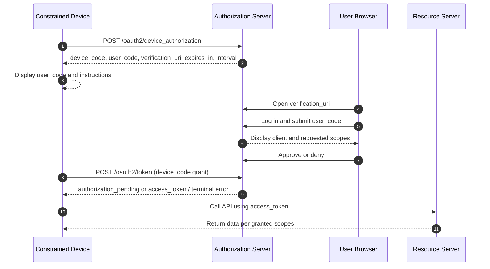
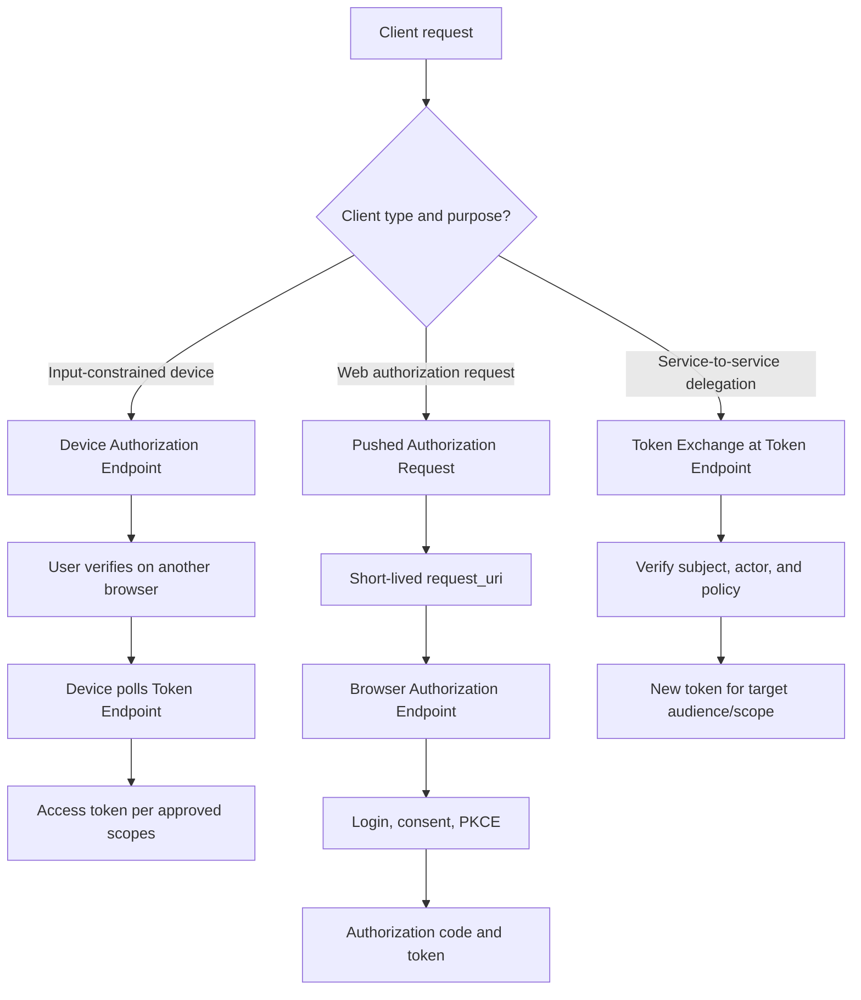

# Implementing Device Flow, PAR, and Token Exchange on Demand

An Authorization Server often serves multiple client types. A TV, printer, or IoT device may lack a keyboard to enter credentials; a web application may need to send complex authorization requests without exposing all parameters on the front channel; and a backend may need to exchange a received access token for one with a narrower audience or scope to call another service. OAuth 2.0 has dedicated mechanisms for each scenario: Device Authorization Grant, Pushed Authorization Requests (PAR), and Token Exchange.

These three mechanisms solve three distinct problems. Device Flow offloads user authentication to a device with a suitable browser. PAR moves authorization request parameters to a back channel before the browser is redirected. Token Exchange allows an authorized client to exchange an input token for a token representing another access context. You should not enable all three simply because the Authorization Server supports them; choose based on client type, trust boundaries, and business requirements.

## 1. Choosing the Right Flow for Each Scenario

| Need | Suitable Flow | Key Outcome | Controls Required |
|---|---|---|---|
| Device without a convenient browser or keyboard | Device Authorization Grant (Device Flow) | Device receives `device_code`; user verifies `user_code` on another device | Code expiration, polling interval, user verification, brute-force protection, and consent |
| Web application needs to send authorization request over a secure channel before redirect | Pushed Authorization Requests (PAR) | Server returns `request_uri` to use in the browser authorization request | Client authentication, binding `request_uri` to the client, short lifetime, and PKCE |
| Backend needs a new token for a different service or audience | OAuth 2.0 Token Exchange | Server issues a token matching permitted subject, actor, audience, and scopes | Input token validation, delegation rights, audience, scopes, and confused-deputy prevention |

Device Flow is not a way to skip login; it moves the login action to a browser on a second device. PAR does not replace the authorization code flow, `state`, PKCE, or redirect URI validation; it protects the transmission of the authorization request. Token Exchange is not a refresh token: a refresh token renews permissions already granted to a client, whereas token exchange creates a new token according to exchange and delegation policies.

## 2. Preparing the Lab Environment

The lab assumes an existing Spring Authorization Server running over HTTPS, with `RegisteredClientRepository`, `OAuth2AuthorizationService`, `OAuth2AuthorizationConsentService`, and a stably configured `JWKSource`. Use a shared database when running multiple instances. Locally, you can use an HTTPS development certificate; do not test redirect- or cookie-based flows with a production configuration downgraded to HTTP.

Before enabling features, record the Spring Authorization Server and Spring Security versions in use. Device Authorization Grant and PAR have dedicated configuration APIs in supported versions. Token Exchange may require a version providing native support or an application-implemented extension. Do not assume that merely adding an `AuthorizationGrantType` gives the server a complete grant handler.

Common default endpoints in a Spring Authorization Server configuration are:

| Endpoint | Purpose |
|---|---|
| `/oauth2/device_authorization` | Device requests a verification code and user instruction details |
| `/activate` or configured verification URI | User enters or confirms the user code |
| `/oauth2/par` | Client pushes the authorization request to the server |
| `/oauth2/authorize` | Browser continues the authorization request; with PAR, uses `request_uri` |
| `/oauth2/token` | Polls device grant, exchanges authorization code, or performs token exchange |

Actual endpoints depend on `AuthorizationServerSettings` and the application's endpoint configuration. Read the server's own metadata or public configuration to confirm paths rather than hardcoding default endpoints into every client.

## 3. Lab A — Device Authorization Grant for Input-Constrained Devices

### 3.1. Operating Model

The device starts by calling the device authorization endpoint. The server generates a confidential `device_code` for the device and a shorter `user_code` for the user to enter on a browser-capable device. The user opens the verification URI, logs in to the Authorization Server, enters the code, reviews the client and scopes, and approves or denies. The device continues polling the token endpoint at the interval specified by the server until authorization completes or expires.



`device_code` is a secret bound to the transaction and held only by the device. `user_code` is a short code for human entry; do not use it in place of a token or as an API access credential. The user must authenticate with the right account and understand which device/client is requesting permissions.

### 3.2. Registering a Device Client

A device client is usually a public client because the device cannot safely keep a client secret. Register the `DEVICE_CODE` grant and grant only strictly necessary scopes. If the device can protect secrets in hardware and the operational model allows it, appropriate client authentication may be used, but never embed a shared secret into mass-distributed firmware.

Example registering a public client:

```java
RegisteredClient deviceClient = RegisteredClient
        .withId(UUID.randomUUID().toString())
        .clientId("living-room-display")
        .clientAuthenticationMethod(ClientAuthenticationMethod.NONE)
        .authorizationGrantType(AuthorizationGrantType.DEVICE_CODE)
        .authorizationGrantType(AuthorizationGrantType.REFRESH_TOKEN)
        .scope("display.read")
        .tokenSettings(TokenSettings.builder()
                .accessTokenTimeToLive(Duration.ofMinutes(5))
                .refreshTokenTimeToLive(Duration.ofDays(14))
                .reuseRefreshTokens(false)
                .build())
        .build();

registeredClientRepository.save(deviceClient);
```

This registration snippet illustrates key attributes; confirm `AuthorizationGrantType.DEVICE_CODE` and refresh token issuance support in your library version. Only enable refresh tokens if the device needs to stay logged in long-term and has a safe way to store, rotate, and revoke refresh tokens. For devices easily lost or shared, prefer short-lived access tokens and a clear re-authorization workflow.

### 3.3. Enabling Device Authorization and Verification Endpoints

In Spring Authorization Server versions supporting Device Authorization Grant, configure the endpoints in the Authorization Server filter chain. Example configuration structure:

```java
@Bean
@Order(1)
SecurityFilterChain authorizationServerSecurityFilterChain(HttpSecurity http)
        throws Exception {
    OAuth2AuthorizationServerConfigurer authorizationServerConfigurer =
            OAuth2AuthorizationServerConfigurer.authorizationServer();

    http
        .securityMatcher(authorizationServerConfigurer.getEndpointsMatcher())
        .with(authorizationServerConfigurer, authorizationServer ->
                authorizationServer
                    .deviceAuthorizationEndpoint(Customizer.withDefaults())
                    .deviceVerificationEndpoint(Customizer.withDefaults())
                    .tokenEndpoint(Customizer.withDefaults()));

    return http.build();
}
```

The builder API and how endpoints are enabled may vary by version. If the version in use enables endpoints automatically when grant support is present, keep configuration minimal per its documentation. The verification page must use the same login mechanism, CSRF protection, and consent policy as the Authorization Server; do not build a standalone code entry page that bypasses user authentication.

### 3.4. Requesting a Device Code

The device sends a POST to the device authorization endpoint with `client_id` and requested scopes. Example:

```bash
curl -X POST https://identity.example.com/oauth2/device_authorization \
  -H 'Content-Type: application/x-www-form-urlencoded' \
  --data-urlencode 'client_id=living-room-display' \
  --data-urlencode 'scope=display.read'
```

A successful response typically has a structure like:

```json
{
  "device_code": "<opaque-device-code>",
  "user_code": "WDJB-MJHT",
  "verification_uri": "https://identity.example.com/activate",
  "verification_uri_complete": "https://identity.example.com/activate?user_code=WDJB-MJHT",
  "expires_in": 600,
  "interval": 5
}
```

This is illustrative data, not a real code or user code. Display the verification URI and user code clearly on the device. If using `verification_uri_complete`, the user must still authenticate and approve; the complete URL only pre-fills the code and must never auto-grant permissions.

The device must store `device_code` in memory securely as needed for the transaction, display remaining time, and stop the transaction upon expiration. Do not log device codes or send them to telemetry. If the user cancels on the device, the client should stop polling immediately.

### 3.5. Verifying the User Code and Polling the Token Endpoint

The user opens the verification URI, logs in, and enters `user_code`. The server must display at minimum the client name, purpose, scopes, and approve/deny actions. Before granting permissions, the server must bind the user code to the valid active device authorization transaction. Limit incorrect entry attempts, throttle or temporarily lock per policy, and do not reveal whether a code exists via overly detailed error messages.

Then the device polls the token endpoint with `device_code`:

```bash
curl -X POST https://identity.example.com/oauth2/token \
  -H 'Content-Type: application/x-www-form-urlencoded' \
  --data-urlencode 'grant_type=urn:ietf:params:oauth:grant-type:device_code' \
  --data-urlencode 'device_code=<opaque-device-code>' \
  --data-urlencode 'client_id=living-room-display'
```

The client must obey the `interval` in the device authorization response. When the server returns `authorization_pending`, keep waiting and poll again. When receiving `slow_down`, increase the polling interval per the Device Authorization Grant rules (typically increasing by at least 5 seconds) and keep the new interval for subsequent polls. Do not run a tight polling loop or retry concurrently from multiple threads.

Outcomes to handle:

| OAuth Error / Result | Meaning | Device Behavior |
|---|---|---|
| `authorization_pending` | User has not completed verification yet | Wait the full interval and poll again |
| `slow_down` | Device is polling too fast | Increase interval and continue under the new limit |
| `access_denied` | User denied the request | Stop the transaction and inform the user they can retry |
| `expired_token` | Device code has expired | Stop polling; start a new device authorization transaction when requested by the user |
| Successful token response | User approved and server issued token | Store token securely; use only granted scopes/audience |

Do not blindly retry on `invalid_client`, `invalid_grant`, or other configuration errors. Log these without secrets and handle them by error type. Once the device receives an access token, it must only call resource servers with granted permissions; do not assume wider scopes from the initial request.

### 3.6. Testing Device Flow

Run the following cases across two independent clients and a test resource server:

1. A valid client requests a device code with permitted scopes; the response includes `device_code`, `user_code`, verification URI, expiry, and interval.
2. Unregistered clients or requests for out-of-policy scopes are rejected.
3. User logs in and enters a valid user code; the page displays the correct client and scopes.
4. User denies; polling returns `access_denied` and no token is issued.
5. Device polling before user verification receives `authorization_pending`.
6. Polling faster than the interval receives `slow_down`; the client increases its interval and stops bursting requests.
7. Invalid user codes, exceeding attempt limits, or expired codes cannot complete authorization.
8. Reusing a device code after a token has already been issued does not result in an unauthorized second token issuance.
9. The issued token contains only approved scopes; the resource server rejects out-of-scope operations.
10. Canceling the transaction or revoking permissions prevents the device from continuing to use invalidated credentials per policy.

## 4. Lab B — Pushed Authorization Requests (PAR)

### 4.1. When to Use PAR?

In a standard authorization code flow, the client directs the browser to `/oauth2/authorize` with parameters like `client_id`, `redirect_uri`, `scope`, `state`, and the PKCE challenge. With PAR, the client first sends the authorization request parameters via a back-channel POST to the PAR endpoint. The server authenticates the client, validates the request, and returns a short-lived `request_uri`. The client then redirects the browser to the authorization endpoint with only `client_id` and `request_uri`.

PAR reduces sensitive or lengthy data on the front channel, prevents authorization parameters from being tampered with while passing through the browser, and creates an early request validation checkpoint. PAR does not make an unregistered redirect URI valid and does not replace PKCE. The client must still generate `state`, keep the verifier secret, and validate the callback.

### 4.2. Registering a Confidential Client for PAR

Example web client using authorization code, PKCE, and client authentication:

```java
RegisteredClient webClient = RegisteredClient
        .withId(UUID.randomUUID().toString())
        .clientId("web-portal")
        .clientSecret(passwordEncoder.encode(secretFromVault))
        .clientAuthenticationMethod(ClientAuthenticationMethod.CLIENT_SECRET_BASIC)
        .authorizationGrantType(AuthorizationGrantType.AUTHORIZATION_CODE)
        .authorizationGrantType(AuthorizationGrantType.REFRESH_TOKEN)
        .redirectUri("https://app.example.com/login/oauth2/code/identity")
        .scope("openid")
        .scope("profile")
        .clientSettings(ClientSettings.builder()
                .requireProofKey(true)
                .requireAuthorizationConsent(true)
                .build())
        .build();

registeredClientRepository.save(webClient);
```

The secret in the example only represents the configuration site. Production must retrieve secrets from a secret manager, use an encoder matching the storage format, and never commit secrets to source control. Public clients without secrets may still need PAR depending on profile and policy; use an authentication method appropriate to the client type and deployment requirements.

### 4.3. Enabling the PAR Endpoint

In Spring Authorization Server versions supporting PAR, enable the pushed authorization request endpoint on the configurer:

```java
http.with(authorizationServerConfigurer, authorizationServer ->
        authorizationServer
            .pushedAuthorizationRequestEndpoint(Customizer.withDefaults())
            .authorizationEndpoint(Customizer.withDefaults()));
```

The default PAR endpoint is typically `/oauth2/par`; verify via `AuthorizationServerSettings` or server metadata. The endpoint must require client authentication per the registered method and validate parameters such as response type, redirect URI, scope, PKCE challenge, and client ID. Enforce limits on request size, submission rate, and `request_uri` lifetime.

### 4.4. Pushing the Authorization Request

The client randomly generates `state`, `code_verifier`, computes the S256 `code_challenge`, and sends the parameters over the back channel. Illustrative example:

```bash
curl -X POST https://identity.example.com/oauth2/par \
  -u 'web-portal:<client-secret>' \
  -H 'Content-Type: application/x-www-form-urlencoded' \
  --data-urlencode 'response_type=code' \
  --data-urlencode 'client_id=web-portal' \
  --data-urlencode 'redirect_uri=https://app.example.com/login/oauth2/code/identity' \
  --data-urlencode 'scope=openid profile' \
  --data-urlencode 'state=<random-state>' \
  --data-urlencode 'code_challenge=<base64url-sha256-challenge>' \
  --data-urlencode 'code_challenge_method=S256'
```

The server returns a response similar to:

```json
{
  "request_uri": "urn:ietf:params:oauth:request_uri:<opaque-value>",
  "expires_in": 90
}
```

The client retains `request_uri` for the current navigation. Do not write the request URI or full authorization request into URL logs, analytics, or referrers. `request_uri` is short-lived and bound to the client that pushed the request; treat it as a sensitive handle during its validity window.

### 4.5. Redirecting the Browser and Exchanging the Code

After receiving `request_uri`, the client redirects the browser to the authorization endpoint, for example:

```text
https://identity.example.com/oauth2/authorize
  ?client_id=web-portal
  &request_uri=urn%3Aietf%3Aparams%3Aoauth%3Arequest_uri%3A<opaque-value>
```

The authorization parameters have already been pushed via PAR. The Authorization Server loads the stored request, confirms it belongs to the corresponding client and has not expired, and proceeds with login/consent like a normal authorization code flow. After the callback, the client verifies `state`, sends the authorization code with `code_verifier` to the token endpoint, and validates the token response.

Do not resend `redirect_uri`, scope, or PKCE challenge with different values on the front channel to override data in the PAR request. If the server requires duplicate parameters under a profile, the values must match the stored request. An expired `request_uri` or one already consumed per policy must not be accepted again.

### 4.6. Testing PAR

| Test Case | Expected Result |
|---|---|
| Valid confidential client pushes a valid request | Returns `request_uri` and `expires_in` |
| Missing or wrong client authentication | Rejected per OAuth client authentication |
| Unregistered Redirect URI | Request rejected at the PAR endpoint |
| Missing PKCE or weak method when policy requires S256 | Request rejected |
| Scope not registered by client | Request rejected or narrowed per published policy |
| Using `request_uri` with a different client | Rejected |
| Expired `request_uri` | Cannot proceed with authorization |
| Modifying front-channel parameters to override pushed request | Server rejects or ignores disallowed parameters; stored data unchanged |
| Valid request through login, consent, and callback | Authorization code issued; token issued only when verifier matches |

Also verify that the request URI is unpredictable, contains no human-readable user data, and cannot be used to bypass user authentication or consent. PAR only moves the authorization request to the back channel; authorization decisions still follow the Authorization Server's policies.

## 5. Lab C — OAuth 2.0 Token Exchange

### 5.1. The Delegation Problem

Suppose a gateway application receives an access token intended for the `orders` API, and then needs to call the `shipping` API. Forwarding the original token verbatim may grant broader permissions than the shipping service needs. Token Exchange allows the gateway to ask the Authorization Server to issue a new token with an audience and scope restricted to the target service, based on the subject token and permitted delegation rights.

RFC 8693 defines the grant type:

```text
urn:ietf:params:oauth:grant-type:token-exchange
```

Common parameters include `subject_token`, `subject_token_type`, `actor_token`, `actor_token_type`, `requested_token_type`, `audience`, `resource`, and `scope`. The subject token represents the delegated principal; the actor token (if used) represents the party performing the exchange on the subject's behalf. The server must verify both the delegation relationship and the calling client's permission to perform the exchange.

Token Exchange is only appropriate when there is a clear trust model between the client, Authorization Server, and resource servers. If a backend simply needs a refresh token to renew the client's own access token, use the refresh token grant. Never use token exchange to turn an arbitrary token into a token with higher privileges.

### 5.2. Defining Policy Before Implementation

Before configuring the grant, establish an allowed-exchange matrix. Example:

| Element | Illustrative Policy |
|---|---|
| Client permitted to exchange | `orders-gateway` authenticated via strong client authentication |
| Subject token | Valid access token issued by a trusted issuer, intended for the `orders` API |
| Actor | Gateway authorized to act on behalf of the subject in the order processing flow |
| Target audience | `shipping-api` only |
| Requested scopes | `shipment.create` or a subset allowed by policy |
| Forbidden scopes | `admin`, `payment.refund`, and any scope outside the delegation allowlist |
| New token lifetime | Short, not exceeding the subject token's remaining limit or delegation policy |

Do not treat the `audience`, `resource`, or `scope` requested by the client as final. The server must intersect them with server-side policies and the subject's permissions. A client allowed to exchange for `shipping-api` is not automatically allowed to exchange for `admin-api`.

### 5.3. Checking Spring Authorization Server Version Support

Token Exchange is an extension grant type. First check whether the library version in use provides native provider/converter support for RFC 8693. If so, use the official implementation and configure clients/policies according to that version's API. If not, you need to implement a custom grant at the token endpoint; simply registering the grant type on `RegisteredClient` does not automatically create token validation and issuance logic.

Registering the grant type on the client is only part of the configuration:

```java
AuthorizationGrantType TOKEN_EXCHANGE = new AuthorizationGrantType(
        "urn:ietf:params:oauth:grant-type:token-exchange");

RegisteredClient gatewayClient = RegisteredClient
        .withId(UUID.randomUUID().toString())
        .clientId("orders-gateway")
        .clientSecret(passwordEncoder.encode(secretFromVault))
        .clientAuthenticationMethod(ClientAuthenticationMethod.CLIENT_SECRET_BASIC)
        .authorizationGrantType(TOKEN_EXCHANGE)
        .scope("token.exchange")
        .build();

registeredClientRepository.save(gatewayClient);
```

Here `token.exchange` is an internal scope representing permission to invoke the exchange capability under the application's design; it does not replace audience, subject, actor, or target scope checks. Depending on version and implementation, exchange permission may be represented via a dedicated client policy rather than a scope.

### 5.4. Designing a Custom Grant Provider

When implementing it yourself, keep the converter thin and place security decisions inside the authentication provider/service. The converter only reads form parameters, performs basic format validation, and builds an unauthenticated authentication request. The provider must execute the following steps in order:

1. Obtain `RegisteredClient` from the client principal authenticated by Spring Security; confirm the client is permitted to use token exchange.
2. Verify `subject_token_type` is supported and validate the signature, issuer, audience, expiration, `nbf`, revocation status, or introspection according to the token type.
3. If `actor_token` is present, verify that token and the delegation relationship between actor and subject. Never trust actor claims merely because they were sent in the request.
4. Determine the target audience/resource from server-side policy; reject client-requested audiences outside the client's and subject's allowlists.
5. Compute the intersection of scopes held by the subject, scopes the client is allowed to delegate, and scopes supported by the target service. Never grant broader scopes just because the client requested them.
6. Mint the new token with the right `sub` for the subject, `aud` for the target resource, appropriate lifetime, and actor/delegation claims per the chosen profile.
7. Save the authorization/token via the Authorization Server's persistence layer, bind the token to the client and grant context, and return the token response per RFC 8693.
8. Emit an audit event without raw tokens; record client info, internal subject ID, audience, scopes, outcome, and correlation ID.

In Spring Authorization Server, extensions are typically integrated via the token endpoint's `AuthenticationConverter` and `AuthenticationProvider`. The provider uses the appropriate `RegisteredClientRepository`, `OAuth2AuthorizationService`, and `OAuth2TokenGenerator`. Configure the token endpoint according to your running version's API, for example:

```java
http.with(authorizationServerConfigurer, authorizationServer ->
        authorizationServer.tokenEndpoint(tokenEndpoint -> tokenEndpoint
                .accessTokenRequestConverter(tokenExchangeConverter)
                .authenticationProvider(tokenExchangeAuthenticationProvider)));
```

This is an illustrative integration point; overload names and how multiple converters/providers are registered may vary by version. Do not replace existing standard grant converters/providers. Add the token exchange converter to the list and keep authorization code, refresh token, client credentials, and device code handling intact.

Do not write a provider that merely decodes a JWT and trusts its claims. Decoding does not verify the signature. For opaque tokens, use introspection via a trusted issuer or a verification mechanism published by the issuer. If the input token was issued by a different issuer, configure dedicated trust settings for that issuer; do not use the current Authorization Server's JWK Set to verify tokens from arbitrary sources.

### 5.5. Sending a Token Exchange Request

Example of an authenticated gateway requesting to exchange a subject token:

```bash
curl -X POST https://identity.example.com/oauth2/token \
  -u 'orders-gateway:<client-secret>' \
  -H 'Content-Type: application/x-www-form-urlencoded' \
  --data-urlencode 'grant_type=urn:ietf:params:oauth:grant-type:token-exchange' \
  --data-urlencode 'subject_token=<subject-access-token>' \
  --data-urlencode 'subject_token_type=urn:ietf:params:oauth:token-type:access_token' \
  --data-urlencode 'requested_token_type=urn:ietf:params:oauth:token-type:access_token' \
  --data-urlencode 'audience=shipping-api' \
  --data-urlencode 'scope=shipment.create'
```

A successful response conforming to RFC 8693 may look like:

```json
{
  "access_token": "<new-access-token>",
  "issued_token_type": "urn:ietf:params:oauth:token-type:access_token",
  "token_type": "Bearer",
  "expires_in": 300,
  "scope": "shipment.create"
}
```

Values in the example are placeholders. The gateway sends the new token to `shipping-api`; the resource server must verify issuer, signature, `aud`, and scopes. If the new token has a different audience, the original resource server should not accept it solely because the signature is valid.

### 5.6. Testing Token Exchange

Tests should focus on delegation boundaries:

- A client without exchange permission is rejected even with a valid subject token.
- A valid client with a subject token having an invalid signature, wrong issuer, expired, not yet valid, or wrong audience is rejected.
- A revoked subject token or un-introspectable opaque token cannot be exchanged.
- An audience outside the allowlist is rejected; no fallback to a broader default audience.
- Requested scopes exceeding the subject's rights or delegation privileges are rejected or narrowed per defined policy.
- An actor token with wrong issuer, expired, or lacking a valid delegation relationship is rejected.
- The new token has the correct `sub`, `aud`, scopes, and lifetime; unnecessary privileged claims from the subject token are not copied over.
- The new token is rejected by resource servers outside its audience.
- Audit logs contain no subject tokens, actor tokens, or newly issued tokens.

Negative tests must verify that no new token is persisted in authorization storage after the provider rejects the request. Positive tests must verify the new token is stored and can be verified by the target resource server using the appropriate key/issuer.

## 6. Combining the Three Flows into One Authorization Server

A single deployment can enable Device Authorization, PAR, and Token Exchange in the same token service, while keeping separate policies for each grant. Endpoint configuration typically lives in the Authorization Server filter chain; client registration determines which grants a client may invoke; authentication providers decide whether a request is valid in context.



When configuring multiple grants on one client, register only the grants truly needed. Do not assign Device Code, Authorization Code, Client Credentials, and Token Exchange to the same client by habit. Every grant adds another attack surface and requires separate testing.

## 7. Observability and Operations

For Device Flow, monitor pending transactions, user approval/denial rates, `slow_down` counts, expired transactions, and polling errors. Never put `device_code` or `user_code` in logs. Rate-limit both the device code creation endpoint and the verification page; cap pending codes per client and source address per policy.

For PAR, monitor rejection rates, processing latency, expired `request_uri` counts, and request sizes. Store request URIs in a TTL-backed store; when running multiple instances, every node must be able to read the same PAR data within its validity window. Purge expired entries and do not retain request URIs longer than necessary.

For Token Exchange, monitor exchange counts by client, input issuer, target audience, granted scopes, rejection rate, and introspection latency. Avoid logging raw tokens or sensitive claims. Audit records must be sufficient to trace who (subject) was represented by which client (actor), exchanged for which resource, and granted which scopes.

Synchronize clocks across nodes for consistent `iat`, `nbf`, and `exp` checks. Use TLS between clients, the Authorization Server, and resource servers; protect secrets with a secret manager; and rotate signing keys on a schedule. When running multiple instances, store authorizations, device authorizations, and PAR requests in shared persistence using supported implementations.

## 8. Integration Test Matrix

| Group | Key Tests | Acceptance Criteria |
|---|---|---|
| Device Flow | Initiate, pending, approve, deny, slow_down, expiry | Correct state transitions; interval enforced; no token issued before approval |
| Device Flow | Wrong user code or brute force | Attempt limits enforced; no transaction details leaked; cannot hijack another session |
| Device Flow | Requests routed across multiple nodes | Verification and polling observe the same transaction; token issued at most once |
| PAR | Client authentication and valid request | Short-lived request URI returned and bound to the right client |
| PAR | Wrong Redirect URI, scope, or PKCE | Request rejected before browser authorization proceeds |
| PAR | Expired Request URI or used by another client | Rejected |
| PAR | Multi-node | Node receiving browser redirect can read the pushed request |
| Token Exchange | Invalid subject/actor token | Rejected and no new authorization created |
| Token Exchange | Out-of-policy audience/scope | Rejected or accurately narrowed per policy |
| Token Exchange | New token calling right/wrong audience resource server | Accepted only by the resource server with the matching audience |
| Token Exchange | Audit and logs | Sufficient traceability with no raw tokens or secrets |

Also test temporary unavailability of Redis/database or token/introspection stores. For grant issuance operations, never silently fall back to divergent local node state across instances. Verify failover does not allow a `device_code` to be exchanged multiple times or an expired `request_uri` to be accepted again.

## 9. Lab Completion Criteria

- [ ] Architecture decision documented specifying which clients need Device Flow, PAR, or Token Exchange and why.
- [ ] Device client registered with proper grant, minimal scopes, token lifetimes, and refresh token policy.
- [ ] Users can verify the user code through a protected login/consent page; the device polls at the proper interval.
- [ ] PAR client pushes requests over the back channel, receives a short-lived `request_uri`, and completes authorization code + PKCE.
- [ ] Token Exchange works only for permitted clients; subject/actor, audience, and scopes are enforced by server-side policy.
- [ ] Positive and negative tests exist for every flow, including expiration, denial, wrong client, and wrong scope.
- [ ] Shared persistence and single-use handling behave correctly across multiple instances.
- [ ] Logs, metrics, and audits never expose device codes, request URIs, client secrets, or access tokens.

The result of this lab is an Authorization Server able to serve each client type with the right grant: devices authenticating via a secondary browser, web apps pushing authorization requests before redirecting, and backends exchanging tokens within approved delegation boundaries. Implementation quality is governed by policies checking client, subject, audience, scope, lifetime, and transaction state in every flow.
