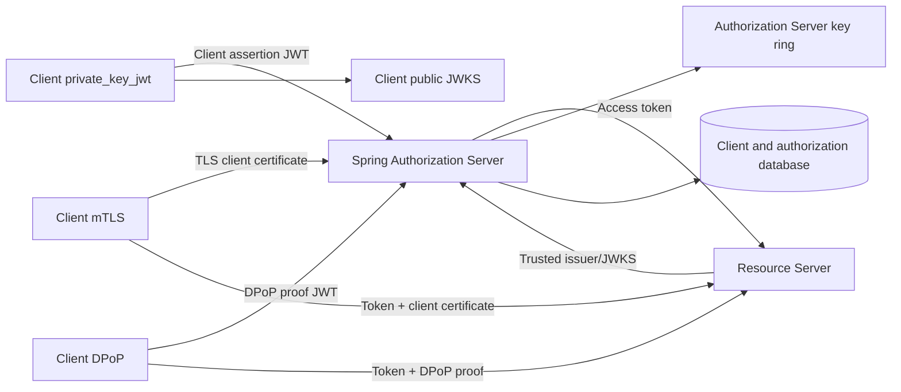

# Practicing private_key_jwt, mTLS, DPoP, and Key Rotation

This lab builds an Authorization Server that can authenticate clients using `private_key_jwt` or mutual TLS (mTLS), issue certificate-bound access tokens when using mTLS, and add DPoP proof-of-possession for the token endpoint and Resource Server. The final part performs key rotation for each mechanism and verifies token validation during the transition window.

The mechanisms in this lesson solve different problems. `private_key_jwt` uses a JWT signature to authenticate the client at the token endpoint. mTLS authenticates the client via a TLS certificate and can bind the access token to that certificate. DPoP uses an HTTP-layer proof JWT to bind the token to a client key. Key rotation is a necessary operational process for all three mechanisms, though each key type has its own purpose and lifecycle.

Spring Authorization Server supports client authentication via `private_key_jwt` and TLS client authentication methods in corresponding releases. DPoP depends on the Spring Authorization Server/Spring Security version and project-specific integration. Check the documentation of your exact pinned dependency version before implementing. If the version in use does not yet provide full DPoP support, the lab calls for building a DPoP verification adapter at the application layer; do not assume merely enabling `JwtDecoder` provides DPoP.

## 1. Lab Objectives and Architecture

Upon completion, you will be able to:

- Register a confidential client using `private_key_jwt`, publish a public JWK, and send a client assertion to the token endpoint.
- Register a client using `tls_client_auth`, verify certificates at the TLS layer, and issue certificate-bound access tokens.
- Describe and test DPoP proofs at the token endpoint and Resource Server, including `htu`, `htm`, `iat`, `jti`, `ath`, nonce, and key thumbprint.
- Rotate Authorization Server signing keys, client assertion keys, mTLS certificates, and DPoP keys in sequence with an appropriate overlap period.
- Demonstrate that valid requests are accepted and requests with invalid proofs, wrong certificates, or wrong keys are rejected.

Logical architecture:



The clients in the diagram are three independent lab clients so each mechanism is easy to observe. A real-world client may use multiple protections across layers, but you should not register multiple authentication methods for the same client without clearly defining how the server selects a method and its fallback policy.

## 2. Environment Preparation

Prepare a Spring Boot application containing Spring Authorization Server, a Resource Server protecting `/api/orders`, a test client, and a public JWKS endpoint. Use Maven or Gradle per your existing project. Choose compatible Java, Spring Boot, Spring Security, and Spring Authorization Server versions; pin dependency versions so lab results are reproducible.

Required components:

| Component | Role |
|---|---|
| Authorization Server | Client registration, client authentication, token issuance, and JWKS publication |
| Resource Server | Verifies access tokens and proof-of-possession bindings |
| Client private_key_jwt | Signs client assertions with a private key |
| Client mTLS | Presents a client certificate during TLS connection |
| Client DPoP | Signs a proof JWT for each HTTP request |
| Database | Stores Registered Clients, authorizations, and consents if needed |
| Key store/KMS/HSM | Stores private keys of the Authorization Server and clients with separate access rights |

Set the lab issuer to `https://auth.lab.example`. Locally, you can map the lab domain to loopback and use TLS certificates issued for the exact hostname. Do not use plain HTTP to test mTLS or DPoP in an environment where TLS is part of the security requirement.

Create secrets and keys in a separate directory excluded from Git. Example filenames for the lab:

```text
lab-secrets/
  as-signing-private.pem
  as-signing-public.pem
  client-private-key-jwt-private.pem
  client-private-key-jwt-public.pem
  mtls-lab-ca.key
  mtls-lab-ca.crt
  mtls-client.key
  mtls-client.crt
  mtls-client.p12
```

Add this directory to `.gitignore` and restrict read permissions. Never put private keys into images, source code, logs, or artifact repositories. In production, replace illustrative PEM files with a KMS/HSM or access-controlled secret manager.

## 3. Preparing Key Pair and Public JWK for private_key_jwt

`private_key_jwt` uses the client's private key to sign a JWT assertion. The Authorization Server fetches the public key from the registered JWKS URL to verify the assertion. The private key stays on the client; the public key is published so the server can verify it.

### 3.1. Generating a Test Key Pair

You can generate an RSA key pair with OpenSSL:

```bash
openssl genpkey -algorithm RSA \
  -pkeyopt rsa_keygen_bits:3072 \
  -out client-private-key-jwt-private.pem

openssl pkey \
  -in client-private-key-jwt-private.pem \
  -pubout \
  -out client-private-key-jwt-public.pem
```

Assign a stable `kid`, such as `client-assertion-2026-01`, to the corresponding JWK. The public JWKS has the conceptual form:

```json
{
  "keys": [
    {
      "kty": "RSA",
      "kid": "client-assertion-2026-01",
      "use": "sig",
      "alg": "RS256",
      "n": "<RSA modulus base64url>",
      "e": "AQAB"
    }
  ]
}
```

`n` must be the real modulus of the public key; the example above intentionally uses a placeholder. Never include `d`, `p`, `q`, `dp`, `dq`, or `qi` in JWKS. The JWKS endpoint must serve public key JSON over HTTPS with a cache policy compatible with your rotation process.

### 3.2. Registering the Client in Spring Authorization Server

Example creating a client using `client_credentials` and `private_key_jwt`:

```java
RegisteredClient privateKeyJwtClient = RegisteredClient.withId(
                UUID.randomUUID().toString())
        .clientId("orders-private-key-client")
        .clientName("Orders private key client")
        .clientAuthenticationMethod(ClientAuthenticationMethod.PRIVATE_KEY_JWT)
        .authorizationGrantType(AuthorizationGrantType.CLIENT_CREDENTIALS)
        .scope("orders.read")
        .clientSettings(ClientSettings.builder()
                .jwkSetUrl("https://client.lab.example/.well-known/jwks.json")
                .tokenEndpointAuthenticationSigningAlgorithm(SignatureAlgorithm.RS256)
                .build())
        .tokenSettings(TokenSettings.builder()
                .accessTokenTimeToLive(Duration.ofMinutes(5))
                .build())
        .build();
```

The main classes belong to Spring Authorization Server/Spring Security OAuth2. Depending on the version, package or builder APIs may change; check against your pinned dependencies. Save the client using the configured `RegisteredClientRepository`. Never store the client's private key in the Registered Client; the server only needs a trusted public JWK or JWKS URL.

### 3.3. Creating the Client Assertion

The client builds a JWT assertion and sends it to the token endpoint with the parameters:

```text
grant_type=client_credentials
scope=orders.read
client_id=orders-private-key-client
client_assertion_type=urn:ietf:params:oauth:client-assertion-type:jwt-bearer
client_assertion=<signed-client-assertion-jwt>
```

The assertion needs the following claims and headers:

| Element | Required Value |
|---|---|
| JOSE `alg` | Registered and allowed algorithm, e.g., `RS256` |
| JOSE `kid` | Matches a public JWK in the client's JWKS |
| `iss` | Client ID |
| `sub` | Client ID |
| `aud` | Exact token endpoint URI the assertion is sent to |
| `iat` | Time the assertion was created |
| `exp` | Short expiration time, typically only a few minutes |
| `jti` | Unique ID for the assertion, used to support replay detection |

Example payload structure:

```json
{
  "iss": "orders-private-key-client",
  "sub": "orders-private-key-client",
  "aud": "https://auth.lab.example/oauth2/token",
  "iat": 1794864000,
  "exp": 1794864300,
  "jti": "assertion-unique-id-001"
}
```

The timestamps above only illustrate the NumericDate format. The client must generate real-time timestamps when sending. `aud` must match the token endpoint expected by the Authorization Server; do not arbitrarily use the issuer instead of the token endpoint. `jti` must be unique and can be stored in a replay cache for the assertion's lifetime to reject reused assertions. Check the replay protection behavior of your running Authorization Server version; if absent, add an atomic `jti` storage mechanism.

### 3.4. Testing private_key_jwt

Send a request to the token endpoint with the signed client assertion. The expected result is an access token with the `orders.read` scope. Test the following cases one by one:

1. Assertion signed with the private key matching the public JWKS: accepted.
2. Assertion signed with a key not in the JWKS: rejected.
3. `aud` pointing to a different endpoint: rejected.
4. `iss` or `sub` not equal to the client ID: rejected.
5. Expired assertion or invalid issued-at timestamp: rejected.
6. Replaying an assertion with the same `jti`: rejected when replay protection is enabled.
7. `alg` not in the allowlist: rejected.

Do not log the assertion JWT. An assertion is also a signed credential and can be replayed during its validity window without replay protection.

## 4. Setting Up mTLS Client Authentication

mTLS authenticates the client during the TLS handshake. The client presents a certificate; the Authorization Server verifies the certificate chain up to a trusted CA and maps the certificate identity to a registered client.

### 4.1. Creating a Lab CA and Client Certificate

The following commands create a lab CA and then sign a client certificate:

```bash
openssl genrsa -out mtls-lab-ca.key 3072

openssl req -x509 -new -key mtls-lab-ca.key \
  -sha256 -days 365 \
  -subj "/CN=Authorization Server Lab CA" \
  -out mtls-lab-ca.crt

openssl genrsa -out mtls-client.key 3072

openssl req -new -key mtls-client.key \
  -subj "/CN=orders-mtls-client/OU=lab" \
  -out mtls-client.csr

openssl x509 -req -in mtls-client.csr \
  -CA mtls-lab-ca.crt -CAkey mtls-lab-ca.key -CAcreateserial \
  -out mtls-client.crt -days 90 -sha256

openssl pkcs12 -export \
  -inkey mtls-client.key -in mtls-client.crt \
  -certfile mtls-lab-ca.crt -out mtls-client.p12
```

In a real environment, the CA must be managed separately, certificates need SAN/subject values aligned with identity policy, appropriate lifetimes, and a revocation process. Never use a lab CA to sign production certificates. Protect `mtls-lab-ca.key`; the client user only needs the client certificate and private key.

### 4.2. Configuring TLS on the Authorization Server

If Spring Boot terminates TLS directly, configure the server certificate and a trust store containing CAs permitted to issue client certificates. Example configuration snippet for client authentication:

```yaml
server:
  ssl:
    client-auth: need
    trust-store: file:/run/secrets/client-ca-truststore.p12
    trust-store-type: PKCS12
    trust-store-password: ${CLIENT_CA_TRUSTSTORE_PASSWORD}
```

The application also needs a server keystore/certificate and full HTTPS configuration. `client-auth: need` requires the client to send a certificate during the TLS handshake; `want` makes it optional and is generally unsuitable if this endpoint mandates mTLS. Choose the mode based on your architecture and Spring Boot version.

Listener scope note: `client-auth: need` applies at the TLS connector level and may require a certificate on every request passing through that connector, including discovery or user login pages. If the application serves both browser login and API/token endpoints, consider a dedicated mTLS listener/hostname or specialized ingress configuration. If using `want` to allow public endpoints, the client authentication layer must still reject requests to the token endpoint when a client is registered with `tls_client_auth` but presents no valid certificate. Never let optional mode turn mTLS into a bypassable method.

If TLS terminates at an ingress or load balancer, the proxy must validate the client certificate and forward verified information via a clearly designed trusted mechanism. Block direct external access to the backend, strip any client-supplied certificate headers, and only accept metadata from authenticated proxies. Never trust a header like `X-Client-Cert` if callers can set it themselves.

### 4.3. Registering a TLS Client in Spring Authorization Server

For clients using a CA-signed certificate and TLS client authentication, configure the Registered Client with a controlled subject DN or SAN:

```java
RegisteredClient mtlsClient = RegisteredClient.withId(
                UUID.randomUUID().toString())
        .clientId("orders-mtls-client")
        .clientName("Orders mTLS client")
        .clientAuthenticationMethod(ClientAuthenticationMethod.TLS_CLIENT_AUTH)
        .authorizationGrantType(AuthorizationGrantType.CLIENT_CREDENTIALS)
        .scope("orders.read")
        .clientSettings(ClientSettings.builder()
                .x509CertificateSubjectDN("CN=orders-mtls-client,OU=lab")
                .build())
        .tokenSettings(TokenSettings.builder()
                .accessTokenTimeToLive(Duration.ofMinutes(5))
                .x509CertificateBoundAccessTokens(true)
                .build())
        .build();
```

Verify the `x509CertificateSubjectDN` builder name and certificate-bound token option against the Spring Authorization Server version in use. SAN can be used instead of DN if specified by the system's identity policy. Do not rely solely on a DN string supplied by the request; the certificate must be verified by the TLS stack for trust chain, validity period, key usage, and revocation status per policy.

`x509CertificateBoundAccessTokens(true)` requires the access token to be bound to the client certificate's thumbprint. For JWTs, the binding typically appears in the `cnf` claim with the `x5t#S256` attribute. The Resource Server must inspect the request's certificate and compare its thumbprint against this claim. If you only enable mTLS client authentication at the token endpoint without enabling certificate-bound tokens and Resource Server verification, the access token remains a bearer token that could be reused by another party.

### 4.4. Sending Requests with mTLS

With `curl`, pass the client certificate and private key:

```bash
curl --cert mtls-client.crt \
  --key mtls-client.key \
  --cacert server-ca.crt \
  --request POST \
  --data 'grant_type=client_credentials&client_id=orders-mtls-client&scope=orders.read' \
  https://auth.lab.example/oauth2/token
```

`server-ca.crt` is the CA the client uses to verify the Authorization Server's TLS certificate; it may differ from `mtls-lab-ca.crt`, which is the CA used to sign the client certificate. The expected result is that the token endpoint authenticates the client certificate and issues an access token. Requests without a certificate, with an expired certificate, with an untrusted CA, or with a subject/SAN mismatching the registered client must be rejected.

After receiving the token, call the Resource Server using the exact bound certificate. Retry with a different certificate: the Resource Server must reject the token due to thumbprint mismatch. Try sending only the access token without a certificate: the request must also be rejected for a certificate-bound token.

## 5. Practicing DPoP Proof-of-Possession

DPoP (Demonstrating Proof of Possession) binds an access token to a public key held by the client. The client signs a DPoP proof JWT for every HTTP request. An attacker who steals only the access token cannot use it without the corresponding private key.

### 5.1. Generating a DPoP Key Pair

The client generates a dedicated key pair for DPoP. You can use EC P-256 or an asymmetric algorithm permitted by the server. The private key stays on the client; the public JWK goes in the proof header. Do not reuse the client assertion private key or the Authorization Server's signing key for DPoP.

### 5.2. DPoP Proof Structure

A proof JWT has a JOSE header like:

```json
{
  "typ": "dpop+jwt",
  "alg": "ES256",
  "jwk": {
    "kty": "EC",
    "crv": "P-256",
    "x": "<public x coordinate>",
    "y": "<public y coordinate>"
  }
}
```

The proof payload for a Resource Server request requires the claims:

```json
{
  "jti": "proof-unique-id-123",
  "htm": "GET",
  "htu": "https://api.lab.example/api/orders",
  "iat": 1794864000,
  "ath": "<base64url-sha256-of-access-token>"
}
```

`htm` is the actual HTTP method; `htu` is the target URI normalized per DPoP rules, excluding query and fragment. `iat` must fall within the accepted time window. `jti` must be unique to detect proof replay. `ath` is the unpadded Base64URL-encoded SHA-256 hash of the access token; it binds the proof to that specific token. The server may require a nonce to reduce replay risk or control when proofs were generated.

The proof must be signed by the private key corresponding to the public JWK in the header. The server verifies the algorithm is in the allowlist, the JWK contains only public material, and the key thumbprint matches `cnf.jkt` in the access token. Reject proofs with `alg: none`, symmetric algorithms, or public JWKs containing private parameters.

### 5.3. DPoP Flow at the Token Endpoint

The client sends a DPoP proof in the `DPoP` HTTP header when calling the token endpoint. The Authorization Server verifies the proof, derives the JWK thumbprint, and binds the new access token to that key. The response for a DPoP token uses `token_type` `DPoP`, and the access token carries the key confirmation claim, typically `cnf.jkt`.

DPoP is a token-to-key binding mechanism and does not replace client authentication. Confidential clients must still authenticate with their registered method, such as `private_key_jwt` or mTLS; for public clients, the server applies the corresponding client identification rules. DPoP can be combined with another client authentication method if the server configuration and version support it.

Abbreviated request example:

```http
POST /oauth2/token HTTP/1.1
Host: auth.lab.example
Content-Type: application/x-www-form-urlencoded
DPoP: <signed-dpop-proof-jwt>

grant_type=client_credentials&client_id=orders-dpop-client&scope=orders.read
```

With the authorization code flow, the proof is sent at the token endpoint when exchanging the code; the server must apply DPoP binding according to the flow and check consistency with the proof key used. With client credentials, the proof at the token endpoint forms the basis for binding the issued token.

### 5.4. DPoP Flow at the Resource Server

The client sends the access token using the `DPoP` scheme and a fresh proof for the request:

```http
GET /api/orders HTTP/1.1
Host: api.lab.example
Authorization: DPoP <access-token>
DPoP: <new-signed-dpop-proof-jwt>
```

The Resource Server must verify both the access token and the proof. Verifying the JWT access token alone like a bearer token is insufficient. Check:

1. The access token has a valid signature, issuer, audience, expiration, and required scopes.
2. The token contains `cnf.jkt` and a token type matching DPoP.
3. The proof has `typ=dpop+jwt`, a valid signature, and an allowed asymmetric `alg`.
4. The public JWK in the proof has a thumbprint matching `cnf.jkt`.
5. `htm` matches the actual method and `htu` matches the normalized target URI.
6. `iat` is within the time window, `jti` has not been used before, and any server-required nonce is valid.
7. `ath` matches the hash of the access token sent in the request.

If the Resource Server sits behind a reverse proxy, `htu` must be compared against the external URI per DPoP rules. Only use forwarded host/proto from trusted proxies; the proxy must strip client-supplied headers before adding its own metadata. Otherwise, an attacker could exploit discrepancies between internal and public URIs to subvert target validation.

### 5.5. Integrating DPoP into Spring

Check whether your Spring Authorization Server and Spring Security versions provide built-in DPoP support for the authorization server and resource server. If full support is not yet available, implement a dedicated integration layer responsible for:

- On the Authorization Server: accepting the `DPoP` header at the token endpoint, verifying the proof, creating the `cnf.jkt` binding, returning `token_type=DPoP`, and handling nonce/replay.
- On the Resource Server: accepting the `DPoP` scheme, verifying the access token, and then verifying the proof against the token binding before producing an authenticated principal.
- Using a TTL-backed replay cache with an atomic insert-if-absent operation keyed by thumbprint/`jti`; sharing the cache across replicas.
- Keeping algorithm allowlists, time windows, and URI rules in trusted configuration.

Do not place a DPoP verification filter after request authorization has already run. The proof must be verified before the request is granted access. Nor should you verify only the proof signature while skipping `htm`, `htu`, `ath`, `jti`, or `cnf.jkt`.

If the library version does not yet support DPoP, document the adapter as an application extension and test against RFC 9449. Do not treat a standard `JwtDecoder` as a complete DPoP implementation; `JwtDecoder` only verifies the JWT access token per configuration and does not execute the full proof-of-possession protocol.

## 6. Comparing the Three Mechanisms

| Characteristic | private_key_jwt | mTLS | DPoP |
|---|---|---|---|
| Client proof | JWT assertion signed with private key | X.509 client certificate in TLS handshake | DPoP proof JWT per HTTP request |
| Verification point | Typically at token endpoint | TLS endpoint and optionally Resource Server | Token endpoint and Resource Server |
| Access token binding | Does not bind token to client key by itself | Can use certificate-bound tokens | Token bound to JWK thumbprint `cnf.jkt` |
| TLS certificate required | No | Yes | Not required beyond server HTTPS |
| Replay protection | Short-lived assertion and `jti` replay cache | TLS session/certificate; token binding when enabled | `jti`, `iat`, nonce, and `ath` |
| Keys to rotate | Client assertion signing key | Client certificate and CA/trust | Client's DPoP key |

Mechanisms can be combined. For example, a client can authenticate at the token endpoint with `private_key_jwt` and receive a DPoP-bound token; or use mTLS for both client authentication and certificate-bound tokens. The choice should reflect your threat model, key/certificate management capabilities, and downstream API support.

## 7. Rotating Authorization Server Signing Keys

The Authorization Server signing key signs JWT access tokens or ID tokens. This is a different key from the client assertion private key, mTLS certificate, and DPoP key.

### 7.1. Preparing a Two-Key Key Ring

Generate a new key and assign a new `kid`. During the transition period, JWKS publishes both the old and new public keys. The signer continues using the old key until all Resource Servers have observed the new public key.

An illustrative `JWKSource` can pull the key set from an application-managed provider:

```java
@Bean
JWKSource<SecurityContext> jwkSource(KeyRingProvider keyRingProvider) {
    return (selector, context) ->
            selector.select(keyRingProvider.currentJwkSet());
}
```

`KeyRingProvider` is an application abstraction. In a real implementation, it must distinguish the active signing key from the set of published public keys. The JWKS endpoint only returns public JWKs; never return private keys. When using KMS/HSM, integrate the signer via the provider's API and do not assume private keys are exportable.

### 7.2. Key Transition Sequence

1. Generate a new key pair and unique `kid` in the key store.
2. Update the key ring across all Authorization Server instances so JWKS exposes both the old and new keys.
3. Verify `jwks_uri` returns the same public key set from every instance and from the Resource Server network.
4. Wait for propagation/cache duration per actual configuration.
5. Switch the signer to the new private key; issue a test token and confirm the new `kid` header.
6. Keep the old public key in JWKS until all old tokens have expired, plus clock skew and cache duration.
7. Remove the old public key and verify all new tokens still validate.

Do not just change `kid` in the header while keeping old key material, or replace key material under an old `kid`. `kid` must stably identify a specific key.

## 8. Rotating Client Assertion Keys for private_key_jwt

This key belongs to the client, not the Authorization Server. The client signs assertions with its private key; the Authorization Server retrieves the public key from the client's JWKS URL.

Rotation procedure:

1. The client generates a new key pair and new `kid`.
2. The client publishes both old and new public keys at its JWKS URL.
3. Verify the Authorization Server can fetch the new JWK and locate the new `kid`.
4. The client switches to signing assertions with the new private key.
5. Monitor client authentication; keep the old public key long enough for in-flight valid assertions and JWKS caches.
6. Remove the old public key after a safe buffer period.

Assertions are typically short-lived, so the overlap window can be shorter than an access token's lifetime. However, you must still account for caching and clock skew. If the old client key is compromised, revoke the old public key immediately per incident response procedures, accepting that valid assertions still using that key will be rejected.

## 9. Rotating mTLS Certificates

Client certificates must be renewed before expiration. When moving between an old CA and a new CA, you can have a period where the trust store trusts both CAs. When using the same CA with a new certificate, update client bindings by subject DN or SAN and test the new cert before retiring the old cert.

Reference procedure:

1. Issue the new certificate, verifying SAN/subject, EKU, validity period, and chain.
2. Add the new CA or certificate to the trust store if needed.
3. Update client configuration to present the new certificate.
4. Update the binding in the Registered Client if subject/SAN changed.
5. Test the token endpoint with the new certificate and the Resource Server with a newly issued certificate-bound token.
6. Stop accepting the old certificate after tokens bound to it have expired or been revoked per policy.
7. Remove the old CA from the trust store once no valid clients depend on it.

Access tokens bound to the old certificate's thumbprint do not automatically transfer to the new certificate. The client must obtain a new token using the new certificate. If the old certificate is compromised, you may need to revoke associated tokens and remove trust earlier than scheduled.

## 10. Rotating DPoP Keys

A DPoP key belongs to the client and is identified via its JWK thumbprint. Already issued tokens carry the old key's `cnf.jkt`. If the client changes its key, proofs signed with the new key will not match old tokens.

Therefore, DPoP rotation typically involves:

1. Generating a new DPoP key pair and protecting the private key.
2. Using the new key in requests to obtain new access tokens.
3. Confirming new tokens carry `cnf.jkt` matching the new key's thumbprint.
4. Switching API requests to the new tokens and proofs signed with the new key.
5. Retiring old tokens once expired or revoked per policy.
6. Deleting the old key from the device/keystore when no tokens still require it.

You cannot simply swap the local private key and continue using old tokens. If zero-downtime transition is needed, retain both key pairs briefly on the client, ensuring each token is always paired with a proof from its own bound key.

## 11. End-to-End Testing

Run the following tests and save results without secrets:

| Group | Test Case | Expected Result |
|---|---|---|
| private_key_jwt | Valid assertion, `kid` present in JWKS | Client authenticated |
| private_key_jwt | Invalid signature, wrong `aud`, wrong `sub`, expired assertion | Token endpoint rejects |
| private_key_jwt | Replay same `jti` | Second assertion rejected when replay protection is enabled |
| private_key_jwt | Client key rotation | Assertion with new key succeeds during overlap window |
| mTLS | Certificate issued by trusted CA matching client | Client authenticated |
| mTLS | Missing cert, untrusted cert, wrong subject/SAN cert | TLS or client authentication rejected |
| mTLS | Certificate-bound token used with matching cert | Resource Server accepts |
| mTLS | Token used with a different cert or no cert | Resource Server rejects |
| DPoP | Valid proof, matching `htm`, `htu`, `ath`, `cnf.jkt` | Request authenticated |
| DPoP | Wrong method/URI, expired proof, or wrong thumbprint | Request rejected |
| DPoP | Replay same `jti` or invalid nonce | Request rejected |
| DPoP | Old token used with new key | Request rejected |
| AS key rotation | Old and new tokens during overlap window | Both verify successfully |
| AS key rotation | New token after removing old public key | New token still verifies |
| Multi-instance | Every replica publishes the same key ring | No random per-replica key lookup errors |

Automate negative cases with integration tests. Do not check HTTP status alone; confirm the server rejects for the right reason, logs contain no tokens, and metrics are properly tagged.

## 12. Common Error Diagnosis

| Symptom | Possible Cause | Resolution |
|---|---|---|
| `invalid_client` with private_key_jwt | Wrong `kid`, unreachable public JWKS, invalid signature, wrong `iss`/`sub`/`aud` | Inspect assertion header/claims and client JWKS |
| Valid assertion rejected as replay | `jti` already used or client reused assertion | Generate a fresh assertion per call; synchronize replay cache |
| mTLS handshake fails | Trust store missing CA, expired cert, or TLS not requesting client cert properly | Check chain, EKU, trust store, and ingress configuration |
| mTLS client gets `invalid_client` | Valid cert but subject/SAN does not match Registered Client | Synchronize client binding and certificate identity |
| Resource Server rejects mTLS token | Missing cert or thumbprint mismatch against `cnf.x5t#S256` | Send the matching cert; check certificate-bound validation |
| DPoP proof rejected due to URI | `htu` does not match target URI seen by server behind proxy | Normalize URI per RFC and configure trusted proxies |
| DPoP proof rejected as replay | `jti` already used or unsynchronized replay cache | Use a fresh `jti`; share replay cache across replicas |
| DPoP token used as bearer | Client sends `Bearer` or Resource Server skips proof check | Require `DPoP` scheme and verify proof before authorization |
| Token errors after rotation | Public key not yet published, stale cache, or token uses removed old key | Restore overlap; verify `kid` and JWKS on every instance |
| One replica verifies while another fails | Unsynchronized key ring or trust store | Check fingerprints, secret versions, and rollout |

## 13. Lab Completion Criteria

The lab is considered complete when you can demonstrate all of the following:

- The `private_key_jwt` client obtains tokens with valid assertions; assertions with invalid signatures, wrong audiences, expired timestamps, or replays are rejected.
- The mTLS client is authenticated via certificate; certificate-bound access tokens work only when requests carry the matching certificate.
- The DPoP client receives tokens bound to a JWK thumbprint; the Resource Server verifies a proof on every request and rejects replayed proofs or proofs with wrong method/URI/token.
- The Authorization Server rotates its signing key while old tokens remain valid during the overlap period and new tokens verify with the new public key.
- Client assertion keys, mTLS certificates, and DPoP keys are rotated on their own lifecycles without mixing keys across purposes.
- Logs and metrics are sufficient for investigation without containing intact private keys, client secrets, assertions, or access tokens.
- Test cases run across multiple instances or simulated caches/replicas to uncover synchronization issues.

## Conclusion

`private_key_jwt`, mTLS, and DPoP produce three distinct forms of proof: a signed assertion to authenticate the client, a TLS certificate to authenticate the connection, and a proof JWT to bind each request to the client's key. When combined with certificate-bound or DPoP-bound access tokens, the Resource Server must verify both the token and proof of key possession. Safe key rotation requires publishing the new public key or trust anchor first, switching the signer/client second, maintaining an appropriate overlap period, and removing the old key only when no valid tokens or assertions still depend on it.
