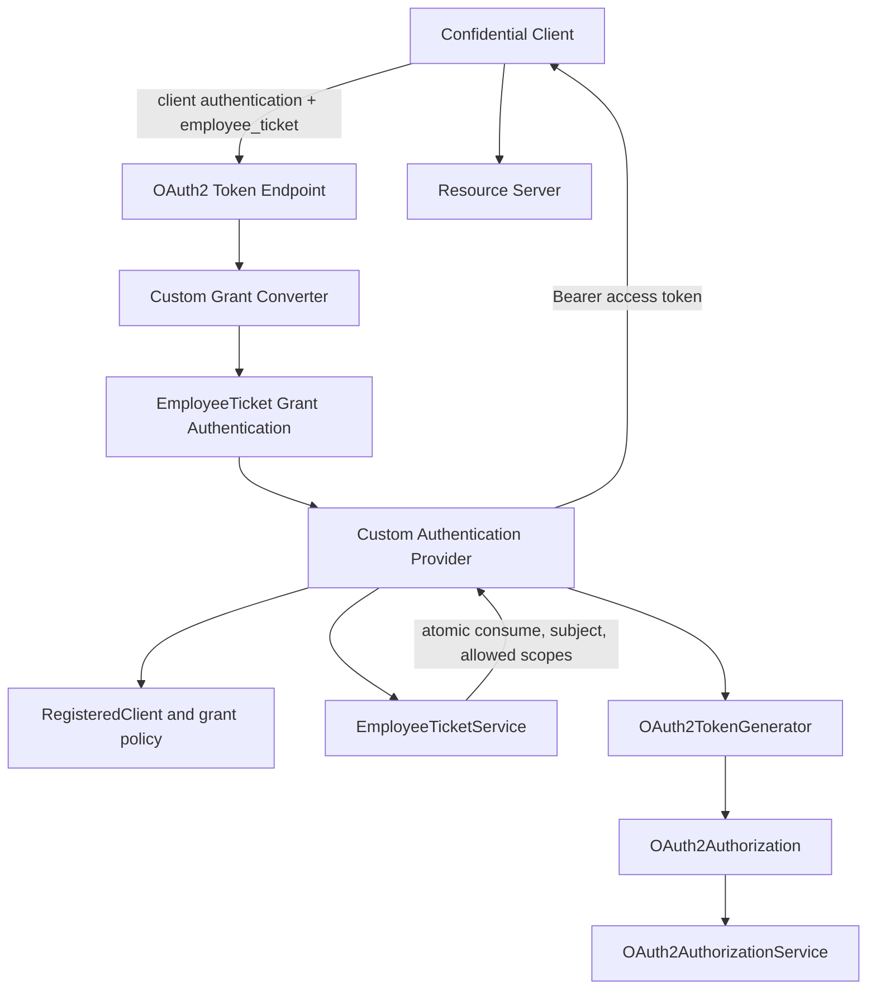

# Extending with a Custom Grant or Custom Storage with Tests

Spring Authorization Server provides common grant types and persistence services, yet real-world systems sometimes need to integrate with a proprietary authorization workflow or an existing data store. For example, an HR system might issue a one-time authentication ticket from an identity broker; an application needs to exchange that ticket for an access token via an internal grant type. Another system might need to store authorizations in a custom data store to satisfy partitioning, encryption, or data integration requirements.

This lab presents two independent extension tracks: **A. custom grant type** to exchange a one-time employee ticket for an access token; **B. custom authorization storage** by implementing `OAuth2AuthorizationService`. Pick the track that fits your problem and complete the corresponding tests. Both tracks must preserve client authentication rules, scope boundaries, replay protection, and consistent authorization state persistence.

After completing this lab, you will be able to:

- Register an extension grant type and wire it into the token endpoint.
- Validate grant business data through a controlled service.
- Mint tokens via `OAuth2TokenGenerator` and persist authorizations through Spring Authorization Server's abstraction.
- Or implement `OAuth2AuthorizationService` for a custom data store.
- Write unit tests, integration tests, and test critical negative cases.
- Evaluate risks around token storage, concurrency handling, and schema upgrades.

## 1. Choosing Your Lab Track

| Track | When to Choose | Expected Deliverables |
|---|---|---|
| A. Custom grant `employee_ticket` | Need to exchange a business credential with the Authorization Server to issue an access token | Grant converter, grant authentication token, authentication provider, ticket service, and end-to-end tests |
| B. Custom authorization storage | Need to replace the default authorization/token store with a custom database or storage adapter | `OAuth2AuthorizationService` implementation, data mapping, transactions, and storage contract tests |

Track A is suitable when integrating a new authentication/authorization mechanism. Track B is suitable when the primary requirement is persistence. You do not need to implement both in a single lab run; if implementing both, complete and test each layer independently before integrating.

## 2. Track A: Building a Custom Grant to Exchange an Employee Ticket

### 2.1. Problem Statement and Contract

Suppose an internal identity broker has authenticated an employee and issued a short-lived, one-time `employee_ticket`. A confidential client registered at the Authorization Server sends the ticket to the token endpoint to receive an access token representing that employee.

Illustrative grant type:

```text
urn:example:params:oauth:grant-type:employee-ticket
```

Form request sent to the token endpoint:

```text
grant_type=urn:example:params:oauth:grant-type:employee-ticket
employee_ticket=<one-time-ticket>
scope=orders.read profile.read
```

The client must authenticate using its registered method, such as `client_secret_basic` or `private_key_jwt`. The ticket proves the subject's identity/authorization per the contract with the identity broker; the ticket does not replace client authentication. The Authorization Server issues a token only when both the client and the ticket are valid.

Business rules for the lab:

- The ticket is issued by a trusted identity broker, has a short lifetime, and is single-use.
- The ticket is bound to the `client_id` allowed to exchange it.
- The ticket identifies the authenticated subject; the client cannot supply an arbitrary subject.
- Requested scopes must be within the RegisteredClient's allowed scopes and the scopes the ticket/subject is permitted to receive.
- Expired, already-used, wrong-client, or invalid tickets must be rejected with `invalid_grant`.
- Disallowed scopes must be rejected with `invalid_scope`.
- The grant only issues an access token in this lab; do not automatically issue a refresh token without designing and testing a refresh token lifecycle policy.

### 2.2. Processing Architecture



The converter turns the HTTP form request into an unauthenticated Authentication object. The provider checks the client, grant type, scopes, and ticket. When the ticket service returns the authenticated subject, the provider builds the token context, invokes the token generator, saves the authorization, and returns the token response in Spring Authorization Server's standard format.

### 2.3. Registering the Grant Type

Create a dedicated `AuthorizationGrantType`. The value must remain stable across versions and not collide with already defined grant types:

```java
public final class EmployeeTicketGrant {
    public static final AuthorizationGrantType GRANT_TYPE =
            new AuthorizationGrantType(
                    "urn:example:params:oauth:grant-type:employee-ticket");

    public static final String TICKET_PARAMETER = "employee_ticket";

    private EmployeeTicketGrant() {
    }
}
```

When creating `RegisteredClient`, enable this grant only for confidential clients permitted to use it:

```java
RegisteredClient client = RegisteredClient.withId(UUID.randomUUID().toString())
        .clientId("employee-portal")
        .clientSecret(passwordEncoder.encode(testClientSecret))
        .clientAuthenticationMethod(ClientAuthenticationMethod.CLIENT_SECRET_BASIC)
        .authorizationGrantType(EmployeeTicketGrant.GRANT_TYPE)
        .scope("orders.read")
        .scope("profile.read")
        .build();
```

This is a minimal fixture. In real applications, add the client name, token lifetimes, approved authentication method, and necessary operational settings. Never use plaintext secrets in production configuration.

### 2.4. Creating the Grant Authentication Token

This object holds the authenticated client principal, the ticket, and requested scopes. It is not yet the user authentication result:

```java
public final class EmployeeTicketAuthenticationToken
        extends OAuth2AuthorizationGrantAuthenticationToken {

    private final String ticket;
    private final Set<String> requestedScopes;

    public EmployeeTicketAuthenticationToken(
            Authentication clientPrincipal,
            String ticket,
            Set<String> requestedScopes) {
        super(EmployeeTicketGrant.GRANT_TYPE, clientPrincipal, Map.of());
        this.ticket = ticket;
        this.requestedScopes = Set.copyOf(requestedScopes);
    }

    public String getTicket() {
        return this.ticket;
    }

    public Set<String> getRequestedScopes() {
        return this.requestedScopes;
    }
}
```

Do not include the ticket in `toString()`, logs, or additional parameters that may be recorded. The ticket is a one-time credential and must be treated as a secret.

### 2.5. Writing the AuthenticationConverter

The converter only processes requests matching the custom grant's `grant_type`. Other grant types must continue to be handled by Spring Authorization Server's default converters.

```java
public final class EmployeeTicketAuthenticationConverter
        implements AuthenticationConverter {

    @Override
    public Authentication convert(HttpServletRequest request) {
        String grantType = request.getParameter(OAuth2ParameterNames.GRANT_TYPE);
        if (!EmployeeTicketGrant.GRANT_TYPE.getValue().equals(grantType)) {
            return null;
        }

        String[] tickets = request.getParameterValues(
                EmployeeTicketGrant.TICKET_PARAMETER);
        if (tickets == null || tickets.length != 1 || !StringUtils.hasText(tickets[0])) {
            throw invalidRequest();
        }

        String[] scopeValues = request.getParameterValues(OAuth2ParameterNames.SCOPE);
        if (scopeValues != null && scopeValues.length != 1) {
            throw invalidRequest();
        }

        Set<String> scopes = new LinkedHashSet<>();
        if (scopeValues != null && StringUtils.hasText(scopeValues[0])) {
            scopes.addAll(Arrays.asList(scopeValues[0].trim().split("\\s+")));
        }
        if (scopes.isEmpty()) {
            throw new OAuth2AuthenticationException(
                    new OAuth2Error(OAuth2ErrorCodes.INVALID_SCOPE));
        }

        Authentication clientPrincipal =
                SecurityContextHolder.getContext().getAuthentication();
        return new EmployeeTicketAuthenticationToken(
                clientPrincipal, tickets[0], scopes);
    }

    private static OAuth2AuthenticationException invalidRequest() {
        return new OAuth2AuthenticationException(
                new OAuth2Error(OAuth2ErrorCodes.INVALID_REQUEST));
    }
}
```

Imports are omitted to focus on the processing flow. The converter checks parameter counts to reject ambiguous requests with duplicate values for the same field. In a real implementation, you can also enforce length limits on the ticket and scope string before instantiating the Authentication object.

### 2.6. Building the Ticket Consumption Service

Do not let the AuthenticationProvider directly query the ticket table or parse ticket formats itself. Encapsulate the business logic in a service with a clear contract:

```java
public interface EmployeeTicketService {
    EmployeeTicketIdentity consume(
            String ticket,
            String clientId,
            Set<String> requestedScopes);
}

public record EmployeeTicketIdentity(
        Authentication principal,
        Set<String> allowedScopes) {
}
```

`consume` should execute inside a transaction with an atomic consumption operation. One database implementation approach is looking up by ticket digest and updating `consumed_at` conditional on the ticket being unused, unexpired, and bound to the right client. Only the request that updates exactly one row receives the ticket. Scope checks should happen within the same transaction before marking the ticket consumed, so an invalid-scope request does not accidentally consume a valid ticket.

The ticket service must verify:

- The ticket was issued by a trusted identity broker and its signature/origin is valid under the chosen mechanism.
- Ticket expiration and validity window.
- Matching `client_id`, audience, or tenant binding.
- The ticket has not been consumed or revoked.
- The subject's account status permits access.
- `requestedScopes` is a subset of scopes allowed for the subject.

For high-entropy random tickets, you can store a digest instead of the raw ticket value to reduce exposure if the database is read unauthorizedly. Never log tickets or sensitive digests. If the ticket is a JWT signed by the identity broker, verify signature, issuer, audience, `exp`, `nbf`, and `jti`; a replay store is still needed to enforce single-use if required by the contract.

The service returns an authenticated `Authentication` with the principal obtained from a trusted source. Never build a principal from a `subject` sent by the client in the form request. If the ticket is invalid or already used, the service throws a business exception that the provider maps to `invalid_grant`.

### 2.7. Writing the AuthenticationProvider

The provider verifies client authentication and grant permission before consuming the ticket. It then generates the token via `OAuth2TokenGenerator` to preserve the Authorization Server's signing configuration, lifetimes, and customizers.

```java
public final class EmployeeTicketAuthenticationProvider
        implements AuthenticationProvider {

    private final EmployeeTicketService ticketService;
    private final OAuth2AuthorizationService authorizationService;
    private final OAuth2TokenGenerator<? extends OAuth2Token> tokenGenerator;

    public EmployeeTicketAuthenticationProvider(
            EmployeeTicketService ticketService,
            OAuth2AuthorizationService authorizationService,
            OAuth2TokenGenerator<? extends OAuth2Token> tokenGenerator) {
        this.ticketService = ticketService;
        this.authorizationService = authorizationService;
        this.tokenGenerator = tokenGenerator;
    }

    @Override
    public Authentication authenticate(Authentication authentication)
            throws AuthenticationException {
        EmployeeTicketAuthenticationToken grant =
                (EmployeeTicketAuthenticationToken) authentication;

        if (!(grant.getPrincipal() instanceof OAuth2ClientAuthenticationToken clientPrincipal)
                || !clientPrincipal.isAuthenticated()) {
            throw new OAuth2AuthenticationException(
                    new OAuth2Error(OAuth2ErrorCodes.INVALID_CLIENT));
        }

        RegisteredClient registeredClient = clientPrincipal.getRegisteredClient();
        if (registeredClient == null || !registeredClient.getAuthorizationGrantTypes()
                .contains(EmployeeTicketGrant.GRANT_TYPE)) {
            throw new OAuth2AuthenticationException(
                    new OAuth2Error(OAuth2ErrorCodes.UNAUTHORIZED_CLIENT));
        }

        Set<String> requestedScopes = grant.getRequestedScopes();
        if (!registeredClient.getScopes().containsAll(requestedScopes)) {
            throw new OAuth2AuthenticationException(
                    new OAuth2Error(OAuth2ErrorCodes.INVALID_SCOPE));
        }

        EmployeeTicketIdentity identity;
        try {
            identity = this.ticketService.consume(
                    grant.getTicket(), registeredClient.getClientId(), requestedScopes);
        } catch (InvalidEmployeeTicketException ex) {
            throw new OAuth2AuthenticationException(
                    new OAuth2Error(OAuth2ErrorCodes.INVALID_GRANT));
        } catch (EmployeeTicketScopeException ex) {
            throw new OAuth2AuthenticationException(
                    new OAuth2Error(OAuth2ErrorCodes.INVALID_SCOPE));
        }

        if (identity == null) {
            throw new OAuth2AuthenticationException(
                    new OAuth2Error(OAuth2ErrorCodes.INVALID_GRANT));
        }
        if (!identity.allowedScopes().containsAll(requestedScopes)) {
            throw new OAuth2AuthenticationException(
                    new OAuth2Error(OAuth2ErrorCodes.INVALID_SCOPE));
        }

        Authentication subjectPrincipal = identity.principal();
        if (subjectPrincipal == null || !subjectPrincipal.isAuthenticated()) {
            throw new OAuth2AuthenticationException(
                    new OAuth2Error(OAuth2ErrorCodes.INVALID_GRANT));
        }

        OAuth2TokenContext tokenContext = DefaultOAuth2TokenContext.builder()
                .registeredClient(registeredClient)
                .principal(subjectPrincipal)
                .authorizationServerContext(
                        AuthorizationServerContextHolder.getContext())
                .authorizedScopes(requestedScopes)
                .tokenType(OAuth2TokenType.ACCESS_TOKEN)
                .authorizationGrantType(EmployeeTicketGrant.GRANT_TYPE)
                .authorizationGrant(grant)
                .build();

        OAuth2Token generatedToken = this.tokenGenerator.generate(tokenContext);
        if (generatedToken == null) {
            throw new OAuth2AuthenticationException(
                    new OAuth2Error(OAuth2ErrorCodes.SERVER_ERROR));
        }

        OAuth2AccessToken accessToken = new OAuth2AccessToken(
                OAuth2AccessToken.TokenType.BEARER,
                generatedToken.getTokenValue(),
                generatedToken.getIssuedAt(),
                generatedToken.getExpiresAt(),
                requestedScopes);

        OAuth2Authorization.Builder authorizationBuilder =
                OAuth2Authorization.withRegisteredClient(registeredClient)
                        .principalName(subjectPrincipal.getName())
                        .authorizationGrantType(EmployeeTicketGrant.GRANT_TYPE)
                        .authorizedScopes(requestedScopes)
                        .token(accessToken, metadata -> {
                            if (generatedToken instanceof ClaimAccessor claimAccessor) {
                                metadata.put(
                                        OAuth2Authorization.Token.CLAIMS_METADATA_NAME,
                                        claimAccessor.getClaims());
                            }
                        });

        this.authorizationService.save(authorizationBuilder.build());

        return new OAuth2AccessTokenAuthenticationToken(
                registeredClient,
                clientPrincipal,
                accessToken,
                null,
                Map.of());
    }

    @Override
    public boolean supports(Class<?> authentication) {
        return EmployeeTicketAuthenticationToken.class.isAssignableFrom(authentication);
    }
}
```

This is an illustrative implementation skeleton; business exceptions, imports, and constructor details must match the Spring Authorization Server version in use. `EmployeeTicketScopeException` and `InvalidEmployeeTicketException` are application-defined exceptions. The provider does not manually construct JWTs or sign them with a private key; the shared token generator determines the format and signature.

If refresh tokens must be issued, design a dedicated policy: client permitted to use `refresh_token`, appropriate token settings, refresh token state persistence, rotation/reuse handling, and replay tests. Never add refresh tokens merely by placing a field in the response.

### 2.8. Registering the Converter and Provider at the Token Endpoint

Add the custom converter and provider to the existing Authorization Server configuration:

```java
http.with(authorizationServerConfigurer, authorizationServer ->
        authorizationServer.tokenEndpoint(tokenEndpoint ->
                tokenEndpoint
                        .accessTokenRequestConverter(employeeTicketConverter)
                        .authenticationProvider(employeeTicketProvider)));
```

`authorizationServerConfigurer`, the converter, and the provider are beans/objects created in the application configuration. Keep the token endpoint's default converters and providers so authorization code, refresh token, client credentials, and standard grant types continue to work. Check the configuration API for your exact dependency version; do not replace the entire default converter list with only the custom converter.

### 2.9. Testing the Custom Grant

Write tests across three layers.

**Unit tests for the converter:**

| Input | Assertion |
|---|---|
| Different grant type | Converter returns `null` so another converter handles it |
| Matching grant type and single ticket | Creates `EmployeeTicketAuthenticationToken` |
| Missing or blank ticket | `invalid_request` |
| Multiple `employee_ticket` parameters | `invalid_request` |
| Missing or blank scope per lab policy | `invalid_scope` |
| Multiple scope parameters | `invalid_request` |

**Unit tests for the provider:**

- Unauthenticated client or not an authenticated OAuth2 client: `invalid_client`.
- Client not registered for the custom grant: `unauthorized_client`.
- Scope outside RegisteredClient: `invalid_scope`.
- Non-existent, expired, wrong-client, or already-used ticket: `invalid_grant`.
- Ticket service returns authenticated subject and valid scopes: token generator is called with the expected principal, grant type, and scopes.
- Token generator returns `null`: `server_error`, no authorization saved.
- Authorization is saved with the right RegisteredClient, principal, grant type, scopes, and access token.

**Integration test through the token endpoint:**

```java
mockMvc.perform(post("/oauth2/token")
        .with(httpBasic("employee-portal", testClientSecret))
        .contentType(MediaType.APPLICATION_FORM_URLENCODED)
        .param("grant_type", EmployeeTicketGrant.GRANT_TYPE.getValue())
        .param("employee_ticket", validTicket)
        .param("scope", "orders.read profile.read"))
    .andExpect(status().isOk())
    .andExpect(jsonPath("$.access_token").isNotEmpty())
    .andExpect(jsonPath("$.token_type").value("Bearer"))
        .andExpect(jsonPath("$.scope", containsString("orders.read")))
        .andExpect(jsonPath("$.scope", containsString("profile.read")));
```

After obtaining the token, call a test Resource Server to verify signature, issuer, audience, and scopes/authorities. Then try submitting the same ticket again and verify the server returns `invalid_grant`. Also test tickets bound to another client, expired tickets, disallowed scopes, and clients not granted the custom grant.

A critical concurrency test sends two simultaneous requests with the same ticket. Only one request may receive a token; the other must be rejected. This test requires a real database or ticket store in an integration environment, because a mock service cannot prove atomic consumption.

Define the transaction boundary between the ticket store and `OAuth2AuthorizationService`. If both share the same transaction manager/database, you can place consumption and authorization saving in the same transaction so it rolls back if saving the authorization fails. If they reside in separate systems, do not assume a local `@Transactional` creates a distributed transaction. Design idempotent redemption or a reconcilable reservation state to handle cases where the ticket was consumed but saving the authorization failed. Policy must prioritize never issuing two tokens for the same ticket.

## 3. Track B: Implementing Custom Authorization Storage

If the requirement is to replace the authorization store, the abstraction to implement is `OAuth2AuthorizationService`. This is where Spring Authorization Server saves and retrieves authorizations and their associated tokens.

### 3.1. Contract of OAuth2AuthorizationService

The interface has these core operations:

```java
public interface OAuth2AuthorizationService {
    void save(OAuth2Authorization authorization);
    void remove(OAuth2Authorization authorization);
    OAuth2Authorization findById(String id);
    OAuth2Authorization findByToken(String token, OAuth2TokenType tokenType);
}
```

The implementation must preserve all information required by the framework, not just the access token string. An authorization may contain the principal name, registered client, grant type, scopes, attributes, authorization code, access token, refresh token, ID token, and metadata for each token.

`OAuth2AuthorizationConsentService` is a separate abstraction for consent. If the requirement also calls for replacing the consent store, implement and test that interface separately; do not fold consent into `OAuth2AuthorizationService` in a way that breaks the framework's contract.

### 3.2. Designing Schema and Mapping

A typical storage design has a primary authorization table and indexed token fields:

| Data Group | Example Fields |
|---|---|
| Authorization | `id`, `registered_client_id`, `principal_name`, `grant_type`, `authorized_scopes`, `attributes`, `version` |
| Authorization code | protected token value, issued/expiry time, metadata, invalidated flag |
| Access token | protected token value, token hash/index, issued/expiry time, scopes, metadata, invalidated flag |
| Refresh token | protected token value, token hash/index, issued/expiry time, metadata, invalidated flag |
| ID token | protected token value, issued/expiry time, and required metadata/claims |

The actual schema depends on the enabled grant types. If supporting device authorization or custom token types, add the corresponding fields and mappings. Define a foreign key to RegisteredClient or ensure stable client lookup according to the chosen storage strategy.

Do not serialize arbitrary Java objects using native Java serialization for long-term storage. That couples stored data to class names and library versions while introducing deserialization risks on untrusted data. Prefer versioned schemas and explicit mappings for supported fields. For extensible attributes, use JSON with controlled data types and migration rules.

Tokens are credentials. Encrypt sensitive data at rest, restrict database access, never log tokens, and maintain an encryption key rotation process. If lookup by token is needed, store an additional digest for indexing and store the encrypted token value to reconstruct `OAuth2Authorization`. Do not store only a hash if the framework needs to read back the token value from the authorization object.

### 3.3. Implementing the Methods

`save` must insert or update the authorization consistently. If the authorization already exists, updates must preserve the latest token state and metadata. Use transactions to avoid partial authorization saves.

`remove` deletes or marks the authorization deleted per the system's retention and audit policies. If using soft deletes, lookup methods must ensure deleted records are never returned as active authorizations.

`findById` retrieves the exact authorization by ID.

`findByToken` must search by token value and token type when specified. If `tokenType` is `null`, the implementation must search across the token types supported by the system according to the framework version's semantics. Do not search only access tokens while ignoring authorization codes, refresh tokens, or ID tokens if active flows depend on them.

When mapping tokens, preserve issued-at, expires-at, scopes, claims metadata, and invalidated status. Do not mark a token valid solely because a record was found; validating expiration, status, and grant policy remains part of the framework's processing flow.

### 3.4. Atomicity and Concurrency Handling

An authorization code can only be used once. Refresh token rotation may also require atomic state updates. If two instances read the same authorization simultaneously and write back new states, the implementation must prevent lost updates and replays.

Available mechanisms include:

- Transactions with row locks when executing read-then-update operations.
- Optimistic locking with a `version` column and checking updated row counts.
- Unique constraints on token digests or `jti` when duplicate/replay prevention is required.
- Conditional updates, such as updating only when the token has not been invalidated and not yet consumed.

Do not rely on in-memory synchronization within a single JVM if the application runs multiple instances. Concurrency tests must run against real storage or an adapter with equivalent transaction semantics.

### 3.5. Testing the Storage Adapter

Write contract tests for every method:

| Method | Test | Expected Result |
|---|---|---|
| `save` | Save a new authorization | Retrievable by ID and by token |
| `save` | Re-save an updated authorization | Updated state/metadata is preserved |
| `findById` | Existing and non-existent ID | Returns exact object or `null` |
| `findByToken` | Find access token with matching type | Returns matching authorization |
| `findByToken` | Find refresh token/authorization code | Returns matching authorization by token type |
| `findByToken` | Non-existent token | Returns `null` |
| `remove` | Remove authorization | Record is no longer returned as an active authorization |
| Round-trip | Save and reconstruct authorization | Principal, grant, scopes, attributes, and token metadata preserved |
| Concurrency | Two requests using the same code or refresh token | Only one operation succeeds per policy |
| Encryption | Inspect physical data in storage | No plaintext tokens or sensitive secrets exposed |

Round-trip tests should cover multiple tokens in the same authorization if a grant flow produces both access tokens and refresh tokens. Verify metadata/claims added by token customizers as well. For migrations, create data using the previous version's schema/adapter, upgrade, and verify the new implementation still reads it.

## 4. Lab Execution Workflow

Follow this order for either Track A or Track B:

1. Write a brief contract covering inputs, outputs, errors, and state to persist.
2. Identify trust boundaries: which clients may call, which credentials are trusted, and which source authenticates subjects.
3. Implement a small adapter/service without placing business logic in controllers or filters.
4. Wire it into the appropriate Spring Authorization Server abstraction.
5. Write unit tests for the success path and input error cases.
6. Write integration tests with a real database/token endpoint or storage.
7. Test concurrent requests and replays.
8. Audit logs, secret handling, token expiry, and scope boundaries.
9. Re-run existing standard grant types to ensure the extension does not break current flows.

## 5. Acceptance Criteria

### If Choosing Track A — Custom Grant

- [ ] Grant type has a stable identifier and is registered properly for permitted clients.
- [ ] Client authentication remains mandatory and is verified independently of the ticket.
- [ ] Converter only handles the custom grant and rejects missing/duplicate parameters.
- [ ] Ticket is verified against a trusted source, with expiry and client binding.
- [ ] Ticket is consumed at most once even under concurrent requests.
- [ ] Subject comes from the ticket service, never from the client request.
- [ ] Scopes fall within both client and subject limits.
- [ ] Tokens are generated via `OAuth2TokenGenerator`.
- [ ] Authorizations are persisted via `OAuth2AuthorizationService`.
- [ ] Token works at the Resource Server and negative cases are rejected.
- [ ] Existing standard grant types still work.
- [ ] Tickets, access tokens, and client secrets do not appear in logs.

### If Choosing Track B — Custom Storage

- [ ] Fully implements `save`, `remove`, `findById`, and `findByToken`.
- [ ] Supports all enabled token types and grant types.
- [ ] Round-trip preserves authorizations, tokens, and required metadata.
- [ ] Update and remove have clear semantics.
- [ ] Writes and state updates use appropriate transactions/locking.
- [ ] Tokens are protected at rest and do not appear in logs.
- [ ] Concurrency tests exist for authorization codes or refresh tokens.
- [ ] Migration tests exist for data from the previous version.
- [ ] Active authorization, token, and introspection/revocation flows continue to work.

## 6. Common Errors and Troubleshooting

| Error | Common Cause | Resolution |
|---|---|---|
| Custom grant always returns `unsupported_grant_type` | Converter not registered or grant type does not match exactly | Check converter chain and grant type value |
| Client rejected despite valid ticket | Client has not registered the grant type or used wrong auth method | Check RegisteredClient and client authentication |
| Ticket can be used twice | Non-atomic consumption or check-then-update race | Use conditional update/transaction and concurrency tests |
| Token has overly broad scopes | Missing intersection across client, subject, and requested scopes | Enforce subset check before generating the token |
| Resource Server rejects token | Wrong signing config, issuer, audience, or JWKS | Use shared token generator and test with a real decoder |
| Introspection cannot find token | `findByToken` only supports access tokens or wrong mapping | Add lookup by token type and contract tests |
| Refresh token replayed | Rotation/reuse policy not persisted atomically | Persist state and perform controlled updates |
| Old authorizations unreadable after upgrade | Class/version-coupled serialization or missing migration | Use versioned schema and test legacy data |

## Conclusion

Both a custom grant and custom storage extend core parts of the Authorization Server, so they must integrate through Spring Authorization Server abstractions while preserving the OAuth/OIDC contracts relied upon by clients. For a custom grant, focus on client authentication, trusted subject identity sources, scope boundaries, and replay protection. For custom storage, focus on data round-trips, lookup by token type, transactions, and schema compatibility. Consider the lab complete only when functional tests, failure tests, and concurrency tests all prove the expected behavior.
