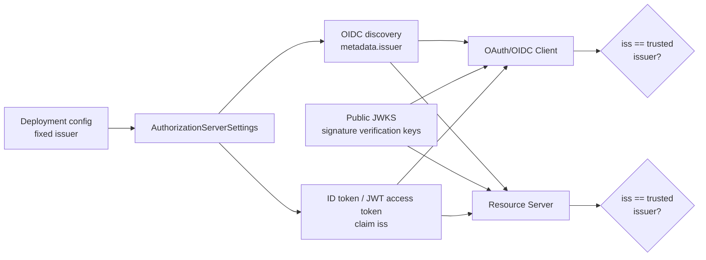
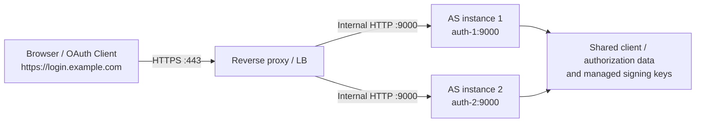

# AuthorizationServerSettings and Explicit Issuer Configuration

When designing an **OAuth 2.0/OpenID Connect Authorization Server** with Spring Security and Spring Authorization Server in Spring Boot, you must define **who the server identifies itself as** and **which endpoints it publishes**. Those two responsibilities are centered in `AuthorizationServerSettings`. In particular, the `issuer` property directly affects the ability of clients and Resource Servers to verify tokens, read discovery metadata, and trust the right issuing server.

A system can start up, display the login page, and return tokens yet still fail on the client if `issuer` is misconfigured. For example: the Authorization Server runs in a container at `http://auth-server:9000`, users access it through `https://login.example.com`, and the JWT states `iss` as the internal address. When the Resource Server only accepts `https://login.example.com`, the token will be rejected even if the signature is valid.

**Learning objectives:**

- Explain the meaning of issuer in OAuth 2.0/OIDC and distinguish issuer from runtime host, client ID, redirect URI, audience, and JWKS address.
- Configure `AuthorizationServerSettings` with an explicit issuer, understand the default endpoints, and know the impact of changing paths.
- Establish a consistent issuer when Spring Boot runs directly, behind a reverse proxy/load balancer, or in a container.
- Cross-check the issuer across discovery metadata, tokens, OAuth clients, and Resource Servers; test common mismatch errors.
- Understand the limitations of demo configurations and operational rules when changing the issuer or running multiple instances.

## 1. Issuer as the Protocol Identity of the Authorization Server

In OIDC, the **issuer identifier** is the URL identifying the OpenID Provider/Authorization Server. An ID token issued by the server carries the `iss` claim representing that identity. An OAuth Authorization Server can also publish `issuer` in its metadata, and the JWT access tokens it issues typically contain `iss`. A Client/Resource Server must verify that the received issuer matches the **configured trusted issuer**.

Example:

```text
Trusted issuer:       https://login.example.com
ID token claim "iss": https://login.example.com
Metadata "issuer":    https://login.example.com
=> Same identity: can proceed with other verification steps.
```

If the ID token specifies `https://internal-auth:9000` or `http://login.example.com`, it **does not match** the configured issuer `https://login.example.com`. The verifying party must reject mismatched tokens, rather than rewriting the claim or skipping verification.

**The issuer is a stable logical identity**, not necessarily the address the Java process binds to. One issuer can be served by multiple instances behind a load balancer, provided they have matching configuration, data, and keys to form the same logical Authorization Server.

### 1.1. Which Addresses and Identifiers Differ from Issuer?

| Concept | Example | Function | Can it replace issuer? |
| --- | --- | --- | --- |
| **Issuer** | `https://login.example.com` | AS/OP identifier trusted by clients and RS. | This is the value that must be configured consistently. |
| **Internal bind address** | `http://auth-service:9000` | Address the container/pod/JVM listens on. | No; usually not reachable externally. |
| **Authorization endpoint** | `https://login.example.com/oauth2/authorize` | Where the browser begins requesting authorization. | No; it is an endpoint belonging to the AS. |
| **Token endpoint** | `https://login.example.com/oauth2/token` | Where the client exchanges a code for tokens. | No; it is an endpoint belonging to the AS. |
| **JWKS URI** | `https://login.example.com/oauth2/jwks` | Provides public keys to verify JWT signatures. | No; fetching keys is not enough to prove the expected issuer. |
| **Client ID** | `web-portal` | Registered OAuth client identifier. | No; client and AS are two different roles. |
| **Redirect URI** | `https://portal.example.com/login/oauth2/code/portal` | Callback URL where the AS is allowed to send the browser back. | No; it is the client's address. |
| **Audience (`aud`)** | `orders-api` | Target recipient the token is intended for. | No; `iss` states who issued it, `aud` states who the token is for. |

**Security note:** A JWT can have a valid cryptographic signature yet still have the wrong `iss` or `aud`. Verifying signature, issuer, expiration, audience, and permissions are separate checks. `AuthorizationServerSettings` establishes the server identity; it does not replace checking those conditions at the Resource Server.

### 1.2. Requirements for the Issuer Value

A public OIDC issuer should be an **HTTPS** URL with a clear, stable host, and without query parameters or fragments. It may contain a path when deployed with a path prefix, but you must ensure discovery metadata and all routing are consistent with that path.

The values below are **different** when matching identifiers:

```text
https://login.example.com
http://login.example.com
https://login.example.com/
https://login.example.com/auth
https://LOGIN.example.com
http://localhost:9000
http://127.0.0.1:9000
```

In practice, standardize on **one canonical issuer string**, publish it via metadata, and configure the **exact same string** on all verifying parties. Do not write logic that arbitrarily "normalizes" or modifies `iss` on the receiving side. For OIDC, issuer comparison rules must follow the specification; do not rely on the assumption that two URLs pointing to the same IP are equivalent.

HTTP is only suitable for examples running in a **loopback development environment**, such as `http://127.0.0.1:9000`. Public issuers for real users and APIs require HTTPS.

## 2. What Does AuthorizationServerSettings Configure?

`AuthorizationServerSettings` is the centralized configuration object for Spring Authorization Server protocol properties, most notably:

1. `issuer`: The URL identifying the Authorization Server.
2. OAuth 2.0 endpoint paths: authorization, token, introspection, revocation, JWK Set, and related endpoints.
3. OIDC endpoint paths when OpenID Connect is enabled, such as UserInfo and logout.
4. Paths for additional flows such as Device Authorization Flow, depending on the capabilities of the version in use.

Some common endpoints with default settings in Spring Authorization Server 1.x:

| Function | Default path | Notes |
| --- | --- | --- |
| Browser-based authorization | `/oauth2/authorize` | Authorization endpoint. |
| Exchange authorization code, obtain tokens | `/oauth2/token` | Token endpoint. |
| Inspect opaque/stateful tokens | `/oauth2/introspect` | Requires appropriate caller permissions and authentication. |
| Revoke tokens | `/oauth2/revoke` | Revocation endpoint. |
| Publish public keys | `/oauth2/jwks` | Available when `JWKSource<SecurityContext>` is configured. |
| Device authorization | `/oauth2/device_authorization` | For supported and configured grant/device flows. |
| Device code verification page | `/oauth2/device_verification` | User enters/approves the code on another device. |
| OIDC UserInfo | `/userinfo` | Applies only when OIDC is enabled with required configuration. |
| OIDC RP-Initiated Logout | `/connect/logout` | Applies only when OIDC is enabled. |

**Not every endpoint in the table works automatically in every configuration.** For example, JWKS requires a `JWKSource`, OIDC requires enabling `oidc(...)`, and whether a grant is allowed also depends on `RegisteredClient` and related services.

Discovery metadata is also important:

- `/.well-known/openid-configuration` is the discovery address for the **OIDC Provider** when OIDC is enabled, in examples where the issuer is at the root.
- `/.well-known/oauth-authorization-server` is the OAuth Authorization Server metadata address according to the appropriate discovery rules.

For issuers with a path component, the discovery URL may be constructed according to rules other than directly appending `issuer + "/.well-known/..."`. When deploying under a path prefix, verify the actual URL against the specification and what the server metadata returns.

### 2.1. Why Declare the Issuer Explicitly?

If you do not set `issuer` in `AuthorizationServerSettings`, Spring Authorization Server may infer the issuer from the current HTTP request information. This is convenient in direct demos, but introduces risks in environments with reverse proxies, containers, multiple hostnames, or multiple ports. The request seen by the application might be `http://auth-server:9000` while the client uses `https://login.example.com`.

Explicit configuration ensures the issuer is chosen by **deployment policy** rather than depending on the host/scheme of each request. However, this setting only stabilizes identity; you still must protect the application against spoofed headers, configure HTTPS/redirects properly, and keep public endpoints reachable.

## 3. Explicit Issuer Configuration in Spring Boot

The example below applies to **Spring Boot 3.x compatible with Spring Authorization Server 1.x**. APIs can change across version lines; consult the documentation for the specific Spring Boot/SAS version you are using.

It is assumed the project already has the dependencies and beans required to run an Authorization Server: `RegisteredClientRepository`, `UserDetailsService`, `JWKSource`, `JwtDecoder`, along with two `SecurityFilterChain` beans for protocol endpoints and form login. This lesson focuses on **settings and issuer**, so it does not repeat the full configuration for client registration or signing key generation.

### 3.1. Declaring Properties in application.yml

Create or update `src/main/resources/application.yml`:

```yaml
spring:
  application:
    name: auth-server

server:
  port: 9000

app:
  security:
    authorization-server:
      issuer: ${AUTH_SERVER_ISSUER}
```

`AUTH_SERVER_ISSUER` is a required environment variable at startup in this example. Avoid adding a fallback to an internal URL in production, as that could cause the application to silently issue tokens with the wrong issuer.

Run locally to test:

**PowerShell (Windows):**

```powershell
$env:AUTH_SERVER_ISSUER = 'http://127.0.0.1:9000'
.\mvnw.cmd spring-boot:run
```

**Bash (macOS/Linux):**

```bash
export AUTH_SERVER_ISSUER='http://127.0.0.1:9000'
./mvnw spring-boot:run
```

In a real operational environment, the value will be a public HTTPS issuer, such as `https://login.example.com`. The environment variable can be supplied via deployment configuration or secret/config management; the issuer itself is not a secret, but it should be governed as a critical identity configuration.

### 3.2. Creating the AuthorizationServerSettings Bean

```java
package com.example.authserver.config;

import org.springframework.beans.factory.annotation.Value;
import org.springframework.context.annotation.Bean;
import org.springframework.context.annotation.Configuration;
import org.springframework.security.oauth2.server.authorization.settings.AuthorizationServerSettings;

@Configuration(proxyBeanMethods = false)
public class AuthorizationServerSettingsConfig {

    @Bean
    AuthorizationServerSettings authorizationServerSettings(
            @Value("${app.security.authorization-server.issuer}") String issuer) {

        return AuthorizationServerSettings.builder()
                .issuer(issuer)
                .build();
    }
}
```

Meaning:

- `@Configuration` registers the configuration in the Spring context. The configuration package must be within the component scan area or explicitly imported.
- `@Value(...)` reads the issuer from application configuration rather than from request `Host`/`X-Forwarded-Host` headers.
- `AuthorizationServerSettings.builder().issuer(issuer).build()` freezes the chosen issuer value when the bean is configured.
- Because endpoint paths are not overridden, Spring Authorization Server uses the corresponding default paths of its version.

**You do not need to redeclare every default endpoint.** The fewer custom values you specify, the fewer places can drift out of sync between registered paths, published metadata, reverse proxies, and client-side configuration.

### 3.3. Ensuring SecurityFilterChain Enables Required Features

`AuthorizationServerSettings` does not enable OIDC or provide a token signer by itself. To expose OIDC discovery, the AS chain configuration needs to enable OIDC, for example:

```java
import org.springframework.core.annotation.Order;
import org.springframework.context.annotation.Bean;
import org.springframework.context.annotation.Configuration;
import org.springframework.security.config.Customizer;
import org.springframework.security.config.annotation.web.builders.HttpSecurity;
import org.springframework.security.oauth2.server.authorization.config.annotation.web.configurers.OAuth2AuthorizationServerConfigurer;
import org.springframework.security.web.SecurityFilterChain;

@Configuration(proxyBeanMethods = false)
class AuthorizationEndpointsSecurityConfig {

    @Bean
    @Order(1)
    SecurityFilterChain authorizationServerSecurityFilterChain(
            HttpSecurity http) throws Exception {

        OAuth2AuthorizationServerConfigurer configurer =
                OAuth2AuthorizationServerConfigurer.authorizationServer();

        http
            .securityMatcher(configurer.getEndpointsMatcher())
            .with(configurer, server ->
                server.oidc(Customizer.withDefaults())
            )
            .authorizeHttpRequests(authorize ->
                authorize.anyRequest().authenticated()
            );

        return http.build();
    }
}
```

The snippet above **only illustrates the relevant endpoint chain portion**. A complete application must also configure a login entry point, a filter chain for `/login`, `RegisteredClientRepository`, token signing/JWKS, and other components. Using the OIDC UserInfo endpoint requires additional JWT verification configuration appropriate to your version and integration approach. Do not treat this snippet alone as a complete Authorization Server.

The `AuthorizationServerSettings` bean and the endpoint configuration can reside in two different Java classes; Spring loads them from the application context. Only **one** valid settings configuration should be created for one logical Authorization Server.

## 4. From Issuer to Metadata and Tokens

Consider the issuer:

```text
https://login.example.com
```

When using default endpoint paths, the AS OIDC discovery at `https://login.example.com/.well-known/openid-configuration` will provide representative fields such as:

```json
{
  "issuer": "https://login.example.com",
  "authorization_endpoint": "https://login.example.com/oauth2/authorize",
  "token_endpoint": "https://login.example.com/oauth2/token",
  "jwks_uri": "https://login.example.com/oauth2/jwks",
  "userinfo_endpoint": "https://login.example.com/userinfo"
}
```

This is a **shortened JSON for illustration**, not the complete actual metadata. Specific fields and values depend on endpoint configuration, OIDC settings, and the version in use.

In an Authorization Code Flow with the `openid` scope, an ID token has conceptual claims such as:

```json
{
  "iss": "https://login.example.com",
  "sub": "user-123",
  "aud": "web-portal",
  "exp": 1980003600,
  "iat": 1980000000
}
```

Timestamps here are illustrative numbers, not a real token. An OIDC client must verify **signature, issuer, audience, expiration, and other protocol constraints** such as `nonce` when requested.

A Resource Server typically receives an access token, such as a JWT whose `iss` claim equals the same issuer. However, not all access tokens are JWTs: when using opaque tokens, the Resource Server needs introspection or an appropriate verification mechanism. Do not read claims from an opaque token as if it were always a JWT.

### 4.1. Relationship with Public Keys and Resource Servers

`jwks_uri` tells consumers where to fetch the **public key** to verify JWTs signed with the AS private key. The public key path may be published under the issuer; it does not replace checking the issuer.

Example configuration for a Spring Resource Server trusting this issuer:

```yaml
spring:
  security:
    oauth2:
      resourceserver:
        jwt:
          issuer-uri: https://login.example.com
```

With a JWT Resource Server configured via `issuer-uri`, Spring Security can use discovery to locate metadata/JWKS and validate signature, expiration, and issuer. **API audience and business permissions typically require separate configuration/checks**: a valid issuer does not mean the token is permitted at every API.

On the Spring Security OAuth2/OIDC Client side, the provider configuration can also be declared as:

```yaml
spring:
  security:
    oauth2:
      client:
        provider:
          company-identity:
            issuer-uri: https://login.example.com
```

This is only the **provider** portion; a complete client also needs registration (`client-id`, authentication method, grant, redirect URI, and scopes). The OIDC client fetches metadata from the issuer to learn endpoints, then verifies responses based on trusted information.

### 4.2. Chain of Trust Diagram



If metadata, tokens, and recipient-side configuration disagree on the issuer, the system must raise a verification error. **Do not fix the issue by disabling issuer validation**: doing so destroys the trust boundary between two different token issuers.

## 5. Running Behind a Reverse Proxy, Load Balancer, or in Containers

Production architectures often have multiple layers:



Here:

- **Public issuer:** `https://login.example.com`.
- **Internal addresses:** `http://auth-1:9000` or `http://auth-2:9000`.
- **Configuration value for both instances:** `AUTH_SERVER_ISSUER=https://login.example.com`.
- Clients and Resource Servers always use the public issuer; they do not use the pod/container hostname as the issuer.

If just one instance has a different issuer, tokens issued by that instance may be randomly rejected by clients/RS depending on load balancing. Beyond the issuer, instances need **compatible signing keys**, shared or consistently distributed authorization/consent/authorization code state, and an appropriate session strategy. Aligning the issuer alone is not sufficient for an HA deployment.

### 5.1. Forwarded Headers and Redirect URLs

A reverse proxy can pass public origin information to the backend via `Forwarded` or `X-Forwarded-Proto`, `X-Forwarded-Host`, `X-Forwarded-Port`. The application may need them to build redirects and cookies with the correct scheme/host.

In Spring Boot, one configuration option is:

```yaml
server:
  forward-headers-strategy: framework
```

**Only enable forwarded header handling when the proxy boundary is controlled.** The proxy must strip/overwrite forwarded headers sent by Internet users, and the backend must not be exposed directly to untrusted clients. If spoofed headers are trusted, the application may generate incorrect URLs/redirects or mis-handle the origin. An explicit issuer avoids inferring identity from a request, but does not by itself eliminate all forwarded header risks.

If you use native forward-header handling from the infrastructure/Servlet container, choose a strategy that matches your deployment configuration; do not enable multiple overlapping processors without verifying the actual URLs produced.

### 5.2. When the Issuer Has a Path Prefix

Suppose you want the issuer to be `https://login.example.com/auth` while the backend runs at root. You must then explicitly determine:

- How the proxy forwards `/auth/...` to the backend: preserving the prefix or stripping the prefix.
- Whether `server.servlet.context-path` is used and what the actual endpoint paths on the backend are.
- The discovery URL according to rules for issuers with a path component.
- Whether published metadata `authorization_endpoint`, `token_endpoint`, and `jwks_uri` are **reachable from the Internet** and match real routes.

Do not simply append `/auth` to the issuer and assume the proxy and Spring will sort out all paths automatically. For simpler requirements, placing the issuer at the root of a dedicated subdomain (such as `https://login.example.com`) reduces routing complexity.

## 6. When Should You Change Endpoint Paths?

`AuthorizationServerSettings` lets you customize paths for certain endpoints. For example, to set the token endpoint to `/identity/token`:

```java
@Bean
AuthorizationServerSettings authorizationServerSettings(
        @Value("${app.security.authorization-server.issuer}") String issuer) {

    return AuthorizationServerSettings.builder()
            .issuer(issuer)
            .authorizationEndpoint("/oauth2/authorize")
            .tokenEndpoint("/identity/token")
            .jwkSetEndpoint("/oauth2/jwks")
            .build();
}
```

This is a **customization**, unnecessary for a minimal configuration. When doing so:

1. Verify that the new metadata publishes `token_endpoint` accurately as `https://login.example.com/identity/token`.
2. Update reverse proxy/WAF rules and any client configurations that do not use discovery (if applicable) to reach the new endpoint.
3. Check token requests, client authentication, CORS (if public clients exist), and monitoring/metrics against the new URL.
4. Ensure no other filter chain configuration or custom servlet endpoint conflicts on the same path.

**Changing endpoint paths** is different from **changing the issuer**: clients can update endpoints from metadata while the issuer stays unchanged. Conversely, changing the issuer alters the trust identity, may require changes on clients/Resource Servers, and affects already-issued tokens.

## 7. Verifying the Issuer Before End-to-End Runs

### 7.1. Discovery Metadata Smoke Test

In a local environment with issuer `http://127.0.0.1:9000`, OIDC enabled on the AS, and the server running:

```bash
curl -i http://127.0.0.1:9000/.well-known/openid-configuration
```

Expected: HTTP `200`, JSON with `issuer` equal to **exactly** `http://127.0.0.1:9000`. Continue checking `authorization_endpoint`, `token_endpoint`, and `jwks_uri`.

In a public environment, check from a **machine outside the internal network**:

```bash
curl -fsS https://login.example.com/.well-known/openid-configuration
curl -fsS https://login.example.com/oauth2/jwks
```

If `jq` is installed, you can inspect the key fields:

```bash
curl -fsS https://login.example.com/.well-known/openid-configuration \
  | jq '{issuer, authorization_endpoint, token_endpoint, jwks_uri}'
```

An example response:

```json
{
  "issuer": "https://login.example.com",
  "authorization_endpoint": "https://login.example.com/oauth2/authorize",
  "token_endpoint": "https://login.example.com/oauth2/token",
  "jwks_uri": "https://login.example.com/oauth2/jwks"
}
```

If `/.well-known/openid-configuration` is not served, verify that OIDC is enabled in `SecurityFilterChain`, required beans are present, and proxy routing is correct. Do not conclude the issuer is wrong from an HTTP 404 alone; the service might not have OIDC enabled or the proxy might not forward the endpoint.

### 7.2. Inspecting Real Tokens

With a registered OAuth client completing the Authorization Code Flow:

1. Obtain an ID token when requesting `openid`.
2. Use a trusted JWT library to verify the signature and claims; you may decode the payload **on a development machine** to observe `iss`, but do not treat simple decoding as verification.
3. Compare `iss` with the discovery `issuer` and the issuer configured on the client.
4. For JWT access tokens, verify the `iss` claim and Resource Server configuration; for opaque tokens, verify through the appropriate introspection mechanism.
5. Send the token to an API requiring the matching audience/scope to observe the verification flow succeed; testing with a mismatched issuer must be rejected.

**Avoid** pasting real tokens into public JWT tools, logging tokens, or sending credentials over chat for troubleshooting.

### 7.3. Configuration Test Case Suite

| Test | Expected result |
| --- | --- |
| Metadata issuer matches AS configuration | Exact match. |
| Client declares issuer `https://login.example.com`, token carries `http://login.example.com` | Client/RS rejects token. |
| Client uses `localhost`, AS configures `127.0.0.1` as issuer | If the verifying party expects the other URL, issuer check fails. |
| Two instances issue JWTs with different issuers | Tests detect per-instance mismatch; deployment must standardize. |
| AS returns metadata with internal endpoint `http://auth-1:9000` | Detects misconfigured public URL/proxy; fix routing/settings. |
| Modified `Host` or `X-Forwarded-Host` sent from the Internet | Metadata issuer stays fixed; proxy must strip/overwrite untrusted headers. |
| Changed token endpoint path | Metadata and request routing reflect the new endpoint. |
| Missing JWKS or signed with a key rotated on restart | Client/RS fails signature verification; check JWKSource/rotation. |
| Token has valid `iss` but `aud` is not for the API | API still rejects; issuer does not replace audience. |
| OIDC disabled while client requests OIDC discovery | Cannot assume `openid-configuration` remains available; enable the required feature. |

If you have automated tests, assert the issuer in **discovery metadata** and the `iss` claim in an actually issued token. An "application starts up" test does not validate the identity contract with clients.

## 8. Common Configuration Errors and Root-Cause Diagnosis

### Error 1: Resource Server reports issuer mismatch

**Symptom:** The JWT is validly signed, but the API returns `401` and the validator reports `iss` does not equal the trusted issuer.

**Check:** read the `issuer` value in metadata; inspect the `iss` claim in the token in a development environment; compare strictly against `spring.security.oauth2.resourceserver.jwt.issuer-uri`. Fix the AS issuer configuration or the recipient configuration to match the official identity. Do not disable `iss` checking.

### Error 2: Discovery publishes HTTP or an internal hostname

**Symptom:** the client reaches the login page over HTTPS, yet metadata points to `http://auth:9000/oauth2/token`.

**Check:** whether the `AuthorizationServerSettings` bean exists, where the issuer comes from, and which profile is active. If `issuer` is omitted, the AS may infer the URL from the request behind the proxy. Declare the issuer explicitly with the public URL and verify proxy/forwarded header configuration.

### Error 3: `localhost` and `127.0.0.1` mismatch

**Symptom:** accessing either URL works, yet the client/Resource Server refuses the token.

**Cause:** the hostname is part of the issuer string. Configure all components on the exact same issuer; for example, standardize on `http://127.0.0.1:9000` locally.

### Error 4: After changing the issuer, old tokens are rejected

**Cause:** tokens have their `iss` claim attached at issuance time. Changing the issuer from `https://old-login.example.com` to `https://login.example.com` does not alter claims in already-issued tokens.

**Remediation:** treat an issuer change as a **protocol identity** change. Plan communication/updates for clients, Resource Servers, metadata, and token acceptance conditions during the transition period. For large systems, you may need to run old and new issuers in parallel under clear governance; do not arbitrarily accept unfamiliar issuers in every API.

### Error 5: Login redirect points to HTTP or an unexpected host

**Possible causes:** the reverse proxy sends missing/non-standard forwarded headers, the application trusts spoofed headers, or the public origin is inconsistent.

**Distinction:** a fixed issuer clarifies the server identity, but redirect URLs and cookies still depend on HTTP/proxy configuration. Inspect the `Location` header of the `302` response directly, headers forwarded by the proxy, `Secure`/`SameSite` cookies, and TLS termination. Do not change the issuer per redirect.

### Error 6: Valid issuer yet missing JWKS or signature verification error

**Cause:** `JWKSource`/signing key is unconfigured, the key set changes on restart, or instances sign with different keys. Configuring the issuer does not automatically create consistent signing keys. Check JWKS, `kid`, and key management/rotation policy.

## 9. Principles for Operating a Stable Issuer

1. **Choose the issuer before client integration:** prefer a public, stable, governed HTTPS hostname; avoid infrastructure hostnames that may change.
2. **Declare a single configuration source:** inject `AUTH_SERVER_ISSUER` from deployment/config management; verify all instances share the same value.
3. **Separate public and private addresses:** private addresses are only for internal connections; clients and RS always rely on the trusted public issuer.
4. **Verify metadata upon deployment:** compare `issuer`, `authorization_endpoint`, `token_endpoint`, and `jwks_uri` against expected configuration.
5. **Protect the proxy boundary:** HTTPS at the entry point, forward trusted headers, block direct Internet connections to the backend.
6. **Manage signing keys and shared state:** multiple instances sharing an issuer must coordinate keys, authorization codes, consent, and sessions appropriately.
7. **Monitor validation errors:** track rates of `invalid_token`, issuer mismatches, and discovery errors; never log access tokens, ID tokens, authorization codes, or secrets.
8. **Treat issuer changes as migrations:** synchronize OAuth client/Resource Server configurations, legacy token strategy, and cutover timing.

## 10. Suggested Practice Exercises

To test practical mastery, perform these changes yourself in a development environment:

1. Run the AS with `AUTH_SERVER_ISSUER=http://127.0.0.1:9000`. Record `issuer` and `token_endpoint` from discovery.
2. Intentionally configure an OAuth client or Resource Server to trust `http://localhost:9000` and observe the issuer verification result.
3. Fix the receiving side to match exactly, then re-verify a valid ID token or JWT access token.
4. Change the token endpoint path in `AuthorizationServerSettings`, restart, and check whether metadata reflects the new URL.
5. Draw a diagram where the AS sits behind proxy `https://login.example.com` while the JVM is at `http://auth-1:9000`. Mark where the issuer is configured, where metadata URLs are checked, and where spoofed forwarded headers are blocked.

**Self-assessment question:** If the same RSA key signs two JWTs, where token A has `iss=https://login.example.com` and token B has `iss=https://other.example.com`, will an API trusting only the first issuer accept both? **No.** Signature verification is one check; token B still has the wrong issuer identity compared to what the API accepts.

---

**Key takeaway:** `AuthorizationServerSettings` defines the identity and endpoint parameters of Spring Authorization Server. Configuring an **explicit issuer** lets components share a stable identity even when the server runs behind a proxy, in containers, or across multiple instances. Every client and Resource Server must still **verify the issuer** against its trusted value, alongside signature, expiration, audience, and access permissions.

**Academic and technical references:** Spring Authorization Server Reference — `AuthorizationServerSettings` and Configuration Model; Spring Security Reference — OAuth2 Client/OIDC Login and OAuth2 Resource Server; OpenID Connect Core 1.0 (issuer and ID Token validation); OpenID Connect Discovery 1.0; RFC 8414 (OAuth 2.0 Authorization Server Metadata); RFC 9068 (JWT Profile for OAuth 2.0 Access Tokens).
